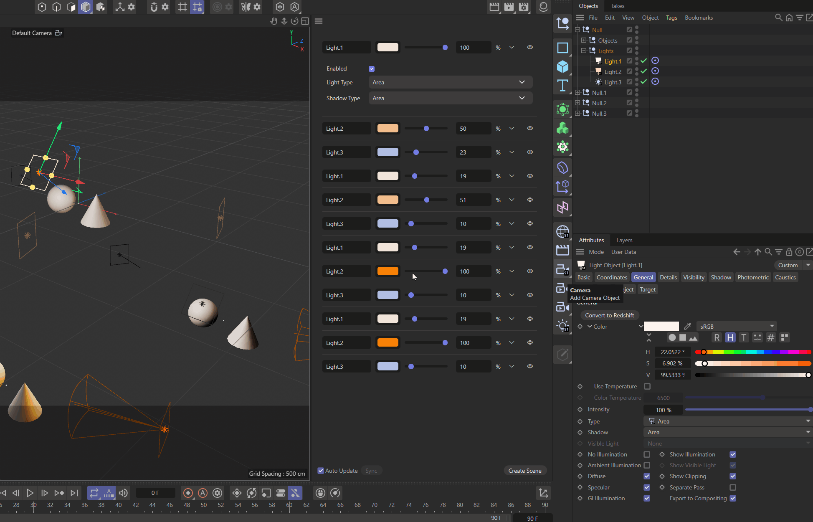

<!-- Source: https://developers.maxon.net/docs/py/2027_0_0/examples/plugins/py_cmd_gui_html/py_cmd_gui_html.pyp.html -->

Local source: [examples/plugins/py_cmd_gui_html/py_cmd_gui_html.pyp](../../../../examples/plugins/py_cmd_gui_html/py_cmd_gui_html.pyp)

# py_cmd_gui_html <a id="py-cmd-gui-html"></a>

Demonstrates how to implement a dialog that hosts an HTML viewer and can send and receive data to/from the displayed web page.



## DETAILS

The example implements a simple light manager that tracks all standard renderer light objects in the scene and displays their data in a web page. Data updates work bidirectionally, i.e., when the user changes data in the web page, the scene is updated accordingly, and when the user changes data in the scene, the web page is updated accordingly (without fully being reloaded). The example also shows how to dynamically style the web page based on the current Cinema 4D look and feel, such as font size, font family, and color scheme.

See #HtmlGuiDialog.OnPostMessage() for how to receive data from the web page and update the scene, and see #HtmlGuiDialog.UpdateTrackedData() for how to gather scene data and send it to the web page. You must also read the HTML file `res/html/light_list.html` to understand this example.

# Data Model

You can change this to your liking; this is not set in stone. But I would recommend using an expressive 'identifying key' such as 'mxnCustomEvent', as the 'message' event is shared with other providers on the JS side. All data is serialized to JSON strings for transport and deserialized on the other side.

## Outgoing

```
    {
        "mxnCustomEvent": "sendLightData",
        "sceneState": {
            "sceneHash": "<hash of the scene>",
            "objects": [
                {
                    "name": "<name of the object>",
                    "objectHash": "<hash of the object>",
                    "position": [x, y, z],
                    "color": "#RRGGBB",
                    "brightness": <float>,
                    "lightType": <int>,
                    "shadowType": <int>,
                    "isEnabled": <bool>
                },
                ...
            ]
        }
    }
```

## Incoming

```
    {
        "mxnCustomEvent": "receiveLightData",
        "objectHash": "<hash of the object>",
        "field": "<name of the field that was changed>",
        "value": "<new value of the field>"
    }
```

To run this example, place the file in the Cinema 4D plugins folder and restart Cinema 4D.

Topics:

- Hosting an HTML viewer in a Cinema 4D dialog
- Exchanging data between HTML and Python
- Synchronizing scene lights with a web interface

## Files <a id="files"></a>

### `py_cmd_gui_html.pyp` <a id="py-cmd-gui-html-pyp"></a>

````python
"""Demonstrates how to implement a dialog that hosts an HTML viewer and can send and receive data to/from the displayed web page.

The example implements a simple light manager that tracks all standard renderer light objects in the
scene and displays their data in a web page. Data updates work bidirectionally, i.e., when the user
changes data in the web page, the scene is updated accordingly, and when the user changes data in
the scene, the web page is updated accordingly (without fully being reloaded). The example also shows
how to dynamically style the web page based on the current Cinema 4D look and feel, such as font
size, font family, and color scheme.

See #HtmlGuiDialog.OnPostMessage() for how to receive data from the web page and update the scene,
and see #HtmlGuiDialog.UpdateTrackedData() for how to gather scene data and send it to the web page.
You must also read the HTML file `res/html/light_list.html` to understand this example.

# Data Model

You can change this to your liking; this is not set in stone. But I would recommend using an
expressive 'identifying key' such as 'mxnCustomEvent', as the 'message' event is shared with other
providers on the JS side. All data is serialized to JSON strings for transport and deserialized on
the other side.

## Outgoing

```json
    {
        "mxnCustomEvent": "sendLightData",
        "sceneState": {
            "sceneHash": "<hash of the scene>",
            "objects": [
                {
                    "name": "<name of the object>",
                    "objectHash": "<hash of the object>",
                    "position": [x, y, z],
                    "color": "#RRGGBB",
                    "brightness": <float>,
                    "lightType": <int>,
                    "shadowType": <int>,
                    "isEnabled": <bool>
                },
                ...
            ]
        }
    }
```

## Incoming

```json
    {
        "mxnCustomEvent": "receiveLightData",
        "objectHash": "<hash of the object>",
        "field": "<name of the field that was changed>",
        "value": "<new value of the field>"
    }
```

To run this example, place the file in the Cinema 4D plugins folder and restart Cinema 4D.

Topics:
    - Hosting an HTML viewer in a Cinema 4D dialog
    - Exchanging data between HTML and Python
    - Synchronizing scene lights with a web interface
"""
__copyright__ = "Copyright 2026, MAXON Computer"
__author__ = "Ferdinand Hoppe"
__date__ = "29/06/2026"
__license__ = "Apache-2.0 license"
__version__ = "2027.0.0"

import os
import json
import typing

import c4d
import maxon
import mxutils

class HtmlGuiDialog(c4d.gui.GeDialog):
    """Implements a dialog that hosts an HTML viewer and can send and receive data to/from the web
    page displayed in the HTML viewer.
    """
    # The IDs for the gadgets in our dialog.
    ID_HTML_VIEWER: int = 1000
    ID_GRP_OPTIONS: int = 1001
    ID_CHK_AUTO_UPDATE: int = 1002
    ID_BTN_SYNC: int = 1003
    ID_BTN_CREATE_SCENE: int = 1004

    # The IDs for the font family and font size in a font container.
    ID_FONT_FAMILY: int = 500
    ID_FONT_SIZE: int = 501

    # The types of objects we want to track in the scene. In this case, we only track light objects,
    # as this example is meant to implement one of the light manager-type plugins.
    TRACKED_OBJECT_TYPES: tuple[int, ...] = (c4d.Olight, )

    def __init__(self) -> None:
        """Initializes the dialog.
        """
        self._htmlGui: c4d.gui.HtmlViewerCustomGui | None = None
        self._sceneState: dict = {}
        self._hashCache: SceneElementHashCache | None = None
        self._autoUpdate: bool = True

    # --- GeDialog Overrides -----------------------------------------------------------------------

    def CreateLayout(self) -> bool:
        """Called by Cinema 4D when the GUI of the dialog is being built.
        """
        # Set up the title and layout of the dialog.
        self.SetTitle("Py - HTML Gui")
        self.GroupBorderSpace(5, 5, 5, 5)
        self.GroupSpace(5, 5)

        # Attach the HTML viewer custom GUI to the dialog.
        self._htmlGui: c4d.gui.HtmlViewerCustomGui = self.AddCustomGui(
            self.ID_HTML_VIEWER, c4d.CUSTOMGUI_HTMLVIEWER, "",
            c4d.BFH_SCALEFIT | c4d.BFV_SCALEFIT, 0, 0)
        if not isinstance(self._htmlGui, c4d.gui.HtmlViewerCustomGui):
            raise RuntimeError("Failed to create HTML viewer custom GUI.")

        # Create the options group with a checkbox and two buttons.
        self.GroupBegin(self.ID_GRP_OPTIONS, c4d.BFH_SCALEFIT, 4)
        self.GroupBorderSpace(5, 5, 5, 5)
        self.GroupSpace(5, 5)
        self.AddCheckbox(self.ID_CHK_AUTO_UPDATE, c4d.BFH_LEFT, 0, 0, name="Auto Update")
        self.AddButton(self.ID_BTN_SYNC, c4d.BFH_LEFT, name="Sync")
        self.AddStaticText(0, c4d.BFH_SCALEFIT, 0, 0, name="")  # dummy for spacing
        self.AddButton(self.ID_BTN_CREATE_SCENE, c4d.BFH_RIGHT, name="Create Scene")
        self.GroupEnd()

        return True

    def InitValues(self) -> bool:
        """Called by Cinema 4D to initialize the dialog's values.
        """
        # Find the HTML file to display.
        htmlFile: str = os.path.join(os.path.dirname(__file__), "res", "html", "light_list.html")
        if not os.path.isfile(htmlFile):
            raise RuntimeError(f"HTML file not found: {htmlFile}")

        # Patch the file to match the current Cinema 4D look and feel, load it into the HTML viewer
        # custom GUI, and attach the post message callback.
        patchedFile: str = self.PatchHtmlFile(htmlFile).replace("\\", "/")
        self._htmlGui.SetUrl(patchedFile, c4d.URL_ENCODING_ESCAPED)
        self._htmlGui.SetWebMessageCallback(self.OnPostMessage, "")

        # Enable auto update and disable the sync button.
        self.SetBool(self.ID_CHK_AUTO_UPDATE, self._autoUpdate)
        self.Enable(self.ID_BTN_SYNC, not self._autoUpdate)

        # Update the tracked scene data and force send it to the web page. But since the web browser
        # can take some time to initialize, sending a message here might get lost in the void. So,
        # we start a 500ms timer, and then send the message in Timer() and stop the timer again.
        self.SetTimer(500)

        return super().InitValues()

    def Timer(self, msg: c4d.BaseContainer) -> None:
        """Called by Cinema 4D when a timer event occurs.

        We use this to send the initial scene data to the web page after a short delay, as the web
        browser can take some time to initialize and might not be ready to receive messages yet.
        """
        self.UpdateTrackedData(sendMessage=True, forceUpdate=True)
        self.SetTimer(0)  # Stop the timer.

    def OnPostMessage(self, message: str, error: bool) -> None:
        """Called when a web message is received from the HTML viewer.

        This is how we receive data from the web page and update the scene accordingly. The message
        is expected to be a JSON string with the following format:

        {
            "mxnCustomEvent": "receiveLightData",
            "objectHash": "<hash of the object>",
            "field": "<name of the field that was changed>",
            "value": "<new value of the field>"
        }

        This is a very simple exchange model and could be extended to support more complex data
        structures and events.

        Args:
            message (str): The JSON string received from the web page.
            error (bool): Whether there was an error in receiving the message.
        """
        if error:
            return

        try:
            data: dict = json.loads(message)
        except json.JSONDecodeError as e:
            return

        # Unpack the data.
        event: str | None = data.get("mxnCustomEvent")
        objHash: str | None = data.get("objectHash")
        field: str | None = data.get("field")
        value: any = data.get("value")

        if None in (event, objHash, field):
            return

        # Find the node that is being targeted by the data using the hash cache. The cache is
        # lazily initialized here and reused for subsequent calls. If the cache becomes stale
        # (e.g., after a scene change), it is rebuilt in GetSceneData() on the next update.
        if self._hashCache is None:
            self._hashCache = SceneElementHashCache(c4d.documents.GetActiveDocument())

        obj: c4d.BaseObject | None = self._hashCache[objHash]
        doc: c4d.documents.BaseDocument = obj.GetDocument() if obj else None
        if not obj:
            raise RuntimeError(f"Failed to find object with hash {objHash} in the scene.")

        if event == "receiveLightData" and c4d.threading.GeIsMainThread():
            if field == "name" and isinstance(value, str):
                obj.SetName(value)
                c4d.EventAdd()
            elif field == "position" and isinstance(value, list) and len(value) == 3:
                obj.SetMg(c4d.Matrix(off=c4d.Vector(*value)))
                c4d.EventAdd()
            elif field == "color" and isinstance(value, str):
                obj[c4d.LIGHT_COLOR] = self.HexToColor(value)
                c4d.EventAdd()
            elif field == "brightness" and isinstance(value, (int, float)):
                obj[c4d.LIGHT_BRIGHTNESS] = float(value)
                c4d.EventAdd()
            elif field == "lightType" and isinstance(value, int):
                obj[c4d.LIGHT_TYPE] = value
                c4d.EventAdd()
            elif field == "shadowType" and isinstance(value, int):
                obj[c4d.LIGHT_SHADOWTYPE] = value
                c4d.EventAdd()
            elif field == "isEnabled" and isinstance(value, (int, bool)):
                obj[c4d.ID_BASEOBJECT_GENERATOR_FLAG] = bool(value)
                c4d.EventAdd()
            elif field == "makeVisible" and isinstance(value, (int, bool)):
                # Fold and deselect all objects ...
                for node in mxutils.IterateTree(doc.GetFirstObject(), True):
                    node.ChangeNBit(c4d.NBIT_OM1_FOLD, c4d.NBITCONTROL_CLEAR)
                    node.DelBit(c4d.BIT_ACTIVE)

                # ... and then only unfold the parents of the object that is being made visible ...
                parent: c4d.BaseObject | None = obj.GetUp()
                while parent:
                    parent.ChangeNBit(c4d.NBIT_OM1_FOLD, c4d.NBITCONTROL_SET)
                    parent = parent.GetUp()

                # ... and finally select the object that is being made visible.
                obj.SetBit(c4d.BIT_ACTIVE)

                c4d.EventAdd()

    def Command(self, mid: int, data: c4d.BaseContainer) -> bool:
        """Called by Cinema 4D when the user clicks a gadget in the dialog.

        This is how we send data to the web page.
        """
        # The user clicked the "Create Scene" button; we will create dummy scene data.
        if mid == self.ID_BTN_CREATE_SCENE:
            self.CreateDummyScene()
        # The user clicked the "Sync" button to manually sync the scene data to the web page.
        elif mid == self.ID_BTN_SYNC:
            self.UpdateTrackedData(sendMessage=True)
            c4d.EventAdd()
        # The user toggled the "Auto Update" checkbox; we will enable/disable the "Sync" button.
        elif mid == self.ID_CHK_AUTO_UPDATE:
            self._autoUpdate = self.GetBool(self.ID_CHK_AUTO_UPDATE)
            self.Enable(self.ID_BTN_SYNC, not self._autoUpdate)
            self.UpdateTrackedData(sendMessage=True)
        return True

    def CoreMessage(self, id: int, msg: c4d.BaseContainer) -> bool:
        """Called by Cinema 4D when a core message is sent to the dialog.
        """
        if id == c4d.EVMSG_CHANGE and self._autoUpdate:
            self.UpdateTrackedData(sendMessage=True)

        return super().CoreMessage(id, msg)

    # --- Custom Methods ---------------------------------------------------------------------------

    def UpdateTrackedData(self, sendMessage: bool = True, forceUpdate: bool = False) -> None:
        """Updates the tracked scene data and optionally sends it to the web page.
        """
        # Gather the current scene state and, if it changed, ...
        newState: dict = self.GetSceneData(c4d.documents.GetActiveDocument())
        if newState != self._sceneState or forceUpdate:
            self._sceneState = newState

            # ... build a message and ...
            if sendMessage:
                msg: str = json.dumps({
                    "mxnCustomEvent": "sendLightData",
                    "sceneState": self._sceneState
                })
                # ... send it to the web page.
                self._htmlGui.PostWebMessage(msg)

    def GetSceneData(self, doc: c4d.documents.BaseDocument) -> dict:
        """Gathers all scene light data and returns it as a dictionary.
        """
        if not doc:
            return {}

        # Build a hash cache for the scene elements to avoid iterating the scene tree over and over
        # again when there was no change in the scene.
        self._hashCache = SceneElementHashCache(doc)

        # Warning: It is absolutely necessary to convert the node hashes to strings, as Cinema 4D
        # generates them as Int64 values. While we can pack these values into JSON strings, JS
        # uses double precision floats for all numbers, even integers. And IEEE 754 double precision
        # floats can only represent integers up to 2^53-1, which is 9007199254740991. So, there is a
        # good chance that decoding these hashes in JS will result in a loss of precision and thus
        # errors, as scene element hashes will often lie at the end of the signed
        # 64-bit integer range.
        return {
            # The hash of the document is a unique identifier for this being the 'same' scene. It will
            # never change, even over reload and reallocation boundaries.
            "sceneHash": str(hash(doc)),
            "objects": [
                {
                    # The name of the object as seen in the object manager.
                    "name": node.GetName(),
                    # Same as for the document, the hash of the object is a unique identifier for
                    # this being the 'same' object. It will also never change.
                    "objectHash": str(hash(node)),
                    # The global position of the object in the scene.
                    "position": HtmlGuiDialog.VectorToTuple(node.GetMg().off),
                    # The light data.
                    "color": HtmlGuiDialog.ColorToHex(node[c4d.LIGHT_COLOR]),
                    "brightness": node[c4d.LIGHT_BRIGHTNESS],
                    "lightType": node[c4d.LIGHT_TYPE],
                    "shadowType": node[c4d.LIGHT_SHADOWTYPE],
                    "isEnabled": node[c4d.ID_BASEOBJECT_GENERATOR_FLAG],
                }

                # We iterate over all objects in the scene and only pick those that match our
                # filter #TRACKED_OBJECT_TYPES, i.e., only standard renderer light objects.
                for h, node in self._hashCache._table.items()
                if node.GetType() in HtmlGuiDialog.TRACKED_OBJECT_TYPES
            ]
        }

    @staticmethod
    def SetSceneData(doc: c4d.documents.BaseDocument, data: dict) -> None:
        """Applies a field-level change received from the web page to the matching scene object.

        This is a batch-style counterpart to OnPostMessage() and can be used when a full object
        payload (rather than a single changed field) is received. In a real plugin you would
        probably extend this to cover all editable fields.

        Note:

            This function is not thread-safe when the passed-in document is an active/loaded
            document, as we modify the document. The caller is responsible for ensuring this
            is only invoked from the main thread in such cases.

        """
        # The incoming data is malformed.
        if not doc or str(hash(doc)) != data.get("sceneHash"):
            return

        objHash: str | None = data.get("objectHash")
        if not isinstance(objHash, str):
            return

        # Find the object in the scene that matches the incoming object hash.
        obj: c4d.BaseObject | None = next(
            (node for node in mxutils.IterateTree(doc.GetFirstObject(), True)
             if str(hash(node)) == objHash), None)
        if not obj:
            return

        # Write the received data back to the object.
        name: str | None = data.get("name")
        if isinstance(name, str):
            obj.SetName(name)

        position: list | None = data.get("position")
        if (isinstance(position, list) and len(position) == 3 and
                all(isinstance(coord, (int, float)) for coord in position)):
            obj.SetMg(c4d.Matrix(off=c4d.Vector(*position)))

        color: str | None = data.get("color")
        if isinstance(color, str):
            obj[c4d.LIGHT_COLOR] = HtmlGuiDialog.HexToColor(color)

        brightness: float | None = data.get("brightness")
        if isinstance(brightness, (int, float)):
            obj[c4d.LIGHT_BRIGHTNESS] = float(brightness)

        lightType: int | None = data.get("lightType")
        if isinstance(lightType, int):
            obj[c4d.LIGHT_TYPE] = lightType

        shadowType: int | None = data.get("shadowType")
        if isinstance(shadowType, int):
            obj[c4d.LIGHT_SHADOWTYPE] = shadowType

        isEnabled: bool | None = data.get("isEnabled")
        if isinstance(isEnabled, bool):
            obj[c4d.ID_BASEOBJECT_VISIBILITY_RENDER] = isEnabled

    @staticmethod
    def CreateDummyScene() -> None:
        """Creates a dummy scene with some geometry and lights to demonstrate the plugin.
        """
        # Since we modify the active document, we must ensure that we are on the main thread.
        if not c4d.threading.GeIsMainThread():
            return

        doc: c4d.documents.BaseDocument = c4d.documents.GetActiveDocument()

        # Make sure that the render engine matches the standard render engine, as that is what we
        # are creating light objects for.
        renderData: c4d.documents.RenderData = mxutils.CheckType(doc.GetActiveRenderData())
        renderData[c4d.RDATA_RENDERENGINE] = c4d.RDATA_RENDERENGINE_STANDARD

        # Create the geometry and lights.
        scene: c4d.BaseObject = mxutils.CheckType(c4d.BaseObject(c4d.Onull))
        objects: c4d.BaseObject = mxutils.CheckType(c4d.BaseObject(c4d.Onull))
        cone: c4d.BaseObject = mxutils.CheckType(c4d.BaseObject(c4d.Ocone))
        sphere: c4d.BaseObject = mxutils.CheckType(c4d.BaseObject(c4d.Osphere))

        lights: c4d.BaseObject = mxutils.CheckType(c4d.BaseObject(c4d.Onull))
        light1: c4d.BaseObject = mxutils.CheckType(c4d.BaseObject(c4d.Olight))
        light2: c4d.BaseObject = mxutils.CheckType(c4d.BaseObject(c4d.Olight))
        light3: c4d.BaseObject = mxutils.CheckType(c4d.BaseObject(c4d.Olight))

        # Create phong tags on the geometry and target tags on the lights.
        phongTag1: c4d.BaseTag = mxutils.CheckType(cone.MakeTag(c4d.Tphong))
        phongTag2: c4d.BaseTag = mxutils.CheckType(sphere.MakeTag(c4d.Tphong))
        targetTag1: c4d.BaseTag = mxutils.CheckType(light1.MakeTag(c4d.Ttargetexpression))
        targetTag2: c4d.BaseTag = mxutils.CheckType(light2.MakeTag(c4d.Ttargetexpression))
        targetTag3: c4d.BaseTag = mxutils.CheckType(light3.MakeTag(c4d.Ttargetexpression))

        # Now build the hierarchy.
        objects.InsertUnderLast(scene)
        lights.InsertUnderLast(scene)
        cone.InsertUnderLast(objects)
        sphere.InsertUnderLast(objects)
        light1.InsertUnderLast(lights)
        light2.InsertUnderLast(lights)
        light3.InsertUnderLast(lights)

        # Set names and positions of the objects and lights.
        objects.SetName("Objects")
        lights.SetName("Lights")
        light1.SetName("Light.1")
        light2.SetName("Light.2")
        light3.SetName("Light.3")

        cone.SetMg(c4d.Matrix(off=c4d.Vector(150, 0, 0)))
        sphere.SetMg(c4d.Matrix(off=c4d.Vector(-150, 0, 0)))
        light1.SetMg(c4d.Matrix(off=c4d.Vector(0, 300, -400)))
        light2.SetMg(c4d.Matrix(off=c4d.Vector(900, 50, 250)))
        light3.SetMg(c4d.Matrix(off=c4d.Vector(-1500, -300, 1000)))

        # Define the light data.
        light1[c4d.LIGHT_COLOR] = c4d.Vector(0.95, 0.90, 0.85)
        light1[c4d.LIGHT_BRIGHTNESS] = 1.0
        light1[c4d.LIGHT_TYPE] = c4d.LIGHT_TYPE_AREA
        light1[c4d.LIGHT_SHADOWTYPE] = c4d.LIGHT_SHADOWTYPE_AREA

        light2[c4d.LIGHT_COLOR] = c4d.Vector(0.95, 0.75, 0.55)
        light2[c4d.LIGHT_BRIGHTNESS] = 0.5
        light2[c4d.LIGHT_TYPE] = c4d.LIGHT_TYPE_AREA
        light2[c4d.LIGHT_SHADOWTYPE] = c4d.LIGHT_SHADOWTYPE_AREA

        light3[c4d.LIGHT_COLOR] = c4d.Vector(0.70, 0.75, 0.90)
        light3[c4d.LIGHT_BRIGHTNESS] = 0.1
        light3[c4d.LIGHT_TYPE] = c4d.LIGHT_TYPE_PARALLEL
        light3[c4d.LIGHT_SHADOWTYPE] = c4d.LIGHT_SHADOWTYPE_AREA

        # Set the target expression of each light to the 'Objects' null and enable
        # the angle limit on the phong tags.
        targetTag1[c4d.TARGETEXPRESSIONTAG_LINK] = objects
        targetTag2[c4d.TARGETEXPRESSIONTAG_LINK] = objects
        targetTag3[c4d.TARGETEXPRESSIONTAG_LINK] = objects
        phongTag1[c4d.PHONGTAG_PHONG_ANGLELIMIT] = True
        phongTag2[c4d.PHONGTAG_PHONG_ANGLELIMIT] = True

        # Unfold the null objects.
        scene.ChangeNBit(c4d.NBIT_OM1_FOLD, c4d.NBITCONTROL_SET)
        objects.ChangeNBit(c4d.NBIT_OM1_FOLD, c4d.NBITCONTROL_SET)
        lights.ChangeNBit(c4d.NBIT_OM1_FOLD, c4d.NBITCONTROL_SET)

        # And finally insert everything into the document, wrapped in an undo group.
        doc.StartUndo()
        doc.InsertObject(scene)
        doc.AddUndo(c4d.UNDOTYPE_NEW, scene)
        doc.EndUndo()

        c4d.EventAdd()

    @staticmethod
    def PatchHtmlFile(filePath: str) -> str:
        """Patches the given HTML file to a look and feel that is closer to the native UI of
        Cinema 4D.

        It is desirable that web page-based GUIs look and feel like the native UI of Cinema 4D. Most
        of the work is done in the HTML/CSS files of the displayed web pages, but some things such as
        font sizes and font types (and in an ideal case even the color scheme) must be evaluated and
        patched at runtime, as the user might have changed them. To make this nicer we could use a
        full-blown templating engine such as Jinja2, but for this example we will just patch the
        HTML file directly.

        Args:
            filePath (str): The path to the HTML file to patch.

        Returns:
            str: The file path of the patched HTML file.
        """
        def patch(content: str, **context) -> str:
            """Replaces placeholders in the content with the given context values.

            Placeholders are in the format {{ key }} and are replaced with the corresponding value
            from the context.
            """
            for key, value in context.items():
                content = content.replace(f"{{{{ {key} }}}}", str(value))

            return content

        # Read the file to patch.
        if not os.path.isfile(filePath):
            raise RuntimeError(f"HTML file not found: {filePath}")

        with open(filePath, "r", encoding="utf-8") as f:
            htmlContent: str = f.read()

        if not htmlContent:
            raise RuntimeError(f"HTML file is empty: {filePath}")

        # Gather Cinema 4D look and feel data.
        baseFont: c4d.BaseContainer | None = c4d.bitmaps.GeClipMap.GetDefaultFont(
            c4d.GE_FONT_DEFAULT_SYSTEM)
        if baseFont:
            fontSize: int = f"{abs(baseFont.GetInt32(HtmlGuiDialog.ID_FONT_SIZE, 11))}px"
            fontFamily: str = (f"{baseFont.GetString(HtmlGuiDialog.ID_FONT_FAMILY, 'Arial')}, "
                               f"Roboto, Arial, sans-serif")
        else:
            fontSize: str = "11 px"
            fontFamily: str = "Roboto, Arial, sans-serif"

        # BG_FOCUS is too dark and not the primary color. COLOR_TEXT_AUTOTAKE is that color.
        bgControl: str = HtmlGuiDialog.ColorToHex(c4d.gui.GetGuiWorldColor(c4d.COLOR_BG))
        bgEdit: str = HtmlGuiDialog.ColorToHex(c4d.gui.GetGuiWorldColor(c4d.COLOR_BGEDIT))
        bgFocus: str = HtmlGuiDialog.ColorToHex(c4d.gui.GetGuiWorldColor(c4d.COLOR_TEXT_AUTOTAKE))
        bgButton: str = HtmlGuiDialog.ColorToHex(c4d.gui.GetGuiWorldColor(c4d.COLOR_BG_BUTTON))
        bgButtonHighlight: str = HtmlGuiDialog.ColorToHex(
            c4d.gui.GetGuiWorldColor(c4d.COLOR_BG_BUTTON_HIGHLIGHTED))
        bgButtonDisabled: str = HtmlGuiDialog.ColorToHex(
            c4d.gui.GetGuiWorldColor(c4d.COLOR_BG_BUTTON_DISABLED))
        fgText: str = HtmlGuiDialog.ColorToHex(c4d.gui.GetGuiWorldColor(c4d.COLOR_TEXT_EDIT))

        htmlContent: str = patch(htmlContent, fontSize=fontSize, fontFamily=fontFamily,
                                 bgControl=bgControl, bgEdit=bgEdit, bgFocus=bgFocus,
                                 bgButton=bgButton, bgButtonHighlight=bgButtonHighlight,
                                 bgButtonDisabled=bgButtonDisabled, fgText=fgText)

        # Write the patched file to a cache/temp location. We could theoretically place the patched
        # file in the plugin directory, but we could run into permission issues on some systems, so
        # it is better to place it in the user prefs directory.
        fileName: str = os.path.basename(filePath)
        prefsDir: str = maxon.Application.GetUrl(
            maxon.APPLICATION_URLTYPE.PREFS_DIR).GetSystemPath()
        patchedFile: str = os.path.join(prefsDir, "cmd_gui_html", "cache", fileName)
        os.makedirs(os.path.dirname(patchedFile), exist_ok=True)

        with open(patchedFile, "w", encoding="utf-8") as f:
            f.write(htmlContent)

        return patchedFile

    @staticmethod
    def ColorToHex(color: c4d.Vector) -> str:
        """Converts a Cinema 4D vector to a hex color string."""
        return f"#{int(color.x * 255):02x}{int(color.y * 255):02x}{int(color.z * 255):02x}"

    @staticmethod
    def HexToColor(hexColor: str) -> c4d.Vector:
        """Converts a hex color string to a Cinema 4D vector."""
        hexColor = hexColor.lstrip("#")
        return c4d.Vector(int(hexColor[0:2], 16) / 255.0,
                          int(hexColor[2:4], 16) / 255.0,
                          int(hexColor[4:6], 16) / 255.0)

    @staticmethod
    def VectorToTuple(vector: c4d.Vector) -> tuple[float, float, float]:
        """Converts a Cinema 4D vector to a tuple."""
        return (vector.x, vector.y, vector.z)

    @staticmethod
    def TupleToVector(tup: tuple[float, float, float]) -> c4d.Vector:
        """Converts a tuple to a Cinema 4D vector."""
        return c4d.Vector(tup[0], tup[1], tup[2])

class SceneElementHashCache:
    """Caches hash-to-scene-element relationships to avoid iterating the scene tree over and over
    again.

    This example only caches objects, but could be easily extended to cache other scene elements such
    as materials, tags, etc. by using #mxutils.RecurseGraph instead of #mxutils.IterateTree.
    """

    def __init__(self, doc: c4d.documents.BaseDocument) -> None:
        """Initializes the cache with the given document.

        Args:
            doc (c4d.documents.BaseDocument): The document to cache.
        """
        self._docHash: str = str(hash(doc))
        self._doc: c4d.documents.BaseDocument = doc
        self._table: dict[str, c4d.BaseObject] = {}

        # Populate the cache with the current scene elements.
        for node in mxutils.IterateTree(doc.GetFirstObject(), True):
            self._table[str(hash(node))] = node

    def __getitem__(self, key: str) -> c4d.BaseObject | None:
        """Returns the scene element for the given hash.
        """
        # Attempt to return a still-valid reference to the scene element.
        node: c4d.BaseObject | None = self._table.get(key)
        if node is None or node.IsAlive():
            return node

        # Make sure we still have a valid document reference.
        if not self._doc or not self._doc.IsAlive():
            temp: c4d.documents.BaseDocument = c4d.documents.GetFirstDocument()
            while temp:
                if str(hash(temp)) == self._docHash:
                    self._doc = temp
                    break
                temp = temp.GetNext()

            if not self._doc or not self._doc.IsAlive():
                raise RuntimeError("Document is no longer valid.")

        # Attempt to find the scene element again in the scene tree.
        node = next(
            (n for n in mxutils.IterateTree(self._doc.GetFirstObject(), True) if str(hash(n)) == key),
            None
        )
        if node is None:
            raise RuntimeError("Scene element is no longer valid.")

        self._table[key] = node
        return node

class HtmlGuiCommand (c4d.plugins.CommandData):
    """Realizes the common implementation for a command that opens a foldable dialog.

    It effectively realizes the button to be found in menus, palettes, and the command manager
    that opens our dialog. Technically, this is the concrete plugin we implement, but it only
    plays a secondary role here — all the logic is implemented in the dialog.
    """
    # The dialog hosted by the plugin.
    REF_DIALOG: HtmlGuiDialog | None = None

    @property
    def Dialog(self) -> HtmlGuiDialog:
        """Returns the class-bound dialog instance.
        """
        if self.REF_DIALOG is None:
            self.REF_DIALOG = HtmlGuiDialog()

        return self.REF_DIALOG

    def Execute(self, doc: c4d.documents.BaseDocument) -> bool:
        """Folds or unfolds the dialog.
        """
        # Fold the dialog, i.e., hide it if it is open and unfolded.
        if self.Dialog.IsOpen() and not self.Dialog.GetFolding():
            self.Dialog.SetFolding(True)
        # Open or unfold the dialog. When we open the dialog, we do it asynchronously, i.e., the
        # user can unfocus the dialog and continue working in Cinema 4D, while the dialog is open.
        # The alternative would be to open a modal dialog, which would force the user to focus the
        # dialog until it is closed. A modal dialog can be useful but cannot be
        # docked in the layout.
        else:
            self.Dialog.Open(c4d.DLG_TYPE_ASYNC, self.ID_PLUGIN, defaultw=400, defaulth=300)

        return True

    def RestoreLayout(self, secret: any) -> bool:
        """Restores the dialog on layout changes.

        Implementing this is absolutely necessary, as otherwise the dialog will not be
        restored when the user changes the layout of Cinema 4D.
        """
        return self.Dialog.Restore(self.ID_PLUGIN, secret)

    def GetState(self, doc: c4d.documents.BaseDocument) -> int:
        """Returns the command icon state of the plugin.

        With this you can tint the command icon blue when the dialog is open or grey it out when
        some condition is not met (not done here). You could for example disable the plugin when
        there is nothing selected in a scene, when document is not in polygon editing mode, etc.
        """
        # The icon is never greyed out, the button can always be clicked.
        result: int = c4d.CMD_ENABLED

        # Tint the icon blue when the dialog is already open.
        if self.Dialog.IsOpen() and not self.Dialog.GetFolding():
            result |= c4d.CMD_VALUE

        return result

    # The unique ID of the plugin; it must be obtained from developers.maxon.net.
    ID_PLUGIN: int = 1069107

    # The name and help text of the plugin.
    STR_NAME: str = "Py SDK - Html Gui"
    STR_HELP: str = "Opens a dialog that renders a web page that is linked to the current scene state."

    @classmethod
    def Register(cls: typing.Type, iconId: int) -> None:
        """Registers the command plugin.

        This is a custom method and not part of the CommandData interface.
        """
        # Load one of the built-in icons of Cinema 4D as the icon of the plugin. You can browse
        # the built-in icons under:
        #
        #   https://developers.maxon.net/docs/py/2023_2/modules/c4d.bitmaps/RESOURCEIMAGE.html
        #
        # You could also load your own icon file here.
        bitmap: c4d.bitmaps.BaseBitmap = c4d.bitmaps.InitResourceBitmap(iconId)

        # The instance of the command that will be registered and live throughout the entire
        # Cinema 4D session. Commands are effectively singletons (although not formally
        # implemented as such).
        command: object = cls()

        # Register the command. A registration can fail, for example when the ID is already taken.
        # But if this happens, Cinema 4D will print an error message to the console on its own. When
        # we register multiple plugins, it can make sense to stop registering plugins when one of
        # them fails. But we do not need this here, so we just ignore the return value of the
        # Registers the command plugin. PLUGINFLAG_HIDEPLUGINMENU hides the natural menu entry of this
        # plugin. Omit this flag or replace it by 0 when you do not have custom menu handling as the 
        # SDK has (see py_menu).
        c4d.plugins.RegisterCommandPlugin(
            id=cls.ID_PLUGIN, str=cls.STR_NAME, info=c4d.PLUGINFLAG_HIDEPLUGINMENU, icon=bitmap,
            help=cls.STR_HELP, dat=command)

# Called by Cinema 4D when this plugin module is loaded.
if __name__ == '__main__':
    HtmlGuiCommand.Register(iconId=465001193)
````

[Example on GitHub](https://github.com/Maxon-Computer/Cinema-4D-Python-API-Examples/tree/master/examples/plugins/py_cmd_gui_html/py_cmd_gui_html.pyp)

### `res/html/light_list.html` <a id="res-html-light-list-html"></a>

```html
<!-- Realizes the HTML page that is displayed in the HtmlViewerCustomGui and used to control lights 
 in Cinema 4D. 
 
The page is styled to match the native UI of Cinema 4D and uses Bootstrap for layout and styling. 
The page displays a list of lights in the scene, allowing the user to view and edit their properties 
such as name, color, brightness, light type, shadow type, and enabled state. The page communicates 
with the host application (Cinema 4D) using post messages to send and receive data about the lights 
in the scene. -->

<!DOCTYPE html>

<!-- Apply the Bootstrap dark theme, add a minimal header, only including the charset and Bootstrap 
 CSS links. -->
<html lang="en" data-bs-theme="dark">
<head>
    <meta charset="UTF-8">
    <link rel="stylesheet" href="https://cdnjs.cloudflare.com/ajax/libs/bootstrap/5.3.8/css/bootstrap.min.css" 
        integrity="sha512-2bBQCjcnw658Lho4nlXJcc6WkV/UxpE/sAokbXPxQNGqmNdQrWqtw26Ns9kFF/yG792pKR1Sx8/Y1Lf1XN4GKA==" 
        crossorigin="anonymous" referrerpolicy="no-referrer" />
    <link rel="stylesheet" href="https://cdnjs.cloudflare.com/ajax/libs/bootstrap-icons/1.13.1/font/bootstrap-icons.min.css" 
        integrity="sha512-t7Few9xlddEmgd3oKZQahkNI4dS6l80+eGEzFQiqtyVYdvcSG2D3Iub77R20BdotfRPA9caaRkg1tyaJiPmO0g==" 
        crossorigin="anonymous" referrerpolicy="no-referrer" />
</head>

<!-- Style our page so that it is closer to the native UI of Cinema 4D.

When displaying an alien web page, we can use any styling we want. But when the HtmlViewerCustomGui 
is used to display a web based control to carry out actions in Cinema 4D, we must align its styling 
with the native UI of Cinema 4D. The match does not have to be perfect, but we should match the 
general colors, sizes, and font choices of the native UI. The styling and templating system shown 
below is a starting point for that. The values in double curly braces, e.g., {{ someVariable }}, 
are replaced by the dialog loading this file with values taken from the native UI at runtime.

When we write CSS for the HtmlViewerCustomGui, we must target WebKit browsers (in the rare cases
where we write browser specific CSS), e.g., Safari and Chrome. We can ignore all other browser 
specific CSS as the HtmlViewerCustomGui is based on WebView2 (Windows) and WebKit (macOS). -->
<style>
    body {
        --bs-body-font-size: {{ fontSize }};
        --bs-body-font-family: {{ fontFamily }};
        --bs-body-bg: {{ bgControl }};
        --bs-body-color: {{ fgText }};

        --bs-border-radius: 0.25rem;
    }

    /* scrollbar */
    html, body, .scroll-pane {
        overflow-y: auto;
        scrollbar-gutter: stable;
    }

    ::-webkit-scrollbar {
        width: 4px;
        height: 8px;
    }

    ::-webkit-scrollbar-track {
        background: {{ bgControl }};
    }

    ::-webkit-scrollbar-thumb {
        background: {{ bgButton }};
        border-radius: 4px;
    }

    /* form controls */
    .form-control {
        background-color: {{ bgEdit }};
        border-color: {{ bgEdit }};
        font-size: {{ fontSize }};
        padding: 0.2rem 0.4rem;
    }

    .form-control:focus,
    .form-control:focus-visible {
        background-color: {{ bgEdit }};
        border-color: {{ bgFocus }};
        box-shadow: none;
    }

    /* buttons */
    .btn {
        --bs-btn-padding-x: 0.5rem;
        --bs-btn-padding-y: 0.05rem;
        --bs-btn-bg: {{ bgButton }};
        --bs-btn-border-color: {{ bgButton }};
        --bs-btn-hover-bg: {{ bgButtonHighlight }};
        --bs-btn-hover-border-color: {{ bgButtonHighlight }};
        --bs-btn-active-bg: {{ bgButtonHighlight }};
        --bs-btn-active-border-color: {{ bgButtonHighlight }};
        --bs-btn-disabled-bg: {{ bgButtonDisabled }};
        --bs-btn-disabled-border-color: {{ bgButtonDisabled }};

        border-radius: 9999px;
        font-size: {{ fontSize }};
    }

    .btn-icon {
        background:none;
        border:none;
        color:inherit;
        margin:0;
    }

    .btn:focus-visible {
        background-color: {{ bgButtonHighlight }};
        border-color: {{ bgFocus }};
        box-shadow: none;
    }

    /* select */
    .form-select,
    .form-select:hover,
    .form-select:focus {
        background-color: {{ bgButton }};
        border-color: {{ bgButton }};
        padding: 0.2rem 0.4rem;
        border-radius: 0.375rem;
    }

    /* checkbox */
    .form-check-input:checked {
        background-color: {{ bgFocus }};
        border-color: {{ bgFocus }};
    }

    /* color picker */
    .form-control-color {
        padding: 0.2rem !important;
        height: 1.5rem;
        width: 3rem;
    }

    /* range slider */
    .form-range::-webkit-slider-runnable-track {
        height: 5px;
        background: {{ bgEdit }};
        border-radius: 999px;
    }

    .form-range::-webkit-slider-thumb {
        -webkit-appearance: none;
        width: 10px;
        height: 10px;
        margin-top: -2px;
        background: {{ bgFocus }};
        border-radius: 50%;
        box-shadow: none;
        cursor: pointer;
    }

    /* Custom classes */
    .object-container {
        align-items: center;
        display: grid;
        grid-template-columns: 75px 1fr;
        gap: 0.375rem;
        margin-bottom: 0.5rem;
        padding: 0.5rem;
    }

    .scene-object:not(:last-child) {
        border-bottom: 1px solid {{ bgButton }};
        padding-bottom: 0.4rem;
        margin-bottom: 0.4rem;
        
    }
    
    /* This comment only exists so that the VS Code syntax highlighter does not have an existential 
       crisis due to the invalid {{ }}  markup above. */
</style>

<!-- The content of the page is a list of scene lights. Each light row shows a header bar with the 
    light name, color, and brightness. The header can be expanded to reveal additional properties
    such as light type, shadow type, and enabled state. Changes made in the UI are sent to the host
    application (Cinema 4D) via post messages. The host also pushes updated scene data to this page
    whenever the scene changes. -->
<body>
    <div class="m-3">
        <input type="hidden" id="currentSceneHash" value="0">
        <div class="mb-1" id ="scene-container">
        </div>
    </div>
</body>

<!-- Now we have to define/include the JavaScript that will make this example work. -->

<!-- Include the Bootstrap JS bundle. Required for the collapse component used to expand/collapse
     the detail rows of each light entry. -->
<script src="https://cdnjs.cloudflare.com/ajax/libs/bootstrap/5.3.8/js/bootstrap.min.js" 
    integrity="sha512-nKXmKvJyiGQy343jatQlzDprflyB5c+tKCzGP3Uq67v+lmzfnZUi/ZT+fc6ITZfSC5HhaBKUIvr/nTLCV+7F+Q==" 
    crossorigin="anonymous" referrerpolicy="no-referrer"></script>

<!-- Define the script that drives the browser <-> Cinema 4D data exchange of this example, this could of course 
     also be a dedicated JS file -->
<script>

// Helper to escape HTML when interpolating values into the template
function escapeHtml(str) {
    if (str === null || str === undefined) return '';
    return String(str)
        .replace(/&/g, '&amp;')
        .replace(/</g, '&lt;')
        .replace(/>/g, '&gt;')
        .replace(/"/g, '&quot;')
        .replace(/'/g, '&#39;');
}

/** Returns an HTML string for a scene item. Use interpolation via the named fields.
 */
const ITEM_HTML = ({ objectHash = 0, name = '', position = [ '', '', '' ], color = '#ffffff', brightness = 0, 
                    lightType = 0, shadowType = 0, isEnabled = 0 } = {}) => `
<div class="scene-object" id="${escapeHtml(objectHash)}">
    <!-- Header bar: name, color, brightness slider, unlabeled controls, chevron -->
    <div class="d-flex align-items-center gap-2 w-100">
        <input type="text" class="form-control item-name" value="${escapeHtml(name)}" placeholder="Name" 
            style="max-width:10rem;">
        <input type="color" class="form-control form-control-color item-color" value="${escapeHtml(color)}" 
            style="min-width:3rem;">
        <input type="range" min="0" max="1" step="0.01" class="form-range item-brightness-range" 
            value="${escapeHtml(brightness)}">
        <input type="number" min="0" max="100" class="form-control brightness-percent ms-2" 
            value="${Math.round((brightness || 0) * 100)}" step="1" style="width:5rem">
        <span>%</span>
        <button class="toggle-collapse btn btn-icon" aria-expanded="false" 
            aria-controls="collapse-${escapeHtml(objectHash)}" data-bs-toggle="collapse" 
            data-bs-target="#collapse-${escapeHtml(objectHash)}">
            <i class="bi bi-chevron-down"></i>
        </button>
        <button class="btn btn-icon btn-visibility" title="Show this light" 
            style="width:2rem;height:2rem;">
            <i class="bi bi-eye"></i>
        </button>
    </div>

    <!-- Collapsible details -->
    <div class="collapse mt-2 w-100" id="collapse-${escapeHtml(objectHash)}">
        <div class="object-container">
            <div class="label">Enabled</div>
            <input type="checkbox" class="form-check-input item-enabled" ${isEnabled ? 'checked' : ''}>
            <div class="label">Light Type</div>
            <select class="form-control form-select item-light-type">
                <option value="0" ${lightType == 0 ? 'selected' : ''}>Omni</option>
                <option value="1" ${lightType == 1 ? 'selected' : ''}>Spot</option>
                <option value="3" ${lightType == 3 ? 'selected' : ''}>Distant</option>
                <option value="8" ${lightType == 8 ? 'selected' : ''}>Area</option>
                <option value="2" ${lightType == 2 ? 'selected' : ''}>Square Spot</option>
                <option value="4" ${lightType == 4 ? 'selected' : ''}>Parallel</option>
                <option value="5" ${lightType == 5 ? 'selected' : ''}>Parallel Spot</option>
                <option value="6" ${lightType == 6 ? 'selected' : ''}>Square Parallel Spot</option>
                <option value="9" ${lightType == 9 ? 'selected' : ''}>IES</option>
            </select>
            <div class="label">Shadow Type</div>
            <select class="form-control form-select item-shadow-type">
                <option value="0" ${shadowType == 0 ? 'selected' : ''}>None</option>
                <option value="1" ${shadowType == 1 ? 'selected' : ''}>Shadow Maps (Soft)</option>
                <option value="2" ${shadowType == 2 ? 'selected' : ''}>Raytraced (Hard)</option>
                <option value="3" ${shadowType == 3 ? 'selected' : ''}>Area</option>
            </select>
            <!--
            <div class="label">Position.X</div>
            <input type="number" class="form-control item-position-x" value="${escapeHtml(position[0])}" step="0.01">
            <div class="label">Position.Y</div>
            <input type="number" class="form-control item-position-y" value="${escapeHtml(position[1])}" step="0.01">
            <div class="label">Position.Z</div>
            <input type="number" class="form-control item-position-z" value="${escapeHtml(position[2])}" step="0.01">
            -->
        </div>
    </div>
</div>`;

/** Builds the GUI from the data received from the host application (Cinema 4D). The data is expected 
 * to be a JSON object with a sceneState property that contains an array of objects representing the 
 * lights in the scene. Each object should have properties such as objectHash, name, position, color, 
 * brightness, lightType, shadowType, and isEnabled.
 * 
 * @param {Object} data - The data received from the host application.
 */
function buildGuiFromData(data) {
    if (!data || typeof data !== 'object' || !data?.sceneState)
        return;

    const incomingSceneHash = data.sceneState?.sceneHash || 0;
    const objects = data.sceneState?.objects || [];
    if (incomingSceneHash == 0 || !Array.isArray(objects))
    return;

    // Update the stored scene hash and remove all objects that are no longer present in the scene 
    // data. We do not really make use of the scene hash in this example, but in a more complex
    // scenario, the scene hash could be used to determine if we have to invalidate all data.
    const currentSceneHash = document.getElementById('currentSceneHash')?.value || 0;
    document.getElementById('currentSceneHash').value = incomingSceneHash;
    for (const item of document.querySelectorAll('.scene-object')) {
        if (!objects.some(obj => obj?.objectHash == item.id)) {
            item.remove();
        }
    }

    // Now we can add/update the objects in the scene data. We will create a new HTML element for
    // each object that is not already present in the DOM.
    for (const obj of objects) {
        // There is no existing GUI/div for an object with the hash of #obj, so we create one.
        if (!document.getElementById(obj?.objectHash || '')) {
            const wrapper = document.createElement('div');
            wrapper.innerHTML = ITEM_HTML(obj).trim();
            document.getElementById('scene-container').appendChild(wrapper.firstElementChild);
        // The object already exists in the DOM, so we update its values.
        } else {
            const otherObj = document.getElementById(obj?.objectHash || '');
            otherObj.querySelector('.item-name').value = obj?.name || '';
            otherObj.querySelector('.item-color').value = obj?.color || '#ffffff';
            otherObj.querySelector('.item-brightness-range').value = obj?.brightness || 0;
            const pctEl = otherObj.querySelector('.brightness-percent');
            if (pctEl) pctEl.value = Math.round((obj?.brightness || 0) * 100);
            otherObj.querySelector('.item-light-type').value = obj?.lightType || 0;
            otherObj.querySelector('.item-shadow-type').value = obj?.shadowType || 0;
            otherObj.querySelector('.item-enabled').checked = obj?.isEnabled || false;
        }
    }
}

/** Handles receiving data from the host application as a JSON string.
 *
 * We assign our handler to window.maxon.messageListener, the cross-platform receive hook that
 * behaves identically on Windows and macOS. It is invoked whenever the host application in
 * Cinema 4D calls PostWebMessage() on its HtmlViewerCustomGui. The data is sent as a JSON string
 * and we must parse it back to an object.
 */
window.maxon.messageListener = (message) => {
    // Attempt to parse the data as JSON, if it is not valid JSON we will ignore it.
    if (!message || typeof message !== 'string')
        return;

    try {
        var data = JSON.parse(message);
    }
    catch (error) {
        return;
    }

    // Check if this is a mxnCustomEvent message and if so, update the GUI state.
    if (data?.mxnCustomEvent === 'sendLightData')
        buildGuiFromData(data);
};

/** Sends a field-change notification to the host application (Cinema 4D) as a JSON post message.
 *
 * We send through window.maxon.postMessage(), the cross-platform send hook that behaves
 * identically on Windows and macOS.
 *
 * @param {HTMLElement} row   - The .scene-object row whose data changed.
 * @param {string}      field - The field name that was changed (e.g. 'brightness', 'name').
 * @param {*}           value - The new value of the field.
 */
function postMessage(row, field, value) {
    // Build the data ...
    if (!row) return;

    const payload = { mxnCustomEvent: 'receiveLightData', objectHash: row.id, field, value };
    const msg = JSON.stringify(payload);

    // ... and send it to the host application.
    if (window?.maxon?.postMessage)
        window.maxon.postMessage(msg);
}

// Below we define the event listeners for the various input fields in the GUI to handle sending data
// back. In larger projects such a hyper-manual approach is of course not very practical, and we could
// use a web framework to abstract away that manual work.

/** Handles input events for the various input fields in the GUI. When an input field is changed, we 
 * send a post message to the host application with the new value.
 */
document.addEventListener('input', (e) => {
    const t = e.target;
    if (!t) return;
    const row = t.closest('.scene-object');
    if (!row) return;

    if (t.matches('.item-brightness-range')) {
        const v = parseFloat(t.value) || 0;
        postMessage(row, 'brightness', v);
        return;
    }

    if (t.matches('.brightness-percent')) {
        const p = parseFloat(t.value) || 0;
        postMessage(row, 'brightness', Math.max(0, Math.min(100, Math.round(p))) / 100);
        return;
    }

    if (t.matches('.item-name')) {
        postMessage(row, 'name', t.value);
        return;
    }

    if (t.matches('.item-color')) {
        postMessage(row, 'color', t.value);
        return;
    }
});

/** Handles change events for the various select and checkbox fields in the GUI. When a select or 
 * checkbox field is changed, we send a post message to the host application with the new value.
 */
document.addEventListener('change', (e) => {
    const t = e.target;
    if (!t) return;
    const row = t.closest('.scene-object');
    if (!row) return;

    if (t.matches('.item-light-type')) {
        postMessage(row, 'lightType', parseInt(t.value, 10));
        return;
    }

    if (t.matches('.item-shadow-type')) {
        postMessage(row, 'shadowType', parseInt(t.value, 10));
        return;
    }

    if (t.matches('.item-enabled')) {
        postMessage(row, 'isEnabled', t.checked ? 1 : 0);
        return;
    }
});

/** Handles click events for the visibility toggle button. When the button is clicked, we send a post 
 * message to the host application with the new visibility state.
 */
document.addEventListener('click', (e) => {
    const t = e.target;
    if (!t) return;
    const btn = t.closest('.btn-visibility');
    if (!btn) return;
    e.preventDefault();
    const row = btn.closest('.scene-object');
    if (!row) return;
    const pressed = btn.getAttribute('aria-pressed') === 'true';
    const next = !pressed;
    btn.setAttribute('aria-pressed', String(next));
    postMessage(row, 'makeVisible', next ? 1 : 0);
});

/** Handles input events for the various input fields in the GUI. When an input field is changed, we 
 * send a post message to the host application with the new value.
 */
document.addEventListener('input', (e) => {
    const target = e.target;
    if (!target) return;

    if (target.matches('.item-brightness-range')) {
        const val = parseFloat(target.value);  // 0..1
        const row = target.closest('.scene-object');
        const pctInput = row?.querySelector('.brightness-percent');
        if (pctInput) pctInput.value = Math.round(val * 100);
    }

    if (target.matches('.brightness-percent')) {
        const p = parseFloat(target.value);
        const row = target.closest('.scene-object');
        const range = row?.querySelector('.item-brightness-range');
        const clamped = isNaN(p) ? 0 : Math.max(0, Math.min(100, Math.round(p)));
        if (range) range.value = (clamped / 100).toFixed(2);
        target.value = clamped;
    }
});
</script>

</html>
```

[Example on GitHub](https://github.com/Maxon-Computer/Cinema-4D-Python-API-Examples/tree/master/examples/plugins/py_cmd_gui_html/res/html/light_list.html)
