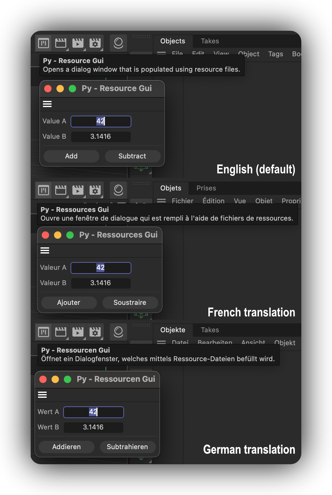

<!-- Source: https://developers.maxon.net/docs/py/2027_0_0/examples/plugins/py_cmd_gui_resources/py_cmd_gui_resources.pyp.html -->

Local source: [examples/plugins/py_cmd_gui_resources/py_cmd_gui_resources.pyp](../../../../examples/plugins/py_cmd_gui_resources/py_cmd_gui_resources.pyp)

# py_cmd_gui_resources <a id="py-cmd-gui-resources"></a>

Demonstrates a plugin that uses resources to define its dialog layout and string translations.



## DETAILS

Open this dialog example by running the command "Py - Resource Gui" in the Commander (Shift + C). The dialog itself is not very complex, but it demonstrates how to use resources to define the layout of a dialog.

Plugins store their resources in a folder named "res" next to the plugin module (the pyp file in Python). Such a resource folder can contain a wide variety of resources, but one important aspect are *.res,* .str, and *.h files, defining description resources (the UI types used by scene elements such as materials, objects, and tags), and dialog resources. This example focuses on dialog resources. A res folder for a plugin using dialog resources could look like this:

```
    myPlugin/                               # The plugin folder.
    ├── myPlugin.pyp                        # The plugin module.
    └── res/                                # The resources of the plugin.
        ├── c4d_symbols.h                   # The global symbols of the plugin; here are all non-
        │                                     description, i.e., dialog, IDs defined.
        ├── dialogs/                        # The dialog resources of the plugin; here we can find
        │   |                               # the markup that defines dialogs.
        │   ├── idd_values.res              # A dialog GUI markup file.
        │   └── idd_buttons.res             # Another dialog GUI markup file.
        ├── strings_en-US/                  # The English strings for the plugin used by resources.
        │   ├── dialogs/                    # The English dialog strings for the plugin.
        │   │   ├── idd_values.str          # The strings for the IDD_VALUES dialog.
        │   │   └── idd_buttons.str         # The strings for the IDD_BUTTONS dialog.
        │   └── c4d_strings.str             # Generic English strings for the plugin.
        └── strings_de-DE/                  # The German strings for the plugin used by resources.
             ...
```

Cinema 4D currently supports the following languages:

- en-US: English (default language, fallback when no translation is available; all plugins must have this language defined)
- ar-AR: Arabic
- cs-CZ: Czech
- de-DE: German
- es-ES: Spanish
- fr-FR: French
- it-IT: Italian
- ja-JP: Japanese
- ko-KR: Korean
- pl-PL: Polish
- pt-BR: Brazilian Portuguese
- zh-CN: Simplified Chinese

Warning:

All languages that use non-ASCII characters, such as Chinese, French, and German, require their special Unicode characters to be encoded as ASCII escape sequences in the *.str files. E.g., an '品' must become '品', an 'é' must become 'é', "ä" must become "ä", and so on. Cinema 4D offers no built-in tool to do this, but the example script `unicode_encode_strings.py` shipped next to this example can be a starting point for a conversion pipeline.

To run this example, place the file in the Cinema 4D plugins folder and restart Cinema 4D.

Topics:

- Defining dialog resources in a resource file.
- Loading dialog resources with GeDialog.LoadDialogResource().
- Loading string translations with c4d.plugins.GeLoadString().
- Purpose of **res** in a plugin module and how to manually load a resource.

## Files <a id="files"></a>

### `py_cmd_gui_resources.pyp` <a id="py-cmd-gui-resources-pyp"></a>

````python
"""Demonstrates a plugin that uses resources to define its dialog layout and string translations.

Open this dialog example by running the command "Py - Resource Gui" in the Commander (Shift + C).
The dialog itself is not very complex, but it demonstrates how to use resources to define the layout
of a dialog.

Plugins store their resources in a folder named "res" next to the plugin module (the pyp file in
Python). Such a resource folder can contain a wide variety of resources, but one important aspect
are *.res, *.str, and *.h files, defining description resources (the UI types used by scene elements
such as materials, objects, and tags), and dialog resources. This example focuses on dialog
resources. A res folder for a plugin using dialog resources could look like this:

```
    myPlugin/                               # The plugin folder.
    ├── myPlugin.pyp                        # The plugin module.
    └── res/                                # The resources of the plugin.
        ├── c4d_symbols.h                   # The global symbols of the plugin; here are all non-
        │                                     description, i.e., dialog, IDs defined.
        ├── dialogs/                        # The dialog resources of the plugin; here we can find
        │   |                               # the markup that defines dialogs.
        │   ├── idd_values.res              # A dialog GUI markup file.
        │   └── idd_buttons.res             # Another dialog GUI markup file.
        ├── strings_en-US/                  # The English strings for the plugin used by resources.
        │   ├── dialogs/                    # The English dialog strings for the plugin.
        │   │   ├── idd_values.str          # The strings for the IDD_VALUES dialog.
        │   │   └── idd_buttons.str         # The strings for the IDD_BUTTONS dialog.
        │   └── c4d_strings.str             # Generic English strings for the plugin.
        └── strings_de-DE/                  # The German strings for the plugin used by resources.
             ...
```

Cinema 4D currently supports the following languages:

    - en-US: English (default language, fallback when no translation is available; all plugins must
                      have this language defined)
    - ar-AR: Arabic
    - cs-CZ: Czech
    - de-DE: German
    - es-ES: Spanish
    - fr-FR: French
    - it-IT: Italian
    - ja-JP: Japanese
    - ko-KR: Korean
    - pl-PL: Polish
    - pt-BR: Brazilian Portuguese
    - zh-CN: Simplified Chinese

Warning:

    All languages that use non-ASCII characters, such as Chinese, French, and German, require their
    special Unicode characters to be encoded as ASCII escape sequences in the *.str files. E.g.,
    an '品' must become '品', an 'é' must become 'é', "ä" must become "ä", and so
    on. Cinema 4D offers no built-in tool to do this, but the example script `unicode_encode_strings.py`
    shipped next to this example can be a starting point for a conversion pipeline.

To run this example, place the file in the Cinema 4D plugins folder and restart Cinema 4D.

Topics:
    - Defining dialog resources in a resource file.
    - Loading dialog resources with GeDialog.LoadDialogResource().
    - Loading string translations with c4d.plugins.GeLoadString().
    - Purpose of __res__ in a plugin module and how to manually load a resource.

"""
__copyright__ = "Copyright 2026, MAXON Computer"
__author__ = "Ferdinand Hoppe"
__date__ = "06/06/2025"
__license__ = "Apache-2.0 license"
__version__ = "2024.0.0"

import os
import typing

import c4d
import mxutils

# There are two ways how we can deal with symbols inside resources (defined for example in a
# symbols.h file). One way to is to automatically import them like this:

# Import all symbols inside the res folder of this plugin module. E.g., `ID_PLUGIN` in the
# `c4d_symbols.h` file will be available as a global attribute of this module, i.e., you can
# just write `print(ID_PLUGIN)` to print the ID of this plugin. The other way would be to redefine
# the symbols in this module, e.g., `ID_PLUGIN = 1065655`. The advantage of the first way is that
# it automatically updates the symbols when the resource files change, while the second way works
# better with auto-completion in IDE and linters, since they have no idea about these symbols being
# defined in a resource file.
mxutils.ImportSymbols(os.path.join(os.path.dirname(__file__), "res"))

class ResourceGuiDialog(c4d.gui.GeDialog):
    """Realizes the most basic dialog possible.
    """
    # Define the button IDs.

    def CreateLayout(self) -> bool:
        """Called by Cinema 4D when the GUI of the dialog is being built.
        """
        self.GroupBorderSpace(5, 5, 5, 5)  # A 5px border around the dialog.

        # Load the dialog resource #IDD_VALUES exposed in the resources of this plugin module.
        # By default, a __res__ resource is exposed in a plugin module, which is uses when
        # resource bound methods such as LoadDialogResource() are called. But these methods
        # usually also accept a manually allocated GeResource object. Referenced insides
        # resources are then entities via their symbol/ID, i.e., here the IDD_VALUES we imported
        # above with mxutils.ImportSymbols.
        self.LoadDialogResource(IDD_VALUES)

        # The cool thing about LoadDialogResource() is that this does not finalize the dialog, it
        # just loads the resource and leaves us with the gadget pointer advanced to the last
        # element in loaded in by the dialog resource. We can now continue with manual in code
        # methods to add gadgets to the dialog, or even call LoadDialogResource() again to
        # load another dialog resource, which will then be appended to the current dialog.

        # Add a horizontal separator to the dialog, and then load the IDD_BUTTONS dialog resource
        # which contains the three buttons we want to add to the dialog. This is a common pattern
        # used internally, that dialogs are split into components which are then mixed and matched
        # at runtime to create the final dialog.

        self.AddSeparatorH(1)
        self.LoadDialogResource(IDD_BUTTONS)

        # When we manually add gadgets or just define strings, we can still use the values defined
        # in a resource. We load here the title of the dialog from the plugin resource.
        # GeLoadString() will load a string in the current language, or fall back to en-US when
        # the plugin has no resources defined for the current language of Cinema 4D.

        # We reuse the name of the plugin as the title of the dialog.
        self.SetTitle(c4d.plugins.GeLoadString(IDS_PLUGIN_NAME))

        return True

    def InitValues(self) -> bool:
        """Called by Cinema 4D to initialize the values dialog once its GUI has bee built.
        """
        # Set the initial values of the two input fields to 0.0, which are defined in the IDD_VALUES
        # dialog resource loaded above.
        self.SetFloat(IDC_VALUE_A, 42.0)
        self.SetFloat(IDC_VALUE_B, 3.14159)

        return True

    def Command(self, mid: int, data: c4d.BaseContainer) -> bool:
        """Called by Cinema 4D when the user clicked a gadget in the dialog.
        """
        # The "Add" and "Subtract" buttons have been clicked. To interact with the dialog, we
        # rely on the IDs defined in the resources, which are imported above with
        # mxutils.ImportSymbols().
        if mid in (IDC_ADD, IDC_SUBTRACT):
            a: float = self.GetFloat(IDC_VALUE_A)
            b: float = self.GetFloat(IDC_VALUE_B)
            res: float = a + b if mid == IDC_ADD else a - b
            c4d.gui.MessageDialog(
                f"{a} {'+' if mid == IDC_ADD else '-'} {b} = {res}")

        return True

class ResourceGuiCommand (c4d.plugins.CommandData):
    """Realizes the common implementation for a command that opens a foldable dialog.

    This example also reduces the CommandData implementation to its bare minimum, but it is
    strongly recommend to follow the more complete pattern shown in other examples, such as
    py_cmd_gui_simple.
    """
    # The dialog hosted by the plugin.
    REF_DIALOG: ResourceGuiDialog | None = None

    def Execute(self, doc: c4d.documents.BaseDocument) -> bool:
        """Opens the dialog when the command is executed.
        """
        # Instantiate the dialog if it does not exist yet.
        if ResourceGuiCommand.REF_DIALOG is None:
            ResourceGuiCommand.REF_DIALOG = ResourceGuiDialog()

        # Open the dialog when it is not yet open. We could also implement closing the dialog, see
        # one of the more complex examples for this, such as py_cmd_gui_simple. We open the dialog
        # asynchronously, i.e., the user can continue working in Cinema 4D while the dialog is open.
        if not ResourceGuiCommand.REF_DIALOG.IsOpen():
            ResourceGuiCommand.REF_DIALOG.Open(
                c4d.DLG_TYPE_ASYNC, ID_PLUGIN, defaultw=1, defaulth=1)

        return True

    # Here we hardcode the plugin ID, name, and help text in other code examples, but when we use
    # resources, we can also load these values from the plugin resources. So, we do not need
    # this section anymore, ID_PLUGIN is defined in the c4d_symbols.h file and imported
    # automatically by mxutils.ImportSymbols() above, and the name and help text are defined in
    # the plugin resources and can be loaded with c4d.plugins.GeLoadString().

    # ID_PLUGIN: int = ...
    # STR_NAME: str = ...
    # STR_HELP: str = ...

    @classmethod
    def Register(cls: typing.Type, iconId: int) -> None:
        """Registers the command plugin.

        This is a custom method and not part of the CommandData interface.
        """
        # Load one of the builtin icons of Cinema 4D as the icon of the plugin. Then instantiate the
        # command plugin that will be registered. And finally register the command plugin with that
        # command instance and icon.
        bitmap: c4d.bitmaps.BaseBitmap = c4d.bitmaps.InitResourceBitmap(iconId)
        command: object = cls()

        name: str = c4d.plugins.GeLoadString(IDS_PLUGIN_NAME)
        help: str = c4d.plugins.GeLoadString(IDS_PLUGIN_HELP)

        # Registers the command plugin. PLUGINFLAG_HIDEPLUGINMENU hides the
        # natural menu entry of this
        # plugin.
        # Omit this flag or replace it by 0 when you do not have custom menu handling as the SDK has
        # (see py_menu).
        c4d.plugins.RegisterCommandPlugin(
            id=ID_PLUGIN, str=name, info=c4d.PLUGINFLAG_HIDEPLUGINMENU, icon=bitmap, help=help,
            dat=command)

# Called by Cinema 4D when this plugin module is loaded.
if __name__ == '__main__':
    # When we use resources, we should make sure that the resource for our plugin is loaded before
    # we register and load the plugin. Cinema 4D will usually do this automatically, but it is
    # common practice to check as this can fail. What is shown here is also the pattern necessary
    # to use resources in other modules (where Cinema 4D does not automatically expose it) or when
    # we specifically want to load resources from a different path than the default one. It is very
    # much recommended to not load the same resources multiple times. I.e., multiple plugin modules
    # working in tandem should share the same resource object.

    # Check if there is a GeResource object available in the global scope under the name `__res__`.
    res: c4d.plugins.GeResource | None = globals().get("__res__", None)
    if not isinstance(res, c4d.plugins.GeResource):
        # Attempt to initialize the resource object from the res folder of this plugin module.
        res = c4d.plugins.GeResource()
        if not res.Init(os.path.join(os.path.dirname(__file__), "res")):
            raise RuntimeError("Failed to initialize the plugin resources.")
        # Write to __res__ so that functions using this default resource can access it.
        __res__ = res

    # Register our plugin as usual.
    ResourceGuiCommand.Register(iconId=465001193)
````

[Example on GitHub](https://github.com/Maxon-Computer/Cinema-4D-Python-API-Examples/tree/master/examples/plugins/py_cmd_gui_resources/py_cmd_gui_resources.pyp)

### `unicode_encode_strings.py` <a id="unicode-encode-strings-py"></a>

```python
"""Provides an example for how one could realize a string encoding pipeline for plugin resources.

Warning:

    This is NOT a product in any sense, it is an EXAMPLE. Please USE IT AT YOUR OWN RISK. We cannot
    guarantee that it will work for all use-cases or add features that you might need.

Note:

    This script can be run with any Python interpreter that supports the standard library; you do
    not need to run it in Cinema 4D or with c4dpy.

The idea is simple: users write the plugin resources in Unicode, e.g., use 'ä' or 'é' in their
string files, and this script encodes these Unicode characters to their escape sequences in ASCII.
The script can be used to encode, decode, restore, or clean up string files in a given directory. It
does not matter if these string files are used by dialogs, descriptions, or other parts of a
Cinema 4D plugin, as long as they end in ".str".

The script will create backups of the original files before encoding them, when asked to do so. It
will also create a log file in the same directory as the script.

The script can be run without any arguments; it will then use the 'res' directory next to the
script and ask the user for details, or it can be run with command line arguments. The four modes
are:

- 'e': This will encode all Unicode characters in the string files to their escape
  sequences in ASCII, e.g., "ä" becomes "\u00e4".
- 'd': This will decode all escape sequences in the string files back to their original
  Unicode characters.
- 'r': This will restore all string files from their backups, which are expected to be
  in the same directory as the original files, with the ".bak" suffix.
- 'c': This will clean (delete) all backup files in the given directory, which are expected to
  have the ".str.bak" suffix.

The command line arguments syntax is as follows:

    usage: unicode_encode_strings.py [-h] [--path [PATH]] [--mode {e,d,r,c}] [--verbose]

    optional arguments:
    -h, --help        show this help message and exit
    --path [PATH]     The path to the directory containing the files to process. If not provided,
                      defaults to the 'res' directory in the script's location.
    --mode {e,d,r,c}  Mode: 'e' for encode, 'd' for decode, 'r' for restore, 'c' for clean.
                      Default is 'e'.
    --verbose         Enable verbose output. Default is False (no verbose output).

Examples:

    Encode all .str files in the default 'res' directory next to this script:
        python unicode_encode_strings.py --mode e

    Decode all .str files in a custom absolute directory:
        python unicode_encode_strings.py --mode d --path /path/to/res

    Decode all .str files in a custom directory relative to this script:
        python unicode_encode_strings.py --mode d --path ./res

    Restore .str files in the default 'res' directory from possibly existing backups:
        python unicode_encode_strings.py --mode r

    Clean (delete) all .str.bak files in a custom directory:
        python unicode_encode_strings.py --mode c --path /path/to/res

    Enable verbose output while encoding .str files in the default 'res' directory:
        python unicode_encode_strings.py --mode e --verbose

Topics:
    * plugins
"""
__author__ = "Ferdinand Hoppe"
__copyright__ = "Copyright (C) 2026 MAXON Computer GmbH"
__license__ = "Apache-2.0 License"

import argparse
import os
import re
import sys
import time

def EncodeStringFiles(path: str, createBackups: bool = True, verboseOutput: bool = True) -> None:
    """Escapes all unicode characters in string files in #path to their escape sequences in ASCII.

    Args:
        path (str): The path to the directory containing the files to encode.
        createBackups (bool): If True, creates a backup of each file before encoding. A file is
            only backed up once, I.e., existing backups will not be overwritten.
    """
    # Walk through the directory and its subdirectories.
    for root, _, files in os.walk(path):
        for filename in files:
            # Only process files with the .str extension.
            if not filename.endswith(".str"):
                continue

            fPath: str = os.path.join(root, filename)
            try:
                os.chmod(fPath, 0o600)  # Read/write for user only
            except Exception as e:
                print(f"Error setting permissions for {fPath}: {e}")

            content: str = ""
            with open(fPath, "r", encoding="utf-8") as f:
                content = f.read()

            if not content:
                print(f"Warning: The file {fPath} is empty or could not be read.")
                continue

            # Python's `string.encode("unicode_escape")` will yield hexadecimal escape sequences
            # (e.g. "\xXX"), but our C++ API expects unicode escape sequences (e.g. "\uXXXX"). I do
            # not see a way how Python can do this out of the box, so we use this little function.
            def EscapeUnicode(item: str) -> str:
                return re.sub(r"([^\x00-\x7f])",
                              lambda m: "\\u{:04x}".format(ord(m.group(1))), item
                              )

            # Escape all unicode characters in the content, e.g. "ä" becomes "\u00e4".
            newContent: str = EscapeUnicode(content)
            if newContent == content:
                continue

            bakPath: str = fPath + ".bak"
            if createBackups and not os.path.exists(bakPath):
                try:
                    with open(bakPath, "w", encoding="utf-8") as f:
                        f.write(content)
                    print(f"Created backup for {fPath} at {bakPath}.")
                except Exception as e:
                    print(f"Error creating backup for {fPath}: {e}")

            with open(fPath, "w", encoding="ascii") as f:
                f.write(newContent)

            if verboseOutput:
                print(f"Encoded {fPath} to ASCII.")
                print("-" * 120)
                print("\nOriginal content:\n")
                print(content)
                print("\nEscaped content:\n")
                print(newContent)
            else:
                print(f"Encoded {fPath} to ASCII.")

def DecodeStringFiles(path: str, verboseOutput: bool = True) -> None:
    """Unescapes all escape sequences in string files in #path back to their unicode characters.

    This is the reverse operation of `EncodeStringFiles`. It will decode escape sequences like
    "\u00e4" back to their original unicode characters like "ä".

    Args:
        path (str): The path to the directory containing the files to decode.
    """
    for root, _, files in os.walk(path):
        for filename in files:
            if filename.endswith(".str"):
                fPath: str = os.path.join(root, filename)
                try:
                    with open(fPath, "r", encoding="utf-8") as f:
                        content = f.read()
                    # Decode the escape sequences back to unicode characters.
                    decodedContent: str = content.encode("utf-8").decode("unicode_escape")

                    if decodedContent == content:
                        continue

                    with open(fPath, "w", encoding="utf-8") as f:
                        f.write(decodedContent)

                    if verboseOutput:
                        print(f"Decoded {fPath} from ASCII.")
                        print("-" * 120)
                        print("\nOriginal content:\n")
                        print(content)
                        print("\nDecoded content:\n")
                        print(decodedContent)
                    else:
                        print(f"Decoded {fPath} from ASCII.")

                except Exception as e:
                    print(f"Error decoding {fPath}: {e}")

def RestoreFilesFromBackups(path: str) -> None:
    """Restores all files from their backups in the given path.

    Args:
        path (str): The path to the directory containing the files to restore.
    """
    for root, _, files in os.walk(path):
        for filename in files:
            if filename.endswith(".str.bak"):
                fPath: str = os.path.join(root, filename)
                originalPath: str = fPath[:-4]  # Remove the ".bak" suffix
                try:
                    with open(fPath, "r", encoding="utf-8") as f:
                        content = f.read()
                    with open(originalPath, "w", encoding="utf-8") as f:
                        f.write(content)
                    os.remove(fPath)  # Remove the backup file after restoring
                    print(f"Restored {originalPath} from backup.")
                except Exception as e:
                    print(f"Error restoring {originalPath} from backup: {e}")

def DeleteBackupFiles(path: str) -> None:
    """Deletes all backup files in the given path.

    Args:
        path (str): The path to the directory containing the backup files to delete.
    """
    print(
        f"Warning: This will delete all string backup files (*.str.bak) in the directory '{path}'.")
    res: str = input("Do you want to continue (y/n): ").strip().lower()
    if res != 'y':
        print("Operation cancelled.")
        return

    for root, _, files in os.walk(path):
        for filename in files:
            if filename.endswith(".str.bak"):
                fPath: str = os.path.join(root, filename)
                try:
                    os.remove(fPath)
                    print(f"Deleted backup file: {fPath}")
                except Exception as e:
                    print(f"Error deleting {fPath}: {e}")

def main() -> None:
    """Runs the script.
    """
    # The three inputs for all actions.
    resPath: str = ""
    mode: str = ""
    verboseMode: bool = False

    # Handle logging
    class LogHandler:
        """Realizes a simple dual channel (stdin/stdout + file) log handler, because doing this
        with the logging module of Python is unnecessarily complicated.
        """

        def __init__(self, stream: str):
            if stream == "out":
                self.stream = sys.stdout
                sys.stdout = self
            elif stream == "err":
                self.stream = sys.stderr
                sys.stderr = self
            else:
                raise ValueError("Stream must be 'out' or 'err'.")

            name: str = os.path.splitext(os.path.basename(__file__))[0]
            self.log: str = os.path.join(os.path.dirname(__file__), f"{name}.log")

            with open(self.log, "a", encoding="utf-8") as logFile:
                if stream == "out":
                    logFile.write("=" * 120 + "\n")
                logFile.write(f"{time.strftime('%Y-%m-%d %H:%M:%S')} - "
                              "Opened new '{stream}' log handler.\n")
                if stream == "err":
                    logFile.write("=" * 120 + "\n")

        def write(self, message: str) -> None:
            """Write a message to the stream and log it.
            """
            if message.strip():
                self.stream.write(f"{message.strip()}\n")
                try:
                    with open(self.log, "a", encoding="utf-8") as logFile:
                        logFile.write(f"{time.strftime('%Y-%m-%d %H:%M:%S')} - {message.strip()}\n")
                except Exception as e:
                    pass

        def flush(self) -> None:
            """Flush the stream.
            """
            if hasattr(self.stream, 'flush'):
                self.stream.flush()

    # Attach our log handler to both stdout and stderr.
    handlers: list[LogHandler] = [
        LogHandler("out"),
        LogHandler("err")
    ]

    # Attempt to parse the command line arguments, if there are any.
    if len(sys.argv) > 1:
        parser = argparse.ArgumentParser(
            description="Encode, decode, or restore string files in a directory.")
        parser.add_argument(
            "--path", type=str, nargs='?', default="",
            help=("The path to the directory containing the files to process. If not provided, "
                  "defaults to the 'res' directory in the script's location."))
        parser.add_argument(
            "--mode", type=str, choices=['e', 'd', 'r', 'c'], default='e',
            help="Mode: 'e' for encode, 'd' for decode, 'r' for restore, 'c' for clean. Default is 'e'.")
        parser.add_argument(
            "--verbose", action='store_true', default=False,
            help="Enable verbose output. Default is False (no verbose output).")
        args = parser.parse_args()

        resPath = args.path
        if resPath == "":
            resPath = os.path.join(os.path.dirname(__file__), "res")
            args.path = resPath

        mode = args.mode
        verboseMode = args.verbose
        print(f"Running with arguments: {args}")
        print("-" * 120)

    # Query the user instead.
    else:
        resPath = os.path.join(os.path.dirname(__file__), "res")
        if not os.path.isabs(resPath):
            resPath = os.path.abspath(resPath)
        if not os.path.exists(resPath):
            raise ValueError(f"The path '{resPath}' does not exist.")

        print(f"Using resource path: {resPath}")
        print("This script will encode or decode *.str files, restore therm from backups, or clean "
              "(delete) all backup files in a 'res' directory.")
        for i in range(3):
            mode = input(
                "Enter mode, 'e' for encode, 'd' for decode, 'r' for restore, 'c' for clean: ").strip().lower()
            if mode not in ("e", "d", "r", "c"):
                print("Invalid mode. Please enter 'e', 'd', 'r', or 'c'.")
            else:
                break
        if mode in ("e", "d"):
            for i in range(3):
                verbose: str = input(
                    "Verbose output? (y/n): ").strip().lower()
                if verbose not in ("y", "n"):
                    print("Invalid input. Please enter 'y' or 'n'.")
                else:
                    verboseMode = verbose == 'y'
                    break

        if mode not in ("e", "d", "r", "c"):
            raise ValueError("Invalid mode. Please enter 'e', 'd', 'r', or 'c'.")

    # Sort out all the path issues.
    if not isinstance(resPath, str):
        raise ValueError("The path must be a valid string.")
    if not os.path.isabs(resPath):
        cwd = os.getcwd()
        os.chdir(os.path.dirname(__file__))
        resPath = os.path.abspath(resPath)
        os.chdir(cwd)
        print(f"Using absolute path: {resPath}")
    if not os.path.exists(resPath):
        raise ValueError(f"The path '{resPath}' does not exist.")
    if not os.path.isdir(resPath):
        raise ValueError(f"The path '{resPath}' is not a directory.")
    if not resPath.endswith("res"):
        raise ValueError(
            f"The path '{resPath}' does not end with 'res'. This script is intended for "
            "encoding plugin resources, which should be in a directory ending with 'res'.")

    # Run the appropriate function based on the mode.
    if mode == 'e':
        EncodeStringFiles(resPath, createBackups=True, verboseOutput=verboseMode)
    elif mode == 'd':
        DecodeStringFiles(resPath, verboseOutput=verboseMode)
    elif mode == 'r':
        RestoreFilesFromBackups(resPath)
    elif mode == 'c':
        DeleteBackupFiles(resPath)

if __name__ == "__main__":
    main()
```

[Example on GitHub](https://github.com/Maxon-Computer/Cinema-4D-Python-API-Examples/tree/master/examples/plugins/py_cmd_gui_resources/unicode_encode_strings.py)

### `res/c4d_symbols.h` <a id="res-c4d-symbols-h"></a>

```cpp
#ifndef C4D_SYMBOLS_H__
#define C4D_SYMBOLS_H__

// This is the primary 'symbol' file of a plugin. A 'symbol' is just a numeric identifier for 
// something. Because Cinema 4D has its roots in C++, the symbols are defined as C++ header files.
//
// In this file dialogs, and general identifiers are defined. Description resource symbols (i.e.,
// things like objects, tags, materials, etc.) are defined in dedicated files for each description.

// The enumeration of all globals symbols for this plugin. Anything we want to reference via a 
// symbol must be defined here (except for description symbols).
enum
{
	ID_PLUGIN = 1065655,         // One thing we can store here is the plugin ID there is no necessity
	                             // for doing this, but it is an option.

	// Cinema 4D uses conventionally a handful of naming patterns in the context of resource symbols.
	// You do not have to follow them.
	//
	//   1. A symbol prefixed with `IDD_` is a dialog ID.
	//   2. A symbol prefixed with `IDC_` is a control ID.
	//   3. A symbol prefixed with `IDS_` is a string ID.
	//
	// This pattern is not without fault, I personally prefer naming things more verbosely, e.g.,
	// ID_DLG_MAIN (a dialog ID), ID_BTN_OK (a button ID), and ID_STR_PLUGIN_NAME (a string ID). But
	// this example follows strictly the Cinema 4D convention.

	// Custom string symbols for the name and help string of the plugin. These strings are defined in
	// the language respective generic string files, e.g., strings_en-US/c4d_strings.str.
	IDS_PLUGIN_NAME = 1000,        
	IDS_PLUGIN_HELP,       // Implicit value definition, i.e., 1001

	// The gadget IDs and strings IDs for dialogs/idd_values.res
	IDD_VALUES = 1100,
	IDC_VALUE_A,        // 1101
	IDC_VALUE_B,        // 1102		
	IDS_VALUE_A,        // ...
	IDS_VALUE_B,

	// The gadget IDs and strings IDs for dialogs/idd_buttons.res
	IDD_BUTTONS = 1200,
	IDC_ADD,
	IDC_SUBTRACT,
	IDS_ADD,
	IDS_SUBTRACT,

	// Dummy - end of the enumeration, this element is necessary to mark the end of the enumeration.
	__DUMMY__
};

#endif // C4D_SYMBOLS_H__
```

[Example on GitHub](https://github.com/Maxon-Computer/Cinema-4D-Python-API-Examples/tree/master/examples/plugins/py_cmd_gui_resources/res/c4d_symbols.h)

### `res/dialogs/idd_buttons.res` <a id="res-dialogs-idd-buttons-res"></a>

```c4dres
// The GUI markup (res) for a dialog. 
//
// This follows the same principles as the `idd_values.res` file, read it for more information.
// We will load this dialog resource into the same dialog instance as the `idd_values.res`
// resource, so that we effectively compose a dialog out of multiple resources.
DIALOG IDD_BUTTONS
{
	SCALE_H; SCALE_V;

	GROUP
	{
		COLUMNS 2;
		SPACE 5, 5;

		BUTTON IDC_ADD { NAME IDS_ADD; SIZE 100,0; SCALE_H; }
		BUTTON IDC_SUBTRACT { NAME IDS_SUBTRACT; SIZE 100,0; SCALE_H; }
	}
}
```

[Example on GitHub](https://github.com/Maxon-Computer/Cinema-4D-Python-API-Examples/tree/master/examples/plugins/py_cmd_gui_resources/res/dialogs/idd_buttons.res)

### `res/dialogs/idd_values.res` <a id="res-dialogs-idd-values-res"></a>

```c4dres
// The GUI markup (res) for a dialog. 
// 
// Here we define the groups and controls of a dialog and Cinema 4D's res markup language. While 
// res markup is unavoidable for description resources (objects, tags, materials, etc.), it is not
// necessary for dialogs. Some parts of our documentation sell dialog markup as the more powerful
// alternative to defining dialogs in code. This is simply not true anymore. Dialog resources are
// an option, especially when one has to define many dialogs composed out of reoccurring parts.
//
// See also: https://developers.maxon.net/docs/cpp/2025_2_0a/page_dialog_resource.html

// Define a dialog resource, this does not necessarily mean that this will be all that is being
// loaded into the the final dialog, as one can load multiple dialog resources into a single
// dialog class.
DIALOG IDD_VALUES
{
	// Define the scaling behaviour of this component, we want it to consume all available
	// horizontal and vertical space.
	SCALE_H;
	SCALE_V;

	// A unnamed group with an anonymous ID
	GROUP
	{
		// Which has two columns and places a five pixel wide horizontal and vertical padding between
		// elements placed in this group.
		COLUMNS 2;
		SPACE 5, 5;

		// Now apply the same layout rules as when we do this in code, since we have a two column
		// layout and we add here label, edit, label, edit, we will end up with:
		//
		//  Label: Edit
		//  Label: Edit
		//

		// The label of the first edit control, we use here one of our string IDs, so that Cinema 4D
		// knows which string to display for the label (picking the active language). The label could
		// also have a gadget ID (`STATICTEXT IDC_LBL_VALUE_A { NAME IDS_VALUE_A; }`), but since we
		// do not want to address this gadget in code, we an use an anonymous ID here.
		STATICTEXT { NAME IDS_VALUE_A; }
		// The first edit control, we use the `EDITNUMBERARROWS` gadget type. Here we used a gadget
		// ID (`IDC_VALUE_A` defined in c4d_symbols.h) so that we can address this control in code. 
		// We also set some flags such as the default size of the control and that it should scale 
		// horizontally.
		EDITNUMBERARROWS IDC_VALUE_A { SIZE 100,0; SCALE_H; }

		// The second label edit control pair.
		STATICTEXT { NAME IDS_VALUE_B; }
		EDITNUMBERARROWS IDC_VALUE_B { SIZE 100,0; SCALE_H; }
	}
}
```

[Example on GitHub](https://github.com/Maxon-Computer/Cinema-4D-Python-API-Examples/tree/master/examples/plugins/py_cmd_gui_resources/res/dialogs/idd_values.res)

### `res/strings_de-DE/c4d_strings.str` <a id="res-strings-de-de-c4d-strings-str"></a>

```c4dstr
// These are the generic German strings for the plugin. We place here only the plugin name and 
// help string. Which we then load at runtime with c4d.plugins.GeLoadString(). This file has
// been unicode escaped, see unicode_encode_strings.py for details.
STRINGTABLE
{
	IDS_PLUGIN_NAME "Py SDK - Ressourcen Gui";
	IDS_PLUGIN_HELP "\u00d6ffnet ein Dialogfenster, welches mittels Ressource-Dateien bef\u00fcllt wird.";
}
```

[Example on GitHub](https://github.com/Maxon-Computer/Cinema-4D-Python-API-Examples/tree/master/examples/plugins/py_cmd_gui_resources/res/strings_de-DE/c4d_strings.str)

### `res/strings_de-DE/dialogs/idd_buttons.str` <a id="res-strings-de-de-dialogs-idd-buttons-str"></a>

```c4dstr
// The German translation strings for the dialog resource IDD_BUTTONS.
DIALOGSTRINGS IDD_BUTTONS
{
	IDS_ADD "Addieren";
	IDS_SUBTRACT "Subtrahieren";
}
```

[Example on GitHub](https://github.com/Maxon-Computer/Cinema-4D-Python-API-Examples/tree/master/examples/plugins/py_cmd_gui_resources/res/strings_de-DE/dialogs/idd_buttons.str)

### `res/strings_de-DE/dialogs/idd_values.str` <a id="res-strings-de-de-dialogs-idd-values-str"></a>

```c4dstr
// The German translation strings for the dialog resource IDD_VALUES.
DIALOGSTRINGS IDD_VALUES
{
	IDS_VALUE_A "Wert A";
	IDS_VALUE_B "Wert B";
}
```

[Example on GitHub](https://github.com/Maxon-Computer/Cinema-4D-Python-API-Examples/tree/master/examples/plugins/py_cmd_gui_resources/res/strings_de-DE/dialogs/idd_values.str)

### `res/strings_en-US/c4d_strings.str` <a id="res-strings-en-us-c4d-strings-str"></a>

```c4dstr
// These are the generic English strings for the plugin. We place here only the plugin name and 
// help string. Which we then load at runtime with c4d.plugins.GeLoadString().
STRINGTABLE
{
	// When c4d.plugins.GeLoadString(IDS_PLUGIN_NAME) is being called, and thee current language is
	// either English, or  neither German nor French (the two other languages we support in this 
	// example), the string "Py - Resource Gui" is returned. This only works when define both the
	// string ID and the string value in this file.
	IDS_PLUGIN_NAME "Py SDK - Resource Gui";
	IDS_PLUGIN_HELP "Opens a dialog window that is populated using resource files.";
}
```

[Example on GitHub](https://github.com/Maxon-Computer/Cinema-4D-Python-API-Examples/tree/master/examples/plugins/py_cmd_gui_resources/res/strings_en-US/c4d_strings.str)

### `res/strings_en-US/dialogs/idd_buttons.str` <a id="res-strings-en-us-dialogs-idd-buttons-str"></a>

```c4dstr
// The English translation strings for the dialog resource IDD_BUTTONS.
DIALOGSTRINGS IDD_BUTTONS // Must match the dialog ID
{
	IDS_ADD "Add";
	IDS_SUBTRACT "Subtract";
}
```

[Example on GitHub](https://github.com/Maxon-Computer/Cinema-4D-Python-API-Examples/tree/master/examples/plugins/py_cmd_gui_resources/res/strings_en-US/dialogs/idd_buttons.str)

### `res/strings_en-US/dialogs/idd_values.str` <a id="res-strings-en-us-dialogs-idd-values-str"></a>

```c4dstr
// The English translation strings for the dialog resource IDD_VALUES.
DIALOGSTRINGS IDD_VALUES // Must match the dialog ID
{
	IDS_VALUE_A "Value A";
	IDS_VALUE_B "Value B";
}
```

[Example on GitHub](https://github.com/Maxon-Computer/Cinema-4D-Python-API-Examples/tree/master/examples/plugins/py_cmd_gui_resources/res/strings_en-US/dialogs/idd_values.str)

### `res/strings_fr-FR/c4d_strings.str` <a id="res-strings-fr-fr-c4d-strings-str"></a>

```c4dstr
// These are the generic French strings for the plugin. We place here only the plugin name and 
// help string. Which we then load at runtime with c4d.plugins.GeLoadString(). This file has
// been unicode escaped, see unicode_encode_strings.py for details.
STRINGTABLE
{
	IDS_PLUGIN_NAME "Py SDK - Ressources Gui";
	IDS_PLUGIN_HELP "Ouvre une fen\u00eatre de dialogue qui est rempli \u00e0 l'aide de fichiers de ressources.";
}
```

[Example on GitHub](https://github.com/Maxon-Computer/Cinema-4D-Python-API-Examples/tree/master/examples/plugins/py_cmd_gui_resources/res/strings_fr-FR/c4d_strings.str)

### `res/strings_fr-FR/dialogs/idd_buttons.str` <a id="res-strings-fr-fr-dialogs-idd-buttons-str"></a>

```c4dstr
// The French translation strings for the dialog resource IDD_BUTTONS.
DIALOGSTRINGS IDD_BUTTONS
{
	IDS_ADD "Ajouter";
	IDS_SUBTRACT "Soustraire";
}
```

[Example on GitHub](https://github.com/Maxon-Computer/Cinema-4D-Python-API-Examples/tree/master/examples/plugins/py_cmd_gui_resources/res/strings_fr-FR/dialogs/idd_buttons.str)

### `res/strings_fr-FR/dialogs/idd_values.str` <a id="res-strings-fr-fr-dialogs-idd-values-str"></a>

```c4dstr
// The French translation strings for the dialog resource IDD_VALUES.
DIALOGSTRINGS IDD_VALUES
{
	IDS_VALUE_A "Valeur A";
	IDS_VALUE_B "Valeur B";
}
```

[Example on GitHub](https://github.com/Maxon-Computer/Cinema-4D-Python-API-Examples/tree/master/examples/plugins/py_cmd_gui_resources/res/strings_fr-FR/dialogs/idd_values.str)
