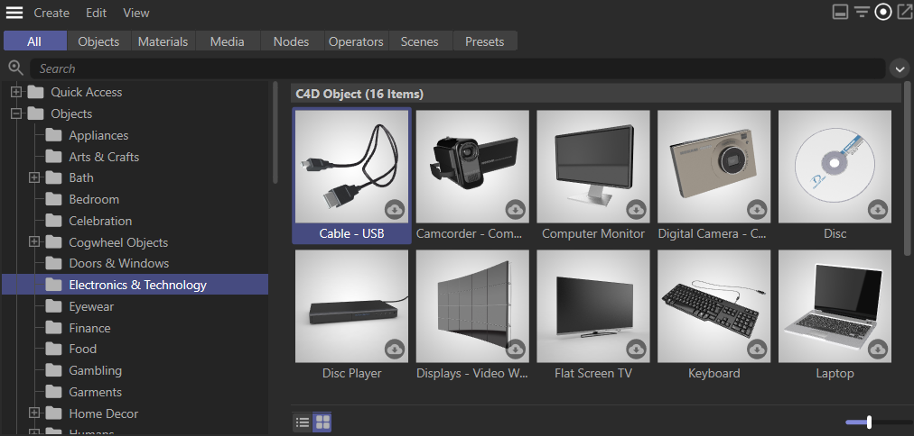

<!-- Source: https://developers.maxon.net/docs/py/2027_0_0/manuals/manual_assets.html -->

# Assets 

Provide content as reusable assets served with the Cinema 4D Asset Browser.

## Overview 

The Asset API is a collection of interfaces for the [Asset Browser](https://help.maxon.net/c4d/en-us/#html/79839.html), replacing the older [Content Browser](https://help.maxon.net/c4d/en-us/#html/5884.html). The API does provide only limited access to the graphical user interface of the Asset Browser and primarily exposes the underlying data structures that are represented by the Asset Browser.

Assets come natively in the form of scenes, objects, materials, media files, presets and other minor types as category and keyword assets. This data wrapped by an asset can be loaded into a scene with the Asset Browser and is stored in asset databases. Asset databases also store metadata for all their assets. This asset metadata is accessible in its most tangible form in the [Detail Area](https://help.maxon.net/c4d/en-us/#html/79842.html) of the Asset Browser, displaying for example an annotation which describes a single asset.

*Fig. 1: The Asset Browser exposes assets managed by the Asset API, which primarily provides access to the underlying data structures.*

> **Note:** See [Asset API](https://developers.maxon.net/docs/Cinema4DCPPSDK/html/page_handbook_assetapi.html) in the C++ Documentation for a more in-depth documentation of the core concepts of the Asset API.

## Related Topics 

|   |   |   |
|---|---|---|
| Frameworks | [asset.framework](../modules/maxon/frameworks/asset.md#framework-asset) | Provides the functionalities of the Asset API. |
|  | [cinema_hybrid.framework](../modules/maxon/frameworks/cinema_hybrid.md#framework-cinema-hybrid) | Contains API elements that are tied both to the Cinema and Maxon API. |
| Development Tools | Copy Asset ID to Cache | Builtin feature of the Cinema 4D Asset Browser to copy the identifiers of assets. The feature is described in the [Asset Browser](https://help.maxon.net/c4d/en-us/#html/79839.html) manual in more detail. |
|  | g_console | Command Line Argument for Cinema 4D which can take the values true or false and defaults to false. Enables or disables the Cinema 4D console (Windows only and only if no debugger is present). |
|  | g_consoleDebugger | Command Line Argument for Cinema 4D which can take the values true or false and defaults to false. Enables or disables the Cinema 4D console (Windows only and even if a debugger is present). |
|  | g_developerNodeEditorFunctions | Command Line Argument for Cinema 4D which can take the values true or false and defaults to false. Shows the versions of node asset in the Asset Browser and allows to create a specific versions of an asset by dragging it into the editor. Also makes the ‘Edit Description’ and ‘Edit Port’ commands available at all times. |
|  | g_generateAssetRepositoryGml | Command Line Argument for Cinema 4D which can take the values true or false and defaults to false. Generates an asset repository dependency gml graph. The location will be printed to the debug console. |
| Code Examples on GitHub | [Asset Databases](https://github.com/Maxon-Computer/Cinema-4D-Python-API-Examples/blob/master/scripts/05_modules/assets/asset_databases_r26.py) | Provides examples for handling asset databases and repositories. |
|  | [Asset Types](https://github.com/Maxon-Computer/Cinema-4D-Python-API-Examples/blob/master/scripts/05_modules/assets/asset_types_r26.py) | Provides examples for creating and loading different asset types. |
|  | [Asset Metadata](https://github.com/Maxon-Computer/Cinema-4D-Python-API-Examples/blob/master/scripts/05_modules/assets/asset_metadata_r26.py) | Provides examples for reading and writing asset metadata. |

### See Also 

- [API Overview](manual_api_overview.md): Provides an overview of the major API components.
- [Graph Descriptions](manual_graph_descriptions.md): Explains how to generate node materials with graph descriptions.
- [Example asset_databases.py](../examples/io/asset_databases.py.md): Provides examples for handling asset databases and repositories.
- [Example asset_types.py](../examples/io/asset_types.py.md): Provides examples for creating and loading different asset types.
