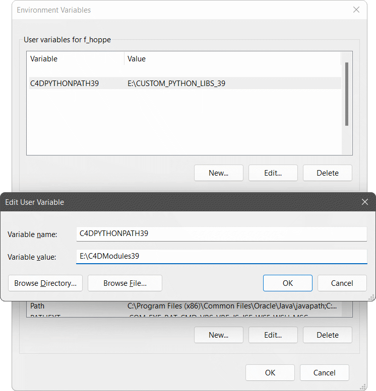

<!-- Source: https://developers.maxon.net/docs/py/2027_0_0/manuals/manual_external_libraries.html -->

# External Libraries <a id="external-libraries"></a><a id="manual-external-libraries"></a>

Explains how to expose third-party libraries to Cinema 4D Python.

> **Note:** MAXON cannot provide support for third-party libraries written for CPython or their compatibility with the Python interpreters shipped with Cinema 4D. While our Python interpreters are derived from the respective CPython builds, they are not identical to them. Popular Python libraries such as `numpy` might not work at all or might work only with a reduced feature set. The Cinema 4D Python interpreters are provided *as-is* and are not meant to be fully CPython-compliant.

The Python interpreters shipped with Cinema 4D are pre-configured to allow users to import custom modules from multiple search paths. The user can also add custom search paths with environment variables or on a plugin level by modifying the search paths of a Python instance at runtime.

## Installation & App Specific Search Paths <a id="installation-app-specific-search-paths"></a><a id="app-module-search-paths"></a>

There are in principle two predefined search paths into which libraries can be placed for each app inside an installation of Cinema 4D. One for libraries which are intended for a specific installation of an app, and one for all apps that use a specific version of Python. The app specific search paths are all tied to a specific installation of Cinema 4D and also differentiate between the apps that have been shipped with that Cinema 4D installation, as for example the *Cinema 4D*, *c4dpy*, or *commandline* executable. The search paths can be located with the following patterns:

| Cinema 4D Version | Operating System | Path |
|---|---|---|
| R20 | Windows | `%APPDATA%/MAXON/{prefs}/python27/libs` |
| R20 | MacOS | `~/Library/Preferences/MAXON/{prefs}/python27/libs` |
| R21 | Windows | `%APPDATA%/MAXON/{prefs}/python27/libs` |
| R21 | MacOS | `~/Library/Preferences/MAXON/{prefs}/python27/libs` |
| S22 | Windows | `%APPDATA%/MAXON/{cinemaveprefsrsion}/python27/libs` |
| S22 | MacOS | `~/Library/Preferences/MAXON/{prefs}/python27/libs` |
| R23 | Windows | `%APPDATA%/MAXON/{prefs}/python37/libs` |
| R23 | MacOS | `~/Library/Preferences/MAXON/{prefs}/python37/libs` |
| S24 or greater | Windows | `%APPDATA%/MAXON/{prefs}/python39/libs` |
| S24 or greater | MacOS | `~/Library/Preferences/MAXON/{prefs}/python39/libs` |

Within these patterns, the symbol `{prefs}` stands for the distinct preferences directories of the different apps that are being shipped with a Cinema 4D installation. For a singular Cinema 4D installation up to six preferences directories can exist, one directory for each app shipped with Cinema 4D. These six directories will all share a common hash prefix for the installation but are differentiated by a postfix. Note that these directories only do exist when their respective app has been run at least once.

### Preferences Directory Patterns <a id="preferences-directory-patterns"></a>

| Pattern | Example | Application |
|---|---|---|
| name | `\AppData\Roaming\MAXON\R26_F0AA9E5D` | Cinema 4D |
| name_p | `\AppData\Roaming\MAXON\R26_F0AA9E5D_p` | c4dpy |
| name_x | `\AppData\Roaming\MAXON\R26_F0AA9E5D_x` | Commandline |
| name_c | `\AppData\Roaming\MAXON\R26_F0AA9E5D_c` | Teamrender Client |
| name_s | `\AppData\Roaming\MAXON\R26_F0AA9E5D_s` | Teamrender Server |
| name_w | `\AppData\Roaming\MAXON\R26_F0AA9E5D_w` | Cineware |

## Python Interpreter Bound Search Paths <a id="python-interpreter-bound-search-paths"></a><a id="interpreter-module-search-paths"></a>

For cases where the complexity of app-specific search paths is not required, the search paths for specific Python versions can be used instead. All apps that use the targeted Python interpreter will be able to import modules from these paths.

| Python Core | Operating System | Path |
|---|---|---|
| Python 2.7 (`R20 <= C4D_VERSION < R23`) | Windows | `%APPDATA%/MAXON/python27/libs` |
| Python 2.7 (`R20 <= C4D_VERSION < R23`) | MacOS | `~/Library/Preferences/MAXON/python27/libs` |
| Python 3.7 (`C4D_VERSION == R23`) | Windows | `%APPDATA%/MAXON/python37/libs` |
| Python 3.7 (`C4D_VERSION == R23`) | MacOS | `~/Library/Preferences/MAXON/python37/libs` |
| Python 3.9 (`C4D_VERSION >= S24`) | Windows | `%APPDATA%/MAXON/python39/libs` |
| Python 3.9 (`C4D_VERSION >= S24`) | MacOS | `~/Library/Preferences/MAXON/python39/libs` |
| Python 3.10 (`C4D_VERSION == 2023.2`) | Windows | `%APPDATA%/MAXON/python310/libs` |
| Python 3.10 (`C4D_VERSION == 2023.2`) | MacOS | `~/Library/Preferences/MAXON/python310/libs` |
| Python 3.11 (`2024.0 <= C4D_VERSION`) | Windows | `%APPDATA%/MAXON/python311/libs` |
| Python 3.11 (`2024.0 <= C4D_VERSION`) | MacOS | `~/Library/Preferences/MAXON/python311/libs` |

### Custom Interpreter Bound Search Paths <a id="custom-interpreter-bound-search-paths"></a><a id="custom-module-search-paths"></a>

Cinema 4D also offers the ability to register custom interpreter-bound search paths, similar to the `PYTHONPATH` environment variable of the standard CPython interpreter. The paths must be set up as an environment variable in the OS, as shown in the Windows example below.

<a id="id1"></a>



*Fig. 1: Setting `E:\C4DModules39` as a module search path for Cinema 4D applications using CPython 3.9.*

The environment variable of the Python interpreters are both on Windows and MacOS as follows:

| Python Core | Variable |
|---|---|
| Python 2.X (`C4D_VERSION <= R21`) | `PYTHONPATH` |
| Python 2.7 (`R21 < C4D_VERSION <= R23`) | `C4DPYTHONPATH` |
| Python 3.7 (`R23 < C4D_VERSION <= S24`) | `C4DPYTHONPATH37` |
| Python 3.9 (`S24 < C4D_VERSION <= 2023.1`) | `C4DPYTHONPATH39` |
| Python 3.10 (`C4D_VERSION == 2023.2`) | `C4DPYTHONPATH310` |
| Python 3.11 (`2024.0 <= C4D_VERSION`) | `C4DPYTHONPATH311` |

> **Note:** To register multiple search paths, the elements must be separated by a semicolon on Windows and by a colon on MacOS in the value of the variable. This feature is only available from `C4DPYTHONPATH37` onwards.

## Executing Code with `python_init.py` <a id="executing-code-with-python-init-py"></a><a id="manual-python-init"></a>

For each app in a Cinema 4D installation also two files named `python_init.py` are being executed before the plugin registrations of a booting app are being carried out.

> **Note:** See [Message System](manual_message_system.md#manual-message-system) for a per plugin approach of executing code at the different stages of the Cinema 4D boot sequence.

The `python_init.py` files do not exist by default and must be created manually. One file can be placed at the root of the interpreter bound search path, and one at the root of the search path in the preferences directory of the booting app. The code contained in these *python_init* modules can already make use of the *c4d* and *maxon* packages. The module located in the interpreter bound search path is being executed first, the one in the search path in the preferences directory of the booting app after that. For booting the *Cinema 4D* executable of an S26 installation, the files and order could be as follows:

> - **Windows**
>
>   1. `%APPDATA%/MAXON/python39/python_init.py`.
>   2. `%APPDATA%/MAXON/R26_F0AA9E5D/python39/python_init.py`.
>
> - **MacOS**
>
>   1. `~/Library/Preferences/MAXON/python39/python_init.py`.
>   2. `~/Library/Preferences/MAXON/R26_F0AA9E5D/python39/python_init.py`.

The exact location of the *python_init* module in the app specific search paths depends on the information lined out under *Installation & App Specific Search Paths*.

> **Note:** In R20 SP1 the *python_init* modules are not being loaded.

### Module Attributes of `python_init.py` <a id="module-attributes-of-python-init-py"></a>

Before execution, the following module attributes will be injected into each module. This means these symbols can be used in code although they are not defined in the module.

- *doc*: ([`BaseDocument`](../modules/c4d.documents/BaseDocument/index.md#c4d.documents.BaseDocument)) The active document.
- *op*: ([`c4d.BaseObject`](../modules/c4d/C4DAtom/GeListNode/BaseList2D/BaseObject/index.md#c4d.BaseObject)) The selected object. Can be `None`.
- *tp*: ([`c4d.modules.thinkingparticles.TP_MasterSystem`](../modules/c4d.modules/thinkingparticles/TP_MasterSystem/index.md#c4d.modules.thinkingparticles.TP_MasterSystem)) The Thinking Particles Master system of the document. Can be `None`.

> **Note:** In R20 SP2 these module attributes are not available and must be defined by the user.

## Local Plugin Search Paths <a id="local-plugin-search-paths"></a><a id="local-module-search-paths"></a>

It is important to understand that the directory of a plugin does *not* lie in the default search paths of a Cinema 4D Python environment. In order to import a module or package which is located in relation to a `pyp` file, the path must be added to the `sys.path` list of the Python instance which is loading the plugin. This approach can cause multiple problems of which some are being lined out in the code example below. It is recommended to install modules globally when possible.

> **Note:**
>
> > The [`mxutils.LocalImportPath`](../modules/maxon_generated/mxutils/mxutils.LocalImportPath.md#module-mxutils.LocalImportPath) context manager can be used to temporarily add a plugin’s local module directory to the import search path while importing local modules. Prefer it over modifying `sys.path` manually when possible.
>
> ```python
> """Code example for loading local modules for a plugin with the following structure:
>
>     MyPlugin
>     +-- res
>         +-- ...
>     +-- modules               <-- Contains the local modules/packages
>     |   +-- __init__.py
>     |   +-- myModule.py       <-- A module to import
>     +-- myPlugin.pyp          <-- The plugin that is meant to import from MyPlugin/modules
> """
>
> import os
> import sys
>
> # Get the directory the plugin is located in and add the directory called "modules" in this root
> # directory to the search paths of the Python instance executing this file.
> root = os.path.dirname(__file__)
> sys.path.insert(0, os.path.join(root, "modules"))
>
> # One must check if there is already a module present before importing a local module and if
> # this is the case, refrain from importing the local module. There are two scenarios how a local
> # module called "myModule" could already be present:
> #
> #   1. One's plugin has run before and already imported the module before. Invoking
> #      "import myModule" again will do no harm in this case (and also have no effect).
> #   2. There is either another plugin installed on the machine which happens to also have a
> #      local module called "myModule" or there is a globally installed module "myModule.
> #      Invoking "import myModule" might replace the module of that other plugin with the local
> #      module "myModule", rendering the other plugin non-functional or even causing Cinema 4D
> #      to crash.
>
> # Attempt to import a local module called "myModule"
> if "myModule" not in sys.modules.keys():
>     import myModule
> # This else statement is optional, but useful for debugging. The condition should be removed in
> # release versions of the plugin as it is not necessary there. This condition will ensure that
> # the command "Reload Python Plugins" of Cinema 4D not only reloads/executes the pyp files again,
> # but that also their local modules are being reloaded. When not done, Cinema 4D must be restarted
> # to reflect changes made in "myModule.py" while the app was already running. Note that this is
> # Python 3.x specific code, in Python 2.x one must use  the builtin function ``reload`` instead,
> # e.g.: ``reload(myModule)``.
> else:
>     import importlib
>     importlib.reload(myModule)
>
> # After the local module has been imported, the module search paths must be cleaned up, so that
> # other code does not accidentally import a module from it.
> sys.path.pop(0)
>
> # A few notes:
> #
> #   1. The module search paths in ``sys.path`` are inspected by ``import`` in a lazy sequential
> #      order. I.e., if there is a ``math`` module to be found in ``sys.path[0]`` and one in
> #      ``sys.path[1]``, the ``math`` module in ``sys.path[1]`` will be shadowed.
> #   2. There are however exceptions to that rule, and a Python interpreter might reorder
> #      ``sys.path`` to move a builtin path to the start of the list, or outright ignore
> #      ``sys.path`` and search a builtin search path before searching any path in ``sys.path``
> #      at all.
> #   3. It is therefore recommended to avoid name collisions as best as possible:
> #       a. Do not name a module ``math``, name it ``myplugin_math``
> #       b. When shipping popular public packages with your plugin, rename the packages when
> #          possible. When you for example want to ship ``urllib3`` with your plugin, it is best
> #          to rename it to ``myplugin_urllib3`` to avoid version collisions.
>
>
> # The normal plugin code starts here ...
>
> import c4d
>
> class MyPluginData(c4d.plugins.ObjectData):
>     """My Plugin.
>     """
>     ...
> ```

## See Also <a id="see-also"></a>

- [Python Environment](manual_python_environment.md): Explains the features and limitations of Cinema 4D’s Python runtime.
- [Standalone Interpreter](manual_standalone_interpreter.md): Explains how to use Cinema 4D’s standalone interpreter, c4dpy.
- [Implementing Plugins](manual_implementing_plugins.md): Explains the basic concepts of implementing plugins.
- [Example mxutils_localimportpath.py](../examples/misc/mxutils_localimportpath.py.md): Demonstrates importing a package relative to a saved Python script.
