<!-- Source: https://developers.maxon.net/docs/py/2027_0_0/manuals/manual_graph_descriptions.html -->

# Graph Descriptions <a id="graph-descriptions"></a><a id="graph-description"></a>

Explains how to generate node materials with graph descriptions.

> **Note:** See the [nodes](https://github.com/Maxon-Computer/Cinema-4D-Python-API-Examples/tree/master/examples/nodes/) examples on GitHub to find code examples for graph descriptions. Use the Nodes view in the [Resource Index](../indexes/resource_index.md) to discover the node spaces and their nodes shipped with Cinema 4D.

## Limitations <a id="limitations"></a><a id="graph-description-overview"></a>

Graph descriptions have these limitations at the moment.

- English is the only supported language for interface label identifiers at the moment.
- Scaffolds are not supported at the moment.

## Overview <a id="overview"></a>

Graph descriptions are a simplified approach to creating and updating node materials. Common use cases for graph descriptions are:

- Creating new materials based on sets of textures and material metadata, as usually provided by material websites.
- Updating parts of existing materials, as for example change the color profile in all textures in all materials in a scene.
- Carry out queries on a graph to find nodes or ports, such as *‘select the port x of all Y nodes that are connected via their y port to a Z node’*.
- Carry out graph description commands such as, resetting a node to its default state, showing/hiding a port, etc.

Graph descriptions hide away some of the verboseness of the Nodes API when dealing with graphs and carrying out tasks within them. A graph description will often require considerably less code than the equivalent Nodes API code. But graph descriptions are not meant to be a replacement for the Nodes API; the Nodes API is still the native API for node systems and might be needed to carry out the most complex tasks.

```python
def SimpleGraphDescription() -> None:
    """Creates a red metallic OpenPBR Material.
    """
    maxon.GraphDescription.ApplyDescription(
        maxon.GraphDescription.GetGraph(name="Hello World"), {
            maxon.GraphDescription.Type: "Output",
            "Surface": {
                maxon.GraphDescription.Type: "OpenPBR Material",
                "Base/Color": (1, 0, 0),
                "Base/Metalness": 1.0,
                "Specular/IOR": 2 * math.pi
            }
        }
    )
```

[Example on GitHub](https://github.com/Maxon-Computer/Cinema-4D-Python-API-Examples/tree/master/examples/nodes/graph_descriptions_basics.py#:~:text=SimpleGraphDescription)

[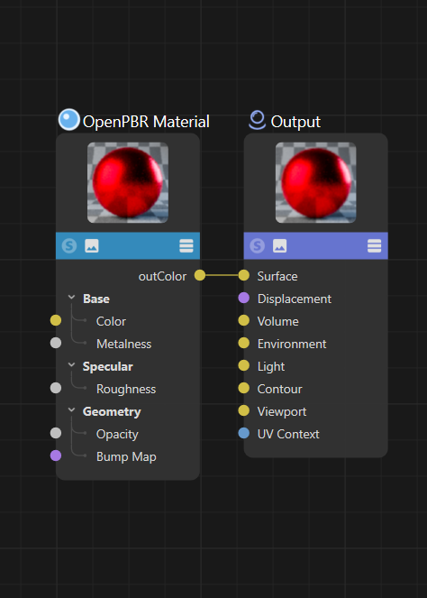](../_images/manual_graph_descriptions_simple_graph_red_metallic.png)

*Fig. 1: A simple graph description and its output, a red metallic material in the Redshift node space.*

A graph description describes a graph as a set of nested Python dictionaries where nodes are listed in a right-to-left order. Usually we read a node graph left-to-right, we read from the input nodes to the singular output node of the graph, its so called end-node. A graph description flips this on the head and describes a graph in the opposite direction, starting out with the end node and cascading from there into its inputs. When we take the example from *Fig.1*, we would normally read this as *OpenPBR Material, Output*. The graph description flips this on the head and describes the graph in the order *Output, Standard Material*.

<a id="id1"></a>

[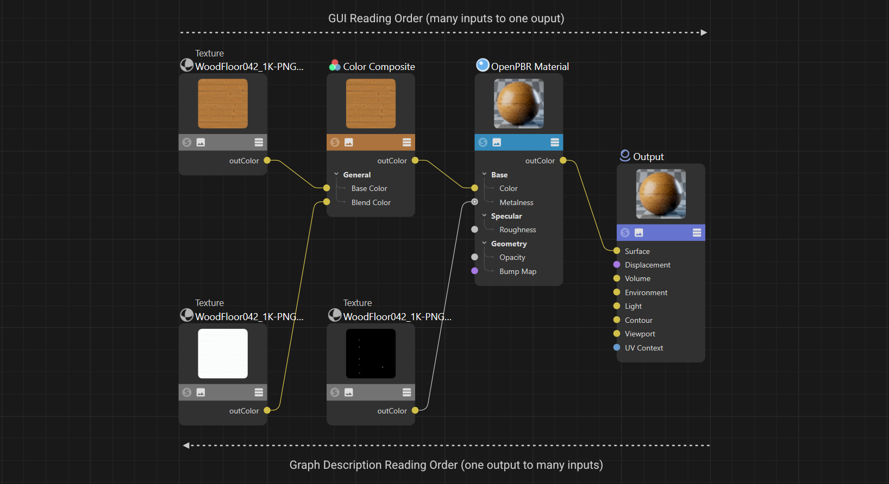](../_images/manual_graph_descriptions_reading_direction_node_editor.png)

*Fig. 2: Graph descriptions are read from right to left, starting with the end node of the graph and cascading into its inputs.*

A graph description is composed of a nested set of scopes where each scope describes a node in the graph. A scope is a Python dictionary that contains the node’s type, its input ports, attributes, and other settings. Ports can either be set to a literal value (*5* or *maxon.Vector(1, 0, 0)*) or form a connection to another node by describing a new node as their value. Find below a commented version of the simple graph description shown in *Fig. 1*.

```python
def CommentedSimpleGraphDescription() -> None:
    """Explains how nested scopes express node creation and port connections.
    """
    # A GraphDescription.ApplyDescription call must take at least two arguments:
    maxon.GraphDescription.ApplyDescription(

        # 1. A graph to write the description to, in this case we use GetGraph to create a new node
        # material and get its graph for the currently active material node space; Redshift by default.

        maxon.GraphDescription.GetGraph(name="Hello World"),

        # 2. And the graph descriptions to write into that graph. They follow an inverted, right-to-left
        # reading pattern compared to the Node Editor (where we tend to read left-to-right). Each 
        # node in the graph has its own scope (a pair of curly braces). Connections between nodes in 
        # the graph are described by nesting scopes.
        {
            # This outmost scope is of type "Output". It tells Cinema 4D that we want to create an
            # Output node. Instead of GraphDescription.Type, we could also write "$type".
            maxon.GraphDescription.Type: "Output",

            # We reference its 'Surface' input port to either set a value or connect it to another
            # node. In this case we create a new node, indicated by opening a new scope (the set of
            # curly braces). Because most (material) nodes only have one output port, we do not have
            # to specify here that we want to connect to the 'outColor' port of the 'OpenPBR Material'
            # node we are going to create, the output port is implicit.
            "Surface": {
                # Just as before, we declare the type of node this scope describes.
                maxon.GraphDescription.Type: "OpenPBR Material",

                "Base/Color": (1, 0, 0),
                "Base/Metalness": 1.0,
                "Specular/IOR": 2 * math.pi
            }
        }
    )
```

[Example on GitHub](https://github.com/Maxon-Computer/Cinema-4D-Python-API-Examples/tree/master/examples/nodes/graph_descriptions_basics.py#:~:text=CommentedSimpleGraphDescription)

## Technical Overview <a id="technical-overview"></a><a id="graph-description-technical-overview"></a>

The graph description API is part of the [maxon.frameworks.nodes](../modules/maxon/frameworks/nodes.md). The relevant entities are:

- [`maxon.GraphDescription.ApplyDescription()`](../modules/maxon_generated/frameworks/nodes/interface/maxon.GraphDescription.md#maxon.GraphDescription.ApplyDescription): Applies a given graph description to a given nodes graph.
- [`maxon.GraphDescription.EvaluateQuery()`](../modules/maxon_generated/frameworks/nodes/interface/maxon.GraphDescription.md#maxon.GraphDescription.EvaluateQuery): Evaluates a graph query against a given nodes graph.
- [`maxon.GraphDescription.GetGraph()`](../modules/maxon_generated/frameworks/nodes/interface/maxon.GraphDescription.md#maxon.GraphDescription.GetGraph): Creates or returns a nodes graph for a given scene element and node space.
- [`maxon.GraphDescription.PARSE_FLAGS`](../modules/maxon_generated/enums/maxon.GraphDescription.PARSE_FLAGS.md#module-maxon.GraphDescription.PARSE_FLAGS): Expresses options when parsing graph descriptions.
- [`maxon.GraphDescription.QUERY_FLAGS`](../modules/maxon_generated/enums/maxon.GraphDescription.QUERY_FLAGS.md#module-maxon.GraphDescription.QUERY_FLAGS): Expresses options when querying a graph for nodes.
- [`maxon.NodeSpaceIdentifiers`](../modules/maxon_generated/enums/maxon.NodeSpaceIdentifiers.md#module-maxon.NodeSpaceIdentifiers): Holds the identifiers for all node spaces shipped with Cinema 4D.

**Special Fields**

The graph description syntax uses special fields that neither reference ports nor attributes of a node to convey metadata about node or graph. The most important of these fields are:

- [`maxon.GraphDescription.Type`](../modules/maxon_generated/frameworks/nodes/interface/maxon.GraphDescription.Type.md#maxon.GraphDescription.Type): The type of the node this scope describes. Alias for *“$type”*.
- [`maxon.GraphDescription.Id`](../modules/maxon_generated/frameworks/nodes/interface/maxon.GraphDescription.Id.md#maxon.GraphDescription.Id): The identifier of the node this scope describes. Alias for *“$id”*.
- [`maxon.GraphDescription.Query`](../modules/maxon_generated/frameworks/nodes/interface/maxon.GraphDescription.Query.md#maxon.GraphDescription.Query): Used to query a graph for nodes. Alias for *“$query”*.
- [`maxon.GraphDescription.QueryMode`](../modules/maxon_generated/frameworks/nodes/interface/maxon.GraphDescription.QueryMode.md#maxon.GraphDescription.QueryMode): Used to specify the query mode of a query scope. Alias for *“$qmode”*.
- [`maxon.GraphDescription.QueryOperator`](../modules/maxon_generated/frameworks/nodes/interface/maxon.GraphDescription.QueryOperator.md#maxon.GraphDescription.QueryOperator): Used to specify a query comparison operator. Alias for *“$qop”*.
- [`maxon.GraphDescription.QueryValue`](../modules/maxon_generated/frameworks/nodes/interface/maxon.GraphDescription.QueryValue.md#maxon.GraphDescription.QueryValue): Used to specify a query comparison value. Alias for *“$qvalue”*.
- [`maxon.GraphDescription.QueryComposition`](../modules/maxon_generated/frameworks/nodes/interface/maxon.GraphDescription.QueryComposition.md#maxon.GraphDescription.QueryComposition): Used to combine query comparisons. Alias for *“$qcomp”*.
- [`maxon.GraphDescription.QueryMaxError`](../modules/maxon_generated/frameworks/nodes/interface/maxon.GraphDescription.QueryMaxError.md#maxon.GraphDescription.QueryMaxError): Used to specify the numeric query tolerance. Alias for *“$qmaxerr”*.
- [`maxon.GraphDescription.QuerySelectPorts`](../modules/maxon_generated/frameworks/nodes/interface/maxon.GraphDescription.QuerySelectPorts.md#maxon.GraphDescription.QuerySelectPorts): Used to select ports as query results. Alias for *“$qselports”*.
- [`maxon.GraphDescription.QueryFlags`](../modules/maxon_generated/frameworks/nodes/interface/maxon.GraphDescription.QueryFlags.md#maxon.GraphDescription.QueryFlags): Used to specify query-wide options. Alias for *“$queryflags”*.
- [`maxon.GraphDescription.InputGroup`](../modules/maxon_generated/frameworks/nodes/interface/maxon.GraphDescription.InputGroup.md#maxon.GraphDescription.InputGroup): Used to define a group with dynamically declared ports. Alias for *“$inputgroup”*.
- [`maxon.GraphDescription.GroupChildren`](../modules/maxon_generated/frameworks/nodes/interface/maxon.GraphDescription.GroupChildren.md#maxon.GraphDescription.GroupChildren): Used to specify the nodes contained by a group. Alias for *“$children”*.
- [`maxon.GraphDescription.Commands`](../modules/maxon_generated/frameworks/nodes/interface/maxon.GraphDescription.Commands.md#maxon.GraphDescription.Commands): Used to describe the commands which are applied to the node of this scope. Alias for *“$commands”*.

> **Note:** This manual will use the string aliases for these special fields in the following examples.

## Basic Features <a id="basic-features"></a><a id="graph-description-basic-features"></a>

### Getting Graphs <a id="getting-graphs"></a><a id="graph-description-getting-graphs"></a>

An important aspect of writing graph descriptions is to get the graph to write the graph description to. The function [`maxon.GraphDescription.GetGraph()`](../modules/maxon_generated/frameworks/nodes/interface/maxon.GraphDescription.md#maxon.GraphDescription.GetGraph) is a convenience function that hides away technical details of that task. It can be used to both create and get a graph for a given scene element and node space. The type [`maxon.GraphDescription`](../modules/maxon_generated/frameworks/nodes/interface/maxon.GraphDescription.md#module-maxon.GraphDescription) operates on graphs in the canonical Nodes API graph format [`maxon.NodesGraphModelRef`](../modules/maxon_generated/frameworks/nodes/reference/maxon.NodesGraphModelRef.md#module-maxon.NodesGraphModelRef), and you can pass any graph in this format to it. The example shown below demonstrates common use cases of the method [`maxon.GraphDescription.GetGraph()`](../modules/maxon_generated/frameworks/nodes/interface/maxon.GraphDescription.md#maxon.GraphDescription.GetGraph).

```python
def GettingGraphs(doc: object) -> None:
    """Obtains new and existing material, scene, and capsule graphs with GraphDescription.GetGraph.
    """
    # The most common use case for GetGraph is to create a new material and graph from scratch.
    # The call below will result in a new material being created in the active document with the
    # name "matA". Since we are not passing an explicit node space, the currently active material
    # node space will be used.
    graphA: maxon.NodesGraphModelRef = maxon.GraphDescription.GetGraph(name="mat_implicit_nodespace(empty)")

    # This will create a material named "matB" that has a graph in the Redshift material node space,
    # no matter what the currently active material node space is.
    graphB: maxon.NodesGraphModelRef = maxon.GraphDescription.GetGraph(
        name="mat_explicit_nodespeace", nodeSpaceId=maxon.NodeSpaceIdentifiers.RedshiftMaterial)

    # But we can also use the function to create or get a graph from an existing material. The call
    # below will either create a new Redshift graph for #material or return the existing one.
    material: c4d.BaseMaterial = mxutils.CheckType(doc.GetFirstMaterial())
    graphC: maxon.NodesGraphModelRef = maxon.GraphDescription.GetGraph(
        material, nodeSpaceId=maxon.NodeSpaceIdentifiers.RedshiftMaterial)

    # We can also pass a document or an object for the first argument #element of GetGraph. If we
    # pass a document, it will yield the scene nodes graph of that document, and if we pass an object,
    # it will yield its capsule graph (if it has one).
    sceneGraph: maxon.NodesGraphModelRef = maxon.GraphDescription.GetGraph(doc)
    # capsuleGraph: maxon.NodesGraphModelRef = maxon.GraphDescription.GetGraph(doc.GetFirstObject())

    # Finally, we can determine the contents of a newly created graph. We can either get an empty
    # graph or the so-called default graph with a few default nodes as it would be created in
    # Cinema 4D when the user creates a new graph for that space.
    emptyGraph: maxon.NodesGraphModelRef = maxon.GraphDescription.GetGraph(name="emptyMat", createEmpty=True)
    defaultGraph: maxon.NodesGraphModelRef = maxon.GraphDescription.GetGraph(name="defaultMat", createEmpty=False)
```

[Example on GitHub](https://github.com/Maxon-Computer/Cinema-4D-Python-API-Examples/tree/master/examples/nodes/graph_descriptions_basics.py#:~:text=GettingGraphs)

### Referencing Entities <a id="referencing-entities"></a><a id="graph-description-referencing-entities"></a>

When describing a graph we must reference its entities such as nodes or their ports. Graph descriptions can reference these entities by their API identifiers as used in the Nodes API. In addition, graph descriptions can also reference entities by their interface labels as shown in the Node Editor. The following sections will explain both approaches and their advantages and disadvantages.

#### Label References <a id="label-references"></a><a id="graph-description-label-references"></a>

Other than the Nodes API, graph descriptions can reference node types, ports, and attributes by their interface labels. The evaluation of these references is lazy, meaning that you only must type out what is required to uniquely identify the entity.

The ‘Standard Material’ node shown in *Fig. 3* has a port named ‘Color’ in its ‘Base’ category. Because there are other ports in this node that are also named Color, as for example the *Reflection/Color* port, we must at least include the attribute group ‘Base’ to reference the port as *Base/Color*. Note that the tabs seen at top of the Attribute Manager on the left (‘Basic’, ‘Preview’, ‘Base Properties’, etc) are also attribute groups.

If there was somewhere another port named ‘Color’ with an attribute group named ‘Base’, we would have to be even more specific in our reference and write *Base Properties/Base/Color*. On the other hand, we can reference entities such as the ‘Metalness’ port simply as *Metalness* because the label is unique in the ‘Standard Material’ node. When referencing node types itself, such as *Standard Material* for example, there is no such thing as attribute groups with which a label could be disambiguated.

There is no guarantee that all node types, ports, and attributes can be referenced by their label as some entities might be unresolvable ambiguous. In such case one must reference the entity by its identifier.

<a id="id2"></a>

[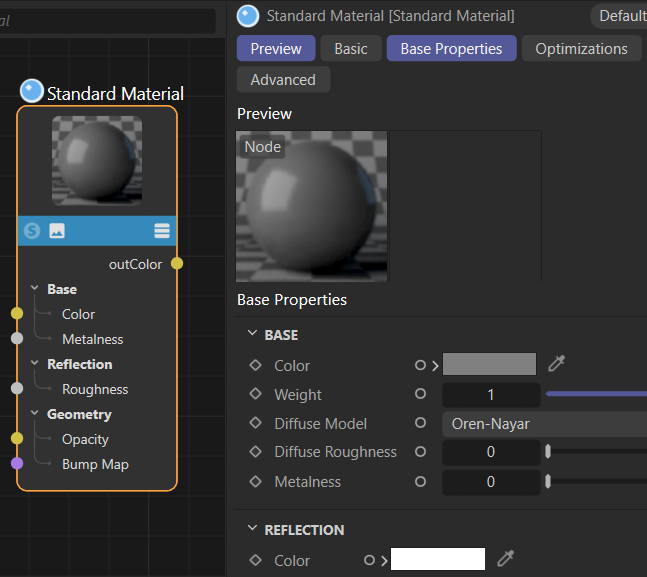](../_images/manual_graph_descriptions_node_references.png)

*Fig. 3: Complex nodes such as the Redshift Standard Material node often have ambiguous port names where we must be more specific in our label references.*

```python
def LabelReferences() -> None:
    """Resolves node types and ports through unambiguous English interface labels.
    """
    # Node types, attributes and ports can be referenced through their English interface labels as
    # alternative to their absolute API identifiers. This is more readable and easier to write, but
    # we must make sure that the label references are unambiguous. For attributes and ports this
    # means that we should included the groups and section labels of where the port is located in 
    # the node's interface.
    maxon.GraphDescription.ApplyDescription(
        maxon.GraphDescription.GetGraph(name="Label References"), {
            # This is a label reference to a node type.
            "$type": "Output",
            "Surface": {
                # This is also a label reference to a node type.
                "$type": "OpenPBR Material",
                # This is a label reference to an input port. We need here the "Base/" because the
                # node has more than one "Color" port.
                "Base/Color": (1, 0, 0),
                # This would be even more precise but is not required in this case. It is also legal
                # to write the same port or attribute multiple times in a description, the last 
                # value will be used (and apart from an example, it is also not very useful).
                "Base Properties/Base/Color": (1, 0, 0),
                # This is unambiguous because the "Metalness" port is unique in the node.
                "Metalness": 1.0,
                # This is not unambiguous, it will raise an error as there are many ports called
                # "Color" in this node.
                # "Color": (1, 0, 0)
            }
        }
    )
```

[Example on GitHub](https://github.com/Maxon-Computer/Cinema-4D-Python-API-Examples/tree/master/examples/nodes/graph_descriptions_references.py#:~:text=LabelReferences)

Cinema 4D will tell you when a reference is ambiguous or not found in an error message. The line *Color”: maxon.Vector(1, 0, 0)* in the example above will for example raise the following error in the Python console of Cinema 4D.

```pytb
...
RuntimeError: The node attribute reference 'Color' (space: 'com.redshift3d.redshift4c4d.class.nodespace',
lang: 'en-US', node: 'com.redshift3d.redshift4c4d.nodes.core.standardmaterial') is ambiguous.
Use a more precise reference or one of the IDs: { net.maxon.node.base.color, ... }
In:
    { <- Error in this scope ->
        Metalness: 1
        $type: Standard Material
        Base/Color: (1,0,0)
        Base Properties/Base/Color: (1,0,0)
        Color: (1,0,0)
    } [graphdescription_impl.cpp(167)]
```

#### Identifier References <a id="graph-description-identifier-references"></a><a id="identifier-references"></a>

But node types, ports, and attributes can also be referenced by their API identifier as commonly done in the Nodes API.

To discover such node identifiers, open the ‘Preferences’ menu from *Edit/Preferences* in the main menu of Cinema 4D. There select the ‘Node Editor’ category and enable the option ‘IDs’. When you select now a node in the Node Editor, you will see its identifiers in the selection info box in the lower left corner. The ‘Asset Id’ of a node is its type identifier, it must be used when a node is instantiated, in graph descriptions with the *GraphDescription.Type* field. The ‘Id’ of a node or port is the identifier for that specific instance of something. For nodes it can be used to reference an existing node in a graph or graph description, for ports it is used to reference a port in a node. To see the Id of a port, you must select the port in a node.

API identifiers in graph descriptions are always prefixed with a hash (*#*) so that they can be disambiguated from label references. Just as for label references, identifiers can be written absolute and lazy. An absolute identifier is a full identifier that uniquely identifies an entity, while a lazy identifier is a shortened version of an absolute identifier where we only write out what we deem relevant for identifying something. Cinema 4D will raise an error when a lazy identifier is ambiguous or has no match at all. Lazy port identifiers are matched in the context of the node they are used in and also split by in- and output ports. This means that one for example has only to worry about avoiding collisions between input ports of a node type when lazily referencing an input port of that node type.

<a id="id3"></a>

[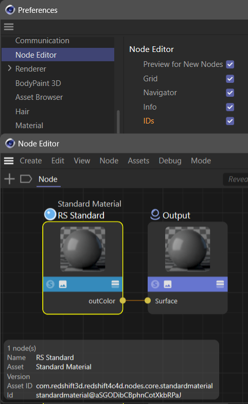](../_images/manual_graph_descriptions_node_identifiers.png)

*Fig. 4: Top - The place in the preferences where to enable displaying node identifiers. Bottom - Once enabled, the Node Editor will show the IDs and Asset IDs of selected nodes and ports.*

##### Absolute Identifiers <a id="absolute-identifiers"></a>

Absolute identifiers are the most precise and robust way to reference an entity (but can also be a bit cumbersome). For node templates and attributes, they are just an ID, for ports they are node paths. Node paths are easily distinguishable, as they either start with a *<* for input ports or a *>* for output ports. Nested ports such as port bundles or variadic ports also contain slashes in their identifiers to separate the parent and child ports.

|   |   |
|---|---|
| Node Template | *#com.redshift3d.redshift4c4d.nodes.core.openpbrmaterial* |
| Node Attribute | *#net.maxon.node.base.name* |
| Top Level Port | *#\<com.redshift3d.redshift4c4d.nodes.core.openpbrmaterial.base_color* |
| Nested Port | *#\<com.redshift3d.redshift4c4d.nodes.core.texturesampler.tex0/path* |

##### Lazy Identifiers <a id="lazy-identifiers"></a>

Lazy identifiers are a shortened version of an absolute identifier where we only write out what we deem relevant for identifying something. The graph description API will try to resolve lazy identifiers at runtime, and raise an error when a lazy identifier is ambiguous or has no match at all. Lazy identifiers are signaled by the *~* character in front or the end of an identifier. The identifier *net.maxon.node.base.name* for example can be lazily referenced as *#~.name*. The identifier *com.redshift3d.redshift4c4d.nodes.core.openpbrmaterial* can be lazily referenced as *#~.openpbrmaterial*. If a lazy identifier resolves, depends on if in the context of they are made in, and if exactly one entity matches the lazy identifier. If multiple entities match a lazy identifier, an error is raised.

Lazy identifiers are resolved in context, which means that a node template identifier can only collide with other node template identifiers, a node attribute identifier can only collide with other node attribute identifiers, and an input port identifier can only collide with other input port identifiers within the node they are used in. So, an input port and an output port of the same node can never collide, and a lazy reference that might match multiple ports on node type A but only one port on node type B will resolve to the port on node type B when used in a scope describing a node of type B.

|   |   |
|---|---|
| Node Template | *#~.openpbrmaterial* |
| Node Attribute | *#~.name* |
| Top Level Port | *#~.base_color* |
| Nested Port | *#~.tex0/path* |

Find below the ‘Hello World’ example written once with absolute API identifiers and once with lazy API identifiers.

```python
def IdentifierReferences() -> None:
    """Contrasts absolute API identifiers with shorter lazy identifier references.
    """
    # An alternative to label references are API identifiers. We can use here the absolute identifiers 
    # or lazy identifiers.

    # The description with absolute identifiers, this gets hard to read quite quickly.
    maxon.GraphDescription.ApplyDescription(
        maxon.GraphDescription.GetGraph(name="Identifier References"), {
            # An output node.
            "$type": "#com.redshift3d.redshift4c4d.node.output",
            # Its surface input port.
            "#<com.redshift3d.redshift4c4d.node.output.surface": {
                # An OpenPBR Material node.
                "$type": "#com.redshift3d.redshift4c4d.nodes.core.openpbrmaterial",
                # And its base color, metalness, and specular IOR input ports.
                "#<com.redshift3d.redshift4c4d.nodes.core.openpbrmaterial.base_color": (1, 0, 0),
                "#<com.redshift3d.redshift4c4d.nodes.core.openpbrmaterial.base_metalness": 1.0,
                "#<com.redshift3d.redshift4c4d.nodes.core.openpbrmaterial.specular_ior": 1.5
            }
        }
    )

    # The same description with lazy identifiers, this is much more readable. It is recommended
    # to include leading dots in lazy identifiers, e.g., "#~.base_color" and not "#~base_color"
    # to avoid matching against "foo.barbase_color".
    maxon.GraphDescription.ApplyDescription(
        maxon.GraphDescription.GetGraph(name="Lazy Identifier References"), {
            "$type": "#~.output",
            "#~.surface": {
                "$type": "#~.openpbrmaterial",
                # When there would be more than one port or attribute in this node which ends in
                # ".base_color" in this node, this would be ambiguous and raise an error. This can
                # especially true for port bundles and variadic ports, we would then have to make
                # the lazy identifier more specific, e.g., "#~.foo/base_color" or "#~.foo/_0/base_color".
                # But for simple ports like this, we can often just type out the last component.
                "#~.base_color": (1, 0, 0),
                "#~.base_metalness": 1.0,
                "#~.specular_ior": 1.5
            }
        }
    )
```

[Example on GitHub](https://github.com/Maxon-Computer/Cinema-4D-Python-API-Examples/tree/master/examples/nodes/graph_descriptions_references.py#:~:text=IdentifierReferences)

#### Nested Ports <a id="nested-ports"></a><a id="graph-description-nested-ports"></a>

In the previous sections we only discussed ports and attributes that were direct children of a node. But the Nodes API has two concepts of ports which can hold ports: *port bundles* and *variadic ports*.

> **Note:** The Nodes view in the [Resource Index](../indexes/resource_index.md) provides full label references and absolute node paths for both port bundles and nested ports, which considerably simplifies writing graph descriptions and Nodes API code. You should however still conceptually understand the difference between port bundles and variadic ports, so that you know when you have to modify a variadic port count. Variadic ports are explicitly marked as *variadic* in the node details, while port bundles are treated just like normal ports.

**Types of Nested Ports**

*Port bundles* are the representation of complex data types where a singular parent port, the data type, has multiple child ports, the fields of the data type. The characteristic of a port bundle is that it has a fixed number of children and that the user can both connect the whole data type parent port and its children individually.

*Variadic ports* are ports where the user can dynamically add and remove child ports with ‘+’ and ‘-‘ buttons in the node UI. Variadic ports are used to represent lists of multiple things of the same type, such as the points of a spline or the layers of a material. The characteristic of a variadic port is that it has a dynamic number of children and other than for a port bundle, the user cannot set all nested ports by connecting the parent port.

The different nested port types can be visually distinguished as follows:

- Elements printed in bold which have elements parented to them, e.g., the ‘Image’ element in *Fig. 5*, are not ports at all but attributes groups as described in [Label References](#graph-description-label-references).
- Port bundles are identifiable by not being printed in bold and by ‘not’ having a ‘+’ and ‘-‘ buttons shown on them when hovered.
- Variadic ports are identifiable by not being printed in bold and by having a ‘+’ and ‘-‘ buttons shown on them when hovered.

While the GUI for variadic ports is unified in the Node Editor, it is not in the Attribute Manager. Many nodes implement ‘Add’ and ‘Remove’ buttons for their variadic ports, e.g., the ‘Material’ node from the ‘Standard Renderer’ for its ‘Surface’ layers. But there is no guarantee to find them here, as exemplified by the ‘RS Scalar Ramp’ node which is using the spline GUI to manage its points.

An ‘RS Texture’ node has the ‘Filename’ port which is a port bundle (*Fig. 5*). The port is of datatype *com.redshift3d.redshift4c4d.portbundle.file*. If we would look up the RS Texture node in the Resource Editor, we would see that where we see a tree of multiple ports in the Node Editor, there is only a singular attribute/port defined in the resource which is of type *portbundle.file*.

An ‘RS Scalar Ramp’ node has the ‘Points’ port which is a variadic port (*Fig. 6*). We can distinguish it from a port bundle by the fact that we can add and remove ports as a user. Other than for a port bundle, where each child can be a port of a different data type, the children of a variadic port are all of the same data type. What we can also see at the Scalar Ramp example is also that variadic ports and port bundles often coexist. The ‘Ramp/Ramp’ port of the RS Scalar Ramp node is a port bundle of type *net.maxon.render.portbundle.spline* which contains a variadic port ‘Points’ which holds a list of port bundle ports of type *net.maxon.render.portbundle.splinepoint*.

<a id="id4"></a>

[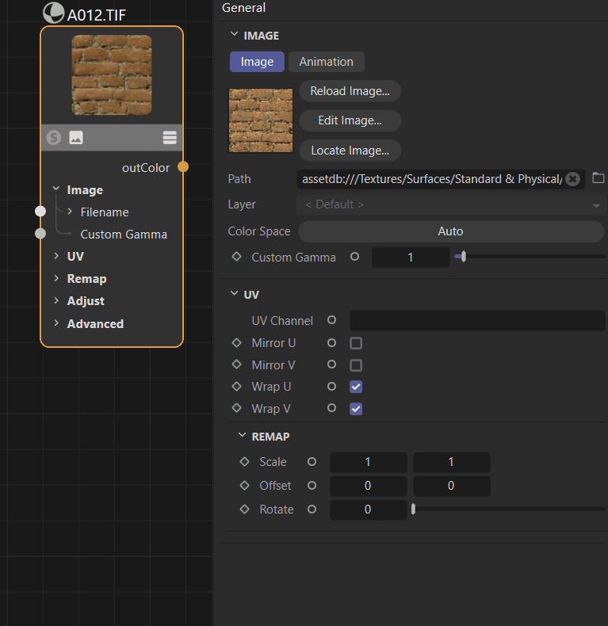](../_images/manual_graph_descriptions_port_bundle.gif)

*Fig. 5: An ‘RS Texture’ node has the ‘Filename’ port which is a port bundle.*

<a id="id5"></a>

[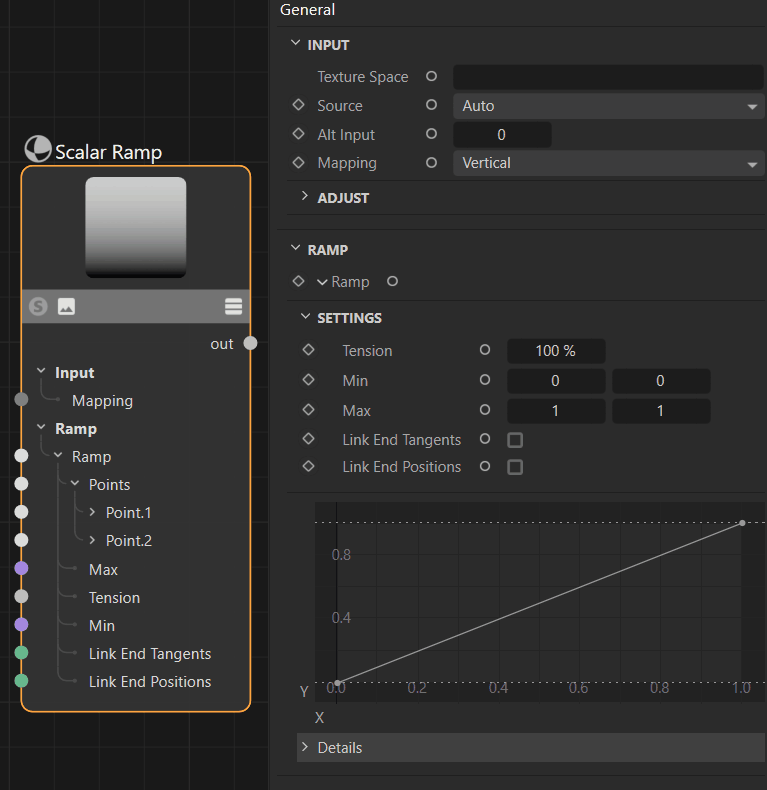](../_images/manual_graph_descriptions_variadic_port.gif)

*Fig. 6: An ‘RS Scalar Ramp’ node has the ‘Points’ port which is a variadic port.*

**Referencing Nested Ports**

Nested ports references are composed with the */* character as a delimiter between components, this applies to both label and API identifier references.

```python
def PortBundleReferences() -> None:
    """Sets a Filename bundle child through complete and shortened nested port paths.
    """
    # Applies graph descriptions that create an RS Texture node and set the texture path.
    maxon.GraphDescription.ApplyDescription(
        maxon.GraphDescription.GetGraph(name="Referencing Port Bundles (Label)"), {
            "$type": "Texture",

            # We set the #Path port of the #Filename port bundle to the URL of an asset. 'General' and
            # 'Image' are both not ports but attribute groups and this is the most verbose form of a
            # label reference.
            "General/Image/Filename/Path": "asset:///file_eb62aff065c50a2b",

            # These would all also work due to the ability of graph descriptions to lazily resolve label
            # references and the fact that in this case each of them unambiguously identifies an input port
            # in an RS Texture node.
            "Image/Filename/Path": "asset:///file_eb62aff065c50a2b",
            "Filename/Path": "asset:///file_eb62aff065c50a2b",
            "Path": "asset:///file_eb62aff065c50a2b",
        })

    # Applies graph descriptions that create an RS Texture node and set the texture path.
    maxon.GraphDescription.ApplyDescription(
        maxon.GraphDescription.GetGraph(name="Referencing Port Bundles (ID)"), {
            "$type": "Texture",

            # This is the absolute API identifier reference for the #Path port in the #Filename port bundle,
            # where:
            #
            #   #                                        denotes a description identifier reference
            #   <                                        denotes an input port
            #   com.redshift3d...texturesampler.tex0     denotes the #Filename port bundle
            #   /                                        denotes a child element
            #   path                                     denotes the #Path port of the #Filename port bundle
            "#<com.redshift3d.redshift4c4d.nodes.core.texturesampler.tex0/path":
                "asset:///file_eb62aff065c50a2b",

            # We could also use lazy identifiers to shorten this, although I would not recommend using the
            # last variant as it is very ambiguous for human readers despite being technically unambiguous.
            "#~.texturesampler.tex0/path": "asset:///file_eb62aff065c50a2b",
            "#~.tex0/path": "asset:///file_eb62aff065c50a2b",
            "#~/path": "asset:///file_eb62aff065c50a2b",
        })
```

[Example on GitHub](https://github.com/Maxon-Computer/Cinema-4D-Python-API-Examples/tree/master/examples/nodes/graph_descriptions_references.py#:~:text=PortBundleReferences)

For API identifier references things are very similar:

There is currently not a direct way to get hold of the full API identifier path of a nested port in the Node Editor. One must inspect the parents of a port and manually combine the components as shown in *Fig. 7*. This can be a bit cumbersome but can be offset by the ability of graph descriptions to lazily reference ports, so that we do not have to always resolve the full chain.

Variadic ports are bit more complicated as they are completely unbound when it comes to naming and IDing their dynamically created child ports.

In general, most variadic ports follow the ID assignment pattern *_0, _1, _2, _3, …* where each new port is consecutively named. But there is unfortunately no guarantee that every node will always ID new variadic port children like this. The Standard Renderer ‘Material’ node will for example come with a default ‘Surface’ layer with the ID *1* and then start naming new children after that *_0, _1, _2, _3, …*, effectively offsetting the ID of each node by one. Analogously there could be nodes which do not follow this ID pattern at all, or decide to break it when some condition X is met. You should always assure that adding N variadic ports to a node will result in the IDs you think it would.

Even more unpredictable are variadic port labels. Their default pattern is *{Datatype Name}.{index}*, e.g., *Point.2* for a second point in a list of points. But there is no guarantee that all nodes follow this pattern, as each can implement it manually, and secondly, the name of a variadic port can change at runtime. When we again take the ‘Material’ node of the Standard Renderer as an example, we can see that the name of its ‘Surface’ variadic port children changes, based on the to which port the node is connected to. By default the port names are ‘BSDF Layer.1’, ‘BSDF Layer.2’, ‘BSDF Layer.3’ and so on, but when we then for example connect a BSDF Diffuse node, they will change their name to ‘Diffuse’.

- Graph descriptions cache port labels by their datatype-index pattern.
- Graph descriptions cannot predict to which node one might want to connect the port to and which port name that would entail. As this would require building and executing the graph which is not possible when the very purpose of graph descriptions is to do exactly that.
- It is recommended to use (lazy) API identifier reference for variadic ports when problems occur.

<a id="id6"></a>

[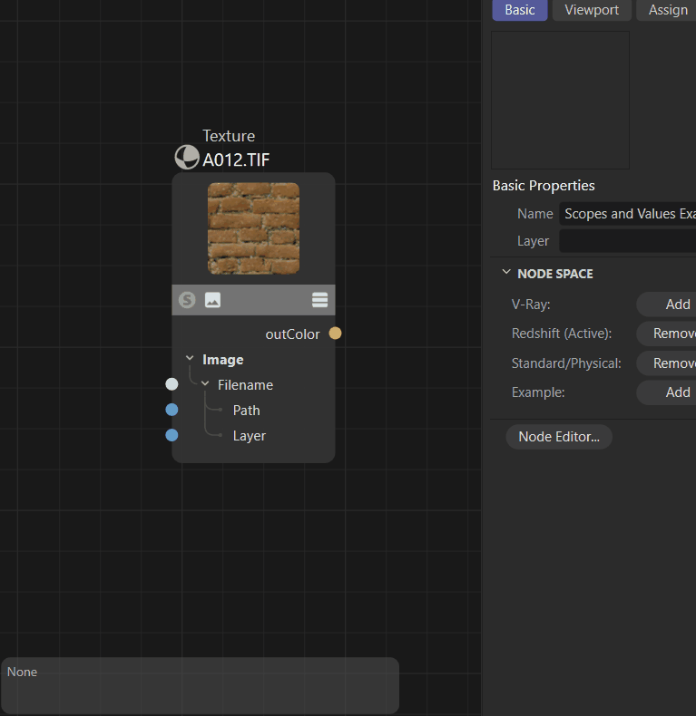](../_images/manual_graph_descriptions_combine_paths.gif)

*Fig. 7: To find the full API identifier of the ‘RS Texture’ ‘Filename/Path’ port, we must inspect two elements, the port bundle ‘Filename’ and its child ‘Path’ to combine their individual identifiers into the full path.*

<a id="id7"></a>

[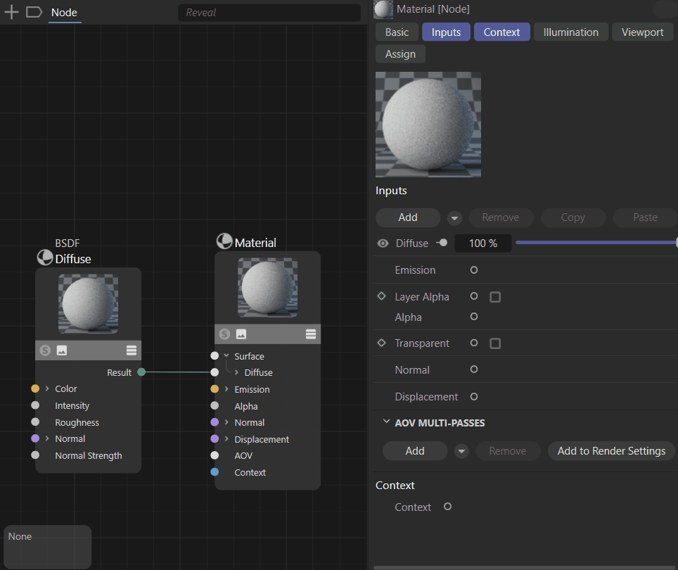](../_images/manual_graph_descriptions_variadic_mess.gif)

*Fig. 8: The ‘Material’ node of the ‘Standard Render’ is a good example for how convoluted variadic port IDs and their labels can be.*

The syntax for addressing children of variadic ports is then the same as for port bundles, the references then often are quite complex as there are often multiple levels of nesting.

```python
def VariadicPortReferences() -> None:
    """Addresses Scalar Ramp points through label and API identifier paths for variadic children.
    """
    # Applies a simple description that adds an RS Scalar Ramp node to the graph.
    maxon.GraphDescription.ApplyDescription(
        maxon.GraphDescription.GetGraph(name="Referencing Variadic Ports (Label)"), {
            "$type": "Scalar Ramp",

            # Sets the Y position of the 0th point (what is shown as Point.1 in the UI). The decomposed
            # reference is:
            #
            #   Ramp            denotes the attribute group 'Ramp' in the node.
            #   Ramp            denotes the port bundle #Ramp of type 'net.maxon.render.portbundle.spline'.
            #   Points          denotes the variadic port #Points in that port bundle which holds a list
            #                    of 'net.maxon.render.portbundle.splinepoint'.
            #   Point.0         denotes the first 'splinepoint' port bundle held by the variadic port.
            #   Position Y      denotes one of the fields of a 'splinepoint' port bundle.
            "Ramp/Ramp/Points/Point.1/Position Y": 1.0,

            # For good measure we now write a few more values and at the same time demonstrate that we can
            # also use lazy references here.
            "Point.1/Position Y": 1.0,
            "Point.1/Interpolation": "linear",
            "Point.2/Position Y": 0.0,
            "Point.2/Interpolation": "linear"
        })

    # Applies a simple description that adds an RS Scalar Ramp node to the graph.
    maxon.GraphDescription.ApplyDescription(
        maxon.GraphDescription.GetGraph(name="Referencing Variadic Ports (ID)"), {
            "$type": "Scalar Ramp",

            # Sets the Y position of the 0th point. The decomposed reference is:
            #
            #   #<                          denotes an input port identifier reference in graph descriptions.
            #   com....rsscalarramp.ramp    denotes the port bundle #Ramp of type 'net.maxon.render.portbundle.spline'.
            #   points                      denotes the variadic port #Points in that port bundle which holds a list
            #                                of 'net.maxon.render.portbundle.splinepoint'.
            #   _0                          denotes the first 'splinepoint' port bundle held by the variadic port.
            #   positiony                   denotes one of the fields of a 'splinepoint' port bundle.
            "#<com.redshift3d.redshift4c4d.nodes.core.rsscalarramp.ramp/points/_0/positiony": 1.0,

            # For good measure we now write a few more values and at the same time demonstrate that we can
            # also use lazy references here.
            "#~_0/positiony": 1.0,
            "#~_0/interpolation": "linear",
            "#~_1/positiony": 0.0,
            "#~_1/interpolation": "linear",
        })
```

[Example on GitHub](https://github.com/Maxon-Computer/Cinema-4D-Python-API-Examples/tree/master/examples/nodes/graph_descriptions_references.py#:~:text=VariadicPortReferences)

> **Note:** See [Setting Port Counts](#graph-description-cmd-set-port-count) for an overview of how to change the number of variadic ports a node has.

### Building Graphs <a id="building-graphs"></a><a id="graph-description-building-graphs"></a>

Graph descriptions are a compact way to describe a graph. They are composed of nested scopes where each scope describes a node in the graph and its connections to other nodes. The following sections will explain the basic concepts of scopes and literals, how to reference existing nodes in a graph description, and how to explicitly connect nodes.

#### Scopes and Literals <a id="scopes-and-literals"></a>

Each node in a graph description is described by a scope. A scope is a Python dictionary (denoted by curly braces, e.g.,`{ “a”: 1, “b”: True }`) that describes the type of a node, its input ports, attributes, and other settings. To connect two nodes, a new scope is nested inside the scope of the node to connect to. A side effect of this is that graph descriptions construct a graph from its output to its inputs and not from the inputs to the output as we would usually read a graph.

A scope describes its node as key-value pairs. The scope *{“Base/Color”: maxon.Color(1, 0, 0)}* for example has the key *Base/Color* which describes an input port by its label and a value that is the color red. Here we have assigned a literal value to the port, which means that we did not construct another node to set the value of the port, but set it directly. But we could also assign a new scope to the port and with that to connect it to another and new node. This is done by opening a new scope inside the scope of the node to connect to. The scope *{“Base/Color”: {“$type”: “Texture”}}* for example would connect the ‘Color’ port of the described node to a new node of type ‘Texture’.

When we look at the nested scope in *{“Base/Color”: {“$type”: “Texture”}}* we can see an unusual key named *$type*. It is an alias for [`maxon.GraphDescription.Type`](../modules/maxon_generated/frameworks/nodes/interface/maxon.GraphDescription.Type.md#maxon.GraphDescription.Type) and is used to declare the mandatory type of the node a scope describes. There are multiple special keys that can appear in a scope and they are all prefixed by a *$*.

> **Note:** Use [Partial Descriptions](#graph-description-partial-descriptions) when you want to construct graphs that do not terminate into a singular node.

<a id="id8"></a>

[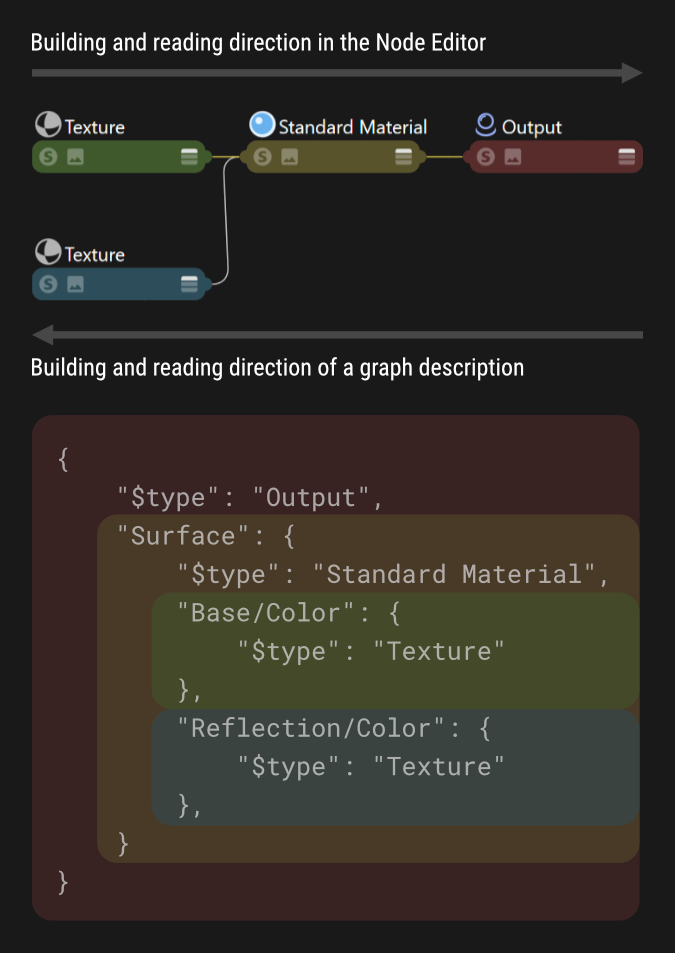](../_images/manual_graph_descriptions_reading_direction.png)

*Fig. 9: Graph descriptions have an inverted reading direction compared to the Node Editor, the outmost node described is the node all other nodes are connected to.*

#### Referenced Nodes <a id="referenced-nodes"></a><a id="graph-description-referenced-nodes"></a>

Another special key that can appear in a scope is *$id* which is used to set the identifier of a node in a graph. When we want to connect an existing node in a graph description, we can pass its identifier prefixed by the hash character as the value of the port where we want to connect the node to. The scope *{“$type”: “Texture”, $id”: “mytex”}* defines a node of type ‘Texture’ with the identifier *mytex*. We can now connect this texture node to the color port of a another node by writing *{“Color”: “#mytex”}*. Node identifiers must be unique in a graph to work correctly and a graph description must define a node and its identifier before it is referenced.

> **Note:** Referenced nodes are the more complex feature of [Graph Queries](#graph-description-queries) in disguise.

<a id="id9"></a>

[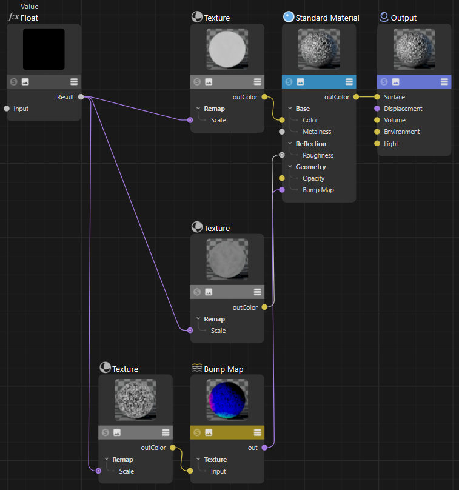](../_images/manual_graph_descriptions_example_scopes.png)

*Fig. 10: This graph is created by the ‘Scopes and Values Example’ shown below, it demonstrates the use of scopes and values in graph descriptions, as well as the use of the *$id* field to reference nodes in a graph description.*

The example shown below creates a more complex setup than the simple examples shown before, demonstrating the inverted structure a graph description uses to describe a graph compared to our reading habits in the Node Editor. Shown is also the use of the *$id* field to reference a node again in a graph description.

```python
def ScopesAndReferencedNodes() -> None:
    """Builds a material graph that shares one Value node through its graph description identifier.
    """
    maxon.GraphDescription.ApplyDescription(
        maxon.GraphDescription.GetGraph(name="Scopes and Values Example"), {
            "$type": "Output",
            # The surface input port of the output node does not have a literal value but describes
            # its value with a nested scope (the {}).
            "Surface -> outColor": {
                # Directly described is an OpenPBR Material node.
                "$type": "OpenPBR Material",
                # The metalness port is set as a literal value, here we do not open a new scope.
                "Base/Metalness": 1.,
                # But the base color is not a literal but connected to a texture node, we open a new scope.
                "Base/Color": {
                    "$type": "Texture",
                    # We set a literal value to the port-bundle child port Path by referencing an asset
                    # by its asset URL. If we wanted to reference a file on disk, we would use the "file"
                    # scheme, e.g., "file:///C:/path/to/file.png".
                    "Image/Filename/Path": "asset:///file_eb62aff065c50a2b",
                    # The scale of the texture is again not a literal but connected to a value node.
                    "Scale": {
                        "$type": "Value",
                        # Here we do something new, we set the id of this node in the graph so that we
                        # can later reference it as #texTransform.
                        "$id": "texTransform",
                        "#~in": (2, 2, 1)
                    }
                },
                # The specular roughness of the OpenPBR Material node, we use another texture here.
                "Specular/Roughness": {
                    "$type": "Texture",
                    "Image/Filename/Path": "asset:///file_8bf49bb0b9992dbe",
                    # Here is something new again, we neither set a literal value nor do we define
                    # a new node/scope to set the value of this Scale port. We reference the node with
                    # the id #texTransform as the value of the scale port. This will result in both
                    # ports being connected to the same value node.
                    "Scale": "#texTransform"
                },
                # The Bump Map port of the OpenPBR Material node, we connect a Bump Map node
                # connected to a texture node reusing our #texTransform value node again.
                "Geometry/Bump Map": {
                    "$type": "Bump Map",
                    "Input Map Type": 0,
                    "Height Scale": .2,
                    "Input": {
                        "$type": "Texture",
                        "Image/Filename/Path": "asset:///file_e706df60a3a533d2",
                        "Scale": "#texTransform"
                    }
                }
            }
        })
```

[Example on GitHub](https://github.com/Maxon-Computer/Cinema-4D-Python-API-Examples/tree/master/examples/nodes/graph_descriptions_basics.py#:~:text=ScopesAndReferencedNodes)

#### Explicit Connections <a id="explicit-connections"></a><a id="graph-description-explicit-connections"></a>

You might have noticed by now that the node-connecting pattern *{“Some Port”: { “$type”: “Some Node” }}* somehow omits the information of which ports exactly are connected between the inner and outer scope. As only the input port of the outer scope is named, *Some Port* in this case, but not the output port of the inner scope; *Some Node* in this case.

This is another short hand syntax of graph descriptions which deliberately makes the output port name implicit. Because many nodes have only a singular output port, which makes the information where to connect to unnecessary. In cases where multiple output ports exist, we must specify the output port we want to connect to by using the *->* syntax to describe what to connect; e.g., *{“Input Port -> Output Port”: { #Node of “Output Port” }}*. Just as for graph descriptions in general, explicit connections follow an inverted order for consistency; one must connect an input to an output and not the other way around.

```python
def ExplicitConnections() -> None:
    """Connects a named OpenPBR Material output explicitly to the Output Surface input.

    This mechanism is only needed when a node has multiple output ports and we want to connect a 
    specific one. In this case, the OpenPBR Material node has only one output port, so we could 
    have used the implicit connection mechanism as in the previous examples.
    """
    # The standard "Hello World" graph descriptions shown in many examples before.
    maxon.GraphDescription.ApplyDescription(
        maxon.GraphDescription.GetGraph(name="Hello World (Explicit Connections)"), {
            "$type": "Output",
            # We describe the only connection in the graph explicitly. We connect the
            # OpenPBRMaterial.outColor port to the Output.Surface port. Or to express it in the 
            # graph description logic: The Output node has an input port named Surface, which 
            # connects to the outColor output port of the OpenPBR Material node we are going to 
            # create in this scope.
            "Surface -> outColor": {
                "$type": "OpenPBR Material",
                "Base/Color": (1, 0, 0),
                "Base/Metalness": 1.0,
            }
        }
    )
```

[Example on GitHub](https://github.com/Maxon-Computer/Cinema-4D-Python-API-Examples/tree/master/examples/nodes/graph_descriptions_basics.py#:~:text=ExplicitConnections)

### Lazy Literals <a id="lazy-literals"></a><a id="graph-description-lazy-literals"></a>

Lazy literals allow you to be less verbose when writing literals (a value that you type out) in a graph description. The most common form of lazy literals are lazy colors and vectors. Instead of explicitly writing out a vector or color type, you can just write a tuple. Graph descriptions will then convert this tuple to the correct type at runtime based on the data type of an attribute or port you are writing to. This also allows you to write data types which are not wrapped for Python, such as a *maxon::Vec2\<maxon::Float32>*. A similar mechanism exists for values of type *maxon::Url*, *maxon::Id*, *maxon::InternedId*, and *maxon::Uuid*. You can write all of these as simple strings now, and graph descriptions will convert them to the correct type at runtime based on the data type of an attribute or port you are writing to.

Finally, for all documents operating in OCIO color management mode, all color values are now implicitly interpreted in sRGB space and then converted to render space at runtime by graph descriptions. In other words, you can define colors as you are used to from the Node Editor, and they will then automatically be converted to the computational color space of the renderer at runtime. This feature can be turned off by setting the *maxon.GraphDescription.PARSE_FLAGS.RAW_COLORS* flag when parsing a graph description. Colors are then interpreted as render space colors (the old behavior) and you have to either provide colors in render space or convert them to render space yourself.

Finally, you can now write asset urls both as their internal *asset://* scheme URL or as their user facing *assetdb:://* url.

```python
def LazyLiterals() -> None:
    """Builds a material graph that uses lazy values for the color and texture paths.
    """
    # Literals are attribute and port values that you directly type out in description (instead of 
    # defining them with a connection). Lazy literals allow you to be less verbose when writing 
    # descriptions and let the Graph Description API handle the details at runtime.
    #
    # Since lazy literals are the defacto standard in graph description examples, this example does 
    # not show you something new, but rather shows you how such values formally would have to be set.
    maxon.GraphDescription.ApplyDescription(
        maxon.GraphDescription.GetGraph(name="Lazy Literals Example"), {
            "$type": "Output",
            "Surface": {
                "$type": "OpenPBR Material",
                "Base/Metalness": 1.,
                "Base/Color": {
                    "$type": "Texture",
                    # The "Image/Filename/Path" port of this node type is of type maxon.Url. Normally, 
                    # we would have to create a maxon.Url object and pass it as the value of this port.
                    #
                    # Using lazy literals, we can just pass a string and the graph description system 
                    # will convert it to a maxon.Url object at runtime. The same will work for ports 
                    # and attributes of type maxon.Id, maxon.InternedId, and maxon.Uuid. Another lazy
                    # literal aspect is us using the user facing (fake) asset URL scheme "assetdb" 
                    # instead of the real asset URL scheme "asset".
                    "Image/Filename/Path": "assetdb:///Textures/Surfaces/Redshift/Metal/mxn_metal_aluminium_foil_crumbled-001_4k_roughness.jpg",

                    # The formal way to set this port, we wrap our url string in a maxon.Url object
                    # and use the "asset" URL scheme to reference an asset.
                    # "Image/Filename/Path": maxon.Url("asset:///file_eb62aff065c50a2b"),

                    # Another form of lazy literals can be vectors. The "General/UV/Remap/Scale" port
                    # uses a data type that is not wrapped for Python: maxon::Vector2d64. But we
                    # can just pass a tuple of two floats now, and the graph description system will 
                    # convert it to a maxon.Vector2d64 object at runtime. You can express any 2, 3, 
                    # or 4 component color or vector as a tuple.
                    "UV/Remap/Scale": (0.5, 0.5),
                },
                # The most important form of lazy literals are colors. They also support the
                # tuple form, but are also interpreted as sRGB values in OCIO documents now, i.e., 
                # the form users are used to from the UI.

                # Will write (1, 0, 0) as an sRGB value, i.e., very roughly (0.61, 0.07, 0.02) in 
                # ACEScg, the default render space of Cinema 4D.
                "Specular/Color": (1, 0, 0),

                # The formal way to set the specular color. We use explicit types, raw colors, and a
                # color converter to convert the color exactly from the input space we chose to
                # render space. See examples/rendering/ocio.py for details on converters. For this
                # wor work, we would have to set:
                #
                #   "$flags": maxon.GraphDescription.Flags.RAW_COLORS,
                #
                # In the top level scope of this description, so that the graph description system 
                # does not convert the color to render space on its own.
                # "Specular/Color": converter.TransformColor(
                #     maxon.Color(1, 0, 0), c4d.COLORSPACETRANSFORMATION_OCIO_SRGB_TO_RENDERING)
            }
        })
```

[Example on GitHub](https://github.com/Maxon-Computer/Cinema-4D-Python-API-Examples/tree/master/examples/nodes/graph_descriptions_basics.py#:~:text=LazyLiterals)

## Advanced Features <a id="advanced-features"></a>

Lines out features which are required by advanced users and can be ignored when taking the first steps with graph descriptions, or when wanting to reduce the complexity of graph descriptions in general. But some features such as [Graph Queries](#graph-description-queries) and [Graph Commands](#graph-description-graph-commands) will be sooner or later required by all users who want to use graph descriptions beyond their most simple form.

### Partial Descriptions <a id="partial-descriptions"></a><a id="graph-description-partial-descriptions"></a>

Unlike introduced in earlier sections of this manual, a graph description is actually not a singular Python dictionary but a list of dictionaries. A singular dictionary in a graph description is called a *partial description*. When a user passes only singular dictionary, a partial description, to [`ApplyDescription`](../modules/maxon_generated/frameworks/nodes/interface/maxon.GraphDescription.md#maxon.GraphDescription.ApplyDescription) as shown in previous examples, it will be automatically wrapped by a list by the API. But we can also pass a list of partial descriptions ourself as this can help with:

- Structuring a graph description in a more readable manner. Imagine having a subgraph whose output is used in multiple places in a graph. We can realize such setup as shown here before by defining the subgraph the first time we need it in the main graph and then use its identifier in the remaining places. With partial descriptions we can first define the subgraph in its own partial description and then always just reference it in the main graph description.
- Modifying existing graphs. When we want to modify an existing graph, we often want to make multiple modifications at once. Partial descriptions allow us to run multiple queries on a graph in a row and modify it with each query.
- Adding multiple sub-graphs not connected to a singular end-node in the graph. Imagine for example preloading a material with a handful of texture setups to be manually wired into a more complex setup by an artist.

<a id="id10"></a>

[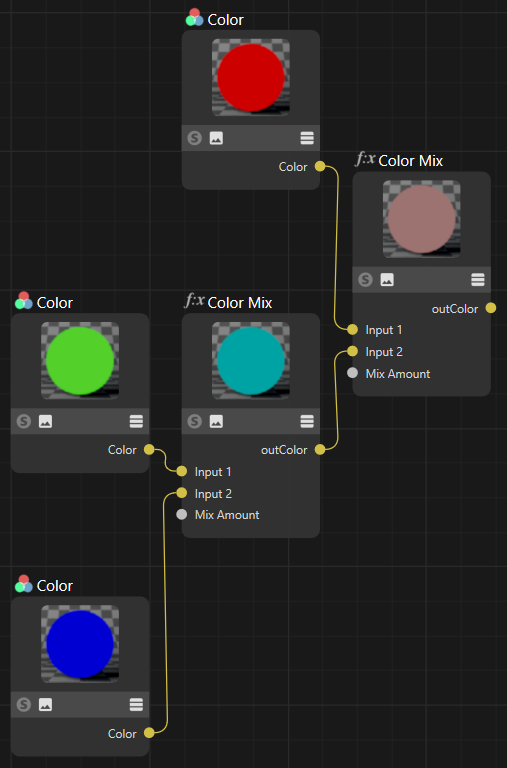](../_images/manual_graph_descriptions_example_partial.png)

*Fig. 13: The output of the simple partial description example shown below. Each Color node has been added by a separate partial description, and only the fourth partial description created the two Mix Color nodes and wired up all nodes.*

```python
def PartialDescriptions() -> None:
    """Builds the same Color Mix graph from a partial-description list and successive applications.
    """
    maxon.GraphDescription.ApplyDescription(
        # Graph descriptions can actually consist of a list of partial descriptions applied to a graph.
        # Prior examples have always used the simplified single description form, but internally,
        # descriptions are always a list of partial descriptions. This also demonstrates that a
        # graph description does not have to necessarily describe a complete graph and can build
        # on existing nodes in a graph.
        maxon.GraphDescription.GetGraph(name="Partial Descriptions"), [
            # First we have three partial descriptions that add the Color nodes for red, green and 
            # blue to the graph.
            {
                "$type": "Color",
                "$id": "red",
                "Inputs/Color": (1, 0, 0, 1)
            },
            {
                "$type": "Color",
                "$id": "green",
                "Inputs/Color": (0, 1, 0, 1)
            },
            {
                "$type": "Color",
                "$id": "blue",
                "Inputs/Color": (0, 0, 1, 1)
            },
            # If we would end our description here, we would just have added three Color nodes to 
            # the graph. But we add a fourth partial description to add the two Color Mix nodes and 
            # wires up all five nodes.
            {
                "$type": "Color Mix",
                "Mix Amount": 0.5,
                "Input 1": "#red",
                "Input 2": {
                    "$type": "Color Mix",
                    "Mix Amount": 0.5,
                    "Input 1": "#green",
                    "Input 2": "#blue",
                },
            }]
    )

    # The former example could also be written as four #ApplyDescription calls and will result in exactly
    # the same graph. This shows also what might have been obfuscated a bit by earlier simpler examples:
    # #ApplyDescription indeed applies a description to a graph and can very well build on existing
    # content in a graph. This is an important fact for understanding what graph queries do.
    graph: maxon.NodesGraphModelRef = maxon.GraphDescription.GetGraph(name="Singular Descriptions")

    # Add the three Color nodes in their own #ApplyDescription call each.
    maxon.GraphDescription.ApplyDescription(
        graph, {
            "$type": "Color",
            "$id": "red",
            "Inputs/Color": (1, 0, 0, 1)
        }
    )

    maxon.GraphDescription.ApplyDescription(
        graph, {
            "$type": "Color",
            "$id": "green",
            "Inputs/Color": (0, 1, 0, 1)
        }
    )

    maxon.GraphDescription.ApplyDescription(
        graph, {
            "$type": "Color",
            "$id": "blue",
            "Inputs/Color": (0, 0, 1, 1)
        }
    )

    # And finally wire everything together in a final call. We could also have done the same with a
    # material graph loaded from disk which contained these three disjunct color Nodes.
    maxon.GraphDescription.ApplyDescription(
        graph, {
            "$type": "Color Mix",
            "Mix Amount": 0.5,
            "Input 1": "#red",
            "Input 2": {
                "$type": "Color Mix",
                "Mix Amount": 0.5,
                "Input 1": "#green",
                "Input 2": "#blue",
            },
        }
    )
```

[Example on GitHub](https://github.com/Maxon-Computer/Cinema-4D-Python-API-Examples/tree/master/examples/nodes/graph_descriptions_basics.py#:~:text=PartialDescriptions)

### Graph Queries <a id="graph-queries"></a><a id="graph-description-queries"></a>

*Graph queries* select one or multiple existing parts in a graph with the goal to reuse or modify these parts. The node references which were already introduced in the section [Referenced Nodes](#graph-description-referenced-nodes) are an implicit form of graph queries. When we have the following section in a graph description,

```python
...
"Reflection/Roughness": {
    "$type": "Texture",
    ...
    # Assigning the value "#texTransform" to
    # this port is an implicit graph query.
    "Scale": "#texTransform"
}, ...
```

then the reference of the ‘Scale’ port to a node with the identifier *#texTransform* (which in this example is defined somewhere else) is an implicit graph query. A graph query is resolved when the graph description is applied to a graph, and in this case, the query will attempt to match a node in the graph that has the identifier *#texTransform* and connect the output port of that node to the ‘Scale’ port. But what we see in this case is only a shorthand form for graph queries for the special case of referencing a node by its identifier.

<a id="id11"></a>

[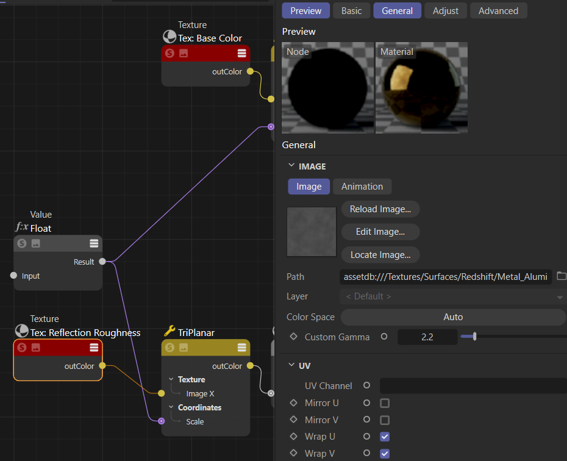](../_images/manual_graph_descriptions_example_query.png)

*Fig. 14: The code example shown at the end of this section uses a graph query to all select texture nodes in a material that use the *file_2e316c303b15a330* asset. When the example is applied to the output of the ‘Callback’ example, it will only set the gamma value of the reflection roughness texture because only it matches the query.*

Internally, the value of the ‘Scale’ port will be expanded into a query scope as shown below. We could also write each identifier reference to a node like this, it would have the same outcome as the shorthand form shown before.

```python
...
"Reflection/Roughness": {
    "$type": "Texture",
    ...
    # A new scope is opened to describe a node to connect this Scale port to.
    "Scale": {
        # But instead of setting the type of a new node with the "$type" field, a "$query" field
        # is used to search for a node with certain properties. The scope containing the query
        # will then act as if it was the node matched by the query.
        "$query": {
            # The query will match a node with the ID "texTransform".
            "$id": "texTransform"
        }
    }
}, ...
```

A graph query is indicated by a scope which does not have the otherwise mandatory *$type* field and instead a *$query* field. Assigned to that *$query* field is then a scope which describes the to be searched node(s). Graph queries can be run both for nodes existing in a graph before a graph description has been applied and nodes that have been created by the currently executed graph description.

#### Query Fields and Modes <a id="query-fields-and-modes"></a>

In the tables below you can find commonly used flags and field options for graph queries.

| Flag | Behavior |
|---|---|
| [`QUERY_FLAGS.NONE`](../modules/maxon_generated/enums/maxon.GraphDescription.QUERY_FLAGS.NONE.md#maxon.GraphDescription.QUERY_FLAGS.NONE) | Requires exactly one match. A query with no matches or multiple matches raises an error. This is the default when no matching mode is specified. |
| [`QUERY_FLAGS.MATCH_FIRST`](../modules/maxon_generated/enums/maxon.GraphDescription.QUERY_FLAGS.MATCH_FIRST.md#maxon.GraphDescription.QUERY_FLAGS.MATCH_FIRST) | Selects the first matching node when more than one node matches. The graph is traversed depth first. Combine it with [`QUERY_FLAGS.MATCH_MAYBE`](../modules/maxon_generated/enums/maxon.GraphDescription.QUERY_FLAGS.MATCH_MAYBE.md#maxon.GraphDescription.QUERY_FLAGS.MATCH_MAYBE) to allow no match. |
| [`QUERY_FLAGS.MATCH_ALL`](../modules/maxon_generated/enums/maxon.GraphDescription.QUERY_FLAGS.MATCH_ALL.md#maxon.GraphDescription.QUERY_FLAGS.MATCH_ALL) | Selects every matching node. Combine it with [`QUERY_FLAGS.MATCH_MAYBE`](../modules/maxon_generated/enums/maxon.GraphDescription.QUERY_FLAGS.MATCH_MAYBE.md#maxon.GraphDescription.QUERY_FLAGS.MATCH_MAYBE) to allow no match. When combined with [`QUERY_FLAGS.MATCH_FIRST`](../modules/maxon_generated/enums/maxon.GraphDescription.QUERY_FLAGS.MATCH_FIRST.md#maxon.GraphDescription.QUERY_FLAGS.MATCH_FIRST), `MATCH_FIRST` takes precedence. |
| [`QUERY_FLAGS.MATCH_MAYBE`](../modules/maxon_generated/enums/maxon.GraphDescription.QUERY_FLAGS.MATCH_MAYBE.md#maxon.GraphDescription.QUERY_FLAGS.MATCH_MAYBE) | Makes a query optional. When no node matches, the query does not raise an error and the affected description scope is not executed. |
| [`QUERY_FLAGS.MATCH_MAYBE_FIRST`](../modules/maxon_generated/enums/maxon.GraphDescription.QUERY_FLAGS.MATCH_MAYBE_FIRST.md#maxon.GraphDescription.QUERY_FLAGS.MATCH_MAYBE_FIRST) | Equivalent to `MATCH_FIRST \| MATCH_MAYBE`: selects the first matching node, or no node when the query has no match. |
| [`QUERY_FLAGS.MATCH_MAYBE_ALL`](../modules/maxon_generated/enums/maxon.GraphDescription.QUERY_FLAGS.MATCH_MAYBE_ALL.md#maxon.GraphDescription.QUERY_FLAGS.MATCH_MAYBE_ALL) | Equivalent to `MATCH_ALL \| MATCH_MAYBE`: selects all matching nodes, including the possibility of selecting none. |
| [`QUERY_FLAGS.SELECT_THIS`](../modules/maxon_generated/enums/maxon.GraphDescription.QUERY_FLAGS.SELECT_THIS.md#maxon.GraphDescription.QUERY_FLAGS.SELECT_THIS) | Changes which node a nested query selects. Without this flag, a nested query selects its outermost node; with it, the node described by the nested query is selected instead. |
| [`QUERY_FLAGS.RAW_URLS`](../modules/maxon_generated/enums/maxon.GraphDescription.QUERY_FLAGS.RAW_URLS.md#maxon.GraphDescription.QUERY_FLAGS.RAW_URLS) | Compares stored URL values instead of their user-facing representations. |
| [`QUERY_FLAGS.RAW_COLORS`](../modules/maxon_generated/enums/maxon.GraphDescription.QUERY_FLAGS.RAW_COLORS.md#maxon.GraphDescription.QUERY_FLAGS.RAW_COLORS) | Compares stored raw color values instead of its sRGB representations during query evaluation. This is relevant only for OCIO color-managed documents. |
| [`QUERY_FLAGS.DEBUG`](../modules/maxon_generated/enums/maxon.GraphDescription.QUERY_FLAGS.DEBUG.md#maxon.GraphDescription.QUERY_FLAGS.DEBUG) | Prints debug information about query evaluation to the Python logger. |

Graph queries can use the following special fields. Their string aliases are shown in the first column; the equivalent [`maxon.GraphDescription`](../modules/maxon_generated/frameworks/nodes/interface/maxon.GraphDescription.md#module-maxon.GraphDescription) attributes are useful when constructing queries in Python code.

| Field | API attribute | Purpose |
|---|---|---|
| `$qmode` | [`QueryMode`](../modules/maxon_generated/frameworks/nodes/interface/maxon.GraphDescription.QueryMode.md#maxon.GraphDescription.QueryMode) | Selects how matching nodes are handled. Its value is a combination of [`maxon.GraphDescription.QUERY_FLAGS`](../modules/maxon_generated/enums/maxon.GraphDescription.QUERY_FLAGS.md#module-maxon.GraphDescription.QUERY_FLAGS) values. |
| `$qop` | [`QueryOperator`](../modules/maxon_generated/frameworks/nodes/interface/maxon.GraphDescription.QueryOperator.md#maxon.GraphDescription.QueryOperator) | Sets the comparison operator for a query value, such as `==`, `!=`, `<`, `>=`, `regex`, or `regex_match`. |
| `$qvalue` | [`QueryValue`](../modules/maxon_generated/frameworks/nodes/interface/maxon.GraphDescription.QueryValue.md#maxon.GraphDescription.QueryValue) | Sets the value used by the comparison. A literal value can be used directly when equality is sufficient. |
| `$qcomp` | [`QueryComposition`](../modules/maxon_generated/frameworks/nodes/interface/maxon.GraphDescription.QueryComposition.md#maxon.GraphDescription.QueryComposition) | Combines multiple comparisons for one port or attribute with `and` or `or`. |
| `$qmaxerr` | [`QueryMaxError`](../modules/maxon_generated/frameworks/nodes/interface/maxon.GraphDescription.QueryMaxError.md#maxon.GraphDescription.QueryMaxError) | Sets the tolerance for numeric comparisons, including scalar, vector, and color values. |
| `$qselports` | [`QuerySelectPorts`](../modules/maxon_generated/frameworks/nodes/interface/maxon.GraphDescription.QuerySelectPorts.md#maxon.GraphDescription.QuerySelectPorts) | Adds matching ports to the result of [`maxon.GraphDescription.EvaluateQuery()`](../modules/maxon_generated/frameworks/nodes/interface/maxon.GraphDescription.md#maxon.GraphDescription.EvaluateQuery). Port selection is not supported by embedded [`maxon.GraphDescription.ApplyDescription()`](../modules/maxon_generated/frameworks/nodes/interface/maxon.GraphDescription.md#maxon.GraphDescription.ApplyDescription) queries. |
| `$queryflags` | [`QueryFlags`](../modules/maxon_generated/frameworks/nodes/interface/maxon.GraphDescription.QueryFlags.md#maxon.GraphDescription.QueryFlags) | Sets query-wide options that are not part of the match mode, such as raw URL or color comparison and debug output. |

#### Query Entry Points <a id="query-entry-points"></a><a id="graph-description-query-entry-points"></a>

Queries can be evaluated directly with [`maxon.GraphDescription.EvaluateQuery()`](../modules/maxon_generated/frameworks/nodes/interface/maxon.GraphDescription.md#maxon.GraphDescription.EvaluateQuery) or embedded in a graph description passed to [`maxon.GraphDescription.ApplyDescription()`](../modules/maxon_generated/frameworks/nodes/interface/maxon.GraphDescription.md#maxon.GraphDescription.ApplyDescription). Direct evaluation returns the matching nodes or ports. Embedded queries select nodes whose scopes are then modified by the remainder of the description; they cannot select ports.

```python
def EvaluateQueryExample() -> None:
    """Demonstrates a simple full case of using a query to select nodes.
    """
    # Most query syntax examples in this file abstract away the boiler plate code of getting the graph
    # of something and evaluating a query against it. This example shows the full process.
    
    # Get the first material in the document and its Redshift material graph.
    material: c4d.BaseMaterial = doc.GetFirstMaterial()
    graph: maxon.NodesGraphModelRef = maxon.GraphDescription.GetGraph(
        material, maxon.NodeSpaceIdentifiers.RedshiftMaterial)

    # Run a simple query that selects all nodes of type "OpenPBR Material" with a Base/Weight 
    # value of 0.5.
    result: list[maxon.NodesNodeRef] = maxon.GraphDescription.EvaluateQuery(graph,
        # A query as shown in the syntax examples. This could also appear in a "$query" field of a 
        # graph description (to then select these nodes for modification), but here we just use it 
        # as a standalone query.                          
        {
            "$qmode": maxon.GraphDescription.QUERY_FLAGS.MATCH_MAYBE_ALL,
            "$type": "OpenPBR Material",
            "Base/Weight": 0.5
        }
    )

    print(f"Found {len(result)} matches: {result}")
```

[Example on GitHub](https://github.com/Maxon-Computer/Cinema-4D-Python-API-Examples/tree/master/examples/nodes/graph_descriptions_queries.py#:~:text=EvaluateQueryExample)

```python
def ApplyDescriptionExample() -> None:
    """Demonstrates cases of using a queries inside graph descriptions to select nodes for modification.
    """
    # Get the first material in the document and its Redshift material graph.
    material: c4d.BaseMaterial = doc.GetFirstMaterial()
    if material is None:
        print("No material found in the document.")
        return

    graph: maxon.NodesGraphModelRef = maxon.GraphDescription.GetGraph(
        material, maxon.NodeSpaceIdentifiers.RedshiftMaterial)

    # Use a query to select all Texture nodes in a graph with a Custom Gamma value of 1.0 and set 
    # their Custom Gamma value to 2.2. ApplyDescription supports the exact same query syntax as 
    # EvaluateQuery in all its complexity with one exception: ApplyDescription does not support 
    # queries that select ports, as it makes no sense to apply a description to a port.
    maxon.GraphDescription.ApplyDescription(
        graph, {
            "$query": {
                # Here we define that this query scope is meant to match everything ...
                "$qmode": maxon.GraphDescription.QUERY_FLAGS.MATCH_MAYBE_ALL,
                # ... that has the properties defined here ...

                "$type": "Texture",         # Is a Texture node ...
                "Image/Custom Gamma": 1.0, # ... and has a Custom Gamma value of 1.0.

            },
            # ... so that we can set the gamma value of all matching nodes to 2.2.
            "Image/Custom Gamma": 2.2
        }
    )
```

[Example on GitHub](https://github.com/Maxon-Computer/Cinema-4D-Python-API-Examples/tree/master/examples/nodes/graph_descriptions_queries.py#:~:text=ApplyDescriptionExample)

#### Query Syntax <a id="query-syntax"></a><a id="graph-description-query-syntax"></a>

The query mode controls how matches are selected. [`QUERY_FLAGS.NONE`](../modules/maxon_generated/enums/maxon.GraphDescription.QUERY_FLAGS.NONE.md#maxon.GraphDescription.QUERY_FLAGS.NONE) requires exactly one match, [`QUERY_FLAGS.MATCH_FIRST`](../modules/maxon_generated/enums/maxon.GraphDescription.QUERY_FLAGS.MATCH_FIRST.md#maxon.GraphDescription.QUERY_FLAGS.MATCH_FIRST) selects the first match, and [`QUERY_FLAGS.MATCH_ALL`](../modules/maxon_generated/enums/maxon.GraphDescription.QUERY_FLAGS.MATCH_ALL.md#maxon.GraphDescription.QUERY_FLAGS.MATCH_ALL) selects all matches. Add [`QUERY_FLAGS.MATCH_MAYBE`](../modules/maxon_generated/enums/maxon.GraphDescription.QUERY_FLAGS.MATCH_MAYBE.md#maxon.GraphDescription.QUERY_FLAGS.MATCH_MAYBE) to make no match non-fatal, or use the composite [`QUERY_FLAGS.MATCH_MAYBE_FIRST`](../modules/maxon_generated/enums/maxon.GraphDescription.QUERY_FLAGS.MATCH_MAYBE_FIRST.md#maxon.GraphDescription.QUERY_FLAGS.MATCH_MAYBE_FIRST) and [`QUERY_FLAGS.MATCH_MAYBE_ALL`](../modules/maxon_generated/enums/maxon.GraphDescription.QUERY_FLAGS.MATCH_MAYBE_ALL.md#maxon.GraphDescription.QUERY_FLAGS.MATCH_MAYBE_ALL) flags. The remaining flags control result selection, value comparison, or diagnostic output.

Literal values use equality by default. The *$qop* and *$qvalue* fields make comparisons explicit. Numeric operators are *==*, *!=*, *<*, *<=*, *>*, and *>=*; string values additionally support *regex* and *regex_match*.

```python
def BasicQuerySyntax() -> dict[str, dict]:
    """Demonstrates the most basic form of a query, which is a literal value query.
    """
    # This is the most simply form of a query, testing for a literal value. We also use the shorthand
    # form which does not specify a query operator (and with that use the default equality operator). 
    query_literal: dict = {
        "$qmode": maxon.GraphDescription.QUERY_FLAGS.MATCH_MAYBE_ALL,

        # Match all nodes of type "OpenPBR Material" ...
        "$type": "OpenPBR Material",

        # ... which also have a Base/Weight value of 0.5.
        "Base/Weight": 0.5
    }

    # Queries do not have to target a specific node type, they can also be anonymous, i.e., they can 
    # just search for any node that fulfills the query conditions. Here we search for any node type
    # that has a Base/Weight input port or attribute that is set to 0.5.
    anonymous_query_literal: dict = {
        "$qmode": maxon.GraphDescription.QUERY_FLAGS.MATCH_MAYBE_ALL,

        # Match all nodes that have a Base/Weight parameter with a value of 0.5.
        "Base/Weight": 0.5
    }

    return {"query_literal": query_literal, "anonymous_query_literal": anonymous_query_literal}
```

[Example on GitHub](https://github.com/Maxon-Computer/Cinema-4D-Python-API-Examples/tree/master/examples/nodes/graph_descriptions_queries.py#:~:text=BasicQuerySyntax)

```python
def QueryOperatorSyntax() -> dict[str, dict]:
    """Demonstrates the use of comparison operators in queries.
    """
    # But queries can also take more complex forms. One level of complexity is to use a dictionary 
    # instead of a literal value, which allows us to specify a query operator explicitly.

    # Match all nodes that have a Base/Weight value equal to 0.5. This is the same as the 
    # anonymous_query_literal example but here we explicitly specify the equality operator.
    query_comp_equal: dict = {
        "$qmode": maxon.GraphDescription.QUERY_FLAGS.MATCH_MAYBE_ALL,

        "Base/Weight": {
            "$qop": "==",
            "$qvalue": 0.5
        }
    }

    # Other query operators for numeric values are: "!=", "<", "<=", ">", ">=". For string values, 
    # the operators are: "==", "!=", "regex", "regex_match" (see RegexQuerySyntax for examples).

    # Match all nodes that have a Base/Diffuse Roughness value not equal to 0.0.   
    query_comp_not_equal: dict = {
        "$qmode": maxon.GraphDescription.QUERY_FLAGS.MATCH_MAYBE_ALL,

        "Base/Diffuse Roughness": {
            "$qop": "!=",
            "$qvalue": 0.0
        }
    }

    # Match all nodes that have a Base/Weight value smaller than 0.5.
    query_comp_less: dict = {
        "$qmode": maxon.GraphDescription.QUERY_FLAGS.MATCH_MAYBE_ALL,

        "Base/Weight": {
            "$qop": "<",
            "$qvalue": 0.5
        }
    }

    # Match all nodes that have a Base/Weight value smaller than or equal to 0.5.
    query_comp_less_equal: dict = {
        "$qmode": maxon.GraphDescription.QUERY_FLAGS.MATCH_MAYBE_ALL,

        "Base/Weight": {
            "$qop": "<=",
            "$qvalue": 0.5
        }
    }

    # Match all nodes that have a Base/Weight value greater than 0.5.
    query_comp_greater: dict = {
        "$qmode": maxon.GraphDescription.QUERY_FLAGS.MATCH_MAYBE_ALL,

        "Base/Weight": {
            "$qop": ">",
            "$qvalue": 0.5
        }
    }

    # Match all nodes that have a Base/Weight value greater than or equal to 0.5.
    query_comp_greater_equal: dict = {
        "$qmode": maxon.GraphDescription.QUERY_FLAGS.MATCH_MAYBE_ALL,

        "Base/Weight": {
            "$qop": ">=",
            "$qvalue": 0.5
        }
    }

    return {"query_comp_equal": query_comp_equal, "query_comp_not_equal": query_comp_not_equal,
            "query_comp_less": query_comp_less, "query_comp_less_equal": query_comp_less_equal,
            "query_comp_greater": query_comp_greater, "query_comp_greater_equal": query_comp_greater_equal}
```

[Example on GitHub](https://github.com/Maxon-Computer/Cinema-4D-Python-API-Examples/tree/master/examples/nodes/graph_descriptions_queries.py#:~:text=QueryOperatorSyntax)

#### Query Compositions <a id="query-compositions"></a><a id="graph-description-query-compositions"></a>

Use *$qcomp* to apply multiple comparisons to one port or attribute. Its *$qop* can combine conditions with *and* or or. Each condition has a unique key and uses *$qop* and *$qvalue* like an ordinary comparison.

```python
def CompositionQuerySyntax() -> dict[str, dict]:
    """Demonstrates the use of composition queries, which combine multiple conditions for a single port or attribute.
    """
    # The next level of complexity is to compose multiple conditions for a single port or attribute.
    # This is called a composition query. Technically, composition could contain other composition 
    # queries, but this is rarely useful in practice. 

    # This will match any node that has a Base/Weight that is larger than or equal to 0.25, smaller than
    # or equal to 1.0, and not equal to 0.5. Since we do not specify an operator for the composition, it
    # defaults to "and".
    query_comp_and: dict = {
        "$qmode": maxon.GraphDescription.QUERY_FLAGS.MATCH_MAYBE_ALL,

        # As usual we declare the port or attribute we want to query for.
        "Base/Weight": {

            # But instead of defining a query operator and value, we define a composition query, 
            # with "$qcomp". "Base/Weight" must now either fullfill all of the conditions in the 
            # composition query or at least one of them.

            "$qcomp": {

                # The mode with which the queries are composed together. 'and' is the default, we
                # therefore could also omit this line. So, in this case we indicate that all conditions 
                # must be fulfilled instead of at least one.
                "$qop": "and",

                # The three conditions of this composition which must be met. You can choose any keys
                # for the conditions, but they must be unique within the composition query.
                "0": {
                    "$qvalue": 0.25, # The Base/Weight value must be larger than or equal to 0.25.
                    "$qop": ">="
                },
                "1": {
                    "$qvalue": 1.0, # The Base/Weight value must be smaller than or equal to 1.0.
                    "$qop": "<="
                },
                "2": {
                    "$qvalue": 0.5, # The Base/Weight value must not be equal to 0.5.
                    "$qop": "!="
                }
            }
        }
    }

    # This is an or-composition query, i.e., it will match any node that has a Base/Weight that
    # is either exactly 0.25 or exactly 0.5.
    query_comp_or: dict = {
        "$qmode": maxon.GraphDescription.QUERY_FLAGS.MATCH_MAYBE_ALL,

        "Base/Weight": {
            "$qcomp": {
                "$qop": "or",
                "a": {
                    "$qvalue": 0.25, # The Base/Weight value must be equal to 0.25.
                    "$qop": "=="
                },
                "b": {
                    "$qvalue": 0.5, # OR the Base/Weight value must be equal to 0.5.
                    "$qop": "=="
                }
            }
        }
    }

    return {"query_comp_and": query_comp_and, "query_comp_or": query_comp_or}
```

[Example on GitHub](https://github.com/Maxon-Computer/Cinema-4D-Python-API-Examples/tree/master/examples/nodes/graph_descriptions_queries.py#:~:text=CompositionQuerySyntax)

#### Numeric, Vector, and Color Queries <a id="numeric-vector-and-color-queries"></a><a id="graph-description-query-vectors"></a>

Numeric comparisons use a tolerance controlled by *$qmaxerr*. Tuples can query vector and color values. In OCIO color-managed documents, colors are compared in sRGB space by default; use *RAW_COLORS* to compare stored render-space values. Vector and color values also support ordered and composition comparisons.

```python
def VectorQuerySyntax() -> dict[str, dict]:
    """Demonstrates the use of vector queries, which can be used to query for color and vector values.
    """
    # We search for all OpenPBR Material nodes in a graph that have a Base/Color value of (1, 0, 0).
    # This query looks harmless but there is more to it. When the document from which the queried
    # graph is taken from is an OCIO color managed document (which is the default since 2026), then
    # the colors stored by a node will be actually in Render Space, and not in sRGB space, which is 
    # what the user usually sees in the UI in color pickers. Graph description queries automatically 
    # unpack color values from sRGB space to Render Space before carrying out the comparison. So, we
    # are looking here for all OpenPBR Material nodes that have a Base/Color value that is equivalent 
    # to (1, 0, 0) in sRGB space, which is roughly the same as (0.6131, 0.0702, 0.0206) in Render Space.
    # For non-OCIO color managed documents, the query will just compare the literal values.
    query_simple_color: dict = {
        "$qmode": maxon.GraphDescription.QUERY_FLAGS.MATCH_MAYBE_ALL,

        "$type": "OpenPBR Material",
        "Base/Color": (1, 0, 0)
    }

    # The same query as query_simple_color, but as raw query, i.e., no implicit unpacking of color
    # values to sRGB space is done, tested will be the raw stored render space value.
    #
    # We also use "$qmaxerr" which allows us to specify a tolerance value for numeric comparisons. 
    # When not explicitly set, the default tolerance is 1E-6, which is usually sufficient for most 
    # cases. But since we here only provide values with four significant digits, and Render Space 
    # values tend to have a lot of places after the comma, we have to increase the  tolerance to 
    # 1E-3, otherwise the query might not match nodes. You can also use "$qmaxerr" for scalar 
    # queries to finetune the tolerance of the numeric comparisons.
    query_raw_color: dict = {
        "$qmode": maxon.GraphDescription.QUERY_FLAGS.MATCH_MAYBE_ALL |
                  maxon.GraphDescription.QUERY_FLAGS.RAW_COLORS,
        "$qmaxerr": 1E-3,

        "$type": "OpenPBR Material",
        "Base/Color": (0.6131, 0.0702, 0.0206)
    }

    # Finally, vector and color queries can also support <, <=, >, >= operators (and of course also 
    # != and ==). vec1 < vec2 means that all components of vec1 are smaller than or equal to the 
    # corresponding components of vec2, and at least one component is smaller. Similarly, vec1 <= 
    # vec2 means that all components of vec1 are smaller than or equal to the corresponding components 
    # of vec2. 

    # We use it here to find all Ramps that have a Knot.1 Color which is larger than or equal to 
    # (0.25, 0.25, 0.1) and smaller than or equal to (1, 1, 1). These operations again happen in 
    # sRGB space, despite the fact that the stored values are (usually) in Render Space.
    query_comp_color: dict = {
        "$qmode": maxon.GraphDescription.QUERY_FLAGS.MATCH_MAYBE_ALL,

        "$type": "Ramp",
        "Ramp/Knot.1/Color": {
            "$qcomp": {
                "a": {
                    "$qvalue": (.25, .25, .1),
                    "$qop": ">="
                },
                "b": {
                    "$qvalue": (1, 1, 1),
                    "$qop": "<="
                }
            }
        }
    }

    return {"query_simple_color": query_simple_color, "query_raw_color": query_raw_color,
            "query_comp_color": query_comp_color}
```

[Example on GitHub](https://github.com/Maxon-Computer/Cinema-4D-Python-API-Examples/tree/master/examples/nodes/graph_descriptions_queries.py#:~:text=VectorQuerySyntax)

#### String, URL, and Regular Expression Queries <a id="string-url-and-regular-expression-queries"></a><a id="graph-description-query-regex-urls"></a>

String queries support ECMAScript regular expressions. *regex* searches for a matching substring, while *regex_match* requires the complete value to match. URL queries use the user-facing URL form by default; *RAW_URLS* disables that conversion and compares the stored URL.

```python
def RegexQuerySyntax() -> dict[str, dict]:
    """Demonstrates the use of regular expression queries, which can be used to query for string values.
    """
    # Cinema 4D uses the C++ std::regex library for regex queries. All queries are run with the 
    # ECMAScript regex grammar, which is the default grammar of std::regex. For more information on 
    # the syntax, see https://en.cppreference.com/w/cpp/regex/ecmascript.

    # Find all nodes nodes whose name contains the string "bump". "$qop": "regex" is a regex search
    # (opposed to a regex match) and only a subset of the string must match the regex.
    query_regex_search: dict = {
        "$qmode": maxon.GraphDescription.QUERY_FLAGS.MATCH_MAYBE_ALL,

        "Basic/Name": {
            "$qop": "regex",
            "$qvalue": "bump"
        }
    }

    # A similar regex search query, but this time we search for all Texture nodes whose Path starts 
    # with the given path (the "^" at the beginning of the regex indicates that the match must start 
    # at the beginning of the string). We also make use of implicit URL unpacking, which allows us 
    # to query for the UI of a an URL instead of the raw stored URL.
    query_regex_search_url: dict = {
        "$qmode": maxon.GraphDescription.QUERY_FLAGS.MATCH_MAYBE_ALL,

        "$type": "Texture",
        "Path": {
            "$qop": "regex",
            "$qvalue": "^assetdb:///Textures/Surfaces/Redshift/Leather"
        }
    }

    # With QUERY_FLAGS.RAW_URLS we can turn off the implicit URL unpacking and query for the raw 
    # stored URL instead of the UI. Other than for lazy literals, where we can just write any URL
    # form, we have here to explicitly turn off the implicit unpacking, otherwise the query will not 
    # match.
    query_regex_search_raw_url: dict = {
        "$qmode": maxon.GraphDescription.QUERY_FLAGS.MATCH_MAYBE_ALL |
                  maxon.GraphDescription.QUERY_FLAGS.RAW_URLS,

        "$type": "Texture",
        "Path": {
            "$qop": "regex",
            "$qvalue": "asset:///file_9e5ecffcde53576d"
        }
    }

    # Finally, a regex match query, which requires the entire string to match the regex. Here we 
    # search for all Texture nodes whose Path ends with ".jpg" (the "$" at the end of the regex 
    # indicates the end of the string). Without the "(.*)" which consumes all characters before the 
    # ".jpg", this query would not match anything, as the regex would require the string to be 
    # exactly ".jpg" which is usually not the case for a Path. For a "$qop": "regex" we could also
    # just write ".jpg" without the "(.*)", as a regex search only requires a substring to match.
    query_regex_match: dict = {
        "$qmode": maxon.GraphDescription.QUERY_FLAGS.MATCH_MAYBE_ALL,

        "$type": "Texture",
        "Path": {
            "$qop": "regex_match",
            "$qvalue": "(.*)(\\.jpg)$"
        }
    }
    return {"query_regex_search": query_regex_search,
            "query_regex_search_url": query_regex_search_url,
            "query_regex_search_raw_url": query_regex_search_raw_url,
            "query_regex_match": query_regex_match}
```

[Example on GitHub](https://github.com/Maxon-Computer/Cinema-4D-Python-API-Examples/tree/master/examples/nodes/graph_descriptions_queries.py#:~:text=RegexQuerySyntax)

#### Connection Queries and Result Selection <a id="connection-queries-and-result-selection"></a><a id="graph-description-query-connections"></a>

Nested query scopes describe connections to other nodes. A deep query normally returns its root node. Set *SELECT_THIS* in a nested scope to return that connected node instead. *$qselports* can add selected ports to the result of *EvaluateQuery*; port results are not supported by embedded *ApplyDescription* queries.

```python
def ConnectionQuerySyntax() -> dict[str, dict]:
    """Demonstrates the use of connection queries, which can be used to query for nodes that are 
    connected to other nodes.
    """
    # Before we only made queries that only looked at the properties of a single node. But we can 
    # also make queries that involve the connections of a node to other nodes. The syntax should
    # com naturally to you when you have come this far with graph descriptions.

    # A nested query that selects a Bump Blender node where the indirectly connected texture nodes
    # are named "data" and "height". This query will return the Bump Blender node as we do not 
    # specify any explicit selection.
    query_connection: dict = {

        # Match all nodes of type "Bump Blender" that:
        "$qmode": maxon.GraphDescription.QUERY_FLAGS.MATCH_MAYBE_ALL,
        "$type": "Bump Blender",

        # 1st condition: ... has a node connected to its Layer 0/Bump Input port ...
        "Layer 0/Bump Input": {
            # ... that is a Bump Map node ...
            "$type": "Bump Map",
            # ... whose Texture/Input port is connected to a Texture node named "data".
            "Texture/Input": {
                "$type": "Texture",
                "Basic/Name": "data"
            }
        },

        # 2nd condition: Similar, but here the texture node must be named "height".
        "Layer 1/Bump Input": {
            "$type": "Bump Map",
            "Texture/Input": {
                "$type": "Texture",
                "Basic/Name": "height"
            }
        }
    }

    # A feature of connection queries is that we can select any of the connected nodes, not just the 
    # root node of the query. This is done by setting QUERY_FLAGS.SELECT_THIS on the connected nodes.

    # A similar connection query as query_connection, but this time we select nodes in the query. We
    # also make use of a few other advanced query features, such as a composition query for the name 
    # of the second texture node.
    query_connection_select_this: dict = {
        # Match all nodes of type "Bump Blender" that match the conditions below. But instead of 
        # returning the root node of the query, we will return the selected connected nodes instead.
        "$qmode": maxon.GraphDescription.QUERY_FLAGS.MATCH_MAYBE_ALL,
        "$type": "Bump Blender",

        "Layer 0/Bump Input": {
            "$type": "Bump Map",
            "Texture/Input": {
                "$type": "Texture",

                # Make this texture node part of the query result. As soon as we set #SELECT_THIS,
                # the root of the query will no longer be implicitly added to the result. But we could
                # still manually add it by writing ...
                #
                # "$qmode": (maxon.GraphDescription.QUERY_FLAGS.MATCH_MAYBE_ALL | 
                #            maxon.GraphDescription.QUERY_FLAGS.SELECT_THIS)
                #
                # in the "Bump Blender" scope, but we do not do that here.
                "$qmode": maxon.GraphDescription.QUERY_FLAGS.SELECT_THIS,

                "Basic/Name": "data"
            }
        },

        "Layer 1/Bump Input": {
            "$type": "Bump Map",
            "Texture/Input": {
                "$type": "Texture",
                # Also select this texture node as part of the query result.
                "$qmode": maxon.GraphDescription.QUERY_FLAGS.SELECT_THIS,

                "Basic/Name": {
                    "$qcomp": {
                        "$qop": "or",
                        "a": {
                            "$qvalue": "height",
                            "$qop": "=="
                        },
                        "b": {
                            "$qvalue": "relief",
                            "$qop": "=="
                        }
                    }
                }
            }
        }
    }

    # The "$qselports" query argument allows us not only to select nodes but also ports. This is 
    # only relevant for queries with GraphDescription.EvaluateQuery, for embedded queries with 
    # GraphDescription.ApplyDescription, this will lead to errors, as the query result will then 
    # contain ports and not nodes, which is not supported by ApplyDescription because it makes 
    # conceptually no sense to apply a description to a port.
    #
    # Port queries can be useful when you want blend the Nodes and Graph Description API.
    query_port_selections: dict = {
        "$qmode": maxon.GraphDescription.QUERY_FLAGS.MATCH_MAYBE_ALL,

        # When the query below is matched, we add the ports Layer 0/Blend Weight and Layer 1/Blend 
        # Weight to the query result. Just as for SELECT_THIS, this will prevent the implicit
        # root node addition to the query result. The position of this field in the scope is always
        # irrelevant, you could also place it after the conditions below.
        "$qselports": {
            # Select the Layer 0/Weight port. Just as for query compositions, the key of the 
            # dictionary is arbitrary, but must be unique. The value must be either label reference 
            # as shown here or a node path (in relation to the true node that is selected by the 
            # query).
            "0": "Layer 0/Blend Weight",
            "1": "Layer 1/Blend Weight"
        },

        # A relatively simple query that selects a Bump Blender node when when it has a bump map
        # connected to its Layer 0 and Layer 1 Bump Input ports.
        "$type": "Bump Blender",
        "Layer 0/Bump Input": {
            "$type": "Bump Map"
        },
        "Layer 1/Bump Input": {
            "$type": "Bump Map",

            # Also add the height scale port of this texture node to the query result. 
            "$qselports": {
                "0": "Inputs/Texture/Height Scale"
            }
        },
    }

    return {"query_connection": query_connection, 
            "query_connection_select_this": query_connection_select_this,
            "query_port_selections": query_port_selections}
```

[Example on GitHub](https://github.com/Maxon-Computer/Cinema-4D-Python-API-Examples/tree/master/examples/nodes/graph_descriptions_queries.py#:~:text=ConnectionQuerySyntax)

### Graph Commands <a id="graph-commands"></a><a id="graph-description-graph-commands"></a>

*Graph commands* provide a set of predefined actions that can be carried out on a graph, such as deleting nodes, adding ports, or hiding ports. Graph commands are similar to the in Python API unexposed *Node Functions* of the Nodes API but an entirely separate feature. Graph commands rely conceptually on [Graph Queries](#graph-description-queries) and [Partial Descriptions](#graph-description-partial-descriptions), as both will often happen in the context of graph commands. For an in depth understanding of graph commands, it is therefore recommended to familiarize oneself with these concepts first.

Graph commands are set with the field *$commands* (or [`Commands`](../modules/maxon_generated/frameworks/nodes/interface/maxon.GraphDescription.Commands.md#maxon.GraphDescription.Commands)) in the scope of a node. Adding the key-value pair *“$commands”: “$cmd_hide_ports”* to the scope of a node, would for example hide all ports of the node that are not part of a connection. Graph commands are context insensitive, just as the rest of graph descriptions. This means that it does not matter where in the scope of a node a command is placed, e.g., both following command invocations are equivalent:

The basic command syntax, command dictionaries, selective port arguments, and query-targeted commands are demonstrated in *CommandBasics()* below.

```python
def CommandBasics() -> None:
    """Demonstrates the basic usage of graph description commands.
    """
    # Description commands are a way to apply modifications to an existing graph that go beyond
    # setting values and connections. A command is always being applied to a node and signaled by 
    # a "$commands" field in the node's scope.
    graph1: maxon.NodesGraphModelRef = maxon.GraphDescription.GetGraph(name="Command Basics 1")
    maxon.GraphDescription.ApplyDescription(graph1,
            {   
                # Create a very simple graph with an Output node and an OpenPBR Material node 
                # connected to it. The "$commands" field in the OpenPBR Material node's scope will 
                # hide all ports of that node.
                "$type": "Output",
                "Surface": {
                    "$type": "OpenPBR Material",

                    "$id": "material",
                    "Base/Color": (1, 0, 0),
                    "$commands": "$cmd_hide_ports"
                }
            }
    )

    # What we have done above is however a shorthand form. As the field name "$commands" implies,
    # you can also apply multiple commands to a node. In this more complex form, we can also specify 
    # an explicit list of ports to which the command should be applied.
    graph2: maxon.NodesGraphModelRef = maxon.GraphDescription.GetGraph(name="Command Basics 2")
    maxon.GraphDescription.ApplyDescription(
            graph2,
            {   
                "$type": "Output",
                "Surface": {
                    "$type": "OpenPBR Material",

                    "$id": "material",
                    "Base/Color": (1, 0, 0),
                    # Run two commands on the OpenPBR Material node, one to hide two ports, and one 
                    # to show one of them again.
                    "$commands": {
                        "$cmd_hide_ports": ["Base/Color", "Specular/Color"],
                        "$cmd_show_ports": ["Base/Color"],
                    }
                }
            }
    )

    # Finally, commands are often used in with queries on existing graphs. Here we for example show
    # the "Base/Color" port of #graph1 again.
    maxon.GraphDescription.ApplyDescription(graph1,
        {
            "$query": "#material",
            "$commands": {
                "$cmd_show_ports": ["Base/Color"],
            },
        }
    )
```

[Example on GitHub](https://github.com/Maxon-Computer/Cinema-4D-Python-API-Examples/tree/master/examples/nodes/graph_descriptions_commands.py#:~:text=CommandBasics)

A graph command is in most cases applied right after its node has been created or found via a query but before the rest of its scope has been executed. This is important to understand, as for example defaulting a node with the command [`DefaultCommand`](../modules/maxon_generated/frameworks/nodes/interface/maxon.GraphDescription.DefaultCommand.md#maxon.GraphDescription.DefaultCommand) and then setting values in the same scope will not result in a defaulted node, but a node which has been defaulted and then had the respective values been set.

#### Defaulting Nodes <a id="defaulting-nodes"></a><a id="graph-description-cmd-default"></a>

The command *$cmd_default* (or [`DefaultCommand`](../modules/maxon_generated/frameworks/nodes/interface/maxon.GraphDescription.DefaultCommand.md#maxon.GraphDescription.DefaultCommand)) will reset the values of all or the given ports and attributes of a given node. It can be useful when loading existing scenes to clean out parts of a graph before writing new values.

<a id="id12"></a>

[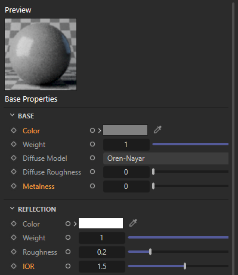](../_images/manual_graph_descriptions_cmd_default.png)

*Fig. 15: The output of the ‘Hello World (Default)’ example shown below. Because the Standard Material node is reset to its default values in the second part of the graph description, the resulting material does not have the red metallic look as the original ‘Hello World’ example.*

```python
def DefaultingNodes() -> None:
    """Demonstrates how to reset a node to its default values using a graph description command.
    """
    # A pair of graph descriptions, where the first creates a graph, and the second resets the 
    # OpenPBR Material in that graph to its default values. We use here the feature of partial 
    # descriptions (see graph_descriptions_basics.py), i.e., an ApplyDescription call that applies 
    # multiple descriptions to the same graph to emulate having an existing graph which we modify 
    # with a command. The "$commands": "$cmd_default" instruction could also be put into the 
    # "OpenPBR Material" scope of the first description, with the same effect. But commands are 
    # often applied as shown here. We have some kind of existing graph, we query for one to many 
    # nodes in it, and then apply commands to those nodes.
    maxon.GraphDescription.ApplyDescription(
        maxon.GraphDescription.GetGraph(name="Default Command"), [
        # Create the 'Hello World' graph.
        {
            "$type": "Output",
            "Surface": {
                "$type": "OpenPBR Material",
                "$id": "material",
                "Base/Color": (1, 0, 0),
                "Base/Metalness": 1.0,
                "Specular/IOR": 3.14159,
            }
        },
        # Query for the OpenPBR Material node and apply the $cmd_default command to it, which resets
        # all the changes we made to it in the first description.
        {
            "$query": "#material",
            "$commands": "$cmd_default"
        }
    ])

    # The command can also target an explicit list of input ports instead of applying to all ports.
    maxon.GraphDescription.ApplyDescription(
        maxon.GraphDescription.GetGraph(name="Default Explicit Command"), [
        {
            "$type": "Output",
            "Surface": {
                "$type": "OpenPBR Material",
                "$id": "material",
                "Base/Color": (1, 0, 0),
                "Base/Metalness": 1.0,
                "Specular/IOR": 3.14159,
            }
        },
        {
            "$query": "#material",
            "$commands": {
                "$cmd_default": ["Base/Color", "Base/Metalness"],
            },
        }
    ])
```

[Example on GitHub](https://github.com/Maxon-Computer/Cinema-4D-Python-API-Examples/tree/master/examples/nodes/graph_descriptions_commands.py#:~:text=DefaultingNodes)

#### Disconnecting Nodes <a id="disconnecting-nodes"></a><a id="graph-description-cmd-disconnect"></a>

The command *$cmd_disconnect* (or [`DisconnectCommand`](../modules/maxon_generated/frameworks/nodes/interface/maxon.GraphDescription.DisconnectCommand.md#maxon.GraphDescription.DisconnectCommand)) will disconnect all or the given ports of a given node. It can be useful to rewire existing node graphs.

<a id="id13"></a>

[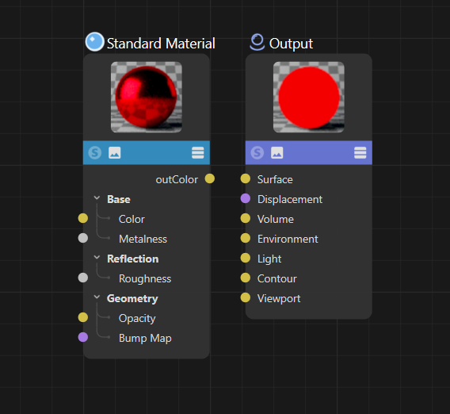](../_images/manual_graph_descriptions_cmd_disconnect.png)

*Fig. 16: The output of the ‘Hello World (Disconnect)’ example shown below. Because the Standard Material node is being disconnected in the second part of the graph description, we end up with a graph with two disjunct nodes.*

```python
def DisconnectingNodes() -> None:
    """Demonstrates how to disconnect a matched node from every connected port.
    """
    # A pair of graph descriptions, where the first creates the 'Hello World' graph, and the
    # second disconnects the OpenPBR Material node in that graph from the rest of the graph.
    maxon.GraphDescription.ApplyDescription(
        maxon.GraphDescription.GetGraph(name="Disconnect Command"), [
        # Create the 'Hello World' graph.
        {
            "$type": "Output",
            "Surface": {
                "$type": "OpenPBR Material",
                "$id": "material",
                "Base/Color": (1, 0, 0),
                "Base/Metalness": 1.0,
                "Specular/IOR": 3.14159,
            }
        },
        # Query for the OpenPBR Material node and apply and disconnect all its connections.
        {
            "$query": "#material",
            "$commands": "$cmd_disconnect"
        }
    ])

    # The command can also target an explicit list of ports instead of disconnecting every port.
    maxon.GraphDescription.ApplyDescription(
        maxon.GraphDescription.GetGraph(name="Disconnect Explicit Command"), [
        {
            "$type": "Output",
            "Surface": {
                "$type": "OpenPBR Material",
                "$id": "material",
                "Base/Color": {
                    "$type": "Noise",
                },
                "Specular/Color": {
                    "$type": "Noise",
                },
            }
        },
        {
            "$query": "#material",
            "$commands": {
                "$cmd_disconnect": ["Base/Color"],
            },
        }
    ])
```

[Example on GitHub](https://github.com/Maxon-Computer/Cinema-4D-Python-API-Examples/tree/master/examples/nodes/graph_descriptions_commands.py#:~:text=DisconnectingNodes)

#### Showing/Hiding Ports <a id="showing-hiding-ports"></a><a id="graph-description-cmd-show-ports"></a>

The commands *$cmd_show_ports* (or [`ShowPortsCommand`](../modules/maxon_generated/frameworks/nodes/interface/maxon.GraphDescription.ShowPortsCommand.md#maxon.GraphDescription.ShowPortsCommand)) and *$cmd_hide_ports* (or [`HidePortsCommand`](../modules/maxon_generated/frameworks/nodes/interface/maxon.GraphDescription.HidePortsCommand.md#maxon.GraphDescription.HidePortsCommand)) will show or hide all or the selected ports in a node.

The show/hide commands are always executed *before* the rest of the scope of the node is executed, which means that actively set connections will be shown even if the port is set to be hidden, as connecting two ports will make them visible again. This is a dedicated behavior of graph descriptions which aligns with the end user facing nature of graph descriptions. In the Nodes API one can also hide ports that are part of a connection or connect hidden ports without making them visible.

<a id="id14"></a>

[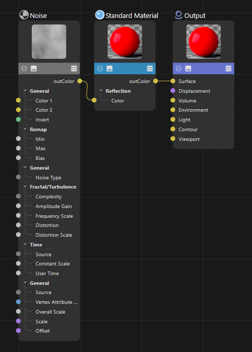](../_images/manual_graph_descriptions_cmd_show_ports.png)

*Fig. 17: The output of the ‘Hello World (Show/Hide Ports)’ example shown below. The Standard Material node only shows the one input and one output port that are actively used in the graph and the Noise node shows all its ports.*

```python
def ShowingAndHidingPorts() -> None:
    """Demonstrates how port visibility commands interact with explicitly described connections.
    """
    # A slightly changed "Hello World!" graph which connects a Noise node to the Reflection Color
    # port of an OpenPBR Material, hides all ports of the OpenPBR Material, and shows all ports of
    # the Noise node. This is a case where it makes sense to use a command while creating a new 
    # graph, so we only need one description here.
    maxon.GraphDescription.ApplyDescription(
        maxon.GraphDescription.GetGraph(name="Visibility Command"), [
        {
            "$type": "Output",
            # An OpenPBR Material node connected to the "Surface" port of the Output node where all
            # ports are hidden in the OpenPBR Material except for the port connections we explicitly
            # describe here ('outColor' and 'Specular/Color'). Note that the explicit out port
            # reference in 'Surface -> outColor' is not necessary, we just use it to make the example
            # more verbose. Also note that just setting values without a connection (as in 'Base/Color')
            # will not cause a port to be shown when all ports have been hidden before.
            "Surface -> outColor": {
                "$type": "OpenPBR Material",
                "$commands": "$cmd_hide_ports",

                "Base/Color": (1, 0, 0),
                # A Noise node connected to the 'Specular/Color' of the OpenPBR Material where all
                # ports are shown. This will affect both input and output ports. But this will have
                # no effect on the number of variadic ports a node has.
                "Specular/Color": {
                    "$type": "Noise",
                    "$commands": "$cmd_show_ports"
                }
            }
        }
    ])

    # Visibility commands can target an explicit list of ports. Here we hide two ports and then
    # show one of them again.
    maxon.GraphDescription.ApplyDescription(
        maxon.GraphDescription.GetGraph(name="Visibility Explicit Command"), [
        {
            "$type": "Output",
            "Surface": {
                "$type": "OpenPBR Material",
                "$id": "material",
                "Base/Color": (1, 0, 0),
                "$commands": {
                    "$cmd_hide_ports": ["Base/Color", "Specular/Color"],
                },
            }
        },
        {
            "$query": "#material",
            "$commands": {
                "$cmd_show_ports": ["Base/Color"],
            },
        }
    ])
```

[Example on GitHub](https://github.com/Maxon-Computer/Cinema-4D-Python-API-Examples/tree/master/examples/nodes/graph_descriptions_commands.py#:~:text=ShowingAndHidingPorts)

#### Removing Nodes <a id="removing-nodes"></a><a id="graph-description-cmd-remove"></a>

The command *$cmd_remove* (or [`RemoveCommand`](../modules/maxon_generated/frameworks/nodes/interface/maxon.GraphDescription.RemoveCommand.md#maxon.GraphDescription.RemoveCommand)) will remove the node it is applied to from its graph, permanently deleting the node.

> **Note:** Consider [Disconnecting Nodes](#graph-description-cmd-disconnect) instead of removing them to avoid to removing data you might later regret to have removed. Functionally, disconnecting a node will result in the same nodes graph output as removing it; as a disconnected node will become an orphaned node in the graph which does not affect the output of the graph.

<a id="id15"></a>

[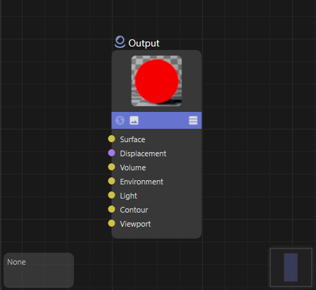](../_images/manual_graph_descriptions_cmd_remove.png)

*Fig. 18: The output of the ‘Hello World (Remove)’ example shown below. Because we remove the Standard Material node in the second part of the graph description, we end up with a graph with a singular Output node.*

```python
def RemovingNodes() -> None:
    """Demonstrates how to permanently remove a matched node from an existing graph.
    """
    # A pair of graph descriptions, where the first creates the 'Hello World' graph, and the
    # second deletes the OpenPBR Material from that graph, leaving only the the Output node.
    # This example is a bit clinical, as it makes usually little sense to first create a node, 
    # and then delete it again within a single application of graph descriptions. This command 
    # is intended to be used in the context of graphs loaded from a material stored in an existing 
    # scene.
    maxon.GraphDescription.ApplyDescription(
        maxon.GraphDescription.GetGraph(name="Remove Command"), [
        # Create the 'Hello World' graph.
        {
            "$type": "Output",
            "Surface": {
                "$type": "OpenPBR Material",
                "$id": "material",
                "Base/Color": (1, 0, 0),
                "Base/Metalness": 1.0,
                "Specular/IOR": 3.14159,
            }
        },
        # Query for the OpenPBR Material node and remove it from the graph.
        {
            "$query": "#material",
            "$commands": "$cmd_remove"
        }
    ])
```

[Example on GitHub](https://github.com/Maxon-Computer/Cinema-4D-Python-API-Examples/tree/master/examples/nodes/graph_descriptions_commands.py#:~:text=RemovingNodes)

#### Setting Port Counts <a id="setting-port-counts"></a><a id="graph-description-cmd-set-port-count"></a>

The command *$cmd_set_port_count* (or [`SetPortCountCommand`](../modules/maxon_generated/frameworks/nodes/interface/maxon.GraphDescription.SetPortCountCommand.md#maxon.GraphDescription.SetPortCountCommand)) will set the number of children a specific or all variadic ports of a node have. The command can be both used to increase and decrease the number of ports. It is currently not possible to insert new ports at a specific position or remove ports at a specific position.

> **Note:** See [Nested Ports](#graph-description-nested-ports) for an introduction into what ‘variadic ports’ are.

<a id="id16"></a>

[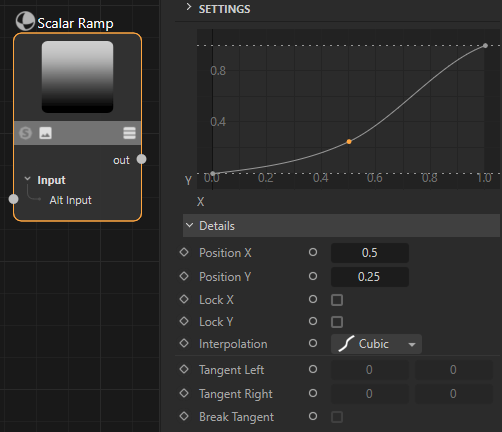](../_images/manual_graph_descriptions_cmd_set_port_count.png)

*Fig. 19: The output of the ‘Set Variadic Port Count: 3’ example shown below. Because we change the variadic port count of the spline from its default of two to three, we can define a smoother transition.*

```python
def SettingPortCounts() -> None:
    """Demonstrates how to grow, shrink, or uniformly set a node's variadic-port count.
    """
    # Applies a simple description that adds an RS Scalar Ramp node to the graph.
    maxon.GraphDescription.ApplyDescription(
        maxon.GraphDescription.GetGraph(name="SetPortCount 3 Command"), {
            "$type": "Scalar Ramp",
        # Explicitly set the point count of the ramp to three (adding one point from its default of
        # two). #cmd_set_port_count will only add or remove as many points as necessary. We can there
        # also use it to ensure that port has exactly N children.
            "$commands": {
                "$cmd_set_port_count": {
                    "Ramp/Ramp/Points": 3,
                },
            },

            "Point.1/Position X": 0.0,
            "Point.1/Position Y": 0.0,
            "Point.1/Interpolation": "cubic",
            "Point.2/Position X": 0.5,
            "Point.2/Position Y": 0.25,
            "Point.2/Interpolation": "cubic",
            "Point.3/Position X": 1.0,
            "Point.3/Position Y": 1.0,
            "Point.3/Interpolation": "cubic",
        })

    # We can also use the same syntax to remove points. Here we will end up with constant 50% grey ramp.
    maxon.GraphDescription.ApplyDescription(
        maxon.GraphDescription.GetGraph(name="SetPortCount 1 Command"), {
            "$type": "Scalar Ramp",
            "$commands": {
                "$cmd_set_port_count": {
                    "Ramp/Ramp/Points": 1,
                },
            },

            "Point.1/Position Y": 0.5
        })

    # An empty port target list applies the command to all variadic ports of the node, which at least
    # for most Redshift Nodes is the same as the explicit variant as they only have one variadic port.
    # For the Scalar Ramp node, this is exactly the same as the previous example, as that none has only
    # one variadic port, the "Ramp/Ramp/Points" port.
    maxon.GraphDescription.ApplyDescription(
        maxon.GraphDescription.GetGraph(name="SetPortCount All Command"), {
            "$type": "Scalar Ramp",
            "$commands": {
                "$cmd_set_port_count": 1,
            },
        })
```

[Example on GitHub](https://github.com/Maxon-Computer/Cinema-4D-Python-API-Examples/tree/master/examples/nodes/graph_descriptions_commands.py#:~:text=SettingPortCounts)

#### Start and Solo Nodes <a id="start-and-solo-nodes"></a><a id="graph-description-cmd-start-solo"></a>

The *$cmd_set_start* and *$cmd_clear_start* commands set and clear the start node of the graph, i.e., the node whose interface will be shown of the entity which owns the graph, e.g., a material. The *$cmd_set_solo* and *$cmd_clear_solo* commands set and clear a node’s output being the output of the graph. A graph can have only one effective start node and one effective solo node; clearing either state can therefore be requested on any node in the graph.

<a id="id17"></a>

[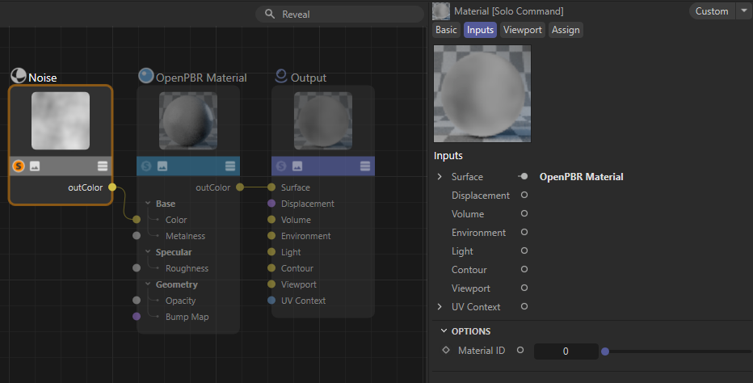](../_images/manual_graph_descriptions_cmd_solo.png)

*Fig. 20: Start-node and solo-node states set by graph description commands.*

```python
def SettingStartAndSoloNodes() -> None:
    """Demonstrates how to set the start and solo nodes with graph description commands.
    """
    # Creates a simple graph where the color of an OpenPBR Material is driven by a Noise node. The 
    # Noise node is set as the start node, i.e., the node that will be shown by default in the 
    # Attribute Manager when the graph/material is selected.
    graph: maxon.NodesGraphModelRef = maxon.GraphDescription.GetGraph(name="Start Command")
    maxon.GraphDescription.ApplyDescription(graph, {
        "$type": "Output",
        "Surface -> outColor": {
            "$type": "OpenPBR Material",
            "Base/Color": {
                "$type": "Noise",
                "$commands": "$cmd_set_start"
            },
        },
    })

    # Same thing, but this time we set the Noise node as the solo node, i.e., mute all output of the
    # graph except for the output of the Noise node.
    graph: maxon.NodesGraphModelRef = maxon.GraphDescription.GetGraph(name="Solo Command")
    maxon.GraphDescription.ApplyDescription(graph, {
        "$type": "Output",
        "Surface -> outColor": {
            "$type": "OpenPBR Material",
            "Base/Color": {
                "$type": "Noise",
                "$commands": "$cmd_set_solo"
            },
        },
    })

    # Finally, there also exist the inverse commands to clear the start and solo nodes, respectively.
    # An important technical insight for start and solo nodes is that always only one can exist for
    # a given graph. So, setting two start nodes or two solo nodes will always result in the last 
    # one being the effective one. In inverse this also means that we can call the clear command on
    # any node in the graph and it will still clear the "correct" node.
    graph: maxon.NodesGraphModelRef = maxon.GraphDescription.GetGraph(name="Clear Solo Command")
    maxon.GraphDescription.ApplyDescription(graph, [

        # First we create a description which solos the noise node.
        {
            "$type": "Output",
            "Surface -> outColor": {
                "$type": "OpenPBR Material",
                "Base/Color": {
                    "$type": "Noise",
                    "$commands": "$cmd_clear_solo"
                },
            },
        },
        # And now we clear the solo state again. Since we did not set an explicit ID for the Noise 
        # node, we make use of the fact that we can clear the solo/start state on any node in the 
        # graph, so we simply pick the Output node to clear it there. We pick the output node because
        # we know there is always exactly one output node in a graph, so this little snippet would
        # work for any material.
        {
            "$query": {
                "$type": "Output"
            },
            "$commands": "$cmd_clear_solo"
        }
    ])
```

[Example on GitHub](https://github.com/Maxon-Computer/Cinema-4D-Python-API-Examples/tree/master/examples/nodes/graph_descriptions_commands.py#:~:text=SettingStartAndSoloNodes)

#### Ungrouping Nodes <a id="ungrouping-nodes"></a><a id="graph-description-cmd-ungroup"></a>

The *$cmd_ungroup* command dissolves one group and moves its children to the group’s parent. The *$cmd_rec_ungroup* command dissolves the targeted group and recursively dissolves nested groups as well. Both commands can target a group by identifier or by a query; a query used for ungrouping should ensure that only group nodes are selected.

<a id="id18"></a>

[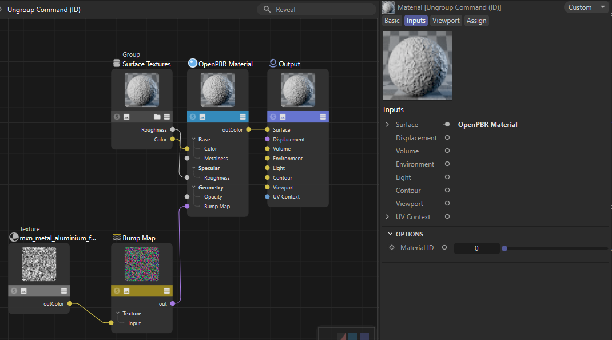](../_images/manual_graph_descriptions_cmd_ungroup.png)

*Fig. 21: One-level and recursive ungrouping.*

```python
def UngroupingNodes() -> None:
    """Creates nested groups and dissolves them again with ungroup commands.
    """
    # A graph description for a material with three textures, where two of them are grouped into a 
    # "Surface Textures" group, and the third one is grouped together with the first group into an 
    # "All Textures" group.
    description: list[dict] = [
        {
            "$type": "Output",
            "Surface -> outColor": {
                "$type": "OpenPBR Material",
                "Base/Color": {
                    "$type": "Texture",
                    "$id": "albedo_texture",
                    "Image/Filename/Path": "asset:///file_eb62aff065c50a2b",
                },
                "Specular/Roughness": {
                    "$type": "Texture",
                    "$id": "roughness_texture",
                    "Image/Filename/Path": "asset:///file_8bf49bb0b9992dbe",
                },
                "Geometry/Bump Map": {
                    "$type": "Bump Map",
                    "Input": {
                        "$type": "Texture",
                        "$id": "height_texture",
                        "Image/Filename/Path": "asset:///file_e706df60a3a533d2",
                    },
                },
            },
        },
        {
            "$type": "Group",
            "$id": "surface_textures",
            "$children": ["#albedo_texture", "#roughness_texture"],
            "Basic/Name": "Surface Textures",
        },
        {
            "$type": "Group",
            "$id": "all_textures",
            "$children": ["#surface_textures", "#height_texture"],
            "Basic/Name": "All Textures",
        }
    ]

    # Add one material for comparison, which we will not modify with any ungroup commands.
    # graph0: maxon.NodesGraphModelRef = maxon.GraphDescription.GetGraph(name="Ungroup Command (unmodified)")
    # maxon.GraphDescription.ApplyDescription(graph0, description)

    # Create a new material with this description.          
    graph1: maxon.NodesGraphModelRef = maxon.GraphDescription.GetGraph(name="Ungroup Command (ID)")
    maxon.GraphDescription.ApplyDescription(graph1, description)

    # Now we non-recursively ungroup the #all_textures group, which will dissolve that group but 
    # leave the inner #surface_textures group intact.
    maxon.GraphDescription.ApplyDescription(graph1, [
        {
            "$query": "#all_textures",
            "$commands": "$cmd_ungroup",
        }
    ])

    # Rinse and repeat, but this time we will recursively ungroup the #all_textures group, which 
    # will dissolve that group and the inner #surface_textures group as well.
    graph2: maxon.NodesGraphModelRef = maxon.GraphDescription.GetGraph(name="Ungroup Command (ID - Recursive)")
    maxon.GraphDescription.ApplyDescription(graph2, description)
    
    maxon.GraphDescription.ApplyDescription(graph2, [
        {
            "$query": "#all_textures",
            "$commands": "$cmd_rec_ungroup",
        }
    ])

    # Finally, we could of course also use other qualifiers than IDs to identify what to dissolve.
    # Note that the ungroup command will throw an error when you try to ungroup a node that is not a 
    # group, so for non-ID queries we should always at least check the type.
    graph3: maxon.NodesGraphModelRef = maxon.GraphDescription.GetGraph(name="Ungroup Command (Type)")
    maxon.GraphDescription.ApplyDescription(graph3, description)

    maxon.GraphDescription.ApplyDescription(graph3, [
        {
            "$query": {
                # Make the query match multiple nodes (ALL), but do not throw an error when there 
                # are no matches at all (MAYBE). There are multiple query flags, see the query 
                # documentation for details.
                "$qmode": maxon.GraphDescription.QUERY_FLAGS.MATCH_MAYBE_ALL,

                "$type": "Group",                # Target all groups in the graph ...
                "Basic/Name": {                  # ... whose name ends with "Textures".
                    "$qop": "regex",
                    "$qvalue": ".*Textures$"
                }

            },
            "$commands": "$cmd_ungroup",
        }
    ])
```

[Example on GitHub](https://github.com/Maxon-Computer/Cinema-4D-Python-API-Examples/tree/master/examples/nodes/graph_descriptions_commands.py#:~:text=UngroupingNodes)

### Groups <a id="groups"></a><a id="graph-description-groups"></a>

Grouping nodes in a graph is done with special top-level scopes and require you to understand the concept of [Partial Descriptions](#graph-description-partial-descriptions). A group scope uses *“$type”: “Group”* and either a *“$children”* list containing node references or a *“$query”* that selects the nodes to group. Group scopes are always flat, but you can create nested groups by opening a new group scope that includes a previously defined group as one of its children.

<a id="id19"></a>

[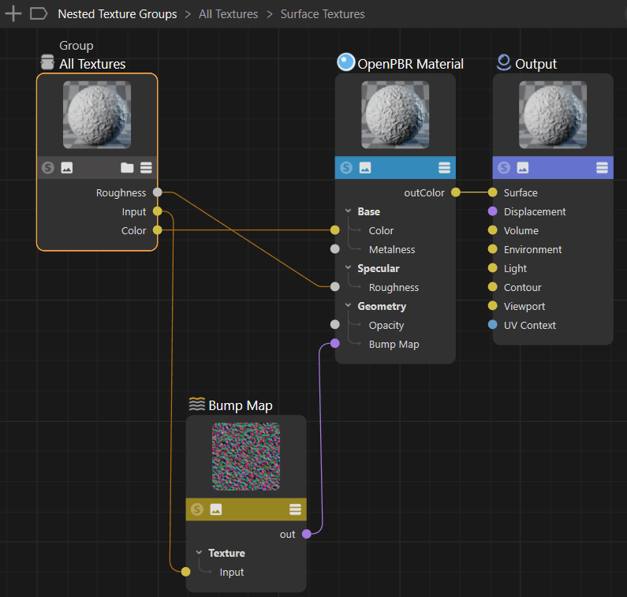](../_images/manual_graph_descriptions_example_groups.gif)

*Fig. 11: The two nested groups created by the description shown below.*

```python
def GroupingNodes() -> None:
    """Demonstrates how to group nodes in a graph description.
    """
    # Grouping nodes follows a special syntax. Grouping is not embedded into an ongoing graph, as you 
    # otherwise run into issues when you want to group nodes in multiple parts of the graph, or group
    # nodes in an existing graph. But grouping nodes is also not a description command (see
    # graph_descriptions_commands.py), but a special form of top level scope.
    maxon.GraphDescription.ApplyDescription(
        maxon.GraphDescription.GetGraph(name="Nested Texture Groups"), [
            # We create a new graph from scratch, and add IDs to the three texture nodes we create.
            {
                "$type": "Output",
                "Surface -> outColor": {
                    "$type": "OpenPBR Material",
                    "Base/Color": {
                        "$type": "Texture",
                        "$id": "albedo_texture",
                        "Image/Filename/Path": "asset:///file_eb62aff065c50a2b",
                    },
                    "Specular/Roughness": {
                        "$type": "Texture",
                        "$id": "roughness_texture",
                        "Image/Filename/Path": "asset:///file_8bf49bb0b9992dbe",
                    },
                    "Geometry/Bump Map": {
                        "$type": "Bump Map",
                        "Input": {
                            "$type": "Texture",
                            "$id": "height_texture",
                            "Image/Filename/Path": "asset:///file_e706df60a3a533d2",
                        },
                    },
                },
            },
            # In the next partial description, we use the special "$type": "Group" scope to group 
            # the two textures via their IDs that feed the Base Color and Specular Roughness ports 
            # of the OpenPBR Material node. A "$type": "Group" scope can only appear at the top 
            # level of a description. We can set its ID and special children field to a list of node
            # IDs that we want to group together. We can also set any attribute on that node, for
            # example its name. But any attempts to write a full description by addressing the ports 
            # of the group node will result in an error, as the only purpose of a group scope is to 
            # group nodes together.
            {
                "$type": "Group",
                "$id": "surface_textures",
                "$children": ["#albedo_texture", "#roughness_texture"],
                "Basic/Name": "Surface Textures",
            },
            # Because we use here partial descriptions, we can now pile onto on the current graph
            # state and group the group #surface_textures we just created with the #height_texture 
            # node. Just as in the Node Editor, nodes which shall be grouped together must be at the 
            # same level in the graph. We could for example no longer group the #albedo_texture and 
            # #height_texture nodes, as they no longer have the same parent node in the graph. The
            # final result of the grouping is as follows:
            #
            #  Group "All Textures"
            #  ├── Group "Surface Textures"
            #  │   ├── Texture "albedo_texture"
            #  │   └── Texture "roughness_texture"
            #  ├── Texture "height_texture"
            #  │   ... remaining nodes of the graph ...
            {
                "$type": "Group",
                "$id": "all_textures",
                "$children": ["#surface_textures", "#height_texture"],
                "Basic/Name": "All Textures",
            },
        ]
    )

    # Another way to group nodes is to use a query to select nodes in the graph. This case is especially 
    # useful when we have an existing graph where we might not know the IDs of the nodes we want to 
    # group together. In this case we would just load an existing graph with maxon.GraphDescription.GetGraph
    # and then omit the first partial description that creates the graph from scratch.
    maxon.GraphDescription.ApplyDescription(
        # We create the same graph as before.
        maxon.GraphDescription.GetGraph(name="Query Texture Groups"), [
            {
                "$type": "Output",
                "Surface -> outColor": {
                    "$type": "OpenPBR Material",
                    "Base/Color": {
                        "$type": "Texture",
                        "Image/Filename/Path": "asset:///file_eb62aff065c50a2b",
                    },
                    "Specular/Roughness": {
                        "$type": "Texture",
                        "Image/Filename/Path": "asset:///file_8bf49bb0b9992dbe",
                    },
                    "Geometry/Bump Map": {
                        "$type": "Bump Map",
                        "Input": {
                            "$type": "Texture",
                            "Image/Filename/Path": "asset:///file_e706df60a3a533d2",
                        },
                    },
                },
            },
            # We use a query to select all Texture nodes in the graph and group them together. We
            # can use here queries of any complexity, for example to group all that are indirectly
            # connected to a specific node. When we use a query, we cannot use the "$children" field
            # at the same time.
            {
                "$type": "Group",
                "$queryflags": maxon.GraphDescription.QUERY_FLAGS.MATCH_ALL,
                "$query": { # A very simple query that matches all nodes of type Texture in the graph.
                    "$type": "Texture", 
                },

                # Set attributes of the group node as usual.
                "Basic/Name": "Textures Selected by Query",
                "Basic/Comment": "This group was created by a query that selected all Texture nodes.",
            },
        ]
    )
```

[Example on GitHub](https://github.com/Maxon-Computer/Cinema-4D-Python-API-Examples/tree/master/examples/nodes/graph_descriptions_basics.py#:~:text=GroupingNodes)

### Input Groups <a id="input-groups"></a><a id="graph-description-input-groups"></a>

Input groups define a group node and its interface in a graph description which is then set as the start node of the graph. Input groups therefore allow you to build interfaces for your graphs. The *“$inputgroup”* scope contains a *“$ports”* dictionary. Each port can define its type, default value, enum, range, and step size. The input group can also receive ordinary node attributes such as its name and comment.

<a id="id20"></a>

[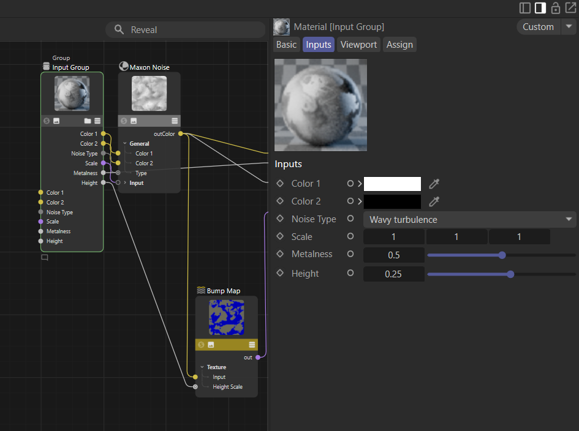](../_images/manual_graph_descriptions_input_group.png)

*Fig. 12: An input-group node which provides a custom interface for its material.*

```python
def InputGroup() -> None:
    """Creates a group node with dynamically declared input and output ports.

    Input groups are useful when a graph needs a small, reusable interface whose ports are declared 
    by the graph description rather than by a node template.
    """
    maxon.GraphDescription.ApplyDescription(
        maxon.GraphDescription.GetGraph(name="Input Group"), [
            # Define the inout group start node for the graph, this will be the UI of the material
            # when selected in the material manager.
            {
            "$inputgroup": {

                # The ID of the group with which we can reference the group in the graph description.
                # "inputs" will also be the default ID when we do not provide one.
                "$id": "inputs",

                # Now we describe the ports of the input group. They will be created as both input 
                # and output ports of the group node, so that they can be connected to other nodes 
                # in the graph.
                "$ports": {

                    # A color port with a default value of white.
                    "Color 1": {
                        "$type": "color",
                        "$default": (1, 1, 1),
                    },

                    # A color port with a default value of black.
                    "Color 2": {
                        "$type": "color",
                        "$default": (0, 0, 0),
                    },

                    # An integer port with an enum associated with it. An enum means that the port
                    # can only take the listed values and will be displayed as a dropdown in the UI.
                    # These are the noise types of the Redshift Maxon Noise node, the values can be
                    # taken from the node space index.
                    "Noise Type": {
                        "$type": "int",
                        "$default": 23,
                        "$enum": {
                            "Ober": 15,
                            "Nutous": 14,
                            "Box noise": 1,
                            "Sema": 19,
                            "Cranal": 5,
                            "Blistered turbulence": 2,
                            "Displaced turbulence": 7,
                            "Pezo": 16,
                            "Dents": 6,
                            "Hama": 9,
                            "VL noise": 22,
                            "Stupl": 20,
                            "Naki": 12,
                            "FBM": 8,
                            "Turbulence": 21,
                            "Fire": 31,
                            "Poxo": 17,
                            "Noise": 13,
                            "Buya": 3,
                            "Mod noise": 11,
                            "Cell noise": 4,
                            "Luka": 10,
                            "Wavy turbulence": 23,
                            "Cell voronoi": 24,
                            "Displaced voronoi": 25,
                            "Sparse convolution": 26,
                            "Voronoi 1": 27,
                            "Voronoi 2": 28,
                            "Voronoi 3": 29,
                            "Electric": 32,
                            "Gaseous": 33,
                            "Ridged Multi Fractal": 34
                        },
                    },

                    # A vector port with a default value of (1, 1, 1).
                    "Scale": {
                        "$type": "vector",
                        "$default": (1, 1, 1),
                    },

                    # And finally a float port with a default value of 0.2, a step of 0.05, and a 
                    # min/max range of 0.0 to 1.0.
                    "Metalness": {
                        "$type": "float",
                        "$default": 0.5,
                        "$min": 0.0,
                        "$max": 1.0,
                        "$step": 0.05,
                    },

                    "Height": {
                        "$type": "float",
                        "$default": 0.25,
                        "$min": 0.0,
                        "$max": 1.0,
                        "$step": 0.05,
                    }
                },

                # An input group can have its attributes set just like any other node.
                "Basic/Name": "Input Group",
                "Basic/Comment": "This is a group node with dynamically declared input and output ports.",

            },
        },
        # Now create a second partial description that uses the input group we just defined. We can 
        # reference the input group ports using the "#inputs" syntax (which is shorthand for a graph
        # query).
        {
            "$type": "Output",

            "Surface -> outColor": {

                # The OpenPBR Material has its color and specular roughness driven by a noise node, 
                # which in turn uses the input group ports as its parameters.
                "$type": "OpenPBR Material",
                "Base/Color": {
                    "$type": "Maxon Noise",
                    "$id": "noise_node",

                    "General/Type -> Noise Type": "#inputs",
                    "General/Color 1 -> Color 1": "#inputs",
                    "General/Color 2 -> Color 2": "#inputs",
                    "Input/Scale -> Scale": "#inputs"
                },
                "Specular/Roughness": "#noise_node",

                "Base/Metalness -> Metalness": "#inputs",

                "Geometry/Bump Map": {
                    "$type": "Bump Map",

                    "Input Map Type": 1,
                    "Height Scale -> Height": "#inputs",
                    "Input": "#noise_node",
                },
            },
        }
        ]
    )
```

[Example on GitHub](https://github.com/Maxon-Computer/Cinema-4D-Python-API-Examples/tree/master/examples/nodes/graph_descriptions_basics.py#:~:text=InputGroup)

### Description Callbacks <a id="description-callbacks"></a><a id="graph-description-description-callbacks"></a>

Graph *description callbacks* are another way to modify graphs in a programmatic way. Other than [Graph Commands](#graph-description-graph-commands), which are carried out on the final node graph, description callbacks are carried out on the description itself. This can be useful to set repetitively set properties of a node, as for example coloring in all nodes of a certain type in a certain color.

Description callbacks are carried out by passing a callable as the argument *callback* to [`maxon.GraphDescription.ApplyDescription()`](../modules/maxon_generated/frameworks/nodes/interface/maxon.GraphDescription.md#maxon.GraphDescription.ApplyDescription). The callable must follow the signature *SomeName (data: dict) -> dict*. The callable will be called for each scope in the description, allowing it to return a modified version. This can be useful when many nodes in a graph share attribute or port values that otherwise would be tedious to set every time by hand.

> **Note:** Although not shown in the example, the callable can also add or remove scopes, i.e., nodes, to the passed scope. Such added scopes will then be passed through the callable as any other. Be careful not to create infinite recursion when adding scopes via a callable.

<a id="id21"></a>

[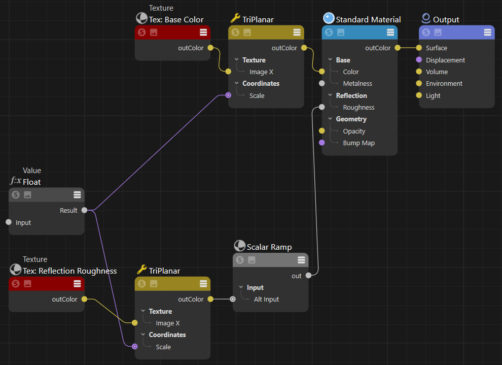](../_images/manual_graph_descriptions_example_callback.png)

*Fig. 22: In this graph, the preview of all nodes has been hidden and the title bar of all ‘Texture’ nodes has been colored red using a callback function.*

The code example shown below uses a callback function to toggle off the preview of nodes and color in “Texture” node title bars. The callback function is called for each node/scope in the graph description. It is used to modify the description before it is applied to the graph. The callback function is passed to [`maxon.GraphDescription.ApplyDescription()`](../modules/maxon_generated/frameworks/nodes/interface/maxon.GraphDescription.md#maxon.GraphDescription.ApplyDescription) as the argument *callback*.

```python
def DescriptionCallbacks() -> None:
    """Applies a nested material graph after MyCallback customizes each of its scopes.
    """
    # Description callbacks are functions that are called for each scope in a graph description 
    # before the description is applied to the graph. They can be used to modify the scope, which
    # can make it easier to carry out reoccurring tasks, such as setting a specific attribute on 
    # all nodes of a certain type, or to generally apply attributes, such as setting the "Show 
    # Preview" attribute to False for all nodes in a graph.
    maxon.GraphDescription.ApplyDescription(
        maxon.GraphDescription.GetGraph(name="Callback Example"), 
        # The description of the graph ...
        {
            "$type": "Output",
            "Surface": {
                "$type": "OpenPBR Material",
                "Base/Metalness": 1.,
                "Base/Color": {
                    "$type": "TriPlanar",
                    "Coordinates/Scale": 0.2,
                    "Texture/Image X": {
                        "$type": "Texture",
                        "Basic/Name": "Tex: Base Color",
                        "Image/Filename/Path": "asset:///file_dcd3db0487f2def6"
                    }
                },
                "Specular/Roughness": {
                    "$type": "Scalar Ramp",
                    "Input/Alt Input": {
                        "$type": "TriPlanar",
                        "Coordinates/Scale": 0.2,
                        "Texture/Image X": {
                            "$type": "Texture",
                            "Basic/Name": "Tex: Reflection Roughness",
                            "Image/Filename/Path": "asset:///file_2e316c303b15a330"
                        }
                    }
                }
            }
        # ... and the callback function that is called for each scope.
        }, callback=MyCallback)
```

[Example on GitHub](https://github.com/Maxon-Computer/Cinema-4D-Python-API-Examples/tree/master/examples/nodes/graph_descriptions_basics.py#:~:text=DescriptionCallbacks)

## See Also <a id="see-also"></a>

- [API Overview](manual_api_overview.md): Provides an overview of the major API components.
- [Assets](manual_assets.md): Provide content as reusable assets served with the Cinema 4D Asset Browser.
- [Example graph_descriptions_basics.py](../examples/nodes/graph_descriptions_basics.py.md): Demonstrates how graph descriptions create and modify node graphs.
- [Example graph_descriptions_commands.py](../examples/nodes/graph_descriptions_commands.py.md): Demonstrates graph description commands.
- [Example graph_descriptions_queries.py](../examples/nodes/graph_descriptions_queries.py.md): Demonstrates graph description queries, including lazy color and vector literals.
- [Example graph_descriptions_references.py](../examples/nodes/graph_descriptions_references.py.md): Demonstrates graph description references together with lazy color and URL literals.
