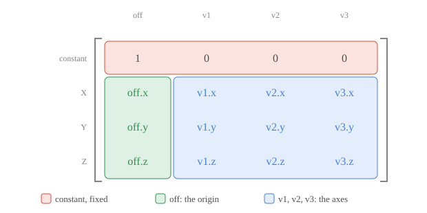

<!-- Source: https://developers.maxon.net/docs/py/2027_0_0/manuals/manual_matrices.html -->

# Matrices <a id="matrices"></a><a id="matrix-fundamental"></a>

Explains how to carry out transform operations.

Matrices in the Cinema API are used to describe and manipulate the position, rotation, and scale of objects in 3D space. Other DCC applications often call such matrices often also *transform matrices* or simply *transforms*. This manual explains how such matrices encode coordinate systems.

> **Note:** It is recommended to have a basic understanding of [Vectors](manual_vectors.md) before reading this manual.

## Overview <a id="overview"></a>

A matrix is a table of numbers arranged in rows and columns. Cinema 4D realizes 4x4 matrices with its class [`c4d.Matrix`](../modules/c4d/Matrix/index.md#c4d.Matrix) to describe an object’s position, rotation, and scale in 3D space. The top row is always `1, 0, 0, 0`. It stays fixed because a matrix can move, rotate, stretch, or skew a coordinate system in the Cinema API, but it cannot create perspective. The entries below it store the system’s origin `off` and its three axes `v1`, `v2`, and `v3`.



*Fig. 1: The layout of a [`c4d.Matrix`](../modules/c4d/Matrix/index.md#c4d.Matrix): the fixed top row, the origin `off`, and the three axes. The following manual will show you that the three axes literally define the coordinate system. They describes the axes of the coordinate system as you would see them in a 3D space, e.g., the axes of a null object.*

To understand how a transform matrix works, we first have to challenge our understanding of coordinate systems. The Cinema API uses a [Cartesian coordinate system](https://en.wikipedia.org/wiki/Cartesian_coordinate_system), where the position of a point is determined by its distances from the coordinate axes. In school, we are often taught to think of such coordinate systems as a grid, but in reality, it is defined by its origin and axes.

A coordinate system is defined by its basis vectors. You can think of the basis vectors as sides of a grid/cube cell in coordinate grid of the system. This allows us to mathematically describe points and transformations within the coordinate system by simply multiplying these basis vectors by the coordinates of the point in that system; opposed to the manual world view of a grid where we rely on human intuition to place a point within that grid.

A [`c4d.Matrix`](../modules/c4d/Matrix/index.md#c4d.Matrix) stores a coordinate system as four vectors: the origin `off` and the basis vectors `v1`, `v2`, and `v3`. The axes can have any length and point in any direction. This is how a matrix rotates, scales, and skews the system it describes.

A point in such a system is described by its *local coordinates*. The point `(2, 1, 1)` is reached from `off` by walking twice along `v1`, once along `v2`, and once along `v3`. Such a sum of scaled basis vectors is called a *linear combination*, and the local coordinates are its weights. Multiplying a vector with a matrix does exactly this and returns the position of the point in the world.

> *Interactive figure (HTML only): A local coordinate system $M$ which translates the point $p$. The transform has an offset $\text{off}$ which offsets the origin of the system. The local transform of $p$ is then literally changing together the basis vectors and the offset to reach the new position of the point. You can drag the handles to interactively change the local coordinates and see how the point moves in the world.*

## Operations <a id="operations"></a>

Select an operation to understand how it works.

<a id="item-move"></a>

**Move**

`c4d.utils.MatrixMove` builds a matrix which only sets the origin, its axes are those of the world. Multiplying a point with it moves the point by the offset. A direction has no position and must not be moved: `MulV` multiplies a vector only with the axes of a matrix, so it ignores the offset.

```python
import c4d

A: c4d.Matrix = c4d.utils.MatrixMove(c4d.Vector(2, 1, 1.5))
a: c4d.Vector = c4d.Vector(1, 1, 1)
r: c4d.Vector = a * A      # (3, 2, 2.5), a point is moved.
s: c4d.Vector = A.MulV(a)  # (1, 1, 1), a direction is not.
```

> *Interactive figure (HTML only): The unit cube moved by the offset of a matrix. Drag the handle to change the offset, orbit to inspect the cube.*

<a id="item-rotate"></a>

**Rotate**

`c4d.utils.MatrixRotX`, `MatrixRotY`, and `MatrixRotZ` build a matrix which rotates about one axis of the world. The angle is in radians, `DegToRad` converts degrees. A positive angle turns clockwise when you look along the axis in its positive direction. To rotate about several axes at once, `HPBToMatrix` builds a matrix from heading, pitch, and bank angles.

```python
import c4d

A: c4d.Matrix = c4d.utils.MatrixRotY(c4d.utils.DegToRad(45))
a: c4d.Vector = c4d.Vector(1, 0, 0)
r: c4d.Vector = a * A  # (0.707, 0, 0.707)
```

> *Interactive figure (HTML only): The unit cube rotated about the Y axis. Drag the handle to change the angle, orbit to inspect the cube.*

<a id="item-scale"></a>

**Scale**

`c4d.utils.MatrixScale` builds a matrix which stretches each axis by its own factor. Equal factors scale uniformly, different factors stretch the system along its axes. A negative factor mirrors the system, and a factor of zero collapses an axis, which makes the matrix impossible to invert. Scaling happens at the origin of the world.

```python
import c4d

A: c4d.Matrix = c4d.utils.MatrixScale(c4d.Vector(1.8, 1.2, 0.7))
a: c4d.Vector = c4d.Vector(1, 1, 1)
r: c4d.Vector = a * A  # (1.8, 1.2, 0.7)
```

> *Interactive figure (HTML only): The unit cube scaled along each axis. Drag the handles to change the factors, orbit to inspect the cube.*

<a id="item-multiplication"></a>

**Multiplication**

Multiplying two matrices combines their transformations into one. With the Cinema 4D convention of `a * R`, the rightmost matrix acts first: `A * B` rotates with `B` first, and then moves with `A`, while `B * A` moves first, and then rotates, which swings the result around the origin of the world. The order matters. To build a transformation from several parts, multiply them in the order move, rotate, scale. The part on the right acts first, so the object is scaled and rotated at the origin and only then moved to its place.

```python
import c4d

A: c4d.Matrix = c4d.utils.MatrixMove(c4d.Vector(2, 0, 1))
B: c4d.Matrix = c4d.utils.MatrixRotY(c4d.utils.DegToRad(45))
R: c4d.Matrix = A * B  # Rotates first, then moves; R.off is (2, 0, 1).
S: c4d.Matrix = B * A  # Moves first, then rotates; S.off is (0.707, 0, 2.121).

# Scales first, then rotates, then moves.
T: c4d.Matrix = (c4d.utils.MatrixMove(c4d.Vector(2, 0, 1)) *
                 c4d.utils.MatrixRotY(c4d.utils.DegToRad(45)) *
                 c4d.utils.MatrixScale(c4d.Vector(1.5, 1.5, 1.5)))
```

> *Interactive figure (HTML only): The unit cube transformed by A * B (solid) and B * A (dashed). Drag the handles to change the offset of A and the angle of B, orbit to compare the cubes.*

<a id="item-from-a-direction"></a>

**From a Direction**

To build a coordinate system whose Z axis points along a given direction, such as the normal of a polygon, convert the direction with `VectorToHPB` into heading and pitch angles, and these with `HPBToMatrix` into a matrix. The result is not banked, its X axis stays horizontal. For another up direction, derive the axes with cross products: the X axis is perpendicular to the normal and an *up* vector, and the Y axis is perpendicular to both. The normal must not be zero, and the up vector must not be parallel to it.

```python
import c4d

normal: c4d.Vector = c4d.Vector(1, 2, 3)  # The direction of the new Z axis.

# With the Cinema API, the X axis stays horizontal.
R: c4d.Matrix = c4d.utils.HPBToMatrix(c4d.utils.VectorToHPB(normal))

# By hand, with any up vector.
z: c4d.Vector = normal.GetNormalized()  # The new Z axis.
up: c4d.Vector = c4d.Vector(0, 1, 0)
up = up if 1.0 - abs(z.Dot(up)) > 1e-6 else c4d.Vector(1, 0, 0)  # Use another one when parallel to z.
x: c4d.Vector = up.Cross(z).GetNormalized()  # The new X axis.
y: c4d.Vector = z.Cross(x).GetNormalized()   # The new Y axis.
S: c4d.Matrix = c4d.Matrix(v1=x, v2=y, v3=z)  # The same as R for this up vector.
```

> *Interactive figure (HTML only): A frame built on the normal of a polygon of a sphere. Drag the slider to construct it: the X axis is the cross product of up and the normal, and the Y axis is the cross product of the normal and the X axis. Drag the arrowhead of the up vector to change it, orbit to inspect the frame.*

<a id="item-inverse"></a>

**Inverse**

The inverse of a matrix undoes it undoes the effect of the matrix. `p * M * ~M` returns the original point `p`. This often used to move points in and out of local coordinate systems.

```python
import c4d

A: c4d.Matrix = (c4d.utils.MatrixMove(c4d.Vector(1, 0, 0.5)) *
                 c4d.utils.MatrixRotY(c4d.utils.DegToRad(30)) *
                 c4d.utils.MatrixScale(c4d.Vector(1.5, 1.5, 1.5)))
r: c4d.Vector = c4d.Vector(2.5, 1.5, 2.5)  # A point in the world.
s: c4d.Vector = r * A                      # The local coordinates of r in A.
t: c4d.Vector = s * ~A                     # Back at r.
```

> *Interactive figure (HTML only): A world point r and its local coordinates in the coordinate system A. Drag the point and the origin of A, orbit to inspect the steps.*

<a id="item-identity-matrix"></a>

**Identity Matrix**

A matrix without arguments has the origin at zero and the three standard axes `(1, 0, 0)`, `(0, 1, 0)`, and `(0, 0, 1)`. This is the coordinate system of the world, and the matrix which does nothing: the *identity matrix*. It is to matrices what the number one is to multiplication. Every construction function starts from it and changes one aspect.

```python
import c4d

A: c4d.Matrix = c4d.Matrix()  # Matrix(v1: (1, 0, 0); v2: (0, 1, 0); v3: (0, 0, 1); off: (0, 0, 0))
a: c4d.Vector = c4d.Vector(1.5, 1, 0.8)
r: c4d.Vector = a * A  # (1.5, 1, 0.8), unchanged.
```

> *Interactive figure (HTML only): The identity matrix, with the unit vectors of the world as axes. Drag the arrowhead to change a, orbit to inspect the cube.*

<a id="item-local-and-global-transformations"></a>

**Local and Global Transformations**

Objects live in a hierarchy, and an object is placed in the coordinate system of its parent. `GetMl()` returns the matrix of an object relative to its parent, its *local* matrix, and `GetMg()` its matrix in the world, its *global* matrix. When the parent moves, the local position of the child stays the same, and its global position changes with it. `SetMl()` assigns a local matrix, and `SetMg()` a global one. Without a parent, local and global space coincide.

```python
import c4d

A: c4d.Matrix = parent.GetMg()
B: c4d.Matrix = child.GetMl()
R: c4d.Matrix = A * B  # The same as child.GetMg().
```

> *Interactive figure (HTML only): A parent coordinate system and a child. The orange arrow is the local position, the teal arrow the global one. Drag the origin and the X axis of the parent, or the child, orbit to inspect the hierarchy.*

<a id="item-freezing-transformations"></a>

**Freezing Transformations**

Freeze Transformations store a rest pose in separate frozen channels, while relative position and rotation return to zero and relative scale to one. They behave like a virtual parent null, as in the previous item: animation works with `GetRelPos()` and other `Rel` values, while `GetAbsPos()` and other `Abs` values describe the complete local pose. `GetMl()` and `GetMg()` include the frozen part; without a freeze, `Rel` and `Abs` agree. `CopyMatrixTo()` also copies the frozen state.

The order is important. With `MatrixMove`, `HPBToMatrix` and `MatrixScale` from `c4d.utils`, the actual local transform is:

```python
import c4d

frozenMove = c4d.utils.MatrixMove(op.GetFrozenPos())
frozenRotate = c4d.utils.HPBToMatrix(op.GetFrozenRot())
relativeMove = c4d.utils.MatrixMove(op.GetRelPos())
relativeRotate = c4d.utils.HPBToMatrix(op.GetRelRot())
frozenScale = c4d.utils.MatrixScale(op.GetFrozenScale())
relativeScale = c4d.utils.MatrixScale(op.GetRelScale())
local = (frozenMove * frozenRotate * relativeMove * relativeRotate
         * frozenScale * relativeScale)
globalMatrix = op.GetUpMg() * local
```

Both scales act first, so this is *not* generally the product of an independently constructed frozen matrix and a relative matrix. This preserves a rectangular local system even when the frozen and relative rotations differ. The result is equivalent to constructing the local matrix from `GetAbsPos()`, `GetAbsRot()` and `GetAbsScale()`.

## See Also <a id="see-also"></a>

- [Vectors](manual_vectors.md): Explains how to carry out vector operations.
- [Example _c4d_matrix.py](../examples/math/_c4d_matrix.py.md): Demonstrates working with matrices.
