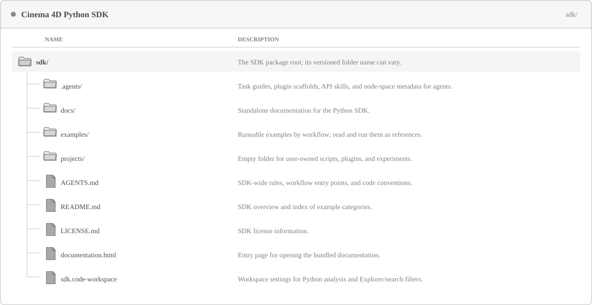

<!-- Source: https://developers.maxon.net/docs/py/2027_0_0/manuals/manual_quickstart.html -->

# Quickstart 

Learn the basics of using the Cinema 4D Python API.

The Cinema 4D Python API exposes a large part of the native [C++ API](https://developers.maxon.net/docs/cpp) to Python. With the API, you can do anything between writing simple scripts and developing complex plugins. This manual guides you through major landmarks in getting you started with the Python API in Cinema 4D.

## Understanding the SDK 

The Cinema 4D Python SDK is a collection of tools, examples, and documentation that allows you to develop Python scripts and plugins for Cinema 4D. To work with the Python API in Cinema 4D, you should download and set up the Python SDK for your version of Cinema 4D. You can get the Python SDK from the Maxon developer [downloads page](https://developers.maxon.net/downloads/). There are also the [Maxon GitHub examples](https://github.com/Maxon-Computer/Cinema-4D-Python-API-Examples), but they primarily exist for visibility and do not contain the standalone documentation and extra tooling found in the downloadable SDK.

> **Warning:** Always use an SDK matching the version of Cinema 4D you are running, to avoid missing out on features.

The main files and folders are shown below. The tree is shared with [Working with the SDK](manual_working_with_sdk.md), which explains the VS Code workspace and how to use these SDK resources while developing.

*Fig. 1: Main files and folders in the Python SDK.*

Use `examples/` as reference material and develop in `projects/`. The SDK-specific AI instructions are in `AGENTS.md` and `.agents/`; the VS Code workspace hides these files from its Explorer and search by default, but assistants can still use them as context.

## Running Code in Cinema 4D 

There are four principal ways to run Python code in Cinema 4D.

| Type | Description |
|---|---|
| Script Manager | Allows you to run single script files, similar to how you would execute a vanilla Python script with the standard Python interpreter. See [Script Manager and Console](manual_script_manager.md) for details. |
| Plugins | Plugins run as `*.pyp` files and are loaded by Cinema 4D as extensions to the application. With them you can realize complex features and extend the functionality of Cinema 4D. See [Implementing Plugins](manual_implementing_plugins.md) for details. |
| MCP Server | The MCP Server allows you to connect tools that support the MCP protocol to Cinema 4D, such as agents such as Claude or ChatGPT. See [Cinema 4D MCP Documentation](https://help.maxon.net/c4d/en-us/Content/html/MCPADAPTERPREFS.html) for details. |
| c4dpy | The command-line Python interpreter for Cinema 4D. It allows you to run Python scripts outside of the Cinema 4D GUI, which is useful for automation and batch processing. See [Standalone Interpreter](manual_standalone_interpreter.md) for details. |

## Working with AI in the SDK 

There are currently two ways to work with AI in the Cinema 4D SDK: using the built-in MCP server or by using Visual Studio Code and the SDK harness.

### Using the MCP Server 

The MCP Server allows you to connect AI tools that support the MCP protocol to Cinema 4D. This enables the assistant to interact with a running Cinema 4D instance, execute commands, and manipulate the scene in real-time. To get started, follow these steps:

1. Start Cinema 4D.
2. Go to `Edit > Preferences > MCP Adapter` and check *Allow MCP Server*.
3. Under *Clients*, select which client you want to connect to the MCP server and then press *Update Selected Client*.
4. Start or restart the client to establish the connection with the MCP server.
5. Ask the client if it can access Cinema 4D and let it create a cube in Cinema 4D. If a cube appears in the scene, the connection works.

> **Note:** For details, see the [Cinema 4D MCP Server Documentation](https://help.maxon.net/c4d/en-us/Content/html/What_is_an_MCP_Server.html).

### Visual Studio Code 

Open `py_sdk/sdk.code-workspace` in VS Code to apply the SDK’s Python analysis settings and search/Explorer filters. When using a VS Code coding assistant, the workspace gives it access to the SDK examples, the `projects/` working area, and (for assistants that support them) the instructions in `AGENTS.md` and `.agents/`. The scaffold guidance helps an assistant choose a compatible plugin type and collect the required details before generating files. For node materials, it routes between Graph Description API and Nodes API; Scene Nodes always use Nodes API.

For detailed, task-based workflows for finding API examples, creating code, choosing a plugin scaffold, running scripts, working with scenes and nodes, and debugging, see [Working with the SDK](manual_working_with_sdk.md).

Install the Cinema 4D Connector to execute a saved active script in the running application and read its Python output in VS Code. See [Working with the SDK](manual_working_with_sdk.md) for installation, connection, and execution steps. The Connector’s debugger is currently broken; use the debugging techniques in [Debugging](manual_debugging.md) instead.

Another option is to connect an MCP-capable assistant to Cinema 4D’s MCP Server. This is a separate workflow from the VS Code Connector; see the [Cinema 4D MCP Server documentation](https://help.maxon.net/c4d/en-us/Content/html/What_is_an_MCP_Server.html).

## Python APIs 

The Cinema 4D Python API consists of two major and one minor API. You do not have to understand the complexity of all Cinema 4D’s modules right away, but you should instead understand that Cinema API refers to *c4d* modules, Maxon API to *maxon* modules, and the mxutils API to *mxutils* modules.

| API | Module | Description |
|---|---|---|
| [Cinema API](../modules/cinema_api.md) | *c4d* | Covers core Cinema 4D functionality: documents, objects, tags, animation, rendering, the interface, and plugin hooks. This is the API you will work most of the time with, especially as a beginner. |
| [Maxon API](../modules/maxon/maxon_api.md) | *maxon* | Covers nodes, assets, volumes, and specialized data and services. Some workflows combine it with the Cinema API. |
| [mxutils API](../modules/mxutils_api.md) | *mxutils* | Offers Python-specific helpers, primarily for working with the Cinema API. |

## Writing Plugins 

Plugins integrate features into Cinema 4D when it starts. A `.pyp` module registers a plugin with a unique ID; many plugin types implement a class derived from a hook in `c4d.plugins`. Unlike a Script Manager script, a plugin can define resources for interfaces and localization. Common hooks are:

| Hook | Purpose |
|---|---|
| [`CommandData`](../modules/c4d.plugins/BaseData/CommandData/index.md#c4d.plugins.CommandData) | Adds a command to a menu or palette, optionally with a dialog. |
| [`ObjectData`](../modules/c4d.plugins/BaseData/NodeData/ObjectData/index.md#c4d.plugins.ObjectData) | Implements an object, generator, or deformer. |
| [`TagData`](../modules/c4d.plugins/BaseData/NodeData/TagData/index.md#c4d.plugins.TagData) | Implements a tag attached to an object. |
| [`ShaderData`](../modules/c4d.plugins/BaseData/NodeData/ShaderData/index.md#c4d.plugins.ShaderData) | Implements a shader in the classic material system. |
| [`ToolData`](../modules/c4d.plugins/BaseData/ToolData/index.md#c4d.plugins.ToolData) | Implements an interactive viewport tool. |
| [`MessageData`](../modules/c4d.plugins/BaseData/MessageData/index.md#c4d.plugins.MessageData) | Responds to application messages. |

See [Implementing Plugins](manual_implementing_plugins.md) for every Python plugin hook with its examples, and for the plugin folder, resource files, registration, and startup.

## See Also 

- [API Overview](manual_api_overview.md): Provides an overview of the major API components.
- [Python Environment](manual_python_environment.md): Explains the features and limitations of Cinema 4D’s Python runtime.
- [Style Guide](manual_style_guide.md): Explains the code style and conventions used in this SDK.
- [Working with the SDK](manual_working_with_sdk.md): Set up Visual Studio Code to work with the Cinema 4D Python SDK.
- [Implementing Plugins](manual_implementing_plugins.md): Explains the basic concepts of implementing plugins.
