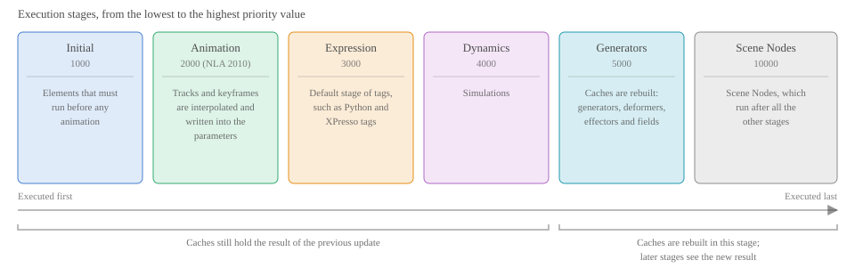

<!-- Source: https://developers.maxon.net/docs/py/2027_0_0/manuals/manual_scene_execution.html -->

# Scene Execution <a id="scene-execution"></a><a id="manual-scene-execution"></a>

Explains how Cinema 4D updates a scene, and where Python code runs in that process.

Whenever you move an object, change the parameter of an object, scrub the timeline, or run a script, Cinema 4D brings the scene up to date: it animates it, runs expressions, rebuilds generators, and draws the result. Almost every Python component is called as a part of this process, and when it is called decides what it can see, what it may change, and on which thread it runs. This manual explains that process and the restrictions that follow from it.

## Update Cycle <a id="update-cycle"></a>

Updates are decoupled from the code that causes them: They are requested, and run later in a cycle. For updates of the active document, the cycle is started and prepared on the main thread, while the execution and the drawing of the result are done by the executing thread:


*Fig. 1: The update cycle of the active document.*

- **Updates are merged and can be cancelled.** [`c4d.EventAdd()`](../modules/c4d/index.md#c4d.EventAdd) does not start an update, it only sets a flag that the main thread handles after the function that set it has returned. Call it once at the end of your function, not in a loop. A new update cancels a running one, so long-running callbacks should check regularly if they have been cancelled.
- **The executing thread varies.** During animation playback, each frame is a synchronous update on the main thread, as is the case for some redraws. [`c4d.documents.BaseDocument.ExecutePasses()`](../modules/c4d.documents/BaseDocument/index.md#c4d.documents.BaseDocument.ExecutePasses) executes in the thread that calls it.

### Types of Updates <a id="types-of-updates"></a>

The kind of update decides which parts of the cycle are executed. Updates can be enqueued using [`c4d.EventAdd()`](../modules/c4d/index.md#c4d.EventAdd) for the active document. Due to the deferred nature of updates, it does not matter if you one or more times request in your code, the update will only be executed once and after your code ran. To trigger immediate updates or updates for documents other than the active one, you must always use [`c4d.documents.BaseDocument.ExecutePasses()`](../modules/c4d.documents/BaseDocument/index.md#c4d.documents.BaseDocument.ExecutePasses) to rebuild the document.

| Update | Triggered by | Executes |
|---|---|---|
| Full | `EventAdd(c4d.EVENT_ANIMATE)`, scrubbing the timeline, each frame of the playback | Animation, expressions, and caches |
| Standard | `EventAdd()`, after a parameter change | Expressions and caches, but not the animation tracks |
| Camera | `EventAdd(c4d.EVENT_CAMERAEXPRESSION)`, navigating in the viewport | Only elements marked as *Camera Dependent* |
| Redraw only | `EventAdd(c4d.EVENT_NO_PREPARE_SCENE)` | Nothing; the views are redrawn from the existing caches |
| Explicit | [`c4d.documents.BaseDocument.ExecutePasses()`](../modules/c4d.documents/BaseDocument/index.md#c4d.documents.BaseDocument.ExecutePasses) | What you pass as arguments; nothing is drawn, which is how documents that are not shown are updated |

Rendering with the Picture Viewer updates a copy of the document on its own, with the flag `EXECUTIONFLAGS_RENDER`.

### Execution Stages <a id="execution-stages"></a>

The execute step does not run elements in the order of the Object Manager, but in the order of their *priority*. Elements with a lower number run first, and elements with the same number run from top to bottom in the Object Manager:



*Fig. 2: The execution stages of an update. The stages are defined in [EXECUTIONPRIORITY](../consts/EXECUTIONPRIORITY.md).*

Tags expose their stage as the *Priority* parameter, a stage plus a value between -499 and 499, which can be set in the Python API with [`c4d.PriorityData`](../modules/c4d/CustomDataType/PriorityData/index.md#c4d.PriorityData). The consequence is that **an element only sees the results of the stages that ran before it**. A tag at the default Expression stage that reads [`c4d.BaseObject.GetCache()`](../modules/c4d/C4DAtom/GeListNode/BaseList2D/BaseObject/index.md#c4d.BaseObject.GetCache) sees the generator output of the *previous* update. To work with up-to-date output, the tag must run after the Generators stage, e.g., at Generators +1.

## Where Your Code Runs <a id="where-your-code-runs"></a>

Python code is called from the update cycle in one of two ways. It is either an *entry point*, e.g., a script, a command, or a dialog, which runs on the main thread between updates, and you decide when it runs. Or it is a *callback*, which Cinema 4D calls while it updates the scene, so that Cinema 4D decides when, how often, and on which thread it runs:


*Fig. 3: The position of Python code in the update cycle. Dashed: callbacks can be moved to other stages.*

All callbacks of an update are called in a *threaded context*, i.e., on the thread that executes the update, which is usually a background thread, but can also be the main thread, e.g., during playback. This includes the `Execute` and `GetVirtualObjects` methods of plugins, the `main` function of a Python Generator or a Python Programming Tag, and all `Draw` methods. Of all the methods of a node, only `Message`, and the `message` function of scripting elements, are usually called on the main thread. See [Scripting Elements](manual_scripting_elements.md) and [Implementing Plugins](manual_implementing_plugins.md) for the individual elements.

Callbacks are called often, for example while the user drags a slider, and for every rendered frame. Keep them fast, and do not use the number of calls as a clock; depend on the document time and on parameters instead.

## Threading Restrictions <a id="threading-restrictions"></a><a id="threading-information"></a>

Cinema 4D uses several threads, so that the interface stays responsive while a scene is updated or rendered. While a callback runs, other threads, such as the Object Manager or a viewport, read the same scene. This results in two contexts with the following rules:

| Operation | Main thread | Threaded context |
|---|---|---|
| Insert, move, or remove nodes of a document, e.g., with [`c4d.documents.BaseDocument.InsertObject()`](../modules/c4d.documents/BaseDocument/index.md#c4d.documents.BaseDocument.InsertObject), [`c4d.GeListNode.InsertUnder()`](../modules/c4d/C4DAtom/GeListNode/index.md#c4d.GeListNode.InsertUnder), or [`c4d.GeListNode.Remove()`](../modules/c4d/C4DAtom/GeListNode/index.md#c4d.GeListNode.Remove) | Allowed | **Forbidden** |
| Create or modify nodes that are not attached to a document, such as the output of a generator | Allowed | Allowed |
| Modify the parameters or matrices of other nodes in a document | Allowed | Tags only |
| Modify the parameters or matrices of the own node | Allowed | **Forbidden** |
| Create or modify materials | Allowed | **Forbidden** |
| Create undo steps | Allowed | **Forbidden** |
| Use the interface, e.g., open dialogs or show messages | Allowed | **Forbidden** |
| Access files | Allowed | Allowed, but not while drawing |
| Read scene data | Allowed | Allowed |

> **Warning:** Modifying scene data from a threaded context is not just discouraged, it is undefined behavior. Large parts of the Cinema API rely on pointers to scene data. Ignoring the threading restrictions will then lead to dangling pointers and with that sooner or later undefined behavior, i.e., crashes or corrupted data.

> **Warning:** Just because your code seems to work does not mean it is safe. It only means that you have not yet encountered a situation where the undefined behavior manifests. It lies in the nature of the problem that this does not always happen immediately and that you need certain setups to trigger it. Ignoring the threading restrictions is therefore always unsafe.

The restrictions on parameters and matrices have a second reason: Changing a node marks it as dirty, which triggers another update. A callback that changes its own node therefore creates a feedback loop. Tags, i.e., [`c4d.plugins.TagData.Execute()`](../modules/c4d.plugins/BaseData/NodeData/TagData/index.md#c4d.plugins.TagData.Execute) and the Python Programming Tag, are the one exception for other nodes: They run after the animation has written the parameters, and before the generators consume them. Changes from other callbacks, e.g., from a generator, come too late for that: They cause caches to be rebuilt constantly, or make the Attribute Manager show mismatching values. [`c4d.plugins.ObjectData.GetVirtualObjects()`](../modules/c4d.plugins/BaseData/NodeData/ObjectData/index.md#c4d.plugins.ObjectData.GetVirtualObjects) is free to do anything to the objects it creates, as they are not part of the document yet.

### Checking the Context <a id="checking-the-context"></a>

Never assume that your code runs on the main thread, not because the documentation says that a method is usually called there, and not because it did so in all your earlier test runs. Which thread calls a method is up to the caller, and nothing prevents other code, e.g., another plugin, from calling `node.Message()` or any other public method from any thread. This applies to all code that is sensitive to the thread it runs on: Everything that is restricted to the main thread in the table above must be guarded with an explicit check, even in methods which are documented to run on the main thread. The only exception to this are a Script Manager scripts, there you can be sure to run on the main thread.

```python
class MyTag(c4d.plugins.TagData):

    def Message(self, node: c4d.BaseTag, msgId: int, data: object) -> bool:
        """Example for a method that usually runs on the main thread."""
        # Guard all main thread sensitive code, even in a method that is usually called on the main thread.
        if msgId == c4d.MSG_DESCRIPTION_COMMAND and c4d.threading.GeIsMainThreadAndNoDrawThread():
            # Main thread work, e.g., modifying the document, can be done here.
            pass

    return True
```

### Deferring Workloads <a id="deferring-workloads"></a>

When a threaded callback finds that the document must be changed, it cannot do that itself. There are two ways to get the work done anyway:

**Send a core message.** With [`c4d.SpecialEventAdd()`](../modules/c4d/index.md#c4d.SpecialEventAdd), a callback sends a core message, which is received by the [`c4d.plugins.MessageData.CoreMessage()`](../modules/c4d.plugins/BaseData/MessageData/index.md#c4d.plugins.MessageData.CoreMessage) method of a message plugin on the main thread. The message itself only carries two integers, so the data which describes the work must be passed through a global storage. The sender stores the data under a unique key, passes the key as the first parameter of the message, and the handler uses it to retrieve the data. Because the storage is accessed by multiple threads, it must be protected with a lock:

```python
import ctypes
import itertools
import threading

import c4d

ID_PLUGIN_REQUEST: int = 1234567 # Use a unique ID, e.g., the ID of your plugin.

# The requests which have been sent but not yet been handled. Hold the lock for every access.
REQUESTS: dict[int, dict] = {}
REQUESTS_LOCK: threading.Lock = threading.Lock()
REQUEST_KEYS = itertools.count(1) # Start at 1, a core message parameter of 0 cannot be read in Python.

def RequestWork(data: dict) -> None:
    """Called from a threaded callback: Stores the data of the work and requests it from the main thread.
    """
    with REQUESTS_LOCK:
        key: int = next(REQUEST_KEYS)
        REQUESTS[key] = data

    # The unique key also prevents Cinema 4D from merging two requests into one.
    c4d.SpecialEventAdd(ID_PLUGIN_REQUEST, key)

def GetCoreMessageParameter(bc: c4d.BaseContainer, parameterId: int) -> int:
    """Returns the integer that has been passed to c4d.SpecialEventAdd().
    """
    getPointer = ctypes.pythonapi.PyCapsule_GetPointer
    getPointer.restype = ctypes.c_void_p
    getPointer.argtypes = [ctypes.py_object, ctypes.c_char_p]
    return getPointer(bc.GetVoid(parameterId), None)

class RequestHandler(c4d.plugins.MessageData):

    def CoreMessage(self, id: int, bc: c4d.BaseContainer) -> bool:
        if id != ID_PLUGIN_REQUEST or not c4d.threading.GeIsMainThreadAndNoDrawThread():
            return True

        key: int = GetCoreMessageParameter(bc, c4d.BFM_CORE_PAR1)
        with REQUESTS_LOCK:
            data: dict | None = REQUESTS.pop(key, None)

        if data is not None:
            # Modify the document here, using the data of the request.
            pass
        return True
```

The lock only protects your own storage, and should only be held while accessing it, never while calling into the Cinema API. Store plain data, such as names or IDs, but not references to nodes, as the scene can have changed by the time the handler runs.

For plugins derived from [`c4d.plugins.NodeData`](../modules/c4d.plugins/BaseData/NodeData/index.md#c4d.plugins.NodeData), such as tags and objects, the other option is to push off work to [`c4d.plugins.NodeData.Message()`](../modules/c4d.plugins/BaseData/NodeData/index.md#c4d.plugins.NodeData.Message). This can either be by simply tying the work to a user interaction, e. g., a button click, or by piggybacking on another message that will be often sent to the node. In the latter case you would again need some data storage mechanism similar to the one described above for handling requests.

```python
import c4d

class MyTagData(c4d.plugins.TagData):

    def Message(self, node: c4d.BaseTag, msgId: int, data: object) -> bool:
        # The user clicked a button of the tag; verify the thread, see above.
        if msgId == c4d.MSG_DESCRIPTION_COMMAND and c4d.threading.GeIsMainThread():
            doc: c4d.documents.BaseDocument = node.GetDocument()
            # Modify the document here, e.g., insert objects, etc.
        return True
```

### Python and Threads <a id="python-and-threads"></a>

All Python code of Cinema 4D runs in one interpreter that executes only one thread at a time. Python threads therefore cannot speed up a computation, and the `threading` and `multiprocessing` modules must not be used to access Cinema 4D data. For a long computation that would block the interface, use [`c4d.threading.C4DThread`](../modules/c4d.threading/C4DThread/index.md#c4d.threading.C4DThread). Long-running callbacks, such as a generator, should check regularly if they have been cancelled, e.g., with `hh.GetThread().TestBreak()`.

Callbacks can arrive on different threads, so module level variables shared by multiple elements, such as a global cache dictionary, are shared mutable state and must be treated accordingly. To find threading violations, see [Debugging](manual_debugging.md).

### See Also <a id="see-also"></a>

- [Scene Structure](manual_scene_structure.md): Explains how a Cinema 4D scene is organized with hierarchies and branches, and how to traverse it.
- [Scripting Elements](manual_scripting_elements.md): Explains Python scripting elements embedded in Cinema 4D scenes.
- [Implementing Plugins](manual_implementing_plugins.md): Explains the basic concepts of implementing plugins.
- [Message System](manual_message_system.md): Explains messages between Cinema 4D scene elements and interfaces.
