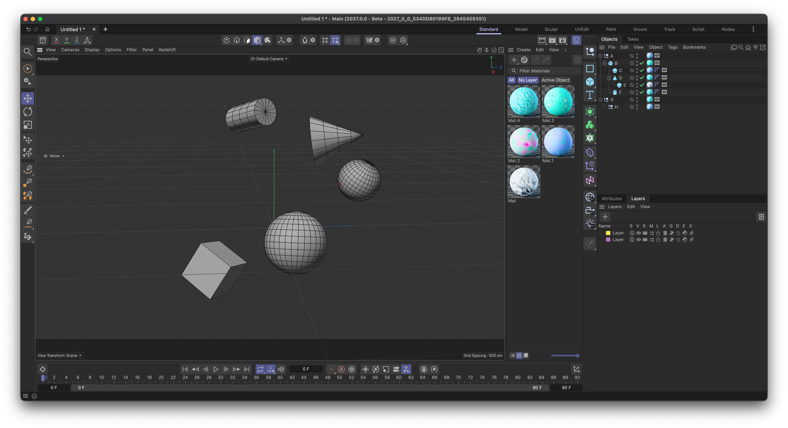
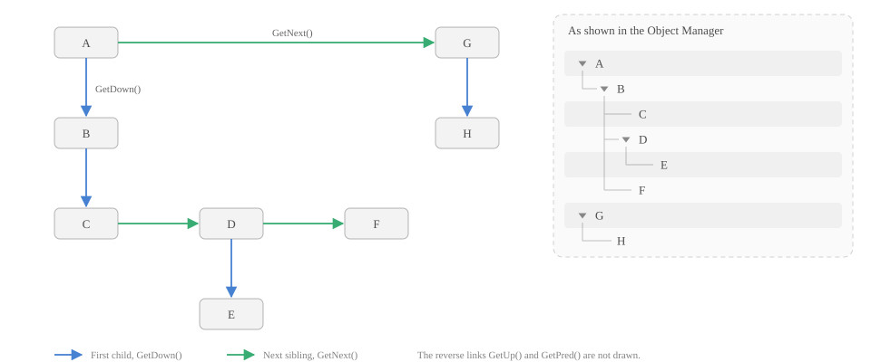

<!-- Source: https://developers.maxon.net/docs/py/2027_0_0/manuals/manual_scene_structure.html -->

# Scene Structure <a id="scene-structure"></a><a id="manual-scene-structure"></a>

Explains how a Cinema 4D scene is organized with hierarchies and branches, and how to traverse it.

In the Object Manager, a scene looks like a simple tree of objects. But a [`c4d.documents.BaseDocument`](../modules/c4d.documents/BaseDocument/index.md#c4d.documents.BaseDocument) stores much more than objects: materials, render settings, layers, scene hooks, and, attached to the objects themselves, tags and animation tracks. All of this is not stored in one big tree, but is organized with just two concepts which are both realized by [`c4d.GeListNode`](../modules/c4d/C4DAtom/GeListNode/index.md#c4d.GeListNode): *hierarchies* and *branches*. This manual explains both, and how to navigate and traverse them.

The examples use the scene below, which consists of eight objects in two hierarchies, five materials, and two layers.

<a id="id1"></a>

[](../_images/manual_scene_structure_scene.png)

*Fig. 1: The example scene. Objects `A` to `H` in the Object Manager, materials in the Material Manager, and layers in the Layer Manager.*

## Hierarchies <a id="hierarchies"></a>

[`c4d.GeListNode`](../modules/c4d/C4DAtom/GeListNode/index.md#c4d.GeListNode) is the base type of almost everything a scene is made of: documents, objects, tags, materials, shaders, tracks, and more. Its purpose is to link nodes into lists and trees. A node knows its parent, its first child, and its previous and next sibling. A *hierarchy* is a set of nodes that are linked in this manner:



*Fig. 2: The objects of the example scene as linked nodes.*

Navigating a hierarchy means following these links:

```python
a: c4d.BaseObject = doc.GetFirstObject() # A, the first object of the document.
b: c4d.BaseObject = a.GetDown()          # B, the first child of A.
g: c4d.BaseObject = a.GetNext()          # G, the next sibling of A.

print(b.GetUp().GetName())               # A, the parent of B.
print(g.GetPred().GetName())             # A, the previous sibling of G.
print([c.GetName() for c in b.GetChildren()]) # ['C', 'D', 'F'], the direct children of B.
```

A node can only be a part of one hierarchy at a time, and a hierarchy only holds nodes of one kind: an object hierarchy contains objects and nothing else.

## Branches <a id="branches"></a>

A hierarchy cannot hold everything a scene consists of. Objects, materials, render settings, and layers are different kinds of nodes, and a tag or a track is not a child of the object it belongs to. To relate such nodes, a node can expose additional hierarchies of other nodes. These are called *branches*.

Branches are not a fixed structure. They are arbitrary extra relations which a node type decides to offer: which branches a node has, how they are named, and what they contain is up to the node. The only thing they have in common is how they are exposed, a call to [`GeListNode.GetBranchInfo()`](../modules/c4d/C4DAtom/GeListNode/index.md#c4d.GeListNode.GetBranchInfo). A branch is rooted in a [`c4d.GeListHead`](../modules/c4d/C4DAtom/GeListNode/GeListHead/index.md#c4d.GeListHead), a special node that does not represent any scene element, but only carries the hierarchy below it. The node which holds the heads of its branches is the *owner* of the branches.

A document is the owner of the branches `Objects`, `Materials`, `Render Settings`, and others. But the concept is not limited to documents. Almost every node can own branches, and the nodes in these branches can own further branches. An object owns for example a branch for its tags and one for its animation tracks. This makes a scene a tree of trees, which is what is commonly called a *scene graph*:

![The structure of a Cinema 4D scene A document owns several branches, each rooted in a list head: Objects, Materials, Render Settings, Layers, Scene Hooks. The Objects branch holds the object hierarchy A with B, C, D, E and F, and G with H. Nodes can own branches too: the object B owns a Tags branch with a Phong tag and a Tracks branch with a position track, which owns a Sequences branch with a curve. A material owns a Shaders branch. A generator additionally stores its output as a cache that is not part of a branch.](../_images/inline/manuals_manual_scene_structure_1.svg)

*Fig. 3: The structure of the example scene. Branch heads are shown as orange pills.*

The most important branches are:

| Owner | Branch | Contains |
|---|---|---|
| Document | Objects (`Obase`) | The object hierarchy, e.g., the objects `A` to `H`. |
| Document | Materials (`Mbase`) | The materials. |
| Document | Render Settings (`Rbase`) | The render data, i.e., the render settings. |
| Document | Layers (`Olayer`) | The layers. |
| Document | Scene Hooks (`SHplugin`) | The scene hooks, i.e., hidden helper nodes with which features such as the take system or the simulation store their data in a scene. |
| Object | Tags (`Tbase`) | The tags of the object. |
| Object, Tag, Material, Shader, … | Tracks (`CTbase`) | The animation tracks of the object. |
| Track | Sequences (`CSbase`) | The curve of the track. |
| Material, Object | Shaders (`Xbase`) | The shaders of the material or object. |

The ID of a branch is the base type of the nodes that it contains in the branches above, e.g., `Obase` for objects. Every owner can be asked for its branches with [`GeListNode.GetBranchInfo()`](../modules/c4d/C4DAtom/GeListNode/index.md#c4d.GeListNode.GetBranchInfo), which returns a list of dictionaries with the keys `head`, `name`, `id`, and `flags`:

```python
for branch in doc.GetBranchInfo(c4d.GETBRANCHINFO_NONE):
    print(f"{branch['name']!r}: {branch['id']}")

# 'Objects': 5155
# 'Materials': 5702
# 'Render Settings': 110304
# 'Layers': 100004801
# 'Scene Hooks': 110065
# '': 110305
```

As the output shows, a branch does not need to have a name, the last branch of a document has none. Passing `GETBRANCHINFO_ONLYWITHCHILDREN` instead only returns the branches that are in use. A scene contains many more nodes than the ones the user created. A new, empty document holds already dozens of them, most of them scene hooks. Everything the user creates, e.g., the objects in *Fig. 1*, is only a small part of the scene graph.

### Moving Between Branches <a id="moving-between-branches"></a>

Since a branch head is a node, it can be navigated like any other node. A node can find its head with [`GeListNode.GetListHead()`](../modules/c4d/C4DAtom/GeListNode/index.md#c4d.GeListNode.GetListHead), and its owner with [`BaseList2D.GetMain()`](../modules/c4d/C4DAtom/GeListNode/BaseList2D/index.md#c4d.BaseList2D.GetMain):

```python
def GetBranchHead(node: c4d.GeListNode, branchId: int) -> c4d.GeListHead | None:
    """Returns the head of the branch with the ID #branchId of #node.
    """
    branches: list[dict] = node.GetBranchInfo(c4d.GETBRANCHINFO_NONE) or []
    return next((b["head"] for b in branches if b["id"] == branchId), None)

objectHead: c4d.GeListHead = GetBranchHead(doc, c4d.Obase)
a: c4d.BaseObject = objectHead.GetDown() # A, the first object. Same as doc.GetFirstObject().
b: c4d.BaseObject = a.GetDown()          # B

print(a.GetListHead() == objectHead)     # True, both objects are in the same branch.
print(b.GetListHead() == objectHead)     # True

print(a.GetUp())                         # None, the head is not a parent.
print(b.GetUp().GetName())               # A, the parent of B in the hierarchy.
print(b.GetMain() == doc)                # True, the owner of the branch which holds B.
```

The difference between the parent and the owner is important. The parent of `B` is the object `A`, as it is a part of the hierarchy. The owner of `B` is the document, as it is the node which owns the branch that the hierarchy of `B` lives in. The owner of a tag is the object it is attached to, and the owner of a shader is its material.

Many branches are also reachable without a call to `GetBranchInfo`, as most owners offer shortcuts for their most important branches:

| Shortcut | Branch |
|---|---|
| [`BaseDocument.GetFirstObject()`](../modules/c4d.documents/BaseDocument/index.md#c4d.documents.BaseDocument.GetFirstObject), [`BaseDocument.GetObjects()`](../modules/c4d.documents/BaseDocument/index.md#c4d.documents.BaseDocument.GetObjects) | The `Objects` branch of a document. |
| [`BaseDocument.GetFirstMaterial()`](../modules/c4d.documents/BaseDocument/index.md#c4d.documents.BaseDocument.GetFirstMaterial), [`BaseDocument.GetMaterials()`](../modules/c4d.documents/BaseDocument/index.md#c4d.documents.BaseDocument.GetMaterials) | The `Materials` branch of a document. |
| [`BaseDocument.GetFirstRenderData()`](../modules/c4d.documents/BaseDocument/index.md#c4d.documents.BaseDocument.GetFirstRenderData) | The `Render Settings` branch of a document. |
| [`BaseDocument.GetLayerObjectRoot()`](../modules/c4d.documents/BaseDocument/index.md#c4d.documents.BaseDocument.GetLayerObjectRoot) | The head of the `Layers` branch of a document. |
| [`BaseObject.GetFirstTag()`](../modules/c4d/C4DAtom/GeListNode/BaseList2D/BaseObject/index.md#c4d.BaseObject.GetFirstTag), [`BaseObject.GetTags()`](../modules/c4d/C4DAtom/GeListNode/BaseList2D/BaseObject/index.md#c4d.BaseObject.GetTags) | The `Tags` branch of an object. |
| [`BaseList2D.GetFirstCTrack()`](../modules/c4d/C4DAtom/GeListNode/BaseList2D/index.md#c4d.BaseList2D.GetFirstCTrack), [`BaseList2D.GetCTracks()`](../modules/c4d/C4DAtom/GeListNode/BaseList2D/index.md#c4d.BaseList2D.GetCTracks) | The `Tracks` branch of an object. |
| [`BaseList2D.GetFirstShader()`](../modules/c4d/C4DAtom/GeListNode/BaseList2D/index.md#c4d.BaseList2D.GetFirstShader) | The `Shaders` branch of a material. |

### Caches <a id="caches"></a>

Besides hierarchies and branches, there is a third relationship between nodes: the *cache*. A generator object such as a Cube, an Array, or a Cloner does not contain any polygons itself, it only describes how to build them. When the scene is executed, the generator builds its output and stores it as its cache, which is reachable with [`BaseObject.GetCache()`](../modules/c4d/C4DAtom/GeListNode/BaseList2D/BaseObject/index.md#c4d.BaseObject.GetCache). The cache is neither a child of the generator, nor a node in one of its branches. It is not found by `GetDown` or `GetBranchInfo`, and its `GetUp` returns `None`. The way back from a cache to its generator is [`BaseObject.GetCacheParent()`](../modules/c4d/C4DAtom/GeListNode/BaseList2D/BaseObject/index.md#c4d.BaseObject.GetCacheParent).


*Fig. 4: The caches of two generators. Caches are drawn in teal, as they are not part of the scene hierarchy.*

A cache is not necessarily a single object, which is shown by the right side of the figure:

- The cache of a generator which produces a single shape, e.g., a Cube, is one polygon object.
- The cache of a generator which produces multiple objects, e.g., an Array, is a Null object with a hierarchy below it. The clones in that hierarchy can be generators themselves, which have caches of their own. Caches can therefore be nested arbitrarily deep. The input objects of the generator, here the Cylinder, are not part of this cache, they stay in the Object Manager.
- Deformers do not change the cache of a generator. They store their result in a second object, the *deform cache*. It is attached to the object that has been deformed, here the polygon object of the Cube, and not to the generator itself, so `cube.GetDeformCache()` is `None` but `cube.GetCache().GetDeformCache()` is the bent Cube. It is reachable with [`BaseObject.GetDeformCache()`](../modules/c4d/C4DAtom/GeListNode/BaseList2D/BaseObject/index.md#c4d.BaseObject.GetDeformCache).
- Caches are nodes like any other, they can for example own a `Tags` branch, which holds the UVW and normal data of the polygon object.
- Caches are created and updated by the scene execution, see [Scene Execution](manual_scene_execution.md). A generator has no cache before the document has been executed for the first time, e.g., with [`BaseDocument.ExecutePasses()`](../modules/c4d.documents/BaseDocument/index.md#c4d.documents.BaseDocument.ExecutePasses).

```python
# Cube > Bend (child)
doc.ExecutePasses(None, True, True, True, c4d.BUILDFLAGS_NONE) # Build the caches.

cube: c4d.BaseObject = doc.GetFirstObject()
cache: c4d.PolygonObject = cube.GetCache()           # The polygon object of the Cube.
deformed: c4d.PolygonObject = cache.GetDeformCache() # The same polygon object, but bent.

print(cache.GetCacheParent() == cube)                # True, the way back to the generator.
print(cache.GetUp(), cube.GetDeformCache())          # None None

def PrintCaches(obj: c4d.BaseObject, depth: int = 0) -> None:
    """Prints the hierarchy of #obj together with all caches below it."""
    print(f"{'  ' * depth}{obj.GetName()} ({obj.GetTypeName()})")
    for cache in (obj.GetCache(), obj.GetDeformCache()):
        if cache:
            PrintCaches(cache, depth + 1)
    for child in obj.GetChildren():
        PrintCaches(child, depth + 1)

# Array > Cylinder (child)
PrintCaches(doc.GetFirstObject().GetNext())

# Array (Array)
#   Array (Null)            <- The cache of the Array.
#     Cylinder.8 (Cylinder) <- The clones, each of them a generator.
#       Cylinder.8 (Polygon)<- Their caches.
#     ...
#   Cylinder (Cylinder)     <- The input object, a child of the Array.
```

## Traversing a Scene <a id="traversing-a-scene"></a>

Navigating with the methods of `GeListNode` is sufficient for simple tasks, such as walking over the top level objects of a document:

```python
node: c4d.BaseObject | None = doc.GetFirstObject()
while node:
    print(node.GetName())   # A, G
    node = node.GetNext()
```

For everything more elaborate, the module `mxutils` offers functions which implement common traversals. They also avoid the pitfalls of manual navigation, such as accidentally using recursion for deep hierarchies, or stepping onto `None` in a chain of calls.

### Finding Nodes <a id="finding-nodes"></a>

[`mxutils.GetNodeFromPath()`](../modules/mxutils_api.md#mxutils.GetNodeFromPath) follows a path of navigation characters from a node. The characters are `d` for down, `u` for up, `n` for next, `p` for previous, `f` for the first sibling, and `r` for the root. A path that cannot be followed returns `None`, or raises an error when `raisePathErrors` is passed. The functions [`mxutils.GetRootNode()`](../modules/mxutils_api.md#mxutils.GetRootNode) and [`mxutils.GetFirstSiblingNode()`](../modules/mxutils_api.md#mxutils.GetFirstSiblingNode) are the same as the paths `r` and `f`:

```python
a: c4d.BaseObject = doc.GetFirstObject()

e: c4d.BaseObject = mxutils.GetNodeFromPath(a, "ddnd") # A > B > D > E
f: c4d.BaseObject = mxutils.GetNodeFromPath(a, "ddnn") # A > B > D > F
h: c4d.BaseObject = mxutils.GetNodeFromPath(a, "nd")   # A > G > H

print(mxutils.GetNodeFromPath(a, "dxd"))               # None, there is no such path.
print(mxutils.GetRootNode(e).GetName())                # A
print(mxutils.GetFirstSiblingNode(f).GetName())        # C
```

### Walking Hierarchies <a id="walking-hierarchies"></a>

[`mxutils.IterateTree()`](../modules/mxutils_api.md#mxutils.IterateTree) yields a node and all its descendants. With `yieldSiblings`, it also yields the siblings that follow the node, with `rewindToFirstSibling` and `rewindToRoot`, the traversal starts at the first sibling or the root of the node instead. It supports three traversal orders:

```python
# The default, depth-first: Parents before children, as a human would read the tree.
mxutils.IterateTree(a, yieldSiblings=True)
# A, B, C, D, E, F, G, H

# Inverse depth-first: Children before parents, useful to delete or flatten a hierarchy.
mxutils.IterateTree(a, yieldSiblings=True, traversalMode=mxutils.TRAVERSAL_INVERSE_DEPTH_FIRST)
# C, E, D, F, B, A, H, G

# Breadth-first: Level by level.
mxutils.IterateTree(a, yieldSiblings=True, traversalMode=mxutils.TRAVERSAL_BREADTH_FIRST)
# A, G, B, H, C, D, F, E
```

Because a branch head is a node, the same function also walks a whole branch. The head itself is the first node that is yielded, so it is easier to start at its first child:

```python
for material in mxutils.IterateTree(GetBranchHead(doc, c4d.Mbase).GetDown(), yieldSiblings=True):
    print(material.GetName()) # The materials of the document.
```

### Walking the Scene Graph <a id="walking-the-scene-graph"></a>

[`mxutils.IterateGraph()`](../modules/mxutils_api.md#mxutils.IterateGraph) traverses all three kinds of relationships: hierarchies, branches, and caches. Each of them must be enabled explicitly, as without any flag, the function yields nothing:

```python
b: c4d.BaseObject = mxutils.GetNodeFromPath(doc.GetFirstObject(), "d")

# B, C, D, E, and F, i.e., what IterateTree() would yield.
mxutils.IterateGraph(b, yieldHierarchy=True)

# Additionally yields the polygon object caches of the objects.
mxutils.IterateGraph(b, yieldHierarchy=True, yieldCaches=True)

# Additionally yields everything in a branch of the objects, e.g., their tags and tracks.
mxutils.IterateGraph(b, yieldHierarchy=True, yieldBranches=True)
```

With `complexYield`, the function yields tuples `(node, owner, depth, isBranch, isCache)` instead of nodes. This tells for each node in which relationship it has been found:

```python
for node, owner, depth, isBranch, isCache in mxutils.IterateGraph(
        b, yieldHierarchy=True, yieldBranches=True, complexYield=True):
    print(f"{'  ' * depth}{node.GetName()} (owner: {owner.GetName() if owner else None}, branch: {isBranch})")

# B (owner: None, branch: False)
#   Material (owner: B, branch: True)
#   Display (owner: B, branch: True)
#   C (owner: None, branch: False)
#     Material (owner: C, branch: True)
#     Phong (owner: C, branch: True)
#     ...  (shortened, the tags depend on the scene)
```

Starting at the document traverses the whole scene graph, which is expensive for large scenes. The arguments `branchFilter`, `stopBranchingEarly`, `nodeFilter`, and `maxBranchingDepth` reduce the work:

- `branchFilter` limits the branches from which nodes are yielded. By default, this does not stop the traversal from entering other branches. With `stopBranchingEarly`, the traversal only enters the branches which are in the filter. Then, all branches that lead to the wanted nodes must be part of the filter.
- `nodeFilter` limits the types of the yielded nodes, e.g., to `c4d.Tphong` or all tags with `c4d.Tbase`.
- `maxBranchingDepth` limits how many branches deep the traversal goes. Tags can only be found with a depth of two or more from a document, as they are in a branch of an object which is in a branch of the document.

The following finds all Phong tags of the objects in a document, without entering any other branch than the ones of the objects and their tags:

```python
for tag in mxutils.IterateGraph(
        doc, yieldHierarchy=True, yieldBranches=True, branchFilter=[c4d.Obase, c4d.Tbase],
        stopBranchingEarly=True, nodeFilter=[c4d.Tphong]):
    print(tag.GetObject().GetName()) # C, D, E, F
```

> **Warning:**
>
> `IterateGraph` is relatively expensive. For a scene with thousands of nodes, expect multiple milliseconds per call. Do not use it in code that runs often, such as a method which is called on every scene update. Use `stopBranchingEarly` or write a traversal that is tailored to your needs in such cases.

### Printing a Scene Graph <a id="printing-a-scene-graph"></a>

Reading a scene graph in code is hard, as it is mostly invisible in the user interface. The class [`mxutils.DebugPrint`](../modules/maxon_generated/mxutils/mxutils.DebugPrint.md#module-mxutils.DebugPrint) prints it as a tree instead. [`DebugPrint.GetGraph()`](../modules/maxon_generated/mxutils/mxutils.DebugPrint.md#mxutils.DebugPrint.GetGraph) builds the tree for any node, e.g., a document, an object, or a material, and [`DebugPrint.PrintGraph()`](../modules/maxon_generated/mxutils/mxutils.DebugPrint.md#mxutils.DebugPrint.PrintGraph) prints it directly. The tree contains the hierarchy and marks caches with `[Cache]` and `[Deform Cache]`, and branches with `[Branch]`. Each node is shown with its name, its Python type, and its type ID:

```python
doc.ExecutePasses(None, True, True, True, c4d.BUILDFLAGS_NONE) # Build the caches, so that they show up.

a: c4d.BaseObject = doc.GetFirstObject()
print(mxutils.DebugPrint.GetGraph(a).ToString()) # Same as mxutils.DebugPrint.PrintGraph(a)

# 'A' (BaseObject: Onull)
# ├── [Branch] 'Tags' (Tbase)
# │   └── 'Display' (BaseTag: Tdisplay)
# └── 'B' (BaseObject: Ocube)
#     ├── [Cache]
#     │   └── 'B' (PolygonObject: Opolygon)
#     │       └── [Branch] 'Tags' (Tbase)
#     │           ├── 'UVW' (UVWTag: Tuvw)
#     │           ├── '' (PolygonTag: Tpolygon)
#     │           └── '' (PointTag: Tpoint)
#     ├── [Branch] 'Tags' (Tbase)
#     │   └── 'Display' (BaseTag: Tdisplay)
#     └── 'C' (BaseObject: Osphere)
#         ├── [Cache]
#         │   └── ...                  (a polygon object with its tags, as for B)
#         └── [Branch] 'Tags' (Tbase)
#             └── 'Display' (BaseTag: Tdisplay)
```

The output shows everything that `IterateGraph` can yield, the hierarchy (`B` and `C`), the branches (`Tags`), and the caches. Passing a document prints the whole scene, which is a lot of text, since even an empty document holds dozens of nodes. [`DebugPrint.DiffGraph()`](../modules/maxon_generated/mxutils/mxutils.DebugPrint.md#mxutils.DebugPrint.DiffGraph) compares the graphs of two nodes, e.g., of the same object before and after a change or in two documents, and returns the result as a unified diff:

```python
clone: c4d.documents.BaseDocument = doc.GetClone(c4d.COPYFLAGS_NONE)
clone.GetFirstObject().GetDown().SetName("B2")
clone.ExecutePasses(None, True, True, True, c4d.BUILDFLAGS_NONE)

print(mxutils.DebugPrint.DiffGraph(doc.GetFirstObject(), clone.GetFirstObject()))

# --- first
# +++ second
# @@ -1,7 +1,7 @@
#  'A' (BaseObject: Onull)
# -└── 'B' (BaseObject: Ocube)
# +└── 'B2' (BaseObject: Ocube)
#      └── [Cache]
# -        └── 'B' (PolygonObject: Opolygon)
# +        └── 'B2' (PolygonObject: Opolygon)
#              └── [Branch] 'Tags' (Tbase)
#              ...
```

### See Also <a id="see-also"></a>

- [API Overview](manual_api_overview.md): Provides an overview of the major API components.
- [Scene Execution](manual_scene_execution.md): Explains how Cinema 4D updates a scene, and where Python code runs in that process.
- [Geometry Model](manual_geometry.md): Explains the geometry model of Cinema 4D: polygons, edges, normals, caches, and splines.
- [Example _c4d_baselist2d.py](../examples/scene/_c4d_baselist2d.py.md): Demonstrates important functions for the type c4d.BaseList2D.
- [Example _c4d_gelistnode.py](../examples/scene/_c4d_gelistnode.py.md): Demonstrates important functions for the type c4d.GeListNode.
- [Example objects.py](../examples/scene/objects.py.md): Demonstrates basic operations on objects.
- [Example traversal.py](../examples/scene/traversal.py.md): Demonstrates scene traversal.
