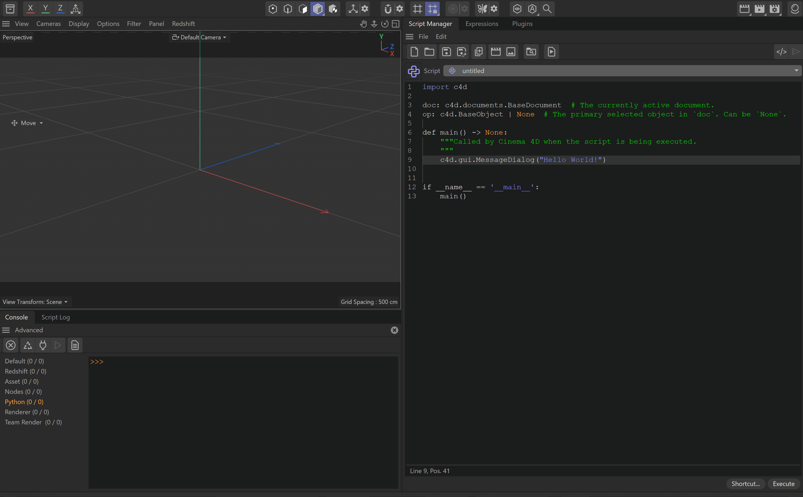
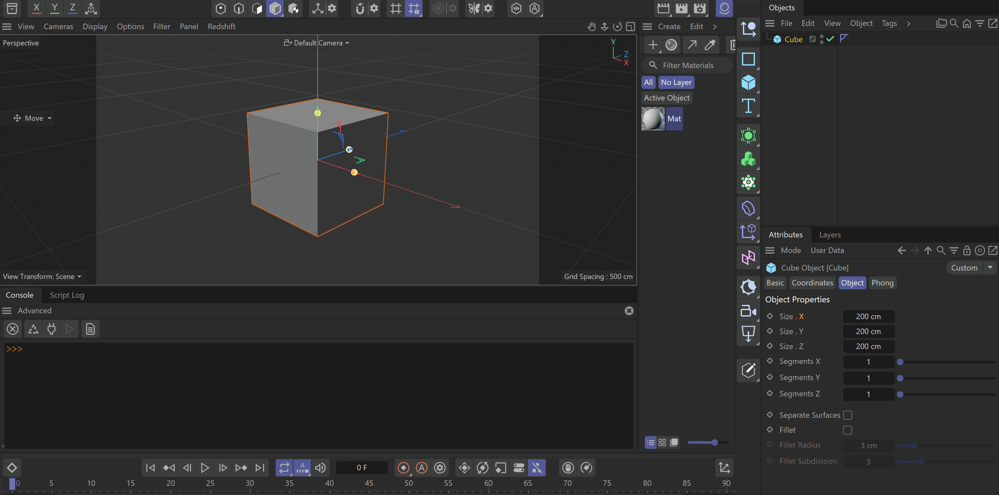

<!-- Source: https://developers.maxon.net/docs/py/2027_0_0/manuals/manual_script_manager.html -->

# Script Manager and Console <a id="script-manager-and-console"></a><a id="manual-python-script-manager"></a>

Write and run scripts in the Script Manager and inspect results in the Python Console.

The **Script Manager** is for editing, saving, and running scripts. The **Python Console** runs short commands and shows output and errors from scripts, plugins, and scene elements. Both are available in the **Script** layout; you can also open them from the **Script** menu. Check the Console when a script does not produce the expected result.

Both tools run code on Cinema 4D’s main thread. A long-running loop blocks the interface; see [Threading Restrictions](manual_scene_execution.md#threading-information). Both supply `doc` (the active [`BaseDocument`](../modules/c4d.documents/BaseDocument/index.md#c4d.documents.BaseDocument)) and `op` (the active object, or `None`). In the Console, `c4d` is already imported. In a saved script, import modules explicitly.

## Script Manager <a id="script-manager"></a>

<a id="id1"></a>| Action | How |
|---|---|
| Create | Choose **File > New** to start a script. |
| Save | Choose **File > Save** to keep the script. |
| Run | Click **Execute** to run the current script. |
| Assign a shortcut | Use **Shortcut** to run the script with a key combination. |
| Create a button | Drag the script icon into the Cinema 4D interface. |

An unsaved script has an asterisk beside its name. Saved scripts are stored in `library/scripts` under the Cinema 4D preferences folder, available through **Preferences > Open Preference Folder**.

<a id="id2"></a>

<a id="manual-python-script-manager-button"></a>[](../_images/manual_script_editor_editor.gif)

*Fig. 1: A script can be run from the Script Manager, its script button, or the Commander.*

The button runs the saved script. To give it a custom label and description, put these fields in its module docstring:

```python
"""Name-en-US: My Script
Description-en-US: Run my Cinema 4D script
"""
```

Use **File > Load Icon** in the Script Manager to assign an icon. For a button that can be disabled or checked, define `state()` in the script and return `False`, `c4d.CMD_ENABLED`, or `c4d.CMD_ENABLED | c4d.CMD_VALUE` as needed. Keep `state()` fast: Cinema 4D can call it on every interface redraw.

## Python Console <a id="python-console"></a><a id="manual-python-console"></a>

The Cinema 4D console shows message and error output from various sources. But the Python console is more than that, it allows you to interact with the scene and execute Python commands directly. It can also be used to inspect scene elements and parameters by dragging them into the console.

<a id="id3"></a>

[](../_images/manual_script_editor_console.gif)

*Fig. 2: The Python Console runs commands and accepts dragged scene elements and parameters.*

## See Also <a id="see-also"></a><a id="manual-python-console-dragdrop"></a><a id="manual-python-script-manager-dragdrop"></a>

- [Quickstart](manual_quickstart.md): Learn the basics of using the Cinema 4D Python API.
- [Scripting Elements](manual_scripting_elements.md): Explains Python scripting elements embedded in Cinema 4D scenes.
- [Working with the SDK](manual_working_with_sdk.md): Set up Visual Studio Code to work with the Cinema 4D Python SDK.
- [Example script_icon.py](../examples/gui/script_icon.py.md): Example to customize the icon used for a script. The icon should be named like the .py file. Should be a TIF with a size of 32x32.
- [Example script_name_description.py](../examples/gui/script_name_description.py.md): Example to customize the name and the description in the script manager. Name-en-US defines the displayed name. Description-en-US defines the description of the script. As long as Name-en-US (Prior R20 it was Name-US) and Description-en-US (Prior R20 it was Description-US) are in the first comment bloc, c4d will extract them.
