<!-- Source: https://developers.maxon.net/docs/py/2027_0_0/manuals/manual_standalone_interpreter.html -->

# Standalone Interpreter <a id="standalone-interpreter"></a><a id="c4dpy"></a>

Explains how to use Cinema 4D’s standalone interpreter, c4dpy.

*c4dpy* is a standalone Python interpreter that is shipped with Cinema 4D and works similarly to the `python` app shipped with a standard CPython. But unlike the standard Python interpreter, c4dpy is also a headless Cinema 4D instance, i.e., a Cinema 4D instance without its GUI. Apart from the normal functionalities of a Python interpreter, such as running scripts, and running in interactive mode, c4dpy can do most things a normal Cinema 4D instance can do: It can load files, construct scenes, save files, start renderings, or run plugins; do everything as long as the functionality does involve any GUI. It is therefore for example not possible in c4dpy to get the content of a viewport in a document or to run a dialog as both would involve GUI interactions.

## Running c4dpy <a id="running-c4dpy"></a>

c4dpy is available on Windows and macOS, and is located in the Cinema 4D installation directory. On Windows, c4dpy can be run with the executable `c4dpy.exe`. On macOS, these steps must be followed to run c4dpy:

1. Right-click on *c4dpy.app* and select *Show Package Contents*.
2. Navigate to the *Contents/MacOS* directory.
3. Drag the c4dpy file into a terminal window and press return.

Note that starting the c4dpy executable will take considerably longer than a standard CPython interpreter, as it is setting up the Python environment and the headless Cinema 4D instance. When running c4dpy for the first time, the user will be prompted with a login menu a shown below:

<a id="id1"></a>

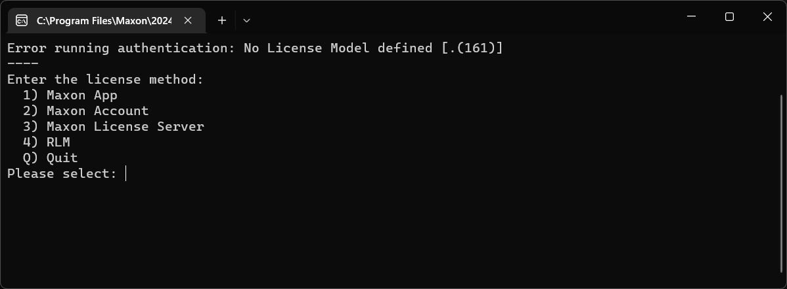

*Fig. 1: The c4dpy first-run login menu offers the available licensing methods.*

The recommended login method is *Maxon App*. Apart from a license sever environment, you can also login with Maxon Account, i.e., just as you would with `id.maxon.net`, using your account credentials. An account login only does work for non-federated accounts, i.e., accounts where you login is not redirected to Apple, Google, or Facebook. Once you have have verified your license, the Python REPL interactive interpreter console will start:

<a id="id2"></a>

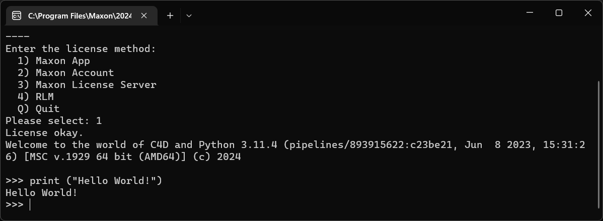

*Fig. 2: The c4dpy interactive Python console after a successful login.*

On all subsequent runs, the login menu will not appear, and the Python REPL interactive interpreter console will start immediately.

<a id="id3"></a>

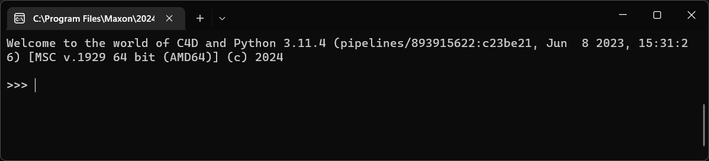

*Fig. 3: The c4dpy interactive Python console shown on subsequent launches.*

## Command-line Arguments <a id="command-line-arguments"></a>

c4dpy supports a subset of the Cinema 4D and CPython command-line arguments. The following table lists the supported arguments:

| Argument | Example | Description |
|---|---|---|
| `-g_encryptPypFile` | `c4dpy dummyfile.py -g_encryptPypFile=d:\plugins\myplugin.pyp` | Encrypts the given pyp file just as the command in the Cinema 4D menu `Extensions/Tools/Source Protector` would. |
| `-g_licenseModel` | `c4dpy -g_licenseModel LICENSEMODEL::MAXONAPP` | Sets the license model, possible values are `LICENSEMODEL::MAXONAPP`, `LICENSEMODEL::MAXONACCOUNT`, `LICENSEMODEL::RLM`, and `LICENSEMODEL::LICENSESERVER`, selecting the respective licensing method. Must be run in conjunction with the `-g_licenseUsername` and `-g_licensePassword` when set to `MAXONAPP`. |
| `-g_licenseUsername` | `c4dpy -g_licenseUsername=user@company.net` | Sets the user handle when using the `LICENSEMODEL::MAXONACCOUNT` licensing model. Must be run in conjunction with `-g_licensePassword`. |
| `-g_licensePassword` | `c4dpy -g_licensePassword=puffyunicorn` | Sets the user password when using the `LICENSEMODEL::MAXONACCOUNT` licensing model. Must be run in conjunction with `-g_licenseUsername`. |
|  | `c4dpy myScript.py` | The first unnamed argument to the c4dpy is a Python script to run. Note that this is a Python script, not a Cinema 4D Script Manager script, global variables like `op` and `doc` are not available here by default. |
| `-c` | `c4dpy -c "print('Hello World!')""` | Executes the passed Python code in command. |
| `-m` | `c4dpy -m ensurepip` | Searches `sys.path` for the named module and execute its contents as the `__main__` module. |
| `-V` | `c4dpy -V` | Prints the version number of the Python VM used by c4dpy, e.g., `3.11.4`. `--version` is also supported. |
| `-b` | `c4dpy -b` | Issues a warning when comparing `bytes` or `bytearray` with `str` or `bytes` with `int`. |
| `-B` | `c4dpy -B` | If given, Python won’t try to write `.pyc` files on the import of source modules. |
| `-E` | `c4dpy -E` | Ignore all PYTHON environment variables, e.g. `PYTHONPATH` and `PYTHONHOME`, that might be set. |
| `-i` | `c4dpy myScript.py -i` | When a script is passed as first argument or the -c option is used, enter interactive mode after executing the script or the command. |
| `-s` | `c4dpy -s` | Removes the user `site-packages` directory from `sys.path`. |
| `-S` | `c4dpy -S` | Disable the import of the module `site` and the site-dependent manipulations of `sys.path` that it entails. Also disable these manipulations if `site` is explicitly imported later (call `site.main()` if you want them to be triggered). |

## Editor Integration <a id="editor-integration"></a>

Since c4dpy is just a Python interpreter like any other, it can be integrated with the developing environment of your choice. Make sure to have run the c4dpy executable at least once before trying to integrate it with an editor, so that the licensing method hast been set.

> **Warning:** For c4dpy R21 to S24, the VS code Python extension can load indefinitely upon auto-discovering interpreters. Please turn off interpreter auto-discovery in such case. See also [c4dpy.exe and VS Code](https://developers.maxon.net/forum/topic/12089/c4dpy-exe-and-vs-code-on-windows).

### Sublime Text <a id="sublime-text"></a>

This guide has been written for *SublimeText* 3.2.2, some of the described steps might be slightly different for future or past versions of the application.

1. Run `Tools > Build Systems > New Build System` from the main menu to create a new build system.

<a id="id4"></a>

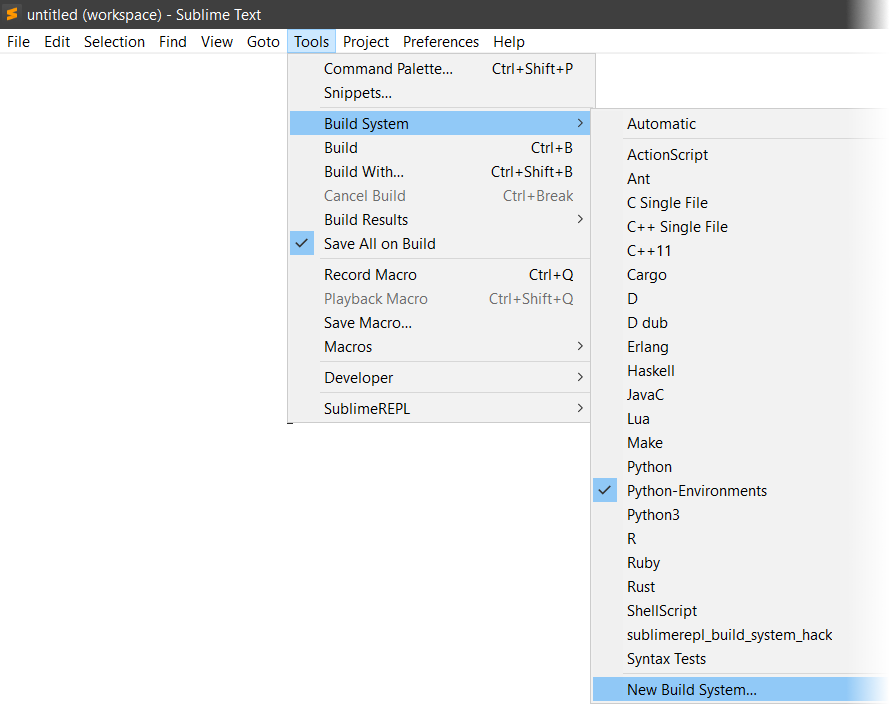

*Fig. 4: Create a new build system from Sublime Text’s Tools menu.*

2. SublimeText will open a file for you, replace its content with the following:

```javascript
{
    "selector": "source.python",
    "cancel": {"kill": true},
    "variants": [
        {
            "name": "c4dpy",
            "cmd": ["c4dpy", "-u", "$file"],
            "file_regex": "^[ ]*File \"(...*?)\", line ([0-9]*)",
        },
        {
            "name": "CPython",
            "cmd": ["py", "$file"],
            "file_regex": "^\\s*File \"(...*?)\", line ([0-9]*)"
        }
    ]
}
```

3. This example assumes a separate standalone *CPython* installation to be on the machine which we want to run alongside with c4dpy in this Python build environment. If this is not the case, one can delete the lines ten to fourteen in the file listing above. This example also assumes the user to having set up environment variables for both the *CPython* and c4dpy interpreter; `c4dpy` for c4dpy and `py` for *CPython*. Alternatively the first `cmd` argument can also be an absolute path, e.g.:

```javascript
"cmd": ["c4dpy", "-u", "$file"],
// Should become something like this, modify to your Cinema 4D directory.
"cmd": ["C:\Program Files\Maxon\R24\c4dpy.exe", "-u", "$file"],

"cmd": ["py", "$file"],
// Should become something like this, modify to your CPython directory.
"cmd": ["C:\compilers\python3.9\python.exe", "$file"],
```

4. Save the file with `CTRL + S`, *SublimeText* will open a file dialog already set to the user packages path. Save the build environment settings under the name it should appear in menus, e.g., *Python-Environments.sublime-build*.
5. The build environment will now appear in the build menu to be selected as the active build environment as shown in the screen under point one.
6. A Python file like shown below can now be run with either of the defined Python interpreters.

<a id="id5"></a>

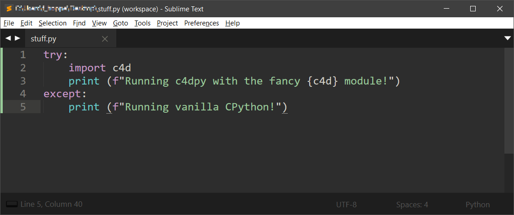

*Fig. 5: A Python file configured to run with the available interpreter build systems.*

7. Pressing `CTRL + SHIFT + B` or running `Tools > Build With` will cause *SublimeText* to prompt a popup asking for the interpreter to run the file with.

<a id="id6"></a>

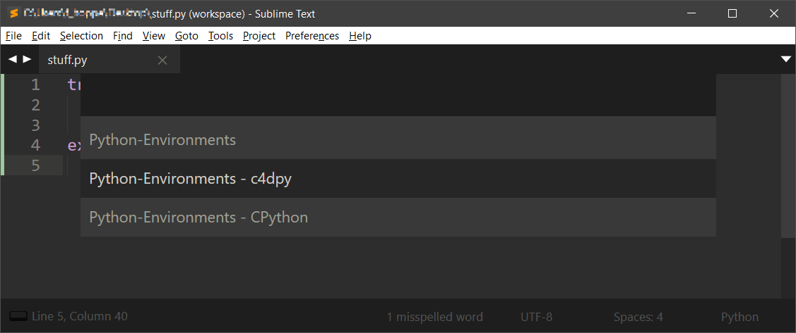

*Fig. 6: Sublime Text prompts for the interpreter after invoking Build With.*

- Running the file with c4dpy:

<a id="id7"></a>

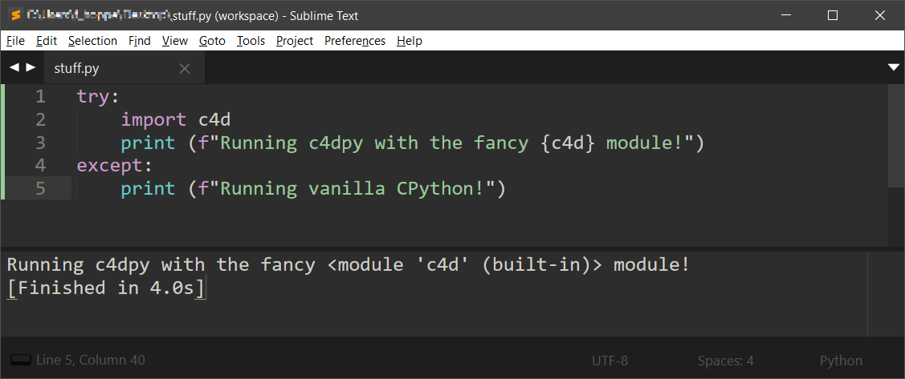

*Fig. 7: The example Python file running with c4dpy in Sublime Text.*

- Running the file with *CPython*:

<a id="id8"></a>

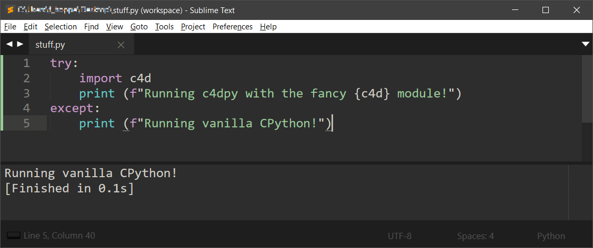

*Fig. 8: The example Python file running with CPython in Sublime Text.*

7. After having set the sub-environment with `CTRL + SHIFT + B` all consecutive *Build* invocations (`CTRL + B`) will run that currently selected sub-environment.

### Visual Studio Code <a id="visual-studio-code"></a>

c4dpy can also be run as a Python interpreter in *Visual Studio Code*.

1. Open *Visual Studio Code* and run `File > Preferences > Settings`

<a id="id9"></a>

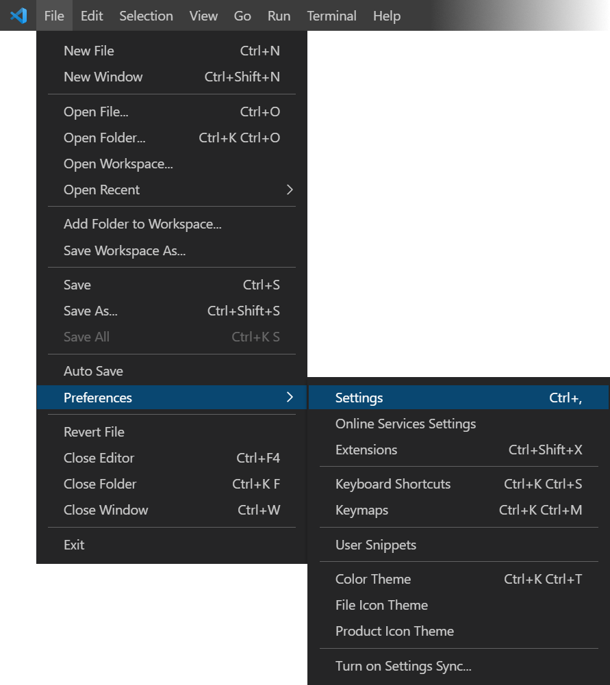

*Fig. 9: Open Visual Studio Code’s Settings to configure a Python interpreter.*

2. Type *‘Default Interpreter’* into the search bar of the user settings to find the *‘Python: Default Interpreter Path’* setting. Set it to the path of a c4dpy interpreter.

<a id="id10"></a>

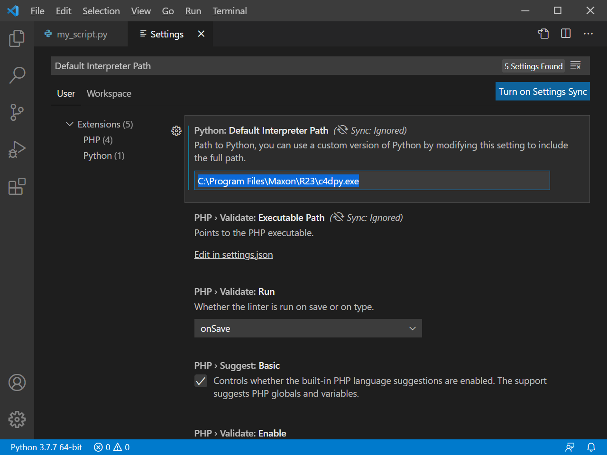

*Fig. 10: Set the Python Default Interpreter Path to the c4dpy executable.*

3. c4dpy should now appear in the available Python interpreters in the interpreter selector in the bottom left corner of *Visual Studio Code* when having a Python file opened.

<a id="id11"></a>

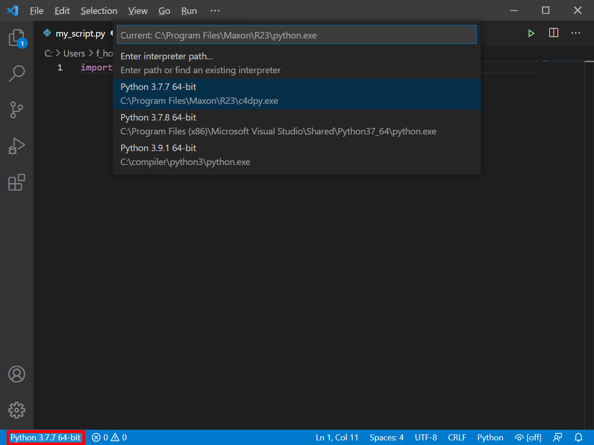

*Fig. 11: Select c4dpy from Visual Studio Code’s available Python interpreters.*

4. With it activated, a file can be interpreted either by pressing `CTRL + F5` or by pressing debug play button in the top right corner.

<a id="id12"></a>

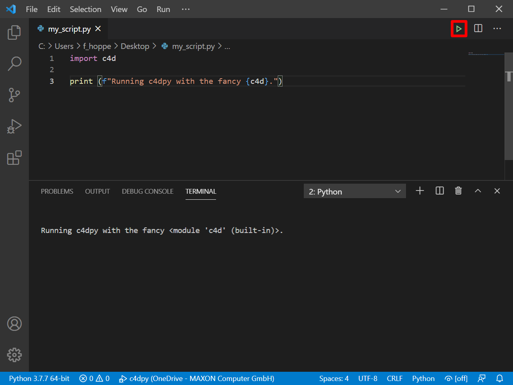

*Fig. 12: Run the active Python file in Visual Studio Code with c4dpy.*

5. Debugging (`F5`) will not work out of the box.

### Visual Studio <a id="visual-studio"></a>

c4dpy has to be setup on a per project basis in *Visual Studio*.

1. Open *Visual Studio* and start a new *Python Application* project.

<a id="id13"></a>

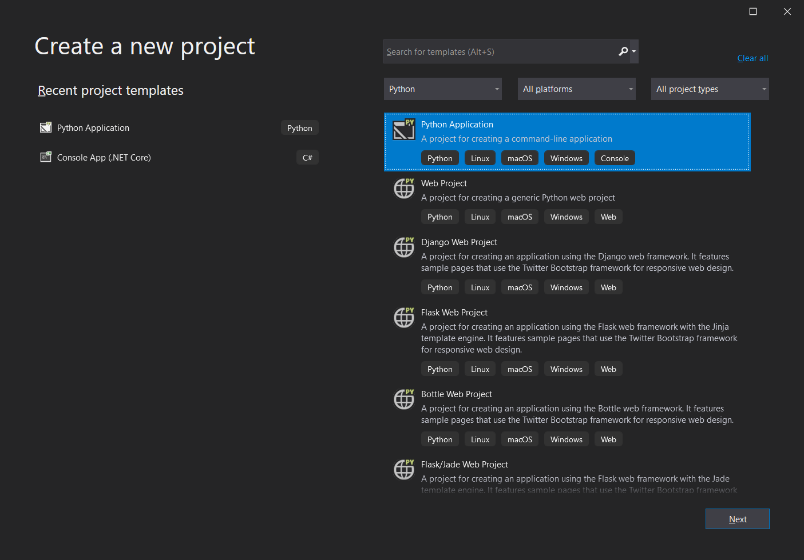

*Fig. 13: Create a Python Application project in Visual Studio.*

2. In the project add a new Python environment.

<a id="id14"></a>

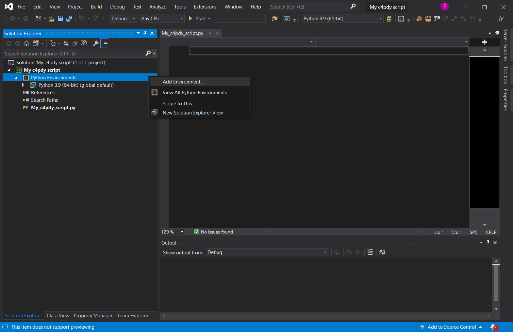

*Fig. 14: Add a Python environment to the Visual Studio project.*

3. In the dialog select *Existing Environment* and then setup the values like shown below.

<a id="id15"></a>

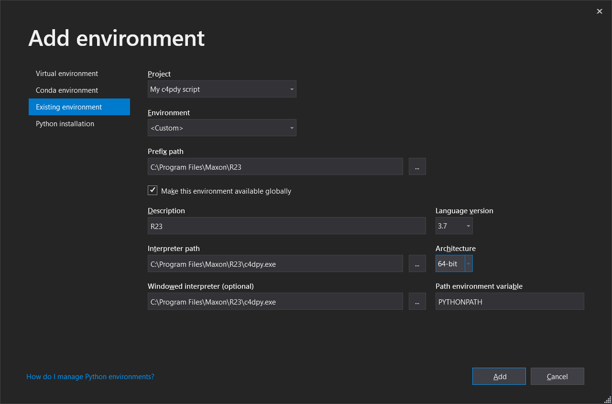

*Fig. 15: Configure the project to use an existing c4dpy environment.*

4. Pressing `CTRL + F5` will now run the defined startup file of the project.

<a id="id16"></a>

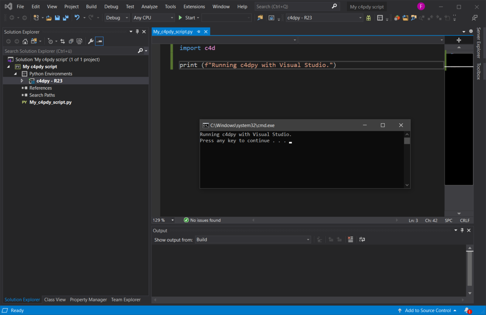

*Fig. 16: Run the configured startup file from Visual Studio.*

5. Debugging (`F5`) will not work out of the box.

## See Also <a id="see-also"></a>

- [Python Environment](manual_python_environment.md): Explains the features and limitations of Cinema 4D’s Python runtime.
- [External Libraries](manual_external_libraries.md): Explains how to expose third-party libraries to Cinema 4D Python.
- [Working with the SDK](manual_working_with_sdk.md): Set up Visual Studio Code to work with the Cinema 4D Python SDK.
