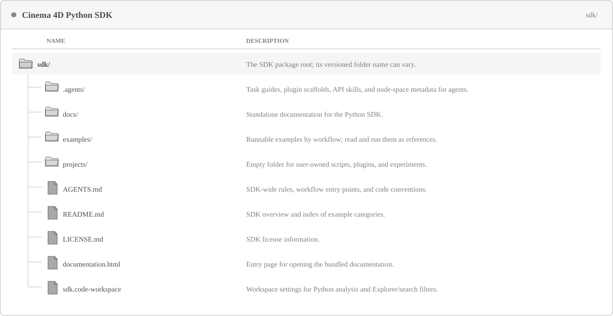
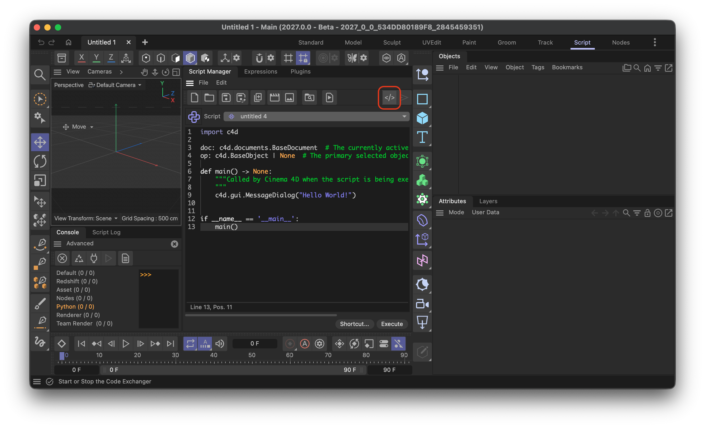
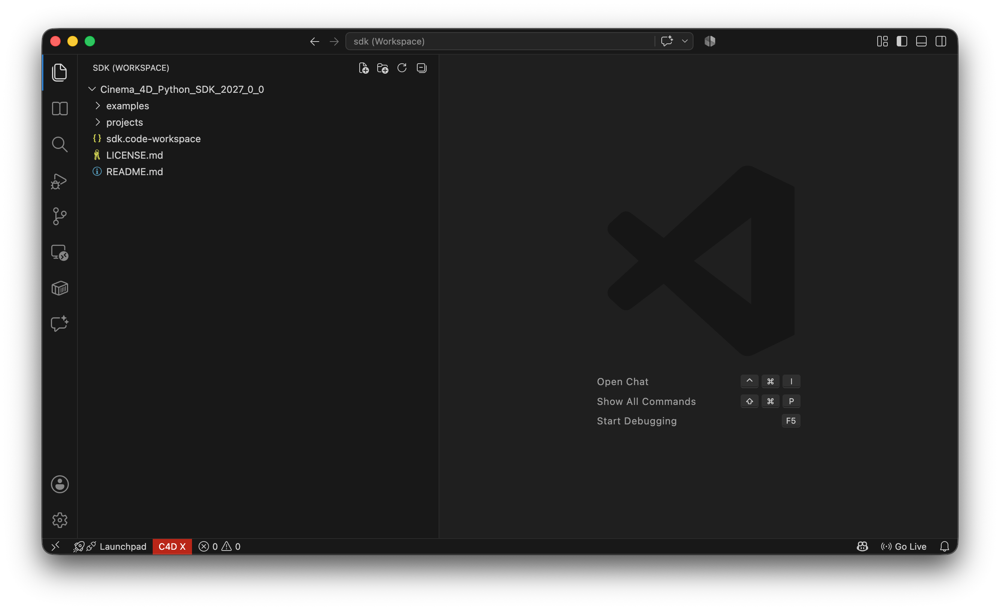
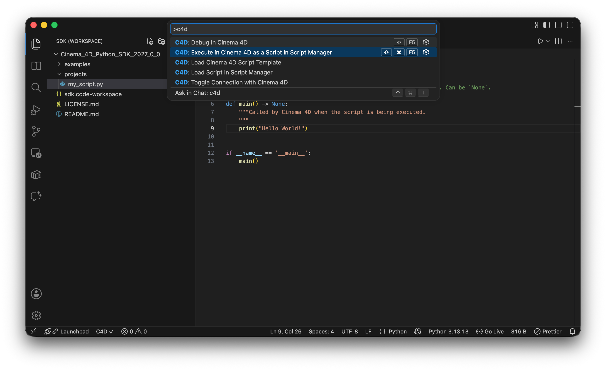
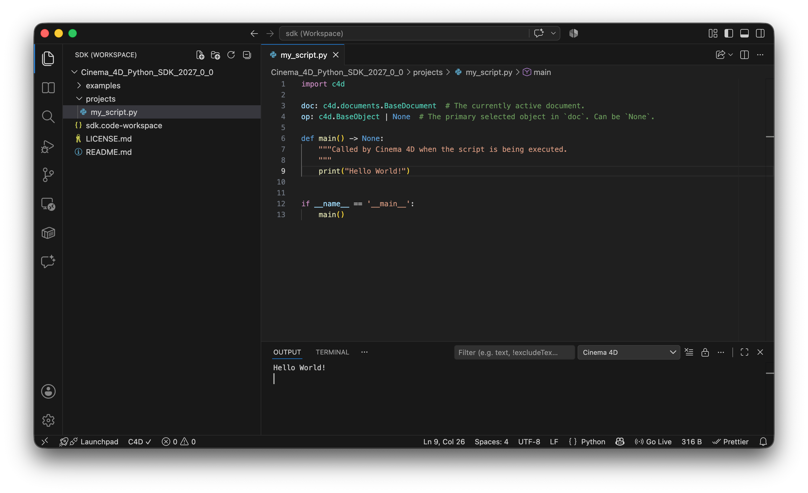
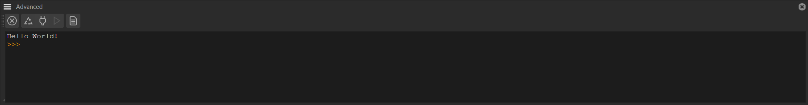

<!-- Source: https://developers.maxon.net/docs/py/2027_0_0/manuals/manual_working_with_sdk.html -->

# Working with the SDK <a id="working-with-the-sdk"></a><a id="vscode-integration"></a>

Set up Visual Studio Code to work with the Cinema 4D Python SDK.

The Cinema 4D Python SDK contains code examples, the documentation, and tools that help with writing plugins and scripts for the Cinema 4D Python API. The SDK is intended to be used as the working directory inside an IDE. We recommend using [Visual Studio Code](https://code.visualstudio.com/) as the IDE for working with the SDK.

## Installing the Cinema 4D Connector <a id="installing-the-cinema-4d-connector"></a>

Maxon offers an extension for Visual Studio Code called the *Cinema 4D Connector*. This extension facilitates the connection between VS Code and Cinema 4D, allowing you to execute scripts directly in the application and view the output within the IDE. To install it, click on the gear icon in the lower left corner of VS Code and select *Extensions* or press *Ctrl+Shift+X* (Windows/Linux) or *Cmd+Shift+X* (Mac) to open the Extensions view.

In the Extensions view, you can search for the *Cinema 4D Connector* extension and install it directly from there. You can also open its [Visual Studio Marketplace page](https://marketplace.visualstudio.com/items?itemName=maxonc4dsdk.cinema4d-connector) and install it from there.

## Loading the SDK <a id="loading-the-sdk"></a>

Head to [Maxon Developers: Downloads](https://developers.maxon.net/downloads/) and download the latest version of the Cinema 4D Python SDK. Unpack it into a suitable location on your file system. You will find a folder structure similar to the one shown below. As you can see with the *projects* folder, the SDK is not only a place for examples and documentation, but also a workspace for your own projects. When you prefer to place your projects elsewhere, you should place a symbolic link to your preferred project location inside the */projects* folder.



*Fig. 1: Main files and folders in the Python SDK.*

> **Note:** To follow the workflows described on this page, it is important that your work and examples are accessible from the SDK root for agentic work, and that a folder named */projects* exists for your own projects. There exist agentic rules that reference that folder and deleting it will confuse agents.

Now open `sdk.code-workspace` from the SDK folder in VS Code (use *File > Open Workspace from File*). You could also simply invoke *File > Open Folder* but the workspace will hide a files for you and also optimize the search of VS Code to exclude irrelevant files and folders from the search results.

Open `sdk.code-workspace` from the SDK folder in VS Code (use *File > Open Workspace from File*). The Explorer then shows the SDK root and its working folders. The workspace file opens that same folder, but also applies SDK-specific settings: basic Python type checking, auto-import suggestions, and filters for generated files, documentation, and agent instruction files. Opening the folder directly does not apply these workspace settings.

## Connecting to Cinema 4D <a id="connecting-to-cinema-4d"></a>

For script development, you can use the Cinema 4D Connector to establish a connection between VS Code and Cinema 4D.

1. In Cinema 4D, open the Script Manager and click its `</>` Code Exchanger button. Do this first; it starts the Cinema 4D side of the connection.

<a id="id5"></a>

[](../_images/manual_work_with_sdk_c4d.png)

*Fig. 2: First, start the Code Exchanger in Cinema 4D’s Script Manager.*

2. Switch to VS Code and click the red `C4D X` status-bar item. It toggles the connection to the running Cinema 4D instance. When connected, it changes to `C4D ✓`; hover over it to confirm the connected instance.

<a id="id6"></a>

[](../_images/manual_work_with_sdk_vscode.png)

*Fig. 3: After starting Code Exchange in Cinema 4D, click `C4D X` in VS Code to connect.*

## Running a Script <a id="running-a-script"></a>

1. Create a new file in VS Code and save it as *my_script.py* to the */projects* folder of the SDK. Add the following content to it:

```python
import c4d

def main() -> None:
    """Called by Cinema 4D when the script is being executed.
    """
    print("Hello World!")

if __name__ == '__main__':
    main()
```

2. Open the Command Palette, by pressing `Ctrl+Shift+P` (Windows/Linux) or `Cmd+Shift+P` (macOS) and type *c4d*. Select the *C4D: Execute in Cinema 4D as a Script in Script Manager* command and execute it.

<a id="id7"></a>

[](../_images/manual_work_with_sdk_run.png)

*Fig. 4: Running a script.*

3. In the lower part of VS Code, the terminal should have opened automatically. If not, open the terminal by pressing [``](#id1)Ctrl+` `` (Windows/Linux) or [``](#id3)Cmd+` `` (macOS). In it you will be able to see the *Hello World!* output from the script. When you cannot see the output, make sure you have *Cinema 4D* selected as the output channel in VS Code’s Output panel.

<a id="id8"></a>

[](../_images/manual_work_with_sdk_output.png)

*Fig. 5: The output from the executed script in VS Code’s *Output* panel.*

4. You can now also switch to the Cinema 4D application to see the script’s output in its Python console. If your script would have altered or loaded a scene, you would also see that reflected in the Cinema 4D viewport.

<a id="id9"></a>

[](../_images/manual_work_with_sdk_c4d_output.png)

*Fig. 6: The same output in the Cinema 4D Python console.*

> **Note:** The Connector’s *Execute* command tests a script in the running application and its active document. `c4dpy` runs in a separate process and is intended for headless or batch workflows, not as a substitute for testing a Script Manager script in the user’s scene.

> **Warning:** The VS Code debugger for Cinema 4D is currently broken. Do not use the Connector’s *Debug in Cinema 4D* command or `debugpy` to debug scripts or plugins. A fix is planned soon; script execution and reading output through the Connector are separate and continue to work.

## Working with AI <a id="working-with-ai"></a>

### SDK Skills <a id="sdk-skills"></a>

The SDK is intended to be a working context for agents and provides some agent skills out of the box. You can make use of them as soon as you set the SDK as the workspace of your development environment.

<a id="id10"></a>| Skill | What it can do | How to invoke it |
|---|---|---|
| Scaffold `CommandData` plugin | Creates a plugin that can be invoked from a menu or toolbar in Cinema 4D. | Prompt something like “Can you implement me a plugin that cleans up a scene from all null objects?” |
| Scaffold `Dialog` plugin | Creates a command plugin that opens a dockable dialog, with controls defined in code or resource files. | “Create a dockable dialog plugin with buttons to select all cameras and clear the selection. Use the Dialog scaffold.” |
| Scaffold `ObjectData` plugin | Creates a generator, spline generator, or deformer that produces a non-destructive result from its parameters. | “Create an ObjectData generator for a stepped column with editable width, height, and step-count parameters.” |
| Scaffold `TagData` plugin | Creates a tag plugin for behavior evaluated with a scene object. Its `Execute` callback must follow the scene-threading restrictions. | “Create a TagData plugin that makes its host object follow a linked target. Use the Tag scaffold and keep the callback thread-safe.” |
| Scaffold `PreferenceData` plugin | Creates a page in Cinema 4D’s preferences for persistent application-wide settings. | “Create a PreferenceData plugin with a checkbox for enabling my tool’s default behavior.” |
| Scaffold `MessageData` plugin | Creates a plugin that receives application or custom core messages. | “Create a MessageData plugin that responds to a custom message and performs the requested work in a safe main-thread context.” |
| Scaffold `ShaderData` plugin | Creates a classic material shader plugin that computes shading output. | “Create a ShaderData plugin that produces a checker pattern with editable scale and color parameters.” |
| Scaffold `ToolData` plugin | Creates a viewport tool that responds to user mouse input. | “Create a ToolData plugin that places a null object at the clicked position in the viewport.” |
| Scaffold `SceneLoaderData` plugin | Creates a scene importer for a file format supported by the plugin. | “Create a SceneLoaderData plugin that imports this scene format and maps its objects to Cinema 4D objects.” |
| Scaffold `SceneSaverData` plugin | Creates a scene exporter for a file format supported by the plugin. | “Create a SceneSaverData plugin that exports the active scene to this format, including object names and transforms.” |
| Scaffold `BitmapLoaderData` plugin | Creates an image importer for a bitmap format supported by the plugin. | “Create a BitmapLoaderData plugin that loads this image format and exposes its dimensions and pixel data.” |
| Scaffold `BitmapSaverData` plugin | Creates an image exporter for a bitmap format supported by the plugin. | “Create a BitmapSaverData plugin that saves the supplied bitmap in this image format.” |
| Scaffold `RenderToken` | Creates a token that expands to a string in render or save paths; this scaffold does not require a plugin ID. | “Create a RenderToken that inserts the active document’s project code into the render output path.” |
| Asset workflows (`assets.md`) | Find and load assets; search repositories and databases; read and write metadata; create object, material, scene, and media assets. Built-in assets are read-only and must be copied before modification. Asset creation requires a running Cinema 4D application. | “Create an asset from the active object and reveal it in the Asset Browser. Follow `assets.md`, preserve the original object, and use a writable repository.” |
| Debugging workflows (`debug.md`) | Inspect and diff containers, parameters, flags, and scene graphs with `mxutils.DebugPrint`; validate values with `CheckType`; trace callbacks with `REPORT`; time code with `TIMEIT`; and build repeatable scenes with seeded `SceneFaker`. The VS Code debugger and `debugpy` are not supported for Cinema 4D. | “Compare these two objects’ parameters and flags, identify their differences, and suggest a focused test. Use the debugging guide; do not change the scene.” |
| Node graph workflows (`nodes.md`) | Create and modify material and Scene Node graphs. For materials, choose between Graph Description API and Nodes API; Scene Nodes require the Nodes API. Use available node-space metadata for node and port names, and report when required metadata is missing rather than guessing. | “Create a Redshift material with a bitmap texture and bump. Check the available node-space metadata, then ask me whether to use Graph Description API or Nodes API before writing code.” |
| Scene workflows (`scene.md`) | Inspect and traverse scene hierarchies, branches, and caches; work with documents, objects, parameters, undo, takes, user data, and scripting elements. The guide specifies which operations are safe in main-thread entry points versus threaded callbacks, and how to defer edits to the main thread. | “Review this generator callback and explain whether its scene operations are thread-safe. If it needs to edit the document, show how to defer that work to the main thread.” |

[YouTube video player](https://www.youtube.com/embed/aQgVwaYWOzI?si=bmuyg6v5M9I_qLnV)

### Using the MCP Server <a id="using-the-mcp-server"></a>

The MCP Server allows you to connect AI tools that support the MCP protocol to Cinema 4D. This enables the assistant to interact with a running Cinema 4D instance, execute commands, and manipulate the scene in real-time. To get started, follow these steps:

1. Start Cinema 4D.
2. Go to `Edit > Preferences > MCP Adapter` and check *Allow MCP Server*.
3. Under *Clients*, select which client you want to connect to the MCP server and then press *Update Selected Client*.
4. Start or restart the client to establish the connection with the MCP server.
5. Ask the client if it can access Cinema 4D and let it create a cube in Cinema 4D. If a cube appears in the scene, the connection works.

> **Note:** For details, see the [Cinema 4D MCP Server Documentation](https://help.maxon.net/c4d/en-us/Content/html/What_is_an_MCP_Server.html).

### Common Issues when Working with AI <a id="common-issues-when-working-with-ai"></a>

<a id="id11"></a>| Problem | Description | Solution |
|---|---|---|
| Overspecialization | A model hyper-focuses on a detail problem in an early stage of the project, leading to overly complex projects. | Prompt the model stating that you are seeking a basic solution, and steer it while the prompt is running when you can see that the model is derailing into overly complex solutions. |
| Steering induced loss of Focus | Steering, i.e., prompting while a model is running on another prompt, can cause the model to lose focus on the original task. | Avoid steering when possible. Only steer when the model is clearly going off track. Otherwise wait for the prompt to finish and correct then. |
| Ambiguous Instructions | Ambiguous prompts lead to bad output and longer processing times, i.e., they cost more for worse output. | **Most bad output comes from bad prompts. Write prompts for larger tasks as Markdown documents in an editor, review and spell check them and only then give them the agent. Creating a new** plugin for example should always start with a clear specs sheet. |
| Overcomplexity | Especially OpenAI models tend to break things into too many functions, modules, and other units of logic. | **The SDK agentic ruleset already contains rules that enforce simplicity and a certain code style. But experience shows that many agents still** tend to break up simple tasks into multiple functions or even files. Tell the agent explicitly to keep things simple and avoid unnecessary modularization. |

## See Also <a id="see-also"></a>

- [Quickstart](manual_quickstart.md): Learn the basics of using the Cinema 4D Python API.
- [Script Manager and Console](manual_script_manager.md): Write and run scripts in the Script Manager and inspect results in the Python Console.
- [Debugging](manual_debugging.md): Explains how to find errors in Python code for Cinema 4D with the mxutils debug tools, and how to track down crashes caused by threading violations.
- [Python Environment](manual_python_environment.md): Explains the features and limitations of Cinema 4D’s Python runtime.
- [Standalone Interpreter](manual_standalone_interpreter.md): Explains how to use Cinema 4D’s standalone interpreter, c4dpy.
