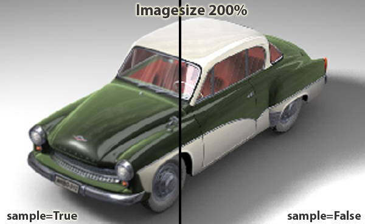
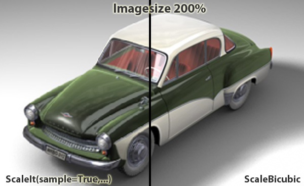

<!-- Source: https://developers.maxon.net/docs/py/2027_0_0/modules/c4d.bitmaps/BaseBitmap/index.html -->

# c4d.bitmaps.BaseBitmap <a id="c4d-bitmaps-basebitmap"></a>

## *class* `c4d.bitmaps.BaseBitmap` <a id="c4d.bitmaps.BaseBitmap"></a>

The bitmap class can be used to load, read, draw and save bitmap pictures of various formats.  
Be sure to call `BaseBitmap.Init()` before you attempt to use a newly allocated bitmap.

> **Note:** Bitmaps are organized so that x = y = 0 is the top left corner.

> **Note:** Though the bitmap class can work with other bit depths than 24 and 32, please note that only these function support other bit depths: `BaseBitmap.GetBw()`, `BaseBitmap.GetBh()`, `BaseBitmap.GetBt()`, `BaseBitmap.GetBpz()`, `BaseBitmap.Init()`, `BaseBitmap.GetPixelCnt()`, `BaseBitmap.SetPixelCnt()`, `BaseBitmap.SetCMAP()`, `BaseBitmap.AddChannel()`, `BaseBitmap.RemoveChannel()`, `BaseBitmap.GetAlphaPixel()`, `BaseBitmap.SetAlphaPixel()`, `BaseBitmap.GetChannelCount()`, `BaseBitmap.GetChannelNum()` (to use higher bit depths or multiple channels, see [`MultipassBitmap`](MultipassBitmap/index.md#c4d.bitmaps.MultipassBitmap)).

Child Class:

- [`c4d.bitmaps.MultipassBitmap`](MultipassBitmap/index.md#c4d.bitmaps.MultipassBitmap)

## Overview <a id="overview"></a>

**Bitmap Lifecycle**

- [`BaseBitmap.FlushAll()`](#c4d.bitmaps.BaseBitmap.FlushAll): Resets the bitmap to its initial state and frees allocated memory.
- [`BaseBitmap.Init()`](#c4d.bitmaps.BaseBitmap.Init): Initializes the bitmap to the given dimensions and depth.
- [`BaseBitmap.InitFromImageRef()`](#c4d.bitmaps.BaseBitmap.InitFromImageRef): Initializes the bitmap by copying pixel data from an image reference.
- [`BaseBitmap.InitWith()`](#c4d.bitmaps.BaseBitmap.InitWith): Loads a file into the bitmap.
- [`BaseBitmap.InitWithVectorFile()`](#c4d.bitmaps.BaseBitmap.InitWithVectorFile): Initializes the bitmap by rasterizing a vector image file.

**Channel Management**

- [`BaseBitmap.AddChannel()`](#c4d.bitmaps.BaseBitmap.AddChannel): Adds a new alpha channel to the image.
- [`BaseBitmap.GetAlphaPixel()`](#c4d.bitmaps.BaseBitmap.GetAlphaPixel): Get the alpha value at (*x,y*).
- [`BaseBitmap.GetChannelCount()`](#c4d.bitmaps.BaseBitmap.GetChannelCount): Returns the number of alpha channels in the bitmap, including the internal channel.
- [`BaseBitmap.GetChannelNum()`](#c4d.bitmaps.BaseBitmap.GetChannelNum): Returns the channel ID from the channel index.
- [`BaseBitmap.GetInternalChannel()`](#c4d.bitmaps.BaseBitmap.GetInternalChannel): Get the internal read-only alpha channel.
- [`BaseBitmap.RemoveChannel()`](#c4d.bitmaps.BaseBitmap.RemoveChannel): Removes the specified channel from the bitmap.
- [`BaseBitmap.SetAlphaPixel()`](#c4d.bitmaps.BaseBitmap.SetAlphaPixel): Sets the alpha value at *(x,y)* to *val*. The valid range of val is *0* to *255*.

**Cloning**

- [`BaseBitmap.GetClone()`](#c4d.bitmaps.BaseBitmap.GetClone): Clones the Bitmap and returns a new instance.
- [`BaseBitmap.GetClonePart()`](#c4d.bitmaps.BaseBitmap.GetClonePart): Clones a part of the bitmap, specified by the rectangle *(x,y)* to *(x+w,y+h)*.

**Color Configuration**

- [`BaseBitmap.GetColorProfile()`](#c4d.bitmaps.BaseBitmap.GetColorProfile): Get a new color profile instance of the bitmap.
- [`BaseBitmap.SetCMAP()`](#c4d.bitmaps.BaseBitmap.SetCMAP): If the image in the bitmap has 8 bit indexed color, this function can be used to set the palette entries.
- [`BaseBitmap.SetColorProfile()`](#c4d.bitmaps.BaseBitmap.SetColorProfile): Copy the color profile to the bitmap.

**Data Transfer And Storage**

- [`BaseBitmap.CopyPartTo()`](#c4d.bitmaps.BaseBitmap.CopyPartTo): Copies a part of the image to *dst*.
- [`BaseBitmap.CopyTo()`](#c4d.bitmaps.BaseBitmap.CopyTo): Copies the image to *dst*.
- [`BaseBitmap.GetData()`](#c4d.bitmaps.BaseBitmap.GetData): Gets bitmap data.
- [`BaseBitmap.Save()`](#c4d.bitmaps.BaseBitmap.Save): Saves the bitmap to a file.
- [`BaseBitmap.SetData()`](#c4d.bitmaps.BaseBitmap.SetData): Sets bitmap data.

**Deprecated**

- [`BaseBitmap.Scale()`](#c4d.bitmaps.BaseBitmap.Scale): Use `BaseBitmap.ScaleIt()` instead.

**Format Information**

- [`BaseBitmap.GetBpz()`](#c4d.bitmaps.BaseBitmap.GetBpz): Returns the number of bytes per line.
- [`BaseBitmap.GetBt()`](#c4d.bitmaps.BaseBitmap.GetBt): Returns the number of bits per pixel.
- [`BaseBitmap.GetColorMode()`](#c4d.bitmaps.BaseBitmap.GetColorMode): Returns the color mode of the bitmap.

**Geometry And Dimensions**

- [`BaseBitmap.GetBh()`](#c4d.bitmaps.BaseBitmap.GetBh): Returns the height of the bitmap in pixels.
- [`BaseBitmap.GetBw()`](#c4d.bitmaps.BaseBitmap.GetBw): Returns the width of the bitmap in pixels.
- [`BaseBitmap.GetSize()`](#c4d.bitmaps.BaseBitmap.GetSize): Returns the size of the bitmap in pixels.
- [`BaseBitmap.Within()`](#c4d.bitmaps.BaseBitmap.Within): Checks if a position is in the bitmap.

**Magic Methods**

- [`BaseBitmap.__eq__()`](#c4d.bitmaps.BaseBitmap.__eq__)
- [`BaseBitmap.__getitem__()`](#c4d.bitmaps.BaseBitmap.__getitem__): This is similar to `GetPixel()`.
- [`BaseBitmap.__init__()`](#c4d.bitmaps.BaseBitmap.__init__)
- [`BaseBitmap.__ne__()`](#c4d.bitmaps.BaseBitmap.__ne__): Check if two references point to the same bitmap.
- [`BaseBitmap.__setitem__()`](#c4d.bitmaps.BaseBitmap.__setitem__): This is similar to `GetPixel()`.

**Pixel Access**

- [`BaseBitmap.GetPixel()`](#c4d.bitmaps.BaseBitmap.GetPixel): Retrieves the color at (*x,y*). Similar to the `__getitem__()`.
- [`BaseBitmap.GetPixelCnt()`](#c4d.bitmaps.BaseBitmap.GetPixelCnt): Reads *cnt* pixels from (*x*, *y*) in the bitmap to the buffer with mode *dstmode*, incrementing *inc* bytes for each pixel.
- [`BaseBitmap.GetPixelDirect()`](#c4d.bitmaps.BaseBitmap.GetPixelDirect): Retrieves the color at (*x,y*).
- [`BaseBitmap.SetPixel()`](#c4d.bitmaps.BaseBitmap.SetPixel): Sets the pixel at *(x, y)* to the color specified by *(r,g,b) (0 <= r/g/b <= 255)*.
- [`BaseBitmap.SetPixelCnt()`](#c4d.bitmaps.BaseBitmap.SetPixelCnt): Sets *cnt* pixels at (*x*, *y*) in the bitmap from buffer with mode *srcmode*, incrementing *inc* bytes for each pixel.

**Scaling**

- [`BaseBitmap.ScaleBicubic()`](#c4d.bitmaps.BaseBitmap.ScaleBicubic): Scales the bitmap rectangle (*src_xmin*, *src_ymin*, *src_xmax*, *src_ymax*) to fit in the destination bitmap rectangle (*dst_xmin*, *dst_ymin*, *dst_xmax*, *dst_ymax*) and copies it there.
- [`BaseBitmap.ScaleIt()`](#c4d.bitmaps.BaseBitmap.ScaleIt): Scales the bitmap to fit in the destination bitmap and copies it there.

**State And Diagnostics**

- [`BaseBitmap.GetDirty()`](#c4d.bitmaps.BaseBitmap.GetDirty): Private.
- [`BaseBitmap.GetMemoryInfo()`](#c4d.bitmaps.BaseBitmap.GetMemoryInfo): Get the size of the memory used by the bitmap.
- [`BaseBitmap.GetUpdateRegionBitmap()`](#c4d.bitmaps.BaseBitmap.GetUpdateRegionBitmap): Get the updated region of a bitmap.
- [`BaseBitmap.IsMultipassBitmap()`](#c4d.bitmaps.BaseBitmap.IsMultipassBitmap): Checks if the image is a [`MultipassBitmap`](MultipassBitmap/index.md#c4d.bitmaps.MultipassBitmap).
- [`BaseBitmap.SetDirty()`](#c4d.bitmaps.BaseBitmap.SetDirty): Makes the bitmap dirty.

## Members <a id="members"></a>

### Bitmap Lifecycle <a id="c4d.bitmaps.BaseBitmap-method-Bitmap-Lifecycle"></a>

#### `BaseBitmap.FlushAll(self)` <a id="c4d.bitmaps.BaseBitmap.FlushAll"></a>

Resets the bitmap to its initial state and frees allocated memory.

> **Warning:** Requires a call to [`Init()`](#c4d.bitmaps.BaseBitmap.Init) before the bitmap can be used again.

#### `BaseBitmap.Init(self, x, y, depth=24, flags=0)` <a id="c4d.bitmaps.BaseBitmap.Init"></a>

Initializes the bitmap to the given dimensions and depth.

> **Warning:** Any previous data in the bitmap object is lost.

> **Note:**
>
> The bitmap class only supports up to 4 channels.  
> Also, most image loaders will only load one alpha channel.

**Parameters:**

- **x** (*int*) – The requested width in pixels. (Max 16000 pixels.).

- **y** (*int*) – The requested width in pixels. (Max 16000 pixels.).

- **depth** (*int*) –

  The requested bit depth (24 default).  
  The possible values are {1,4,8,16,24,32}.  
  On some platforms 32 bits will be used even if 24 is requested, to allow for padding.

- **flags** (*int*) –

  Flags:

  |   |   |
  |---|---|
  | *INITBITMAPFLAGS_NONE* | None. |
  | *INITBITMAPFLAGS_GRAYSCALE* | Initializes as grayscale bitmap. |
  | *INITBITMAPFLAGS_SYSTEM* | Private. |

**Return type:** int

**Returns:**

The result:

|   |   |
|---|---|
| *IMAGERESULT_OK* | Image loaded/created. |
| *IMAGERESULT_NOTEXISTING* | Image does not exist. |
| *IMAGERESULT_WRONGTYPE* | Image has the wrong type. |
| *IMAGERESULT_OUTOFMEMORY* | Not enough memory. |
| *IMAGERESULT_FILEERROR* | File error. |
| *IMAGERESULT_FILESTRUCTURE* | Invalid file structure. |
| *IMAGERESULT_MISC_ERROR* | Unknown error. |
| *IMAGERESULT_PARAM_ERROR* | Parameter error. |
| *IMAGERESULT_THREADCANCELED* | Thread canceled while working. |

#### `BaseBitmap.InitFromImageRef(self, image)` <a id="c4d.bitmaps.BaseBitmap.InitFromImageRef"></a>

Initializes the bitmap by copying pixel data from an image reference.

> **Note:** Only the `RGB::U8`, `RGBA::U8`, `RGB::U16`, `RGBA::U16`, `RGB::F32` and `RGBA::F32` pixel formats are supported.

**Parameters:** **image** (`maxon.ImageRef`) – The image reference to copy into the bitmap.

**Return type:** int

**Returns:**

The result:

|   |   |
|---|---|
| *IMAGERESULT_OK* | Image loaded/created. |
| *IMAGERESULT_NOTEXISTING* | Image does not exist. |
| *IMAGERESULT_WRONGTYPE* | Image has the wrong type. |
| *IMAGERESULT_OUTOFMEMORY* | Not enough memory. |
| *IMAGERESULT_FILEERROR* | File error. |
| *IMAGERESULT_FILESTRUCTURE* | Invalid file structure. |
| *IMAGERESULT_MISC_ERROR* | Unknown error. |
| *IMAGERESULT_PARAM_ERROR* | Parameter error. |
| *IMAGERESULT_THREADCANCELED* | Thread canceled while working. |

#### `BaseBitmap.InitWith(self, name, frame=-1)` <a id="c4d.bitmaps.BaseBitmap.InitWith"></a>

Loads a file into the bitmap. The file can be either a movie or a picture.  
The file format is automatically detected

```python
result, isMovie = bmp.InitWith(path)
if result == c4d.IMAGERESULT_OK: #int check
    # picture loaded

    if isMovie: #bool check
        pass # file is a movie
    else:
        pass # file is no movie
```

> **Note:**
>
> The bitmap class only supports up to 4 channels.  
> Also, most image loaders will only load one alpha channel.

**Parameters:**

- **name** (*Union*[*str*, [*c4d.storage.MemoryFileStruct*](../../c4d.storage/MemoryFileStruct/index.md#c4d.storage.MemoryFileStruct)]) – The file.
- **frame** (*Optional*[*int*]) – The frame number to load in a movie.

**Return type:** Tuple[int, bool]

**Returns:**

The result for first element:

|   |   |
|---|---|
| *IMAGERESULT_OK* | Image loaded/created. |
| *IMAGERESULT_NOTEXISTING* | Image does not exist. |
| *IMAGERESULT_WRONGTYPE* | Image has the wrong type. |
| *IMAGERESULT_OUTOFMEMORY* | Not enough memory. |
| *IMAGERESULT_FILEERROR* | File error. |
| *IMAGERESULT_FILESTRUCTURE* | Invalid file structure. |
| *IMAGERESULT_MISC_ERROR* | Unknown error. |
| *IMAGERESULT_PARAM_ERROR* | Parameter error. |
| *IMAGERESULT_THREADCANCELED* | Thread canceled while working. |

The second element is **True** if the loaded picture was a movie.

#### `BaseBitmap.InitWithVectorFile(self, name, preferredHeight=0)` <a id="c4d.bitmaps.BaseBitmap.InitWithVectorFile"></a>

Initializes the bitmap by rasterizing a vector image file.

> **Note:** The vector image is rasterized to its intrinsic dimensions unless *preferredHeight* is specified. The bitmap is initialized as an 8-bit RGB image. If the vector image contains transparency, an internal alpha channel is created.

**Parameters:**

- **name** (*Union*[*str*, [*c4d.storage.MemoryFileStruct*](../../c4d.storage/MemoryFileStruct/index.md#c4d.storage.MemoryFileStruct)]) – The vector image file, such as an SVG file.
- **preferredHeight** (*int*) – The preferred rasterized height in pixels. Must be between 8 and 16384, or 0 to use the intrinsic height.

**Return type:** int

**Returns:**

The result:

|   |   |
|---|---|
| *IMAGERESULT_OK* | Image loaded/created. |
| *IMAGERESULT_NOTEXISTING* | Image does not exist. |
| *IMAGERESULT_WRONGTYPE* | Image has the wrong type. |
| *IMAGERESULT_OUTOFMEMORY* | Not enough memory. |
| *IMAGERESULT_FILEERROR* | File error. |
| *IMAGERESULT_FILESTRUCTURE* | Invalid file structure. |
| *IMAGERESULT_MISC_ERROR* | Unknown error. |
| *IMAGERESULT_PARAM_ERROR* | Parameter error. |
| *IMAGERESULT_THREADCANCELED* | Thread canceled while working. |

### Channel Management <a id="c4d.bitmaps.BaseBitmap-method-Channel-Management"></a>

#### `BaseBitmap.AddChannel(self, internal, straight)` <a id="c4d.bitmaps.BaseBitmap.AddChannel"></a>

Adds a new alpha channel to the image.

**Parameters:**

- **internal** (*bool*) –

  Should only be **True** for the first alpha.  
  The internal alpha will be stored within an image if the image format supports alphas.

- **straight** (*bool*) –

  Should be **True** if the image has to be interpreted as straight.  
  For information about straight alphas please take a look at the corresponding option in the render settings of Cinema 4D and the Cinema 4D manual.

**Return type:** int

**Returns:** The new channel.

#### `BaseBitmap.GetAlphaPixel(self, channel, x, y)` <a id="c4d.bitmaps.BaseBitmap.GetAlphaPixel"></a>

Get the alpha value at (*x,y*).

> **Note:**
>
> Currently this method does no range check of *x* and *y*.  
> This might be added in the future.  
> Please do the check on your own.

**Parameters:**

- **bmp** ([*c4d.bitmaps.BaseBitmap*](#c4d.bitmaps.BaseBitmap)) – The alpha channels to use. Has to be an alpha bitmap.
- **x** (*int*) – X coordinate.
- **y** (*int*) – Y coordinate.

**Return type:** int

**Returns:** The alpha value. Range is *0* to *255*.

#### `BaseBitmap.GetChannelCount(self)` <a id="c4d.bitmaps.BaseBitmap.GetChannelCount"></a>

Returns the number of alpha channels in the bitmap, including the internal channel.

**Return type:** int

**Returns:** Number of alpha channels.

#### `BaseBitmap.GetChannelNum(self, num)` <a id="c4d.bitmaps.BaseBitmap.GetChannelNum"></a>

Returns the channel ID from the channel index.

**Parameters:** **num** (*int*) – A number between 0 and [`GetChannelCount()`](#c4d.bitmaps.BaseBitmap.GetChannelCount).

**Return type:** [c4d.bitmaps.BaseBitmap](#c4d.bitmaps.BaseBitmap)

**Returns:** The requested channel.

#### `BaseBitmap.GetInternalChannel(self)` <a id="c4d.bitmaps.BaseBitmap.GetInternalChannel"></a>

Get the internal read-only alpha channel.  
The internal alpha channel is the one that’s saved together with the picture, with those formats that support this.

> **Note:** If no internal alpha is available, None is returned.

**Return type:** Optional[[c4d.bitmaps.BaseBitmap](#c4d.bitmaps.BaseBitmap)]

**Returns:** The internal alpha channel.

#### `BaseBitmap.RemoveChannel(self, channel)` <a id="c4d.bitmaps.BaseBitmap.RemoveChannel"></a>

Removes the specified channel from the bitmap.

**Parameters:** **channel** ([*c4d.bitmaps.BaseBitmap*](#c4d.bitmaps.BaseBitmap)) – The alpha channels to use.

#### `BaseBitmap.SetAlphaPixel(self, channel, x, y, val)` <a id="c4d.bitmaps.BaseBitmap.SetAlphaPixel"></a>

Sets the alpha value at *(x,y)* to *val*. The valid range of val is *0* to *255*.

> **Note:**
>
> Currently this method does no range check of *x* and *y*.  
> This might be added in the future.  
> Please do the check on your own.

**Parameters:**

- **bmp** ([*c4d.bitmaps.BaseBitmap*](#c4d.bitmaps.BaseBitmap)) – The alpha channels to use. Has to be an alpha bitmap.
- **x** (*int*) – X coordinate.
- **y** (*int*) – Y coordinate.
- **val** (*int*) – The alpha value. Range is *0* to *255*.

### Cloning <a id="c4d.bitmaps.BaseBitmap-method-Cloning"></a>

#### `BaseBitmap.GetClone(self)` <a id="c4d.bitmaps.BaseBitmap.GetClone"></a>

Clones the Bitmap and returns a new instance.

**Return type:** [c4d.bitmaps.BaseBitmap](#c4d.bitmaps.BaseBitmap)

**Returns:** The clone.

#### `BaseBitmap.GetClonePart(self, x, y, w, h)` <a id="c4d.bitmaps.BaseBitmap.GetClonePart"></a>

Clones a part of the bitmap, specified by the rectangle *(x,y)* to *(x+w,y+h)*.

**Parameters:**

- **x** (*int*) – The upper X coordinate of the rectangle.
- **y** (*int*) – The upper Y coordinate of the rectangle.
- **w** (*int.*) – The width of the rectangle.
- **h** (*int*) – The height of the rectangle.

**Return type:** Optional[[c4d.bitmaps.BaseBitmap](#c4d.bitmaps.BaseBitmap)]

**Returns:** The cloned bitmap, or **None** if an error occured.

### Color Configuration <a id="c4d.bitmaps.BaseBitmap-method-Color-Configuration"></a>

#### `BaseBitmap.GetColorProfile(self, index=0)` <a id="c4d.bitmaps.BaseBitmap.GetColorProfile"></a>

Get a new color profile instance of the bitmap.

**Parameters:**

**index** (*int*) –

Index of the colorprofile to retrieve.

*New in version 2025.2.0.*

| Symbol ID | Description |
|---|---|
| COLORPROFILE_INDEX_IMAGE | Index of the image color profile. |
| COLORPROFILE_INDEX_RENDERSPACE | Index of the renderspace color profile. |
| COLORPROFILE_INDEX_VIEW_TRANSFORM | Index of the view transform. |
| COLORPROFILE_INDEX_DISPLAYSPACE | Index of the displayspace color profile. |

**Return type:** [c4d.bitmaps.ColorProfile](../ColorProfile/index.md#c4d.bitmaps.ColorProfile)

**Returns:** The profile.

#### `BaseBitmap.SetCMAP(self, i, r, g, b)` <a id="c4d.bitmaps.BaseBitmap.SetCMAP"></a>

If the image in the bitmap has 8 bit indexed color, this function can be used to set the palette entries.  
All four parameters must be between *0* and *255*.

**Parameters:**

- **i** (*int*) – The index.
- **r** (*int*) – The red component.
- **g** (*int*) – The green component.
- **b** (*int*) – The blue component.

#### `BaseBitmap.SetColorProfile(self, profile, index=0)` <a id="c4d.bitmaps.BaseBitmap.SetColorProfile"></a>

Copy the color profile to the bitmap.

**Parameters:**

- **profile** ([*c4d.bitmaps.ColorProfile*](../ColorProfile/index.md#c4d.bitmaps.ColorProfile)) – The profile.

- **index** (*int*) –

  Index of the colorprofile to set.

  *New in version 2025.2.0.*

  | Symbol ID | Description |
  |---|---|
  | COLORPROFILE_INDEX_IMAGE | Index of the image color profile. |
  | COLORPROFILE_INDEX_RENDERSPACE | Index of the renderspace color profile. |
  | COLORPROFILE_INDEX_VIEW_TRANSFORM | Index of the view transform. |
  | COLORPROFILE_INDEX_DISPLAYSPACE | Index of the displayspace color profile. |

**Return type:** bool

**Returns:** **True** on success, otherwise **False**.

### Data Transfer And Storage <a id="c4d.bitmaps.BaseBitmap-method-Data-Transfer-And-Storage"></a>

#### `BaseBitmap.CopyPartTo(self, dst, x, y, w, h)` <a id="c4d.bitmaps.BaseBitmap.CopyPartTo"></a>

Copies a part of the image to *dst*.

**Parameters:**

- **dst** ([*c4d.bitmaps.BaseBitmap*](#c4d.bitmaps.BaseBitmap)) – The bitmap to copy the image to.
- **x** (*int*) – The X position of the part to be copied from the source image.
- **y** (*int*) – The Y position of the part to be copied from the source image.
- **w** (*int.*) – The width of the part to be copied.
- **h** (*int*) – The height of the part to be copied.

**Return type:** bool

**Returns:** Success of copying the image.

#### `BaseBitmap.CopyTo(self, dst)` <a id="c4d.bitmaps.BaseBitmap.CopyTo"></a>

Copies the image to *dst*.

**Parameters:** **dst** ([*c4d.bitmaps.BaseBitmap*](#c4d.bitmaps.BaseBitmap)) – The bitmap to copy the image to.

**Return type:** bool

**Returns:** Success of copying the image.

#### `BaseBitmap.GetData(self, id, default)` <a id="c4d.bitmaps.BaseBitmap.GetData"></a>

Gets bitmap data. Private.

**Parameters:**

- **id** (*int*) – The data ID to get.
- **default** (*any*) – Returned if data is not set.

**Return type:** Any

**Returns:** The retrieved data, or *default*.

#### `BaseBitmap.Save(self, name, format, data=None, savebits=0)` <a id="c4d.bitmaps.BaseBitmap.Save"></a>

Saves the bitmap to a file. Valid formats are:

> |   |   |
> |---|---|
> | *FILTER_TIF* | TIFF. |
> | *FILTER_TGA* | TGA. |
> | *FILTER_BMP* | BMP. |
> | *FILTER_IFF* | IFF. |
> | *FILTER_JPG* | JPEG. |
> | *FILTER_PICT* | PICT. |
> | *FILTER_PSD* | PSD. |
> | *FILTER_RLA* | RLA. |
> | *FILTER_RPF* | RPF. |
> | *FILTER_B3D* | *BodyPaint 3D*. |
> | *FILTER_TIF_B3D* | TIFF *BodyPaint 3D*. |
> | *FILTER_PSB* | PSB. |
> | *FILTER_AVI* | AVI Movie. |
> | *FILTER_MOVIE* | Quicktime Movie. |
> | *FILTER_QTVRSAVER_PANORAMA* | QTVR Panorama. |
> | *FILTER_QTVRSAVER_OBJECT* | QTVR Object. |
> | *FILTER_HDR* | HDR. |
> | *FILTER_EXR_LOAD* | EXR (Load). |
> | *FILTER_EXR* | EXR. |
> | *FILTER_PNG* | PNG. |
> | *FILTER_IES* | IES. |
> | *FILTER_B3DNET* | *BodyPaint 3D* NET. Private. |
> | *FILTER_DPX* | DPX. |
> | *FILTER_DDS* | *New in version R19:* DDS. |

**Parameters:**

- **name** (*Union*[*str*, [*c4d.storage.MemoryFileStruct*](../../c4d.storage/MemoryFileStruct/index.md#c4d.storage.MemoryFileStruct)]) – A file.

- **format** (*int*) – The image format.

- **data** (*Optional*[[*c4d.BaseContainer*](../../c4d/BaseContainer/index.md#c4d.BaseContainer)]) – The data.

- **savebits** (*Optional*[*int*]) –

  Can be a combination of the following flags:

  | Symbol ID | Description |
  |---|---|
  | SAVEBIT_NONE | None. |
  | SAVEBIT_ALPHA | Save the alpha channel(s) in the file. (For filter plugins, do not save an alpha channel if this is not set.) |
  | SAVEBIT_MULTILAYER | Save multiple layers. |
  | SAVEBIT_USESELECTEDLAYERS | Use selected layers. |
  | SAVEBIT_USE16BITCHANNELS | Use *16*-bit channels. |
  | SAVEBIT_GREYSCALE | Save in grayscale mode. |
  | SAVEBIT_INTERNALNET | Private. |
  | SAVEBIT_DONTMERGE | Avoid merging of layers in BodyPaint 3D files. |
  | SAVEBIT_USE32BITCHANNELS | Use *32*-bit channels. |
  | SAVEBIT_SAVERENDERRESULT | Private. |
  | SAVEBIT_FIRSTALPHA_ONLY | Private. |
  | SAVEBIT_KEEP_COLOR_MODE | Private. |

**Return type:** int

**Returns:**

**True** if [`BaseBitmap`](#c4d.bitmaps.BaseBitmap) is not empty, otherwise **False**.

|   |   |
|---|---|
| *IMAGERESULT_OK* | Image loaded/created. |
| *IMAGERESULT_NOTEXISTING* | Image does not exist. |
| *IMAGERESULT_WRONGTYPE* | Image has the wrong type. |
| *IMAGERESULT_OUTOFMEMORY* | Not enough memory. |
| *IMAGERESULT_FILEERROR* | File error. |
| *IMAGERESULT_FILESTRUCTURE* | Invalid file structure. |
| *IMAGERESULT_MISC_ERROR* | Unknown error. |
| *IMAGERESULT_PARAM_ERROR* | Parameter error. |
| *IMAGERESULT_THREADCANCELED* | Thread canceled while working. |

#### `BaseBitmap.SetData(self, id, data)` <a id="c4d.bitmaps.BaseBitmap.SetData"></a>

Sets bitmap data. Private.

**Parameters:**

- **id** (*int*) – The data ID to set.
- **data** (*any*) – The data to set.

**Return type:** bool

**Returns:** **True** if the data could be set, otherwise **False**.

### Deprecated <a id="c4d.bitmaps.BaseBitmap-method-Deprecated"></a>

#### `BaseBitmap.Scale(self, dst, intens, sample, nprop)` <a id="c4d.bitmaps.BaseBitmap.Scale"></a>

*Deprecated since version R18:* Use `BaseBitmap.ScaleIt()` instead.

Scales the bitmap to fit in the destination bitmap and copies it there.

> **Note:** The destination needs to be initialized with the destination size before calling this function.

[](../../../_images/basebitmap_scaleit.jpg)

**Parameters:**

- **dst** ([*c4d.bitmaps.BaseBitmap*](#c4d.bitmaps.BaseBitmap)) – The destination image. Must be initiated already with the destination size.
- **intens** (*int*) – Lets you change brightness of the image (128 = 50% brightness, 256 = unchanged).
- **sample** (*bool*) – If **True** a better scaling algorithm is used, which results in a better quality but is a bit slower.
- **nprop** (*bool*) – Must be **True** if non-proportional scaling is wanted.

### Format Information <a id="c4d.bitmaps.BaseBitmap-method-Format-Information"></a>

#### `BaseBitmap.GetBpz(self)` <a id="c4d.bitmaps.BaseBitmap.GetBpz"></a>

Returns the number of bytes per line.

**Return type:** int

**Returns:** Number of bytes per line.

#### `BaseBitmap.GetBt(self)` <a id="c4d.bitmaps.BaseBitmap.GetBt"></a>

Returns the number of bits per pixel.

**Return type:** int

**Returns:** The number of bits.

#### `BaseBitmap.GetColorMode(self)` <a id="c4d.bitmaps.BaseBitmap.GetColorMode"></a>

Returns the color mode of the bitmap.

**Return type:** int

**Returns:**

Color mode

|   |   |
|---|---|
| *COLORMODE_ILLEGAL* | Illegal 8-bit mode. |
| *COLORMODE_ALPHA* | Only 8-bit alpha channel. |
| *COLORMODE_GRAY* | 8-bit grayscale channel. |
| *COLORMODE_AGRAY* | 8-bit grayscale channel with 8-bit alpha. |
| *COLORMODE_RGB* | 8-bit RGB channels. |
| *COLORMODE_ARGB* | 8-bit RGB channels with 8-bit alpha. |
| *COLORMODE_CMYK* | 8-bit CMYK channel. |
| *COLORMODE_ACMYK* | 8-bit CMYK channel with 8-bit alpha. |
| *COLORMODE_MASK* | 8-bit grayscale map as mask. |
| *COLORMODE_AMASK* | 8-bit grayscale map as mask with 8-bit alpha. |
| *COLORMODE_ILLEGALw* | Illegal 16-bit mode. |
| *COLORMODE_GRAYw* | 16-bit grayscale channel. |
| *COLORMODE_AGRAYw* | 16-bit grayscale channel with 16-bit alpha. |
| *COLORMODE_RGBw* | 16-bit RGB channels. |
| *COLORMODE_ARGBw* | 16-bit RGB channels with 16-bit alpha. |
| *COLORMODE_MASKw* | 16-bit grayscale map as mask with 16-bit alpha. |
| *COLORMODE_ILLEGALf* | Illegal 32-bit mode. |
| *COLORMODE_GRAYf* | 32-bit floating point grayscale channel. |
| *COLORMODE_AGRAYf* | 32-bit floating point grayscale channel with floating point alpha. |
| *COLORMODE_RGBf* | 32-bit floating point RGB channels. |
| *COLORMODE_ARGBf* | 32-bit floating point RGB channels with floating point alpha. |
| *COLORMODE_MASKf* | 32-bit floating point grayscale map as mask. |

### Geometry And Dimensions <a id="c4d.bitmaps.BaseBitmap-method-Geometry-And-Dimensions"></a>

#### `BaseBitmap.GetBh(self)` <a id="c4d.bitmaps.BaseBitmap.GetBh"></a>

Returns the height of the bitmap in pixels.

**Return type:** int

**Returns:** Bitmap height in pixels.

#### `BaseBitmap.GetBw(self)` <a id="c4d.bitmaps.BaseBitmap.GetBw"></a>

Returns the width of the bitmap in pixels.

> **Note:** If the bitmap hasn’t been initialized the return value is 0. (This is the only way to see if a bitmap has been initialized.)

**Return type:** int

**Returns:** Bitmap width in pixels, or 0 if the bitmap is not initialized.

#### `BaseBitmap.GetSize(self)` <a id="c4d.bitmaps.BaseBitmap.GetSize"></a>

Returns the size of the bitmap in pixels.

> **Note:** If the bitmap hasn’t been initialized the return values are 0. (This is the only way to see if a bitmap has been initialized.)
>
> ```python
> #bmp is a BaseBitmap instance
> x, y = bmp.GetSize()
> ```

**Return type:** List[int]

**Returns:** Bitmap width and height in pixels, or 0 if the bitmap is not initialized.

#### `BaseBitmap.Within(self, x, y)` <a id="c4d.bitmaps.BaseBitmap.Within"></a>

Checks if a position is in the bitmap.

**Parameters:**

- **x** (*int*) – The X Coordinate
- **y** (*int*) – The Y Coordinate

**Return type:** bool

**Returns:** **True** if the coordinate is in the bitmap.

### Magic Methods <a id="c4d.bitmaps.BaseBitmap-method-Magic-Methods"></a>

#### `BaseBitmap.__eq__(self, other)` <a id="c4d.bitmaps.BaseBitmap.__eq__"></a>

#### `BaseBitmap.__getitem__(self, key)` <a id="c4d.bitmaps.BaseBitmap.__getitem__"></a>

This is similar to [`GetPixel()`](#c4d.bitmaps.BaseBitmap.GetPixel).

```python
r, g, b = bmp[5, 5] #returns the color of a pixel at position x(5), y(5)
```

**Raises:** **IndexError** – If the pixel position is out of the bitmap boundaries. See [`GetSize()`](#c4d.bitmaps.BaseBitmap.GetSize), [`GetBw()`](#c4d.bitmaps.BaseBitmap.GetBw) and [`GetBh()`](#c4d.bitmaps.BaseBitmap.GetBh).

**Parameters:** **key** (*int*) – The pixel position.

**Return type:** Tuple[int, int, int]

**Returns:** The color of a pixel. Range between *0-255*.

#### `BaseBitmap.__init__(self)` <a id="c4d.bitmaps.BaseBitmap.__init__"></a>

#### `BaseBitmap.__ne__(self, other)` <a id="c4d.bitmaps.BaseBitmap.__ne__"></a>

Check if two references point to the same bitmap.

> **Note:** Does not compare if two references are equal.

#### `BaseBitmap.__setitem__(self, key, value)` <a id="c4d.bitmaps.BaseBitmap.__setitem__"></a>

This is similar to [`GetPixel()`](#c4d.bitmaps.BaseBitmap.GetPixel).

```python
bmp[5, 5] = (50, 255, 50) #returns the color of a pixel at position x(5), y(5)
```

> **Note:**
>
> The [`Vector`](../../c4d/Vector/index.md#c4d.Vector) objects does not support item deletion.  
> For instance by calling *del(bmp[5,5])*.

**Raises:** **IndexError** – If the pixel position is out of the bitmap boundaries. See [`GetSize()`](#c4d.bitmaps.BaseBitmap.GetSize), [`GetBw()`](#c4d.bitmaps.BaseBitmap.GetBw) and [`GetBh()`](#c4d.bitmaps.BaseBitmap.GetBh).

**Parameters:**

- **key** (*int*) – The pixel position.
- **value** (*Tuple*[*int*, *int*, *int*]) – The color of the pixel. Range between *0-255*.

### Pixel Access <a id="c4d.bitmaps.BaseBitmap-method-Pixel-Access"></a>

#### `BaseBitmap.GetPixel(self, x, y)` <a id="c4d.bitmaps.BaseBitmap.GetPixel"></a>

Retrieves the color at (*x,y*). Similar to the [`__getitem__()`](#c4d.bitmaps.BaseBitmap.__getitem__).

> **Note:**
>
> Currently this method does no range check of *x* and *y*.  
> This might be added in the future.  
> Please do the check on your own.

**Parameters:**

- **x** (*int*) – The X coordinate.
- **y** (*int*) – The Y coordinate.

**Return type:** List[int]

**Returns:** The color of the pixel. Range between *0-255*.

#### `BaseBitmap.GetPixelCnt(self, x, y, cnt, buffer, inc, dstmode, flags, conversion=None)` <a id="c4d.bitmaps.BaseBitmap.GetPixelCnt"></a>

Reads *cnt* pixels from (*x*, *y*) in the bitmap to the buffer with mode *dstmode*, incrementing *inc* bytes for each pixel.

**Parameters:**

- **x** (*int*) – X coordinate of the first pixel to set.

- **y** (*int*) – Y coordinate of the first pixel to set.

- **cnt** (*int*) – Number of pixels to set.

- **buffer** (*Union*[*bytearray*, *memoryview*]) – The destination buffer.

- **inc** (*int*) – The byte increment per pixel in the buffer.

- **dstmode** (*int*) –

  The destination mode:

  |   |   |
  |---|---|
  | *COLORMODE_ILLEGAL* | Illegal 8-bit mode. |
  | *COLORMODE_ALPHA* | Only 8-bit alpha channel. |
  | *COLORMODE_GRAY* | 8-bit grayscale channel. |
  | *COLORMODE_AGRAY* | 8-bit grayscale channel with 8-bit alpha. |
  | *COLORMODE_RGB* | 8-bit RGB channels. |
  | *COLORMODE_ARGB* | 8-bit RGB channels with 8-bit alpha. |
  | *COLORMODE_CMYK* | 8-bit CMYK channel. |
  | *COLORMODE_ACMYK* | 8-bit CMYK channel with 8-bit alpha. |
  | *COLORMODE_MASK* | 8-bit grayscale map as mask. |
  | *COLORMODE_AMASK* | 8-bit grayscale map as mask with 8-bit alpha. |
  | *COLORMODE_ILLEGALw* | Illegal 16-bit mode. |
  | *COLORMODE_GRAYw* | 16-bit grayscale channel. |
  | *COLORMODE_AGRAYw* | 16-bit grayscale channel with 16-bit alpha. |
  | *COLORMODE_RGBw* | 16-bit RGB channels. |
  | *COLORMODE_ARGBw* | 16-bit RGB channels with 16-bit alpha. |
  | *COLORMODE_MASKw* | 16-bit grayscale map as mask with 16-bit alpha. |
  | *COLORMODE_ILLEGALf* | Illegal 32-bit mode. |
  | *COLORMODE_GRAYf* | 32-bit floating point grayscale channel. |
  | *COLORMODE_AGRAYf* | 32-bit floating point grayscale channel with floating point alpha. |
  | *COLORMODE_RGBf* | 32-bit floating point RGB channels. |
  | *COLORMODE_ARGBf* | 32-bit floating point RGB channels with floating point alpha. |
  | *COLORMODE_MASKf* | 32-bit floating point grayscale map as mask. |

- **flags** (*int*) –

  Flags:

  |   |   |
  |---|---|
  | *PIXELCNT_NONE* | None. |
  | *PIXELCNT_DITHERING* | Allow dithering. |
  | *PIXELCNT_B3DLAYERS* | Merge BodyPaint 3D layers ([`MultipassBitmap`](MultipassBitmap/index.md#c4d.bitmaps.MultipassBitmap)). |
  | *PIXELCNT_APPLYALPHA* | Apply alpha layers to the result ([`PaintLayerBmp`](../../c4d.modules/bodypaint/PaintBitmap/PaintLayer/PaintLayerBmp/index.md#c4d.modules.bodypaint.PaintLayerBmp)). |
  | *PIXELCNT_INTERNAL_SETLINE* | Internal SetLine indicator. Private. |
  | *PIXELCNT_INTERNAL_ALPHAVALUE* | Get also the alpha value (RGBA *32*-bit). Private. |

- **conversion** (*Optional*[[*c4d.bitmaps.ColorProfileConvert*](../ColorProfileConvert/index.md#c4d.bitmaps.ColorProfileConvert)]) –

  *New in version R17.032.*

  This should be normally set to **None**. Pass a color profile only if a conversion is wanted before retrieving the pixel data.  
  This only works if either the bitmap is 32-bit per component (so no 8/16-bit images) or the *dstmode* is 32-bit per component.  
  The conversion is done before color reduction (e.g. if *dstmode* is 16-bit the profile is first applied and then the data resampled to 16-bit).

**Return type:** bool

**Returns:** **True** if successful, otherwise *False*.

#### `BaseBitmap.GetPixelDirect(self, x, y)` <a id="c4d.bitmaps.BaseBitmap.GetPixelDirect"></a>

Retrieves the color at (*x,y*).

*New in version S22.*

> **Note:**
>
> The range of the assigned parameters are *0.0* to *255.0*, regardless of the bit depth of the image where (255.0, 255.0, 255.0) is white.  
> The range returns float value, so 8, 16 and 32 bit precision is supported.

**Parameters:**

- **x** (*int*) – The X coordinate.
- **y** (*int*) – The Y coordinate.

**Returns:** Color as form of a 3D Vector.

**Return type:** [c4d.Vector](../../c4d/Vector/index.md#c4d.Vector)

#### `BaseBitmap.SetPixel(self, x, y, r, g, b)` <a id="c4d.bitmaps.BaseBitmap.SetPixel"></a>

Sets the pixel at *(x, y)* to the color specified by *(r,g,b) (0 <= r/g/b <= 255)*.  
Similar to the [`__setitem__()`](#c4d.bitmaps.BaseBitmap.__setitem__).

> **Note:**
>
> Currently this method does no range check of *x* and *y*.  
> This might be added in the future.  
> Please do the check on your own.

**Parameters:**

- **x** (*int*) – The X coordinate.
- **y** (*int*) – The Y coordinate.
- **r** (*int*) – The red component.
- **g** (*int*) – The green component.
- **b** (*int*) – The blue component.

**Return type:** bool

**Returns:** **True** if successful, otherwise **False**.

#### `BaseBitmap.SetPixelCnt(self, x, y, cnt, buffer, inc, srcmode, flags)` <a id="c4d.bitmaps.BaseBitmap.SetPixelCnt"></a>

Sets *cnt* pixels at (*x*, *y*) in the bitmap from buffer with mode *srcmode*, incrementing *inc* bytes for each pixel.

```python
"""Copies the internal data of a 32 bit per-channel image to a new one.

Topics:
    * BaseBitmap.SetPixelCnt()
    * BaseBitmap.GetPixelCnt()

Note:
- BaseBitmap.GetClone could be used for doing the exact same purpose, bu
"""
__author__ = "Ferdinand Hoppe"
__copyright__ = "Copyright (C) 2026 MAXON Computer GmbH"
__license__ = "Apache-2.0 License"
__version__ = "R23"

import c4d

def main():
    # Opens a Dialog to choose a picture file
    path = c4d.storage.LoadDialog(type=c4d.FILESELECTTYPE_IMAGES, title="Please Choose a 32-bit Image:")

    # If the user cancels, leaves
    if not path:
        return

    # Creates a BaseBitmap that will be used for loading the selected picture
    orig = c4d.bitmaps.BaseBitmap()
    if orig is None:
        raise RuntimeError("Failed to create the bitmap.")

    # Initializes the BaseBitmap with the selected picture
    if orig.InitWith(path)[0] != c4d.IMAGERESULT_OK:
        raise RuntimeError("Cannot load image \"" + path + "\".")

    # Checks if channel depth is really 32 bit
    if orig.GetBt()/3 != 32:
        raise RuntimeError("The image \"" + path + "\" is not a 32 bit per-channel image.")

    # Gets selected image information
    width, height = orig.GetSize()
    bits = orig.GetBt()

    # Creates a BaseBitmap that will be ued for making a copy copy and initialize it
    copy = c4d.bitmaps.BaseBitmap()
    if copy is None:
        raise RuntimeError("Failed to create the bitmap.")

    copy.Init(width, height, bits)
    if orig.InitWith(path)[0] != c4d.IMAGERESULT_OK:
        raise RuntimeError("Cannot load image \"" + path + "\".")

    # Calculates the number of bytes per pixel
    # Each pixel has RGB bits, so we need an offset of 'inc' bytes per pixel
    # the image has 32 bits per-channel : (32*3)/8 = 12 bytes per pixel (1 byte = 8 bits)
    # the image has 3 channels per pixel (RGB) : 12/3 = 4 bytes per component = 1 float
    inc = orig.GetBt() // 8
    bytesArray = bytearray(width * height * inc)
    memoryView = memoryview(bytesArray)
    for row in range(height):
        memoryViewSlice = memoryView[row*(width*inc):]
        orig.GetPixelCnt(0, row, width, memoryViewSlice, inc, c4d.COLORMODE_RGBf, c4d.PIXELCNT_0)

    for row in range(height):
        memoryViewSlice = memoryView[row * (width * inc):]
        copy.SetPixelCnt(0, row, width, memoryViewSlice, inc, c4d.COLORMODE_RGBf, c4d.PIXELCNT_0)

    # Show original and copied image in the picture viewer
    c4d.bitmaps.ShowBitmap(orig)
    c4d.bitmaps.ShowBitmap(copy)

if __name__ == '__main__':
    main()
```

**Parameters:**

- **x** (*int*) – X coordinate of the first pixel to set.

- **y** (*int*) – Y coordinate of the first pixel to set.

- **cnt** (*int*) – Number of pixels to set.

- **buffer** (*Union*[*bytearray*, *memoryview*]) – The source buffer.

- **inc** (*int*) – The byte increment per pixel in the buffer.

- **srcmode** (*int*) –

  The source mode.

  > **Note:** None of the alpha modes are supported.

  |   |   |
  |---|---|
  | *COLORMODE_ILLEGAL* | Illegal 8-bit mode. |
  | *COLORMODE_ALPHA* | Only 8-bit alpha channel. |
  | *COLORMODE_GRAY* | 8-bit grayscale channel. |
  | *COLORMODE_AGRAY* | 8-bit grayscale channel with 8-bit alpha. |
  | *COLORMODE_RGB* | 8-bit RGB channels. |
  | *COLORMODE_ARGB* | 8-bit RGB channels with 8-bit alpha. |
  | *COLORMODE_CMYK* | 8-bit CMYK channel. |
  | *COLORMODE_ACMYK* | 8-bit CMYK channel with 8-bit alpha. |
  | *COLORMODE_MASK* | 8-bit grayscale map as mask. |
  | *COLORMODE_AMASK* | 8-bit grayscale map as mask with 8-bit alpha. |
  | *COLORMODE_ILLEGALw* | Illegal 16-bit mode. |
  | *COLORMODE_GRAYw* | 16-bit grayscale channel. |
  | *COLORMODE_AGRAYw* | 16-bit grayscale channel with 16-bit alpha. |
  | *COLORMODE_RGBw* | 16-bit RGB channels. |
  | *COLORMODE_ARGBw* | 16-bit RGB channels with 16-bit alpha. |
  | *COLORMODE_MASKw* | 16-bit grayscale map as mask with 16-bit alpha. |
  | *COLORMODE_ILLEGALf* | Illegal 32-bit mode. |
  | *COLORMODE_GRAYf* | 32-bit floating point grayscale channel. |
  | *COLORMODE_AGRAYf* | 32-bit floating point grayscale channel with floating point alpha. |
  | *COLORMODE_RGBf* | 32-bit floating point RGB channels. |
  | *COLORMODE_ARGBf* | 32-bit floating point RGB channels with floating point alpha. |
  | *COLORMODE_MASKf* | 32-bit floating point grayscale map as mask. |

- **flags** (*int*) –

  Flags:

  |   |   |
  |---|---|
  | *PIXELCNT_NONE* | None. |
  | *PIXELCNT_DITHERING* | Allow dithering. |
  | *PIXELCNT_B3DLAYERS* | Merge BodyPaint 3D layers ([`MultipassBitmap`](MultipassBitmap/index.md#c4d.bitmaps.MultipassBitmap)). |
  | *PIXELCNT_APPLYALPHA* | Apply alpha layers to the result ([`PaintLayerBmp`](../../c4d.modules/bodypaint/PaintBitmap/PaintLayer/PaintLayerBmp/index.md#c4d.modules.bodypaint.PaintLayerBmp)). |
  | *PIXELCNT_INTERNAL_SETLINE* | Internal SetLine indicator. Private. |
  | *PIXELCNT_INTERNAL_ALPHAVALUE* | Get also the alpha value (RGBA *32*-bit). Private. |

**Return type:** bool

**Returns:** **True** if successful, otherwise **False**.

### Scaling <a id="c4d.bitmaps.BaseBitmap-method-Scaling"></a>

#### `BaseBitmap.ScaleBicubic(self, dst, src_xmin, src_ymin, src_xmax, src_ymax, dst_xmin, dst_ymin, dst_xmax, dst_ymax)` <a id="c4d.bitmaps.BaseBitmap.ScaleBicubic"></a>

Scales the bitmap rectangle (*src_xmin*, *src_ymin*, *src_xmax*, *src_ymax*) to fit in the destination bitmap rectangle (*dst_xmin*, *dst_ymin*, *dst_xmax*, *dst_ymax*) and copies it there.  
The scaling, if necessary, is done using bicubic interpolation.  
The destination needs to be initialized before calling this function.

```python
bmp.ScaleBicubic(dst, 0, 0, bmp.GetBw()-1, bmp.GetBh()-1, 0, 0, dst.GetBw()-1, dst.GetBh()-1)
```

> **Note:** This function can currently only scale down, i.e. the destination needs to be smaller to the source in size.

[](../../../_images/basebitmap_scalebicubic.jpg)

**Parameters:**

- **dst** ([*c4d.bitmaps.BaseBitmap*](#c4d.bitmaps.BaseBitmap)) – The destination bitmap.
- **src_xmin** (*int*) – Source top left X coordinate.
- **src_ymin** (*int*) – Source top left Y coordinate.
- **src_xmax** (*int*) – Source bottom right X coordinate.
- **src_ymax** (*int*) – Source bottom right Y coordinate.
- **dst_xmin** (*int*) – Destination top left X coordinate.
- **dst_ymin** (*int*) – Destination top left Y coordinate.
- **dst_xmax** (*int*) – Destination bottom right X coordinate.
- **dst_ymax** (*int*) – Destination bottom right Y coordinate.

#### `BaseBitmap.ScaleIt(self, dst, intens, sample, nprop)` <a id="c4d.bitmaps.BaseBitmap.ScaleIt"></a>

Scales the bitmap to fit in the destination bitmap and copies it there.

> **Note:** The destination needs to be initialized with the destination size before calling this function.

[](../../../_images/basebitmap_scaleit.jpg)

**Parameters:**

- **dst** ([*c4d.bitmaps.BaseBitmap*](#c4d.bitmaps.BaseBitmap)) – The destination image. Must be initiated already with the destination size.
- **intens** (*int*) – Lets you change brightness of the image (128 = 50% brightness, 256 = unchanged).
- **sample** (*bool*) – If **True** a better scaling algorithm is used, which results in a better quality but is a bit slower.
- **nprop** (*bool*) – Must be **True** if non-proportional scaling is wanted.

### State And Diagnostics <a id="c4d.bitmaps.BaseBitmap-method-State-And-Diagnostics"></a>

#### `BaseBitmap.GetDirty(self)` <a id="c4d.bitmaps.BaseBitmap.GetDirty"></a>

Private.

**Return type:** int

**Returns:** Dirty count, incremented when the bitmap changes.

#### `BaseBitmap.GetMemoryInfo(self)` <a id="c4d.bitmaps.BaseBitmap.GetMemoryInfo"></a>

Get the size of the memory used by the bitmap.

**Return type:** int

**Returns:** Memory size of the bitmap.

#### `BaseBitmap.GetUpdateRegionBitmap(self)` <a id="c4d.bitmaps.BaseBitmap.GetUpdateRegionBitmap"></a>

Get the updated region of a bitmap.

**Return type:** [c4d.bitmaps.BaseBitmap](#c4d.bitmaps.BaseBitmap)

**Returns:** The updated region.

#### `BaseBitmap.IsMultipassBitmap(self)` <a id="c4d.bitmaps.BaseBitmap.IsMultipassBitmap"></a>

Checks if the image is a [`MultipassBitmap`](MultipassBitmap/index.md#c4d.bitmaps.MultipassBitmap).

**Return type:** bool

**Returns:** **True** if the image is a [`MultipassBitmap`](MultipassBitmap/index.md#c4d.bitmaps.MultipassBitmap), otherwise **False**

#### `BaseBitmap.SetDirty(self)` <a id="c4d.bitmaps.BaseBitmap.SetDirty"></a>

Makes the bitmap dirty.
