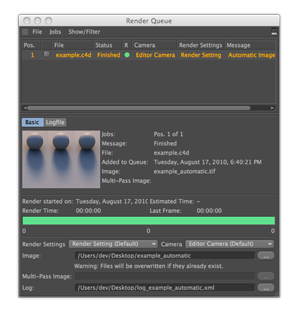

<!-- Source: https://developers.maxon.net/docs/py/2027_0_0/modules/c4d.documents/BatchRender/index.html -->

# c4d.documents.BatchRender 

## *class* `c4d.documents.BatchRender` 

The render queue is used for batch rendering.  
To get the batch render instance, see [`GetBatchRender()`](../index.md#c4d.documents.GetBatchRender)

## Overview 

**Camera Selection**

- [`BatchRender.GetActiveCameraIndex()`](#c4d.documents.BatchRender.GetActiveCameraIndex): Get the active camera index for the element.
- [`BatchRender.GetActiveCameraName()`](#c4d.documents.BatchRender.GetActiveCameraName): Get the active camera name for the element.
- [`BatchRender.GetAllCameraNames()`](#c4d.documents.BatchRender.GetAllCameraNames): Get the names of all cameras for the element.
- [`BatchRender.GetCameraCount()`](#c4d.documents.BatchRender.GetCameraCount): Get the number of cameras for the element.
- [`BatchRender.SetActiveCameraIndex()`](#c4d.documents.BatchRender.SetActiveCameraIndex): Set the active camera index for the element.

**File List Management**

- [`BatchRender.AddFile()`](#c4d.documents.BatchRender.AddFile): Add a scene file to the batch render.
- [`BatchRender.DelFile()`](#c4d.documents.BatchRender.DelFile): Delete a file from the list.
- [`BatchRender.EnableElement()`](#c4d.documents.BatchRender.EnableElement): Enable or disable the element for the rendering.
- [`BatchRender.GetElement()`](#c4d.documents.BatchRender.GetElement): Return the scene path of the element.
- [`BatchRender.GetElementCount()`](#c4d.documents.BatchRender.GetElementCount): Return the count how many scenes are in the batch render list.
- [`BatchRender.GetElementStatus()`](#c4d.documents.BatchRender.GetElementStatus): Get the status of the element.
- [`BatchRender.GetEnableElement()`](#c4d.documents.BatchRender.GetEnableElement): Enable or disable the element for the rendering.

**Render Settings Selection**

- [`BatchRender.GetActiveRenderSettingsIndex()`](#c4d.documents.BatchRender.GetActiveRenderSettingsIndex): Get the active render settings index for the element.
- [`BatchRender.GetActiveRenderSettingsName()`](#c4d.documents.BatchRender.GetActiveRenderSettingsName): Get the active render settings name for the element.
- [`BatchRender.GetAllRenderSettingsNames()`](#c4d.documents.BatchRender.GetAllRenderSettingsNames): Get the names of all render settings for the element.
- [`BatchRender.GetRenderSettingsCount()`](#c4d.documents.BatchRender.GetRenderSettingsCount): Get the number of render settings for the element.
- [`BatchRender.SetActiveRenderSettingsIndex()`](#c4d.documents.BatchRender.SetActiveRenderSettingsIndex): Set the active render settings index for the element.

**Rendering Operations**

- [`BatchRender.GetFrameBitmap()`](#c4d.documents.BatchRender.GetFrameBitmap): Private.
- [`BatchRender.GetJsonJobs()`](#c4d.documents.BatchRender.GetJsonJobs): Get the JSON jobs.
- [`BatchRender.IsRendering()`](#c4d.documents.BatchRender.IsRendering): Check if the batch render is in the render mode.
- [`BatchRender.Open()`](#c4d.documents.BatchRender.Open): Open the batch render.
- [`BatchRender.SetRendering()`](#c4d.documents.BatchRender.SetRendering): Start or stop the rendering of the batch render.
- [`BatchRender.SetUseNet()`](#c4d.documents.BatchRender.SetUseNet): Enable or disable the use of NET/Team Render.

**Take Selection**

- [`BatchRender.GetActiveTakeIndex()`](#c4d.documents.BatchRender.GetActiveTakeIndex): Get the active take index for the element.
- [`BatchRender.GetActiveTakeName()`](#c4d.documents.BatchRender.GetActiveTakeName): Get the active take name for the element.
- [`BatchRender.GetAllTakeNames()`](#c4d.documents.BatchRender.GetAllTakeNames): Get the names of all takes for the element.
- [`BatchRender.GetTakeCount()`](#c4d.documents.BatchRender.GetTakeCount): Get the number of takes for the element.
- [`BatchRender.SetActiveTakeIndex()`](#c4d.documents.BatchRender.SetActiveTakeIndex): Set the active take index for the element.

**Texture Validation**

- [`BatchRender.GetCheckTexture()`](#c4d.documents.BatchRender.GetCheckTexture): Check if texture checking is enabled.
- [`BatchRender.GetTextureError()`](#c4d.documents.BatchRender.GetTextureError): Check if there is a texture error.
- [`BatchRender.SetCheckTexture()`](#c4d.documents.BatchRender.SetCheckTexture): Enable or disable texture checking.
- [`BatchRender.SetTextureError()`](#c4d.documents.BatchRender.SetTextureError): Set the texture error state.

## Members 

### Camera Selection 

#### `BatchRender.GetActiveCameraIndex(self, n)` 

Get the active camera index for the element.

*New in version 2025.3.0.*

**Parameters:** **n** (*int*) – The element index.

**Return type:** int

**Returns:** The active camera index.

#### `BatchRender.GetActiveCameraName(self, n, filename)` 

Get the active camera name for the element.

*New in version 2025.3.0.*

**Parameters:**

- **n** (*int*) – The element index.
- **filename** (*bool*) – True to retrieve the filename, False to retrieve the camera name.

**Return type:** str

**Returns:** The active camera name.

#### `BatchRender.GetAllCameraNames(self, n)` 

Get the names of all cameras for the element.

*New in version 2025.3.0.*

**Parameters:** **n** (*int*) – The element index.

**Return type:** list[str]

**Returns:** The names of all cameras. Indexes can be used with [`SetActiveCameraIndex()`](#c4d.documents.BatchRender.SetActiveCameraIndex) by adding 1.

#### `BatchRender.GetCameraCount(self, n)` 

Get the number of cameras for the element.

*New in version 2025.3.0.*

**Parameters:** **n** (*int*) – The element index.

**Return type:** int

**Returns:** The number of cameras.

#### `BatchRender.SetActiveCameraIndex(self, n, index)` 

Set the active camera index for the element.

*New in version 2025.3.0.*

**Parameters:**

- **n** (*int*) – The element index.
- **index** (*int*) – The index of the camera to set as active.

### File List Management 

#### `BatchRender.AddFile(self, file, number)` 

Add a scene file to the batch render.

**Parameters:**

- **file** (*str*) – Path to the scene.
- **number** (*int*) – The index of the scene file in the list.

**Return type:** bool

**Returns:** **True** on success, otherwise **False**.

#### `BatchRender.DelFile(self, file)` 

Delete a file from the list.

**Parameters:** **file** (*str*) – Path to the scene.

**Return type:** bool

**Returns:** **True** on success, otherwise **False**.

#### `BatchRender.EnableElement(self, n, bSet)` 

Enable or disable the element for the rendering.

**Parameters:**

- **n** (*int*) – The element.
- **bSet** (*bool*) – **True** to enable the element, otherwise **False**.

**Raises:** **IndexError** – If the element index *n* is out of range : *0<=n<*[`GetElementCount()`](#c4d.documents.BatchRender.GetElementCount).

#### `BatchRender.GetElement(self, n)` 

Return the scene path of the element.

**Parameters:** **n** (*int*) – The element.

**Raises:** **IndexError** – If the element index *n* is out of range : *0<=n<*[`GetElementCount()`](#c4d.documents.BatchRender.GetElementCount).

**Return type:** str

**Returns:** The path.

#### `BatchRender.GetElementCount(self)` 

Return the count how many scenes are in the batch render list.

**Return type:** int

**Returns:** The count.

#### `BatchRender.GetElementStatus(self, n)` 

Get the status of the element.

**Parameters:** **n** (*int*) – The element.

**Raises:** **IndexError** – If the element index *n* is out of range : *0<=n<*[`GetElementCount()`](#c4d.documents.BatchRender.GetElementCount).

**Return type:** int

**Returns:**

The status:

|   |   |
|---|---|
| *RM_PROGRESS* | Rendering in progress. |
| *RM_FINISHED* | Rendering finished. |
| *RM_STOPPED* | Rendering stopped. |
| *RM_ERROR* | An error occured. |
| *RM_ERROR2* | An error occured. |
| *RM_PAUSED* | Paused. |
| *RM_QUEUE* | Is in queue, but not rendered yet. |
| *RM_NONE* | Not rendered yet. |

#### `BatchRender.GetEnableElement(self, n)` 

Enable or disable the element for the rendering.

**Parameters:** **n** (*int*) – The element.

**Raises:** **IndexError** – If the element index *n* is out of range : *0<=n<*[`GetElementCount()`](#c4d.documents.BatchRender.GetElementCount).

**Return type:** bool

**Returns:** **True** when the element is enabled, otherwise **False**.

### Render Settings Selection 

#### `BatchRender.GetActiveRenderSettingsIndex(self, n)` 

Get the active render settings index for the element.

*New in version 2025.3.0.*

**Parameters:** **n** (*int*) – The element index.

**Return type:** int

**Returns:** The active render settings index.

#### `BatchRender.GetActiveRenderSettingsName(self, n)` 

Get the active render settings name for the element.

*New in version 2025.3.0.*

**Parameters:** **n** (*int*) – The element index.

**Return type:** str

**Returns:** The active render settings name.

#### `BatchRender.GetAllRenderSettingsNames(self, n)` 

Get the names of all render settings for the element.

*New in version 2025.3.0.*

**Parameters:** **n** (*int*) – The element index.

**Return type:** list[str]

**Returns:** The names of all render settings. Indexes can be used directly with [`SetActiveRenderSettingsIndex()`](#c4d.documents.BatchRender.SetActiveRenderSettingsIndex).

#### `BatchRender.GetRenderSettingsCount(self, n)` 

Get the number of render settings for the element.

*New in version 2025.3.0.*

**Parameters:** **n** (*int*) – The element index.

**Return type:** int

**Returns:** The number of render settings.

#### `BatchRender.SetActiveRenderSettingsIndex(self, n, index)` 

Set the active render settings index for the element.

*New in version 2025.3.0.*

**Parameters:**

- **n** (*int*) – The element index.
- **index** (*int*) – The index of the render settings to set as active.

### Rendering Operations 

#### `BatchRender.GetFrameBitmap(self, nodeUuid, frameUuid)` 

Private.

**Parameters:**

- **nodeUuid** (*uuid.Uuid*) – Uuid of the internal node.
- **frameUuid** (*uuid.uuid*) – Uuid of the internal bitmap of the frame.

#### `BatchRender.GetJsonJobs(self)` 

Get the JSON jobs.

**Return type:** List[[c4d.modules.net.RenderJob](../../c4d.modules/net/RenderJob/index.md#c4d.modules.net.RenderJob)]

**Returns:** The JSON jobs.

#### `BatchRender.IsRendering(self)` 

Check if the batch render is in the render mode.

**Return type:** bool

**Returns:** **True** if the batch render is in render mode, otherwise **False**.

#### `BatchRender.Open(self)` 

Open the batch render.

**Return type:** bool

**Returns:** **True** on success, otherwise **False**.

#### `BatchRender.SetRendering(self, set)` 

Start or stop the rendering of the batch render.

**Parameters:**

**set** (*int*) –

One of the modes:

|   |   |
|---|---|
| *BR_START* | Start. |
| *BR_STOP* | Stop. |

#### `BatchRender.SetUseNet(self, n, on)` 

Enable or disable the use of NET/Team Render.

**Parameters:**

- **n** (*int*) – The element.
- **on** (*bool*) – **True** to enable NET, **False** to disable it.

**Raises:** **IndexError** – If the element index *n* is out of range : *0<=n<*[`GetElementCount()`](#c4d.documents.BatchRender.GetElementCount).

### Take Selection 

#### `BatchRender.GetActiveTakeIndex(self, n)` 

Get the active take index for the element.

*New in version 2025.3.0.*

**Parameters:** **n** (*int*) – The element index.

**Return type:** int

**Returns:** The active take index.

#### `BatchRender.GetActiveTakeName(self, n)` 

Get the active take name for the element.

*New in version 2025.3.0.*

**Parameters:** **n** (*int*) – The element index.

**Return type:** str

**Returns:** The active take name.

#### `BatchRender.GetAllTakeNames(self, n)` 

Get the names of all takes for the element.

*New in version 2025.3.0.*

**Parameters:** **n** (*int*) – The element index.

**Return type:** list[str]

**Returns:** The names of all takes. Indexes can be used directly with [`SetActiveTakeIndex()`](#c4d.documents.BatchRender.SetActiveTakeIndex).

#### `BatchRender.GetTakeCount(self, n)` 

Get the number of takes for the element.

*New in version 2025.3.0.*

**Parameters:** **n** (*int*) – The element index.

**Return type:** int

**Returns:** The number of takes.

#### `BatchRender.SetActiveTakeIndex(self, n, index, takeOnly)` 

Set the active take index for the element.

*New in version 2025.3.0.*

**Parameters:**

- **n** (*int*) – The element index.
- **index** (*int*) – The index of the take to set as active.
- **takeOnly** (*bool*) – True to set only the take, False to also set the take, camera, and render settings.

### Texture Validation 

#### `BatchRender.GetCheckTexture(self)` 

Check if texture checking is enabled.

*New in version 2025.3.0.*

**Return type:** bool

**Returns:** True if texture checking is enabled, otherwise False.

#### `BatchRender.GetTextureError(self)` 

Check if there is a texture error.

*New in version 2025.3.0.*

**Return type:** bool

**Returns:** True if there is a texture error, otherwise False.

#### `BatchRender.SetCheckTexture(self, state)` 

Enable or disable texture checking.

*New in version 2025.3.0.*

**Parameters:** **state** (*bool*) – True to enable texture checking, False to disable it.

#### `BatchRender.SetTextureError(self, state)` 

Set the texture error state.

*New in version 2025.3.0.*

**Parameters:** **state** (*bool*) – True to set a texture error, False to clear it.
