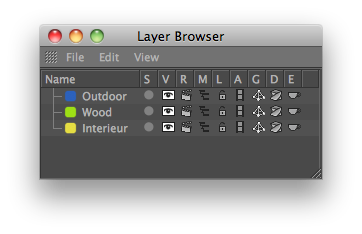

<!-- Source: https://developers.maxon.net/docs/py/2027_0_0/modules/c4d.documents/LayerObject/index.html -->

# c4d.documents.LayerObject 

## *class* `c4d.documents.LayerObject` 

Parent Class:

- [`c4d.BaseList2D`](../../c4d/C4DAtom/GeListNode/BaseList2D/index.md#c4d.BaseList2D)

## Overview 

- [`LayerObject.__init__()`](#c4d.documents.LayerObject.__init__)

## Members 

### Magic Methods 

#### `LayerObject.__init__(self)` 
