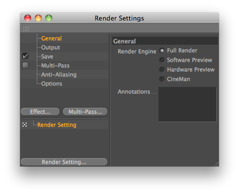

<!-- Source: https://developers.maxon.net/docs/py/2027_0_0/modules/c4d.documents/RenderData/index.html -->

# c4d.documents.RenderData <a id="c4d-documents-renderdata"></a>

## *class* `c4d.documents.RenderData` <a id="c4d.documents.RenderData"></a>



This class contains a container with all raytracer options.  
One can add multiple render data classes to a document.  
The active one will be used for the raytracing.  
Render settings in Cinema 4D are description based.  
Valid IDs are (open Cinema 4D for detailed information):

> |   |   |   |
> |---|---|---|
> | **Container ID** | **Type** | **Description** |
> | `RDATA_ANTIALIASING` | `LONG` | Anti-Aliasing. |
> | > > \|   \|   \|<br>> > \|---\|---\|<br>> > \| `RDATA_ANTIALIASING_NONE` \| None. \|<br>> > \| `RDATA_ANTIALIASING_GEOMETRY` \| Geometry. \|<br>> > \| `RDATA_ANTIALIASING_BEST` \| Best. \| |  |  |
> | `RDATA_AAFILTER` | `LONG` | Filter. |
> | > > \|   \|   \|<br>> > \|---\|---\|<br>> > \| `RDATA_AAFILTER_STILLIMAGE` \| Still Image. \|<br>> > \| `RDATA_AAFILTER_ANIMATION` \| Animation. \|<br>> > \| `RDATA_AAFILTER_BLEND` \| Blend. \|<br>> > \| `RDATA_AAFILTER_SINC` \| Sinc. \|<br>> > \| `RDATA_AAFILTER_AREA` \| Area. \|<br>> > \| `RDATA_AAFILTER_CONE` \| Cone. \|<br>> > \| `RDATA_AAFILTER_CATMULL` \| Catmull. \|<br>> > \| `RDATA_AAFILTER_VIDEO` \| PAL/NTSC. \| |  |  |
> | `RDATA_AATHRESHOLD` | `Real` | Threshold. |
> | `RDATA_AAMINLEVEL` | `LONG` | Min Level. |
> | > > \|   \|   \|<br>> > \|---\|---\|<br>> > \| `RDATA_AAMINLEVEL_1` \| 1x1. \|<br>> > \| `RDATA_AAMINLEVEL_2` \| 2x2. \|<br>> > \| `RDATA_AAMINLEVEL_4` \| 4x4. \|<br>> > \| `RDATA_AAMINLEVEL_8` \| 8x8. \|<br>> > \| `RDATA_AAMINLEVEL_16` \| 16x16. \| |  |  |
> | `RDATA_AAMAXLEVEL` | `LONG` | Max Level. |
> | > > \|   \|   \|<br>> > \|---\|---\|<br>> > \| `RDATA_AAMAXLEVEL_1` \| 1x1. \|<br>> > \| `RDATA_AAMAXLEVEL_2` \| 2x2. \|<br>> > \| `RDATA_AAMAXLEVEL_4` \| 4x4. \|<br>> > \| `RDATA_AAMAXLEVEL_8` \| 8x8. \|<br>> > \| `RDATA_AAMAXLEVEL_16` \| 16x16. \| |  |  |
> | `RDATA_AAOBJECTPROPERTIES` | `Bool` | Use Object Properties. |
> | `RDATA_AAMIPGLOBAL` | `Real` | MIP Scale. |
> | `RDATA_AASOFTNESS` | `Real` | Softness. |
> | `RDATA_RENDERENGINE` | `LONG` | Render Engine (external renderers pass their plugin ID). |
> | > > \|   \|   \|<br>> > \|---\|---\|<br>> > \| `RDATA_RENDERENGINE_STANDARD` \| Full Render. \| |  |  |
> | `RDATA_ACTIVEOBJECTONLY` | `Bool` | Active Object Only. |
> | `RDATA_AUTOLIGHT` | `Bool` | Auto Light. |
> | `RDATA_TEXTURES` | `Bool` | Textures. |
> | `RDATA_TEXTUREERROR` | `Bool` | Cancel if Texture Error. |
> | `RDATA_ENABLEBLURRY` | `Bool` | Blurriness. |
> | `RDATA_VOLUMETRICLIGHTING` | `Bool` | Volumetric Lighting. |
> | `RDATA_USELOD` | `Bool` | Use Display Tag LOD. |
> | `RDATA_SHOWHUD` | `Bool` | Render HUD. |
> | `RDATA_CACHESHADOWMAPS` | `Bool` | Cache Shadow Maps. |
> | `RDATA_ENABLESPD` | `Bool` | Sub-Polygon Displacement. |
> | `RDATA_POSTEFFECTS_ENABLE` | `Bool` | Post Effects. |
> | `RDATA_RAYDEPTH` | `LONG` | Ray Depth. |
> | `RDATA_REFLECTIONDEPTH` | `LONG` | Reflection Depth. |
> | `RDATA_SHADOWDEPTH` | `LONG` | Shadow Depth. |
> | `RDATA_THRESHOLD` | `Real` | Ray Threshold. |
> | `RDATA_LOD` | `Real` | Level of Detail. |
> | `RDATA_GLOBALBRIGHTNESS` | `Real` | Global Brightness. |
> | `RDATA_RENDERGAMMA` | `Real` | Render Gamma. |
> | `RDATA_MOTIONLENGTH` | `Real` | Motion Scale. |
> | `RDATA_SAVEIMAGE` | `Bool` | Save Image. |
> | `RDATA_PATH` | `Filename` | Path. |
> | `RDATA_FORMAT` | `LONG` | Format (bitmap filter plugins pass their plugin ID). |
> | > > \|   \|   \|<br>> > \|---\|---\|<br>> > \| `FILTER_TIF` \| TIFF \|<br>> > \| `FILTER_TGA` \| TGA \|<br>> > \| `FILTER_BMP` \| BMP \|<br>> > \| `FILTER_IFF` \| IFF \|<br>> > \| `FILTER_JPG` \| JPEG \|<br>> > \| `FILTER_PICT` \| Mac pict \|<br>> > \| `FILTER_PSD` \| Photoshop \|<br>> > \| `FILTER_RLA` \| RLA \|<br>> > \| `FILTER_RPF` \| RPF \|<br>> > \| `FILTER_B3D` \| Bodypaint \|<br>> > \| `FILTER_TIF_B3D` \| TIFF B3D. \|<br>> > \| `FILTER_PSB` \| Photoshop Big. \|<br>> > \| `FILTER_AVI` \| AVI movie. \|<br>> > \| `FILTER_MOVIE` \| Quicktime movie. \|<br>> > \| `FILTER_QTVRSAVER_PANORAMA` \| QTVR panorama \|<br>> > \| `FILTER_QTVRSAVER_OBJECT` \| QTVR object \|<br>> > \| `FILTER_HDR` \| HDR \|<br>> > \| `FILTER_PNG` \| PNG. \|<br>> > \| `FILTER_IES` \| IES. \| |  |  |
> | `RDATA_SAVEOPTIONS` | `BaseContainer` | Options. |
> | `RDATA_FORMATDEPTH` | `LONG` | Depth. |
> | > > \|   \|   \|<br>> > \|---\|---\|<br>> > \| `RDATA_FORMATDEPTH_8` \| 8 Bit/Channel. \|<br>> > \| `RDATA_FORMATDEPTH_16` \| 16 Bit/Channel. \|<br>> > \| `RDATA_FORMATDEPTH_32` \| 32 Bit/Channel. \| |  |  |
> | `RDATA_NAMEFORMAT` | `LONG` | Name. |
> | > > \|   \|   \|<br>> > \|---\|---\|<br>> > \| `RDATA_NAMEFORMAT_0` \| Name0000.TIF \|<br>> > \| `RDATA_NAMEFORMAT_1` \| Name0000 \|<br>> > \| `RDATA_NAMEFORMAT_2` \| Name.0000 \|<br>> > \| `RDATA_NAMEFORMAT_3` \| Name000.TIF \|<br>> > \| `RDATA_NAMEFORMAT_4` \| Name000 \|<br>> > \| `RDATA_NAMEFORMAT_5` \| Name.000 \|<br>> > \| `RDATA_NAMEFORMAT_6` \| Name.0000.TIF \| |  |  |
> | `RDATA_TRUECOLORDITHERING` | `Bool` | 24 Bit Dithering. |
> | `RDATA_ALPHACHANNEL` | `Bool` | Alpha Channel. |
> | `RDATA_STRAIGHTALPHA` | `Bool` | Straight Alpha. |
> | `RDATA_SEPARATEALPHA` | `Bool` | Separate Alpha. |
> | `RDATA_VRGENERATE` | `LONG` | Generate File. |
> | > > \|   \|   \|<br>> > \|---\|---\|<br>> > \| `RDATA_VRGENERATE_VR` \| VR. \|<br>> > \| `RDATA_VRGENERATE_INTERMEDIATE` \| Intermediate. \|<br>> > \| `RDATA_VRGENERATE_BOTH` \| Both. \| |  |  |
> | `RDATA_HSTEPS` | `LONG` | Horizontal Steps. |
> | `RDATA_HSTART` | `Real` | Horizontal Start Angle. |
> | `RDATA_HEND` | `Real` | Horizontal End Angle. |
> | `RDATA_VSTEPS` | `LONG` | Vertical Steps. |
> | `RDATA_VSTART` | `Real` | Vertical Start Angle. |
> | `RDATA_VEND` | `Real` | Vertical End Angle. |
> | `RDATA_VRDEFAULTX` | `LONG` | Default X Resolution. |
> | `RDATA_VRDEFAULTY` | `LONG` | Default Y Resolution. |
> | `RDATA_PROJECTFILE` | `Bool` | Save Compositing Project File. |
> | `RDATA_PROJECTFILETYPE` | `LONG` | Target Application. |
> | > > \|   \|   \|<br>> > \|---\|---\|<br>> > \| `RDATA_PROJECTFILETYPE_AFTEREFFECTS` \| After Effects. \|<br>> > \| `RDATA_PROJECTFILETYPE_COMBUSTION` \| Combustion. \|<br>> > \| `RDATA_PROJECTFILETYPE_FINALCUT` \| Final Cut (not yet avaible). \|<br>> > \| `RDATA_PROJECTFILETYPE_MOTION` \| Motion. \|<br>> > \| `RDATA_PROJECTFILETYPE_SHAKE` \| Shake. \|<br>> > \| `RDATA_PROJECTFILETYPE_DIGITALFUSION` \| Digital Fusion. \| |  |  |
> | `RDATA_PROJECTFILELOCAL` | `Bool` | Relative. |
> | `RDATA_PROJECTFILEDATA` | `Bool` | Include 3D Data. |
> | `RDATA_XRES_VIRTUAL` | `Real` | Width (units applied). |
> | `RDATA_YRES_VIRTUAL` | `Real` | Height (units applied). |
> | `RDATA_PIXELRESOLUTION_VIRTUAL` | `Real` | Resolution (units applied). |
> | `RDATA_PROJECTFILESAVE` | `BUTTON` | 'Save Project File' button. |
> | `RDATA_XRES` | `Real` | Width (Pixels). |
> | `RDATA_YRES` | `Real` | Height (Pixels). |
> | `RDATA_FRAMESEQUENCE` | `LONG` | Frame Range. |
> | > > \|   \|   \|<br>> > \|---\|---\|<br>> > \| `RDATA_FRAMESEQUENCE_MANUAL` \| Manual. \|<br>> > \| `RDATA_FRAMESEQUENCE_CURRENTFRAME` \| Current Frame. \|<br>> > \| `RDATA_FRAMESEQUENCE_ALLFRAMES` \| All Frames. \|<br>> > \| `RDATA_FRAMESEQUENCE_PREVIEWRANGE` \| Preview Range. \| |  |  |
> | `RDATA_FRAMEFROM` | `BaseTime` | From. |
> | `RDATA_FRAMETO` | `BaseTime` | To. |
> | `RDATA_FRAMESTEP` | `LONG` | Frame Step. |
> | `RDATA_FIELD` | `LONG` | Fields. |
> | > > \|   \|   \|<br>> > \|---\|---\|<br>> > \| `RDATA_FIELD_NONE` \| None. \|<br>> > \| `RDATA_FIELD_EVEN` \| Even First. \|<br>> > \| `RDATA_FIELD_ODD` \| Odd First. \| |  |  |
> | `RDATA_FRAMERATE` | `Real` | Frame Rate. |
> | `RDATA_LOCKRATIO` | `Bool` | Lock Ratio. |
> | `RDATA_SIZEUNIT` | `LONG` | Units. |
> | > > \|   \|   \|<br>> > \|---\|---\|<br>> > \| `RDATA_SIZEUNIT_PIXELS` \| Pixels. \|<br>> > \| `RDATA_SIZEUNIT_CM` \| cm. \|<br>> > \| `RDATA_SIZEUNIT_MM` \| mm. \|<br>> > \| `RDATA_SIZEUNIT_INCHES` \| Inches. \|<br>> > \| `RDATA_SIZEUNIT_POINTS` \| Points. \|<br>> > \| `RDATA_SIZEUNIT_PICAS` \| Picas. \| |  |  |
> | `RDATA_PIXELRESOLUTION` | `Real` | Resolution (always in DPI). |
> | `RDATA_PIXELRESOLUTIONUNIT` | `LONG` | Resolution Units. |
> | > > \|   \|   \|<br>> > \|---\|---\|<br>> > \| `RDATA_PIXELRESOLUTIONUNIT_PERCM` \| Pixels/cm. \|<br>> > \| `RDATA_PIXELRESOLUTIONUNIT_PERINCH` \| Pixels/Inch (DPI). \| |  |  |
> | `RDATA_FILMASPECT` | `Real` | Film Aspect. |
> | `RDATA_FILMPRESET` | `LONG` | Film Aspect Presets. |
> | > > \|   \|   \|<br>> > \|---\|---\|<br>> > \| `RDATA_FILMPRESET_CUSTOM` \| Custom. \|<br>> > \| `RDATA_FILMPRESET_SQUARE` \| Square (1:1). \|<br>> > \| `RDATA_FILMPRESET_STANDARD` \| Standard (4:3). \|<br>> > \| `RDATA_FILMPRESET_HDTV` \| HDTV (16:9). \|<br>> > \| `RDATA_FILMPRESET_35MMSTILL` \| 35mm Still (3:2). \|<br>> > \| `RDATA_FILMPRESET_WIDESCREEN` \| Widescreen (14:9). \|<br>> > \| `RDATA_FILMPRESET_35MM` \| 35mm (1.85:1). \|<br>> > \| `RDATA_FILMPRESET_PANAVISION` \| Panavision (2.39:1). \| |  |  |
> | `RDATA_PIXELASPECT` | `Real` | Pixel Aspect. |
> | `RDATA_PIXELPRESET` | `LONG` | Pixel Aspect Presets. |
> | > > \|   \|   \|<br>> > \|---\|---\|<br>> > \| `RDATA_PIXELPRESET_CUSTOM` \| Custom. \|<br>> > \| `RDATA_PIXELPRESET_SQUARE` \| Square. \|<br>> > \| `RDATA_PIXELPRESET_D1DVNTSC` \| D1/DV NTSC (0.9). \|<br>> > \| `RDATA_PIXELPRESET_D1DVPAL` \| D1/DV PAL (1.067). \|<br>> > \| `RDATA_PIXELPRESET_D1DVNTSCWIDESCREEN` \| D1/DV NTSC Widescreen (1.2). \|<br>> > \| `RDATA_PIXELPRESET_HDVANAMORPHIC` \| HDV Anamorphic (1.333). \|<br>> > \| `RDATA_PIXELPRESET_D1DVPALWIDESCREEN` \| D1/DV PAL Widescreen (1.422). \|<br>> > \| `RDATA_PIXELPRESET_ANAMORPHIC` \| Anamorphic 2:1 (2.0). \| |  |  |
> | `RDATA_PRESET` | `POPUP` | Presets. |
> | > > \|   \|   \|<br>> > \|---\|---\|<br>> > \| `RDATA_PRESET_160_120` \| 160 x 120. \|<br>> > \| `RDATA_PRESET_320_240` \| 320 x 240. \|<br>> > \| `RDATA_PRESET_480_360` \| 480 x 360. \|<br>> > \| `RDATA_PRESET_640_480` \| 640 x 480. \|<br>> > \| `RDATA_PRESET_800_600` \| 800 x 600. \|<br>> > \| `RDATA_PRESET_1024_768` \| 1024 x 768. \|<br>> > \| `RDATA_PRESET_1280_1024` \| 1280 x 1024. \|<br>> > \| `RDATA_PRESET_1440_900` \| 1440 x 900. \|<br>> > \| `RDATA_PRESET_1680_1080` \| 1680 x 1080. \|<br>> > \| `RDATA_PRESET_1920_1200` \| 1920 x 1200. \|<br>> > \| `RDATA_PRESET_2560_1600` \| 2560 x 1600. \|<br>> > \| `RDATA_PRESET_EDITORRESOLUTION` \| Editor Resolution. \|<br>> > \| `RDATA_PRESET_WEBVIDEO` \| Web Video 320 x 240. \|<br>> > \| `RDATA_PRESET_WEBBANNER` \| Web Banner 468 x 60. \|<br>> > \| `RDATA_PRESET_IPODVIDEO` \| iPod Video 640 x 480. \|<br>> > \| `RDATA_PRESET_NTSCDV` \| NTSC DV. \|<br>> > \| `RDATA_PRESET_NTSCDVWIDESCREEN` \| NTSC Widescreen. \|<br>> > \| `RDATA_PRESET_NTSCDVWIDESCREEN24` \| NTSC Widescreen 23.976. \|<br>> > \| `RDATA_PRESET_NTSCD1` \| NTSC D1. \|<br>> > \| `RDATA_PRESET_NTSCD1WIDESCREEN` \| NTSC D1 Widescreen. \|<br>> > \| `RDATA_PRESET_NTSCD1SQUAREPIXEL` \| NTSC D1 Square Pixel. \|<br>> > \| `RDATA_PRESET_NTSCD1WIDESCREENSQUAREPIXEL` \| NTSC D1 Widescreen Square Pixel. \|<br>> > \| `RDATA_PRESET_PALD1DV` \| PAL D1/DV. \|<br>> > \| `RDATA_PRESET_PALD1DVWIDESCREEN` \| PAL D1/DV Widescreen. \|<br>> > \| `RDATA_PRESET_PALD1DVSQUAREPIXEL` \| PAL D1/DV Square Pixel. \|<br>> > \| `RDATA_PRESET_PALD1DVWIDESCREENSQUAREPIXEL` \| PAL D1/DV Widescreen Square Pixel. \|<br>> > \| `RDATA_PRESET_HDVHDTV720_30` \| HDV/HDTV 720 29.97. \|<br>> > \| `RDATA_PRESET_HDVHDTV720_25` \| HDV/HDTV 720 25. \|<br>> > \| `RDATA_PRESET_HDV1080_30` \| HDV 1080 29.97. \|<br>> > \| `RDATA_PRESET_HDV1080_25` \| HDV 1080 25. \|<br>> > \| `RDATA_PRESET_DVCPRO_HD720_24` \| DVCPRO HD 720 23.976. \|<br>> > \| `RDATA_PRESET_DVCPRO_HD720_30` \| DVCPRO HD 720 29.97. \|<br>> > \| `RDATA_PRESET_DVCPRO_HD1080` \| DVCPRO 1080 29.97. \|<br>> > \| `RDATA_PRESET_HDTV1080_24` \| HDTV 1080 24. \|<br>> > \| `RDATA_PRESET_HDTV1080_30` \| HDTV 1080 29.97. \|<br>> > \| `RDATA_PRESET_CINEONHALF` \| Cineon Half. \|<br>> > \| `RDATA_PRESET_CINEONFULL` \| Cineon Full. \|<br>> > \| `RDATA_PRESET_FILM2K` \| Film (2K). \|<br>> > \| `RDATA_PRESET_FILM4K` \| Film (4K). \|<br>> > \| `RDATA_PRESET_QTVRHALF` \| Quicktime VR Half. \|<br>> > \| `RDATA_PRESET_QTVRFULL` \| Quicktime VR Full. \|<br>> > \| `RDATA_PRESET_SQUARE1K` \| Square (1K). \|<br>> > \| `RDATA_PRESET_SQUARE2K` \| Square (2K). \|<br>> > \| `RDATA_PRESET_SQUARE3K` \| Square (3K). \|<br>> > \| `RDATA_PRESET_SQUARE4K` \| Square (4K). \|<br>> > \| `RDATA_PRESET_LETTER_H` \| Letter (Portrait). \|<br>> > \| `RDATA_PRESET_LEGAL_H` \| Legal (Portrait). \|<br>> > \| `RDATA_PRESET_TABLOID_H` \| Tabloid (Portrait). \|<br>> > \| `RDATA_PRESET_A5_H` \| A5 (Portrait). \|<br>> > \| `RDATA_PRESET_A4_H` \| A4 (Portrait). \|<br>> > \| `RDATA_PRESET_A3_H` \| A3 (Portrait). \|<br>> > \| `RDATA_PRESET_A2_H` \| A2 (Portrait). \|<br>> > \| `RDATA_PRESET_A1_H` \| A1 (Portrait). \|<br>> > \| `RDATA_PRESET_A0_H` \| A0 (Portrait). \|<br>> > \| `RDATA_PRESET_B5_H` \| B5 (Portrait). \|<br>> > \| `RDATA_PRESET_B4_H` \| B4 (Portrait). \|<br>> > \| `RDATA_PRESET_B3_H` \| B3 (Portrait). \|<br>> > \| `RDATA_PRESET_B2_H` \| B2 (Portrait). \|<br>> > \| `RDATA_PRESET_B1_H` \| B1 (Portrait). \|<br>> > \| `RDATA_PRESET_B0_H` \| B0 (Portrait). \|<br>> > \| `RDATA_PRESET_2_3_INCH_H` \| 2'' x 3'' (Portrait). \|<br>> > \| `RDATA_PRESET_3_5_INCH_H` \| 3'' x 5'' (Portrait). \|<br>> > \| `RDATA_PRESET_4_6_INCH_H` \| 4'' x 6'' (Portrait). \|<br>> > \| `RDATA_PRESET_5_7_INCH_H` \| 5'' x 7'' (Portrait). \|<br>> > \| `RDATA_PRESET_8_10_INCH_H` \| 8'' x 10'' (Portrait). \|<br>> > \| `RDATA_PRESET_LETTER_V` \| Letter (Landscape). \|<br>> > \| `RDATA_PRESET_LEGAL_V` \| Legal (Landscape). \|<br>> > \| `RDATA_PRESET_TABLOID_V` \| Tabloid (Landscape). \|<br>> > \| `RDATA_PRESET_A5_V` \| A5 (Landscape). \|<br>> > \| `RDATA_PRESET_A4_V` \| A4 (Landscape). \|<br>> > \| `RDATA_PRESET_A3_V` \| A3 (Landscape). \|<br>> > \| `RDATA_PRESET_A2_V` \| A2 (Landscape). \|<br>> > \| `RDATA_PRESET_A1_V` \| A1 (Landscape). \|<br>> > \| `RDATA_PRESET_A0_V` \| A0 (Landscape). \|<br>> > \| `RDATA_PRESET_B5_V` \| B5 (Landscape). \|<br>> > \| `RDATA_PRESET_B4_V` \| B4 (Landscape). \|<br>> > \| `RDATA_PRESET_B3_V` \| B3 (Landscape). \|<br>> > \| `RDATA_PRESET_B2_V` \| B2 (Landscape). \|<br>> > \| `RDATA_PRESET_B1_V` \| B1 (Landscape). \|<br>> > \| `RDATA_PRESET_B0_V` \| B0 (Landscape). \|<br>> > \| `RDATA_PRESET_2_3_INCH_V` \| 3'' x 2'' (Landscape). \|<br>> > \| `RDATA_PRESET_3_5_INCH_V` \| 5'' x 3'' (Landscape). \|<br>> > \| `RDATA_PRESET_4_6_INCH_V` \| 6'' x 4'' (Landscape). \|<br>> > \| `RDATA_PRESET_5_7_INCH_V` \| 7'' x 5'' (Landscape). \|<br>> > \| `RDATA_PRESET_8_10_INCH_V` \| 10'' x 8'' (Landscape). \| |  |  |
> | `RDATA_MULTIPASS_SAVEIMAGE` | `Bool` | Save Multi-Pass Image. |
> | `RDATA_MULTIPASS_SAVEONEFILE` | `Bool` | Mulit-Layer File. |
> | `RDATA_MULTIPASS_ENABLE` | `Bool` | Enable Multi-Pass. |
> | `RDATA_MULTIPASS_SAVEFORMAT` | `LONG` | Format (bitmap filter plugins pass their plugin ID). |
> | > > \|   \|   \|<br>> > \|---\|---\|<br>> > \| `FILTER_TIF` \| TIFF \|<br>> > \| `FILTER_TGA` \| TGA \|<br>> > \| `FILTER_BMP` \| BMP \|<br>> > \| `FILTER_IFF` \| IFF \|<br>> > \| `FILTER_JPG` \| JPEG \|<br>> > \| `FILTER_PICT` \| Mac pict \|<br>> > \| `FILTER_PSD` \| Photoshop \|<br>> > \| `FILTER_RLA` \| RLA \|<br>> > \| `FILTER_RPF` \| RPF \|<br>> > \| `FILTER_B3D` \| Bodypaint \|<br>> > \| `FILTER_TIF_B3D` \| TIFF B3D. \|<br>> > \| `FILTER_PSB` \| Photoshop Big. \|<br>> > \| `FILTER_AVI` \| AVI movie. \|<br>> > \| `FILTER_MOVIE` \| Quicktime movie. \|<br>> > \| `FILTER_QTVRSAVER_PANORAMA` \| QTVR panorama \|<br>> > \| `FILTER_QTVRSAVER_OBJECT` \| QTVR object \|<br>> > \| `FILTER_HDR` \| HDR \|<br>> > \| `FILTER_PNG` \| PNG. \|<br>> > \| `FILTER_IES` \| IES. \| |  |  |
> | `RDATA_MULTIPASS_SAVEOPTIONS` | `BaseContainer` | Options. |
> | `RDATA_MULTIPASS_LIGHTS` | `LONG` | Separate Lights. |
> | > > \|   \|   \|<br>> > \|---\|---\|<br>> > \| `RDATA_MULTIPASS_LIGHTS_NONE` \| None. \|<br>> > \| `RDATA_MULTIPASS_LIGHTS_ALL` \| All. \|<br>> > \| `RDATA_MULTIPASS_LIGHTS_SELECTED` \| Selected. \| |  |  |
> | `RDATA_MULTIPASS_FILENAME` | `Filename` | Path. |
> | `RDATA_MULTIPASS_SAVEDEPTH` | `LONG` | Depth. |
> | > > \|   \|   \|<br>> > \|---\|---\|<br>> > \| `RDATA_MULTIPASS_SAVEDEPTH_8` \| 8 Bit/Channel \|<br>> > \| `RDATA_MULTIPASS_SAVEDEPTH_16` \| 16 Bit/Channel \|<br>> > \| `RDATA_MULTIPASS_SAVEDEPTH_32` \| 32 Bit/Channel \| |  |  |
> | `RDATA_MULTIPASS_LIGHTMODE` | `LONG` | Mode. |
> | > > \|   \|   \|<br>> > \|---\|---\|<br>> > \| `RDATA_MULTIPASS_LIGHTMODE_1CHANNEL` \| 1 Channel: Diffuse+Specular+Shadow \|<br>> > \| `RDATA_MULTIPASS_LIGHTMODE_2CHANNELS` \| 2 Channels: Diffuse+Specular,Shadow \|<br>> > \| `RDATA_MULTIPASS_LIGHTMODE_3CHANNELS` \| 3 Channels: Diffuse,Specular,Shadow \| |  |  |
> | `RDATA_MULTIPASS_SUFFIX` | `Bool` | Layer Name as Suffix. |
> | `RDATA_MULTIPASS_SHADOWCORRECTION` | `Bool` | Shadow Correction. |
> | `RDATA_MULTIPASS_STRAIGHTALPHA` | `Bool` | Straight Alpha. |
> | `RDATA_RENDERDOODLE` | `Bool` | Render Doodle. |
> | `RDATA_INCLUDESOUND` | `Bool` | Include Sound. |
> | `RDATA_GLOBALSAVE` | `Bool` | Enable Saving. |
> | `RDATA_HELPTEXT` | `String` | Annotations. |
> | `RDATA_SAVECALLBACK_FUNC` | `LONG` | Private. |
> | > > \|   \|   \|<br>> > \|---\|---\|<br>> > \| `RDATA_CALLABACK_OPEN` \| Open. \|<br>> > \| `RDATA_CALLABACK_WRITE` \| Write. \|<br>> > \| `RDATA_CALLABACK_CLOSE` \| Close. \| |  |  |
> | `RDATA_SAVECALLBACK_USERDATA` | `void*` | Private. |
> | `RDATA_OPTION_TRANSPARENCY` | `Bool` | Transaprency. |
> | `RDATA_OPTION_REFRACTION` | `Bool` | Refraction. |
> | `RDATA_OPTION_REFLECTION` | `Bool` | Reflection. |
> | `RDATA_OPTION_SHADOW` | `Bool` | Shadow. |
> | `RDATA_LIMITREFLECTION` | `Bool` | Limit Reflections to Floor/Sky. |
> | `RDATA_LIMITSHADOW` | `Bool` | Limit Shadows to Soft. |

Parent Class:

- [`c4d.BaseList2D`](../../c4d/C4DAtom/GeListNode/BaseList2D/index.md#c4d.BaseList2D)

## Overview <a id="overview"></a>

**Magic Methods**

- [`RenderData.__init__()`](#c4d.documents.RenderData.__init__)

**Multipass Rendering**

- [`RenderData.GetFirstMultipass()`](#c4d.documents.RenderData.GetFirstMultipass): Returns the first multipass of the render setting.
- [`RenderData.InsertMultipass()`](#c4d.documents.RenderData.InsertMultipass): Inserts the multipass channel into the render setting.

**Render Timing And Resolution**

- [`RenderData.GetRealFrameRate()`](#c4d.documents.RenderData.GetRealFrameRate): Calculated the framerate taking the RDATA_FRAMERATE_SYNC_WITH_PROJECT into account.
- [`RenderData.GetResolution()`](#c4d.documents.RenderData.GetResolution): Gets the resolution and the aspect ratios of the render data.
- [`RenderData.SetResolution()`](#c4d.documents.RenderData.SetResolution): Sets the resolution and the aspect ratios of the render data.

**Video Post Processing**

- [`RenderData.GetFirstVideoPost()`](#c4d.documents.RenderData.GetFirstVideoPost): Returns the first videopost of the render setting.
- [`RenderData.InsertVideoPost()`](#c4d.documents.RenderData.InsertVideoPost): Inserts *pvp* as the last videopost in the render setting.
- [`RenderData.InsertVideoPostLast()`](#c4d.documents.RenderData.InsertVideoPostLast): Inserts *pvp* as the last videopost in the render setting.

## Members <a id="members"></a>

### Magic Methods <a id="c4d.documents.RenderData-method-Magic-Methods"></a>

#### `RenderData.__init__(self)` <a id="c4d.documents.RenderData.__init__"></a>

### Multipass Rendering <a id="c4d.documents.RenderData-method-Multipass-Rendering"></a>

#### `RenderData.GetFirstMultipass(self)` <a id="c4d.documents.RenderData.GetFirstMultipass"></a>

Returns the first multipass of the render setting.

**Return type:** [c4d.BaseList2D](../../c4d/C4DAtom/GeListNode/BaseList2D/index.md#c4d.BaseList2D)

**Returns:** The first multipass.

#### `RenderData.InsertMultipass(self, obj, pred)` <a id="c4d.documents.RenderData.InsertMultipass"></a>

Inserts the multipass channel into the render setting.  
Optionally specify the insertion position with the *pred* parameter, giving the multipass channel before (right above) the wanted position.  
Otherwise the multipass channel is inserted at the first position in the list:

```python
import c4d

# Create a depth object in the multipass object list

def main(doc):
    rd = doc.GetActiveRenderData()          # Get the current renderdata
    vdepth=c4d.BaseList2D(c4d.Zmultipass)   # create a multipass object (all have the same plugin type ID 'Zmultipass')
    vdepth.GetDataInstance()[c4d.MULTIPASSOBJECT_TYPE] = c4d.VPBUFFER_DEPTH #Set type to 'Depth'
    rd.InsertMultipass(vdepth)              # Insert into Multipass list
    c4d.EventAdd()                          # Send global event

if __name__=='__main__':
    main(doc)
```

**Parameters:**

- **obj** ([*c4d.BaseList2D*](../../c4d/C4DAtom/GeListNode/BaseList2D/index.md#c4d.BaseList2D)) – The multipass object to insert.
- **pred** ([*c4d.BaseList2D*](../../c4d/C4DAtom/GeListNode/BaseList2D/index.md#c4d.BaseList2D)) – Optional point to insert the multipass channel.

### Render Timing And Resolution <a id="c4d.documents.RenderData-method-Render-Timing-And-Resolution"></a>

#### `RenderData.GetRealFrameRate(self, doc)` <a id="c4d.documents.RenderData.GetRealFrameRate"></a>

Calculated the framerate taking the RDATA_FRAMERATE_SYNC_WITH_PROJECT into account.

*New in version 2025.2.0.*

**Parameters:** **doc** ([*c4d.documents.BaseDocument*](../BaseDocument/index.md#c4d.documents.BaseDocument)) – Document to take the frame rate from in case of RDATA_FRAMERATE_SYNC_WITH_PROJECT is true.

**Returns:** Rounded Integer value of the effective frame rate.

**Return type:** int

#### `RenderData.GetResolution(self)` <a id="c4d.documents.RenderData.GetResolution"></a>

Gets the resolution and the aspect ratios of the render data.

*New in version 2025.2.0.*

**Return type:** Tuple[float, float, float, float]

**Returns:**

A tuple with the following information:

float: The image output width.  
float: The image output height.  
float: The ratio of a pixel’s on-screen width to it’s on-screen height.  
float: The X-to-Y aspect ratio of the rendered image.

#### `RenderData.SetResolution(self, width, height, pixelAspect)` <a id="c4d.documents.RenderData.SetResolution"></a>

Sets the resolution and the aspect ratios of the render data.

*New in version 2025.2.0.*

The film aspect ratio is set accordingly (width / height * pixelAspect).

**Parameters:**

- **width** (*float*) – The image output width.
- **height** (*float*) – The image output height.
- **pixelAspect** (*float*) – The ratio of a pixel’s on-screen width to it’s on-screen height.

### Video Post Processing <a id="c4d.documents.RenderData-method-Video-Post-Processing"></a>

#### `RenderData.GetFirstVideoPost(self)` <a id="c4d.documents.RenderData.GetFirstVideoPost"></a>

Returns the first videopost of the render setting.

**Return type:** [c4d.documents.BaseVideoPost](../BaseVideoPost/index.md#c4d.documents.BaseVideoPost)

**Returns:**

The first videopost.

*Changed in version R19:* Returns a [`BaseVideoPost`](../BaseVideoPost/index.md#c4d.documents.BaseVideoPost) object.

#### `RenderData.InsertVideoPost(self, pvp, pred)` <a id="c4d.documents.RenderData.InsertVideoPost"></a>

Inserts *pvp* as the last videopost in the render setting.

**Parameters:**

- **pvp** ([*c4d.documents.BaseVideoPost*](../BaseVideoPost/index.md#c4d.documents.BaseVideoPost)) –

  The videopost to insert.

  *Changed in version R19:* Accepts a [`BaseVideoPost`](../BaseVideoPost/index.md#c4d.documents.BaseVideoPost) object.

- **pred** ([*c4d.documents.BaseVideoPost*](../BaseVideoPost/index.md#c4d.documents.BaseVideoPost)) –

  The videopost to insert *pvp* after, or do not pass anything to insert *pvp* first.

  *Changed in version R19:* Accepts a [`BaseVideoPost`](../BaseVideoPost/index.md#c4d.documents.BaseVideoPost) object.

#### `RenderData.InsertVideoPostLast(self, pvp)` <a id="c4d.documents.RenderData.InsertVideoPostLast"></a>

Inserts *pvp* as the last videopost in the render setting.

**Parameters:**

**pvp** ([*c4d.documents.BaseVideoPost*](../BaseVideoPost/index.md#c4d.documents.BaseVideoPost)) –

The videopost to insert.

*Changed in version R19:* Accepts a [`BaseVideoPost`](../BaseVideoPost/index.md#c4d.documents.BaseVideoPost) object.
