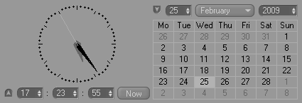

<!-- Source: https://developers.maxon.net/docs/py/2027_0_0/modules/c4d.gui/BaseCustomGui/DateTimeControlData/index.html -->

# c4d.gui.DateTimeControl 

## *class* `c4d.gui.DateTimeControl` 

Spline GUI(**DATETIME_GUI**) for [`DateTimeData`](../../../c4d/CustomDataType/DateTimeData/index.md#c4d.DateTimeData) data type. These are the settings:

|   |   |
|---|---|
| *DATETIME_TIME_CONTROL* | **True**, if it is a clock. |
| *DATETIME_DATE_CONTROL* | **True**, if it is a calendar. |
| *DATETIME_NOW_BUTTON* | **True**, to add “Now” button. |
| *DATETIME_NO_SECONDS* | **True**, to not show seconds. |
| *DATETIME_SHOW_LABELS* | **True**, to show the *“Date”* and *“Time”* labels if the GUI is collapsed. |

This is how it looks like:

Parent Class:

- [`c4d.gui.BaseCustomGui`](../index.md#c4d.gui.BaseCustomGui)

## Overview 

- [`DateTimeControl.GetDateTime()`](#c4d.gui.DateTimeControl.GetDateTime): Get the time.
- [`DateTimeControl.SetDateTime()`](#c4d.gui.DateTimeControl.SetDateTime): Sets the time.

## Members 

### Date And Time 

#### `DateTimeControl.GetDateTime(self)` 

Get the time.

**Return type:** [c4d.DateTimeData](../../../c4d/CustomDataType/DateTimeData/index.md#c4d.DateTimeData)

**Returns:** The new spline data object.

#### `DateTimeControl.SetDateTime(self, d, bSetData=True, bSetTime=True)` 

Sets the time.

**Parameters:**

- **d** ([*c4d.DateTimeData*](../../../c4d/CustomDataType/DateTimeData/index.md#c4d.DateTimeData)) – The new time.
- **bSetData** (*bool*) – If this is **False** the date part of *d* is disregarded.
- **bSetTime** (*bool*) – If this is **False** the time part of *d* is disregarded.
