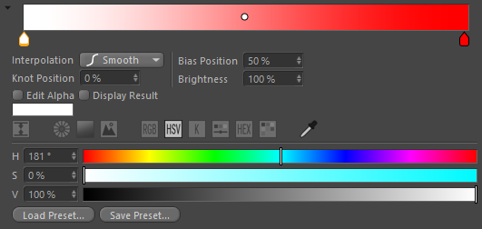

<!-- Source: https://developers.maxon.net/docs/py/2027_0_0/modules/c4d.gui/BaseCustomGui/GradientCustomGui/index.html -->

# c4d.gui.GradientCustomGui 

## *class* `c4d.gui.GradientCustomGui` 

Gradient GUI(**CUSTOMGUI_GRADIENT**) for [`Gradient`](../../../c4d/CustomDataType/Gradient/index.md#c4d.Gradient) data type. These are the settings:

| Symbol ID | Type | Description | Property in a res file |
|---|---|---|---|
| *GRADIENTPROPERTY_ALPHA_WITH_COLOR* | bool | If *GRADIENTPROPERTY_ALPHA* is set to **True**, this creates a Gradient with Color and Alpha.   It’s also shows controls to handle both gradients. | `GRADIENT MYGRADIENT { COLOR; }` |
| *GRADIENTPROPERTY_ALPHA* | bool | Creates an Alpha gradient. | `GRADIENT MYGRADIENT { ALPHA; }` |
| *GRADIENTPROPERTY_NOEDITCOLOR* | bool | No color editing. | `GRADIENT MYGRADIENT { NOEDITCOLOR; }` |
| *GRADIENTPROPERTY_NOPRESETS* | bool | No load/save preset buttons. | `GRADIENT MYGRADIENT { NOPRESETS; }` |
| *GRADIENTPROPERTY_NOINTERPOLATION* | bool | No Interpolation parameter. | `GRADIENT MYGRADIENT { NOINTERPOLATION; }` |
| *GRADIENTPROPERTY_NOKNOTPOSITION* | bool | No Knot Position parameter. | `GRADIENT MYGRADIENT { NOKNOTPOSITION; }` |
| *GRADIENTPROPERTY_NOBIASPOSITION* | bool | No Bias Position parameter. | `GRADIENT MYGRADIENT { NOBIASPOSITION; }` |
| *GRADIENTPROPERTY_NOBRIGHTNESS* | bool | No Brightness parameter. | `GRADIENT MYGRADIENT { NOBRIGHTNESS; }` |

> **Note:** These 2 options are allowed:
>
> - DR_COLORFIELD_ICC_BASEDOC: Use ICC profile of the current document.
> - DR_COLORFIELD_ICC_BPTEX: Use ICC profile of the current BodyPain3D texture.

This is what it looks like:

> 

Parent Class:

- [`c4d.gui.BaseCustomGui`](../index.md#c4d.gui.BaseCustomGui)

## Overview 

- [`GradientCustomGui.GetGradient()`](#c4d.gui.GradientCustomGui.GetGradient): Get the data.
- [`GradientCustomGui.SetGradient()`](#c4d.gui.GradientCustomGui.SetGradient): Sets the data.

## Members 

### Gradient Data 

#### `GradientCustomGui.GetGradient(self)` 

Get the data.

**Return type:** [c4d.Gradient](../../../c4d/CustomDataType/Gradient/index.md#c4d.Gradient)

**Returns:** The new gradient data object.

#### `GradientCustomGui.SetGradient(self, data)` 

Sets the data.

**Parameters:** **data** ([*c4d.Gradient*](../../../c4d/CustomDataType/Gradient/index.md#c4d.Gradient)) – The new Gradient data.

**Return type:** bool

**Returns:** **True** if successful, otherwise **False**.
