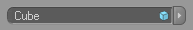

<!-- Source: https://developers.maxon.net/docs/py/2027_0_0/modules/c4d.gui/BaseCustomGui/LinkBoxGui/index.html -->

# c4d.gui.LinkBoxGui 

## *class* `c4d.gui.LinkBoxGui` 

Link box GUI(**CUSTOMGUI_LINKBOX**) for [`BaseList2D`](../../../c4d/C4DAtom/GeListNode/BaseList2D/index.md#c4d.BaseList2D) objects. These are the settings:

| Symbol ID | Type | Description |
|---|---|---|
| *LINKBOX_HIDE_ICON* | bool | Hide the icon. |
| *LINKBOX_LAYERMODE* | bool | Layer mode. |
| *LINKBOX_NO_PICKER* | bool | No picker mode. |
| *LINKBOX_NODE_MODE* | bool | Private - Node mode. |

This is what it looks like:

Parent Class:

- [`c4d.gui.BaseCustomGui`](../index.md#c4d.gui.BaseCustomGui)

## Overview 

- [`LinkBoxGui.GetLink()`](#c4d.gui.LinkBoxGui.GetLink): Evaluates the link in *doc*, returning **None** if the linked object is not an instance of *instance*.
- [`LinkBoxGui.SetLink()`](#c4d.gui.LinkBoxGui.SetLink): Sets the link.

## Members 

### Link Management 

#### `LinkBoxGui.GetLink(self, doc, instance)` 

Evaluates the link in *doc*, returning **None** if the linked object is not an instance of *instance*.

**Parameters:**

- **doc** ([*c4d.documents.BaseDocument*](../../../c4d.documents/BaseDocument/index.md#c4d.documents.BaseDocument)) – Document to evaluate the link in.
- **instance** (*int*) – The type to check.

**Returns:** The linked object, or **None** if the link is broken or of the wrong type.

**Return type:** Optional[[c4d.BaseList2D](../../../c4d/C4DAtom/GeListNode/BaseList2D/index.md#c4d.BaseList2D)]

#### `LinkBoxGui.SetLink(self, obj)` 

Sets the link.

**Parameters:** **obj** ([*c4d.BaseList2D*](../../../c4d/C4DAtom/GeListNode/BaseList2D/index.md#c4d.BaseList2D)) – The object to set.

**Return type:** bool

**Returns:** **True** if the object was set, otherwise **False**.
