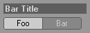

<!-- Source: https://developers.maxon.net/docs/py/2027_0_0/modules/c4d.gui/BaseCustomGui/QuickTabCustomGui/index.html -->

# c4d.gui.QuickTabCustomGui 

## *class* `c4d.gui.QuickTabCustomGui` 

Quick tab GUI (**CUSTOMGUI_QUICKTAB**). The settings are:

|   |   |   |
|---|---|---|
| *QUICKTAB_BAR* | in | Bar mode (0=off, 1=on, 2=non-bold). Set **True** for group title bars. |
| *QUICKTAB_BARTITLE* | str | Title for bar mode. |
| *QUICKTAB_SHOWSINGLE* | bool | Show single items. |
| *QUICKTAB_SPRINGINGFOLDERS* | bool | Allow springing folders (activate quicktabs on drag and drop). |
| *QUICKTAB_SEPARATOR* | bool | Draw separator. |
| *QUICKTAB_BARSUBGROUP* | bool | Handle as subgroup. Like bar mode, but with fold arrow icon. Implies *QUICKTAB_BAR*. Call `QuickTabCustomGui.IsSelected()` to get fold state. |
| *QUICKTAB_BARLAYERCOLOR* | bool | Show layer color. |
| *QUICKTAB_NOLINEBREAK* | bool | No line break for tabs inside scrollgroups. |
| *QUICKTAB_BGCOLOR* | vector/int | Color RGB or ID. |
| *QUICKTAB_NOMULTISELECT* | bool | No multiple tab selection. |
| *QUICKTAB_ALTERNATIVECOLOR* | int | Use an alternative color (color ID from color preferences). |

This is what it looks like:

The picture shows two elements, the top one with *QUICKTAB_BAR* set to **True**.

Parent Class:

- [`c4d.gui.BaseCustomGui`](../index.md#c4d.gui.BaseCustomGui)

## Overview 

**Appearance**

- [`QuickTabCustomGui.SetLayerColor()`](#c4d.gui.QuickTabCustomGui.SetLayerColor): Sets the layer color of string id.
- [`QuickTabCustomGui.SetTextColor()`](#c4d.gui.QuickTabCustomGui.SetTextColor): Set the text color of item *id* to *col*.

**Content Management**

- [`QuickTabCustomGui.AppendString()`](#c4d.gui.QuickTabCustomGui.AppendString): Appends a string.
- [`QuickTabCustomGui.ClearStrings()`](#c4d.gui.QuickTabCustomGui.ClearStrings): Removes all strings.
- [`QuickTabCustomGui.DoLayoutChange()`](#c4d.gui.QuickTabCustomGui.DoLayoutChange): Call this after appending strings to show the results.

**Selection**

- [`QuickTabCustomGui.IsSelected()`](#c4d.gui.QuickTabCustomGui.IsSelected): Checks if a string is selected.
- [`QuickTabCustomGui.Select()`](#c4d.gui.QuickTabCustomGui.Select): Change the selection state of item *id* to *b*.

## Members 

### Appearance 

#### `QuickTabCustomGui.SetLayerColor(self, id, show, col)` 

Sets the layer color of string id.

**Parameters:**

- **id** (*int*) – The string ID.
- **show** (*bool*) – **True** to show the layer color.
- **col** ([*c4d.Vector*](../../../c4d/Vector/index.md#c4d.Vector)) – The color.

#### `QuickTabCustomGui.SetTextColor(self, id, col)` 

Set the text color of item *id* to *col*.

**Parameters:**

- **id** (*int*) – String ID.
- **col** (*int*) – Text color, e.g. *COLOR_MATERIALMANAGER_TEXT_SELECTED*. See [COLOR](../../../../consts/COLOR.md).

### Content Management 

#### `QuickTabCustomGui.AppendString(self, id, str, checked)` 

Appends a string.

**Parameters:**

- **id** (*int*) – String ID.
- **str** (*str*) – String to append.
- **checked** (*bool*) – Initial selection state.

#### `QuickTabCustomGui.ClearStrings(self)` 

Removes all strings.

#### `QuickTabCustomGui.DoLayoutChange(self)` 

Call this after appending strings to show the results.

### Selection 

#### `QuickTabCustomGui.IsSelected(self, id)` 

Checks if a string is selected.

**Parameters:** **id** (*int*) – String ID.

**Return type:** bool

**Returns:** **True** if string *id* is selected, otherwise **False**.

#### `QuickTabCustomGui.Select(self, id, b)` 

Change the selection state of item *id* to *b*.

**Parameters:**

- **id** (*int*) – String ID.
- **b** (*bool*) – New selection state.

**Return type:** bool

**Returns:** **True** if successful, otherwise **False**.
