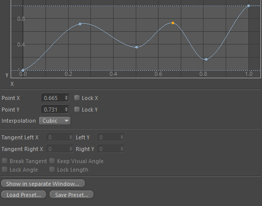

<!-- Source: https://developers.maxon.net/docs/py/2027_0_0/modules/c4d.gui/BaseCustomGui/SplineCustomGui/index.html -->

# c4d.gui.SplineCustomGui 

## *class* `c4d.gui.SplineCustomGui` 

Spline GUI (**CUSTOMGUI_SPLINE**) for the [`SplineData`](../../../c4d/CustomDataType/SplineData/index.md#c4d.SplineData) data type. These are the settings:

|   |   |   |
|---|---|---|
| *SPLINECONTROL_GRID_H* | bool | Shows the horizontal grid. |
| *SPLINECONTROL_GRID_V* | bool | Shows the vertical grid. |
| *SPLINECONTROL_VALUE_EDIT_H* | bool | Show X edit box. |
| *SPLINECONTROL_VALUE_EDIT_V* | bool | Show Y edit box. |
| *SPLINECONTROL_VALUE_LABELS_H_LEGACY* | bool | Show labels on the X axis. |
| *SPLINECONTROL_VALUE_LABELS_V_LEGACY* | bool | Show labels on the Y axis. |
| *SPLINECONTROL_X_MIN* | float | Min. X. |
| *SPLINECONTROL_X_MAX* | float | Max. X. |
| *SPLINECONTROL_X_STEPS* | float | X steps (for the edit box). |
| *SPLINECONTROL_Y_MIN* | float | Min. Y. |
| *SPLINECONTROL_Y_MAX* | float | Max. Y. |
| *SPLINECONTROL_Y_STEPS* | float | Y steps (for the edit box). |
| *SPLINECONTROL_PRESET_BTN_LEGACY* | bool | Has preset button. |
| *SPLINECONTROL_ROUND_SLIDER_LEGACY* | bool | Has tension slider. |
| *SPLINECONTROL_GRIDLINES_H_LEGACY* | int | Number of horizontal grid lines. |
| *SPLINECONTROL_GRIDLINES_V_LEGACY* | int | Number of vertical grid lines. |
| *SPLINECONTROL_MINSIZE_H* | int | Minimal horizontal size. |
| *SPLINECONTROL_MINSIZE_V* | int | Minimal vertical size. |
| *SPLINECONTROL_X_MIN_TEXT_LEGACY* | str | Xmin label text. |
| *SPLINECONTROL_X_MAX_TEXT_LEGACY* | str | Xmax label text. |
| *SPLINECONTROL_Y_MIN_TEXT_LEGACY* | str | Xmin label text. |
| *SPLINECONTROL_Y_MAX_TEXT_LEGACY* | str | Xmax label text. |
| *SPLINECONTROL_X_TEXT* | str | X label text. |
| *SPLINECONTROL_Y_TEXT* | str | Y label text. |
| *SPLINECONTROL_NEW_NO_HORIZ_LEGACY* | bool | New knots can’t be moved horizontally. |
| *SPLINECONTROL_NEW_NO_VERT_LEGACY* | bool | New knots can’t be moved vertically. |
| *SPLINECONTROL_HIDE_GRID_H_LEGACY* | bool | Hide the horizontal grid. |
| *SPLINECONTROL_HIDE_GRID_V_LEGACY* | bool | Hide the vertical grid. |
| *SPLINECONTROL_HIDE_PRESET_BTN_LEGACY* | bool | Hide preset button. |
| *SPLINECONTROL_HIDE_ROUND_SLIDER_LEGACY* | bool | Hide tension slider. |
| *SPLINECONTROL_HIDE_VALUE_EDIT_H_LEGACY* | bool | Hide X edit box. |
| *SPLINECONTROL_HIDE_VALUE_EDIT_V_LEGACY* | bool | Hide Y edit box. |
| *SPLINECONTROL_HIDE_VALUE_LABELS_H_LEGACY* | bool | Hide labels on the X axis. |
| *SPLINECONTROL_HIDE_VALUE_LABELS_V_LEGACY* | bool | Hide labels on the Y axis. |
| *SPLINECONTROL_ALLOW_HORIZ_SCALE_MOVE* | bool | Allows horizontal scale and move. |
| *SPLINECONTROL_ALLOW_VERT_SCALE_MOVE* | bool | Allows vertical scale and move. |
| *SPLINECONTROL_OPTIMAL* | bool | Uses optimal area. |
| *SPLINECONTROL_OPTIMAL_X_MIN* | float | Optimal X minimum. |
| *SPLINECONTROL_OPTIMAL_Y_MIN* | float | Optimal Y minimum. |
| *SPLINECONTROL_OPTIMAL_X_MAX* | float | Optimal X maximum. |
| *SPLINECONTROL_OPTIMAL_Y_MAX* | float | Optimal Y maximum. |
| *SPLINECONTROL_SQUARE* | bool | Area is square. |
| *SPLINECONTROL_CUSTOMCOLOR_SET* | bool | The custom color specified in *SPLINECONTROL_CUSTOMCOLOR_COL* is used for the curves. |
| *SPLINECONTROL_CUSTOMCOLOR_COL* | vector | The custom color. |
| *SPLINECONTROL_NO_FLOATING_WINDOW* | bool | No entry in the menu to open the spline in a floating window. |
| *SPLINECONTROL_NO_PRESETS* | bool | No load/save preset buttons. |

This is how it looks:

Parent Class:

- [`c4d.gui.BaseCustomGui`](../index.md#c4d.gui.BaseCustomGui)

## Overview 

**Coordinate Mapping**

- [`SplineCustomGui.GetScreenPosition()`](#c4d.gui.SplineCustomGui.GetScreenPosition): Get the screen position for a spline value.
- [`SplineCustomGui.GetValue()`](#c4d.gui.SplineCustomGui.GetValue): Get the spline value for a screen position.

**Display Customization**

- [`SplineCustomGui.GetGridLineCountH()`](#c4d.gui.SplineCustomGui.GetGridLineCountH): Get the horizontal grid line count.
- [`SplineCustomGui.GetGridLineCountV()`](#c4d.gui.SplineCustomGui.GetGridLineCountV): Get the vertical grid line count.
- [`SplineCustomGui.SetCustomColor()`](#c4d.gui.SplineCustomGui.SetCustomColor): Set a custom color for the curve.
- [`SplineCustomGui.SetGridLineCountH()`](#c4d.gui.SplineCustomGui.SetGridLineCountH): Set the horizontal grid line count.
- [`SplineCustomGui.SetGridLineCountV()`](#c4d.gui.SplineCustomGui.SetGridLineCountV): Set the vertical grid line count.

**Spline Data**

- [`SplineCustomGui.GetSplineData()`](#c4d.gui.SplineCustomGui.GetSplineData): Gets the data.
- [`SplineCustomGui.SetSpline()`](#c4d.gui.SplineCustomGui.SetSpline): Sets the data.

## Members 

### Coordinate Mapping 

#### `SplineCustomGui.GetScreenPosition(self, v)` 

Get the screen position for a spline value.

**Parameters:** **v** ([*c4d.Vector*](../../../c4d/Vector/index.md#c4d.Vector)) – The spline value.

**Return type:** Tuple[float, float]

**Returns:** The screen X and Y positions.

#### `SplineCustomGui.GetValue(self, x, y)` 

Get the spline value for a screen position.

*New in version R14.014.*

**Parameters:**

- **x** (*int*) – The screen X position.
- **y** (*int*) – The screen Y position.

**Return type:** [c4d.Vector](../../../c4d/Vector/index.md#c4d.Vector)

**Returns:** The spline value.

### Display Customization 

#### `SplineCustomGui.GetGridLineCountH(self)` 

Get the horizontal grid line count.

**Return type:** int

**Returns:** The count.

#### `SplineCustomGui.GetGridLineCountV(self)` 

Get the vertical grid line count.

**Return type:** int

**Returns:** The count.

#### `SplineCustomGui.SetCustomColor(self, bSet=False, col=<_custom_c4d.Vector object at 0x0000012D97934E20>)` 

Set a custom color for the curve.

*New in version R14.014.*

**Parameters:**

- **bSet** (*bool*) – True if a custom color should be used.
- **col** ([*c4d.Vector*](../../../c4d/Vector/index.md#c4d.Vector)) – The custom color.

#### `SplineCustomGui.SetGridLineCountH(self, l)` 

Set the horizontal grid line count.

**Parameters:** **l** (*int*) – The new count.

#### `SplineCustomGui.SetGridLineCountV(self, l)` 

Set the vertical grid line count.

**Parameters:** **l** (*int*) – The new count.

### Spline Data 

#### `SplineCustomGui.GetSplineData(self)` 

Gets the data.

**Return type:** [c4d.SplineData](../../../c4d/CustomDataType/SplineData/index.md#c4d.SplineData)

**Returns:** The spline data.

#### `SplineCustomGui.SetSpline(self, data)` 

Sets the data.

**Parameters:** **data** ([*c4d.SplineData*](../../../c4d/CustomDataType/SplineData/index.md#c4d.SplineData)) – The new spline data.

**Return type:** bool

**Returns:** **True** if successful, otherwise **False**.
