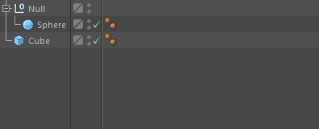

<!-- Source: https://developers.maxon.net/docs/py/2027_0_0/modules/c4d.gui/BaseCustomGui/TreeViewCustomGui/index.html -->

# c4d.gui.TreeViewCustomGui 

## *class* `c4d.gui.TreeViewCustomGui` 

The tree view GUI (*CUSTOMGUI_TREEVIEW*) is a very versatile list view interface.

*New in version R13.029.*

It looks like this:

> 

The settings are:

> |   |   |   |
> |---|---|---|
> | *TREEVIEW_BORDER* | int | Border type: |
>
> > |   |   |
> > |---|---|
> > | *BORDER_NONE* | No border. |
> > | *BORDER_THIN_IN* | Thin border inward. |
> > | *BORDER_THIN_OUT* | Thin border outward. |
> > | *BORDER_IN* | Normal border inward. |
> > | *BORDER_OUT* | Normal border outward. |
> > | *BORDER_GROUP_IN* | Group border inside. |
> > | *BORDER_GROUP_OUT* | Group border outside. |
> > | *BORDER_OUT2* | Outward border 2. |
> > | *BORDER_OUT3* | Outward border 3 |
> > | *BORDER_BLACK* | Thin black line. |
> > | *BORDER_ACTIVE_1* | Active border 1. |
> > | *BORDER_ACTIVE_2* | Active border 2. |
> > | *BORDER_ACTIVE_3* | Active border 3. |
> > | *BORDER_ACTIVE_4* | Active border 4. |
> > | *BORDER_GROUP_TOP* | Border along the top. |
> > | *BORDER_ROUND* | Border with round corners. |
> > | *BORDER_SCHEME_EDIT* | Edit field border like the shortcut gadget for example. |
> > | *BORDER_SCHEME_EDIT_NUMERIC* | Edit field border that is open to the right like the link field for example. |
> > | *BORDER_OUT3l* | Outward border 3, open to the left. |
> > | *BORDER_OUT3r* | Outward border 3, open to the right. |
> > | *BORDER_THIN_INb* | Thin border inward, open to the botton. |
> > | *BORDER_MASK* | Masks out border type. |
> > | *BORDER_TEXT_DOTTED* | Only used with `GeDialog.AddStaticText()`.   Draws a dotted line at right of text, useful to visually connect the text with its parameter. |
> > | *BORDER_WITH_TITLE_MONO* | Display group title with monospaced font. |
> > | *BORDER_WITH_TITLE_BOLD* | Display group title with bold font. |
> > | *BORDER_WITH_TITLE* | Display group title in the border. |
>
> |   |   |   |
> |---|---|---|
> | *TREEVIEW_OUTSIDE_DROP* | bool | **True** if an object may be dropped under all the objects in the tree view. |
> | *TREEVIEW_HIDE_LINES* | bool | **True** if no lines should be drawn. |
> | *TREEVIEW_CTRL_DRAG* | bool | **True** if item may be duplicated by Ctrl + Drag. |
> | *TREEVIEW_NO_MULTISELECT* | bool | **True** if no multiple selection is allowed. |
> | *TREEVIEW_HAS_HEADER* | bool | **True** if the tree view may have a header line. |
> | *TREEVIEW_RESIZE_HEADER* | bool | **True** if the column width can be changed by the user. |
> | *TREEVIEW_MOVE_COLUMN* | bool | **True** if the user can move the columns. |
> | *TREEVIEW_FIXED_LAYOUT* | bool | **True** if all lines have the same height. |
> | *TREEVIEW_NOAUTOCOLUMNS* | bool | **True** if only the first line is asked for the columns width, resulting in a huge speedup. |
> | *TREEVIEW_NO_OPEN_CTRLCLK* | bool | **True** if it is not allowed to open the complete tree with Ctrl + Click. |
> | *TREEVIEW_ALT_DRAG* | bool | **True** if Alt should be used instead of Ctrl for drag and drop; implies item may be duplicated by Alt + Drag. |
> | *TREEVIEW_NO_BACK_DELETE* | bool | Disable “delete pressed” messages if backspace was hit. |
> | *TREEVIEW_NO_DELETE* | bool | Disable Delete Message Callback completely for backspace and delete. |
> | *TREEVIEW_ALTERNATE_BG* | bool | Alternate background per line. |
> | *TREEVIEW_CURSORKEYS* | bool | **True** if cursor keys should be processed. Note: The focus item has to be set to None if it is deleted and this flag is set. |
> | *TREEVIEW_CUSTOM_BG_COLOR* | int or c4d.Vector | Custom Background Color. Can be an color ID ([COLOR constants](../../../../consts/COLOR.md)) or a Vector color in range [0.0, 1.0].   If unset, default application background color will be used. > **Note:** > > Only is applied if TREEVIEW_ALTERNATE_BG is **False**;   > `TreeViewFunctions.GetBackgroundColor()` overrides it. |
> | *TREEVIEW_NOENTERRENAME* | bool | Suppresses the rename popup when the user presses enter. |
> | *TREEVIEW_NO_VERTICALSCROLL* | bool | **True** to disable vertical scrolling and show the full list. |
> | *TREEVIEW_ADDROW* | bool | Show an add new column row at the bottom of the list. |
> | *TREEVIEW_RESIZABLE* | bool | The treeview is resizable from the bottom edge. |
> | *TREEVIEW_VERTICAL_SPACE* | int | *New in version R24:* vertical space between lines in pixel |

Parent Class:

- [`c4d.gui.BaseCustomGui`](../index.md#c4d.gui.BaseCustomGui)

## Overview 

**Focus Management**

- [`TreeViewCustomGui.IsFocusItem()`](#c4d.gui.TreeViewCustomGui.IsFocusItem): Checks if *pItem* is the focus item.
- [`TreeViewCustomGui.SetFocusItem()`](#c4d.gui.TreeViewCustomGui.SetFocusItem): Sets the focus item.

**Tree Configuration**

- [`TreeViewCustomGui.SetHeaderText()`](#c4d.gui.TreeViewCustomGui.SetHeaderText): Set the header text for a column.
- [`TreeViewCustomGui.SetLayout()`](#c4d.gui.TreeViewCustomGui.SetLayout): Sets the layout for the tree view.
- [`TreeViewCustomGui.SetRoot()`](#c4d.gui.TreeViewCustomGui.SetRoot): Initializes the tree.

**Visibility And Updates**

- [`TreeViewCustomGui.GetVisibleLineCount()`](#c4d.gui.TreeViewCustomGui.GetVisibleLineCount): Gets the number of currently visible lines related to folded and unfolded items of the tree.
- [`TreeViewCustomGui.GetVisibleScrollArea()`](#c4d.gui.TreeViewCustomGui.GetVisibleScrollArea): Queries the internal scroll group for its currently visible region.
- [`TreeViewCustomGui.MakeVisible()`](#c4d.gui.TreeViewCustomGui.MakeVisible): Scrolls to *pObj* and expands the tree if necessary.
- [`TreeViewCustomGui.Refresh()`](#c4d.gui.TreeViewCustomGui.Refresh): Refreshes the tree view.
- [`TreeViewCustomGui.SetVisibleScrollArea()`](#c4d.gui.TreeViewCustomGui.SetVisibleScrollArea): Sets the internal scroll group currently visible region, a rectangle between (*x1*, *y1*) and (*x2*, *y2*).
- [`TreeViewCustomGui.ShowObject()`](#c4d.gui.TreeViewCustomGui.ShowObject): Expands the tree to *pObj*.

## Members 

### Focus Management 

#### `TreeViewCustomGui.IsFocusItem(self, pItem)` 

Checks if *pItem* is the focus item.

**Parameters:** **pItem** (*any*) – The item to check.

**Return type:** bool

**Returns:** **True** if *pItem* is the focus item, otherwise **False**.

#### `TreeViewCustomGui.SetFocusItem(self, pItem)` 

Sets the focus item.

**Parameters:** **pItem** (*any*) – The new focus item.

### Tree Configuration 

#### `TreeViewCustomGui.SetHeaderText(self, lColumnID, str)` 

Set the header text for a column.

**Parameters:**

- **lColumnID** (*int*) – Column index.
- **str** (*str*) – Header text.

**Return type:** bool

**Returns:** **True** if successful, otherwise **False**.

#### `TreeViewCustomGui.SetLayout(self, columns, data)` 

Sets the layout for the tree view.

**Parameters:**

- **columns** (*int*) – Number of columns.

- **data** ([*c4d.BaseContainer*](../../../c4d/BaseContainer/index.md#c4d.BaseContainer)) –

  Column data container, with one column type entry for each column:

  |   |   |
  |---|---|
  | *LV_TREE* | Tree or list. |
  | *LV_USERTREE* | User tree. If set, the tree view calls `TreeViewFunctions.DrawCell()` for the left cell of each line (otherwise it would display the object’s name in the cell). |
  | *LV_USER* | Custom. |
  | *LV_CHECKBOX* | Checkbox. If set, the tree view calls `TreeViewFunctions.IsChecked()` and `TreeViewFunctions.SetCheck()` for each column and row. |
  | *LV_CHECKBOXUSER* | Checkbox. If set, the tree view calls `TreeViewFunctions.IsChecked()` and `TreeViewFunctions.SetCheck()` for each column and row. User draw by `TreeViewFunctions.DrawCell()`. |
  | *LV_SLIDER* | Slider. If set, the tree view calls `TreeViewFunctions.GetFloatValue()` and `TreeViewFunctions.SetFloatValue()` for each column and row. |
  | *LV_DROPDOWN* | Dropdown cycle box. If set, the tree view calls `TreeViewFunctions.GetDropDownMenu()` and `TreeViewFunctions.SetDropDownMenu()` for each column and row. |

**Return type:** bool

**Returns:** **True** if successful, otherwise **False**.

#### `TreeViewCustomGui.SetRoot(self, root, functions, userdata)` 

Initializes the tree.

**Parameters:**

- **root** (*any*) – Root object.
- **functions** ([*c4d.gui.TreeViewFunctions*](../../TreeViewFunctions/index.md#c4d.gui.TreeViewFunctions)) – Tree view functions.
- **userdata** (*any*) – User data.

**Return type:** bool

**Returns:** **True** if successful, otherwise **False**.

### Visibility And Updates 

#### `TreeViewCustomGui.GetVisibleLineCount(self)` 

Gets the number of currently visible lines related to folded and unfolded items of the tree.

*New in version R17.048.*

**Return type:** int

**Returns:** The number of visible lines.

#### `TreeViewCustomGui.GetVisibleScrollArea(self)` 

Queries the internal scroll group for its currently visible region.

*New in version R17.048.*

**Return type:** Tuple[int,int,int,int]

**Returns:** The X and Y coordinates of the top/bottom left/right visible corner: Tuple[x1,y1,x2,y2].

#### `TreeViewCustomGui.MakeVisible(self, pObj)` 

Scrolls to *pObj* and expands the tree if necessary.

**Parameters:** **pObj** (*any*) – The object to scroll to.

**Return type:** bool

**Returns:** **True** if successful, otherwise **False**.

#### `TreeViewCustomGui.Refresh(self)` 

Refreshes the tree view.

#### `TreeViewCustomGui.SetVisibleScrollArea(self, x1, y1, x2, y2)` 

Sets the internal scroll group currently visible region, a rectangle between (*x1*, *y1*) and (*x2*, *y2*).

*New in version R18.020.*

**Parameters:**

- **x1** (*int*) – The left X value.
- **y1** (*int*) – The top Y value.
- **x2** (*int*) – The right X value.
- **y2** (*int*) – The bottom Y value.

**Return type:** bool

**Returns:** **True** if successful, otherwise **False**.

#### `TreeViewCustomGui.ShowObject(self, pObj)` 

Expands the tree to *pObj*.

**Parameters:** **pObj** (*any*) – The object to expand to.

**Return type:** bool

**Returns:** **True** if successful, otherwise **False**.
