<!-- Source: https://developers.maxon.net/docs/py/2027_0_0/modules/c4d.gui/GeDialog/index.html -->

# c4d.gui.GeDialog <a id="c4d-gui-gedialog"></a>

## *class* `c4d.gui.GeDialog` <a id="c4d.gui.GeDialog"></a>

A dialog is a window or a panel, in which buttons, edit boxes, icons, images, and other things are put upon.  
These buttons, sliders, icons, etc are called widgets.  
Dialogs act as interfaces for a plugin.  
You are able to customize or derive a dialog box that will act as an interface for your plugin.  
Most dialog boxes are derived off of [`GeDialog`](#c4d.gui.GeDialog) class.

The reason you care about dialogs is that you want anyone to be able to use your plugin, and you want it to be easier to use.  
Plus it is a lot cooler when you have tons of widgets to play with.  
There is no other (easy) interactive way for you to interface with the user than with a dialog.

<a id="border-types-picture"></a>**Border Type**

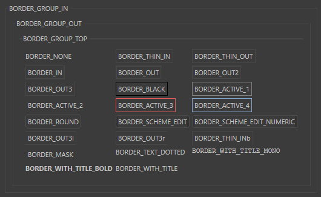

Child Class:

- [`c4d.gui.SubDialog`](SubDialog/index.md#c4d.gui.SubDialog)

## Overview <a id="overview"></a>

**Basic Methods**

- [`GeDialog.Close()`](#c4d.gui.GeDialog.Close): Close the dialog.
- [`GeDialog.Enable()`](#c4d.gui.GeDialog.Enable): Enables or disables the dialog gadget, depending on the value of *enable*.
- [`GeDialog.GetId()`](#c4d.gui.GeDialog.GetId): Gets the dialog ID.
- [`GeDialog.GetType()`](#c4d.gui.GeDialog.GetType): Return the type of a gadget.
- [`GeDialog.LoadDialogResource()`](#c4d.gui.GeDialog.LoadDialogResource): Loads an external resource file.
- [`GeDialog.Open()`](#c4d.gui.GeDialog.Open): Opens the dialog at the specified position.
- [`GeDialog.Restore()`](#c4d.gui.GeDialog.Restore): Used to restore an asynchronous dialog that has been placed in the users layout.
- [`GeDialog.SendMessage()`](#c4d.gui.GeDialog.SendMessage): Sends a message to a dialog gadget.
- [`GeDialog.SendParentMessage()`](#c4d.gui.GeDialog.SendParentMessage): Sends a message to the parent dialog.
- [`GeDialog.SetTimer()`](#c4d.gui.GeDialog.SetTimer): Initializes the timer clock, so that `Timer()` is called every timer milliseconds.

**Coordinate Methods**

- [`GeDialog.Global2Local()`](#c4d.gui.GeDialog.Global2Local): Transforms global coordinates (relative to the top left corner of the physical window) to local coordinates (relative to the top left corner of the dialog). Result is a dict with member keys *x* and *y* of type *int*.
- [`GeDialog.Local2Global()`](#c4d.gui.GeDialog.Local2Global): Transforms local coordinates (relative to the top left corner of the dialog) to global coordinates (relative to the top left corner of the physical window). Result is a dict with member keys *x* and *y* of type *int*.
- [`GeDialog.Local2Screen()`](#c4d.gui.GeDialog.Local2Screen): Transforms local coordinates (relative to the top left corner of the dialog) to screen coordinates (relative to the top left corner of the system screen). Result is a dict with member keys *x* and *y* of type *int*.
- [`GeDialog.Screen2Local()`](#c4d.gui.GeDialog.Screen2Local): Transforms screen coordinates (relative to the top left corner of the system screen) to local coordinates (relative to the top left corner of the dialog). Result is a dict with member keys *x* and *y* of type *int*.

**Deprecated**

- [`GeDialog.GetLong()`](#c4d.gui.GeDialog.GetLong): Use `GetInt32()` instead.
- [`GeDialog.GetReal()`](#c4d.gui.GeDialog.GetReal): Use `GetFloat()` instead.
- [`GeDialog.SetLong()`](#c4d.gui.GeDialog.SetLong): Use `SetInt32()` instead.
- [`GeDialog.SetReal()`](#c4d.gui.GeDialog.SetReal): Use `SetFloat()` instead.

**Dialog Change Methods**

- [`GeDialog.FreeChildren()`](#c4d.gui.GeDialog.FreeChildren): Clears the item list of combo boxes and popup buttons.
- [`GeDialog.HideElement()`](#c4d.gui.GeDialog.HideElement): Hides/unhides an element from the dialog.
- [`GeDialog.LayoutChanged()`](#c4d.gui.GeDialog.LayoutChanged): Notifies Cinema 4D that the layout of a dynamic group in the dialog has changed.
- [`GeDialog.LayoutChangedNoRedraw()`](#c4d.gui.GeDialog.LayoutChangedNoRedraw): Notifies Cinema 4D that the layout of a dynamic group in the dialog has changed.
- [`GeDialog.LayoutFlushDisableRedraw()`](#c4d.gui.GeDialog.LayoutFlushDisableRedraw): Removes all controls from a group and places the control insertion point within the group.
- [`GeDialog.LayoutFlushGroup()`](#c4d.gui.GeDialog.LayoutFlushGroup): Removes all controls from a group and places the control insertion point within the group.
- [`GeDialog.RemoveElement()`](#c4d.gui.GeDialog.RemoveElement): Removes an element from the dialog.

**Dialog Checks Methods**

- [`GeDialog.GetFolding()`](#c4d.gui.GeDialog.GetFolding): Retrieve if the dialog is open but currently folded away in the layout.
- [`GeDialog.IsActive()`](#c4d.gui.GeDialog.IsActive): Checks if the given gadget has the focus.
- [`GeDialog.IsOpen()`](#c4d.gui.GeDialog.IsOpen): Checks if the dialog is open.
- [`GeDialog.IsVisible()`](#c4d.gui.GeDialog.IsVisible): Checks if the dialog is visible.

**Dialog Group Methods**

- [`GeDialog.GetVisibleArea()`](#c4d.gui.GeDialog.GetVisibleArea): Queries a scroll group for its currently visible region, a rectangle between (**x1,y1**) and (**x2,y2**).
- [`GeDialog.GroupBegin()`](#c4d.gui.GeDialog.GroupBegin): Begins a group.
- [`GeDialog.GroupBeginInMenuLine()`](#c4d.gui.GeDialog.GroupBeginInMenuLine): Begins a group in the menu bar of the dialog.
- [`GeDialog.GroupBorder()`](#c4d.gui.GeDialog.GroupBorder): Sets the border type of the current group, and displays the title in the border if possible.
- [`GeDialog.GroupBorderNoTitle()`](#c4d.gui.GeDialog.GroupBorderNoTitle): Sets the border type of the current group, and displays the title in the border if possible.
- [`GeDialog.GroupBorderSpace()`](#c4d.gui.GeDialog.GroupBorderSpace): Sets the border size around the current group in pixels.
- [`GeDialog.GroupEnd()`](#c4d.gui.GeDialog.GroupEnd): Ends groups.
- [`GeDialog.GroupSpace()`](#c4d.gui.GeDialog.GroupSpace): Sets the space in pixels between two elements in the current group.
- [`GeDialog.GroupWeightsLoad()`](#c4d.gui.GeDialog.GroupWeightsLoad): Sets group weights for group *id*.
- [`GeDialog.GroupWeightsSave()`](#c4d.gui.GeDialog.GroupWeightsSave): Retrieves group weights for group *id*.
- [`GeDialog.ScrollGroupBegin()`](#c4d.gui.GeDialog.ScrollGroupBegin): Begins a scrollgroup.
- [`GeDialog.SetVisibleArea()`](#c4d.gui.GeDialog.SetVisibleArea): Scrolls a scroll group so that the rectangle spanned between the pixel coordinates *(x1, y1, x2, y2)* is visible.
- [`GeDialog.TabGroupBegin()`](#c4d.gui.GeDialog.TabGroupBegin): Begins a tab group.

**Dialog Information Methods**

- [`GeDialog.CheckDropArea()`](#c4d.gui.GeDialog.CheckDropArea): Checks the drag position in a drag event message against a certain dialog element’s position in the layout.
- [`GeDialog.GetColorRGB()`](#c4d.gui.GeDialog.GetColorRGB): Gets the RGB values associated with a color ID.
- [`GeDialog.GetColorRGBA()`](#c4d.gui.GeDialog.GetColorRGBA): Gets the RGBA values associated with a color ID.
- [`GeDialog.GetDragObject()`](#c4d.gui.GeDialog.GetDragObject): Extracts the object from a drag and drop message.
- [`GeDialog.GetDragPosition()`](#c4d.gui.GeDialog.GetDragPosition): Extracts local drag coordinates from a drag and drop event.
- [`GeDialog.SetDragDestination()`](#c4d.gui.GeDialog.SetDragDestination): Sets the correct cursor during drag and drop handling.

**Dialog Menu Methods**

- [`GeDialog.MenuAddCommand()`](#c4d.gui.GeDialog.MenuAddCommand): Adds a command item to the current menu.
- [`GeDialog.MenuAddSeparator()`](#c4d.gui.GeDialog.MenuAddSeparator): Adds a separator to the current menu.
- [`GeDialog.MenuAddString()`](#c4d.gui.GeDialog.MenuAddString): Adds a string item to the current menu.
- [`GeDialog.MenuFinished()`](#c4d.gui.GeDialog.MenuFinished): Call this function when all menus and all items have been added.
- [`GeDialog.MenuFlushAll()`](#c4d.gui.GeDialog.MenuFlushAll): Flushes the menu bar of the dialog, removing all menus.
- [`GeDialog.MenuInitString()`](#c4d.gui.GeDialog.MenuInitString): Used to change the enabled/disabled and checked/unchecked state of menu items.
- [`GeDialog.MenuSetResource()`](#c4d.gui.GeDialog.MenuSetResource): Sets the menu from a MENU resource ID.
- [`GeDialog.MenuSubBegin()`](#c4d.gui.GeDialog.MenuSubBegin): Creates a new menu group.
- [`GeDialog.MenuSubEnd()`](#c4d.gui.GeDialog.MenuSubEnd): Closes the current menu group, opened with `MenuSubBegin()`.

**Dialog Setter Methods**

- [`GeDialog.SetDefaultColor()`](#c4d.gui.GeDialog.SetDefaultColor): Set the default color for GUI elements.
- [`GeDialog.SetFolding()`](#c4d.gui.GeDialog.SetFolding): Fold the dialog away in the layout.
- [`GeDialog.SetTitle()`](#c4d.gui.GeDialog.SetTitle): Sets the title of the dialog window.

**Gadget Addition Methods**

- [`GeDialog.AddArrowButton()`](#c4d.gui.GeDialog.AddArrowButton): Adds an arrow button to the layout.
- [`GeDialog.AddButton()`](#c4d.gui.GeDialog.AddButton): Add a button to the dialog.
- [`GeDialog.AddCheckbox()`](#c4d.gui.GeDialog.AddCheckbox): Add a checkbox to the dialog.
- [`GeDialog.AddChild()`](#c4d.gui.GeDialog.AddChild): Adds items to combo boxes or popup buttons.
- [`GeDialog.AddColorChooser()`](#c4d.gui.GeDialog.AddColorChooser): Adds a color field with sliders to the layout.
- [`GeDialog.AddColorField()`](#c4d.gui.GeDialog.AddColorField): Adds a simple color field without sliders to the layout.
- [`GeDialog.AddComboBox()`](#c4d.gui.GeDialog.AddComboBox): Adds a combo box to the layout.
- [`GeDialog.AddComboButton()`](#c4d.gui.GeDialog.AddComboButton): Adds a combo button to the layout.
- [`GeDialog.AddCustomGui()`](#c4d.gui.GeDialog.AddCustomGui): Adds a custom GUI to the dialog.
- [`GeDialog.AddDlgGroup()`](#c4d.gui.GeDialog.AddDlgGroup): Adds a dialog group with standard buttons to the layout.
- [`GeDialog.AddEditNumber()`](#c4d.gui.GeDialog.AddEditNumber): Adds an editable number field to the layout.
- [`GeDialog.AddEditNumberArrows()`](#c4d.gui.GeDialog.AddEditNumberArrows): Adds an editable number field with up/down arrows to the layout.
- [`GeDialog.AddEditShortcut()`](#c4d.gui.GeDialog.AddEditShortcut): Adds a field for editing shortcuts.
- [`GeDialog.AddEditSlider()`](#c4d.gui.GeDialog.AddEditSlider): Adds a slider with an editable number field to the layout.
- [`GeDialog.AddEditText()`](#c4d.gui.GeDialog.AddEditText): Adds an editable text field to the layout.
- [`GeDialog.AddGadget()`](#c4d.gui.GeDialog.AddGadget): Add a gadget to the dialog.
- [`GeDialog.AddMultiLineEditText()`](#c4d.gui.GeDialog.AddMultiLineEditText): Adds an editable text field with multiple lines to the layout.
- [`GeDialog.AddPopupButton()`](#c4d.gui.GeDialog.AddPopupButton): Adds a popup button to the layout.
- [`GeDialog.AddRadioButton()`](#c4d.gui.GeDialog.AddRadioButton): Adds a radio button to the layout.
- [`GeDialog.AddRadioGroup()`](#c4d.gui.GeDialog.AddRadioGroup): Adds a radio group to the layout.
- [`GeDialog.AddRadioText()`](#c4d.gui.GeDialog.AddRadioText): Adds a text radio button to the layout (like the ones to the left in the Cinema 4D material editor).
- [`GeDialog.AddSeparatorH()`](#c4d.gui.GeDialog.AddSeparatorH): Adds a horizontal separator to the layout.
- [`GeDialog.AddSeparatorV()`](#c4d.gui.GeDialog.AddSeparatorV): Adds a vertical separator to the layout.
- [`GeDialog.AddSlider()`](#c4d.gui.GeDialog.AddSlider): Adds a slider to the layout.
- [`GeDialog.AddStaticText()`](#c4d.gui.GeDialog.AddStaticText): Adds a static text field to the layout.
- [`GeDialog.AddSubDialog()`](#c4d.gui.GeDialog.AddSubDialog): Adds a sub-dialog to the layout.
- [`GeDialog.AddUserArea()`](#c4d.gui.GeDialog.AddUserArea): Adds a user area to the layout.

**Gadget Checks Methods**

- [`GeDialog.CheckClose()`](#c4d.gui.GeDialog.CheckClose): Checks if the dialog can be closed.
- [`GeDialog.CheckCoreMessage()`](#c4d.gui.GeDialog.CheckCoreMessage): Speedup function that checks if a core message is new or has been already processed.
- [`GeDialog.CheckTristateChange()`](#c4d.gui.GeDialog.CheckTristateChange): Indicates whatever a control’s content has been changed since the last time its value was set manually with.
- [`GeDialog.CheckValueRanges()`](#c4d.gui.GeDialog.CheckValueRanges): Checks if the value for all input fields are within the allowed range.
- [`GeDialog.GetPixelRatio()`](#c4d.gui.GeDialog.GetPixelRatio): Always returns 1.0 except for user areas shown on OS X Retina displays, where it returns 2.0.
- [`GeDialog.IsEnabled()`](#c4d.gui.GeDialog.IsEnabled): Checks if a dialog item is enabled.

**Gadget Getter Methods**

- [`GeDialog.FindCustomGui()`](#c4d.gui.GeDialog.FindCustomGui): Get the custom GUI for a certain ID.
- [`GeDialog.GetBool()`](#c4d.gui.GeDialog.GetBool): Retrieves the value of checkbox controls.
- [`GeDialog.GetColorField()`](#c4d.gui.GeDialog.GetColorField): Retrieves the color and brightness of color controls.
- [`GeDialog.GetFilename()`](#c4d.gui.GeDialog.GetFilename): Retrieves the text from string controls as a filename.
- [`GeDialog.GetFloat()`](#c4d.gui.GeDialog.GetFloat): Retrieves the value of float fields.
- [`GeDialog.GetInt32()`](#c4d.gui.GeDialog.GetInt32): Retrieves the value of integer fields.
- [`GeDialog.GetString()`](#c4d.gui.GeDialog.GetString): Retrieves the text from string controls.
- [`GeDialog.GetTime()`](#c4d.gui.GeDialog.GetTime): Retrieves the time of time fields.
- [`GeDialog.GetVector()`](#c4d.gui.GeDialog.GetVector): Retrieves the value of three float fields at the same time as a vector.

**Gadget Information Methods**

- [`GeDialog.GetItemDim()`](#c4d.gui.GeDialog.GetItemDim): Queries a dialog control for its current position and size in pixels.

**Gadget Setter Methods**

- [`GeDialog.Activate()`](#c4d.gui.GeDialog.Activate): Sets the focus to a specific control within the dialog.
- [`GeDialog.AddChildren()`](#c4d.gui.GeDialog.AddChildren): Adds children to a dialog element using a container.
- [`GeDialog.AttachSubDialog()`](#c4d.gui.GeDialog.AttachSubDialog): Attaches a [`c4d.gui.SubDialog`](SubDialog/index.md#c4d.gui.SubDialog) derived object to a sub-dialog control, added with `AddSubDialog()`.
- [`GeDialog.AttachUserArea()`](#c4d.gui.GeDialog.AttachUserArea): Assigns a [`GeUserArea`](../GeUserArea/index.md#c4d.gui.GeUserArea) object to a user area control in the dialog.
- [`GeDialog.SetBool()`](#c4d.gui.GeDialog.SetBool): Sets the value of checkbox controls.
- [`GeDialog.SetColorField()`](#c4d.gui.GeDialog.SetColorField): Sets the color, brightness and limits of color fields and color choosers.
- [`GeDialog.SetDegree()`](#c4d.gui.GeDialog.SetDegree): Sets the value and limits of an angle field.
- [`GeDialog.SetFilename()`](#c4d.gui.GeDialog.SetFilename): Sets the text of string controls, taking the new value from a filename.
- [`GeDialog.SetFloat()`](#c4d.gui.GeDialog.SetFloat): Sets the value, unit and limits of float fields.
- [`GeDialog.SetInt32()`](#c4d.gui.GeDialog.SetInt32): Sets the value and limits of integer fields.
- [`GeDialog.SetMeter()`](#c4d.gui.GeDialog.SetMeter): Sets the value and limits of a meter field.
- [`GeDialog.SetMultiLineLock()`](#c4d.gui.GeDialog.SetMultiLineLock): Locks/unlocks multi-line edit fields.
- [`GeDialog.SetMultiLineMode()`](#c4d.gui.GeDialog.SetMultiLineMode): Sets the edit mode for multi-line edit fields.
- [`GeDialog.SetMultiLinePos()`](#c4d.gui.GeDialog.SetMultiLinePos): Set the cursor position within a dialog multi-line string item.
- [`GeDialog.SetPercent()`](#c4d.gui.GeDialog.SetPercent): Sets the value and limits of a percent field.
- [`GeDialog.SetPopup()`](#c4d.gui.GeDialog.SetPopup): Sets the item list of a popup button using a popup menu container.
- [`GeDialog.SetString()`](#c4d.gui.GeDialog.SetString): Sets the text of string controls.
- [`GeDialog.SetTime()`](#c4d.gui.GeDialog.SetTime): Sets the value and limits of a time field.

**Input Events Methods**

- [`GeDialog.GetInputEvent()`](#c4d.gui.GeDialog.GetInputEvent): Gets the next input event for a certain device from the event queue.
- [`GeDialog.GetInputState()`](#c4d.gui.GeDialog.GetInputState): Polls a certain channel of a device for the current input state.
- [`GeDialog.KillEvents()`](#c4d.gui.GeDialog.KillEvents): Flushes all events from the window message queue.

**Magic Methods**

- [`GeDialog.__init__()`](#c4d.gui.GeDialog.__init__): Init a GeDialog.

**Methods to Override**

- [`GeDialog.AskClose()`](#c4d.gui.GeDialog.AskClose): Override it to avoid closing the dialog if an error situation has occurred.
- [`GeDialog.Command()`](#c4d.gui.GeDialog.Command): Override this function if you want to react to user clicks.
- [`GeDialog.CoreMessage()`](#c4d.gui.GeDialog.CoreMessage): Override this function if you want to react to Cinema 4D core messages.
- [`GeDialog.CreateLayout()`](#c4d.gui.GeDialog.CreateLayout): Override - Called when Cinema 4D is about to display the dialog.
- [`GeDialog.DestroyWindow()`](#c4d.gui.GeDialog.DestroyWindow): Override this method - this function is called when the dialog is about to be closed temporarily, for example for layout switching.
- [`GeDialog.InitValues()`](#c4d.gui.GeDialog.InitValues): Called when the dialog is initialized by the GUI.
- [`GeDialog.Message()`](#c4d.gui.GeDialog.Message): Override this function to react to more messages than covered by the other functions.
- [`GeDialog.Timer()`](#c4d.gui.GeDialog.Timer): If you subscribe to timer events using `SetTimer()` (x), this function is called every x’th millisecond.

## Members <a id="members"></a>

### Basic Methods <a id="c4d.gui.GeDialog-method-Basic-Methods"></a>

#### `GeDialog.Close(self)` <a id="c4d.gui.GeDialog.Close"></a>

Close the dialog.

**Return type:** bool

**Returns:** **True** if successfully closed, otherwise **False**.

#### `GeDialog.Enable(self, gadget, enable)` <a id="c4d.gui.GeDialog.Enable"></a>

Enables or disables the dialog gadget, depending on the value of *enable*.

**Parameters:**

- **gadget** ([`C4DGadget`](../C4DGadget/index.md#c4d.gui.C4DGadget)) – The dialog gadget
- **enable** (*bool*) – **True** means enabled, otherwise **False**.

#### `GeDialog.GetId(self)` <a id="c4d.gui.GeDialog.GetId"></a>

Gets the dialog ID.

**Return type:** int

**Returns:** The id.

#### `GeDialog.GetType(self, id)` <a id="c4d.gui.GeDialog.GetType"></a>

Return the type of a gadget.

**Parameters:** **id** (*int*) – The gadget id.

**Return type:** int

**Returns:** The gadget id type.

#### `GeDialog.LoadDialogResource(self, id, lr=None, flags=0)` <a id="c4d.gui.GeDialog.LoadDialogResource"></a>

Loads an external resource file.  
This is the preferred method for dialog layout since it gives maximum flexibility and easy multi language support.

> **Note:** The dialog loaded is automatically surrounded by an additional outer group, so *flags* means the same as with dialog groups (e.g. *BFV_CENTER*).

**Parameters:**

- **id** (*int*) – The dialog ID.
- **lr** (*Optional*[[*c4d.plugins.GeResource*](../../c4d.plugins/GeResource/index.md#c4d.plugins.GeResource)]) – A loaded resource or **None**. If this is **None** then the global resource singleton is used.
- **flags** (*int*) – Additional layout flags.

**Return type:** bool

**Returns:** **true** if the dialog was successfully loaded, otherwise **false**.

#### `GeDialog.Open(self, dlgtype, pluginid=0, xpos=-1, ypos=-1, defaultw=0, defaulth=0, subid=0)` <a id="c4d.gui.GeDialog.Open"></a>

Opens the dialog at the specified position.

> **Note:**
>
> If *xpos* = *-1* and *ypos* = *-1* the dialog will be opened at the current mouse position.  
> If *xpos* = *-2* and *ypos* = *-2* the dialog will be opened at the center of the screen.

**Parameters:**

- **dlgtype** (*int*) –

  The dialog type:

  |   |   |
  |---|---|
  | *DLG_TYPE_MODAL* | Modal dialog. |
  | *DLG_TYPE_MODAL_RESIZEABLE* | Resizable modal dialog. |
  | *DLG_TYPE_ASYNC* | Asynchronous dialog. |
  | *DLG_TYPE_ASYNC_POPUP_RESIZEABLE* | Asynchronous dialog: resizable popup dialog style (no menu bar). |
  | *DLG_TYPE_ASYNC_POPUPEDIT* | Asynchronous dialog: popup dialog style (no menu bar, no window frame). |
  | *DLG_TYPE_ASYNC_FULLSCREEN_WORK* | Asynchronous dialog: fullscreen over desktop area. |
  | *DLG_TYPE_ASYNC_FULLSCREEN_MONITOR* | Asynchronous dialog: fullscreen over the whole monitor area. |
  | *DLG_TYPE_ASYNC_TOOLBAR* | Non-modal (asynchronous) dialog. Toolbar style with no minimize/maximize buttons, but close button |

- **pluginid** (*int*) – The plugin ID of [`CommandData`](../../c4d.plugins/BaseData/CommandData/index.md#c4d.plugins.CommandData).

- **xpos** (*int*) – The X position of the dialog. See note above.

- **ypos** (*int*) – The Y position of the dialog. See note above.

- **defaultw** (*int*) – The default width in pixels.

- **defaulth** (*int*) – The default height in pixels.

- **subid** (*int*) – The dialog sub-ID. This can be used to open several dialogs with a single command plugin for `CommandData.ExecuteSubID()`.

**Return type:** bool

**Returns:** **True** if successful, otherwise **False**.

#### `GeDialog.Restore(self, pluginid, secret)` <a id="c4d.gui.GeDialog.Restore"></a>

Used to restore an asynchronous dialog that has been placed in the users layout.

> **Note:** Just use this method in `CommandData.RestoreLayout()`.

**Parameters:**

- **pluginid** (*int*) – The plugin ID of the menu plugin.
- **secret** (*PyCObject*) – The *secret* argument of `CommandData.RestoreLayout()`.

**Return type:** bool

**Returns:** **True** if successfully restored, otherwise **False**.

#### `GeDialog.SendMessage(self, id, value)` <a id="c4d.gui.GeDialog.SendMessage"></a>

Sends a message to a dialog gadget.

**Parameters:**

- **id** (*Union*[[*c4d.gui.C4DGadget*](../C4DGadget/index.md#c4d.gui.C4DGadget), *int*]) – The control ID or int.
- **value** ([*c4d.BaseContainer*](../../c4d/BaseContainer/index.md#c4d.BaseContainer)) – The message container.

**Return type:** object

**Returns:** Depends on the message.

#### `GeDialog.SendParentMessage(self, msg)` <a id="c4d.gui.GeDialog.SendParentMessage"></a>

Sends a message to the parent dialog.

**Parameters:** **msg** ([*c4d.BaseContainer*](../../c4d/BaseContainer/index.md#c4d.BaseContainer)) – The message container.

**Return type:** bool

**Returns:** **True** if the message was sent.

#### `GeDialog.SetTimer(self, value)` <a id="c4d.gui.GeDialog.SetTimer"></a>

Initializes the timer clock, so that [`Timer()`](#c4d.gui.GeDialog.Timer) is called every timer milliseconds. Use [`SetTimer()`](#c4d.gui.GeDialog.SetTimer) (0) to stop the clock.

> > **Note:**
> >
> > Depending on the speed of the computer, the operating system, the complexity of the dialog and the threads running in the background, there is no guarantee that event messages will occur on a regular basis.  
> > Using a value of 500 ms should be no problem but if using a value of 1 ms one might get events with the following time spaces: 3 ms, 76 ms, 15 ms, 19 ms, 67 ms…
>
> > **Note:** The timer will be paused while a synchronous dialog is opened in Cinema 4D.
>
> > **Warning:** Keep in mind that using small timer values results in heavy message traffic in the application which may slow down Cinema 4D.

**Parameters:** **value** (*int*) – The timer interval in milliseconds.

### Coordinate Methods <a id="c4d.gui.GeDialog-method-Coordinate-Methods"></a>

#### `GeDialog.Global2Local(self)` <a id="c4d.gui.GeDialog.Global2Local"></a>

Transforms global coordinates (relative to the top left corner of the physical window) to local coordinates (relative to the top left corner of the dialog). Result is a dict with member keys *x* and *y* of type *int*.

**Return type:** Optional[Dict[**x**: int, **y**: int]]

**Returns:** The converted coordinates or **None**.

#### `GeDialog.Local2Global(self)` <a id="c4d.gui.GeDialog.Local2Global"></a>

Transforms local coordinates (relative to the top left corner of the dialog) to global coordinates (relative to the top left corner of the physical window). Result is a dict with member keys *x* and *y* of type *int*.

**Return type:** Optional[Dict[**x**: int, **y**: int]]

**Returns:** The converted coordinates or **None**.

#### `GeDialog.Local2Screen(self)` <a id="c4d.gui.GeDialog.Local2Screen"></a>

Transforms local coordinates (relative to the top left corner of the dialog) to screen coordinates (relative to the top left corner of the system screen). Result is a dict with member keys *x* and *y* of type *int*.

**Return type:** Optional[Dict[**x**: int, **y**: int]]

**Returns:** The converted coordinates or **None**.

#### `GeDialog.Screen2Local(self)` <a id="c4d.gui.GeDialog.Screen2Local"></a>

Transforms screen coordinates (relative to the top left corner of the system screen) to local coordinates (relative to the top left corner of the dialog). Result is a dict with member keys *x* and *y* of type *int*.

**Return type:** Optional[Dict[**x**: int, **y**: int]]

**Returns:** The converted coordinates or **None**.

### Deprecated <a id="c4d.gui.GeDialog-method-Deprecated"></a>

#### `GeDialog.GetLong(self, id)` <a id="c4d.gui.GeDialog.GetLong"></a>

*Deprecated since version R15:* Use [`GetInt32()`](#c4d.gui.GeDialog.GetInt32) instead.

Retrieves the value of integer fields.

> **Note:** Also used for tab groups, radio buttons and combo boxes.

**Parameters:** **id** (*Union*[[*c4d.gui.C4DGadget*](../C4DGadget/index.md#c4d.gui.C4DGadget), *int*]) – The control ID or int.

**Return type:** Optional[int]

**Returns:** The value or **None** if the value was not retrieved.

#### `GeDialog.GetReal(self, id)` <a id="c4d.gui.GeDialog.GetReal"></a>

*Deprecated since version R15:* Use [`GetFloat()`](#c4d.gui.GeDialog.GetFloat) instead.

Retrieves the value of float fields.

**Parameters:** **id** (*Union*[[*c4d.gui.C4DGadget*](../C4DGadget/index.md#c4d.gui.C4DGadget), *int*]) – The control ID or int.

**Return type:** Optional[float]

**Returns:** The value or **None** if the value was not retrieved.

#### `GeDialog.SetLong(self, id, value, min=-2147483647, max=2147483647, step=1, tristate=False, min2=-2147483647, max2=2147483647)` <a id="c4d.gui.GeDialog.SetLong"></a>

*Deprecated since version R15:* Use [`SetInt32()`](#c4d.gui.GeDialog.SetInt32) instead.

Sets the value and limits of integer fields.

> **Note:** Also used for tab groups, radio buttons and combo boxes.

**Parameters:**

- **id** (*Union*[[*c4d.gui.C4DGadget*](../C4DGadget/index.md#c4d.gui.C4DGadget), *int*]) – The control ID or int.
- **value** (*int*) – The new value.
- **min** (*int*) – The minimum value accepted.
- **max** (*int*) – The maximum value accepted.
- **step** (*bool*) – The step used for arrow buttons.
- **step** – If this is **True** the control is tinted blue to indicate tristate mode.
- **min2** (*int*) – The minimum value allowed outside the range used for sliders. Overrides *min* for the acceptance check.
- **max2** (*int*) – The minimum value allowed outside the range used for sliders. Overrides *max* for the acceptance check.

**Return type:** bool

**Returns:** **True** if the value was set.

#### `GeDialog.SetReal(self, id, value, min=2.2250738585072014e-308, max=1.7976931348623157e+308, step=1.0, format=1718773089, min2=0.0, max2=0.0, quadscale=False, tristate=False)` <a id="c4d.gui.GeDialog.SetReal"></a>

*Deprecated since version R15:* Use [`SetFloat()`](#c4d.gui.GeDialog.SetFloat) instead.

Sets the value, unit and limits of float fields.

**Parameters:**

- **id** (*Union*[[*c4d.gui.C4DGadget*](../C4DGadget/index.md#c4d.gui.C4DGadget), *int*]) – The control ID or int.

- **value** (*float*) – The new value.

- **min** (*int*) – The minimum value accepted.

- **max** (*int*) – The maximum value accepted.

- **step** (*float*) – The step used for arrow buttons.

- **format** (*int*) –

  The unit and format of the field. Valid formats are:

  |   |   |
  |---|---|
  | *FORMAT_FLOAT* | Floating point without unit. |
  | *FORMAT_INT* | Integer without unit. |
  | *FORMAT_PERCENT* | Floating point with % sign, *1.0* = *100%*. |
  | *FORMAT_DEGREE* | Floating point with ° sign. Measured in radians, displayed in degrees. |
  | *FORMAT_METER* | Floating point in the current working unit. |
  | *FORMAT_FRAMES* | Time formatted as frames. (Overrided by user preference.) |
  | *FORMAT_SECONDS* | Time formatted as seconds. (Overrided by user preference.) |
  | *FORMAT_SMPTE* | Time formatted as SMPTE. (Overrided by user preference.) |

- **min2** (*int*) – The minimum value allowed outside the range used for sliders. Overrides *min* for the acceptance check.

- **max2** (*int*) – The maximum value allowed outside the range used for sliders. Overrides *max* for the acceptance check.

- **quadscale** (*bool*) – If this is **True** a quadratic scale is used for the slider, so that more precision is available for lower values.

- **tristate** (*bool*) – If this is **True** the control is tinted blue to indicate tristate mode.

**Return type:** bool

**Returns:** **True** if the value was set.

### Dialog Change Methods <a id="c4d.gui.GeDialog-method-Dialog-Change-Methods"></a>

#### `GeDialog.FreeChildren(self, id)` <a id="c4d.gui.GeDialog.FreeChildren"></a>

Clears the item list of combo boxes and popup buttons.

**Parameters:** **id** (*Union*[[*c4d.gui.C4DGadget*](../C4DGadget/index.md#c4d.gui.C4DGadget), *int*]) – The control ID or int.

**Return type:** bool

**Returns:** **True** if the children were removed.

#### `GeDialog.HideElement(self, id, hide)` <a id="c4d.gui.GeDialog.HideElement"></a>

Hides/unhides an element from the dialog.

**Parameters:**

- **id** (*int*) – The control ID.
- **hide** (*bool*) – **True** to hide and **False** to unhide.

**Return type:** bool

**Returns:** **True** if the element was hidden/unhidden.

#### `GeDialog.LayoutChanged(self, id)` <a id="c4d.gui.GeDialog.LayoutChanged"></a>

Notifies Cinema 4D that the layout of a dynamic group in the dialog has changed.  
This is usually done by first calling [`LayoutFlushGroup()`](#c4d.gui.GeDialog.LayoutFlushGroup) and then adding new controls.

**Parameters:** **id** (*int*) – The ID of the changed group.

**Return type:** bool

**Returns:** **True** if the layout was updated, otherwise **False**.

#### `GeDialog.LayoutChangedNoRedraw(self, id)` <a id="c4d.gui.GeDialog.LayoutChangedNoRedraw"></a>

Notifies Cinema 4D that the layout of a dynamic group in the dialog has changed.  
This is usually done by first calling [`LayoutFlushGroup()`](#c4d.gui.GeDialog.LayoutFlushGroup) and then adding new controls.

**Parameters:** **id** (*Union*[[*c4d.gui.C4DGadget*](../C4DGadget/index.md#c4d.gui.C4DGadget), *int*]) – The ID of the changed group.

**Return type:** bool

**Returns:** **True** if the layout was updated, otherwise **False**.

#### `GeDialog.LayoutFlushDisableRedraw(self, id: int, disable: bool) → bool` <a id="c4d.gui.GeDialog.LayoutFlushDisableRedraw"></a>

Removes all controls from a group and places the control insertion point within the group.  
Calling this method while passing *True* for *disable* will cause the group not be redrawn once it has been flushed. For each call of *LayoutFlushDisableRedraw(True)* one must call *LayoutFlushDisableRedraw(False)*.

*New in version 2023.2.0.*

**Parameters:**

- **id** (*int*) – The ID of the group.
- **disable** (*bool*) – **True** to disable redraw.

**Return type:** bool

**Returns:** **True** if the group was disabled/enabled for redraw, otherwise **False**.

#### `GeDialog.LayoutFlushGroup(self, id)` <a id="c4d.gui.GeDialog.LayoutFlushGroup"></a>

Removes all controls from a group and places the control insertion point within the group.  
This makes it possible to have dynamic groups.

> **Note:** After all components are added call [`LayoutChanged()`](#c4d.gui.GeDialog.LayoutChanged) with the group ID.

**Parameters:** **id** (*int*) – The control ID.

**Return type:** bool

**Returns:** **True** if the group was flushed.

#### `GeDialog.RemoveElement(self, id)` <a id="c4d.gui.GeDialog.RemoveElement"></a>

Removes an element from the dialog.

**Parameters:** **id** (*int*) – The control ID.

**Return type:** bool

**Returns:** **True** if the element was removed.

### Dialog Checks Methods <a id="c4d.gui.GeDialog-method-Dialog-Checks-Methods"></a>

#### `GeDialog.GetFolding(self)` <a id="c4d.gui.GeDialog.GetFolding"></a>

Retrieve if the dialog is open but currently folded away in the layout.

*New in version 24.*

**Return type:** bool

**Returns:** **True** if folded.

#### `GeDialog.IsActive(self, id)` <a id="c4d.gui.GeDialog.IsActive"></a>

Checks if the given gadget has the focus.

**Parameters:** **id** (*int*) – The control ID.

**Return type:** bool

**Returns:** **True** if the control is active, otherwise **False**.

#### `GeDialog.IsOpen(self)` <a id="c4d.gui.GeDialog.IsOpen"></a>

Checks if the dialog is open.

**Return type:** bool

**Returns:** **True** if it is open, otherwise **False**.

#### `GeDialog.IsVisible(self)` <a id="c4d.gui.GeDialog.IsVisible"></a>

Checks if the dialog is visible.

**Return type:** bool

**Returns:** **True** if it is visible, otherwise **False**.

### Dialog Group Methods <a id="c4d.gui.GeDialog-method-Dialog-Group-Methods"></a>

#### `GeDialog.GetVisibleArea(self, scrollgroup)` <a id="c4d.gui.GeDialog.GetVisibleArea"></a>

Queries a scroll group for its currently visible region, a rectangle between (**x1,y1**) and (**x2,y2**).  
The coordinates are in pixels.

**Parameters:** **scrollgroup** (*int*) – The scroll group ID.

**Return type:** dict{**x1**: int, **y1**: int , **x2**: int , **y2**: int }

**Returns:** The visible area in coordinates, in keys **x1**, **y1**, **x2**, **y2**.

#### `GeDialog.GroupBegin(self, id, flags, cols=0, rows=0, title='', groupflags=0, initw=0, inith=0)` <a id="c4d.gui.GeDialog.GroupBegin"></a>

Begins a group.

**Parameters:**

- **id** (*int*) – The ID of the group.

- **flags** (*int*) –

  Layout flags:

  |   |   |
  |---|---|
  | *BFH_CENTER* | Centered horizontally. |
  | *BFH_LEFT* | Aligned to the left. |
  | *BFH_RIGHT* | Aligned to the right. |
  | *BFH_FIT* | Fit horizontally. *BFH_LEFT* \| *BFH_RIGHT*. |
  | *BFH_SCALE* | Scale horizontally if there is more space. |
  | *BFH_SCALEFIT* | Scale fit horizontally. *BFH_SCALE* \| *BFH_FIT*. |
  | *BFH_MASK* | Masks out flags. |

  |   |   |
  |---|---|
  | *BFV_CENTER* | Centered vertically. |
  | *BFV_TOP* | Aligned to the top. |
  | *BFV_BOTTOM* | Aligned to the bottom. |
  | *BFV_FIT* | Fit. *BFV_BOTTOM* \| *BFV_TOP*. |
  | *BFV_SCALE* | Scale vertically if there is more space. |
  | *BFV_SCALEFIT* | Scale fit vertically. *BFV_SCALE* \| *BFV_FIT*. |
  | *BFV_MASK* | Masks out flags. |

- **cols** (*int*) – Columns.

- **rows** (*int*) – Rows

- **title** (*str*) – The title.

- **groupflags** (*int*) –

  Settings for the group. Can be a combination of the following:

  |   |   |
  |---|---|
  | *BFV_GRIDGROUP_EQUALCOLS* | Each column has the same width. |
  | *BFV_GRIDGROUP_EQUALROWS* | Each row has the same height. |
  | *BFV_CMD_EQUALCOLUMNS* | Columns have equal width. |
  | *BFV_BORDERGROUP_CHECKBOX* | Checkbox in title of a border group. |
  | *BFV_BORDERGROUP_FOLD* | Fold symbol in title of a border group. Deprecated. |
  | *BFV_BORDERGROUP_FOLD_OPEN* | Opened fold symbol. |
  | *BFV_BORDERGROUP_FOLD2* | Foldable group, but no switch gadget. |
  | *BFV_GRIDGROUP_ALLOW_WEIGHTS* | Allow the user to move the weights. |
  | *BFV_GRIDGROUP_FORBID_MIRROR* | Do not mirror the layout of the group. |
  | *BFV_DIALOG_REMOVEABLE* | Dialog is removable. |
  | *BFV_DIALOG_BAR_VERT* | Dialog has a vertical dialog bar. |
  | *BFV_DIALOG_NOBUTTONS* | Dialog has no button bar. |
  | *BFV_LAYOUTGROUP_PALETTEOUTLINES* | Layout group has palette outlines. |
  | *BFV_IGNORE_FOCUS* | Group ignores focus. |
  | *BFV_TABGROUP_RELOADDIALOG* | Private. |
  | *BFV_LAYOUTGROUP_NODROP* | Prevents drag and drop onto a tab. Private. |
  | *BFV_LAYOUTGROUP_NODROP2* | Prevents drag and drop between layout groups. Private. |
  | *BFx_NOEQUAL* | Groups with *BFV_GRIDGROUP_EQUALCOLS* or *BFV_GRIDGROUP_EQUALROWS* flags can have their own maximum width. |
  | *BFH_FIXED* | Fixed horizontal size. |
  | *BFV_FIXED* | Fixed vertical size. |

- **initw** (*int*) –

  *New in version R14.014:* Initial width.

- **inith** (*int*) –

  *New in version R14.014:* Initial height.

**Return type:** bool

**Returns:** **True** if a group could be begun, otherwise **False**.

#### `GeDialog.GroupBeginInMenuLine(self)` <a id="c4d.gui.GeDialog.GroupBeginInMenuLine"></a>

Begins a group in the menu bar of the dialog.

> **Note:** End the group with [`GroupEnd()`](#c4d.gui.GeDialog.GroupEnd)

#### `GeDialog.GroupBorder(self, borderstyle)` <a id="c4d.gui.GeDialog.GroupBorder"></a>

Sets the border type of the current group, and displays the title in the border if possible.

> **Note:**
>
> Use [`GroupBorderNoTitle()`](#c4d.gui.GeDialog.GroupBorderNoTitle) if you do not have a title.  
> Otherwise there’ll be a small gap in the border where the title would be.

**Parameters:**

**borderstyle** (*int*) –

The style:

|   |   |
|---|---|
| *BORDER_NONE* | No border. |
| *BORDER_THIN_IN* | Thin border inward. |
| *BORDER_THIN_OUT* | Thin border outward. |
| *BORDER_IN* | Normal border inward. |
| *BORDER_OUT* | Normal border outward. |
| *BORDER_GROUP_IN* | Group border inside. |
| *BORDER_GROUP_OUT* | Group border outside. |
| *BORDER_OUT2* | Outward border 2. |
| *BORDER_OUT3* | Outward border 3 |
| *BORDER_BLACK* | Thin black line. |
| *BORDER_ACTIVE_1* | Active border 1. |
| *BORDER_ACTIVE_2* | Active border 2. |
| *BORDER_ACTIVE_3* | Active border 3. |
| *BORDER_ACTIVE_4* | Active border 4. |
| *BORDER_GROUP_TOP* | Border along the top. |
| *BORDER_ROUND* | Border with round corners. |
| *BORDER_SCHEME_EDIT* | Edit field border like the shortcut gadget for example. |
| *BORDER_SCHEME_EDIT_NUMERIC* | Edit field border that is open to the right like the link field for example. |
| *BORDER_OUT3l* | Outward border 3, open to the left. |
| *BORDER_OUT3r* | Outward border 3, open to the right. |
| *BORDER_THIN_INb* | Thin border inward, open to the botton. |
| *BORDER_MASK* | Masks out border type. |
| *BORDER_TEXT_DOTTED* | Only used with `GeDialog.AddStaticText()`.  <br>Draws a dotted line at right of text, useful to visually connect the text with its parameter. |
| *BORDER_WITH_TITLE_MONO* | Display group title with monospaced font. |
| *BORDER_WITH_TITLE_BOLD* | Display group title with bold font. |
| *BORDER_WITH_TITLE* | Display group title in the border. |

#### `GeDialog.GroupBorderNoTitle(self, borderstyle)` <a id="c4d.gui.GeDialog.GroupBorderNoTitle"></a>

Sets the border type of the current group, and displays the title in the border if possible.

**Parameters:**

**borderstyle** (*int*) –

The style:

|   |   |
|---|---|
| *BORDER_NONE* | No border. |
| *BORDER_THIN_IN* | Thin border inward. |
| *BORDER_THIN_OUT* | Thin border outward. |
| *BORDER_IN* | Normal border inward. |
| *BORDER_OUT* | Normal border outward. |
| *BORDER_GROUP_IN* | Group border inside. |
| *BORDER_GROUP_OUT* | Group border outside. |
| *BORDER_OUT2* | Outward border 2. |
| *BORDER_OUT3* | Outward border 3 |
| *BORDER_BLACK* | Thin black line. |
| *BORDER_ACTIVE_1* | Active border 1. |
| *BORDER_ACTIVE_2* | Active border 2. |
| *BORDER_ACTIVE_3* | Active border 3. |
| *BORDER_ACTIVE_4* | Active border 4. |
| *BORDER_GROUP_TOP* | Border along the top. |
| *BORDER_ROUND* | Border with round corners. |
| *BORDER_SCHEME_EDIT* | Edit field border like the shortcut gadget for example. |
| *BORDER_SCHEME_EDIT_NUMERIC* | Edit field border that is open to the right like the link field for example. |
| *BORDER_OUT3l* | Outward border 3, open to the left. |
| *BORDER_OUT3r* | Outward border 3, open to the right. |
| *BORDER_THIN_INb* | Thin border inward, open to the botton. |
| *BORDER_MASK* | Masks out border type. |
| *BORDER_TEXT_DOTTED* | Only used with `GeDialog.AddStaticText()`.  <br>Draws a dotted line at right of text, useful to visually connect the text with its parameter. |
| *BORDER_WITH_TITLE_MONO* | Display group title with monospaced font. |
| *BORDER_WITH_TITLE_BOLD* | Display group title with bold font. |
| *BORDER_WITH_TITLE* | Display group title in the border. |

#### `GeDialog.GroupBorderSpace(self, left, top, right, bottom)` <a id="c4d.gui.GeDialog.GroupBorderSpace"></a>

Sets the border size around the current group in pixels.

**Parameters:**

- **left** (*int*) – The distance to the left of the group.
- **top** (*int*) – The distance above the group.
- **right** (*int*) – The distance to the right of the group.
- **bottom** (*int*) – The distance below the group.

**Return type:** bool

**Returns:** **True** if the border space was set.

#### `GeDialog.GroupEnd(self)` <a id="c4d.gui.GeDialog.GroupEnd"></a>

Ends groups.

**Return type:** bool

**Returns:** **True** if the group was ended, otherwise **False**.

#### `GeDialog.GroupSpace(self, spacex, spacey)` <a id="c4d.gui.GeDialog.GroupSpace"></a>

Sets the space in pixels between two elements in the current group.  
Equivalent to *SPACE* in dialog resources.

**Parameters:**

- **spacex** (*int*) – The X distance.
- **spacey** (*int*) – The Y distance.

**Return type:** bool

**Returns:** **True** if the spacing could be set.

#### `GeDialog.GroupWeightsLoad(self, id, weights)` <a id="c4d.gui.GeDialog.GroupWeightsLoad"></a>

Sets group weights for group *id*.

The group weights are usually absolute values.

> **Note:**
>
> If an element has a bigger minimum size the given weight will be ignored.  
> The sum of the weights do not need to be *100*.

> **Note:**
>
> A weight value can be negative.  
> In this case the group keeps its size absolute and it is not resized proportionally.

```python
def CreateLayout():
    self.GroupBegin(GRP_SUB,c4d.BFH_SCALEFIT|c4d.BFV_SCALEFIT,2,0,"",c4d.BFV_GRIDGROUP_ALLOW_WEIGHTS)

    self.AddStaticText(1000,c4d.BFH_SCALEFIT|c4d.BFV_SCALEFIT,0,0,"SubDialog2",c4d.BORDER_THIN_IN)
    self.AddStaticText(1001,c4d.BFH_SCALEFIT|c4d.BFV_SCALEFIT,0,0,"SubDialog2",c4d.BORDER_THIN_IN)

    self.AddStaticText(1002,c4d.BFH_SCALEFIT|c4d.BFV_SCALEFIT,0,0,"SubDialog2",c4d.BORDER_THIN_IN)
    self.AddStaticText(1003,c4d.BFH_SCALEFIT|c4d.BFV_SCALEFIT,0,0,"SubDialog2",c4d.BORDER_THIN_IN)

    self.AddStaticText(1004,c4d.BFH_SCALEFIT|c4d.BFV_SCALEFIT,0,0,"SubDialog2",c4d.BORDER_THIN_IN)
    self.AddStaticText(1005,c4d.BFH_SCALEFIT|c4d.BFV_SCALEFIT,0,0,"SubDialog2",c4d.BORDER_THIN_IN)

    self.AddEditNumberArrows(1006, c4d.BFH_SCALEFIT)

    if not self.weights_saved:
        #initialization code

        self.weights.SetInt32(c4d.GROUPWEIGHTS_PERCENT_W_CNT, 2)      # number of columns - has to be equal to the given layout
        self.weights.SetFloat(c4d.GROUPWEIGHTS_PERCENT_W_VAL+0,25.0)  # weight for col 1
        self.weights.SetFloat(c4d.GROUPWEIGHTS_PERCENT_W_VAL+1,75.0)  # weight for col 2

        #set the rows
        self.weights.SetInt32(c4d.GROUPWEIGHTS_PERCENT_H_CNT,4)       # number of rows - has to be equal to the given layout
        self.weights.SetFloat(c4d.GROUPWEIGHTS_PERCENT_H_VAL+0,10.0)  # weight for row 1
        self.weights.SetFloat(c4d.GROUPWEIGHTS_PERCENT_H_VAL+1,30.0)  # weight for row 2
        self.weights.SetFloat(c4d.GROUPWEIGHTS_PERCENT_H_VAL+2,60.0)  # weight for row 3
        self.weights.SetFloat(c4d.GROUPWEIGHTS_PERCENT_H_VAL+3,0.0)   # weight for row 4
        self.weights_saved = True

    self.GroupWeightsLoad(GRP_SUB, self.weights)
    self.GroupEnd()
    return True

def Message(self, msg, result):
    if msg.GetId()==c4d.BFM_WEIGHTS_CHANGED:
        #if the weights change because of user interaction you will get notified
        if msg.GetInt32(c4d.BFM_WEIGHTS_CHANGED)==GRP_SUB:
            self.weights = self.GroupWeightsSave(GRP_SUB)
    return GeDialog.Message(self, msg, result)
```

**Parameters:**

- **id** (*Union*[[*c4d.gui.C4DGadget*](../C4DGadget/index.md#c4d.gui.C4DGadget), *int*]) – The control ID or int.

- **weights** ([*c4d.BaseContainer*](../../c4d/BaseContainer/index.md#c4d.BaseContainer)) –

  The weights to store:

  |   |   |   |
  |---|---|---|
  | *GROUPWEIGHTS_PERCENT_W_CNT* | int | The number of columns. Has to to be equal to the given layout. |
  | *GROUPWEIGHTS_PERCENT_W_VAL* | float | The column weight for column *i* is in *GROUPWEIGHTS_PERCENT_W_VAL + i*. |
  | *GROUPWEIGHTS_PERCENT_H_CNT* | int | The number of rows. Has to be equal to the given layout. |
  | *GROUPWEIGHTS_PERCENT_H_VAL* | float | The row weight for row *i* is in *GROUPWEIGHTS_PERCENT_H_VAL + i*. |

**Return type:** bool

**Returns:** **True** if the group weights could be set, otherwise **False**.

#### `GeDialog.GroupWeightsSave(self, id)` <a id="c4d.gui.GeDialog.GroupWeightsSave"></a>

Retrieves group weights for group *id*.

**Parameters:** **id** (*Union*[[*c4d.gui.C4DGadget*](../C4DGadget/index.md#c4d.gui.C4DGadget), *int*]) – The control ID or int.

**Return type:** Optional[[c4d.BaseContainer](../../c4d/BaseContainer/index.md#c4d.BaseContainer)]

**Returns:**

A new container with the weights or **None**.

|   |   |   |
|---|---|---|
| *GROUPWEIGHTS_PERCENT_W_CNT* | int | The number of columns. Has to to be equal to the given layout. |
| *GROUPWEIGHTS_PERCENT_W_VAL* | float | The column weight for column *i* is in *GROUPWEIGHTS_PERCENT_W_VAL + i*. |
| *GROUPWEIGHTS_PERCENT_H_CNT* | int | The number of rows. Has to be equal to the given layout. |
| *GROUPWEIGHTS_PERCENT_H_VAL* | float | The row weight for row *i* is in *GROUPWEIGHTS_PERCENT_H_VAL + i*. |

#### `GeDialog.ScrollGroupBegin(self, id, flags, scrollflags, initw=0, inith=0)` <a id="c4d.gui.GeDialog.ScrollGroupBegin"></a>

Begins a scrollgroup.

**Parameters:**

- **id** (*int*) – The scroll group ID.

- **flags** (*int*) –

  Layout flags:

  |   |   |
  |---|---|
  | *BFH_CENTER* | Centered horizontally. |
  | *BFH_LEFT* | Aligned to the left. |
  | *BFH_RIGHT* | Aligned to the right. |
  | *BFH_FIT* | Fit horizontally. *BFH_LEFT* \| *BFH_RIGHT*. |
  | *BFH_SCALE* | Scale horizontally if there is more space. |
  | *BFH_SCALEFIT* | Scale fit horizontally. *BFH_SCALE* \| *BFH_FIT*. |
  | *BFH_MASK* | Masks out flags. |

  |   |   |
  |---|---|
  | *BFV_CENTER* | Centered vertically. |
  | *BFV_TOP* | Aligned to the top. |
  | *BFV_BOTTOM* | Aligned to the bottom. |
  | *BFV_FIT* | Fit. *BFV_BOTTOM* \| *BFV_TOP*. |
  | *BFV_SCALE* | Scale vertically if there is more space. |
  | *BFV_SCALEFIT* | Scale fit vertically. *BFV_SCALE* \| *BFV_FIT*. |
  | *BFV_MASK* | Masks out flags. |

- **scrollflags** (*int*) –

  Additional settings for the scroll group. Can be a combination of the following flags:

  |   |   |
  |---|---|
  | *SCROLLGROUP_VERT* | Allow the group to scroll vertically. |
  | *SCROLLGROUP_HORIZ* | Allow the group to scroll horizontally. |
  | *SCROLLGROUP_NOBLIT* | Always redraw the whole group, not just new areas, when scrolling. |
  | *SCROLLGROUP_LEFT* | Create the vertical slider to the left. |
  | *SCROLLGROUP_BORDERIN* | Display a small border around the scroll group. |
  | *SCROLLGROUP_STATUSBAR* | Create a status bar for the scroll group. |
  | *SCROLLGROUP_AUTOHORIZ* | Only show horizontal slider if needed. |
  | *SCROLLGROUP_AUTOVERT* | Only show vertical slider if needed. |
  | *SCROLLGROUP_NOSCROLLER* | No scroller. |
  | *SCROLLGROUP_NOVGAP* | No vertical gap. |
  | *SCROLLGROUP_STATUSBAR_EXT_GROUP* | Create an extern group within the statusbar. |
  | *SCROLLGROUP_BORDERINb* | **Same as SCROLLGROUP_BORDERIN but open at bottom.** *New in version R21.* |
  | *ID_SCROLLGROUP_STATUSBAR_EXTLEFT_GROUP* | ID of the extern left scroll group statusbar group. |
  | *ID_SCROLLGROUP_STATUSBAR_EXTRIGHT_GROUP* | ID of the extern right scroll group statusbar group. |

- **initw** (*int*) – The initial width of the scroll area.

- **inith** (*int*) – The initial height of the scroll area.

**Return type:** bool

**Returns:** **True** if scrollgroup was added.

#### `GeDialog.SetVisibleArea(self, scrollgroupid, x1, y1, x2, y2)` <a id="c4d.gui.GeDialog.SetVisibleArea"></a>

Scrolls a scroll group so that the rectangle spanned between the pixel coordinates *(x1, y1, x2, y2)* is visible.  
Other than `GeDialog.GetItemDim()`, the method does not take scrollbars into account when determining the scroll area of a scroll group. The method is also sensitive to scroll-rectangles *(x1, y1, x2, y2)* which are larger than the visible area of the scroll group and then bail the execution. If the scroll rectangle is smaller than the scroll group, the scroll bars will only be moved as much as necessary. Due to that, often the real area of the scroll group has to be determined before carrying out any alignment operations. See the example below for details.

```python
def CenterScrollGroup(self, idScrollGroup: int, idGadget: int) -> None:
    '''Centers a scroll group on a gadget that might be larger or smaller 
    than the visible area of the scroll group.
    
    This method should be attached to a GeDialog and deals with the fact
    that the methods GetItemDim() and SetVisibleArea() operate on different
    notions of gadget size which can lead to problems when unaccounted.

    Args:
        idScrollGroup (int): The id of the scroll group to center.
        idGadget (int): The id of the gadget that should be centered in the
         scroll group.
    '''
    # The width and height of the scroll group and the gadget.
    _, _, scrollWidth, scrollHeight = self.GetItemDim(idScrollGroup).values()
    _, _, gadgetWidth, gadegtHeight = self.GetItemDim(idGadget).values()

    # GetItemDim() takes the scrollbars of a gadget into account, but 
    # SetVisibleArea() does not, since the scrollbars are not part of the
    # visible area. So, when we want to center something, or mix these two
    # methods in any other way, we have to take these scrollbars into 
    # account.

    # Compute the scroll bars as the delta between the visible area of the
    # the scroll group and its total size.
    svax1, svay1, svax2, svay2 = self.GetVisibleArea(idScrollGroup).values()
    dx, dy = scrollWidth - (svax2 - svax1), scrollHeight - (svay2 - svay1)

    # And subtract them from the width and height of the scroll group.
    realScrollWidth = scrollWidth - dx
    realScrollHeight = scrollHeight - dy

    # Now we can align the content of the scroll group by computing the x and 
    # y offsets for the centered gadget,
    x = int((gadgetWidth - realScrollWidth) * .5)
    y = int((gadegtHeight - realScrollHeight) * .5)

    # And with that center the scroll group.
    self.SetVisibleArea(
        idScrollGroup, x, y, x + realScrollWidth, y + realScrollHeight)
```

**Parameters:**

- **scrollgroupid** (*int*) – The scroll group ID.
- **x1** (*int*) – The X coordinate of the top left corner of the rectangle.
- **y1** (*int*) – The Y coordinate of the top left corner of the rectangle.
- **x2** (*int*) – The X coordinate of the bottom right corner of the rectangle.
- **y2** (*int*) – The Y coordinate of the bottom right corner of the rectangle.

**Return type:** bool

**Returns:** **True** if the group was scrolled or already had the right view.

#### `GeDialog.TabGroupBegin(self, id, flags, tabtype=0)` <a id="c4d.gui.GeDialog.TabGroupBegin"></a>

Begins a tab group.

> 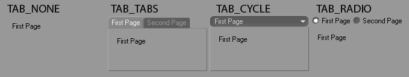

**Parameters:**

- **id** (*int*) – The ID of the group.

- **flags** (*int*) –

  Layout flags:

  |   |   |
  |---|---|
  | *BFH_CENTER* | Centered horizontally. |
  | *BFH_LEFT* | Aligned to the left. |
  | *BFH_RIGHT* | Aligned to the right. |
  | *BFH_FIT* | Fit horizontally. *BFH_LEFT* \| *BFH_RIGHT*. |
  | *BFH_SCALE* | Scale horizontally if there is more space. |
  | *BFH_SCALEFIT* | Scale fit horizontally. *BFH_SCALE* \| *BFH_FIT*. |
  | *BFH_MASK* | Masks out flags. |

  |   |   |
  |---|---|
  | *BFV_CENTER* | Centered vertically. |
  | *BFV_TOP* | Aligned to the top. |
  | *BFV_BOTTOM* | Aligned to the bottom. |
  | *BFV_FIT* | Fit. *BFV_BOTTOM* \| *BFV_TOP*. |
  | *BFV_SCALE* | Scale vertically if there is more space. |
  | *BFV_SCALEFIT* | Scale fit vertically. *BFV_SCALE* \| *BFV_FIT*. |
  | *BFV_MASK* | Masks out flags. |

- **tabtype** (*int*) –

  Specifies what kind of tabs to use:

  |   |   |
  |---|---|
  | *TAB_TABS* | Normal tabs. |
  | *TAB_NOSELECT* | No tabs. |
  | *TAB_CYCLE* | Popup buttons instead of tabs. |
  | *TAB_RADIO* | Radio buttons instead of tabs. |
  | *TAB_VLTABS* | Vertical tabs, left-sided. |
  | *TAB_VRTABS* | Vertical tabs, right-sided. |

**Return type:** bool

**Returns:** **True** if a tab group could be begun, otherwise **False**.

### Dialog Information Methods <a id="c4d.gui.GeDialog-method-Dialog-Information-Methods"></a>

#### `GeDialog.CheckDropArea(self, id, msg, horiz, vert)` <a id="c4d.gui.GeDialog.CheckDropArea"></a>

Checks the drag position in a drag event message against a certain dialog element’s position in the layout.

> **Note:** The check can be limited to only X or Y coordinates.

**Parameters:**

- **id** (*int*) – The dialog element that this cursor is for, or *0*.
- **msg** ([*c4d.BaseContainer*](../../c4d/BaseContainer/index.md#c4d.BaseContainer)) – The drag message.
- **horiz** (*bool*) – If **True** the drag position is checked against the horizontal bounds of the region.
- **vert** (*bool*) – If **True** the drag position is checked against the vertical bounds of the region.

**Return type:** bool

**Returns:** **True** if the drag message is within the bounds specified, otherwise **False**.

#### `GeDialog.GetColorRGB(self, colorid)` <a id="c4d.gui.GeDialog.GetColorRGB"></a>

Gets the RGB values associated with a color ID.

**Parameters:** **colorid** (*int*) – The color ID. See [COLOR constants](../../../consts/COLOR.md).

**Return type:** dict{**r**: int, **g**: int, **b**: int}

**Returns:** The color in the dict with the keys *r*, *g* and *b*.

#### `GeDialog.GetColorRGBA(self, colorid)` <a id="c4d.gui.GeDialog.GetColorRGBA"></a>

Gets the RGBA values associated with a color ID.

*New in version 2025.2.0.*

**Parameters:** **colorid** (*int*) – The color ID. See [COLOR constants](../../../consts/COLOR.md).

**Return type:** dict{**r**: int, **g**: int, **b**: int, **a**: int}

**Returns:** The color in the dict with the keys *r*, *g*, *b* and *a*.

#### `GeDialog.GetDragObject(self, msg)` <a id="c4d.gui.GeDialog.GetDragObject"></a>

Extracts the object from a drag and drop message.

**Parameters:** **msg** ([*c4d.BaseContainer*](../../c4d/BaseContainer/index.md#c4d.BaseContainer)) – The original message.

**Return type:** dict{‘type’: int, ‘object’: any}

**Returns:**

The type of drag and the object itself. The types are:

|   |   |
|---|---|
| *DRAGTYPE_ATOMARRAY* | Atom array. The data is a list of [`c4d.C4DAtom`](../../c4d/C4DAtom/index.md#c4d.C4DAtom). |
| *DRAGTYPE_CMDPALETTE* | Not supported. |
| *DRAGTYPE_COMMAND* | Not supported. |
| *DRAGTYPE_DESCID* | Description ID. The data is a dict(‘did’: [`c4d.DescID`](../../c4d/DescID/index.md#c4d.DescID), ‘arr’: list of [`c4d.C4DAtom`](../../c4d/C4DAtom/index.md#c4d.C4DAtom)). |
| *DRAGTYPE_ICON* | Not supported. |
| *DRAGTYPE_FILES* | Files. The data is a string with the filename. |
| *DRAGTYPE_FILENAME_IMAGE* | Image. The data is a string with the filename. |
| *DRAGTYPE_FILENAME_OTHER* | Other filename. The data is a string with the filename. |
| *DRAGTYPE_FILENAME_SCENE* | Scene filename. The data is a string with the filename. |
| *DRAGTYPE_MANAGER* | Not supported. |
| *DRAGTYPE_RGB* | RGB color. The data is a [`c4d.Vector`](../../c4d/Vector/index.md#c4d.Vector). |
| *DRAGTYPE_RGB_ARRAY* | RGB color array. The data is a list of [`c4d.Vector`](../../c4d/Vector/index.md#c4d.Vector). |
| *DRAGTYPE_RGBA_ARRAY* | RGBA color array. The data is a [`maxon.BaseArray`](../../maxon_generated/datatypes/collection/maxon.BaseArray.md#module-maxon.BaseArray) of [`maxon.ColorA`](../../maxon_generated/datatypes/vec_col_mat/maxon.ColorA.md#module-maxon.ColorA). |
| *DRAGTYPE_BROWSER* | Browser drag message. The data is a list of string with the filename. |
| *DRAGTYPE_ASSET* | *New in version 2023.2.0:* Message ID for Asset browser assets, the message data is a [`maxon.DragAndDropDataAssetArray`](../../maxon_generated/frameworks/asset/datatype/maxon.DragAndDropDataAssetArray.md#module-maxon.DragAndDropDataAssetArray). Exposed as *maxon.DRAGTYPE_ASSET* in Python. |

#### `GeDialog.GetDragPosition(self, msg)` <a id="c4d.gui.GeDialog.GetDragPosition"></a>

Extracts local drag coordinates from a drag and drop event.

**Parameters:** **msg** ([*c4d.BaseContainer*](../../c4d/BaseContainer/index.md#c4d.BaseContainer)) – The original message.

**Return type:** dict{‘x’: int, ‘y’: int}

**Returns:** The local X and Y position.

#### `GeDialog.SetDragDestination(self, cursor, gadgetid=0)` <a id="c4d.gui.GeDialog.SetDragDestination"></a>

Sets the correct cursor during drag and drop handling.

**Parameters:**

- **cursor** (*int*) –

  A mouse cursor:

  |   |   |
  |---|---|
  | *MOUSE_HIDE* | Hide cursor. |
  | *MOUSE_SHOW* | Show cursor. |
  | *MOUSE_NORMAL* | Normal cursor. |
  | *MOUSE_BUSY* | Busy cursor. |
  | *MOUSE_CROSS* | Cross cursor. |
  | *MOUSE_QUESTION* | Question cursor |
  | *MOUSE_ZOOM_IN* | Zoom in cursor. |
  | *MOUSE_ZOOM_OUT* | Zoom out cursor. |
  | *MOUSE_FORBIDDEN* | Forbidden cursor. |
  | *MOUSE_DELETE* | Delete cursor. |
  | *MOUSE_COPY* | Copy cursor. |
  | *MOUSE_INSERTCOPY* | Insert copy cursor. |
  | *MOUSE_INSERTCOPYDOWN* | Insert copy down cursor. |
  | *MOUSE_MOVE* | Move cursor. |
  | *MOUSE_INSERTMOVE* | Insert move cursor. |
  | *MOUSE_INSERTMOVEDOWN* | Insert move cursor. |
  | *MOUSE_ARROW_H* | Horizontal cursor. |
  | *MOUSE_ARROW_V* | Vertical cursor. |
  | *MOUSE_ARROW_HV* | Horizontal and vertical arrow cursor. |
  | *MOUSE_POINT_HAND* | Point hand cursor. |
  | *MOUSE_MOVE_HAND* | Move hand cursor. |
  | *MOUSE_IBEAM* | I-beam cursor. |
  | *MOUSE_SELECT_LIVE* | Live selection cursor. |
  | *MOUSE_SELECT_FREE* | Free selection cursor. |
  | *MOUSE_SELECT_RECT* | Rectangle selection cursor. |
  | *MOUSE_SELECT_POLY* | Polygon selection cursor. |
  | *MOUSE_SPLINETOOLS* | Spline tools cursor. |
  | *MOUSE_EXTRUDE* | Extrude cursor. |
  | *MOUSE_NORMALMOVE* | Normal move cursor. |
  | *MOUSE_ADDPOINTS* | Add points cursor. |
  | *MOUSE_ADDPOLYGONS* | Add polygons cursor. |
  | *MOUSE_BRIDGE* | Bridge cursor. |
  | *MOUSE_MIRROR* | Mirror cursor. |
  | *MOUSE_PAINTMOVE* | Paint move cursor. |
  | *MOUSE_PAINTSELECTRECT* | Paint select rectangle cursor. |
  | *MOUSE_PAINTSELECTCIRCLE* | Paint select circle cursor. |
  | *MOUSE_PAINTSELECTPOLY* | Paint select polygon cursor. |
  | *MOUSE_PAINTSELECTFREE* | Paint select free cursor. |
  | *MOUSE_PAINTMAGICWAND* | Paint magic wand cursor. |
  | *MOUSE_PAINTCOLORRANGE* | Paint color range cursor. |
  | *MOUSE_PAINTFILL* | Paint fill cursor. |
  | *MOUSE_PAINTPICK* | Paint pick cursor. |
  | *MOUSE_PAINTBRUSH* | Paint brush cursor. |
  | *MOUSE_PAINTCLONE* | Paint clone cursor. |
  | *MOUSE_PAINTTEXT* | Paint text cursor. |
  | *MOUSE_PAINTCROP* | Paint crop cursor. |
  | *MOUSE_PAINTLINE* | Paint line cursor. |
  | *MOUSE_PAINTPOLYSHAPE* | Paint polygon shape cursor. |

- **gadgetid** (*int*) – The dialog element that this cursor is for, or *0*.

**Return type:** bool

**Returns:** **True** if the cursor could be set, otherwise **False**.

### Dialog Menu Methods <a id="c4d.gui.GeDialog-method-Dialog-Menu-Methods"></a>

#### `GeDialog.MenuAddCommand(self, cmdid)` <a id="c4d.gui.GeDialog.MenuAddCommand"></a>

Adds a command item to the current menu.  
This can either be a Cinema 4D command or a plugin command.

> **Note:** Particularly useful is *IDM_CM_CLOSEWINDOW* to add a close item for dialogs.

**Parameters:** **cmdid** (*int*) – A Cinema 4D command id or a plugin ID.

**Return type:** bool

**Returns:** **True** if the command was added.

#### `GeDialog.MenuAddSeparator(self)` <a id="c4d.gui.GeDialog.MenuAddSeparator"></a>

Adds a separator to the current menu.

**Return type:** bool

**Returns:** **True** if a separator was added.

#### `GeDialog.MenuAddString(self, id, string)` <a id="c4d.gui.GeDialog.MenuAddString"></a>

Adds a string item to the current menu.

> **Note:** [`Command()`](#c4d.gui.GeDialog.Command) will be called when the menu item is selected.

**Parameters:**

- **id** (*int*) – The item ID.
- **string** (*str*) – The item text. Use a *&d&* suffix for disabled and a *c* suffix for checked items.

**Return type:** bool

**Returns:** **True** if the menu item was added, otherwise **False**.

#### `GeDialog.MenuFinished(self)` <a id="c4d.gui.GeDialog.MenuFinished"></a>

Call this function when all menus and all items have been added.

**Return type:** bool

**Returns:** **True** if a separator was added.

#### `GeDialog.MenuFlushAll(self)` <a id="c4d.gui.GeDialog.MenuFlushAll"></a>

Flushes the menu bar of the dialog, removing all menus.  
Add menus with [`MenuSubBegin()`](#c4d.gui.GeDialog.MenuSubBegin).

> **Note:** Call [`MenuFinished()`](#c4d.gui.GeDialog.MenuFinished) when all menus and items have been added.

**Return type:** bool

**Returns:** **True** if the menu bar was flushed.

#### `GeDialog.MenuInitString(self, id, enabled, value)` <a id="c4d.gui.GeDialog.MenuInitString"></a>

Used to change the enabled/disabled and checked/unchecked state of menu items.  
Can be called after [`MenuFinished()`](#c4d.gui.GeDialog.MenuFinished) to update the menu item dynamically.

**Parameters:**

- **id** (*int*) – The menu item ID.
- **enabled** (*bool*) – **True** if the item is enabled, otherwise **False**.
- **value** (*bool*) – **True** if the menu item should be checked.

**Return type:** bool

**Returns:** **True** if the item was set.

#### `GeDialog.MenuSetResource(self, id)` <a id="c4d.gui.GeDialog.MenuSetResource"></a>

Sets the menu from a MENU resource ID.

**Parameters:** **id** (*int*) – The menu resource ID.

**Return type:** bool

**Returns:** **True** if the menu was set from resource, otherwise **False**

#### `GeDialog.MenuSubBegin(self, string)` <a id="c4d.gui.GeDialog.MenuSubBegin"></a>

Creates a new menu group.  
At the top level this means a menu, at lower levels a sub-menu.  
Add items with [`MenuAddCommand()`](#c4d.gui.GeDialog.MenuAddCommand), [`MenuAddString()`](#c4d.gui.GeDialog.MenuAddString) or [`MenuAddSeparator()`](#c4d.gui.GeDialog.MenuAddSeparator).

> **Note:** Call [`MenuSubEnd()`](#c4d.gui.GeDialog.MenuSubEnd) when the menu is finished.

**Parameters:** **string** (*str*) – Name of the sub menu.

**Return type:** bool

**Returns:** **True** if a menu group could be begun.

#### `GeDialog.MenuSubEnd(self)` <a id="c4d.gui.GeDialog.MenuSubEnd"></a>

Closes the current menu group, opened with [`MenuSubBegin()`](#c4d.gui.GeDialog.MenuSubBegin).

**Return type:** bool

**Returns:** **True** if the menu group was ended, otherwise **False**.

### Dialog Setter Methods <a id="c4d.gui.GeDialog-method-Dialog-Setter-Methods"></a>

#### `GeDialog.SetDefaultColor(self, id, colorid, color)` <a id="c4d.gui.GeDialog.SetDefaultColor"></a>

Set the default color for GUI elements.

**Parameters:**

- **id** (*Union*[[*c4d.gui.C4DGadget*](../C4DGadget/index.md#c4d.gui.C4DGadget), *int*]) – The control ID.
- **colorid** (*int*) – The color ID. See [COLOR constants](../../../consts/COLOR.md).
- **color** ([*c4d.Vector*](../../c4d/Vector/index.md#c4d.Vector)) – The color.

#### `GeDialog.SetFolding(self, allowClose)` <a id="c4d.gui.GeDialog.SetFolding"></a>

Fold the dialog away in the layout.

*New in version 24.*

**Parameters:** **allowClose** (*bool*) – **True** if the dialog should fold away.

#### `GeDialog.SetTitle(self, title)` <a id="c4d.gui.GeDialog.SetTitle"></a>

Sets the title of the dialog window.

**Parameters:** **title** (*str*) – The title.

### Gadget Addition Methods <a id="c4d.gui.GeDialog-method-Gadget-Addition-Methods"></a>

#### `GeDialog.AddArrowButton(self, id, flags, initw=0, inith=0, arrowtype=0)` <a id="c4d.gui.GeDialog.AddArrowButton"></a>

Adds an arrow button to the layout.

*New in version 2023.2.0.*

**Parameters:**

- **id** (*int*) – The unique ID of the gadget.

- **flags** (*int*) –

  Layout flags:

  |   |   |
  |---|---|
  | *BFH_CENTER* | Centered horizontally. |
  | *BFH_LEFT* | Aligned to the left. |
  | *BFH_RIGHT* | Aligned to the right. |
  | *BFH_FIT* | Fit horizontally. *BFH_LEFT* \| *BFH_RIGHT*. |
  | *BFH_SCALE* | Scale horizontally if there is more space. |
  | *BFH_SCALEFIT* | Scale fit horizontally. *BFH_SCALE* \| *BFH_FIT*. |
  | *BFH_MASK* | Masks out flags. |

  |   |   |
  |---|---|
  | *BFV_CENTER* | Centered vertically. |
  | *BFV_TOP* | Aligned to the top. |
  | *BFV_BOTTOM* | Aligned to the bottom. |
  | *BFV_FIT* | Fit. *BFV_BOTTOM* \| *BFV_TOP*. |
  | *BFV_SCALE* | Scale vertically if there is more space. |
  | *BFV_SCALEFIT* | Scale fit vertically. *BFV_SCALE* \| *BFV_FIT*. |
  | *BFV_MASK* | Masks out flags. |

- **initw** (*int*) – Initial width.

- **inith** (*int*) – Initial height.

- **arrowtype** (*int*) –

  The arrow type:

  | Key | Description |
  |---|---|
  | ARROW_LEFT | Arrow pointing left. |
  | ARROW_RIGHT | Arrow pointing right. |
  | ARROW_UP | Arrow pointing up. |
  | ARROW_DOWN | Arrow pointing down. |
  | ARROW_SMALL_LEFT | Small arrow pointing left. |
  | ARROW_SMALL_RIGHT | Small arrow pointing right. |
  | ARROW_SMALL_UP | Small arrow pointing up. |
  | ARROW_SMALL_DOWN | Small arrow pointing down. |

**Return type:** [c4d.gui.C4DGadget](../C4DGadget/index.md#c4d.gui.C4DGadget)

**Returns:** The added gadget.

#### `GeDialog.AddButton(self, id, flags, initw=0, inith=0, name='', buttonStyle=0)` <a id="c4d.gui.GeDialog.AddButton"></a>

Add a button to the dialog.


**Parameters:**

- **id** (*int*) – The unique ID of the dialog.

- **flags** (*int*) –

  Layout flags:

  |   |   |
  |---|---|
  | *BFH_CENTER* | Centered horizontally. |
  | *BFH_LEFT* | Aligned to the left. |
  | *BFH_RIGHT* | Aligned to the right. |
  | *BFH_FIT* | Fit horizontally. *BFH_LEFT* \| *BFH_RIGHT*. |
  | *BFH_SCALE* | Scale horizontally if there is more space. |
  | *BFH_SCALEFIT* | Scale fit horizontally. *BFH_SCALE* \| *BFH_FIT*. |
  | *BFH_MASK* | Masks out flags. |

  |   |   |
  |---|---|
  | *BFV_CENTER* | Centered vertically. |
  | *BFV_TOP* | Aligned to the top. |
  | *BFV_BOTTOM* | Aligned to the bottom. |
  | *BFV_FIT* | Fit. *BFV_BOTTOM* \| *BFV_TOP*. |
  | *BFV_SCALE* | Scale vertically if there is more space. |
  | *BFV_SCALEFIT* | Scale fit vertically. *BFV_SCALE* \| *BFV_FIT*. |
  | *BFV_MASK* | Masks out flags. |

- **initw** (*int*) – Initial width.

- **inith** (*int*) – Initial height.

- **name** (*str*) – Name of the button.

- **buttonStyle** (*int*) –

  *New in version 2024.0.0.*

  The style of the button.

  | Symbol ID | Description |
  |---|---|
  | DR_BUTTON_STYLE_NORMAL | Button in normal style. |
  | DR_BUTTON_STYLE_EMPHASIZED | Button with its text emphasized. |
  | DR_BUTTON_STYLE_DIMMED | Button dimmed. |

**Return type:** [c4d.gui.C4DGadget](../C4DGadget/index.md#c4d.gui.C4DGadget)

**Returns:** The added gadget.

#### `GeDialog.AddCheckbox(self, id, flags, initw, inith, name)` <a id="c4d.gui.GeDialog.AddCheckbox"></a>

Add a checkbox to the dialog.

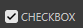

**Parameters:**

- **id** (*int*) – The unique ID of the dialog.

- **flags** (*int*) –

  Layout flags:

  |   |   |
  |---|---|
  | *BFH_CENTER* | Centered horizontally. |
  | *BFH_LEFT* | Aligned to the left. |
  | *BFH_RIGHT* | Aligned to the right. |
  | *BFH_FIT* | Fit horizontally. *BFH_LEFT* \| *BFH_RIGHT*. |
  | *BFH_SCALE* | Scale horizontally if there is more space. |
  | *BFH_SCALEFIT* | Scale fit horizontally. *BFH_SCALE* \| *BFH_FIT*. |
  | *BFH_MASK* | Masks out flags. |

  |   |   |
  |---|---|
  | *BFV_CENTER* | Centered vertically. |
  | *BFV_TOP* | Aligned to the top. |
  | *BFV_BOTTOM* | Aligned to the bottom. |
  | *BFV_FIT* | Fit. *BFV_BOTTOM* \| *BFV_TOP*. |
  | *BFV_SCALE* | Scale vertically if there is more space. |
  | *BFV_SCALEFIT* | Scale fit vertically. *BFV_SCALE* \| *BFV_FIT*. |
  | *BFV_MASK* | Masks out flags. |

- **initw** (*int*) – Initial width.

- **inith** (*int*) – Initial height.

- **name** (*str*) – Name of the checkbox option.

**Return type:** [c4d.gui.C4DGadget](../C4DGadget/index.md#c4d.gui.C4DGadget)

**Returns:** The added gadget.

#### `GeDialog.AddChild(self, id, subid, child)` <a id="c4d.gui.GeDialog.AddChild"></a>

Adds items to combo boxes or popup buttons. The resource equivalent is *CHILDS*.

**Parameters:**

- **id** (*Union*[[*c4d.gui.C4DGadget*](../C4DGadget/index.md#c4d.gui.C4DGadget), *int*]) – The control ID or int.
- **subid** (*int*) – ID of the item to add.
- **child** (*str*) – Name of the item to add.

**Return type:** bool

**Returns:** **True** if the child was added.

#### `GeDialog.AddColorChooser(self, id, flags, initw=80, inith=0, layoutflags=False, settings=None)` <a id="c4d.gui.GeDialog.AddColorChooser"></a>

Adds a color field with sliders to the layout.

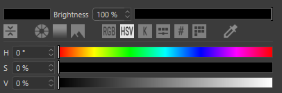

**Parameters:**

- **id** (*int*) – The unique ID of the dialog.

- **flags** (*int*) –

  Layout flags:

  |   |   |
  |---|---|
  | *BFH_CENTER* | Centered horizontally. |
  | *BFH_LEFT* | Aligned to the left. |
  | *BFH_RIGHT* | Aligned to the right. |
  | *BFH_FIT* | Fit horizontally. *BFH_LEFT* \| *BFH_RIGHT*. |
  | *BFH_SCALE* | Scale horizontally if there is more space. |
  | *BFH_SCALEFIT* | Scale fit horizontally. *BFH_SCALE* \| *BFH_FIT*. |
  | *BFH_MASK* | Masks out flags. |

  |   |   |
  |---|---|
  | *BFV_CENTER* | Centered vertically. |
  | *BFV_TOP* | Aligned to the top. |
  | *BFV_BOTTOM* | Aligned to the bottom. |
  | *BFV_FIT* | Fit. *BFV_BOTTOM* \| *BFV_TOP*. |
  | *BFV_SCALE* | Scale vertically if there is more space. |
  | *BFV_SCALEFIT* | Scale fit vertically. *BFV_SCALE* \| *BFV_FIT*. |
  | *BFV_MASK* | Masks out flags. |

- **initw** (*int*) – Initial width.

- **inith** (*int*) – Initial height.

- **layoutflags** (*int*) –

  Flags:

  |   |   |
  |---|---|
  | *DR_COLORFIELD_NO_BRIGHTNESS* | Disables the brightness control. |
  | *DR_COLORFIELD_NO_COLOR* | Disables the color control. |
  | *DR_COLORFIELD_BODYPAINT* | Uses the BodyPaint 3D style. Deprecated since R17. Not needed anymore: now just one style. |
  | *DR_COLORFIELD_ICC_BASEDOC* | Uses the color profile of the current [`BaseDocument`](../../c4d.documents/BaseDocument/index.md#c4d.documents.BaseDocument). |
  | *DR_COLORFIELD_ICC_BPTEX* | Uses the color profile of the current BodyPaint 3D texture. |
  | *DR_COLORFIELD_NO_MODE_BUTTONS* | *New in version R17.032:* Hides the color mode buttons. |
  | *DR_COLORFIELD_NO_COLORWHEEL* | *New in version R17.032:* Hides the Color Wheel mode button. |
  | *DR_COLORFIELD_NO_SPECTRUM* | *New in version R17.032:* Hides the Color Spectrum mode button. |
  | *DR_COLORFIELD_NO_PICTURE* | *New in version R17.032:* Hides the Color From Picture mode button. |
  | *DR_COLORFIELD_NO_RGB* | *New in version R17.032:* Hides the RGB sliders mode button. |
  | *DR_COLORFIELD_NO_HSV* | *New in version R17.032:* Hides the HSV sliders mode button. |
  | *DR_COLORFIELD_NO_KELVIN* | *New in version R17.032:* Hides the Kelvin Color Temperature mode button. |
  | *DR_COLORFIELD_NO_MIXER* | *New in version R17.032:* Hides the Color Mixer mode button. |
  | *DR_COLORFIELD_NO_SWATCHES* | *New in version R17.032:* Hides the Swatches mode button. |
  | *DR_COLORFIELD_NO_SCREENPICKER* | *New in version R17.032:* Hides the ScreenPicker mode button. |
  | *DR_COLORFIELD_ENABLE_COLORWHEEL* | *New in version R17.032:* Enables the Special Color Wheel mode (Special modes are exclusive each other: use only one at a time). |
  | *DR_COLORFIELD_ENABLE_SPECTRUM* | *New in version R17.032:* Enables the Special Color Spectrum mode (Special modes are exclusive each other: use only one at a time). |
  | *DR_COLORFIELD_ENABLE_PICTURE* | *New in version R17.032:* Enables the Special Color from Picture mode (Special modes are exclusive each other: use only one at a time). |
  | *DR_COLORFIELD_ENABLE_RGB* | *New in version R17.032:* Enables the RGB sliders mode. |
  | *DR_COLORFIELD_ENABLE_HSV* | *New in version R17.032:* Enables the HSV sliders mode. |
  | *DR_COLORFIELD_ENABLE_KELVIN* | *New in version R17.032:* Enables the Kelvin Color Temperature mode. |
  | *DR_COLORFIELD_ENABLE_MIXER* | *New in version R17.032:* Enables the Color Mixer mode. |
  | *DR_COLORFIELD_ENABLE_SWATCHES* | *New in version R17.032:* Enables the Swatches mode. |
  | *DR_COLORFIELD_RGB_HIDE_HEX* | *New in version R17.032:* Hides the Hexadecimal color field in the RGB Mode. |
  | *DR_COLORFIELD_POPUP* | *New in version R17.032:* Private. |

- **settings** (*Optional*[[*c4d.BaseContainer*](../../c4d/BaseContainer/index.md#c4d.BaseContainer)]) –

  Private.

  *New in version R17.048:* The color chooser settings.

**Return type:** [c4d.gui.C4DGadget](../C4DGadget/index.md#c4d.gui.C4DGadget)

**Returns:** The added gadget.

#### `GeDialog.AddColorField(self, id, flags, initw=0, inith=0, colorflags=0)` <a id="c4d.gui.GeDialog.AddColorField"></a>

Adds a simple color field without sliders to the layout.


**Parameters:**

- **id** (*int*) – The unique ID of the dialog.

- **flags** (*int*) –

  Layout flags:

  |   |   |
  |---|---|
  | *BFH_CENTER* | Centered horizontally. |
  | *BFH_LEFT* | Aligned to the left. |
  | *BFH_RIGHT* | Aligned to the right. |
  | *BFH_FIT* | Fit horizontally. *BFH_LEFT* \| *BFH_RIGHT*. |
  | *BFH_SCALE* | Scale horizontally if there is more space. |
  | *BFH_SCALEFIT* | Scale fit horizontally. *BFH_SCALE* \| *BFH_FIT*. |
  | *BFH_MASK* | Masks out flags. |

  |   |   |
  |---|---|
  | *BFV_CENTER* | Centered vertically. |
  | *BFV_TOP* | Aligned to the top. |
  | *BFV_BOTTOM* | Aligned to the bottom. |
  | *BFV_FIT* | Fit. *BFV_BOTTOM* \| *BFV_TOP*. |
  | *BFV_SCALE* | Scale vertically if there is more space. |
  | *BFV_SCALEFIT* | Scale fit vertically. *BFV_SCALE* \| *BFV_FIT*. |
  | *BFV_MASK* | Masks out flags. |

- **initw** (*int*) – Initial width.

- **inith** (*int*) – Initial height.

- **colorflags** (*int*) –

  *New in version R14.014:* Color flags:

  |   |   |
  |---|---|
  | *DR_COLORFIELD_NO_BRIGHTNESS* | Disables the brightness control. |
  | *DR_COLORFIELD_NO_COLOR* | Disables the color control. |
  | *DR_COLORFIELD_BODYPAINT* | Uses the BodyPaint 3D style. Deprecated since R17. Not needed anymore: now just one style. |
  | *DR_COLORFIELD_ICC_BASEDOC* | Uses the color profile of the current [`BaseDocument`](../../c4d.documents/BaseDocument/index.md#c4d.documents.BaseDocument). |
  | *DR_COLORFIELD_ICC_BPTEX* | Uses the color profile of the current BodyPaint 3D texture. |
  | *DR_COLORFIELD_NO_MODE_BUTTONS* | *New in version R17.032:* Hides the color mode buttons. |
  | *DR_COLORFIELD_NO_COLORWHEEL* | *New in version R17.032:* Hides the Color Wheel mode button. |
  | *DR_COLORFIELD_NO_SPECTRUM* | *New in version R17.032:* Hides the Color Spectrum mode button. |
  | *DR_COLORFIELD_NO_PICTURE* | *New in version R17.032:* Hides the Color From Picture mode button. |
  | *DR_COLORFIELD_NO_RGB* | *New in version R17.032:* Hides the RGB sliders mode button. |
  | *DR_COLORFIELD_NO_HSV* | *New in version R17.032:* Hides the HSV sliders mode button. |
  | *DR_COLORFIELD_NO_KELVIN* | *New in version R17.032:* Hides the Kelvin Color Temperature mode button. |
  | *DR_COLORFIELD_NO_MIXER* | *New in version R17.032:* Hides the Color Mixer mode button. |
  | *DR_COLORFIELD_NO_SWATCHES* | *New in version R17.032:* Hides the Swatches mode button. |
  | *DR_COLORFIELD_NO_SCREENPICKER* | *New in version R17.032:* Hides the ScreenPicker mode button. |
  | *DR_COLORFIELD_ENABLE_COLORWHEEL* | *New in version R17.032:* Enables the Special Color Wheel mode (Special modes are exclusive each other: use only one at a time). |
  | *DR_COLORFIELD_ENABLE_SPECTRUM* | *New in version R17.032:* Enables the Special Color Spectrum mode (Special modes are exclusive each other: use only one at a time). |
  | *DR_COLORFIELD_ENABLE_PICTURE* | *New in version R17.032:* Enables the Special Color from Picture mode (Special modes are exclusive each other: use only one at a time). |
  | *DR_COLORFIELD_ENABLE_RGB* | *New in version R17.032:* Enables the RGB sliders mode. |
  | *DR_COLORFIELD_ENABLE_HSV* | *New in version R17.032:* Enables the HSV sliders mode. |
  | *DR_COLORFIELD_ENABLE_KELVIN* | *New in version R17.032:* Enables the Kelvin Color Temperature mode. |
  | *DR_COLORFIELD_ENABLE_MIXER* | *New in version R17.032:* Enables the Color Mixer mode. |
  | *DR_COLORFIELD_ENABLE_SWATCHES* | *New in version R17.032:* Enables the Swatches mode. |
  | *DR_COLORFIELD_RGB_HIDE_HEX* | *New in version R17.032:* Hides the Hexadecimal color field in the RGB Mode. |
  | *DR_COLORFIELD_POPUP* | *New in version R17.032:* Private. |

**Return type:** [c4d.gui.C4DGadget](../C4DGadget/index.md#c4d.gui.C4DGadget)

**Returns:** The added gadget.

#### `GeDialog.AddComboBox(self, id, flags, initw=80, inith=0, specialalign=False, allowfiltering=False)` <a id="c4d.gui.GeDialog.AddComboBox"></a>

Adds a combo box to the layout.


> **Note:** To add items to the combo box menu use the [`AddChild()`](#c4d.gui.GeDialog.AddChild) method.

**Parameters:**

- **id** (*int*) – The unique ID of the dialog.

- **flags** (*int*) –

  Layout flags:

  |   |   |
  |---|---|
  | *BFH_CENTER* | Centered horizontally. |
  | *BFH_LEFT* | Aligned to the left. |
  | *BFH_RIGHT* | Aligned to the right. |
  | *BFH_FIT* | Fit horizontally. *BFH_LEFT* \| *BFH_RIGHT*. |
  | *BFH_SCALE* | Scale horizontally if there is more space. |
  | *BFH_SCALEFIT* | Scale fit horizontally. *BFH_SCALE* \| *BFH_FIT*. |
  | *BFH_MASK* | Masks out flags. |

  |   |   |
  |---|---|
  | *BFV_CENTER* | Centered vertically. |
  | *BFV_TOP* | Aligned to the top. |
  | *BFV_BOTTOM* | Aligned to the bottom. |
  | *BFV_FIT* | Fit. *BFV_BOTTOM* \| *BFV_TOP*. |
  | *BFV_SCALE* | Scale vertically if there is more space. |
  | *BFV_SCALEFIT* | Scale fit vertically. *BFV_SCALE* \| *BFV_FIT*. |
  | *BFV_MASK* | Masks out flags. |

- **initw** (*int*) – Initial width.

- **inith** (*int*) – Initial height.

- **specialalign** (*bool*) –

  Used to quantize the width of the combo box.  
  If this is **True** then the width of the combo box will be a multiple of *initw*.  
  For example if *initw* is 60px and *specialalign* is **True** the width will be 60, 120, 180px and so on.

- **allowfiltering** (*bool*) –

  *New in version R21:* **True** to allow keyboard filtering of the combobox list.

**Return type:** [c4d.gui.C4DGadget](../C4DGadget/index.md#c4d.gui.C4DGadget)

**Returns:** The added gadget.

#### `GeDialog.AddComboButton(self, id, flags, initw=0, inith=0, specialalign=False, allowfiltering=False)` <a id="c4d.gui.GeDialog.AddComboButton"></a>

Adds a combo button to the layout.

*New in version 2023.2.0.*

> **Note:** To add items to the combo box menu use the [`AddChild()`](#c4d.gui.GeDialog.AddChild) method.

**Parameters:**

- **id** (*int*) – The unique ID of the dialog.

- **flags** (*int*) –

  Layout flags:

  |   |   |
  |---|---|
  | *BFH_CENTER* | Centered horizontally. |
  | *BFH_LEFT* | Aligned to the left. |
  | *BFH_RIGHT* | Aligned to the right. |
  | *BFH_FIT* | Fit horizontally. *BFH_LEFT* \| *BFH_RIGHT*. |
  | *BFH_SCALE* | Scale horizontally if there is more space. |
  | *BFH_SCALEFIT* | Scale fit horizontally. *BFH_SCALE* \| *BFH_FIT*. |
  | *BFH_MASK* | Masks out flags. |

  |   |   |
  |---|---|
  | *BFV_CENTER* | Centered vertically. |
  | *BFV_TOP* | Aligned to the top. |
  | *BFV_BOTTOM* | Aligned to the bottom. |
  | *BFV_FIT* | Fit. *BFV_BOTTOM* \| *BFV_TOP*. |
  | *BFV_SCALE* | Scale vertically if there is more space. |
  | *BFV_SCALEFIT* | Scale fit vertically. *BFV_SCALE* \| *BFV_FIT*. |
  | *BFV_MASK* | Masks out flags. |

- **initw** (*int*) – Initial width.

- **inith** (*int*) – Initial height.

- **specialalign** (*bool*) –

  Used to quantize the width of the combo box.  
  If this is **True** then the width of the combo box will be a multiple of *initw*.  
  For example if *initw* is 60px and *specialalign* is **True** the width will be 60, 120, 180px and so on.

- **allowfiltering** (*bool*) –

  *New in version R21:* **True** to allow keyboard filtering of the combobox list.

**Return type:** [c4d.gui.C4DGadget](../C4DGadget/index.md#c4d.gui.C4DGadget)

**Returns:** The added gadget.

#### `GeDialog.AddCustomGui(self, id, pluginid, name, flags, minw, minh, customdata)` <a id="c4d.gui.GeDialog.AddCustomGui"></a>

Adds a custom GUI to the dialog.

**Parameters:**

- **id** (*int*) – The ID of the custom GUI to add.

- **pluginid** (*int*) –

  The plugin ID of the custom GUI.

  | Symbol ID | Value Type | Description |
  |---|---|---|
  | CUSTOMGUI_REAL | Float | Edit field. |
  | CUSTOMGUI_REALSLIDER | Float | Edit field with slider. |
  | CUSTOMGUI_REALSLIDERONLY | Float | Slider only. |
  | CUSTOMGUI_VECTOR | c4d.Vector | Vector |
  | CUSTOMGUI_VECTOR4D | c4d.Vector4D | Vector 4D. |
  | CUSTOMGUI_STRING | str | String field. |
  | CUSTOMGUI_STRINGMULTI | str | Multiple line string field. |
  | CUSTOMGUI_STATICTEXT | str | Static text field. |
  | CUSTOMGUI_CYCLE | int | Selection list field. |
  | CUSTOMGUI_CYCLEBUTTON | int | Selection field list with button functionality, e.g. the function of a button can be changed through a selection field list. |
  | CUSTOMGUI_LONG | int | Edit field. |
  | CUSTOMGUI_LONGSLIDER | int | Edit field with slider. |
  | CUSTOMGUI_BOOL | bool | Checkbox. |
  | CUSTOMGUI_TIME | c4d.BaseTime | Time edit field. |
  | CUSTOMGUI_COLOR | c4d.Vector | Color chooser. |
  | CUSTOMGUI_MATRIX | c4d.Matrix | Matrix edit fields. |
  | CUSTOMGUI_BUTTON | bool | Button. |
  | CUSTOMGUI_POPUP | None | Popup field. |
  | CUSTOMGUI_SEPARATOR | None | Separator. |
  | CUSTOMGUI_SUBDESCRIPTION | None | Sub-description. |
  | CUSTOMGUI_PROGRESSBAR | None | Progress bar. |

- **name** (*str*) – The name of the added custom GUI. (Not necessarily used.)

- **flags** (*int*) –

  Layout flags:

  |   |   |
  |---|---|
  | *BFH_CENTER* | Centered horizontally. |
  | *BFH_LEFT* | Aligned to the left. |
  | *BFH_RIGHT* | Aligned to the right. |
  | *BFH_FIT* | Fit horizontally. *BFH_LEFT* \| *BFH_RIGHT*. |
  | *BFH_SCALE* | Scale horizontally if there is more space. |
  | *BFH_SCALEFIT* | Scale fit horizontally. *BFH_SCALE* \| *BFH_FIT*. |
  | *BFH_MASK* | Masks out flags. |

  |   |   |
  |---|---|
  | *BFV_CENTER* | Centered vertically. |
  | *BFV_TOP* | Aligned to the top. |
  | *BFV_BOTTOM* | Aligned to the bottom. |
  | *BFV_FIT* | Fit. *BFV_BOTTOM* \| *BFV_TOP*. |
  | *BFV_SCALE* | Scale vertically if there is more space. |
  | *BFV_SCALEFIT* | Scale fit vertically. *BFV_SCALE* \| *BFV_FIT*. |
  | *BFV_MASK* | Masks out flags. |

- **minw** (*int*) – Minimum width.

- **minh** (*int*) – Minimum height.

- **customdata** ([*c4d.BaseContainer*](../../c4d/BaseContainer/index.md#c4d.BaseContainer)) – Container with settings for the custom GUI element.

**Return type:** Optional[[c4d.gui.BaseCustomGui](../BaseCustomGui/index.md#c4d.gui.BaseCustomGui)]

**Returns:**

The custom GUI that was added, or **None** if an error occured.

The method returns a [`BaseCustomGui`](../BaseCustomGui/index.md#c4d.gui.BaseCustomGui) when there is no class available for the custom GUI.  
This allows to interact with any custom GUI, calling for instance `BaseCustomGui.GetData()`/`SetData()`.

#### `GeDialog.AddDlgGroup(self, type)` <a id="c4d.gui.GeDialog.AddDlgGroup"></a>

Adds a dialog group with standard buttons to the layout.

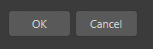

> **Note:**
>
> The dialog group contains the standard buttons of a modal dialog (OK and Cancel).  
> By having these grouped together in a single element, Cinema 4D can change the ordering and alignment of the buttons to suit the operation system used.  
> The id of the button will be the same as the type used in the type parameter. This allow, in the dialog’s command function, to check which button have been pressed.

**Parameters:**

**type** (*int*) –

Specifies what standard buttons to include. Can be a combination of:

|   |   |
|---|---|
| *DLG_OK* | OK button. |
| *DLG_CANCEL* | Cancel button. |

**Return type:** bool

**Returns:** **True** if the dialog group was added, otherwise **False**.

#### `GeDialog.AddEditNumber(self, id, flags, initw=80, inith=0)` <a id="c4d.gui.GeDialog.AddEditNumber"></a>

Adds an editable number field to the layout.

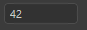

**Parameters:**

- **id** (*int*) – The unique ID of the dialog.

- **flags** (*int*) –

  Layout flags:

  |   |   |
  |---|---|
  | *BFH_CENTER* | Centered horizontally. |
  | *BFH_LEFT* | Aligned to the left. |
  | *BFH_RIGHT* | Aligned to the right. |
  | *BFH_FIT* | Fit horizontally. *BFH_LEFT* \| *BFH_RIGHT*. |
  | *BFH_SCALE* | Scale horizontally if there is more space. |
  | *BFH_SCALEFIT* | Scale fit horizontally. *BFH_SCALE* \| *BFH_FIT*. |
  | *BFH_MASK* | Masks out flags. |

  |   |   |
  |---|---|
  | *BFV_CENTER* | Centered vertically. |
  | *BFV_TOP* | Aligned to the top. |
  | *BFV_BOTTOM* | Aligned to the bottom. |
  | *BFV_FIT* | Fit. *BFV_BOTTOM* \| *BFV_TOP*. |
  | *BFV_SCALE* | Scale vertically if there is more space. |
  | *BFV_SCALEFIT* | Scale fit vertically. *BFV_SCALE* \| *BFV_FIT*. |
  | *BFV_MASK* | Masks out flags. |

- **initw** (*int*) – Initial width.

- **inith** (*int*) – Initial height.

**Return type:** [c4d.gui.C4DGadget](../C4DGadget/index.md#c4d.gui.C4DGadget)

**Returns:** The added gadget.

#### `GeDialog.AddEditNumberArrows(self, id, flags, initw=70, inith=0)` <a id="c4d.gui.GeDialog.AddEditNumberArrows"></a>

Adds an editable number field with up/down arrows to the layout.

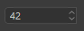

**Parameters:**

- **id** (*int*) – The unique ID of the dialog.

- **flags** (*int*) –

  Layout flags:

  |   |   |
  |---|---|
  | *BFH_CENTER* | Centered horizontally. |
  | *BFH_LEFT* | Aligned to the left. |
  | *BFH_RIGHT* | Aligned to the right. |
  | *BFH_FIT* | Fit horizontally. *BFH_LEFT* \| *BFH_RIGHT*. |
  | *BFH_SCALE* | Scale horizontally if there is more space. |
  | *BFH_SCALEFIT* | Scale fit horizontally. *BFH_SCALE* \| *BFH_FIT*. |
  | *BFH_MASK* | Masks out flags. |

  |   |   |
  |---|---|
  | *BFV_CENTER* | Centered vertically. |
  | *BFV_TOP* | Aligned to the top. |
  | *BFV_BOTTOM* | Aligned to the bottom. |
  | *BFV_FIT* | Fit. *BFV_BOTTOM* \| *BFV_TOP*. |
  | *BFV_SCALE* | Scale vertically if there is more space. |
  | *BFV_SCALEFIT* | Scale fit vertically. *BFV_SCALE* \| *BFV_FIT*. |
  | *BFV_MASK* | Masks out flags. |

- **initw** (*int*) – Initial width.

- **inith** (*int*) – Initial height.

**Return type:** [c4d.gui.C4DGadget](../C4DGadget/index.md#c4d.gui.C4DGadget)

**Returns:** The added gadget.

#### `GeDialog.AddEditShortcut(self, id, flags, initw=80, inith=0, shortcutflags=0)` <a id="c4d.gui.GeDialog.AddEditShortcut"></a>

Adds a field for editing shortcuts.

*New in version 2023.2.0.*

**Parameters:**

- **id** (*int*) – The unique ID of the gadget.

- **flags** (*int*) –

  Layout flags:

  |   |   |
  |---|---|
  | *BFH_CENTER* | Centered horizontally. |
  | *BFH_LEFT* | Aligned to the left. |
  | *BFH_RIGHT* | Aligned to the right. |
  | *BFH_FIT* | Fit horizontally. *BFH_LEFT* \| *BFH_RIGHT*. |
  | *BFH_SCALE* | Scale horizontally if there is more space. |
  | *BFH_SCALEFIT* | Scale fit horizontally. *BFH_SCALE* \| *BFH_FIT*. |
  | *BFH_MASK* | Masks out flags. |

  |   |   |
  |---|---|
  | *BFV_CENTER* | Centered vertically. |
  | *BFV_TOP* | Aligned to the top. |
  | *BFV_BOTTOM* | Aligned to the bottom. |
  | *BFV_FIT* | Fit. *BFV_BOTTOM* \| *BFV_TOP*. |
  | *BFV_SCALE* | Scale vertically if there is more space. |
  | *BFV_SCALEFIT* | Scale fit vertically. *BFV_SCALE* \| *BFV_FIT*. |
  | *BFV_MASK* | Masks out flags. |

- **initw** (*int*) – Initial width.

- **inith** (*int*) – Initial height.

- **shortcutflags** (*int*) – The shortcut flags.

**Return type:** [c4d.gui.C4DGadget](../C4DGadget/index.md#c4d.gui.C4DGadget)

**Returns:** The added gadget.

#### `GeDialog.AddEditSlider(self, id, flags, initw=80, inith=0)` <a id="c4d.gui.GeDialog.AddEditSlider"></a>

Adds a slider with an editable number field to the layout.

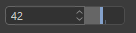

**Parameters:**

- **id** (*int*) – The unique ID of the dialog.

- **flags** (*int*) –

  Layout flags:

  |   |   |
  |---|---|
  | *BFH_CENTER* | Centered horizontally. |
  | *BFH_LEFT* | Aligned to the left. |
  | *BFH_RIGHT* | Aligned to the right. |
  | *BFH_FIT* | Fit horizontally. *BFH_LEFT* \| *BFH_RIGHT*. |
  | *BFH_SCALE* | Scale horizontally if there is more space. |
  | *BFH_SCALEFIT* | Scale fit horizontally. *BFH_SCALE* \| *BFH_FIT*. |
  | *BFH_MASK* | Masks out flags. |

  |   |   |
  |---|---|
  | *BFV_CENTER* | Centered vertically. |
  | *BFV_TOP* | Aligned to the top. |
  | *BFV_BOTTOM* | Aligned to the bottom. |
  | *BFV_FIT* | Fit. *BFV_BOTTOM* \| *BFV_TOP*. |
  | *BFV_SCALE* | Scale vertically if there is more space. |
  | *BFV_SCALEFIT* | Scale fit vertically. *BFV_SCALE* \| *BFV_FIT*. |
  | *BFV_MASK* | Masks out flags. |

- **initw** (*int*) – Initial width.

- **inith** (*int*) – Initial height.

**Return type:** [c4d.gui.C4DGadget](../C4DGadget/index.md#c4d.gui.C4DGadget)

**Returns:** The added gadget.

#### `GeDialog.AddEditText(self, id, flags, initw=0, inith=0, editflags=0)` <a id="c4d.gui.GeDialog.AddEditText"></a>

Adds an editable text field to the layout.


**Parameters:**

- **id** (*int*) – The unique ID of the dialog.

- **flags** (*int*) –

  Layout flags:

  |   |   |
  |---|---|
  | *BFH_CENTER* | Centered horizontally. |
  | *BFH_LEFT* | Aligned to the left. |
  | *BFH_RIGHT* | Aligned to the right. |
  | *BFH_FIT* | Fit horizontally. *BFH_LEFT* \| *BFH_RIGHT*. |
  | *BFH_SCALE* | Scale horizontally if there is more space. |
  | *BFH_SCALEFIT* | Scale fit horizontally. *BFH_SCALE* \| *BFH_FIT*. |
  | *BFH_MASK* | Masks out flags. |

  |   |   |
  |---|---|
  | *BFV_CENTER* | Centered vertically. |
  | *BFV_TOP* | Aligned to the top. |
  | *BFV_BOTTOM* | Aligned to the bottom. |
  | *BFV_FIT* | Fit. *BFV_BOTTOM* \| *BFV_TOP*. |
  | *BFV_SCALE* | Scale vertically if there is more space. |
  | *BFV_SCALEFIT* | Scale fit vertically. *BFV_SCALE* \| *BFV_FIT*. |
  | *BFV_MASK* | Masks out flags. |

- **initw** (*int*) – Initial width.

- **inith** (*int*) – Initial height.

- **editflags** (*int*) –

  Edit flags:

  | Symbol ID | Description |
  |---|---|
  | EDITTEXT_PASSWORD | Password field. |
  | EDITTEXT_HELPTEXT | Sets the help text for an edit field. This text appears if the edit field is empty. |
  | EDITTEXT_IGNORELEFTRIGHTIFEMPTY | Ignore Left Right Keys if edit field is empty. |
  | EDITTEXT_CURSORUPDOWNBUTTONS | Returns messages if cursor up/down is pressed (BFM_ACTION_KEYUP, BFM_ACTION_KEYDOWN) |
  | EDITTEXT_ENABLECLEARBUTTON | Displays a clear button within the edit field |

**Return type:** [c4d.gui.C4DGadget](../C4DGadget/index.md#c4d.gui.C4DGadget)

**Returns:** The added gadget.

#### `GeDialog.AddGadget(self, type, gadget)` <a id="c4d.gui.GeDialog.AddGadget"></a>

Add a gadget to the dialog.

Several one can be useful:

> - c4d.DIALOG_NOMENUBAR to disables the menu bar.
> - c4d. DIALOG_PIN to add the ability to dock the GeDialog.

**Parameters:**

- **type** (*int*) – The gadget type ID.
- **gadget** (*int*) – The gadget ID.

**Returns:** Success of the addition of the Gadget.

**Return type:** bool

#### `GeDialog.AddMultiLineEditText(self, id, flags, initw=0, inith=0, style=0)` <a id="c4d.gui.GeDialog.AddMultiLineEditText"></a>

Adds an editable text field with multiple lines to the layout.

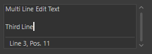

**Parameters:**

- **id** (*int*) – The unique ID of the dialog.

- **flags** (*int*) –

  Layout flags:

  |   |   |
  |---|---|
  | *BFH_CENTER* | Centered horizontally. |
  | *BFH_LEFT* | Aligned to the left. |
  | *BFH_RIGHT* | Aligned to the right. |
  | *BFH_FIT* | Fit horizontally. *BFH_LEFT* \| *BFH_RIGHT*. |
  | *BFH_SCALE* | Scale horizontally if there is more space. |
  | *BFH_SCALEFIT* | Scale fit horizontally. *BFH_SCALE* \| *BFH_FIT*. |
  | *BFH_MASK* | Masks out flags. |

  |   |   |
  |---|---|
  | *BFV_CENTER* | Centered vertically. |
  | *BFV_TOP* | Aligned to the top. |
  | *BFV_BOTTOM* | Aligned to the bottom. |
  | *BFV_FIT* | Fit. *BFV_BOTTOM* \| *BFV_TOP*. |
  | *BFV_SCALE* | Scale vertically if there is more space. |
  | *BFV_SCALEFIT* | Scale fit vertically. *BFV_SCALE* \| *BFV_FIT*. |
  | *BFV_MASK* | Masks out flags. |

- **initw** (*int*) – Initial width.

- **inith** (*int*) – Initial height.

- **style** (*int*) –

  A combination of the following flags:

  | Symbol ID | Description |
  |---|---|
  | DR_MULTILINE_MONOSPACED | Monospaced font. |
  | DR_MULTILINE_SYNTAXCOLOR | Python syntax highlighting. |
  | DR_MULTILINE_STATUSBAR | Display a status bar with the cursor position. |
  | DR_MULTILINE_HIGHLIGHTLINE | Highlight lines. |
  | DR_MULTILINE_READONLY | Read-only multi-line field. |
  | DR_MULTILINE_PYTHON | Python line return handling. |
  | DR_MULTILINE_WORDWRAP | Word-warp multi line field. |
  | DR_MULTILINE_NO_DARK_BACKGROUND | *New in version S22:* Uses not dark but normal background color |
  | DR_MULTILINE_NO_BORDER | *New in version S22:* No border |
  | DR_MULTILINE_NO_SCROLLBARS | *New in version S22:* Shows all the text without scrollbars. |
  | DR_MULTILINE_BOLD | *New in version S22:* Bold font. |

**Return type:** [c4d.gui.C4DGadget](../C4DGadget/index.md#c4d.gui.C4DGadget)

**Returns:** The added gadget.

#### `GeDialog.AddPopupButton(self, id, flags, initw=0, inith=0)` <a id="c4d.gui.GeDialog.AddPopupButton"></a>

Adds a popup button to the layout.

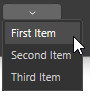

> **Note:** To add items to the popup menu use [`AddChild()`](#c4d.gui.GeDialog.AddChild) or [`SetPopup()`](#c4d.gui.GeDialog.SetPopup).

*New in version R19.*

**Parameters:**

- **id** (*int*) – The unique ID of the dialog.

- **flags** (*int*) –

  Layout flags:

  |   |   |
  |---|---|
  | *BFH_CENTER* | Centered horizontally. |
  | *BFH_LEFT* | Aligned to the left. |
  | *BFH_RIGHT* | Aligned to the right. |
  | *BFH_FIT* | Fit horizontally. *BFH_LEFT* \| *BFH_RIGHT*. |
  | *BFH_SCALE* | Scale horizontally if there is more space. |
  | *BFH_SCALEFIT* | Scale fit horizontally. *BFH_SCALE* \| *BFH_FIT*. |
  | *BFH_MASK* | Masks out flags. |

  |   |   |
  |---|---|
  | *BFV_CENTER* | Centered vertically. |
  | *BFV_TOP* | Aligned to the top. |
  | *BFV_BOTTOM* | Aligned to the bottom. |
  | *BFV_FIT* | Fit. *BFV_BOTTOM* \| *BFV_TOP*. |
  | *BFV_SCALE* | Scale vertically if there is more space. |
  | *BFV_SCALEFIT* | Scale fit vertically. *BFV_SCALE* \| *BFV_FIT*. |
  | *BFV_MASK* | Masks out flags. |

- **initw** (*int*) – Initial width.

- **inith** (*int*) – Initial height.

**Return type:** [c4d.gui.C4DGadget](../C4DGadget/index.md#c4d.gui.C4DGadget)

**Returns:** The added gadget.

#### `GeDialog.AddRadioButton(self, id, flags, initw=80, inith=0, name='')` <a id="c4d.gui.GeDialog.AddRadioButton"></a>

Adds a radio button to the layout.

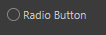

**Parameters:**

- **id** (*int*) – The unique ID of the dialog.

- **flags** (*int*) –

  Layout flags:

  |   |   |
  |---|---|
  | *BFH_CENTER* | Centered horizontally. |
  | *BFH_LEFT* | Aligned to the left. |
  | *BFH_RIGHT* | Aligned to the right. |
  | *BFH_FIT* | Fit horizontally. *BFH_LEFT* \| *BFH_RIGHT*. |
  | *BFH_SCALE* | Scale horizontally if there is more space. |
  | *BFH_SCALEFIT* | Scale fit horizontally. *BFH_SCALE* \| *BFH_FIT*. |
  | *BFH_MASK* | Masks out flags. |

  |   |   |
  |---|---|
  | *BFV_CENTER* | Centered vertically. |
  | *BFV_TOP* | Aligned to the top. |
  | *BFV_BOTTOM* | Aligned to the bottom. |
  | *BFV_FIT* | Fit. *BFV_BOTTOM* \| *BFV_TOP*. |
  | *BFV_SCALE* | Scale vertically if there is more space. |
  | *BFV_SCALEFIT* | Scale fit vertically. *BFV_SCALE* \| *BFV_FIT*. |
  | *BFV_MASK* | Masks out flags. |

- **initw** (*int*) – Initial width.

- **inith** (*int*) – Initial height.

- **name** (*str*) – Name of the radio button.

**Return type:** [c4d.gui.C4DGadget](../C4DGadget/index.md#c4d.gui.C4DGadget)

**Returns:** The added gadget.

#### `GeDialog.AddRadioGroup(self, id, flags=0, columns=0, rows=0)` <a id="c4d.gui.GeDialog.AddRadioGroup"></a>

Adds a radio group to the layout.

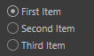

> **Note:** To add items to the radio button group use the [`AddChild()`](#c4d.gui.GeDialog.AddChild) function.

**Parameters:**

- **id** (*int*) – The control ID.

- **flags** (*int*) –

  Layout flags:

  |   |   |
  |---|---|
  | *BFH_CENTER* | Centered horizontally. |
  | *BFH_LEFT* | Aligned to the left. |
  | *BFH_RIGHT* | Aligned to the right. |
  | *BFH_FIT* | Fit horizontally. *BFH_LEFT* \| *BFH_RIGHT*. |
  | *BFH_SCALE* | Scale horizontally if there is more space. |
  | *BFH_SCALEFIT* | Scale fit horizontally. *BFH_SCALE* \| *BFH_FIT*. |
  | *BFH_MASK* | Masks out flags. |

  |   |   |
  |---|---|
  | *BFV_CENTER* | Centered vertically. |
  | *BFV_TOP* | Aligned to the top. |
  | *BFV_BOTTOM* | Aligned to the bottom. |
  | *BFV_FIT* | Fit. *BFV_BOTTOM* \| *BFV_TOP*. |
  | *BFV_SCALE* | Scale vertically if there is more space. |
  | *BFV_SCALEFIT* | Scale fit vertically. *BFV_SCALE* \| *BFV_FIT*. |
  | *BFV_MASK* | Masks out flags. |

- **columns** (*int*) – Number of columns, or 0 if rows is used.

- **rows** (*int*) – Number of rows, or 0 if columns is used.

**Return type:** bool

**Returns:** **True** if the radio group was added, otherwise **False**.

#### `GeDialog.AddRadioText(self, id, flags, initw=80, inith=0, name='')` <a id="c4d.gui.GeDialog.AddRadioText"></a>

Adds a text radio button to the layout (like the ones to the left in the Cinema 4D material editor).

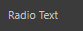

**Parameters:**

- **id** (*int*) – The unique ID of the dialog.

- **flags** (*int*) –

  Layout flags:

  |   |   |
  |---|---|
  | *BFH_CENTER* | Centered horizontally. |
  | *BFH_LEFT* | Aligned to the left. |
  | *BFH_RIGHT* | Aligned to the right. |
  | *BFH_FIT* | Fit horizontally. *BFH_LEFT* \| *BFH_RIGHT*. |
  | *BFH_SCALE* | Scale horizontally if there is more space. |
  | *BFH_SCALEFIT* | Scale fit horizontally. *BFH_SCALE* \| *BFH_FIT*. |
  | *BFH_MASK* | Masks out flags. |

  |   |   |
  |---|---|
  | *BFV_CENTER* | Centered vertically. |
  | *BFV_TOP* | Aligned to the top. |
  | *BFV_BOTTOM* | Aligned to the bottom. |
  | *BFV_FIT* | Fit. *BFV_BOTTOM* \| *BFV_TOP*. |
  | *BFV_SCALE* | Scale vertically if there is more space. |
  | *BFV_SCALEFIT* | Scale fit vertically. *BFV_SCALE* \| *BFV_FIT*. |
  | *BFV_MASK* | Masks out flags. |

- **initw** (*int*) – Initial width.

- **inith** (*int*) – Initial height.

- **name** (*str*) – Name of the text radio button.

**Return type:** [c4d.gui.C4DGadget](../C4DGadget/index.md#c4d.gui.C4DGadget)

**Returns:** The added gadget.

#### `GeDialog.AddSeparatorH(self, initw, flags=24)` <a id="c4d.gui.GeDialog.AddSeparatorH"></a>

Adds a horizontal separator to the layout.

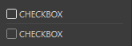

**Parameters:**

- **initw** (*int*) – Initial width.

- **flags** (*int*) –

  Layout flags:

  |   |   |
  |---|---|
  | *BFH_CENTER* | Centered horizontally. |
  | *BFH_LEFT* | Aligned to the left. |
  | *BFH_RIGHT* | Aligned to the right. |
  | *BFH_FIT* | Fit horizontally. *BFH_LEFT* \| *BFH_RIGHT*. |
  | *BFH_SCALE* | Scale horizontally if there is more space. |
  | *BFH_SCALEFIT* | Scale fit horizontally. *BFH_SCALE* \| *BFH_FIT*. |
  | *BFH_MASK* | Masks out flags. |

  |   |   |
  |---|---|
  | *BFV_CENTER* | Centered vertically. |
  | *BFV_TOP* | Aligned to the top. |
  | *BFV_BOTTOM* | Aligned to the bottom. |
  | *BFV_FIT* | Fit. *BFV_BOTTOM* \| *BFV_TOP*. |
  | *BFV_SCALE* | Scale vertically if there is more space. |
  | *BFV_SCALEFIT* | Scale fit vertically. *BFV_SCALE* \| *BFV_FIT*. |
  | *BFV_MASK* | Masks out flags. |

**Return type:** [c4d.gui.C4DGadget](../C4DGadget/index.md#c4d.gui.C4DGadget)

**Returns:** The added gadget.

#### `GeDialog.AddSeparatorV(self, inith, flags=24)` <a id="c4d.gui.GeDialog.AddSeparatorV"></a>

Adds a vertical separator to the layout.

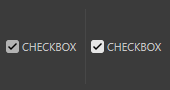

**Parameters:**

- **inith** (*int*) – Initial width.

- **flags** (*int*) –

  Layout flags:

  |   |   |
  |---|---|
  | *BFH_CENTER* | Centered horizontally. |
  | *BFH_LEFT* | Aligned to the left. |
  | *BFH_RIGHT* | Aligned to the right. |
  | *BFH_FIT* | Fit horizontally. *BFH_LEFT* \| *BFH_RIGHT*. |
  | *BFH_SCALE* | Scale horizontally if there is more space. |
  | *BFH_SCALEFIT* | Scale fit horizontally. *BFH_SCALE* \| *BFH_FIT*. |
  | *BFH_MASK* | Masks out flags. |

  |   |   |
  |---|---|
  | *BFV_CENTER* | Centered vertically. |
  | *BFV_TOP* | Aligned to the top. |
  | *BFV_BOTTOM* | Aligned to the bottom. |
  | *BFV_FIT* | Fit. *BFV_BOTTOM* \| *BFV_TOP*. |
  | *BFV_SCALE* | Scale vertically if there is more space. |
  | *BFV_SCALEFIT* | Scale fit vertically. *BFV_SCALE* \| *BFV_FIT*. |
  | *BFV_MASK* | Masks out flags. |

**Return type:** [c4d.gui.C4DGadget](../C4DGadget/index.md#c4d.gui.C4DGadget)

**Returns:** The added gadget.

#### `GeDialog.AddSlider(self, id, flags, initw=90, inith=0)` <a id="c4d.gui.GeDialog.AddSlider"></a>

Adds a slider to the layout.


**Parameters:**

- **id** (*int*) – The unique ID of the dialog.

- **flags** (*int*) –

  Layout flags:

  |   |   |
  |---|---|
  | *BFH_CENTER* | Centered horizontally. |
  | *BFH_LEFT* | Aligned to the left. |
  | *BFH_RIGHT* | Aligned to the right. |
  | *BFH_FIT* | Fit horizontally. *BFH_LEFT* \| *BFH_RIGHT*. |
  | *BFH_SCALE* | Scale horizontally if there is more space. |
  | *BFH_SCALEFIT* | Scale fit horizontally. *BFH_SCALE* \| *BFH_FIT*. |
  | *BFH_MASK* | Masks out flags. |

  |   |   |
  |---|---|
  | *BFV_CENTER* | Centered vertically. |
  | *BFV_TOP* | Aligned to the top. |
  | *BFV_BOTTOM* | Aligned to the bottom. |
  | *BFV_FIT* | Fit. *BFV_BOTTOM* \| *BFV_TOP*. |
  | *BFV_SCALE* | Scale vertically if there is more space. |
  | *BFV_SCALEFIT* | Scale fit vertically. *BFV_SCALE* \| *BFV_FIT*. |
  | *BFV_MASK* | Masks out flags. |

- **initw** (*int*) – Initial width.

- **inith** (*int*) – Initial height.

**Return type:** [c4d.gui.C4DGadget](../C4DGadget/index.md#c4d.gui.C4DGadget)

**Returns:** The added gadget.

#### `GeDialog.AddStaticText(self, id, flags, initw=0, inith=0, name='', borderstyle=0)` <a id="c4d.gui.GeDialog.AddStaticText"></a>

Adds a static text field to the layout.

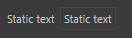

**Parameters:**

- **id** (*int*) – The unique ID of the dialog.

- **flags** (*int*) –

  Layout flags:

  |   |   |
  |---|---|
  | *BFH_CENTER* | Centered horizontally. |
  | *BFH_LEFT* | Aligned to the left. |
  | *BFH_RIGHT* | Aligned to the right. |
  | *BFH_FIT* | Fit horizontally. *BFH_LEFT* \| *BFH_RIGHT*. |
  | *BFH_SCALE* | Scale horizontally if there is more space. |
  | *BFH_SCALEFIT* | Scale fit horizontally. *BFH_SCALE* \| *BFH_FIT*. |
  | *BFH_MASK* | Masks out flags. |

  |   |   |
  |---|---|
  | *BFV_CENTER* | Centered vertically. |
  | *BFV_TOP* | Aligned to the top. |
  | *BFV_BOTTOM* | Aligned to the bottom. |
  | *BFV_FIT* | Fit. *BFV_BOTTOM* \| *BFV_TOP*. |
  | *BFV_SCALE* | Scale vertically if there is more space. |
  | *BFV_SCALEFIT* | Scale fit vertically. *BFV_SCALE* \| *BFV_FIT*. |
  | *BFV_MASK* | Masks out flags. |

- **initw** (*int*) – Initial width.

- **inith** (*int*) – Initial height.

- **name** (*str*) – Name of the button.

- **borderstyle** (*int*) –

  Border style:

  |   |   |
  |---|---|
  | *BORDER_NONE* | No border. |
  | *BORDER_THIN_IN* | Thin border inward. |
  | *BORDER_THIN_OUT* | Thin border outward. |
  | *BORDER_IN* | Normal border inward. |
  | *BORDER_OUT* | Normal border outward. |
  | *BORDER_GROUP_IN* | Group border inside. |
  | *BORDER_GROUP_OUT* | Group border outside. |
  | *BORDER_OUT2* | Outward border 2. |
  | *BORDER_OUT3* | Outward border 3 |
  | *BORDER_BLACK* | Thin black line. |
  | *BORDER_ACTIVE_1* | Active border 1. |
  | *BORDER_ACTIVE_2* | Active border 2. |
  | *BORDER_ACTIVE_3* | Active border 3. |
  | *BORDER_ACTIVE_4* | Active border 4. |
  | *BORDER_GROUP_TOP* | Border along the top. |
  | *BORDER_ROUND* | Border with round corners. |
  | *BORDER_SCHEME_EDIT* | Edit field border like the shortcut gadget for example. |
  | *BORDER_SCHEME_EDIT_NUMERIC* | Edit field border that is open to the right like the link field for example. |
  | *BORDER_OUT3l* | Outward border 3, open to the left. |
  | *BORDER_OUT3r* | Outward border 3, open to the right. |
  | *BORDER_THIN_INb* | Thin border inward, open to the botton. |
  | *BORDER_MASK* | Masks out border type. |
  | *BORDER_TEXT_DOTTED* | Only used with `GeDialog.AddStaticText()`.  <br>Draws a dotted line at right of text, useful to visually connect the text with its parameter. |
  | *BORDER_WITH_TITLE_MONO* | Display group title with monospaced font. |
  | *BORDER_WITH_TITLE_BOLD* | Display group title with bold font. |
  | *BORDER_WITH_TITLE* | Display group title in the border. |

**Return type:** [c4d.gui.C4DGadget](../C4DGadget/index.md#c4d.gui.C4DGadget)

**Returns:** The added gadget.

#### `GeDialog.AddSubDialog(self, id, flags, initw=0, inith=0)` <a id="c4d.gui.GeDialog.AddSubDialog"></a>

Adds a sub-dialog to the layout.

> **Note:** Use [`AttachSubDialog()`](#c4d.gui.GeDialog.AttachSubDialog) to assign a [`c4d.gui.SubDialog`](SubDialog/index.md#c4d.gui.SubDialog) object to the sub-dialog control.

*New in version R19.*

**Parameters:**

- **id** (*int*) – The sub-dialog ID.

- **flags** (*int*) –

  |   |   |
  |---|---|
  | *BFH_CENTER* | Centered horizontally. |
  | *BFH_LEFT* | Aligned to the left. |
  | *BFH_RIGHT* | Aligned to the right. |
  | *BFH_FIT* | Fit horizontally. *BFH_LEFT* \| *BFH_RIGHT*. |
  | *BFH_SCALE* | Scale horizontally if there is more space. |
  | *BFH_SCALEFIT* | Scale fit horizontally. *BFH_SCALE* \| *BFH_FIT*. |
  | *BFH_MASK* | Masks out flags. |

  |   |   |
  |---|---|
  | *BFV_CENTER* | Centered vertically. |
  | *BFV_TOP* | Aligned to the top. |
  | *BFV_BOTTOM* | Aligned to the bottom. |
  | *BFV_FIT* | Fit. *BFV_BOTTOM* \| *BFV_TOP*. |
  | *BFV_SCALE* | Scale vertically if there is more space. |
  | *BFV_SCALEFIT* | Scale fit vertically. *BFV_SCALE* \| *BFV_FIT*. |
  | *BFV_MASK* | Masks out flags. |

- **initw** (*int*) – Initial width.

- **inith** (*int*) – Initial height.

**Return type:** bool

**Returns:** **True** if the sub-dialog was added, otherwise **False**.

#### `GeDialog.AddUserArea(self, id, flags, initw=0, inith=0)` <a id="c4d.gui.GeDialog.AddUserArea"></a>

Adds a user area to the layout.

> **Note:** Use [`AttachUserArea()`](#c4d.gui.GeDialog.AttachUserArea) to assign a [`GeUserArea`](../GeUserArea/index.md#c4d.gui.GeUserArea) object to the user area control.

**Parameters:**

- **id** (*int*) – The user area ID.

- **flags** (*int*) –

  |   |   |
  |---|---|
  | *BFH_CENTER* | Centered horizontally. |
  | *BFH_LEFT* | Aligned to the left. |
  | *BFH_RIGHT* | Aligned to the right. |
  | *BFH_FIT* | Fit horizontally. *BFH_LEFT* \| *BFH_RIGHT*. |
  | *BFH_SCALE* | Scale horizontally if there is more space. |
  | *BFH_SCALEFIT* | Scale fit horizontally. *BFH_SCALE* \| *BFH_FIT*. |
  | *BFH_MASK* | Masks out flags. |

  |   |   |
  |---|---|
  | *BFV_CENTER* | Centered vertically. |
  | *BFV_TOP* | Aligned to the top. |
  | *BFV_BOTTOM* | Aligned to the bottom. |
  | *BFV_FIT* | Fit. *BFV_BOTTOM* \| *BFV_TOP*. |
  | *BFV_SCALE* | Scale vertically if there is more space. |
  | *BFV_SCALEFIT* | Scale fit vertically. *BFV_SCALE* \| *BFV_FIT*. |
  | *BFV_MASK* | Masks out flags. |

- **initw** (*int*) – Initial width.

- **inith** (*int*) – Initial height.

**Return type:** [c4d.gui.C4DGadget](../C4DGadget/index.md#c4d.gui.C4DGadget)

**Returns:** The added gadget.

### Gadget Checks Methods <a id="c4d.gui.GeDialog-method-Gadget-Checks-Methods"></a>

#### `GeDialog.CheckClose(self)` <a id="c4d.gui.GeDialog.CheckClose"></a>

Checks if the dialog can be closed. Normally checks the value ranges and calls `GeDialog.AskClose()`.

*New in version 2023.2.0.*

**Return type:** bool

**Returns:** **True** if the dialog should not be closed, otherwise **False**.

#### `GeDialog.CheckCoreMessage(self, msg)` <a id="c4d.gui.GeDialog.CheckCoreMessage"></a>

Speedup function that checks if a core message is new or has been already processed.

*New in version 2023.2.0.*

**Parameters:** **msg** ([*c4d.BaseContainer*](../../c4d/BaseContainer/index.md#c4d.BaseContainer)) – The core message.

**Return type:** bool

**Returns:** True if the message is new, False if it is a message of the same age.

#### `GeDialog.CheckTristateChange(self, id)` <a id="c4d.gui.GeDialog.CheckTristateChange"></a>

Indicates whatever a control’s content has been changed since the last time its value was set manually with.

**Parameters:** **id** (*Union*[[*c4d.gui.C4DGadget*](../C4DGadget/index.md#c4d.gui.C4DGadget), *int*]) – The control ID or int.

**Return type:** bool

**Returns:** **True** if the control has been changed, otherwise **False**.

#### `GeDialog.CheckValueRanges(self)` <a id="c4d.gui.GeDialog.CheckValueRanges"></a>

Checks if the value for all input fields are within the allowed range.

**Return type:** bool

**Returns:** **True** if everything is alright, or **False** if any field is wrong.

#### `GeDialog.GetPixelRatio(self)` <a id="c4d.gui.GeDialog.GetPixelRatio"></a>

Always returns 1.0 except for user areas shown on OS X Retina displays, where it returns 2.0.

*New in version 2023.2.0.*

**Return type:** float

**Returns:** Always 1.0 except for user areas shown on OS X Retina displays.

#### `GeDialog.IsEnabled(self, id)` <a id="c4d.gui.GeDialog.IsEnabled"></a>

Checks if a dialog item is enabled.

*New in version 2023.2.0.*

**Parameters:** **id** (*Union*[[*c4d.gui.C4DGadget*](../C4DGadget/index.md#c4d.gui.C4DGadget), *int*]) – The control ID or int.

**Return type:** bool

**Returns:** **True** if the dialog item is enabled, otherwise **False**.

### Gadget Getter Methods <a id="c4d.gui.GeDialog-method-Gadget-Getter-Methods"></a>

#### `GeDialog.FindCustomGui(self, id, pluginid)` <a id="c4d.gui.GeDialog.FindCustomGui"></a>

Get the custom GUI for a certain ID.

> **Note:** The GUI object must have been previously added with [`AddCustomGui()`](#c4d.gui.GeDialog.AddCustomGui).

**Parameters:**

- **id** (*int*) – The ID of the custom GUI.

- **pluginid** (*int*) –

  The plugin ID of the custom GUI.

  | Symbol ID | Value Type | Description |
  |---|---|---|
  | CUSTOMGUI_REAL | Float | Edit field. |
  | CUSTOMGUI_REALSLIDER | Float | Edit field with slider. |
  | CUSTOMGUI_REALSLIDERONLY | Float | Slider only. |
  | CUSTOMGUI_VECTOR | c4d.Vector | Vector |
  | CUSTOMGUI_VECTOR4D | c4d.Vector4D | Vector 4D. |
  | CUSTOMGUI_STRING | str | String field. |
  | CUSTOMGUI_STRINGMULTI | str | Multiple line string field. |
  | CUSTOMGUI_STATICTEXT | str | Static text field. |
  | CUSTOMGUI_CYCLE | int | Selection list field. |
  | CUSTOMGUI_CYCLEBUTTON | int | Selection field list with button functionality, e.g. the function of a button can be changed through a selection field list. |
  | CUSTOMGUI_LONG | int | Edit field. |
  | CUSTOMGUI_LONGSLIDER | int | Edit field with slider. |
  | CUSTOMGUI_BOOL | bool | Checkbox. |
  | CUSTOMGUI_TIME | c4d.BaseTime | Time edit field. |
  | CUSTOMGUI_COLOR | c4d.Vector | Color chooser. |
  | CUSTOMGUI_MATRIX | c4d.Matrix | Matrix edit fields. |
  | CUSTOMGUI_BUTTON | bool | Button. |
  | CUSTOMGUI_POPUP | None | Popup field. |
  | CUSTOMGUI_SEPARATOR | None | Separator. |
  | CUSTOMGUI_SUBDESCRIPTION | None | Sub-description. |
  | CUSTOMGUI_PROGRESSBAR | None | Progress bar. |

**Return type:** Optional[[c4d.gui.BaseCustomGui](../BaseCustomGui/index.md#c4d.gui.BaseCustomGui)]

**Returns:**

The found custom GUI, or **None** if it could not be retrieved.

The method returns a [`BaseCustomGui`](../BaseCustomGui/index.md#c4d.gui.BaseCustomGui) when there is no class available for the custom GUI.  
This allows to interact with any custom GUI, calling for instance `BaseCustomGui.GetData()`/`SetData()`.

#### `GeDialog.GetBool(self, id)` <a id="c4d.gui.GeDialog.GetBool"></a>

Retrieves the value of checkbox controls.

**Parameters:** **id** (*Union*[[*c4d.gui.C4DGadget*](../C4DGadget/index.md#c4d.gui.C4DGadget), *int*]) – The control ID or int.

**Return type:** Optional[bool]

**Returns:** The value or **None** if the value was not retrieved.

#### `GeDialog.GetColorField(self, id)` <a id="c4d.gui.GeDialog.GetColorField"></a>

Retrieves the color and brightness of color controls.

**Parameters:** **id** (*Union*[[*c4d.gui.C4DGadget*](../C4DGadget/index.md#c4d.gui.C4DGadget), *int*]) – The control ID or int.

**Return type:** Optional[Dict[**brightness**: float, **color**: c4d.Vector]]

**Returns:** The value or **None** if the value was not retrieved.

#### `GeDialog.GetFilename(self, id)` <a id="c4d.gui.GeDialog.GetFilename"></a>

Retrieves the text from string controls as a filename.

**Parameters:** **id** (*Union*[[*c4d.gui.C4DGadget*](../C4DGadget/index.md#c4d.gui.C4DGadget), *int*]) – The control ID or int.

**Return type:** Optional[str]

**Returns:** The time or **None** if the value was not retrieved.

#### `GeDialog.GetFloat(self, id)` <a id="c4d.gui.GeDialog.GetFloat"></a>

Retrieves the value of float fields.

*New in version R15.037.*

**Parameters:** **id** (*Union*[[*c4d.gui.C4DGadget*](../C4DGadget/index.md#c4d.gui.C4DGadget), *int*]) – The control ID or int.

**Return type:** Optional[float]

**Returns:** The value or **None** if the value was not retrieved.

#### `GeDialog.GetInt32(self, id)` <a id="c4d.gui.GeDialog.GetInt32"></a>

Retrieves the value of integer fields.

*New in version R15.037.*

> **Note:** Also used for tab groups, radio buttons and combo boxes.

**Parameters:** **id** (*Union*[[*c4d.gui.C4DGadget*](../C4DGadget/index.md#c4d.gui.C4DGadget), *int*]) – The control ID or int.

**Return type:** Optional[int]

**Returns:** The value or **None** if the value was not retrieved.

#### `GeDialog.GetString(self, id)` <a id="c4d.gui.GeDialog.GetString"></a>

Retrieves the text from string controls.  
Used for all controls that have a text, for example static text fields, edit fields, buttons and checkboxes.

**Parameters:** **id** (*Union*[[*c4d.gui.C4DGadget*](../C4DGadget/index.md#c4d.gui.C4DGadget), *int*]) – The control ID or int.

**Return type:** Optional[str]

**Returns:** The value or **None** if the value was not retrieved.

#### `GeDialog.GetTime(self, id, doc)` <a id="c4d.gui.GeDialog.GetTime"></a>

Retrieves the time of time fields.

**Parameters:**

- **id** (*Union*[[*c4d.gui.C4DGadget*](../C4DGadget/index.md#c4d.gui.C4DGadget), *int*]) – The control ID or int.
- **doc** ([*c4d.documents.BaseDocument*](../../c4d.documents/BaseDocument/index.md#c4d.documents.BaseDocument)) – The document.

**Return type:** Optional[[c4d.BaseTime](../../c4d/BaseTime/index.md#c4d.BaseTime)]

**Returns:** The time or **None** if the value was not retrieved.

#### `GeDialog.GetVector(self, id_x, id_y, id_z)` <a id="c4d.gui.GeDialog.GetVector"></a>

Retrieves the value of three float fields at the same time as a vector.

**Parameters:**

- **id_x** (*Union*[[*c4d.gui.C4DGadget*](../C4DGadget/index.md#c4d.gui.C4DGadget), *int*]) – The control ID of the X field.
- **id_y** (*Union*[[*c4d.gui.C4DGadget*](../C4DGadget/index.md#c4d.gui.C4DGadget), *int*]) – The control ID of the Y field.
- **id_z** (*Union*[[*c4d.gui.C4DGadget*](../C4DGadget/index.md#c4d.gui.C4DGadget), *int*]) – The control ID of the Z field.

**Return type:** Optional[[c4d.Vector](../../c4d/Vector/index.md#c4d.Vector)]

**Returns:** The value or **None** if the value was not retrieved.

### Gadget Information Methods <a id="c4d.gui.GeDialog-method-Gadget-Information-Methods"></a>

#### `GeDialog.GetItemDim(self, id)` <a id="c4d.gui.GeDialog.GetItemDim"></a>

Queries a dialog control for its current position and size in pixels.  
Note that this method does take the scrollbars of a gadget into account while `GeDialog.SetVisibleArea()` will not. See `GeDialog.SetVisibleArea()` for more information on how to compensate for that.

**Parameters:** **id** (*Union*[[*c4d.gui.C4DGadget*](../C4DGadget/index.md#c4d.gui.C4DGadget), *int*]) – The control ID.

**Return type:** Dict[‘x’: int, ‘y’: int, ‘w’: int, ‘h’: int]

**Returns:** A dictionary with the X/Y coordinates of the upper left corner and the width/height of the control.

### Gadget Setter Methods <a id="c4d.gui.GeDialog-method-Gadget-Setter-Methods"></a>

#### `GeDialog.Activate(self, id)` <a id="c4d.gui.GeDialog.Activate"></a>

Sets the focus to a specific control within the dialog.

**Parameters:** **id** (*int*) – The control ID.

**Return type:** bool

**Returns:** **True** if the control was activated.

#### `GeDialog.AddChildren(self, id, bc)` <a id="c4d.gui.GeDialog.AddChildren"></a>

Adds children to a dialog element using a container.

*New in version R19.*

**Parameters:**

- **id** (*int*) – The control ID.
- **bc** ([*c4d.BaseContainer*](../../c4d/BaseContainer/index.md#c4d.BaseContainer)) – A container with the children to set.

**Return type:** bool

**Returns:** **True** if the children were added, otherwise **False**.

#### `GeDialog.AttachSubDialog(self, userdlg, id)` <a id="c4d.gui.GeDialog.AttachSubDialog"></a>

Attaches a [`c4d.gui.SubDialog`](SubDialog/index.md#c4d.gui.SubDialog) derived object to a sub-dialog control, added with [`AddSubDialog()`](#c4d.gui.GeDialog.AddSubDialog).  
To replace the sub-dialog with another one, just call this function again.

*New in version R19.*

**Parameters:**

- **userdlg** ([*c4d.gui.SubDialog*](SubDialog/index.md#c4d.gui.SubDialog)) – The sub-dialog to attach.
- **id** (*int*) – The sub-dialog ID.

**Return type:** bool

**Returns:** **True** if the sub-dialog was attached, otherwise **False**.

#### `GeDialog.AttachUserArea(self, ua, id, userareaflags=4)` <a id="c4d.gui.GeDialog.AttachUserArea"></a>

Assigns a [`GeUserArea`](../GeUserArea/index.md#c4d.gui.GeUserArea) object to a user area control in the dialog.  
The object will handle all messages to the user area and is responsible for painting the user area.  
A good practice is to place the [`GeUserArea`](../GeUserArea/index.md#c4d.gui.GeUserArea) derived object as a member of the [`GeDialog`](#c4d.gui.GeDialog) derived class.

**Parameters:**

- **ua** ([*c4d.gui.GeUserArea*](../GeUserArea/index.md#c4d.gui.GeUserArea)) – A user area object to attach.

- **id** (*Union*[[*c4d.gui.C4DGadget*](../C4DGadget/index.md#c4d.gui.C4DGadget), *int*]) – The control ID.

- **userareaflags** (*int*) –

  Flags for the user area:

  |   |   |
  |---|---|
  | *USERAREAFLAGS_NONE* | None. |
  | *USERAREAFLAGS_TABSTOP* | Tab stop. |
  | *USERAREAFLAGS_HANDLEFOCUS* | Handle focus. |
  | *USERAREAFLAGS_COREMESSAGE* | Receive core messages. |
  | *USERAREAFLAGS_SYNCMESSAGE* | Receive sync messages. |
  | *USERAREAFLAGS_DONT_MIRROR* | Do not mirror the user area. |

**Return type:** bool

**Returns:** **True** if the children were removed.

#### `GeDialog.SetBool(self, id, value)` <a id="c4d.gui.GeDialog.SetBool"></a>

Sets the value of checkbox controls.

**Parameters:**

- **id** (*Union*[[*c4d.gui.C4DGadget*](../C4DGadget/index.md#c4d.gui.C4DGadget), *int*]) – The control ID or int.
- **value** (*bool*) – The new value.

**Return type:** bool

**Returns:** **True** if the value was set.

#### `GeDialog.SetColorField(self, id, color, brightness, maxbrightness, flags)` <a id="c4d.gui.GeDialog.SetColorField"></a>

Sets the color, brightness and limits of color fields and color choosers.

**Parameters:**

- **id** (*Union*[[*c4d.gui.C4DGadget*](../C4DGadget/index.md#c4d.gui.C4DGadget), *int*]) – The control ID or int.

- **color** ([*c4d.Vector*](../../c4d/Vector/index.md#c4d.Vector)) – The color.

- **brightness** (*float*) – The new brightness value.

- **maxbrightness** (*float*) – The maximum brightness allowed.

- **flags** (*int*) –

  Controls what parts of a color chooser that are available. Possible values are:

  |   |   |
  |---|---|
  | *DR_COLORFIELD_NO_BRIGHTNESS* | Disables the brightness control. |
  | *DR_COLORFIELD_NO_COLOR* | Disables the color control. |
  | *DR_COLORFIELD_BODYPAINT* | Uses the BodyPaint 3D style. Deprecated since R17. Not needed anymore: now just one style. |
  | *DR_COLORFIELD_ICC_BASEDOC* | Uses the color profile of the current [`BaseDocument`](../../c4d.documents/BaseDocument/index.md#c4d.documents.BaseDocument). |
  | *DR_COLORFIELD_ICC_BPTEX* | Uses the color profile of the current BodyPaint 3D texture. |
  | *DR_COLORFIELD_NO_MODE_BUTTONS* | *New in version R17.032:* Hides the color mode buttons. |
  | *DR_COLORFIELD_NO_COLORWHEEL* | *New in version R17.032:* Hides the Color Wheel mode button. |
  | *DR_COLORFIELD_NO_SPECTRUM* | *New in version R17.032:* Hides the Color Spectrum mode button. |
  | *DR_COLORFIELD_NO_PICTURE* | *New in version R17.032:* Hides the Color From Picture mode button. |
  | *DR_COLORFIELD_NO_RGB* | *New in version R17.032:* Hides the RGB sliders mode button. |
  | *DR_COLORFIELD_NO_HSV* | *New in version R17.032:* Hides the HSV sliders mode button. |
  | *DR_COLORFIELD_NO_KELVIN* | *New in version R17.032:* Hides the Kelvin Color Temperature mode button. |
  | *DR_COLORFIELD_NO_MIXER* | *New in version R17.032:* Hides the Color Mixer mode button. |
  | *DR_COLORFIELD_NO_SWATCHES* | *New in version R17.032:* Hides the Swatches mode button. |
  | *DR_COLORFIELD_NO_SCREENPICKER* | *New in version R17.032:* Hides the ScreenPicker mode button. |
  | *DR_COLORFIELD_ENABLE_COLORWHEEL* | *New in version R17.032:* Enables the Special Color Wheel mode (Special modes are exclusive each other: use only one at a time). |
  | *DR_COLORFIELD_ENABLE_SPECTRUM* | *New in version R17.032:* Enables the Special Color Spectrum mode (Special modes are exclusive each other: use only one at a time). |
  | *DR_COLORFIELD_ENABLE_PICTURE* | *New in version R17.032:* Enables the Special Color from Picture mode (Special modes are exclusive each other: use only one at a time). |
  | *DR_COLORFIELD_ENABLE_RGB* | *New in version R17.032:* Enables the RGB sliders mode. |
  | *DR_COLORFIELD_ENABLE_HSV* | *New in version R17.032:* Enables the HSV sliders mode. |
  | *DR_COLORFIELD_ENABLE_KELVIN* | *New in version R17.032:* Enables the Kelvin Color Temperature mode. |
  | *DR_COLORFIELD_ENABLE_MIXER* | *New in version R17.032:* Enables the Color Mixer mode. |
  | *DR_COLORFIELD_ENABLE_SWATCHES* | *New in version R17.032:* Enables the Swatches mode. |
  | *DR_COLORFIELD_RGB_HIDE_HEX* | *New in version R17.032:* Hides the Hexadecimal color field in the RGB Mode. |
  | *DR_COLORFIELD_POPUP* | *New in version R17.032:* Private. |

**Return type:** bool

**Returns:** **True** if the value was set.

#### `GeDialog.SetDegree(self, id, value, min=2.2250738585072014e-308, max=1.7976931348623157e+308, step=1.0, tristate=False)` <a id="c4d.gui.GeDialog.SetDegree"></a>

Sets the value and limits of an angle field.

> **Note:** Same as [`SetFloat()`](#c4d.gui.GeDialog.SetFloat) with *FORMAT_DEGREE*.

**Parameters:**

- **id** (*Union*[[*c4d.gui.C4DGadget*](../C4DGadget/index.md#c4d.gui.C4DGadget), *int*]) – The control ID or int.
- **value** (*float*) – The new value.
- **min** (*int*) – The minimum angle accepted in degrees.
- **max** (*int*) – The maximum angle accepted in degrees.
- **step** (*float*) – The step used for arrow buttons in degrees.
- **tristate** (*bool*) – If this is **True** the control is tinted blue to indicate tristate mode.

**Return type:** bool

**Returns:** **True** if the value was set.

#### `GeDialog.SetFilename(self, id, fn, tristate=False)` <a id="c4d.gui.GeDialog.SetFilename"></a>

Sets the text of string controls, taking the new value from a filename.

**Parameters:**

- **id** (*Union*[[*c4d.gui.C4DGadget*](../C4DGadget/index.md#c4d.gui.C4DGadget), *int*]) – The control ID or int.
- **fn** (*str*) – The new filename.
- **tristate** (*bool*) – If this is **True** the control is tinted blue to indicate tristate mode.

**Return type:** bool

**Returns:** **True** if the value was set.

#### `GeDialog.SetFloat(self, id, value, min=2.2250738585072014e-308, max=1.7976931348623157e+308, step=1.0, format=1718773089, min2=0.0, max2=0.0, quadscale=False, tristate=False)` <a id="c4d.gui.GeDialog.SetFloat"></a>

Sets the value, unit and limits of float fields.

*New in version R15.037.*

**Parameters:**

- **id** (*Union*[[*c4d.gui.C4DGadget*](../C4DGadget/index.md#c4d.gui.C4DGadget), *int*]) – The control ID or int.

- **value** (*float*) – The new value.

- **min** (*int*) – The minimum value accepted.

- **max** (*int*) – The maximum value accepted.

- **step** (*float*) – The step used for arrow buttons.

- **format** (*int*) –

  The unit and format of the field. Valid formats are:

  |   |   |
  |---|---|
  | *FORMAT_FLOAT* | Floating point without unit. |
  | *FORMAT_INT* | Integer without unit. |
  | *FORMAT_PERCENT* | Floating point with % sign, *1.0* = *100%*. |
  | *FORMAT_DEGREE* | Floating point with ° sign. Measured in radians, displayed in degrees. |
  | *FORMAT_METER* | Floating point in the current working unit. |
  | *FORMAT_FRAMES* | Time formatted as frames. (Overrided by user preference.) |
  | *FORMAT_SECONDS* | Time formatted as seconds. (Overrided by user preference.) |
  | *FORMAT_SMPTE* | Time formatted as SMPTE. (Overrided by user preference.) |

- **min2** (*int*) – The minimum value allowed outside the range used for sliders. Overrides *min* for the acceptance check.

- **max2** (*int*) – The maximum value allowed outside the range used for sliders. Overrides *max* for the acceptance check.

- **quadscale** (*bool*) – If this is **True** a quadratic scale is used for the slider, so that more precision is available for lower values.

- **tristate** (*bool*) – If this is **True** the control is tinted blue to indicate tristate mode.

**Return type:** bool

**Returns:** **True** if the value was set.

#### `GeDialog.SetInt32(self, id, value, min=-2147483647, max=2147483647, step=1, tristate=False, min2=-2147483647, max2=2147483647)` <a id="c4d.gui.GeDialog.SetInt32"></a>

Sets the value and limits of integer fields.

*New in version R15.037.*

> **Note:** Also used for tab groups, radio buttons and combo boxes.

**Parameters:**

- **id** (*Union*[[*c4d.gui.C4DGadget*](../C4DGadget/index.md#c4d.gui.C4DGadget), *int*]) – The control ID or int.
- **value** (*int*) – The new value.
- **min** (*int*) – The minimum value accepted.
- **max** (*int*) – The maximum value accepted.
- **step** (*bool*) – The step used for arrow buttons.
- **step** – If this is **True** the control is tinted blue to indicate tristate mode.
- **min2** (*int*) – The minimum value allowed outside the range used for sliders. Overrides *min* for the acceptance check.
- **max2** (*int*) – The minimum value allowed outside the range used for sliders. Overrides *max* for the acceptance check.

**Return type:** bool

**Returns:** **True** if the value was set.

#### `GeDialog.SetMeter(self, id, value, min=2.2250738585072014e-308, max=1.7976931348623157e+308, step=1.0, tristate=False)` <a id="c4d.gui.GeDialog.SetMeter"></a>

Sets the value and limits of a meter field.

> **Note:** Same as [`SetFloat()`](#c4d.gui.GeDialog.SetFloat) with *FORMAT_METER*.

**Parameters:**

- **id** (*Union*[[*c4d.gui.C4DGadget*](../C4DGadget/index.md#c4d.gui.C4DGadget), *int*]) – The control ID or int.
- **value** (*float*) – The new value.
- **min** (*int*) – The minimum value accepted.
- **max** (*int*) – The maximum value accepted.
- **step** (*float*) – The step used for arrow buttons.
- **tristate** (*bool*) – If this is **True** the control is tinted blue to indicate tristate mode.

**Return type:** bool

**Returns:** **True** if the value was set.

#### `GeDialog.SetMultiLineLock(self, id, lock)` <a id="c4d.gui.GeDialog.SetMultiLineLock"></a>

Locks/unlocks multi-line edit fields.

*New in version 2023.2.0.*

**Parameters:**

- **id** (*Union*[[*c4d.gui.C4DGadget*](../C4DGadget/index.md#c4d.gui.C4DGadget), *int*]) – The control ID or int.
- **lock** (*bool*) – **True** to lock the field, **False** to unlock it.

**Return type:** bool

**Returns:** **True** if the multi-line edit field was locked/unlocked, otherwise **False**.

#### `GeDialog.SetMultiLineMode(self, id, mode)` <a id="c4d.gui.GeDialog.SetMultiLineMode"></a>

Sets the edit mode for multi-line edit fields.

**Parameters:**

- **id** (*Union*[[*c4d.gui.C4DGadget*](../C4DGadget/index.md#c4d.gui.C4DGadget), *int*]) – The control ID or int.

- **mode** (*int*) –

  The multi-line edit mode:

  |   |   |
  |---|---|
  | *SCRIPTMODE_NONE* | Normal multi-line text field. |
  | *SCRIPTMODE_PYTHON* | Python syntax highlighting. |
  | *SCRIPTMODE_AM_ID* | *New in version R19:* Plain Attribute Manager ID (used for online help and new feature highlighting). |

**Return type:** bool

**Returns:** **True** if the multi-line mode was set, otherwise **False**.

#### `GeDialog.SetMultiLinePos(self, id, line, pos)` <a id="c4d.gui.GeDialog.SetMultiLinePos"></a>

Set the cursor position within a dialog multi-line string item.

**Parameters:**

- **id** (*Union*[[*c4d.gui.C4DGadget*](../C4DGadget/index.md#c4d.gui.C4DGadget), *int*]) – The control ID or int.
- **line** (*int*) – The line number.
- **pos** (*int*) – The position within the line.

**Return type:** bool

**Returns:** **True** if successful, otherwise **False**.

#### `GeDialog.SetPercent(self, id, value, min=0.0, max=100.0, step=1.0, tristate=False)` <a id="c4d.gui.GeDialog.SetPercent"></a>

Sets the value and limits of a percent field.

> **Note:** Same as [`SetFloat()`](#c4d.gui.GeDialog.SetFloat) with *FORMAT_PERCENT*.

**Parameters:**

- **id** (*Union*[[*c4d.gui.C4DGadget*](../C4DGadget/index.md#c4d.gui.C4DGadget), *int*]) – The control ID or int.
- **value** (*float*) – The new value.
- **min** (*int*) – The minimum value accepted (percentage units).
- **max** (*int*) – The maximum value accepted (percentage units).
- **step** (*float*) – The step used for arrow buttons (percentage units).
- **tristate** (*bool*) – If this is **True** the control is tinted blue to indicate tristate mode.

**Return type:** bool

**Returns:** **True** if the value was set.

#### `GeDialog.SetPopup(self, id, bc)` <a id="c4d.gui.GeDialog.SetPopup"></a>

Sets the item list of a popup button using a popup menu container.

*New in version R19.*

**Parameters:**

- **id** (*Union*[[*c4d.gui.C4DGadget*](../C4DGadget/index.md#c4d.gui.C4DGadget), *int*]) – The control ID or int.
- **bc** ([*c4d.BaseContainer*](../../c4d/BaseContainer/index.md#c4d.BaseContainer)) – A container with the items to set.

**Return type:** bool

**Returns:** **True** if the popup menu was set, otherwise **False**.

#### `GeDialog.SetString(self, id, value, tristate=False, flags=0)` <a id="c4d.gui.GeDialog.SetString"></a>

Sets the text of string controls.  
Used for all controls that have a text, for example static text fields, edit fields, buttons and checkboxes.

**Parameters:**

- **id** (*Union*[[*c4d.gui.C4DGadget*](../C4DGadget/index.md#c4d.gui.C4DGadget), *int*]) – The control ID or int.

- **value** (*str*) – The new string.

- **tristate** (*bool*) – If this is **True** the control is tinted blue to indicate tristate mode.

- **flags** (*int*) –

  Flags:

  | Symbol ID | Description |
  |---|---|
  | EDITTEXT_PASSWORD | Password field. |
  | EDITTEXT_HELPTEXT | Sets the help text for an edit field. This text appears if the edit field is empty. |
  | EDITTEXT_IGNORELEFTRIGHTIFEMPTY | Ignore Left Right Keys if edit field is empty. |
  | EDITTEXT_CURSORUPDOWNBUTTONS | Returns messages if cursor up/down is pressed (BFM_ACTION_KEYUP, BFM_ACTION_KEYDOWN) |
  | EDITTEXT_ENABLECLEARBUTTON | Displays a clear button within the edit field |

**Return type:** bool

**Returns:** **True** if the value was set.

#### `GeDialog.SetTime(self, id, doc, value, min=-108000, max=108000, stepframes=1, tristate=False)` <a id="c4d.gui.GeDialog.SetTime"></a>

Sets the value and limits of a time field.

> **Note:** Same as [`SetFloat()`](#c4d.gui.GeDialog.SetFloat) with *FORMAT_FRAMES*.

**Parameters:**

- **id** (*Union*[[*c4d.gui.C4DGadget*](../C4DGadget/index.md#c4d.gui.C4DGadget), *int*]) – The control ID or int.
- **value** ([*c4d.BaseTime*](../../c4d/BaseTime/index.md#c4d.BaseTime)) – The new time.
- **min** ([*c4d.BaseTime*](../../c4d/BaseTime/index.md#c4d.BaseTime)) – The minimum time accepted.
- **max** ([*c4d.BaseTime*](../../c4d/BaseTime/index.md#c4d.BaseTime)) – The maximum time accepted.
- **stepframes** (*int*) – The frame step used for arrow buttons.
- **tristate** (*bool*) – If this is **True** the control is tinted blue to indicate tristate mode.

**Return type:** bool

**Returns:** **True** if the value was set.

### Input Events Methods <a id="c4d.gui.GeDialog-method-Input-Events-Methods"></a>

#### `GeDialog.GetInputEvent(self, askdevice, res)` <a id="c4d.gui.GeDialog.GetInputEvent"></a>

Gets the next input event for a certain device from the event queue.

**Parameters:**

- **askdevice** (*int*) – The device to ask. Either **BFM_INPUT_MOUSE** or **BFM_INPUT_KEYBOARD**.
- **res** ([*c4d.BaseContainer*](../../c4d/BaseContainer/index.md#c4d.BaseContainer)) – The result container.

**Return type:** bool

**Returns:** **True** if the event could be retrieved in *res*, otherwise **False**.

#### `GeDialog.GetInputState(self, askdevice, askchannel, res)` <a id="c4d.gui.GeDialog.GetInputState"></a>

Polls a certain channel of a device for the current input state.

**Parameters:**

- **askdevice** (*int*) – The device to ask. Either **BFM_INPUT_MOUSE** or **BFM_INPUT_KEYBOARD**.
- **askchannel** (*int*) – The channel to ask.
- **res** ([*c4d.BaseContainer*](../../c4d/BaseContainer/index.md#c4d.BaseContainer)) – The result container.

**Return type:** bool

**Returns:** **True** if the state could be retrieved in *res*, otherwise **False**.

#### `GeDialog.KillEvents(self)` <a id="c4d.gui.GeDialog.KillEvents"></a>

Flushes all events from the window message queue. For example if you loop while the mouse is down (polling) you can call this command to flush all keydowns/mouseclicks that are made during the loop.

### Magic Methods <a id="c4d.gui.GeDialog-method-Magic-Methods"></a>

#### `GeDialog.__init__(self)` <a id="c4d.gui.GeDialog.__init__"></a>

Init a GeDialog.

### Methods to Override <a id="c4d.gui.GeDialog-method-Methods-to-Override"></a>

#### `GeDialog.AskClose(self)` <a id="c4d.gui.GeDialog.AskClose"></a>

Override it to avoid closing the dialog if an error situation has occurred.  
If the user wants to close the dialog with the OK button this function will be called.

> **Note:** If you return **False** everything will be as usual, but if you return **True** the dialog won’t close.

> **Warning:**
>
> Please pay attention to the result value.  
> **True** means, it will **not** close.

**Return type:** bool

**Returns:** **True** if the dialog shouldn’t be closed, **False** if it should.

#### `GeDialog.Command(self, id, msg)` <a id="c4d.gui.GeDialog.Command"></a>

Override this function if you want to react to user clicks.  
Whenever the user clicks on a gadget and/or changes its value this function will be called.  
It is also called when a string menu item is selected. Override it to handle such events.

> **Note:** Remember that you need to call [`StopAllThreads()`](../../c4d/index.md#c4d.StopAllThreads) before making modifications to the scene.

**Parameters:**

- **id** (*int*) – The ID of the gadget that triggered the event.

- **msg** ([*c4d.BaseContainer*](../../c4d/BaseContainer/index.md#c4d.BaseContainer)) –

  The original message container. Contains the following values:

  |   |   |   |
  |---|---|---|
  | *BFM_ACTION_ID* | int | ID of the dialog element that triggered the action. |
  | *BFM_ACTION_VALUE* | any | Action value. |
  | *BFM_ACTION_INDRAG* | bool | Slider in dragging mode (not finished). |
  | *BFM_ACTION_STRCHG* | bool | String in text field changed. |
  | *BFM_ACTION_VALCHG* | bool | Edit/slider changed. |
  | *BFM_ACTION_ESC* | bool | Action escaped. Internal. |
  | *BFM_ACTION_RESET* | bool | Reset to default value on right-click of input field arrows. |
  | *BFM_ACTION_UPDATE* | bool | Update without verify. Internal. |
  | *BFM_ACTION_KEYDOWN* | bool | *New in version R24:* Key Down pressed while editfield is active. |
  | *BFM_ACTION_KEYUP* | bool | *New in version R24:* Key Up pressed while editfield is active. |

**Return type:** bool

**Returns:** **False** if there was an error, otherwise **True**.

#### `GeDialog.CoreMessage(self, id, msg)` <a id="c4d.gui.GeDialog.CoreMessage"></a>

Override this function if you want to react to Cinema 4D core messages.  
The original message is stored in msg.

**Parameters:**

- **id** (*int*) – The received [core message](../../../consts/MSG_CORE_EVMSG.md#msg-core-event).
- **msg** ([*c4d.BaseContainer*](../../c4d/BaseContainer/index.md#c4d.BaseContainer)) – The message container.

**Return type:** bool

**Returns:** Currently not used - but you have to return a bool value.

#### `GeDialog.CreateLayout(self)` <a id="c4d.gui.GeDialog.CreateLayout"></a>

Override - Called when Cinema 4D is about to display the dialog.

**Return type:** bool

**Returns:** **True** if successful, or **False** to signalize an error.

#### `GeDialog.DestroyWindow(self)` <a id="c4d.gui.GeDialog.DestroyWindow"></a>

Override this method - this function is called when the dialog is about to be closed temporarily, for example for layout switching.

#### `GeDialog.InitValues(self)` <a id="c4d.gui.GeDialog.InitValues"></a>

Called when the dialog is initialized by the GUI.

**Return type:** bool

**Returns:** **True** if successful, or **False** to signalize an error.

#### `GeDialog.Message(self, msg, result)` <a id="c4d.gui.GeDialog.Message"></a>

Override this function to react to more messages than covered by the other functions.  
Normally this is not necessary.

> **Note:** If overridden, include a call to the base version of this function, `GeDialog.Message()`:

> **See also:** [C4DAtom and Plugin Messages](../../../consts/MSG_C4DATOM_PLUGINS.md) for information on the messages type, data and input/output.

```python
def Message(self, msg, result):
    return c4d.gui.GeDialog.Message(self, msg, result)
```

**Parameters:**

- **msg** ([*BaseContainer*](../../c4d/BaseContainer/index.md#c4d.BaseContainer)) – The message container.
- **result** ([*BaseContainer*](../../c4d/BaseContainer/index.md#c4d.BaseContainer)) – A container to store results in.

**Return type:** int

**Returns:** The return value depends on the message.

#### `GeDialog.Timer(self, msg)` <a id="c4d.gui.GeDialog.Timer"></a>

If you subscribe to timer events using [`SetTimer()`](#c4d.gui.GeDialog.SetTimer) (x), this function is called every x’th millisecond.

**Parameters:** **msg** ([*BaseContainer*](../../c4d/BaseContainer/index.md#c4d.BaseContainer)) – The raw timer message.
