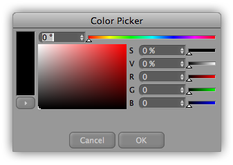
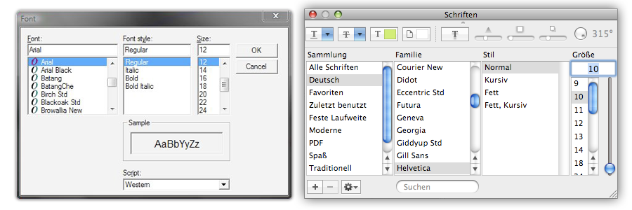
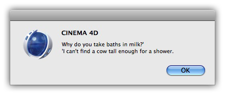
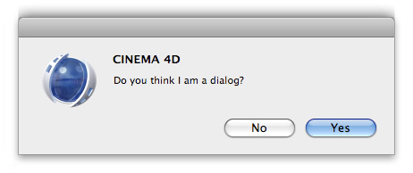
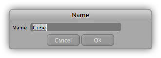
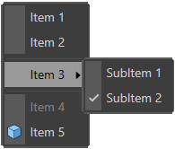
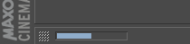
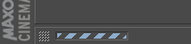
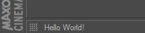

<!-- Source: https://developers.maxon.net/docs/py/2027_0_0/modules/c4d.gui/index.html -->

# c4d.gui <a id="c4d-gui"></a>

## *class* `c4d.gui` <a id="c4d.gui"></a>

> **Note:** File dialogs are defined in [`c4d.storage`](../c4d.storage/index.md#c4d.storage).

- [`c4d.gui.BaseCustomGui`](BaseCustomGui/index.md#c4d.gui.BaseCustomGui)

  - [`c4d.gui.BitmapButtonCustomGui`](BaseCustomGui/BitmapButtonCustomGui/index.md#c4d.gui.BitmapButtonCustomGui)
  - [`c4d.gui.FontChooserCustomGui`](BaseCustomGui/FontChooserCustomGui/index.md#c4d.gui.FontChooserCustomGui)
  - [`c4d.gui.GradientCustomGui`](BaseCustomGui/GradientCustomGui/index.md#c4d.gui.GradientCustomGui)
  - [`c4d.gui.HyperLinkCustomGui`](BaseCustomGui/HyperLinkCustomGui/index.md#c4d.gui.HyperLinkCustomGui)
  - [`c4d.gui.HtmlViewerCustomGui`](BaseCustomGui/HtmlViewerCustomGui/index.md#c4d.gui.HtmlViewerCustomGui)
  - [`c4d.gui.InExcludeCustomGui`](BaseCustomGui/InExcludeCustomGui/index.md#c4d.gui.InExcludeCustomGui)
  - [`c4d.gui.LinkBoxGui`](BaseCustomGui/LinkBoxGui/index.md#c4d.gui.LinkBoxGui)
  - [`c4d.gui.QuickTabCustomGui`](BaseCustomGui/QuickTabCustomGui/index.md#c4d.gui.QuickTabCustomGui)
  - [`c4d.gui.SplineCustomGui`](BaseCustomGui/SplineCustomGui/index.md#c4d.gui.SplineCustomGui)
  - [`c4d.gui.TreeViewCustomGui`](BaseCustomGui/TreeViewCustomGui/index.md#c4d.gui.TreeViewCustomGui)
  - [`c4d.gui.DateTimeControl`](BaseCustomGui/DateTimeControlData/index.md#c4d.gui.DateTimeControl)
  - [`c4d.gui.DescriptionCustomGui`](BaseCustomGui/DescriptionCustomGui/index.md#c4d.gui.DescriptionCustomGui)
  - [`c4d.gui.RangeCustomGui`](BaseCustomGui/RangeCustomGui/index.md#c4d.gui.RangeCustomGui)
  - [`c4d.gui.SoundEffectorCustomGui`](BaseCustomGui/SoundEffectorCustomGui/index.md#c4d.gui.SoundEffectorCustomGui)

- [`c4d.gui.C4DGadget`](C4DGadget/index.md#c4d.gui.C4DGadget)

- [`c4d.gui.EditorWindow`](EditorWindow/index.md#c4d.gui.EditorWindow)

- [`c4d.gui.GeDialog`](GeDialog/index.md#c4d.gui.GeDialog)

  - [`c4d.gui.SubDialog`](GeDialog/SubDialog/index.md#c4d.gui.SubDialog)

- [`c4d.gui.GeUserArea`](GeUserArea/index.md#c4d.gui.GeUserArea)

- [`c4d.gui.TreeViewFunctions`](TreeViewFunctions/index.md#c4d.gui.TreeViewFunctions)

## Overview <a id="overview"></a>

**Dialogs**

- [`c4d.gui.ColorDialog()`](#c4d.gui.ColorDialog): Opens a color chooser dialog for the user to select a color.
- [`c4d.gui.FontDialog()`](#c4d.gui.FontDialog): Opens a font chooser dialog for the user to select a font.
- [`c4d.gui.InputDialog()`](#c4d.gui.InputDialog): Opens an input dialog which returns the input string.
- [`c4d.gui.MessageDialog()`](#c4d.gui.MessageDialog): Display a message dialog with the string as the message.
- [`c4d.gui.QuestionDialog()`](#c4d.gui.QuestionDialog): Opens a standard question dialog with a question mark icon and Yes/No buttons.
- [`c4d.gui.RenameDialog()`](#c4d.gui.RenameDialog): Opens a standard rename dialog

**Input And Drag Operations**

- [`c4d.gui.GetDnDFilename()`](#c4d.gui.GetDnDFilename): Extracts the Filename from the given drag and drop data returned by GetDragObject.
- [`c4d.gui.GetInputEvent()`](#c4d.gui.GetInputEvent): Gets the next input event for a certain device from the event queue.
- [`c4d.gui.GetInputState()`](#c4d.gui.GetInputState): Polls a certain channel of a device for the current input state.

**Interface Appearance**

- [`c4d.gui.GetCursorBitmap()`](#c4d.gui.GetCursorBitmap): Private.
- [`c4d.gui.GetGuiWorldColor()`](#c4d.gui.GetGuiWorldColor): Gets a GUI color from its constant ID.
- [`c4d.gui.GetIcon()`](#c4d.gui.GetIcon): Gets an icon registered with `RegisterIcon()`. Similar to [`InitResourceBitmap()`](../c4d.bitmaps/index.md#c4d.bitmaps.InitResourceBitmap).
- [`c4d.gui.GetInterfaceIcon()`](#c4d.gui.GetInterfaceIcon): Returns the icon for an interface element.
- [`c4d.gui.GetInterfaceIconEx()`](#c4d.gui.GetInterfaceIconEx): Returns the icon for an interface element.
- [`c4d.gui.GeUpdateUI()`](#c4d.gui.GeUpdateUI): Forces a redraw of the GUI, for example after a change of the preferences or Linear Workflow settings.
- [`c4d.gui.RegisterIcon()`](#c4d.gui.RegisterIcon): Registers an icon from a bitmap.
- [`c4d.gui.SetMousePointer()`](#c4d.gui.SetMousePointer): Sets the type of mouse pointer.
- [`c4d.gui.UnregisterIcon()`](#c4d.gui.UnregisterIcon): Unregisters the icon with ID *lIconID*. Only unregister your own registered icons.

**Layout Sizing**

- [`c4d.gui.SizeChr()`](#c4d.gui.SizeChr): Bakes a character count so that it can be used to specify dialog control dimension.
- [`c4d.gui.SizePix()`](#c4d.gui.SizePix): Bakes a pixel size so that it can be used to specify dialog control dimension.
- [`c4d.gui.SizePixChr()`](#c4d.gui.SizePixChr): Combines the `SizePix()` and `SizeChr()` functions.

**Menu Resources**

- [`c4d.gui.GetMenuResource()`](#c4d.gui.GetMenuResource): Gets the menu container of a main menu.
- [`c4d.gui.SearchMenuResource()`](#c4d.gui.SearchMenuResource): Searches a menu container for a certain plugin command (which is a string identifier, for example **“PLUGIN_CMD_1000472”**).
- [`c4d.gui.SearchPluginMenuResource()`](#c4d.gui.SearchPluginMenuResource): Searches for the ‘Plugins’ main category in ‘M_EDITOR’.
- [`c4d.gui.SearchPluginSubMenuResource()`](#c4d.gui.SearchPluginSubMenuResource): Searches for the “Plugins” main category in “M_EDITOR” or optionally a submenu specified by *bc*.
- [`c4d.gui.UpdateMenus()`](#c4d.gui.UpdateMenus): Forces a menu update.

**Popup Menus**

- [`c4d.gui.SelectionListDialog()`](#c4d.gui.SelectionListDialog): Shows a popup menu with of the given object tuple and lets the user choose an object at the position of the mouse.
- [`c4d.gui.ShowPopupDialog()`](#c4d.gui.ShowPopupDialog): Displays a popup menu dialog.

**Shortcuts**

- [`c4d.gui.AddShortcut()`](#c4d.gui.AddShortcut): Adds the shortcut in *bc* to the shortcut list.
- [`c4d.gui.GetShortcut()`](#c4d.gui.GetShortcut): Gets the shortcut at *index*.
- [`c4d.gui.GetShortcutCount()`](#c4d.gui.GetShortcutCount): Gets the global shortcut count.
- [`c4d.gui.LoadShortcutSet()`](#c4d.gui.LoadShortcutSet): Loads shortcuts from *fn*.
- [`c4d.gui.RemoveShortcut()`](#c4d.gui.RemoveShortcut): Removes the shortcut at *index*.
- [`c4d.gui.SaveShortcutSet()`](#c4d.gui.SaveShortcutSet): Saves shortcuts to *fn*.
- [`c4d.gui.Shortcut2String()`](#c4d.gui.Shortcut2String): Converts a shortcut to a readable string.

**Status Reporting**

- [`c4d.gui.StatusClear()`](#c4d.gui.StatusClear): Clears the status bar text.
- [`c4d.gui.StatusNetClear()`](#c4d.gui.StatusNetClear): Clears the NET status bar text.
- [`c4d.gui.StatusSetBar()`](#c4d.gui.StatusSetBar): Sets the status bar text.
- [`c4d.gui.StatusSetNetBar()`](#c4d.gui.StatusSetNetBar): Sets the NET status bar progress and custom color.
- [`c4d.gui.StatusSetNetLoad()`](#c4d.gui.StatusSetNetLoad): Sets the NET status bar to *status* state.
- [`c4d.gui.StatusSetNetText()`](#c4d.gui.StatusSetNetText): Sets the NET status bar text.
- [`c4d.gui.StatusSetSpin()`](#c4d.gui.StatusSetSpin): Sets the status bar to a spinning state.
- [`c4d.gui.StatusSetText()`](#c4d.gui.StatusSetText): Sets the status bar text.

**Workspace Display**

- [`c4d.gui.ActiveObjectManager_SetObject()`](#c4d.gui.ActiveObjectManager_SetObject): Sets the currently shown object *op* in the specified mode.
- [`c4d.gui.ActiveObjectManager_SetObjects()`](#c4d.gui.ActiveObjectManager_SetObjects): Sets the currently shown *objects* in the specified mode.
- [`c4d.gui.GeGetScreenDimensions()`](#c4d.gui.GeGetScreenDimensions): Returns the screen dimensions in pixels.

## Members <a id="members"></a>

### Dialogs <a id="c4d.gui-function-Dialogs"></a>

#### `c4d.gui.ColorDialog(flags, col=<_custom_c4d.Vector object at 0x0000012ECB7876A0>)` <a id="c4d.gui.ColorDialog"></a>

Opens a color chooser dialog for the user to select a color. The look of this dialog depends on the operating system.



**Parameters:**

- **flags** (*int*) – Flags.

- **col** ([*c4d.Vector*](../c4d/Vector/index.md#c4d.Vector)) –

  *New in version R19.024:* The default color.

**Return type:** Optional[[c4d.Vector](../c4d/Vector/index.md#c4d.Vector)]

**Returns:** A [`Vector`](../c4d/Vector/index.md#c4d.Vector) on success, otherwise **None** if the user canceled the dialog.

#### `c4d.gui.FontDialog()` <a id="c4d.gui.FontDialog"></a>

Opens a font chooser dialog for the user to select a font.  
The look of this dialog depends on the operating system.



**Return type:** Optional[[c4d.BaseContainer](../c4d/BaseContainer/index.md#c4d.BaseContainer)]

**Returns:** A [`BaseContainer`](../c4d/BaseContainer/index.md#c4d.BaseContainer) with the font settings, otherwise **None**

#### `c4d.gui.InputDialog(title, preset)` <a id="c4d.gui.InputDialog"></a>

Opens an input dialog which returns the input string.

**Return title:** The label string.

**Return preset:** The default value which will be written on popup.

**Return type:** str

**Returns:** The input as string.

#### `c4d.gui.MessageDialog(text, type=0)` <a id="c4d.gui.MessageDialog"></a>

Display a message dialog with the string as the message.

```python
import c4d

c4d.gui.MessageDialog("Why do you take baths in milk? 'I can't find a cow tall enough for a shower.")
```



**Parameters:**

- **text** (*str*) – The string to print out.

- **type** (*int.*) –

  The values are:

  |   |   |
  |---|---|
  | *GEMB_OK* | OK. |
  | *GEMB_OKCANCEL* | OK and Cancel. |
  | *GEMB_ABORTRETRYIGNORE* | Abort, Retry and Ignore. |
  | *GEMB_YESNOCANCEL* | Yes, No and Cancel. |
  | *GEMB_YESNO* | Yes and No. |
  | *GEMB_RETRYCANCEL* | Retry and Cancel. |
  | *GEMB_FORCEDIALOG* | Forces dialog. |
  | *GEMB_ICONSTOP* | Stop icon. |
  | *GEMB_ICONQUESTION* | Question icon. |
  | *GEMB_ICONEXCLAMATION* | Exclamation icon. |
  | *GEMB_ICONASTERISK* | Asterisk icon. |
  | *GEMB_MULTILINE* | If the message is more than *255* characters and *4 lines* then this bit should be set for Mac compatibility. The dialog is then restricted to only an OK button with limited keyboard support. |

**Return type:** int

**Returns:**

Result from the message box. The value for this are:

| Symbol ID | Description |
|---|---|
| GEMB_R_V_UNDEFINED | Undefined. |
| GEMB_R_V_OK | OK button. |
| GEMB_R_V_CANCEL | Cancel button. |
| GEMB_R_V_ABORT | Abort button. |
| GEMB_R_V_RETRY | Retry button. |
| GEMB_R_V_IGNORE | Ignore button. |
| GEMB_R_V_YES | Yes button. |
| GEMB_R_V_NO | No button. |

#### `c4d.gui.QuestionDialog(text)` <a id="c4d.gui.QuestionDialog"></a>

Opens a standard question dialog with a question mark icon and Yes/No buttons.  
The text is specified as a string.

```python
rvalue = c4d.gui.QuestionDialog("Do you think I am a dialog?")
```



**Parameters:** **text** (*str*) – The string to show.

**Return type:** bool

**Returns:** **True** if the user answered Yes, otherwise **False**.

#### `c4d.gui.RenameDialog(text)` <a id="c4d.gui.RenameDialog"></a>

Opens a standard rename dialog

```python
name = op.GetName()             # Get the name of the active object
rvalue = c4d.gui.RenameDialog(name) # Pass it for rename
print(rvalue)                    # Returns None if the user aborts the dialog
```



**Parameters:** **text** (*str*) – The string with the name to change.

**Return type:** Optional[str]

**Returns:** The changed string on success, otherwise **None** if the user canceled the dialog.

### Input And Drag Operations <a id="c4d.gui-function-Input-And-Drag-Operations"></a>

#### `c4d.gui.GetDnDFilename(msg, dragType, dragObj, texturesOnly, updateUsage, loadUrl)` <a id="c4d.gui.GetDnDFilename"></a>

Extracts the Filename from the given drag and drop data returned by GetDragObject.

*New in version 24.*

**Parameters:**

- **msg** ([*c4d.BaseContainer*](../c4d/BaseContainer/index.md#c4d.BaseContainer)) – Drag and Drop message.

- **dragType** (*int*) –

  The drag type:

  > |   |   |
  > |---|---|
  > | *DRAGTYPE_ATOMARRAY* | Atom array. The data is a list of [`c4d.C4DAtom`](../c4d/C4DAtom/index.md#c4d.C4DAtom). |
  > | *DRAGTYPE_CMDPALETTE* | Not supported. |
  > | *DRAGTYPE_COMMAND* | Not supported. |
  > | *DRAGTYPE_DESCID* | Description ID. The data is a dict(‘did’: [`c4d.DescID`](../c4d/DescID/index.md#c4d.DescID), ‘arr’: list of [`c4d.C4DAtom`](../c4d/C4DAtom/index.md#c4d.C4DAtom)). |
  > | *DRAGTYPE_ICON* | Not supported. |
  > | *DRAGTYPE_FILES* | Files. The data is a string with the filename. |
  > | *DRAGTYPE_FILENAME_IMAGE* | Image. The data is a string with the filename. |
  > | *DRAGTYPE_FILENAME_OTHER* | Other filename. The data is a string with the filename. |
  > | *DRAGTYPE_FILENAME_SCENE* | Scene filename. The data is a string with the filename. |
  > | *DRAGTYPE_MANAGER* | Not supported. |
  > | *DRAGTYPE_RGB* | RGB color. The data is a [`c4d.Vector`](../c4d/Vector/index.md#c4d.Vector). |
  > | *DRAGTYPE_RGB_ARRAY* | RGB color array. The data is a list of [`c4d.Vector`](../c4d/Vector/index.md#c4d.Vector). |
  > | *DRAGTYPE_RGBA_ARRAY* | RGBA color array. The data is a [`maxon.BaseArray`](../maxon_generated/datatypes/collection/maxon.BaseArray.md#module-maxon.BaseArray) of [`maxon.ColorA`](../maxon_generated/datatypes/vec_col_mat/maxon.ColorA.md#module-maxon.ColorA). |
  > | *DRAGTYPE_BROWSER* | Browser drag message. The data is a list of string with the filename. |
  > | *DRAGTYPE_ASSET* | *New in version 2023.2.0:* Message ID for Asset browser assets, the message data is a [`maxon.DragAndDropDataAssetArray`](../maxon_generated/frameworks/asset/datatype/maxon.DragAndDropDataAssetArray.md#module-maxon.DragAndDropDataAssetArray). Exposed as *maxon.DRAGTYPE_ASSET* in Python. |

- **dragObj** (*any*) – The drag object.

- **texturesOnly** (*bool*) – **True** to check for textures only.

- **updateUsage** (*bool*) – **True** to update the usage stats of the asset.

- **loadUrl** (*bool*) – **True** to show a modal progress dialog when files need to be downloaded.

**Return type:** str

**Returns:** Filename on success. Filename IsEmpty if no data was found.

#### `c4d.gui.GetInputEvent(askdevice, res)` <a id="c4d.gui.GetInputEvent"></a>

Gets the next input event for a certain device from the event queue.

**Parameters:**

- **askdevice** (*int*) – The device to ask. Either **BFM_INPUT_MOUSE** or **BFM_INPUT_KEYBOARD**.
- **res** ([*c4d.BaseContainer*](../c4d/BaseContainer/index.md#c4d.BaseContainer)) – The result container.

**Return type:** bool

**Returns:** **True** if the event could be retrieved in *res*, otherwise **False**.

#### `c4d.gui.GetInputState(askdevice, askchannel, res)` <a id="c4d.gui.GetInputState"></a>

Polls a certain channel of a device for the current input state.

**Parameters:**

- **askdevice** (*int*) – The device to ask. Either **BFM_INPUT_MOUSE** or **BFM_INPUT_KEYBOARD**.
- **askchannel** (*int*) – The channel to ask, can either be a Cinema 4D key symbol or an ASCII symbol.
- **res** ([*c4d.BaseContainer*](../c4d/BaseContainer/index.md#c4d.BaseContainer)) – The result container.

**Return type:** bool

**Returns:** **True** if the state could be retrieved in *res*, otherwise **False**.

### Interface Appearance <a id="c4d.gui-function-Interface-Appearance"></a>

#### `c4d.gui.GetCursorBitmap(type, hotspotx, hotspoty)` <a id="c4d.gui.GetCursorBitmap"></a>

Private.

#### `c4d.gui.GetGuiWorldColor(cid)` <a id="c4d.gui.GetGuiWorldColor"></a>

Gets a GUI color from its constant ID.

**Parameters:** **cid** (*int*) – The color ID. See [COLOR constants](../../consts/COLOR.md).

**Return type:** [c4d.Vector](../c4d/Vector/index.md#c4d.Vector)

**Returns:** The GUI color.

#### `c4d.gui.GetIcon(lIconID)` <a id="c4d.gui.GetIcon"></a>

Gets an icon registered with [`RegisterIcon()`](#c4d.gui.RegisterIcon). Similar to [`InitResourceBitmap()`](../c4d.bitmaps/index.md#c4d.bitmaps.InitResourceBitmap).

```python
import c4d

icon = c4d.gui.GetIcon(c4d.RESOURCEIMAGE_MOVE)
bmp = icon["bmp"]
x, y = icon["x"], icon["y"]
```

**Parameters:** **lIconID** (*int*) – The ID of the icon. For a list of possible IDs check out [`InitResourceBitmap()`](../c4d.bitmaps/index.md#c4d.bitmaps.InitResourceBitmap)

**Return type:** dict{**bmp**: [`BaseBitmap`](../c4d.bitmaps/BaseBitmap/index.md#c4d.bitmaps.BaseBitmap), **x**: int, **y**: int, **w**: int, **h**: int}

**Returns:** The information about the icon data.

#### `c4d.gui.GetInterfaceIcon(type, id_x, id_y, id_w, id_h)` <a id="c4d.gui.GetInterfaceIcon"></a>

Returns the icon for an interface element.

*New in version R14.014.*

**Parameters:**

- **type** (*int*) –

  Flags:

  |   |   |
  |---|---|
  | *INTERFACE_ICON_TYPE_NORMAL* | Icon - normal. |
  | *INTERFACE_ICON_TYPE_DISABLED* | Icon - disabled. |
  | *INTERFACE_ICON_TYPE_FOCUS* | Icon - focus. |

- **id_x** (*int*) – The X position ID of the icon.

- **id_y** (*int*) – The Y position ID of the icon.

- **id_w** (*int*) – The width ID of the icon.

- **id_h** (*int*) – The height ID of the icon.

**Return type:** Optional[Dict[**bmp**: [`BaseBitmap`](../c4d.bitmaps/BaseBitmap/index.md#c4d.bitmaps.BaseBitmap), **flags**: int, **w**: int, **h**: int, **x**: int, **y**: int]]

**Returns:** The icon resource data, or **None** if an error occurred.

#### `c4d.gui.GetInterfaceIconEx(type, id_x, id_y, id_w, id_h)` <a id="c4d.gui.GetInterfaceIconEx"></a>

Returns the icon for an interface element.

*New in version R21.*

> **Note:** It’s similar to [`c4d.gui.GetInterfaceIcon()`](#c4d.gui.GetInterfaceIcon), the only difference it’s the return type, since [`c4d.gui.GetInterfaceIconEx()`](#c4d.gui.GetInterfaceIconEx) return an [`c4d.IconData`](../c4d/IconData/index.md#c4d.IconData).

**Parameters:**

- **type** (*int*) –

  Flags:

  |   |   |
  |---|---|
  | *INTERFACE_ICON_TYPE_NORMAL* | Icon - normal. |
  | *INTERFACE_ICON_TYPE_DISABLED* | Icon - disabled. |
  | *INTERFACE_ICON_TYPE_FOCUS* | Icon - focus. |

- **id_x** (*int*) – The X position ID of the icon.

- **id_y** (*int*) – The Y position ID of the icon.

- **id_w** (*int*) – The width ID of the icon.

- **id_h** (*int*) – The height ID of the icon.

**Return type:** Optional[[IconData](../c4d/IconData/index.md#c4d.IconData)]

**Returns:** The icon resource data, or **None** if an error occurred.

#### `c4d.gui.GeUpdateUI()` <a id="c4d.gui.GeUpdateUI"></a>

Forces a redraw of the GUI, for example after a change of the preferences or Linear Workflow settings.

#### `c4d.gui.RegisterIcon(lIconID, pBmp, x=0, y=0, w=-1, h=-1)` <a id="c4d.gui.RegisterIcon"></a>

Registers an icon from a bitmap. Optionally a sub-icon can be specified within an larger image by giving a rectangle from (*x*, *y*) to (*x+w*, *y+h*). If no rectangle is specified the whole bitmap is used. The bitmap is internally copied.

**Parameters:**

- **lIconID** (*int*) – A unique plugin ID. You **must** obtain this from [PluginCafe.com](http://plugincafe.com/)
- **pBmp** ([*c4d.bitmaps.BaseBitmap*](../c4d.bitmaps/BaseBitmap/index.md#c4d.bitmaps.BaseBitmap)) – The bitmap to use for the icon. Is internally copied.
- **x** (*int*) – Optional X coordinate of the top left corner of the sub-icon rectangle.
- **y** (*int*) – Optioanl Y coordinate of the top left corner of the sub-icon rectangle.
- **w** (*int*) – Optional width of the sub-icon rectangle.
- **h** (*int*) – Optional height of the sub-icon rectangle.

**Return type:** bool

**Returns:** **True** if the icon was registered, otherwise **False**.

#### `c4d.gui.SetMousePointer(l)` <a id="c4d.gui.SetMousePointer"></a>

Sets the type of mouse pointer.

**Parameters:**

**l** (*int*) –

Values for the mouse pointer image:

|   |   |
|---|---|
| *MOUSE_HIDE* | Hide cursor. |
| *MOUSE_SHOW* | Show cursor. |
| *MOUSE_NORMAL* | Normal cursor. |
| *MOUSE_BUSY* | Busy cursor. |
| *MOUSE_CROSS* | Cross cursor. |
| *MOUSE_QUESTION* | Question cursor |
| *MOUSE_ZOOM_IN* | Zoom in cursor. |
| *MOUSE_ZOOM_OUT* | Zoom out cursor. |
| *MOUSE_FORBIDDEN* | Forbidden cursor. |
| *MOUSE_DELETE* | Delete cursor. |
| *MOUSE_COPY* | Copy cursor. |
| *MOUSE_INSERTCOPY* | Insert copy cursor. |
| *MOUSE_INSERTCOPYDOWN* | Insert copy down cursor. |
| *MOUSE_MOVE* | Move cursor. |
| *MOUSE_INSERTMOVE* | Insert move cursor. |
| *MOUSE_INSERTMOVEDOWN* | Insert move cursor. |
| *MOUSE_ARROW_H* | Horizontal cursor. |
| *MOUSE_ARROW_V* | Vertical cursor. |
| *MOUSE_ARROW_HV* | Horizontal and vertical arrow cursor. |
| *MOUSE_POINT_HAND* | Point hand cursor. |
| *MOUSE_MOVE_HAND* | Move hand cursor. |
| *MOUSE_IBEAM* | I-beam cursor. |
| *MOUSE_SELECT_LIVE* | Live selection cursor. |
| *MOUSE_SELECT_FREE* | Free selection cursor. |
| *MOUSE_SELECT_RECT* | Rectangle selection cursor. |
| *MOUSE_SELECT_POLY* | Polygon selection cursor. |
| *MOUSE_SPLINETOOLS* | Spline tools cursor. |
| *MOUSE_EXTRUDE* | Extrude cursor. |
| *MOUSE_NORMALMOVE* | Normal move cursor. |
| *MOUSE_ADDPOINTS* | Add points cursor. |
| *MOUSE_ADDPOLYGONS* | Add polygons cursor. |
| *MOUSE_BRIDGE* | Bridge cursor. |
| *MOUSE_MIRROR* | Mirror cursor. |
| *MOUSE_PAINTMOVE* | Paint move cursor. |
| *MOUSE_PAINTSELECTRECT* | Paint select rectangle cursor. |
| *MOUSE_PAINTSELECTCIRCLE* | Paint select circle cursor. |
| *MOUSE_PAINTSELECTPOLY* | Paint select polygon cursor. |
| *MOUSE_PAINTSELECTFREE* | Paint select free cursor. |
| *MOUSE_PAINTMAGICWAND* | Paint magic wand cursor. |
| *MOUSE_PAINTCOLORRANGE* | Paint color range cursor. |
| *MOUSE_PAINTFILL* | Paint fill cursor. |
| *MOUSE_PAINTPICK* | Paint pick cursor. |
| *MOUSE_PAINTBRUSH* | Paint brush cursor. |
| *MOUSE_PAINTCLONE* | Paint clone cursor. |
| *MOUSE_PAINTTEXT* | Paint text cursor. |
| *MOUSE_PAINTCROP* | Paint crop cursor. |
| *MOUSE_PAINTLINE* | Paint line cursor. |
| *MOUSE_PAINTPOLYSHAPE* | Paint polygon shape cursor. |

#### `c4d.gui.UnregisterIcon(lIconID)` <a id="c4d.gui.UnregisterIcon"></a>

Unregisters the icon with ID *lIconID*. Only unregister your own registered icons.

**Parameters:** **lIconID** (*int*) – The ID of the icon.

**Return type:** bool

**Returns:** **True** if the icon was unregistered, otherwise **False**.

### Layout Sizing <a id="c4d.gui-function-Layout-Sizing"></a>

#### `c4d.gui.SizeChr(chars)` <a id="c4d.gui.SizeChr"></a>

Bakes a character count so that it can be used to specify dialog control dimension. (How many characters that will fit in a control for widths, and how many standard lines that will fit for heights.)

**Parameters:** **chars** (*int*) – The number of characters.

**Return type:** int

**Returns:** The size value.

#### `c4d.gui.SizePix(pixels)` <a id="c4d.gui.SizePix"></a>

Bakes a pixel size so that it can be used to specify dialog control dimension.

**Parameters:** **pixels** (*int*) – The pixel dimension.

**Return type:** int

**Param:** The size value.

#### `c4d.gui.SizePixChr(pixels, chars)` <a id="c4d.gui.SizePixChr"></a>

Combines the [`SizePix()`](#c4d.gui.SizePix) and [`SizeChr()`](#c4d.gui.SizeChr) functions. The returned value is interpreted as a number of characters/lines plus a number of pixels.

**Parameters:**

- **pixels** (*int*) – The pixel dimension.
- **chars** (*int*) – The number of characters.

**Return type:** int

**Param:** The size value.

### Menu Resources <a id="c4d.gui-function-Menu-Resources"></a>

#### `c4d.gui.GetMenuResource(menuname)` <a id="c4d.gui.GetMenuResource"></a>

Gets the menu container of a main menu.

**Parameters:** **menuname** (*str*) – Main menu name, e.g. **“M_EDITOR”** (the same name as on disk or that you can see in the menu editor).

**Return type:** [c4d.BaseContainer](../c4d/BaseContainer/index.md#c4d.BaseContainer)

**Returns:**

The menu container:

|   |   |   |   |
|---|---|---|---|
| *MENURESOURCE_SUBMENU* | [`BaseContainer`](../c4d/BaseContainer/index.md#c4d.BaseContainer) | Sub-menu: |  |
|  | *MENURESOURCE_SEPARATOR* | bool | **True** if it is a separator. |
|  | *MENURESOURCE_COMMAND* | string | Command, e.g. “IDM_NEU” or “PLUGIN_CMD_1000472”. |
|  | *MENURESOURCE_SUBTITLE* | string | The title of the menu item or sub-menu. |
| *MENURESOURCE_STRING* | [`BaseContainer`](../c4d/BaseContainer/index.md#c4d.BaseContainer) | Menu item: |  |
|  | *MENURESOURCE_SEPARATOR* | bool | **True** if it is a separator. |
|  | *MENURESOURCE_COMMAND* | string | Command, e.g. “IDM_NEU” or “PLUGIN_CMD_1000472”. |
|  | *MENURESOURCE_SUBTITLE* | string | The title of the menu item or sub-menu. |
| *MENURESOURCE_MENURESOURCE* | [`BaseContainer`](../c4d/BaseContainer/index.md#c4d.BaseContainer) | Menu resource. |  |

#### `c4d.gui.SearchMenuResource(bc, searchstr)` <a id="c4d.gui.SearchMenuResource"></a>

Searches a menu container for a certain plugin command (which is a string identifier, for example **“PLUGIN_CMD_1000472”**).

**Parameters:**

- **bc** ([*c4d.BaseContainer*](../c4d/BaseContainer/index.md#c4d.BaseContainer)) – Menu container to search.
- **searchstr** (*str*) – Search string.

**Return type:** bool

**Returns:** **True** if the command was found, otherwise **False**.

#### `c4d.gui.SearchPluginMenuResource(identifier='IDS_EDITOR_PLUGINS')` <a id="c4d.gui.SearchPluginMenuResource"></a>

Searches for the ‘Plugins’ main category in ‘M_EDITOR’.

**Parameters:** **identifier** (*str*) – The resource identifier.

**Return type:** Optional[ptr]

**Returns:**

The found menu container, or **None**.

> **Note:** To get the actual menu container use [`c4d.Cast()`](../c4d/index.md#c4d.Cast):
>
> ```python
> res = gui.SearchPluginMenuResource()
> bc = c4d.Cast(None, res)
> ```

#### `c4d.gui.SearchPluginSubMenuResource(identifier='IDS_EDITOR_PLUGINS', bc=None)` <a id="c4d.gui.SearchPluginSubMenuResource"></a>

Searches for the “Plugins” main category in “M_EDITOR” or optionally a submenu specified by *bc*.

**Parameters:**

- **identifier** (*str*) – The resource identifier.
- **bc** (*Optional*[[*c4d.BaseContainer*](../c4d/BaseContainer/index.md#c4d.BaseContainer)]) – Submenu container.

**Return type:** Optional[ptr]

**Returns:**

The found menu container, or **None**.

> **Note:** To get the actual menu container use [`c4d.Cast()`](../c4d/index.md#c4d.Cast):
>
> ```python
> res = gui.SearchPluginMenuResource()
> bc = c4d.Cast(None, res)
> ```

#### `c4d.gui.UpdateMenus()` <a id="c4d.gui.UpdateMenus"></a>

Forces a menu update.

### Popup Menus <a id="c4d.gui-function-Popup-Menus"></a>

#### `c4d.gui.SelectionListDialog(arr, doc, x, y)` <a id="c4d.gui.SelectionListDialog"></a>

Shows a popup menu with of the given object tuple and lets the user choose an object at the position of the mouse.

**Parameters:**

- **arr** (*List*[[*c4d.BaseObject*](../c4d/C4DAtom/GeListNode/BaseList2D/BaseObject/index.md#c4d.BaseObject)]) – A list of BaseObjects.
- **doc** ([*c4d.documents.BaseDocument*](../c4d.documents/BaseDocument/index.md#c4d.documents.BaseDocument)) – The document.
- **x** (*int*) – X-Coordinate
- **y** (*int*) – Y-Coordinate

**Return type:** int

**Returns:** The user choice, or *NOTOK* if nothing was selected.

#### `c4d.gui.ShowPopupDialog(cd, bc, x, y, flags=72)` <a id="c4d.gui.ShowPopupDialog"></a>

Displays a popup menu dialog. The menu is defined by adding string items sequentially to a [`BaseContainer`](../c4d/BaseContainer/index.md#c4d.BaseContainer). (i.e. the order the items are set in the container determines their order in the menu.) The ID of the string item determines its function.  
Here is a complete example of the features:

```python
import c4d

# Declare menu items ID

IDM_MENU1 = c4d.FIRST_POPUP_ID
IDM_MENU2 = c4d.FIRST_POPUP_ID+1
IDM_MENU3 = c4d.FIRST_POPUP_ID+2
IDM_MENU4 = c4d.FIRST_POPUP_ID+3
IDM_MENU5 = c4d.FIRST_POPUP_ID+4

IDM_SUBMENU1 = c4d.FIRST_POPUP_ID+10
IDM_SUBMENU2 = c4d.FIRST_POPUP_ID+11

# Main menu

menu = c4d.BaseContainer()
menu.InsData(IDM_MENU1, 'Item 1')
menu.InsData(IDM_MENU2, 'Item 2')
menu.InsData(0, '')  # Append separator

# Sub menu

submenu = c4d.BaseContainer()
submenu.InsData(1, 'Item 3')  # Set sub menu title
submenu.InsData(IDM_SUBMENU1, 'SubItem 1')
submenu.InsData(IDM_SUBMENU2, 'SubItem 2&c&')  # Check this sub item
menu.SetContainer(IDM_MENU3, submenu)  # Set sub menu as sub container

# Continue main menu
menu.InsData(0, '')  # Append separator
menu.InsData(IDM_MENU4, 'Item 4&d&')  # Disable this item
menu.InsData(IDM_MENU5, f'Item 5&i{c4d.Ocube}&') # Show cube icon next this item

# Show the popup dialog

result = c4d.gui.ShowPopupDialog(cd=None, bc=menu, x=300, y=300)
print(result)
```



- A string with ID=0 gives a separator.

  > ```python
  > menu.InsData(0, '')
  > ```

- A string with ID=1 sets the name of the menu (used for submenus).

  > ```python
  > submenu.SetString(1, 'Text')
  > ```

- The pre- or postfix *&c&* in the string of an item will check this item.

  > ```python
  > menu.InsData(2, 'Item &c&') 
  > ```

- The pre- or postfix *&i{ICON_ID}&* in the string of an item will display that icon next to it.

  > ```python
  > menu.InsData(2, f'Item &i{c4d.Ocube}&') 
  > ```

- IDs in the range 1000 to 899999 inserts a Cinema 4D command.

  > ```python
  > menu.InsData(c4d.IDM_COPY, 'Copy')
  > menu.InsData(c4d.IDM_PASTE, 'Paste')
  > ```
  >
  > To add ‘Cube’ command to a menu.
  >
  > > ```python
  > > menu.InsData(c4d.Ocube, "CMD")
  > > ```

For a list of IDs, see the *c4d_symbols.h* file. A special case is the *c4d.IDM_CM_CLOSEWINDOW* ID that will close the current dialog.

- The same applies to plugin IDs of plugins that have a menu entry (everything above 1000000).

  > ```python
  > menu.SetString(pluginid, 'Text')
  > ```

- The IDs that are left, between 900000 (*c4d.FIRST_POPUP_ID*) and 999999, can be used for your own menu items.

  > ```python
  > ID_MENU1 = c4d.FIRST_POPUP_ID
  > ID_MENU2 = c4d.FIRST_POPUP_ID+1
  > ID_MENU3 = c4d.FIRST_POPUP_ID+2
  > ```

**Parameters:**

- **cd** (*Optional*[[*c4d.gui.GeDialog*](GeDialog/index.md#c4d.gui.GeDialog)]) – The parent dialog.

- **bc** ([*c4d.BaseContainer*](../c4d/BaseContainer/index.md#c4d.BaseContainer)) – The container with the elements. The elements have to be strings. You can optionally set a title with the ID *0* or just start with the first element with the ID *c4d.FIRST_POPUP_ID*. If you set a title, we recommend to add the string ‘&d&’ to the name of the title (see example) to grey it out. The title cannot be selected, even if its not greyed out.

- **x** (*int*) – Popup X position in screen pixels, or *c4d.MOUSEPOS* to popup where the cursor is.

- **y** (*int*) – Popup Y position in screen pixels, or *c4d.MOUSEPOS* to popup where the cursor is.

- **flags** (*int*) –

  One of the following flags:

  |   |   |
  |---|---|
  | *POPUP_ABOVE* | Open above mouse. |
  | *POPUP_BELOW* | Open below mouse. |
  | *POPUP_CENTERVERT* | Open centered vertically around mouse. |
  | *POPUP_LEFT* | Open to the left of the mouse. |
  | *POPUP_RIGHT* | Open to the right of the mouse. |
  | *POPUP_CENTERHORIZ* | Open centered horizontally around mouse. |
  | *POPUP_ADJUSTWIDTH* | Internal. |
  | *POPUP_ADJUSTHEIGHT* | Internal. |
  | *POPUP_EXECUTECOMMANDS* | Execute commands immediately. |
  | *POPUP_ALLOWUNDOCK* | Allow to undock popup menu. |
  | *POPUP_ALLOWUNDOCK_REC* | Allow to undock popup menu for children. |
  | *POPUP_ALLOW_FILTERING* | Allow filtering of menu entries via keyboard typing. |

**Return type:** int

**Returns:** The ID of the selected item, or *0* if nothing was selected.

### Shortcuts <a id="c4d.gui-function-Shortcuts"></a>

#### `c4d.gui.AddShortcut(bc)` <a id="c4d.gui.AddShortcut"></a>

Adds the shortcut in *bc* to the shortcut list.

**Parameters:**

**bc** ([*c4d.BaseContainer*](../c4d/BaseContainer/index.md#c4d.BaseContainer)) –

Shortcut to add. These are the IDs:

|   |   |   |
|---|---|---|
| *SHORTCUT_PLUGINID* | int | Command ID. |
| *SHORTCUT_ADDRESS* | int | Manager ID. |
| *ShortcutQualifier* | int | The qualifier is stored under ID *0 + n*10*, where *n* is 0 for single shortcuts and 0, 1, … for shortcuts with multiple keys. |
| *ShortcutKey* | int | The shortcut key is stored under ID *1 + n*10*. |

**Return type:** bool

**Returns:** **True** if successful, otherwise **False**.

#### `c4d.gui.GetShortcut(index)` <a id="c4d.gui.GetShortcut"></a>

Gets the shortcut at *index*.

**Parameters:** **index** (*int*) – Shortcut index, *0<=index<* [`GetShortcutCount`](#c4d.gui.GetShortcutCount)

**Return type:** [c4d.BaseContainer](../c4d/BaseContainer/index.md#c4d.BaseContainer)

**Returns:** The retrieved shortcut.

#### `c4d.gui.GetShortcutCount()` <a id="c4d.gui.GetShortcutCount"></a>

Gets the global shortcut count.

**Return type:** int

**Returns:** Number of shortcuts.

#### `c4d.gui.LoadShortcutSet(fn, add)` <a id="c4d.gui.LoadShortcutSet"></a>

Loads shortcuts from *fn*.

**Parameters:**

- **fn** (*Union*[*str*, [*c4d.storage.MemoryFileStruct*](../c4d.storage/MemoryFileStruct/index.md#c4d.storage.MemoryFileStruct)]) – File with shortcuts to load.
- **add** (*bool*) – Add the shortcuts, instead of replacing.

**Return type:** bool

**Returns:** **True** if successful, otherwise **False**.

#### `c4d.gui.RemoveShortcut(index)` <a id="c4d.gui.RemoveShortcut"></a>

Removes the shortcut at *index*.

**Parameters:** **index** (*int*) – Shortcut index, *0<=index<* [`GetShortcutCount()`](#c4d.gui.GetShortcutCount)

**Return type:** bool

**Returns:** **True** if successful, otherwise **False**.

#### `c4d.gui.SaveShortcutSet(fn)` <a id="c4d.gui.SaveShortcutSet"></a>

Saves shortcuts to *fn*.

**Parameters:** **fn** (*Union*[*str*, [*c4d.storage.MemoryFileStruct*](../c4d.storage/MemoryFileStruct/index.md#c4d.storage.MemoryFileStruct)]) – File to save the shortcuts to.

**Return type:** bool

**Returns:** **True** if successful, otherwise **False**.

#### `c4d.gui.Shortcut2String(shortqual, shortkey)` <a id="c4d.gui.Shortcut2String"></a>

Converts a shortcut to a readable string.

**Parameters:**

- **shortqual** (*int*) – Qualifier.
- **shortkey** (*int*) – Key.

**Return type:** str

**Returns:** Shortcut string.

### Status Reporting <a id="c4d.gui-function-Status-Reporting"></a>

#### `c4d.gui.StatusClear()` <a id="c4d.gui.StatusClear"></a>

Clears the status bar text.

*New in version 2025.0.0.*

#### `c4d.gui.StatusNetClear()` <a id="c4d.gui.StatusNetClear"></a>

Clears the NET status bar text.

*New in version 2025.0.0.*

#### `c4d.gui.StatusSetBar(p)` <a id="c4d.gui.StatusSetBar"></a>

Sets the status bar text.

*New in version 2025.0.0.*

```python
import c4d
c4d.gui.StatusSetBar(50)
```



**Parameters:** **p** (*float*) – The percentage of the bar (*0-100*).

#### `c4d.gui.StatusSetNetBar(p, dat)` <a id="c4d.gui.StatusSetNetBar"></a>

Sets the NET status bar progress and custom color.

*New in version 2025.0.0.*

**Parameters:**

- **p** (*float*) – The percentage of the progress (0-100).
- **dat** (*any*) – The color for the NET status bar. Can be a color constant *COLOR_BG*, *COLOR_TEXT*, etc. or a color [`Vector`](../c4d/Vector/index.md#c4d.Vector).

#### `c4d.gui.StatusSetNetLoad(status)` <a id="c4d.gui.StatusSetNetLoad"></a>

Sets the NET status bar to *status* state.

*New in version 2025.0.0.*

**Parameters:**

**status** (*int*) –

The NET status state:

|   |   |
|---|---|
| *STATUSNETSTATE_NONE* | None. |
| *STATUSNETSTATE_DISABLE* | Disable. |
| *STATUSNETSTATE_IDLE* | Idle. |
| *STATUSNETSTATE_BUSY* | Busy. |
| *STATUSNETSTATE_BUSY2* | Busy 2. |
| *STATUSNETSTATE_CRITICAL* | Critical. |

#### `c4d.gui.StatusSetNetText(str)` <a id="c4d.gui.StatusSetNetText"></a>

Sets the NET status bar text.

*New in version 2025.0.0.*

**Parameters:** **str** (*str*) – The text to display.

#### `c4d.gui.StatusSetSpin()` <a id="c4d.gui.StatusSetSpin"></a>

Sets the status bar to a spinning state.  
Use this to indicate that your plugin is still processing even if the progress bar is not increasing.

*New in version 2025.0.0.*

```python
import c4d
c4d.gui.StatusSetSpin()
```



#### `c4d.gui.StatusSetText(str)` <a id="c4d.gui.StatusSetText"></a>

Sets the status bar text.

*New in version 2025.0.0.*

```python
import c4d
c4d.gui.StatusSetText("Hello World!")
```



**Parameters:** **str** (*str*) – The text to display.

### Workspace Display <a id="c4d.gui-function-Workspace-Display"></a>

#### `c4d.gui.ActiveObjectManager_SetObject(id, op, flags, activepage=<_custom_c4d.DescID object at 0x0000012EBFA9D9A0>)` <a id="c4d.gui.ActiveObjectManager_SetObject"></a>

Sets the currently shown object *op* in the specified mode.

> **Note:**
>
> Use this only if a mode has been registered without a hook.  
> Otherwise the managers will ask for new objects themselves, and listen for events when new objects are selected.

**Parameters:**

- **id** (*int*) –

  The mode ID:

  |   |   |
  |---|---|
  | *ACTIVEOBJECTMODE_NONE* | None. |
  | *ACTIVEOBJECTMODE_OBJECT* | Object mode. |
  | *ACTIVEOBJECTMODE_TAG* | Tag mode. |
  | *ACTIVEOBJECTMODE_MATERIAL* | Material mode. |
  | *ACTIVEOBJECTMODE_SHADER* | Shader mode. |
  | *ACTIVEOBJECTMODE_NODE* | Node mode. |
  | *ACTIVEOBJECTMODE_TIMELINE* | Timeline mode. |
  | *ACTIVEOBJECTMODE_FCURVE* | F-curve mode. |
  | *ACTIVEOBJECTMODE_BITMAPINFO* | BodyPaint 3D bitmap info mode. |
  | *ACTIVEOBJECTMODE_TOOL* | Tool mode. |
  | *ACTIVEOBJECTMODE_VIEW* | View mode. |
  | *ACTIVEOBJECTMODE_INFOTAB* | Info tab. |
  | *ACTIVEOBJECTMODE_CAMERA* | Editor camera mode. |
  | *ACTIVEOBJECTMODE_RENDERDATA* | Render data mode. |
  | *ACTIVEOBJECTMODE_DOCUMENT* | Document settings mode. |
  | *ACTIVEOBJECTMODE_MODELING* | Modeling mode. |
  | *ACTIVEOBJECTMODE_LAYER* | *New in version R17.032:* Layer mode. |
  | *ACTIVEOBJECTMODE_UV* | *New in version S22:* UV Mode. |

- **op** ([*c4d.C4DAtom*](../c4d/C4DAtom/index.md#c4d.C4DAtom)) – The object to show.

- **flags** (*int*) –

  The flags:

  |   |   |
  |---|---|
  | *ACTIVEOBJECTMANAGER_SETOBJECTS_OPEN* | A new manager is opened if there is no manager that accepts the given id, for example if the other managers are locked or have that mode disabled. |
  | *ACTIVEOBJECTMANAGER_SETOBJECTS_NOMODESWITCH* | If the Attribute Manager already shows the mode of the objects being set, it will switch to the new objects. If the Attribute Manager has another mode the old mode and objects stay. |

- **activepage** ([*c4d.DescID*](../c4d/DescID/index.md#c4d.DescID)) – The description ID of the object’s tab to be shown.

#### `c4d.gui.ActiveObjectManager_SetObjects(id, objects, flags, activepage=<_custom_c4d.DescID object at 0x0000012ECEA84B20>)` <a id="c4d.gui.ActiveObjectManager_SetObjects"></a>

Sets the currently shown *objects* in the specified mode.

*New in version R19.053.*

> **Note:**
>
> Use this only if a mode has been registered without a hook.  
> Otherwise the managers will ask for new objects themselves, and listen for events when new objects are selected.

**Parameters:**

- **id** (*int*) –

  The mode ID:

  |   |   |
  |---|---|
  | *ACTIVEOBJECTMODE_NONE* | None. |
  | *ACTIVEOBJECTMODE_OBJECT* | Object mode. |
  | *ACTIVEOBJECTMODE_TAG* | Tag mode. |
  | *ACTIVEOBJECTMODE_MATERIAL* | Material mode. |
  | *ACTIVEOBJECTMODE_SHADER* | Shader mode. |
  | *ACTIVEOBJECTMODE_NODE* | Node mode. |
  | *ACTIVEOBJECTMODE_TIMELINE* | Timeline mode. |
  | *ACTIVEOBJECTMODE_FCURVE* | F-curve mode. |
  | *ACTIVEOBJECTMODE_BITMAPINFO* | BodyPaint 3D bitmap info mode. |
  | *ACTIVEOBJECTMODE_TOOL* | Tool mode. |
  | *ACTIVEOBJECTMODE_VIEW* | View mode. |
  | *ACTIVEOBJECTMODE_INFOTAB* | Info tab. |
  | *ACTIVEOBJECTMODE_CAMERA* | Editor camera mode. |
  | *ACTIVEOBJECTMODE_RENDERDATA* | Render data mode. |
  | *ACTIVEOBJECTMODE_DOCUMENT* | Document settings mode. |
  | *ACTIVEOBJECTMODE_MODELING* | Modeling mode. |
  | *ACTIVEOBJECTMODE_LAYER* | *New in version R17.032:* Layer mode. |
  | *ACTIVEOBJECTMODE_UV* | *New in version S22:* UV Mode. |

- **objects** (*List*[[*c4d.C4DAtom*](../c4d/C4DAtom/index.md#c4d.C4DAtom)]) – The objects to show.

- **flags** (*int*) –

  The flags:

  |   |   |
  |---|---|
  | *ACTIVEOBJECTMANAGER_SETOBJECTS_OPEN* | A new manager is opened if there is no manager that accepts the given id, for example if the other managers are locked or have that mode disabled. |
  | *ACTIVEOBJECTMANAGER_SETOBJECTS_NOMODESWITCH* | If the Attribute Manager already shows the mode of the objects being set, it will switch to the new objects. If the Attribute Manager has another mode the old mode and objects stay. |

- **activepage** ([*c4d.DescID*](../c4d/DescID/index.md#c4d.DescID)) – The descripion ID of the objects’ tab to be shown.

#### `c4d.gui.GeGetScreenDimensions(x, y, whole_screen)` <a id="c4d.gui.GeGetScreenDimensions"></a>

Returns the screen dimensions in pixels.

**Parameters:**

- **x** (*int*) – Screen X coordinates to identify which display information is read (for multi-display setups).
- **y** (*int*) – Screen Y coordinates to identify which display information is read (for multi-display setups).
- **whole_screen** (*bool*) – **True** if dimensions of the whole screen (including taskbar etc.) are returned, otherwise **False**.

**Return type:** dict{**sx1**: int, **sy1**: int, **sx2**: int, **sy2**: int}

**Returns:**

A dictionary with the screen dimensions:

**type sx1:** int

**key sx1:** The minimum X coordinate (left).

**type sy1:** int

**key sy1:** The minimum Y coordinate (top).

**type sx2:** int

**key sx2:** The maximum X coordinate (right).

**type sy2:** int

**key sy2:** The maximum Y coordinate (bottom).
