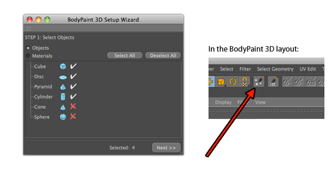

<!-- Source: https://developers.maxon.net/docs/py/2027_0_0/modules/c4d.modules/bodypaint/index.html -->

# c4d.modules.bodypaint <a id="c4d-modules-bodypaint"></a>

## *class* `c4d.modules.bodypaint` <a id="c4d.modules.bodypaint"></a>

- [`c4d.modules.bodypaint.PaintBitmap`](PaintBitmap/index.md#c4d.modules.bodypaint.PaintBitmap)

  - [`c4d.modules.bodypaint.PaintMaterial`](PaintBitmap/PaintMaterial/index.md#c4d.modules.bodypaint.PaintMaterial)

  - [`c4d.modules.bodypaint.PaintTexture`](PaintBitmap/PaintTexture/index.md#c4d.modules.bodypaint.PaintTexture)

  - [`c4d.modules.bodypaint.PaintLayer`](PaintBitmap/PaintLayer/index.md#c4d.modules.bodypaint.PaintLayer)

    - [`c4d.modules.bodypaint.PaintLayerBmp`](PaintBitmap/PaintLayer/PaintLayerBmp/index.md#c4d.modules.bodypaint.PaintLayerBmp)
    - [`c4d.modules.bodypaint.PaintLayerFolder`](PaintBitmap/PaintLayer/PaintLayerFolder/index.md#c4d.modules.bodypaint.PaintLayerFolder)
    - [`c4d.modules.bodypaint.PaintLayerMask`](PaintBitmap/PaintLayer/PaintLayerMask/index.md#c4d.modules.bodypaint.PaintLayerMask)

- [`c4d.modules.bodypaint.TempUVHandle`](TempUVHandle/index.md#c4d.modules.bodypaint.TempUVHandle)

**Functions**

## Overview <a id="overview"></a>

**Deprecated**

- [`c4d.modules.bodypaint.GetUVSeams()`](#c4d.modules.bodypaint.GetUVSeams): Use `c4d.modules.bodypaint.GetUvSeams2()` (obj, True) to have the same behavior as before, but most of the time you want the “checkUVSettings” parameter to be false.

**Painting And Texture Tools**

- [`c4d.modules.bodypaint.BPSetupWizardWithParameters()`](#c4d.modules.bodypaint.BPSetupWizardWithParameters): Run the BodyPaint 3D paint wizard.
- [`c4d.modules.bodypaint.IdentifyImage()`](#c4d.modules.bodypaint.IdentifyImage): Identifies the image’s file format.
- [`c4d.modules.bodypaint.PainterActivateChannel()`](#c4d.modules.bodypaint.PainterActivateChannel): Activation/deactivation of paint channels.
- [`c4d.modules.bodypaint.SendPainterCommand()`](#c4d.modules.bodypaint.SendPainterCommand): Sends commands to Bodypaint 3D.

**UV Editing And Sets**

- [`c4d.modules.bodypaint.CallUVCommand()`](#c4d.modules.bodypaint.CallUVCommand): Calls UV commands.
- [`c4d.modules.bodypaint.FreeActiveUVSet()`](#c4d.modules.bodypaint.FreeActiveUVSet): Frees the active UV set.
- [`c4d.modules.bodypaint.GetActiveUVSet()`](#c4d.modules.bodypaint.GetActiveUVSet): Retrieves the document’s active UV set.
- [`c4d.modules.bodypaint.GetUVSeams2()`](#c4d.modules.bodypaint.GetUVSeams2): Gets the UV seam edges for obj.
- [`c4d.modules.bodypaint.UpdateMeshUV()`](#c4d.modules.bodypaint.UpdateMeshUV): Updates the mesh based on the UVW result of interactive unwrapping.

## Members <a id="members"></a>

### Deprecated <a id="c4d.modules.bodypaint-function-Deprecated"></a>

#### `c4d.modules.bodypaint.GetUVSeams(object)` <a id="c4d.modules.bodypaint.GetUVSeams"></a>

*Deprecated since version R15:* Use `c4d.modules.bodypaint.GetUvSeams2()` (obj, True) to have the same behavior as before, but most of the time you want the “checkUVSettings” parameter to be false.

Gets the UV seam edges for obj.

*New in version S22.114.*

> **Note:** The edges are indexed by 4 * polygon + edge where polygon is the polygon index and edge is the edge index between 0 and 3.

**Parameters:** **object** ([*c4d.BaseObject*](../../c4d/C4DAtom/GeListNode/BaseList2D/BaseObject/index.md#c4d.BaseObject)) – The object of the UV set.

**Return type:** The UV seam edges. The UV mesh owns the pointed base select.

**Returns:** c4d.BaseSelect

### Painting And Texture Tools <a id="c4d.modules.bodypaint-function-Painting-And-Texture-Tools"></a>

#### `c4d.modules.bodypaint.BPSetupWizardWithParameters(doc, settings, objects, material)` <a id="c4d.modules.bodypaint.BPSetupWizardWithParameters"></a>



Run the BodyPaint 3D paint wizard.

**Parameters:**

- **doc** ([*c4d.documents.BaseDocument*](../../c4d.documents/BaseDocument/index.md#c4d.documents.BaseDocument)) – The document

- **settings** ([`BaseContainer`](../../c4d/BaseContainer/index.md#c4d.BaseContainer)) –

  The container with the settings for the paint wizard:

  |   |   |   |
  |---|---|---|
  | *AMSI_CREATE_MISSING_MATERIALS* | bool | Create materials and texture tags if they are missing. |
  | *AMSI_CREATE_MISSING_CHANNELS* | bool | Create missing texture channels. |
  | *AMSI_AUTOSELECT_MATERIALS* | bool | Autoselect materials from object selection. |
  | *AMSI_AUTOSELECT_OBJECTS* | bool | Autoselect objects from material selection. |
  | *AMSI_DELETE_BROKENMATERIALTAGS* | bool | Delete material tags with broken material links. |
  | *AMSI_ENABLEMATERIALS* | bool | Enable all materials for painting. |
  | *AMSI_SINGLEMATERIAL* | bool | Join UV’s in one single material. |
  | *CREATE_CHANNEL* | bool | Create missing texture channels (*CREATE_CHANNEL + CHANNEL_ID*). |
  | *CREATE_CHANNEL_C* | vector | Channel color (*CREATE_CHANNEL_C + CHANNEL_ID*). |
  | *AMSI_ENABLED* | bool | Enable automatic mapsize interpolation, otherwise minimum *size == texsize*. |
  | *AMSI_TEXW* | int | Fixed texture size width. |
  | *AMSI_TEXH* | int | Fixed texture size height. |
  | *AMSI_TEXMIN* | int | Minimum texture size (width and height). |
  | *AMSI_TEXMAX* | int | Maximum texture size (width and height). |
  | *AMSI_QUANTIZE* | int | Quantize texture size. |
  | *AMSI_RESCALE_EXISTING* | bool | Rescale existing material channels. |
  | *AMSI_USE_SAME_RES* | bool | Use the same texture size if one channel already exists. |
  | *AMSI_UV_CALC_METHOD* | int | Calculation mode: |
  |  | *UV_CALC_METHOD_OPTIMAL1* | Optimal Cube Mapping. |
  |  | *UV_CALC_METHOD_OPTIMAL2* | Optimal Angle Mapping. |
  |  | *UV_CALC_METHOD_REALIGN* | Realign. |
  | *AMSI_UV_CALC_EXISTING* | bool | Calculate UVs. |
  | *AMSI_UV_RELAXATION* | bool | Relax UVs. |

- **objects** (*any*) – Any iteratable object, e.g: list, tuple.

- **material** (*any*) – Any iteratable object, e.g: list, tuple.

**Return type:** bool

**Returns:** **True** if successful, otherwise **False**.

#### `c4d.modules.bodypaint.IdentifyImage(texpath)` <a id="c4d.modules.bodypaint.IdentifyImage"></a>

Identifies the image’s file format.

**Parameters:** **texpath** (*str*) – The path to the image.

**Return type:** int

**Returns:**

The image’s file format:

|   |   |
|---|---|
| *FILTER_TIF* | TIFF. |
| *FILTER_TGA* | TGA. |
| *FILTER_BMP* | BMP. |
| *FILTER_IFF* | IFF. |
| *FILTER_JPG* | JPEG. |
| *FILTER_PICT* | PICT. |
| *FILTER_PSD* | PSD. |
| *FILTER_RLA* | RLA. |
| *FILTER_RPF* | RPF. |
| *FILTER_B3D* | *BodyPaint 3D*. |
| *FILTER_TIF_B3D* | TIFF *BodyPaint 3D*. |
| *FILTER_PSB* | PSB. |
| *FILTER_AVI* | AVI Movie. |
| *FILTER_MOVIE* | Quicktime Movie. |
| *FILTER_QTVRSAVER_PANORAMA* | QTVR Panorama. |
| *FILTER_QTVRSAVER_OBJECT* | QTVR Object. |
| *FILTER_HDR* | HDR. |
| *FILTER_EXR_LOAD* | EXR (Load). |
| *FILTER_EXR* | EXR. |
| *FILTER_PNG* | PNG. |
| *FILTER_IES* | IES. |
| *FILTER_B3DNET* | *BodyPaint 3D* NET. Private. |
| *FILTER_DPX* | DPX. |
| *FILTER_DDS* | *New in version R19:* DDS. |

#### `c4d.modules.bodypaint.PainterActivateChannel(channel, multi, enable)` <a id="c4d.modules.bodypaint.PainterActivateChannel"></a>

Activation/deactivation of paint channels.

**Parameters:**

- **channel** (*int*) –

  The paint channel:

  |   |   |
  |---|---|
  | *CHANNEL_COLOR* | The color channel of a material. |
  | *CHANNEL_LUMINANCE* | The luminance channel of a material. |
  | *CHANNEL_TRANSPARENCY* | The transparency channel of a material. |
  | *CHANNEL_REFLECTION* | The reflection channel of a material. |
  | *CHANNEL_ENVIRONMENT* | The environment channel of a material. |
  | *CHANNEL_FOG* | The fog channel of a material. |
  | *CHANNEL_BUMP* | The bump channel of a material. |
  | *CHANNEL_ALPHA* | The alpha channel of a material. |
  | *CHANNEL_SPECULAR* | The specular channel of a material. |
  | *CHANNEL_SPECULARCOLOR* | The specular color channel of a material. |
  | *CHANNEL_GLOW* | The glow channel of a material. |
  | *CHANNEL_DISPLACEMENT* | The displacement channel of a material. |
  | *CHANNEL_DIFFUSION* | The diffusion channel of a material. |
  | *CHANNEL_NORMAL* | The normal channel of a material. |
  | *CHANNEL_ANY* | An unlabeled plugin channel. |

- **multi** (*bool*) – **True** for multi channel painting, **False** for single channel painting.

- **enable** (*bool*) – **True** to activate the paint channel, **False** to deactivate the paint channel.

#### `c4d.modules.bodypaint.SendPainterCommand(command, doc, tex, bc)` <a id="c4d.modules.bodypaint.SendPainterCommand"></a>

Sends commands to Bodypaint 3D.

**Parameters:**

- **command** (*int*) –

  Commands:

  |   |   |   |   |
  |---|---|---|---|
  | *PAINTER_SAVETEXTURE* | Save textures. If *doc* != **None** all textures associated with *doc* are saved. If *tex* != **None** only *tex* is saved, otherwise all textures are saved. |  |  |
  |  | *PAINTER_SAVETEXTURE_FLAGS* | int | Save texture flags: |
  |  | *PAINTER_SAVEBIT_SAVEAS* | Save As. |  |
  |  | *PAINTER_SAVEBIT_SAVECOPY* | Save As Copy. |  |
  |  | *PAINTER_SAVEBIT_SAVEALLOWWARNING* | Allow warnings. |  |
  |  | *PAINTER_SAVEBIT_RENAMEINSCENE* | Rename. |  |
  | *PAINTER_BRINGTOFRONT* | Bring the BodyPaint 3D application window to front (for exchange plugins). Private. |  |  |
  | *PAINTER_LOADTEXTURE* | Load a texture. Returns the loaded [`PaintTexture`](PaintBitmap/PaintTexture/index.md#c4d.modules.bodypaint.PaintTexture) if successful, otherwise **None**. |  |  |
  |  | *LOADTEXTURE_FILENAME* | str | The filename of the texture to load. |
  | *PAINTER_FORCECLOSETEXTURE* | Remove a texture from memory. Pass the texture to *tex*. |  |  |
  | *PAINTER_CLOSETEXTURE* | Remove a texture from memory but ask for if the texture is unsaved. Pass the texture to *tex*. |  |  |
  | *PAINTER_SAVETEXTURE_DIRECT* | Unused. |  |  |
  | *PAINTER_RELOADTEXTURE* | Reload a texture in BodyPaint 3D and Cinema 4D’s renderer locklist. |  |  |
  |  | *RELOADTEXTURE_FILENAME* | str | The filename of the texture to reload. |

- **doc** ([*c4d.documents.BaseDocument*](../../c4d.documents/BaseDocument/index.md#c4d.documents.BaseDocument)) – The optional document for the operation.

- **tex** ([*c4d.modules.bodypaint.PaintTexture*](PaintBitmap/PaintTexture/index.md#c4d.modules.bodypaint.PaintTexture)) – The optional paint texture for the operation.

- **bc** ([*c4d.BaseContainer*](../../c4d/BaseContainer/index.md#c4d.BaseContainer)) – The optional container for the operation.

**Return type:** bool

**Returns:**

**True** if the command was successfully sent, otherwise **False**.

If *command* was **PAINTER_LOADTEXTURE** and the texture successfully loaded, it then returns the [`PaintTexture`](PaintBitmap/PaintTexture/index.md#c4d.modules.bodypaint.PaintTexture)

```python
import c4d

texturename = r'path/to/texture'
settings = c4d.BaseContainer()
settings.SetFilename(c4d.LOADTEXTURE_FILENAME, texturename)

tex = c4d.modules.bodypaint.SendPainterCommand(c4d.PAINTER_LOADTEXTURE, doc, None, settings)
if not tex:
    print(tex)
```

### UV Editing And Sets <a id="c4d.modules.bodypaint-function-UV-Editing-And-Sets"></a>

#### `c4d.modules.bodypaint.CallUVCommand(points, pointCount, polys, polyCount, uvw, polySelection, pointSelection, op, mode, cmdid, settings)` <a id="c4d.modules.bodypaint.CallUVCommand"></a>

Calls UV commands.

*New in version R18.011.*

**Parameters:**

- **points** (*List*[[*c4d.Vector*](../../c4d/Vector/index.md#c4d.Vector)]) – The points array.

- **pointCount** (*int*) – The number of points in the *points* array.

- **polys** (*List*[[*c4d.CPolygon*](../../c4d/CPolygon/index.md#c4d.CPolygon)]) – The polygons array.

- **polyCount** (*int*) – The number of polygons in the *polys* array.

- **uvw** (*Dict*[[*c4d.Vector*](../../c4d/Vector/index.md#c4d.Vector), [*c4d.Vector*](../../c4d/Vector/index.md#c4d.Vector), [*c4d.Vector*](../../c4d/Vector/index.md#c4d.Vector), [*c4d.Vector*](../../c4d/Vector/index.md#c4d.Vector)]) – The UVWs array.

- **polySelection** ([*c4d.BaseSelect*](../../c4d/BaseSelect/index.md#c4d.BaseSelect)) – The polygon selection.

- **pointSelection** ([*c4d.BaseSelect*](../../c4d/BaseSelect/index.md#c4d.BaseSelect)) –

  The UV point selection.

  > **Note:** The points are indexed by *4* * *polygon* + *point* where *polygon* is the polygon index and *point* is the point index between *0* and *3*.

- **op** ([*c4d.BaseObject*](../../c4d/C4DAtom/GeListNode/BaseList2D/BaseObject/index.md#c4d.BaseObject)) – The object of the UV set.

- **mode** (*int*) –

  The UV editing mode:

  |   |   |
  |---|---|
  | *Mcamera* | Camera mode. |
  | *Mobject* | Object mode. |
  | *Mtexture* | Texture mode. |
  | *Mtextureaxis* | Texture axis mode. |
  | *Mpoints* | Point edit mode. |
  | *Medges* | Edge edit mode. |
  | *Mpolygons* | Polygon edit mode. |
  | *Manimation* | Animation mode. |
  | *Mkinematic* | IK mode. |
  | *Mmodel* | Model mode. |
  | *Mpaint* | Paint mode. |
  | *Muvpoints* | UV points mode. |
  | *Muvpolygons* | UV polygons mode. |
  | *Mdrag* | Drag mode. |
  | *Mpolyedgepoint* | Combined poly/edge/point mode. Must only be used in [`ViewportSelect`](../../c4d.utils/ViewportSelect/index.md#c4d.utils.ViewportSelect). |
  | *Medgepoint* | Combined edge/point mode. Must only be used in [`ViewportSelect`](../../c4d.utils/ViewportSelect/index.md#c4d.utils.ViewportSelect). |
  | *Mworkplane* | Workplane mode. |
  | *Mdrag* | Drag mode. |
  | *Muvedges* | Uv Edge node is enabled. |
  | *Muvon* | Uv mode is enabled. |

- **cmdid** (*int*) –

  The UV command:

  | Symbols | Description / Sub Symbols | Type | Description |
  |---|---|---|---|
  | *UVCOMMAND_OPTIMALMAPPING* | Optimal Angle UV Mapping. |  |  |
  | *UVCOMMAND_OPTIMALCUBICMAPPING* | Optimal Cubic UV Mapping. |  |  |
  | *UVCOMMAND_REALIGN* | Realign UV Mapping: |  |  |
  |  | *OPTIMALMAPPING_PRESERVEORIENTATION* | bool | Preserve Orientation (Cubic, Angle, Realign). |
  |  | *OPTIMALMAPPING_STRETCHTOFIT* | bool | Stretch To Fit (Cubic, Angle, Realign). |
  |  | *OPTIMALMAPPING_DISTORTION* | float | Maximum Distortion (Angle). |
  |  | *OPTIMALMAPPING_SPACING* | float | Spacing (Cubic, Angle, Realign). |
  |  | *OPTIMALMAPPING_AREAFAK* | float | Maximum Area Factor (Cubic). |
  |  | *OPTIMALMAPPING_TWOD* | bool | 2D (Cubic). |
  |  | *OPTIMALMAPPING_PROGRESSBAR* | bool | Progress bar (Cubic, Angle, Realign). |
  |  | *OPTIMALMAPPING_RELAXCOUNT* | int | Relaxation Steps (Cubic, Angle). |
  |  | *OPTIMALMAPPING_EQUALIZEAREA* | bool | Equalize Island Size (Realign). |
  | *UVCOMMAND_RELAX* | Relax UV: |  |  |
  |  | *RELAXUV_KEEP_BORDER* | bool | Pin Border Points. |
  |  | *RELAXUV_KEEP_NEIGHBORS* | bool | Pin To Neighbors. |
  |  | *RELAXUV_KEEP_POINTSEL* | bool | Pin Point Selection. |
  |  | *RELAXUV_CUT_EDGESEL* | bool | Cut Selected Edges. |
  |  | *RELAXUV_EDGESEL_POINTER* | [`c4d.BaseSelect`](../../c4d/BaseSelect/index.md#c4d.BaseSelect) | Pointer to the edge selection. |
  |  | *RELAXUV_MAX_ITERATIONS* | int | Maximum Iteration Steps. |
  |  | *RELAXUV_MODE* | int | Relaxation Mode: |
  |  |  | *RELAXUV_MODE_LSCM* | LSCM relaxation. |
  |  |  | *RELAXUV_MODE_ABF* | ABF relaxation. |
  | *UVCOMMAND_COPY_UV* | Copy UV Points. |  |  |
  | *UVCOMMAND_PASTE_UV* | Paste UV Points. |  |  |
  | *UVCOMMAND_MAX_UV* | Max UV. |  |  |
  | *UVCOMMAND_FLIP_SEQUENCE* | Flip Sequence. |  |  |
  | *UVCOMMAND_CYCLE_CW_UV*<br>Previously UVCOMMAND_MOVE_DOWN_SEQUENCE | Move Down Sequence. |  |  |
  |  |  |  |  |
  | *UVCOMMAND_CYCLE_CCW_UV*<br>Previously UVCOMMAND_MOVE_UP_SEQUENCE | Move Up Sequence. |  |  |
  |  |  |  |  |
  | *UVCOMMAND_TERRACE* | UV Terrace. |  |  |
  | *UVCOMMAND_FIT_TO_CANVAS* | Fit UV To Canvas. |  |  |
  | *UVCOMMAND_TRANSFORM* | Transform UV: |  |  |
  |  | *UVCOMMAND_TRANSFORM_MOVE_X* | float | Move X (U). |
  |  | *UVCOMMAND_TRANSFORM_MOVE_Y* | float | Move Y (V). |
  |  | *UVCOMMAND_TRANSFORM_SCALE_X* | float | Scale X (U). |
  |  | *UVCOMMAND_TRANSFORM_SCALE_Y* | float | Scale Y (V). |
  |  | *UVCOMMAND_TRANSFORM_ANGLE* | float | Rotation angle in radians. |
  | *UVCOMMAND_LINEUP* | Line Up UV. |  |  |
  | *UVCOMMAND_UNSTITCH* | Unstitch UV. |  |  |
  | *UVCOMMAND_BOUNDARY2SHAPE* | UV Boundary To Shape: |  |  |
  |  | *UVCOMMAND_BOUNDARY2SHAPE_MODE* | int | UV boundary shape: |
  |  |  | *UVCOMMAND_BOUNDARY2SHAPE_CIRCLE* | UV boundary to circle. |
  |  |  | *UVCOMMAND_BOUNDARY2SHAPE_QUAD* | UV boundary to square. |

- **settings** ([*c4d.BaseContainer*](../../c4d/BaseContainer/index.md#c4d.BaseContainer)) – The optional settings for the UV command.

**Return type:** bool

**Returns:** **True** if successful, otherwise **False**.

#### `c4d.modules.bodypaint.FreeActiveUVSet(handle)` <a id="c4d.modules.bodypaint.FreeActiveUVSet"></a>

Frees the active UV set.

*New in version R18.011.*

**Parameters:** **handle** ([*c4d.modules.bodypaint.TempUVHandle*](TempUVHandle/index.md#c4d.modules.bodypaint.TempUVHandle)) – The temporary handle of the UV set to be freed.

#### `c4d.modules.bodypaint.GetActiveUVSet(doc, flags)` <a id="c4d.modules.bodypaint.GetActiveUVSet"></a>

Retrieves the document’s active UV set.

*New in version R18.011.*

**Parameters:**

- **doc** ([*c4d.documents.BaseDocument*](../../c4d.documents/BaseDocument/index.md#c4d.documents.BaseDocument)) – The document returning the active UV set.

- **flags** (*int*) –

  The flags:

  |   |   |
  |---|---|
  | *GETACTIVEUVSET_CHECKENABLING* | Enable status. |
  | *GETACTIVEUVSET_UVWS* | Get the UVWs array. |
  | *GETACTIVEUVSET_POLYS* | Get the polygons array. |
  | *GETACTIVEUVSET_POLYSELECTION* | Get the selected polygons array. |
  | *GETACTIVEUVSET_POINTS* | Get the points array. |
  | *GETACTIVEUVSET_POINTSELECTION* | Get the selected UV points. |
  | *GETACTIVEUVSET_OBJECT* | Get the object of the UV set. |
  | *GETACTIVEUVSET_MODE* | Get the active editor mode. |
  | *GETACTIVEUVSET_POLYHIDDEN* | Get the hidden polygons array. |
  | *GETACTIVEUVSET_ALL_CHECKENABLING* | Combine all of the previous flags and the enable status. |
  | *GETACTIVEUVSET_ALL* | Combine all of the previous flags except the enable status. |
  | *GETACTIVEUVSET_EDGESELECTION* | Get the selected edges. |

**Return type:** Optional[[c4d.modules.bodypaint.TempUVHandle](TempUVHandle/index.md#c4d.modules.bodypaint.TempUVHandle)]

**Returns:** A temporary handle to the active UV set, or **None** if there is no active UV set. Has to be freed with [`FreeActiveUVSet()`](#c4d.modules.bodypaint.FreeActiveUVSet).

#### `c4d.modules.bodypaint.GetUVSeams2(object, checkUVSettings)` <a id="c4d.modules.bodypaint.GetUVSeams2"></a>

Gets the UV seam edges for obj.

*New in version R23.105.*

> **Note:** The edges are indexed by 4 * polygon + edge where polygon is the polygon index and edge is the edge index between 0 and 3.

**Parameters:**

- **object** ([*c4d.BaseObject*](../../c4d/C4DAtom/GeListNode/BaseList2D/BaseObject/index.md#c4d.BaseObject)) – The object of the UV set.

- **checkUVSettings** (*bool*) –

  If *True* and the UV seams are disabled in the UV viewport, nullptr will be return.  
  If *False*, will always return the UV seams, without checking if the UV seams settings is enabled or not in the UV viewport.

**Return type:** The UV seam edges. The UV mesh owns the pointed base select.

**Returns:** c4d.BaseSelect

#### `c4d.modules.bodypaint.UpdateMeshUV(fullUpdate)` <a id="c4d.modules.bodypaint.UpdateMeshUV"></a>

Updates the mesh based on the UVW result of interactive unwrapping.

*New in version S22.*

**Parameters:** **fullUpdate** (*bool*) – **True** to perform a slow full update or **False** for a quicker one which updates only the UV coordinates of the UV Mesh.

**Returns:** **True** if successful otherwise **False**.
