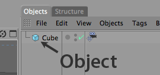

<!-- Source: https://developers.maxon.net/docs/py/2027_0_0/modules/c4d.modules/character/CAJointObject/index.html -->

# c4d.modules.character.CAJointObject <a id="c4d-modules-character-cajointobject"></a>

## *class* `c4d.modules.character.CAJointObject` <a id="c4d.modules.character.CAJointObject"></a>

The base class of objects.

Here is an example how to create and edit objects.

```python
import c4d

obj = c4d.BaseObject(c4d.Ocube) # Create new cube
obj.SetRelPos(c4d.Vector(20))   # Set position of cube
doc.InsertObject(obj)           # Insert object in document
c4d.EventAdd()                  # Send global event message
```



Parent Class:

- [`c4d.BaseObject`](../../../c4d/C4DAtom/GeListNode/BaseList2D/BaseObject/index.md#c4d.BaseObject)

## Overview <a id="overview"></a>

**Magic Methods**

- [`CAJointObject.__init__()`](#c4d.modules.character.CAJointObject.__init__)

**Rigging Data Access**

- [`CAJointObject.GetBone()`](#c4d.modules.character.CAJointObject.GetBone): Get the bone data for this joint
- [`CAJointObject.GetWeightTag()`](#c4d.modules.character.CAJointObject.GetWeightTag): Get the weight tag corresponding to this joint

## Members <a id="members"></a>

### Magic Methods <a id="c4d.modules.character.CAJointObject-method-Magic-Methods"></a>

#### `CAJointObject.__init__(self)` <a id="c4d.modules.character.CAJointObject.__init__"></a>

### Rigging Data Access <a id="c4d.modules.character.CAJointObject-method-Rigging-Data-Access"></a>

#### `CAJointObject.GetBone(self)` <a id="c4d.modules.character.CAJointObject.GetBone"></a>

Get the bone data for this joint

```python
m, len = cajointobject.GetBone()
```

**Return type:** List[[c4d.Matrix](../../../c4d/Matrix/index.md#c4d.Matrix), float]

**Returns:** The matrix and the length of the bone.

#### `CAJointObject.GetWeightTag(self)` <a id="c4d.modules.character.CAJointObject.GetWeightTag"></a>

Get the weight tag corresponding to this joint

```python
weight = cajointobject.GetWeightTag()
if not weight: return

print(weight["op"]) #c4d.BaseTag
print(weight["index"]) #int
```

**Return type:** dict{**op**: [`BaseTag`](../../../c4d/C4DAtom/GeListNode/BaseList2D/BaseTag/index.md#c4d.BaseTag), **index**: int}

**Returns:** The weight tag and the index of the tag.
