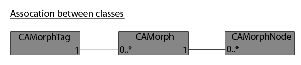

<!-- Source: https://developers.maxon.net/docs/py/2027_0_0/modules/c4d.modules/character/CAMorph/index.html -->

# c4d.modules.character.CAMorph <a id="c4d-modules-character-camorph"></a>

## *class* `c4d.modules.character.CAMorph` <a id="c4d.modules.character.CAMorph"></a>

[](../../../../_images/character_association_pose.png)

## Overview <a id="overview"></a>

**Application Control**

- [`CAMorph.Apply()`](#c4d.modules.character.CAMorph.Apply): Apply the morph.
- [`CAMorph.SetMode()`](#c4d.modules.character.CAMorph.SetMode): Set the mode.
- [`CAMorph.Store()`](#c4d.modules.character.CAMorph.Store): Store the morph.

**Data Management**

- [`CAMorph.CopyFrom()`](#c4d.modules.character.CAMorph.CopyFrom): Get the ID of the morph.
- [`CAMorph.GetID()`](#c4d.modules.character.CAMorph.GetID): Get the ID of the morph.
- [`CAMorph.GetName()`](#c4d.modules.character.CAMorph.GetName): Get the name of the morph.
- [`CAMorph.SetName()`](#c4d.modules.character.CAMorph.SetName): Set the name of the morph.

**Hierarchy Navigation**

- [`CAMorph.FindIndex()`](#c4d.modules.character.CAMorph.FindIndex): Retrieves the index of the morph node for the object specified by bl.
- [`CAMorph.GetFirst()`](#c4d.modules.character.CAMorph.GetFirst): Get the first morph node.

## Members <a id="members"></a>

### Application Control <a id="c4d.modules.character.CAMorph-method-Application-Control"></a>

#### `CAMorph.Apply(self, doc, tag, flags)` <a id="c4d.modules.character.CAMorph.Apply"></a>

Apply the morph.

**Parameters:**

- **doc** ([*c4d.documents.BaseDocument*](../../../c4d.documents/BaseDocument/index.md#c4d.documents.BaseDocument)) – The document.

- **tag** ([*c4d.modules.character.CAPoseMorphTag*](../CAPoseMorphTag/index.md#c4d.modules.character.CAPoseMorphTag)) – The morph tag.

- **flags** (*int*) –

  The flags:

  |   |   |
  |---|---|
  | *CAMORPH_DATA_FLAGS_P* | Position morphing. |
  | *CAMORPH_DATA_FLAGS_S* | Scale morphing. |
  | *CAMORPH_DATA_FLAGS_R* | HPB rotation morphing. |
  | *CAMORPH_DATA_FLAGS_POINTS* | Points morphing. |
  | *CAMORPH_DATA_FLAGS_TANGENTS* | Tangents morphing. |
  | *CAMORPH_DATA_FLAGS_VERTEXMAP* | Vertex map morphing. |
  | *CAMORPH_DATA_FLAGS_WEIGHTMAPS* | Joint weights morphing. |
  | *CAMORPH_DATA_FLAGS_PARAMS* | Parameter morphing. |
  | *CAMORPH_DATA_FLAGS_USERDATA* | User data morphing. |
  | *CAMORPH_DATA_FLAGS_UV* | UV coordinate morphing. |
  | *CAMORPH_DATA_FLAGS_ASTAG* | Set to store the current state of an object into the morph. Stores the morph data as set by the user in the morph tag, otherwise it would mess up the internal data. |
  | *CAMORPH_DATA_FLAGS_ALL* | All data morphing. |
  | *CAMORPH_DATA_FLAGS_NONE* | None. |

#### `CAMorph.SetMode(self, doc, tag, flags, mode)` <a id="c4d.modules.character.CAMorph.SetMode"></a>

Set the mode.

> **Note:**
>
> This is not the mode a user would change but data inside the morph.  
> It must be restored to the original mode once changes are finished.  
> To change the morph tag’s modes or parameters use `C4DAtom.SetParameter()`.

Example: Point data could be stored as rotational or correctional and in a delta form (only differences from the base).  
This can not be edited in this form so the data mode must be changed to relative (c4d.CAMORPH_MODE_REL) or absolute (c4d.CAMORPH_MODE_ABS) before editing and then restored to (c4d.CAMORPH_MODE_AUTO) when finished.  
The flags must be passed as c4d.CAMORPH_MODE_FLAGS_EXPAND to expand the data from the delta form and then returned with c4d.CAMORPH_MODE_FLAGS_COLLAPSE when finished.  
For example VAMP uses the following line to expand all data types to relative data

```python
smorph.SetMode(doc, s_morphtag, c4d.CAMORPH_MODE_FLAGS_ALL | c4d.CAMORPH_MODE_FLAGS_EXPAND, c4d.CAMORPH_MODE_REL)
```

It then does some changes and finally restores all types to collapsed (delta) form and to the users mode (AUTO):

```python
smorph.SetMode(doc, s_morphtag, c4d.CAMORPH_MODE_FLAGS_ALL | c4d.CAMORPH_MODE_FLAGS_COLLAPSE, c4d.CAMORPH_MODE_AUTO)
```

**Parameters:**

- **doc** ([*c4d.documents.BaseDocument*](../../../c4d.documents/BaseDocument/index.md#c4d.documents.BaseDocument)) – The document.

- **tag** ([*c4d.modules.character.CAPoseMorphTag*](../CAPoseMorphTag/index.md#c4d.modules.character.CAPoseMorphTag)) – The morph tag.

- **flags** (*int*) –

  The value:

  |   |   |
  |---|---|
  | *CAMORPH_MODE_FLAGS_COLLAPSE* | Collapse. |
  | *CAMORPH_MODE_FLAGS_EXPAND* | Expand. |
  | *CAMORPH_MODE_FLAGS_ALL* | All. |

- **mode** (*int*) –

  The mode:

  |   |   |
  |---|---|
  | *CAMORPH_MODE_ABS* | Abs. |
  | *CAMORPH_MODE_REL* | Rel. |
  | *CAMORPH_MODE_ROT* | Rot. |
  | *CAMORPH_MODE_CORRECTIONAL* | Correctional. |
  | *CAMORPH_MODE_CORRECTIONAL_AREA* | Area. |
  | *CAMORPH_MODE_PSD* | PSD. |
  | *CAMORPH_MODE_AUTO* | Auto. |
  | *CAMORPH_MODE_NONE* | No flags. |

**Return type:** int

**Returns:** **True** on success, otherwise **False**.

#### `CAMorph.Store(self, doc, tag, flags)` <a id="c4d.modules.character.CAMorph.Store"></a>

Store the morph.

**Parameters:**

- **doc** ([*c4d.documents.BaseDocument*](../../../c4d.documents/BaseDocument/index.md#c4d.documents.BaseDocument)) – The document.

- **tag** ([*c4d.modules.character.CAPoseMorphTag*](../CAPoseMorphTag/index.md#c4d.modules.character.CAPoseMorphTag)) – The morph tag.

- **flags** (*int*) –

  The flags:

  |   |   |
  |---|---|
  | *CAMORPH_DATA_FLAGS_P* | Position morphing. |
  | *CAMORPH_DATA_FLAGS_S* | Scale morphing. |
  | *CAMORPH_DATA_FLAGS_R* | HPB rotation morphing. |
  | *CAMORPH_DATA_FLAGS_POINTS* | Points morphing. |
  | *CAMORPH_DATA_FLAGS_TANGENTS* | Tangents morphing. |
  | *CAMORPH_DATA_FLAGS_VERTEXMAP* | Vertex map morphing. |
  | *CAMORPH_DATA_FLAGS_WEIGHTMAPS* | Joint weights morphing. |
  | *CAMORPH_DATA_FLAGS_PARAMS* | Parameter morphing. |
  | *CAMORPH_DATA_FLAGS_USERDATA* | User data morphing. |
  | *CAMORPH_DATA_FLAGS_UV* | UV coordinate morphing. |
  | *CAMORPH_DATA_FLAGS_ASTAG* | Set to store the current state of an object into the morph. Stores the morph data as set by the user in the morph tag, otherwise it would mess up the internal data. |
  | *CAMORPH_DATA_FLAGS_ALL* | All data morphing. |
  | *CAMORPH_DATA_FLAGS_NONE* | None. |

### Data Management <a id="c4d.modules.character.CAMorph-method-Data-Management"></a>

#### `CAMorph.CopyFrom(self, src, trn, flags)` <a id="c4d.modules.character.CAMorph.CopyFrom"></a>

Get the ID of the morph.

**Parameters:**

- **src** ([*c4d.modules.character.CAMorph*](#c4d.modules.character.CAMorph)) – The source morph.

- **trn** (*Optional*[*any*]) – Set to **None**, currently not used.

- **flags** (*int*) –

  The flags:

  |   |   |
  |---|---|
  | *CAMORPH_COPY_FLAGS_NONE* | None. |

**Return type:** bool

**Returns:** **True** on success, otherwise **False**.

#### `CAMorph.GetID(self)` <a id="c4d.modules.character.CAMorph.GetID"></a>

Get the ID of the morph.

**Return type:** int

**Returns:** The ID.

#### `CAMorph.GetName(self)` <a id="c4d.modules.character.CAMorph.GetName"></a>

Get the name of the morph.

**Return type:** str

**Returns:** The name.

#### `CAMorph.SetName(self, name)` <a id="c4d.modules.character.CAMorph.SetName"></a>

Set the name of the morph.

**Parameters:** **name** (*str*) – The name.

### Hierarchy Navigation <a id="c4d.modules.character.CAMorph-method-Hierarchy-Navigation"></a>

#### `CAMorph.FindIndex(self, tag, bl)` <a id="c4d.modules.character.CAMorph.FindIndex"></a>

Retrieves the index of the morph node for the object specified by bl.

> **Note:** A single morph can be applied to a hierarchy of objects, each has a representation in the morph as a `CAMorphNode`.

**Parameters:**

- **tag** ([*c4d.modules.character.CAPoseMorphTag*](../CAPoseMorphTag/index.md#c4d.modules.character.CAPoseMorphTag)) – The morph tag containing the morph node.
- **bl** ([*c4d.BaseList2D*](../../../c4d/C4DAtom/GeListNode/BaseList2D/index.md#c4d.BaseList2D)) – The object connected to the morph node.

**Returns:** The index of the morph node of the specified object.

**Return type:** int

#### `CAMorph.GetFirst(self)` <a id="c4d.modules.character.CAMorph.GetFirst"></a>

Get the first morph node.

**Return type:** [c4d.modules.character.CAMorphNode](../CAMorphNode/index.md#c4d.modules.character.CAMorphNode)

**Returns:** The first morph node.
