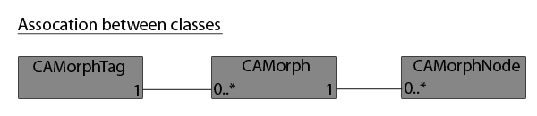

<!-- Source: https://developers.maxon.net/docs/py/2027_0_0/modules/c4d.modules/character/CAMorphNode/index.html -->

# c4d.modules.character.CAMorphNode 

## *class* `c4d.modules.character.CAMorphNode` 

## Overview 

**Hierarchy Navigation**

- [`CAMorphNode.GetDown()`](#c4d.modules.character.CAMorphNode.GetDown): Retrieves the first child of the morph node.
- [`CAMorphNode.GetNext()`](#c4d.modules.character.CAMorphNode.GetNext): Retrieves the next morph node.
- [`CAMorphNode.GetPrev()`](#c4d.modules.character.CAMorphNode.GetPrev): Retrieves the previous morph node.
- [`CAMorphNode.GetUp()`](#c4d.modules.character.CAMorphNode.GetUp): Retrieves the parent morph node.

**Metadata And References**

- [`CAMorphNode.GetInfo()`](#c4d.modules.character.CAMorphNode.GetInfo): Returns the information on what morph data is stored in the morph node.
- [`CAMorphNode.GetLink()`](#c4d.modules.character.CAMorphNode.GetLink): Retrieves the object linked to the morph node.
- [`CAMorphNode.GetPSDReference()`](#c4d.modules.character.CAMorphNode.GetPSDReference): Retrieves the PSD data for a point pose holding the reference pose and providing multiple functions dedicated to PSD behavior.

**Parameter Data**

- [`CAMorphNode.GetParam()`](#c4d.modules.character.CAMorphNode.GetParam): Returns a parameter.
- [`CAMorphNode.GetParamCount()`](#c4d.modules.character.CAMorphNode.GetParamCount): Retrieves the parameter count.
- [`CAMorphNode.SetParam()`](#c4d.modules.character.CAMorphNode.SetParam): Sets a parameter.
- [`CAMorphNode.SetParamCount()`](#c4d.modules.character.CAMorphNode.SetParamCount): Sets the parameter count.

**Point Data**

- [`CAMorphNode.GetPoint()`](#c4d.modules.character.CAMorphNode.GetPoint): Retrieves a point of the morph node.
- [`CAMorphNode.GetPointCount()`](#c4d.modules.character.CAMorphNode.GetPointCount): Returns the point count.
- [`CAMorphNode.SetPoint()`](#c4d.modules.character.CAMorphNode.SetPoint): Sets a point of the morph node.
- [`CAMorphNode.SetPointCount()`](#c4d.modules.character.CAMorphNode.SetPointCount): Sets the point count.

**Tangent Data**

- [`CAMorphNode.GetTangent()`](#c4d.modules.character.CAMorphNode.GetTangent): Retrieves a tangent of the morph node.
- [`CAMorphNode.GetTangentCount()`](#c4d.modules.character.CAMorphNode.GetTangentCount): Returns the tangent count.
- [`CAMorphNode.SetTangent()`](#c4d.modules.character.CAMorphNode.SetTangent): Sets the tangent at *index*.
- [`CAMorphNode.SetTangentCount()`](#c4d.modules.character.CAMorphNode.SetTangentCount): Sets the tangent count.

**Transform Data**

- [`CAMorphNode.GetP()`](#c4d.modules.character.CAMorphNode.GetP): Returns the position of the morph node.
- [`CAMorphNode.GetR()`](#c4d.modules.character.CAMorphNode.GetR): Returns the rotation of the morph node.
- [`CAMorphNode.GetS()`](#c4d.modules.character.CAMorphNode.GetS): Returns the scale of the morph node.

**UV Data**

- [`CAMorphNode.GetUV()`](#c4d.modules.character.CAMorphNode.GetUV): Retrieves the UV coordinate *index* of the *tindex* UV tag.
- [`CAMorphNode.GetUVCount()`](#c4d.modules.character.CAMorphNode.GetUVCount): Retrieves the UV coordinates count of the UV tag at *tindex*.
- [`CAMorphNode.GetUVTagCount()`](#c4d.modules.character.CAMorphNode.GetUVTagCount): Retrieves the UV tag count.
- [`CAMorphNode.SetUV()`](#c4d.modules.character.CAMorphNode.SetUV): Sets the UV coordinate *index* of the *tindex* UV tag.
- [`CAMorphNode.SetUVCount()`](#c4d.modules.character.CAMorphNode.SetUVCount): Sets the UV coordinates count of the UV tag at *tindex*.

**Vertex Map Data**

- [`CAMorphNode.GetVertexMap()`](#c4d.modules.character.CAMorphNode.GetVertexMap): Retrieves the vertex map value at *index* of the *tindex* vertex map.
- [`CAMorphNode.GetVertexMapCount()`](#c4d.modules.character.CAMorphNode.GetVertexMapCount): Retrieves the size of the vertex map at *tindex*.
- [`CAMorphNode.GetVertexMapTagCount()`](#c4d.modules.character.CAMorphNode.GetVertexMapTagCount): Retrieves the number of vertex map tags of the morph node.
- [`CAMorphNode.SetVertexMap()`](#c4d.modules.character.CAMorphNode.SetVertexMap): Sets the vertex map value at *index* of the *tindex* vertex map.
- [`CAMorphNode.SetVertexMapTagCount()`](#c4d.modules.character.CAMorphNode.SetVertexMapTagCount): Sets the size of the vertex map at *tindex*.

**Weight Map Data**

- [`CAMorphNode.GetWeightMap()`](#c4d.modules.character.CAMorphNode.GetWeightMap): Retrieves the weight at *index* of *jindex* joint and *tindex* weight tag.
- [`CAMorphNode.GetWeightMapCount()`](#c4d.modules.character.CAMorphNode.GetWeightMapCount): Retrieves the weights count of the joint at *jindex* of *tindex* weight tag.
- [`CAMorphNode.GetWeightMapJointCount()`](#c4d.modules.character.CAMorphNode.GetWeightMapJointCount): Retrieves the joint count of the weight tag at *tindex*.
- [`CAMorphNode.GetWeightMapTagCount()`](#c4d.modules.character.CAMorphNode.GetWeightMapTagCount): Retrieves the number of weight map tags.
- [`CAMorphNode.SetWeightMap()`](#c4d.modules.character.CAMorphNode.SetWeightMap): Sets the weight at *index* of *jindex* joint and *tindex* weight tag.
- [`CAMorphNode.SetWeightMapCount()`](#c4d.modules.character.CAMorphNode.SetWeightMapCount): Sets the weights count of the joint at *jindex* of *tindex* weight tag.

## Members 

### Hierarchy Navigation 

#### `CAMorphNode.GetDown(self)` 

Retrieves the first child of the morph node.

**Return type:** Optional[[c4d.modules.character.CAMorphNode](#c4d.modules.character.CAMorphNode)]

**Returns:** The first child.

#### `CAMorphNode.GetNext(self)` 

Retrieves the next morph node.

**Return type:** Optional[[c4d.modules.character.CAMorphNode](#c4d.modules.character.CAMorphNode)]

**Returns:** The next node.

#### `CAMorphNode.GetPrev(self)` 

Retrieves the previous morph node.

**Return type:** Optional[[c4d.modules.character.CAMorphNode](#c4d.modules.character.CAMorphNode)]

**Returns:** The previous node.

#### `CAMorphNode.GetUp(self)` 

Retrieves the parent morph node.

**Return type:** Optional[[c4d.modules.character.CAMorphNode](#c4d.modules.character.CAMorphNode)]

**Returns:** The parent node.

### Metadata And References 

#### `CAMorphNode.GetInfo(self)` 

Returns the information on what morph data is stored in the morph node.

**Return type:** int

**Returns:**

The data flags:

|   |   |
|---|---|
| *CAMORPH_DATA_FLAGS_P* | Position morphing. |
| *CAMORPH_DATA_FLAGS_S* | Scale morphing. |
| *CAMORPH_DATA_FLAGS_R* | HPB rotation morphing. |
| *CAMORPH_DATA_FLAGS_POINTS* | Points morphing. |
| *CAMORPH_DATA_FLAGS_TANGENTS* | Tangents morphing. |
| *CAMORPH_DATA_FLAGS_VERTEXMAP* | Vertex map morphing. |
| *CAMORPH_DATA_FLAGS_WEIGHTMAPS* | Joint weights morphing. |
| *CAMORPH_DATA_FLAGS_PARAMS* | Parameter morphing. |
| *CAMORPH_DATA_FLAGS_USERDATA* | User data morphing. |
| *CAMORPH_DATA_FLAGS_UV* | UV coordinate morphing. |
| *CAMORPH_DATA_FLAGS_ASTAG* | Set to store the current state of an object into the morph. Stores the morph data as set by the user in the morph tag, otherwise it would mess up the internal data. |
| *CAMORPH_DATA_FLAGS_ALL* | All data morphing. |
| *CAMORPH_DATA_FLAGS_NONE* | None. |

#### `CAMorphNode.GetLink(self, tag, morph, doc)` 

Retrieves the object linked to the morph node.

*New in version R18.057.*

**Parameters:**

- **tag** ([*c4d.modules.character.CAPoseMorphTag*](../CAPoseMorphTag/index.md#c4d.modules.character.CAPoseMorphTag)) – The morph tag containing the morph data.
- **morph** ([*c4d.modules.character.CAMorph*](../CAMorph/index.md#c4d.modules.character.CAMorph)) – The morph containing the morph node.
- **doc** ([*c4d.documents.BaseDocument*](../../../c4d.documents/BaseDocument/index.md#c4d.documents.BaseDocument)) – The document containing the linked object.

**Return type:** Optional[[c4d.BaseList2D](../../../c4d/C4DAtom/GeListNode/BaseList2D/index.md#c4d.BaseList2D)]

**Returns:** The linked object if there is one, or **None**.

#### `CAMorphNode.GetPSDReference(self)` 

Retrieves the PSD data for a point pose holding the reference pose and providing multiple functions dedicated to PSD behavior.

*New in version R19.*

> **See also:**
>
> `CAMorph.SetMode()` to retrieve all data.

**Return type:** [c4d.modules.character.CAReferencePSD](../CAReferencePSD/index.md#c4d.modules.character.CAReferencePSD)

**Returns:** The PSD referential for the morph node.

### Parameter Data 

#### `CAMorphNode.GetParam(self, index)` 

Returns a parameter.

> **See also:**
>
> `CAMorph.SetMode()` to retrieve all data.

**Parameters:** **index** (*int*) – The parameter index.

**Raises:** **IndexError** – If *index* is out of range : *0<=index<*[`GetParamCount()`](#c4d.modules.character.CAMorphNode.GetParamCount).

**Return type:** dict{**data**: any, **id**: [`DescID`](../../../c4d/DescID/index.md#c4d.DescID)}

**Returns:** The parameter.

#### `CAMorphNode.GetParamCount(self)` 

Retrieves the parameter count.

> **See also:**
>
> `CAMorph.SetMode()` to retrieve all data.

**Return type:** int

**Returns:** The parameter count.

#### `CAMorphNode.SetParam(self, index, data, id)` 

Sets a parameter.

**Parameters:**

- **index** (*int*) – The parameter index.
- **data** (*any*) – The data to be set.
- **id** ([*c4d.DescID*](../../../c4d/DescID/index.md#c4d.DescID)) – The id.

**Raises:** **IndexError** – If *index* is out of range : *0<=index<*[`GetParamCount()`](#c4d.modules.character.CAMorphNode.GetParamCount).

#### `CAMorphNode.SetParamCount(self, cnt)` 

Sets the parameter count.

**Parameters:** **cnt** (*int*) – The parameter count to be set.

### Point Data 

#### `CAMorphNode.GetPoint(self, index)` 

Retrieves a point of the morph node.

> **See also:**
>
> `CAMorph.SetMode()` to retrieve all data.

**Parameters:** **index** (*int*) – The index of the point to get.

**Raises:** **IndexError** – If *index* is out of range : *0<=index<*[`GetPointCount()`](#c4d.modules.character.CAMorphNode.GetPointCount).

**Return type:** [c4d.Vector](../../../c4d/Vector/index.md#c4d.Vector)

**Returns:** The point at *index*.

#### `CAMorphNode.GetPointCount(self)` 

Returns the point count.

> **See also:**
>
> `CAMorph.SetMode()` to retrieve all data.

**Return type:** int

**Returns:** The point count.

#### `CAMorphNode.SetPoint(self, index, pnt)` 

Sets a point of the morph node.

**Parameters:**

- **index** (*int*) – The index of the point.
- **pnt** ([*c4d.Vector*](../../../c4d/Vector/index.md#c4d.Vector)) – The point to be set.

**Raises:** **IndexError** – If *index* is out of range : *0<=index<*[`GetPointCount()`](#c4d.modules.character.CAMorphNode.GetPointCount).

#### `CAMorphNode.SetPointCount(self, cnt)` 

Sets the point count.

**Parameters:** **cnt** (*int*) – The point count to be set.

**Return type:** bool

**Returns:** **True** if successful, otherwise **False**.

### Tangent Data 

#### `CAMorphNode.GetTangent(self, index)` 

Retrieves a tangent of the morph node.

> **See also:**
>
> `CAMorph.SetMode()` to retrieve all data.

**Parameters:** **index** (*int*) – The index of the tangent to get.

**Raises:** **IndexError** – If *index* is out of range : *0<=index<*[`GetTangentCount()`](#c4d.modules.character.CAMorphNode.GetTangentCount).

**Return type:** [c4d.Vector](../../../c4d/Vector/index.md#c4d.Vector)

**Returns:** The tangent.

#### `CAMorphNode.GetTangentCount(self)` 

Returns the tangent count.

> **See also:**
>
> `CAMorph.SetMode()` to retrieve all data.

**Return type:** int

**Returns:** The tangent count.

#### `CAMorphNode.SetTangent(self, index, v)` 

Sets the tangent at *index*.

**Parameters:**

- **index** (*int*) – The tangent index.
- **v** ([*c4d.Vector*](../../../c4d/Vector/index.md#c4d.Vector)) – The tangent to be set.

**Raises:** **IndexError** – If *index* is out of range : *0<=index<*[`GetTangentCount()`](#c4d.modules.character.CAMorphNode.GetTangentCount).

#### `CAMorphNode.SetTangentCount(self, cnt)` 

Sets the tangent count.

**Parameters:** **cnt** (*int*) – The tangent count to be set.

**Return type:** bool

**Returns:** **True** if successful, otherwise **False**.

### Transform Data 

#### `CAMorphNode.GetP(self)` 

Returns the position of the morph node.

**Return type:** [c4d.Vector](../../../c4d/Vector/index.md#c4d.Vector)

**Returns:** The position.

#### `CAMorphNode.GetR(self)` 

Returns the rotation of the morph node.

**Return type:** [c4d.Vector](../../../c4d/Vector/index.md#c4d.Vector)

**Returns:** The rotation.

#### `CAMorphNode.GetS(self)` 

Returns the scale of the morph node.

**Return type:** [c4d.Vector](../../../c4d/Vector/index.md#c4d.Vector)

**Returns:** The scale.

### UV Data 

#### `CAMorphNode.GetUV(self, tindex, index)` 

Retrieves the UV coordinate *index* of the *tindex* UV tag.

> **See also:**
>
> `CAMorph.SetMode()` to retrieve all data.

**Parameters:**

- **tindex** (*int*) – The UV tag index.
- **index** (*int*) – The UV coordinates index.

**Raises:**

- **IndexError** – If *tindex* is out of range : *0<=tindex<*[`GetUVTagCount()`](#c4d.modules.character.CAMorphNode.GetUVTagCount).
- **IndexError** – If *index* is out of range : *0<=index<*[`GetUVCount()`](#c4d.modules.character.CAMorphNode.GetUVCount).

**Return type:** Tuple[[c4d.Vector](../../../c4d/Vector/index.md#c4d.Vector), [c4d.Vector](../../../c4d/Vector/index.md#c4d.Vector), [c4d.Vector](../../../c4d/Vector/index.md#c4d.Vector), c4d.Vector`]

**Returns:** The UV structure.

#### `CAMorphNode.GetUVCount(self, tindex)` 

Retrieves the UV coordinates count of the UV tag at *tindex*.

> **See also:**
>
> `CAMorph.SetMode()` to retrieve all data.

**Parameters:** **tindex** (*int*) – The UV tag index.

**Raises:** **IndexError** – If *tindex* is out of range : *0<=tindex<*[`GetUVTagCount()`](#c4d.modules.character.CAMorphNode.GetUVTagCount).

**Return type:** int

**Returns:** The UV coordinates count.

#### `CAMorphNode.GetUVTagCount(self)` 

Retrieves the UV tag count.

> **See also:**
>
> `CAMorph.SetMode()` to retrieve all data.

**Return type:** int

**Returns:** The UV tag count.

#### `CAMorphNode.SetUV(self, tindex, index, a, b, c, d)` 

Sets the UV coordinate *index* of the *tindex* UV tag.

**Parameters:**

- **tindex** (*int*) – The UV tag index.
- **index** (*int*) – The UV coordinates index.
- **a** ([*c4d.Vector*](../../../c4d/Vector/index.md#c4d.Vector)) – The UVW coordinate for the first point.
- **b** ([*c4d.Vector*](../../../c4d/Vector/index.md#c4d.Vector)) – The UVW coordinate for the second point.
- **c** ([*c4d.Vector*](../../../c4d/Vector/index.md#c4d.Vector)) – The UVW coordinate for the third point.
- **d** ([*c4d.Vector*](../../../c4d/Vector/index.md#c4d.Vector)) – The UVW coordinate for the fourth point.

**Raises:**

- **IndexError** – If *tindex* is out of range : *0<=tindex<*[`GetUVTagCount()`](#c4d.modules.character.CAMorphNode.GetUVTagCount).
- **IndexError** – If *index* is out of range : *0<=index<*[`GetUVCount()`](#c4d.modules.character.CAMorphNode.GetUVCount).

#### `CAMorphNode.SetUVCount(self, tindex, cnt)` 

Sets the UV coordinates count of the UV tag at *tindex*.

**Parameters:**

- **tindex** (*int*) – The UV tag index.
- **cnt** (*int*) – The new UV coordinates count.

**Raises:** **IndexError** – If *tindex* is out of range : *0<=tindex<*[`GetUVTagCount()`](#c4d.modules.character.CAMorphNode.GetUVTagCount).

**Return type:** bool

**Returns:** **True** if successful, otherwise **False**.

### Vertex Map Data 

#### `CAMorphNode.GetVertexMap(self, tindex, index)` 

Retrieves the vertex map value at *index* of the *tindex* vertex map.

> **See also:**
>
> `CAMorph.SetMode()` to retrieve all data.

**Parameters:**

- **tindex** (*int*) – The vertex map tag index.
- **index** (*int*) – The vertex map index.

**Raises:**

- **IndexError** – If *tindex* is out of range : *0<=tindex<*[`GetVertexMapTagCount()`](#c4d.modules.character.CAMorphNode.GetVertexMapTagCount).
- **IndexError** – If *index* is out of range : *0<=index<*[`GetVertexMapCount()`](#c4d.modules.character.CAMorphNode.GetVertexMapCount).

**Return type:** float

**Returns:** The vertex map value.

#### `CAMorphNode.GetVertexMapCount(self, tindex)` 

Retrieves the size of the vertex map at *tindex*.

> **See also:**
>
> `CAMorph.SetMode()` to retrieve all data.

**Parameters:** **tindex** (*int*) – The vertex map tag index.

**Raises:** **IndexError** – If *tindex* is out of range : *0<=tindex<*[`GetVertexMapTagCount()`](#c4d.modules.character.CAMorphNode.GetVertexMapTagCount).

**Return type:** int

**Returns:** The vertex map count.

#### `CAMorphNode.GetVertexMapTagCount(self)` 

Retrieves the number of vertex map tags of the morph node.

> **See also:**
>
> `CAMorph.SetMode()` to retrieve all data.

**Return type:** int

**Returns:** The vertex map tag count.

#### `CAMorphNode.SetVertexMap(self, tindex, index, v)` 

Sets the vertex map value at *index* of the *tindex* vertex map.

**Parameters:**

- **tindex** (*int*) – The vertex map tag index.
- **index** (*int*) – The vertex map index.
- **v** (*float*) – The vertex map value to be set.

**Raises:**

- **IndexError** – If *tindex* is out of range : *0<=index<*[`GetVertexMapTagCount()`](#c4d.modules.character.CAMorphNode.GetVertexMapTagCount).
- **IndexError** – If *index* is out of range : *0<=index<*[`GetVertexMapCount()`](#c4d.modules.character.CAMorphNode.GetVertexMapCount).

#### `CAMorphNode.SetVertexMapTagCount(self, tindex, cnt)` 

Sets the size of the vertex map at *tindex*.

**Parameters:**

- **tindex** (*int*) – The vertex map tag index.
- **cnt** (*int*) – The count.

**Raises:** **IndexError** – If *tindex* is out of range : *0<=tindex<*[`GetVertexMapTagCount()`](#c4d.modules.character.CAMorphNode.GetVertexMapTagCount).

**Return type:** bool

**Returns:** **True** if successful, otherwise **False**.

### Weight Map Data 

#### `CAMorphNode.GetWeightMap(self, tindex, jindex, index)` 

Retrieves the weight at *index* of *jindex* joint and *tindex* weight tag.

> **See also:**
>
> `CAMorph.SetMode()` to retrieve all data.

**Parameters:**

- **tindex** (*int.*) – The weight tag index.
- **jindex** (*int*) – The joint index.
- **index** (*int*) – The weight index.

**Raises:**

- **IndexError** – If *tindex* is out of range : *0<=tindex<*[`GetWeightMapTagCount()`](#c4d.modules.character.CAMorphNode.GetWeightMapTagCount).
- **IndexError** – If *jindex* is out of range : *0<=jindex<*[`GetWeightMapJointCount()`](#c4d.modules.character.CAMorphNode.GetWeightMapJointCount).
- **IndexError** – If *index* is out of range : *0<=index<*[`GetWeightMapCount()`](#c4d.modules.character.CAMorphNode.GetWeightMapCount).

**Return type:** float

**Returns:** The weight value.

#### `CAMorphNode.GetWeightMapCount(self, tindex, jindex)` 

Retrieves the weights count of the joint at *jindex* of *tindex* weight tag.

> **See also:**
>
> `CAMorph.SetMode()` to retrieve all data.

**Parameters:**

- **tindex** (*int.*) – The weight tag index.
- **jindex** (*int*) – The joint index.

**Raises:**

- **IndexError** – If *tindex* is out of range : *0<=tindex<*[`GetWeightMapTagCount()`](#c4d.modules.character.CAMorphNode.GetWeightMapTagCount).
- **IndexError** – If *jindex* is out of range : *0<=jindex<*[`GetWeightMapJointCount()`](#c4d.modules.character.CAMorphNode.GetWeightMapJointCount).

**Return type:** int

**Returns:** The weight count of the specified joint.

#### `CAMorphNode.GetWeightMapJointCount(self, tindex)` 

Retrieves the joint count of the weight tag at *tindex*.

> **See also:**
>
> `CAMorph.SetMode()` to retrieve all data.

**Parameters:** **tindex** (*int.*) – The weight tag index.

**Raises:** **IndexError** – If *tindex* is out of range : *0<=tindex<*[`GetWeightMapTagCount()`](#c4d.modules.character.CAMorphNode.GetWeightMapTagCount).

**Return type:** int

**Returns:** The weight map joint count.

#### `CAMorphNode.GetWeightMapTagCount(self)` 

Retrieves the number of weight map tags.

> **See also:**
>
> `CAMorph.SetMode()` to retrieve all data.

**Return type:** int

**Returns:** The weight map tag count.

#### `CAMorphNode.SetWeightMap(self, tindex, jindex, index, v)` 

Sets the weight at *index* of *jindex* joint and *tindex* weight tag.

**Parameters:**

- **tindex** (*int.*) – The weight tag index.
- **jindex** (*int*) – The joint index.
- **index** (*int*) – The weight index.
- **v** (*float*) – The new weight value.

**Raises:**

- **IndexError** – If *tindex* is out of range : *0<=tindex<*[`GetWeightMapTagCount()`](#c4d.modules.character.CAMorphNode.GetWeightMapTagCount).
- **IndexError** – If *jindex* is out of range : *0<=jindex<*[`GetWeightMapJointCount()`](#c4d.modules.character.CAMorphNode.GetWeightMapJointCount).
- **IndexError** – If *index* is out of range : *0<=index<*[`GetWeightMapCount()`](#c4d.modules.character.CAMorphNode.GetWeightMapCount).

#### `CAMorphNode.SetWeightMapCount(self, tindex, jindex, cnt)` 

Sets the weights count of the joint at *jindex* of *tindex* weight tag.

**Parameters:**

- **tindex** (*int.*) – The weight tag index.
- **jindex** (*int*) – The joint index.
- **cnt** (*int*) – The new weight count.

**Raises:**

- **IndexError** – If *tindex* is out of range : *0<=tindex<*[`GetWeightMapTagCount()`](#c4d.modules.character.CAMorphNode.GetWeightMapTagCount).
- **IndexError** – If *jindex* is out of range : *0<=jindex<*[`GetWeightMapJointCount()`](#c4d.modules.character.CAMorphNode.GetWeightMapJointCount).

**Return type:** bool

**Returns:** **True** if successful, otherwise **False**.
