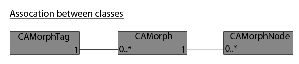

<!-- Source: https://developers.maxon.net/docs/py/2027_0_0/modules/c4d.modules/character/CAPoseMorphTag/index.html -->

# c4d.modules.character.CAPoseMorphTag 

## *class* `c4d.modules.character.CAPoseMorphTag` 

Parent Class:

- [`c4d.BaseTag`](../../../c4d/C4DAtom/GeListNode/BaseList2D/BaseTag/index.md#c4d.BaseTag)

## Overview 

**Active Morph Selection**

- [`CAPoseMorphTag.GetActiveMorph()`](#c4d.modules.character.CAPoseMorphTag.GetActiveMorph): Retrieves the active morph (usually the one selected).
- [`CAPoseMorphTag.GetActiveMorphIndex()`](#c4d.modules.character.CAPoseMorphTag.GetActiveMorphIndex): Get the index of the current active morph.
- [`CAPoseMorphTag.SetActiveMorphIndex()`](#c4d.modules.character.CAPoseMorphTag.SetActiveMorphIndex): Set the active morph index.

**Automatic Weighting Configuration**

- [`CAPoseMorphTag.GetMorphPSDID()`](#c4d.modules.character.CAPoseMorphTag.GetMorphPSDID): Retrieves the description ID for the morph slider at *morphIndex*.
- [`CAPoseMorphTag.GetPSDOrientThreshold()`](#c4d.modules.character.CAPoseMorphTag.GetPSDOrientThreshold): Retrieves the PSD orient radian threshold used in automatic weighting.
- [`CAPoseMorphTag.GetPSDPositionThreshold()`](#c4d.modules.character.CAPoseMorphTag.GetPSDPositionThreshold): Retrieves the PSD position distance threshold used in automatic weighting.
- [`CAPoseMorphTag.GetPSDTwistThreshold()`](#c4d.modules.character.CAPoseMorphTag.GetPSDTwistThreshold): Retrieves the PSD twist radian threshold used in automatic weighting.
- [`CAPoseMorphTag.SetPSDOrientThreshold()`](#c4d.modules.character.CAPoseMorphTag.SetPSDOrientThreshold): Sets the PSD orient radian threshold used in automatic weighting.
- [`CAPoseMorphTag.SetPSDPositionThreshold()`](#c4d.modules.character.CAPoseMorphTag.SetPSDPositionThreshold): Sets the PSD position distance threshold used in automatic weighting.
- [`CAPoseMorphTag.SetPSDTwistThreshold()`](#c4d.modules.character.CAPoseMorphTag.SetPSDTwistThreshold): Sets the PSD twist radian threshold used in automatic weighting.

**Editing State**

- [`CAPoseMorphTag.ExitEdit()`](#c4d.modules.character.CAPoseMorphTag.ExitEdit): Must be called before doing anything to a morph tag.
- [`CAPoseMorphTag.GetMode()`](#c4d.modules.character.CAPoseMorphTag.GetMode): Get the mode of the morph tag.
- [`CAPoseMorphTag.InitMorphs()`](#c4d.modules.character.CAPoseMorphTag.InitMorphs): Initialize the morphs.
- [`CAPoseMorphTag.UpdateMorphs()`](#c4d.modules.character.CAPoseMorphTag.UpdateMorphs): Update the morphs.

**Feedback Color**

- [`CAPoseMorphTag.GetPSDFeedbackColor()`](#c4d.modules.character.CAPoseMorphTag.GetPSDFeedbackColor): Retrieves the PSD color used for feedback.
- [`CAPoseMorphTag.GetPSDFeedbackColorEnabled()`](#c4d.modules.character.CAPoseMorphTag.GetPSDFeedbackColorEnabled): Checks if PSD color feedback is enabled or disabled.
- [`CAPoseMorphTag.SetPSDFeedbackColor()`](#c4d.modules.character.CAPoseMorphTag.SetPSDFeedbackColor): Sets the PSD color used for feedback.
- [`CAPoseMorphTag.SetPSDFeedbackColorEnabled()`](#c4d.modules.character.CAPoseMorphTag.SetPSDFeedbackColorEnabled): Sets the enable/disable state of the PSD color used for feedback.

**Magic Methods**

- [`CAPoseMorphTag.__init__()`](#c4d.modules.character.CAPoseMorphTag.__init__): Create a new pose morph tag.

**Morph Collection**

- [`CAPoseMorphTag.AddMorph()`](#c4d.modules.character.CAPoseMorphTag.AddMorph): Add a morph to the morph tag.
- [`CAPoseMorphTag.GetMorph()`](#c4d.modules.character.CAPoseMorphTag.GetMorph): Retrieves the morph at *index*.
- [`CAPoseMorphTag.GetMorphBase()`](#c4d.modules.character.CAPoseMorphTag.GetMorphBase): Get the morph base of the morph tag.
- [`CAPoseMorphTag.GetMorphCount()`](#c4d.modules.character.CAPoseMorphTag.GetMorphCount): Retrieves the number of morphs targets as shown in the user interface.
- [`CAPoseMorphTag.GetMorphID()`](#c4d.modules.character.CAPoseMorphTag.GetMorphID): Return the morph ID.
- [`CAPoseMorphTag.GetMorphIndex()`](#c4d.modules.character.CAPoseMorphTag.GetMorphIndex): Retrieves the index for the given *morph*.
- [`CAPoseMorphTag.RemoveMorph()`](#c4d.modules.character.CAPoseMorphTag.RemoveMorph): Remove a morph by *index*.

## Members 

### Active Morph Selection 

#### `CAPoseMorphTag.GetActiveMorph(self)` 

Retrieves the active morph (usually the one selected).

*New in version R17.053.*

**Return type:** [c4d.modules.character.CAMorph](../CAMorph/index.md#c4d.modules.character.CAMorph)

**Returns:** The active morph.

#### `CAPoseMorphTag.GetActiveMorphIndex(self)` 

Get the index of the current active morph.

**Return type:** int

**Returns:** The index.

#### `CAPoseMorphTag.SetActiveMorphIndex(self, index)` 

Set the active morph index.

*New in version R17.053.*

**Parameters:** **index** (*int*) – The active morph index to set.

**Raises:** **IndexError** – If the morph *index* is out of range : *0<=index<*[`GetMorphCount()`](#c4d.modules.character.CAPoseMorphTag.GetMorphCount).

### Automatic Weighting Configuration 

#### `CAPoseMorphTag.GetMorphPSDID(self, morphIndex, psdAttributeID)` 

Retrieves the description ID for the morph slider at *morphIndex*.

*New in version R19.*

**Parameters:**

- **morphIndex** (*int*) – The morph index: *0* <= *morphIndex* < [`GetMorphCount()`](#c4d.modules.character.CAPoseMorphTag.GetMorphCount).
- **psdAttributeID** (*int*) – The attribute ID defined in *tcaposemorph.h*: **ID_CA_POSE_PSD_ORIENT_INTERP_WEIGHT** <= *psdAttributeID* < **ID_CA_POSE_PSD_AUTOWEIGHT_INTERP**.

**Raises:** **IndexError** – If *morphIndex* is out of range.

**Return type:** [c4d.DescID](../../../c4d/DescID/index.md#c4d.DescID)

**Returns:** The description ID of the specified attribute.

#### `CAPoseMorphTag.GetPSDOrientThreshold(self)` 

Retrieves the PSD orient radian threshold used in automatic weighting.

*New in version R19.*

**Return type:** float

**Returns:** The PSD orient threshold (in radian).

#### `CAPoseMorphTag.GetPSDPositionThreshold(self)` 

Retrieves the PSD position distance threshold used in automatic weighting.

*New in version R19.*

**Return type:** float

**Returns:** The PSD position threshold (distance).

#### `CAPoseMorphTag.GetPSDTwistThreshold(self)` 

Retrieves the PSD twist radian threshold used in automatic weighting.

*New in version R19.*

**Return type:** float

**Returns:** The PSD twist threshold (in radian).

#### `CAPoseMorphTag.SetPSDOrientThreshold(self, radianThreshold)` 

Sets the PSD orient radian threshold used in automatic weighting.

*New in version R19.*

**Parameters:** **radianThreshold** (*float*) – The PSD orient threshold to set (in radian).

**Return type:** bool

**Returns:** **True** if successful, otherwise **False**.

#### `CAPoseMorphTag.SetPSDPositionThreshold(self, distanceThreshold)` 

Sets the PSD position distance threshold used in automatic weighting.

*New in version R19.*

**Parameters:** **distanceThreshold** (*float*) – The PSD position threshold to set (distance).

**Return type:** bool

**Returns:** **True** if successful, otherwise **False**.

#### `CAPoseMorphTag.SetPSDTwistThreshold(self, radianThreshold)` 

Sets the PSD twist radian threshold used in automatic weighting.

*New in version R19.*

**Parameters:** **radianThreshold** (*float*) – The PSD twist threshold to set (in radian).

**Return type:** bool

**Returns:** **True** if successful, otherwise **False**.

### Editing State 

#### `CAPoseMorphTag.ExitEdit(self, doc, apply)` 

Must be called before doing anything to a morph tag.  
If the user is in Edit mode and making changes to the morph, these are not applied until this function is called and, if not called, they are lost.  
Set apply to **True** if any user changes should be stored. This is normally the case.

**Parameters:**

- **doc** ([*c4d.documents.BaseDocument*](../../../c4d.documents/BaseDocument/index.md#c4d.documents.BaseDocument)) – The document.
- **apply** (*bool*) – Set to **False** if any user changes should be stored, otherwise set to **True**.

**Return type:** bool

**Returns:** **True** if successful, otherwise **False**.

#### `CAPoseMorphTag.GetMode(self)` 

Get the mode of the morph tag.

**Return type:** int

**Returns:** The mode.

#### `CAPoseMorphTag.InitMorphs(self)` 

Initialize the morphs.

#### `CAPoseMorphTag.UpdateMorphs(self)` 

Update the morphs.

### Feedback Color 

#### `CAPoseMorphTag.GetPSDFeedbackColor(self)` 

Retrieves the PSD color used for feedback.

*New in version R19.*

**Return type:** [c4d.Vector](../../../c4d/Vector/index.md#c4d.Vector)

**Returns:** The PSD feedback color.

#### `CAPoseMorphTag.GetPSDFeedbackColorEnabled(self)` 

Checks if PSD color feedback is enabled or disabled.

*New in version R19.*

**Return type:** bool

**Returns:** **True** if PSD color feedback is enabled, otherwise **False**.

#### `CAPoseMorphTag.SetPSDFeedbackColor(self, color)` 

Sets the PSD color used for feedback.

*New in version R19.*

**Parameters:** **color** ([*c4d.Vector*](../../../c4d/Vector/index.md#c4d.Vector)) – The PSD feedback color to set.

**Return type:** bool

**Returns:** **True** if successful, otherwise **False**.

#### `CAPoseMorphTag.SetPSDFeedbackColorEnabled(self, active)` 

Sets the enable/disable state of the PSD color used for feedback.

*New in version R19.*

**Parameters:** **active** (*bool*) – **True** to enable PSD color feedback, otherwise **False**.

**Return type:** bool

**Returns:** **True** if successful, otherwise **False**.

### Magic Methods 

#### `CAPoseMorphTag.__init__(self)` 

Create a new pose morph tag.

### Morph Collection 

#### `CAPoseMorphTag.AddMorph(self)` 

Add a morph to the morph tag.

**Return type:** [c4d.modules.character.CAMorph](../CAMorph/index.md#c4d.modules.character.CAMorph)

**Returns:** The new morph.

#### `CAPoseMorphTag.GetMorph(self, index)` 

Retrieves the morph at *index*.  
The parameter *index* is zero-based and index 0 will return the base morph, while the morphs starting from index 1 will be the user defined morphs.

**Parameters:** **index** (*int*) – The index of the morph.

**Raises:** **IndexError** – If the morph *index* is out of range : *0<=index<*[`GetMorphCount()`](#c4d.modules.character.CAPoseMorphTag.GetMorphCount).

**Return type:** [c4d.modules.character.CAMorph](../CAMorph/index.md#c4d.modules.character.CAMorph)

**Returns:** The morph.

#### `CAPoseMorphTag.GetMorphBase(self)` 

Get the morph base of the morph tag.

**Return type:** [c4d.modules.character.CAMorph](../CAMorph/index.md#c4d.modules.character.CAMorph)

**Returns:** The morph base.

#### `CAPoseMorphTag.GetMorphCount(self)` 

Retrieves the number of morphs targets as shown in the user interface.  
The value returned here indicates the maximum morph index, which is one less than this value due to being zero based.

**Return type:** int

**Returns:** The morph count.

#### `CAPoseMorphTag.GetMorphID(self, index)` 

Return the morph ID.

**Parameters:** **index** (*int*) – The index of the morph.

**Raises:** **IndexError** – If the morph *index* is out of range : *0<=index<*[`GetMorphCount()`](#c4d.modules.character.CAPoseMorphTag.GetMorphCount).

**Return type:** [c4d.DescID](../../../c4d/DescID/index.md#c4d.DescID)

**Returns:** The morph ID.

#### `CAPoseMorphTag.GetMorphIndex(self, morph)` 

Retrieves the index for the given *morph*.

*New in version R17.053.*

**Parameters:** **morph** ([*c4d.modules.character.CAMorph*](../CAMorph/index.md#c4d.modules.character.CAMorph)) – The morph to search for.

**Return type:** int

**Returns:** The index for *morph*.

#### `CAPoseMorphTag.RemoveMorph(self, index)` 

Remove a morph by *index*.

**Parameters:** **index** (*int*) – The index of the morph.

**Raises:** **IndexError** – If the morph *index* is out of range : *0<=index<*[`GetMorphCount()`](#c4d.modules.character.CAPoseMorphTag.GetMorphCount).
