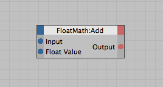

<!-- Source: https://developers.maxon.net/docs/py/2027_0_0/modules/c4d.modules/graphview/GvNode/index.html -->

# c4d.modules.graphview.GvNode <a id="c4d-modules-graphview-gvnode"></a>

## *class* `c4d.modules.graphview.GvNode` <a id="c4d.modules.graphview.GvNode"></a>

Use `GvNodeMaster.CreateNode()` to create nodes.  
The *GvNode* is a double [`BaseList2D`](../../../c4d/C4DAtom/GeListNode/BaseList2D/index.md#c4d.BaseList2D) node.

> **Warning:** This type cannot be instantiated.

> **Note:** Please use `GvNode.GetOperatorContainer()` to access most parameters.

A [`GvNode`](#c4d.modules.graphview.GvNode) is a node which is stored in a [`GvNodeMaster`](../GvNodeMaster/index.md#c4d.modules.graphview.GvNodeMaster).  
A node contains ports represented by [`GvPort`](../GvPort/index.md#c4d.modules.graphview.GvPort).



Parent Class:

- [`c4d.BaseList2D`](../../../c4d/C4DAtom/GeListNode/BaseList2D/index.md#c4d.BaseList2D)

## Overview <a id="overview"></a>

**Node Overview**

- [`GvNode.GetNodeMaster()`](#c4d.modules.graphview.GvNode.GetNodeMaster): Returns the GvNodeMaster where the node is attached to.
- [`GvNode.GetOperatorID()`](#c4d.modules.graphview.GvNode.GetOperatorID): Returns the operator ID.
- [`GvNode.GetOwnerID()`](#c4d.modules.graphview.GvNode.GetOwnerID): Returns the owner ID of the node.
- [`GvNode.IsGroupNode()`](#c4d.modules.graphview.GvNode.IsGroupNode): Checks if the node is a group node.
- [`GvNode.Redraw()`](#c4d.modules.graphview.GvNode.Redraw): Redraws the node.

**Operator Configuration**

- [`GvNode.GetOpContainerInstance()`](#c4d.modules.graphview.GvNode.GetOpContainerInstance): Retrieves a pointer to the internal operator’s container.
- [`GvNode.GetOperatorContainer()`](#c4d.modules.graphview.GvNode.GetOperatorContainer): Returns the settings container.
- [`GvNode.OperatorSetData()`](#c4d.modules.graphview.GvNode.OperatorSetData): Sets data in the operator.
- [`GvNode.SetOperatorContainer()`](#c4d.modules.graphview.GvNode.SetOperatorContainer): Set the settings container.

**Port Access**

- [`GvNode.GetInPort()`](#c4d.modules.graphview.GvNode.GetInPort): Retrieves an inport by index.
- [`GvNode.GetInPortCount()`](#c4d.modules.graphview.GvNode.GetInPortCount): Returns the count of the inports.
- [`GvNode.GetInPorts()`](#c4d.modules.graphview.GvNode.GetInPorts): Retrieves all inports of a node.
- [`GvNode.GetOutPort()`](#c4d.modules.graphview.GvNode.GetOutPort): Retrieves an outport by index.
- [`GvNode.GetOutPortCount()`](#c4d.modules.graphview.GvNode.GetOutPortCount): Returns the count of the outports.
- [`GvNode.GetOutPorts()`](#c4d.modules.graphview.GvNode.GetOutPorts): Retrieves all outports of a node.
- [`GvNode.GetPort()`](#c4d.modules.graphview.GvNode.GetPort): Retrieves a port by sub ID.
- [`GvNode.GetPortIndex()`](#c4d.modules.graphview.GvNode.GetPortIndex): Gets the index of a port by sub ID.

**Ports And Connections**

- [`GvNode.AddPort()`](#c4d.modules.graphview.GvNode.AddPort): Adds a port to the node.
- [`GvNode.AddPortIsOK()`](#c4d.modules.graphview.GvNode.AddPortIsOK): Checks if `AddPort()` would be successful.
- [`GvNode.RemoveConnections()`](#c4d.modules.graphview.GvNode.RemoveConnections): Removes all connections of the node.
- [`GvNode.RemovePort()`](#c4d.modules.graphview.GvNode.RemovePort): Removes a port from this node.
- [`GvNode.RemovePortIsOK()`](#c4d.modules.graphview.GvNode.RemovePortIsOK): Checks if it is OK to remove a port from this node.
- [`GvNode.RemoveUnusedPorts()`](#c4d.modules.graphview.GvNode.RemoveUnusedPorts): Removes all unused ports - Sends a message to the node.
- [`GvNode.ResetPortType()`](#c4d.modules.graphview.GvNode.ResetPortType): Changes the type of the port.
- [`GvNode.SetPortType()`](#c4d.modules.graphview.GvNode.SetPortType): Changes the type of a port of this node.

## Members <a id="members"></a>

### Node Overview <a id="c4d.modules.graphview.GvNode-method-Node-Overview"></a>

#### `GvNode.GetNodeMaster(self)` <a id="c4d.modules.graphview.GvNode.GetNodeMaster"></a>

Returns the GvNodeMaster where the node is attached to.

**Return type:** Optional[[c4d.modules.graphview.GvNodeMaster](../GvNodeMaster/index.md#c4d.modules.graphview.GvNodeMaster)]

**Returns:** The GvNodeMaster or **None** if there is no nodemaster.

#### `GvNode.GetOperatorID(self)` <a id="c4d.modules.graphview.GvNode.GetOperatorID"></a>

Returns the operator ID.

**Return type:** int

**Returns:** The id.

#### `GvNode.GetOwnerID(self)` <a id="c4d.modules.graphview.GvNode.GetOwnerID"></a>

Returns the owner ID of the node.

**Return type:** int

**Returns:**

The id.

|   |   |
|---|---|
| *ID_GV_SYSTEM_OWNER* | System. |
| *ID_GV_GENERAL_OWNER* | General. |
| *ID_GV_IGNORE_OWNER* | Ignore owner. |

#### `GvNode.IsGroupNode(self)` <a id="c4d.modules.graphview.GvNode.IsGroupNode"></a>

Checks if the node is a group node.

**Return type:** bool

**Returns:** **True** if the node is a group node, otherwise **False**.

#### `GvNode.Redraw(self)` <a id="c4d.modules.graphview.GvNode.Redraw"></a>

Redraws the node.

### Operator Configuration <a id="c4d.modules.graphview.GvNode-method-Operator-Configuration"></a>

#### `GvNode.GetOpContainerInstance(self)` <a id="c4d.modules.graphview.GvNode.GetOpContainerInstance"></a>

Retrieves a pointer to the internal operator’s container.  
This means that the container can be changed directly.

**Return type:** [c4d.BaseContainer](../../../c4d/BaseContainer/index.md#c4d.BaseContainer)

**Returns:** The container.

#### `GvNode.GetOperatorContainer(self)` <a id="c4d.modules.graphview.GvNode.GetOperatorContainer"></a>

Returns the settings container.

**Return type:** [c4d.BaseContainer](../../../c4d/BaseContainer/index.md#c4d.BaseContainer)

**Returns:** The container.

#### `GvNode.OperatorSetData(self, type, data, mode)` <a id="c4d.modules.graphview.GvNode.OperatorSetData"></a>

Sets data in the operator. Usually simulates dragging onto the node.

*New in version R18.057.*

**Parameters:**

- **type** (*int*) –

  The data type:

  |   |   |   |
  |---|---|---|
  | *GV_ATOMARRAY* | list of [`c4d.C4DAtom`](../../../c4d/C4DAtom/index.md#c4d.C4DAtom) | The active objects. |
  | *GV_ATOM* | [`c4d.C4DAtom`](../../../c4d/C4DAtom/index.md#c4d.C4DAtom) | The active object. |
  | *GV_DESCID* | dict(‘did’: [`c4d.DescID`](../../../c4d/DescID/index.md#c4d.DescID), ‘arr’: list of [`c4d.C4DAtom`](../../../c4d/C4DAtom/index.md#c4d.C4DAtom)) | The description ID and related active object(s). |

- **data** (*any*) – The data to set. Depends on *type*.

- **mode** (*int*) –

  The set data mode:

  |   |   |
  |---|---|
  | *GV_OP_NOP* | Ignore. |
  | *GV_OP_SET* | Set the internal value to the parameter value. (The constant node uses this.) |
  | *GV_OP_DROP* | An atom has been dropped over the node. |
  | *GV_OP_DROP_IN_BODY* | An atom has been dropped over the body of the node. |
  | *GV_OP_DROP_IN_INDOCK* | An atom has been dropped in the inport area of the node. |
  | *GV_OP_DROP_IN_OUTDOCK* | An atom has been dropped in the outport area of the node. |

**Return type:** bool

**Returns:** **True** if the data was set, otherwise **False**.

#### `GvNode.SetOperatorContainer(self, bc)` <a id="c4d.modules.graphview.GvNode.SetOperatorContainer"></a>

Set the settings container.

**Parameters:** **str** – The container.

### Port Access <a id="c4d.modules.graphview.GvNode-method-Port-Access"></a>

#### `GvNode.GetInPort(self, id)` <a id="c4d.modules.graphview.GvNode.GetInPort"></a>

Retrieves an inport by index.

**Parameters:** **id** (*int*) – the index

**Return type:** Optional[[c4d.modules.graphview.GvPort](../GvPort/index.md#c4d.modules.graphview.GvPort)]

**Returns:** The GvPort or **None** if no port was found.

#### `GvNode.GetInPortCount(self)` <a id="c4d.modules.graphview.GvNode.GetInPortCount"></a>

Returns the count of the inports.

**Return type:** int

**Returns:** The count.

#### `GvNode.GetInPorts(self, type=-1)` <a id="c4d.modules.graphview.GvNode.GetInPorts"></a>

Retrieves all inports of a node.

**Parameters:**

**type** (*int*) –

If *type* is set, just the ports with the given type will be returned.  
Each port has its own type ID’s for the ports so check the C-header files of the node.

**Return type:** Optional[List[[c4d.modules.graphview.GvPort](../GvPort/index.md#c4d.modules.graphview.GvPort)]]

**Returns:** The GvPorts or **None** if no port was found.

#### `GvNode.GetOutPort(self, id)` <a id="c4d.modules.graphview.GvNode.GetOutPort"></a>

Retrieves an outport by index.

**Parameters:** **id** (*int*) – the index

**Return type:** Optional[[c4d.modules.graphview.GvPort](../GvPort/index.md#c4d.modules.graphview.GvPort)]

**Returns:** The GvPort or **None** if no port was found.

#### `GvNode.GetOutPortCount(self)` <a id="c4d.modules.graphview.GvNode.GetOutPortCount"></a>

Returns the count of the outports.

**Return type:** int

**Returns:** The count

#### `GvNode.GetOutPorts(self, type=-1)` <a id="c4d.modules.graphview.GvNode.GetOutPorts"></a>

Retrieves all outports of a node.

**Parameters:**

**type** (*int*) –

If *type* is set, just the ports with the given type will be returned.  
Each port has its own type ID’s for the ports so check the C-header files of the node.

**Return type:** Optional[List[[c4d.modules.graphview.GvPort](../GvPort/index.md#c4d.modules.graphview.GvPort)]]

**Returns:** The GvPorts or **None** if no port was found.

#### `GvNode.GetPort(self, sub_id)` <a id="c4d.modules.graphview.GvNode.GetPort"></a>

Retrieves a port by sub ID.

**Parameters:** **sub_id** (*int*) – Port sub ID.

**Return type:** Optional[[c4d.modules.graphview.GvPort](../GvPort/index.md#c4d.modules.graphview.GvPort)]

**Returns:** The retrieved port, or **None**.

#### `GvNode.GetPortIndex(self, id)` <a id="c4d.modules.graphview.GvNode.GetPortIndex"></a>

Gets the index of a port by sub ID.

**Parameters:** **id** (*int*) – Port sub ID.

**Return type:** int

**Returns:** Port index.

### Ports And Connections <a id="c4d.modules.graphview.GvNode-method-Ports-And-Connections"></a>

#### `GvNode.AddPort(self, io, id, flag=1, message=False)` <a id="c4d.modules.graphview.GvNode.AddPort"></a>

Adds a port to the node.

> **Note:** To add a port for a user data parameter create the [`DescID`](../../../c4d/DescID/index.md#c4d.DescID) of that parameter:
>
> ```python
> USERDATA_NUMBER = 1
> nodeObjOut.AddPort(c4d.GV_PORT_OUTPUT, c4d.DescID(c4d.DescLevel(c4d.ID_USERDATA, c4d.DTYPE_SUBCONTAINER, 0), c4d.DescLevel(USERDATA_NUMBER)), message=True)
> ```

**Parameters:**

- **io** (*int*) –

  The IO mode of the port to create:

  |   |   |
  |---|---|
  | *GV_PORT_INVALID* | Invalid. |
  | *GV_PORT_INPUT* | Input. |
  | *GV_PORT_OUTPUT* | Output. |
  | *GV_PORT_INPUT_OR_GEDATA* | Input or GeData. |

- **id** (*Union*[*int*, [*c4d.DescID*](../../../c4d/DescID/index.md#c4d.DescID)]) – The ID of the port to create.

- **flag** (*int*) –

  Flags:

  |   |   |
  |---|---|
  | *GV_PORT_FLAG_NONE* | No flag. |
  | *GV_PORT_FLAG_IS_VISIBLE* | Visible port. |
  | *GV_PORT_FLAG_IS_ITERATE* | Iteration port. |

- **message** (*bool*) – If **True** the operator receives a message when the port is added.

**Return type:** Optional[[c4d.modules.graphview.GvPort](../GvPort/index.md#c4d.modules.graphview.GvPort)]

**Returns:** The created port or **None** if creation failed.

#### `GvNode.AddPortIsOK(self, io, id)` <a id="c4d.modules.graphview.GvNode.AddPortIsOK"></a>

Checks if [`AddPort()`](#c4d.modules.graphview.GvNode.AddPort) would be successful.

**Parameters:**

- **io** (*int*) –

  The port mode:

  |   |   |
  |---|---|
  | *GV_PORT_INVALID* | Invalid. |
  | *GV_PORT_INPUT* | Input. |
  | *GV_PORT_OUTPUT* | Output. |
  | *GV_PORT_INPUT_OR_GEDATA* | Input or GeData. |

- **id** (*int*) – The type id of the port.

**Return type:** bool

**Returns:** **True** if adding the port would succeed, otherwise **False**.

#### `GvNode.RemoveConnections(self)` <a id="c4d.modules.graphview.GvNode.RemoveConnections"></a>

Removes all connections of the node.

#### `GvNode.RemovePort(self, port, message=False)` <a id="c4d.modules.graphview.GvNode.RemovePort"></a>

Removes a port from this node.

**Parameters:**

- **port** ([*c4d.modules.graphview.GvPort*](../GvPort/index.md#c4d.modules.graphview.GvPort)) – A port of this node to remove.
- **message** (*bool*) – If this is **True** the operator receives a message when the port is removed.

#### `GvNode.RemovePortIsOK(self, port)` <a id="c4d.modules.graphview.GvNode.RemovePortIsOK"></a>

Checks if it is OK to remove a port from this node.

> **Note:** Used to check if a call to `GvNode.RemovePort()` would succeed.

**Parameters:** **port** ([*c4d.modules.graphview.GvPort*](../GvPort/index.md#c4d.modules.graphview.GvPort)) – A port of this node to remove.

**Return type:** bool

**Returns:** **True** if this port can be remove.

#### `GvNode.RemoveUnusedPorts(self, message=True)` <a id="c4d.modules.graphview.GvNode.RemoveUnusedPorts"></a>

Removes all unused ports - Sends a message to the node.

**Parameters:** **message** (*bool*) – If this is **True**, the operator receives a message when the ports are removed.

#### `GvNode.ResetPortType(self, id)` <a id="c4d.modules.graphview.GvNode.ResetPortType"></a>

Changes the type of the port. Used to manage dynamic data ports.

**Parameters:** **id** (*int*) – The type.

#### `GvNode.SetPortType(self, port, id)` <a id="c4d.modules.graphview.GvNode.SetPortType"></a>

Changes the type of a port of this node.

**Parameters:**

- **port** ([*c4d.modules.graphview.GvPort*](../GvPort/index.md#c4d.modules.graphview.GvPort)) – A port of this node.
- **id** (*int*) – The new port ID.
