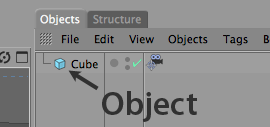

<!-- Source: https://developers.maxon.net/docs/py/2027_0_0/modules/c4d.modules/motiontracker/MotionTrackerObject/index.html -->

# c4d.modules.motiontracker.MotionTrackerObject <a id="c4d-modules-motiontracker-motiontrackerobject"></a>

## *class* `c4d.modules.motiontracker.MotionTrackerObject` <a id="c4d.modules.motiontracker.MotionTrackerObject"></a>

The base class of objects.

Here is an example how to create and edit objects.

```python
import c4d

obj = c4d.BaseObject(c4d.Ocube) # Create new cube
obj.SetRelPos(c4d.Vector(20))   # Set position of cube
doc.InsertObject(obj)           # Insert object in document
c4d.EventAdd()                  # Send global event message
```



Parent Class:

- [`c4d.BaseObject`](../../../c4d/C4DAtom/GeListNode/BaseList2D/BaseObject/index.md#c4d.BaseObject)

## Overview <a id="overview"></a>

- [`MotionTrackerObject.Get2dTrackData()`](#c4d.modules.motiontracker.MotionTrackerObject.Get2dTrackData): Retrieves 2D tracking data.
- [`MotionTrackerObject.GetFootageData()`](#c4d.modules.motiontracker.MotionTrackerObject.GetFootageData): Retrieves data about the footage.

## Members <a id="members"></a>

### Tracking Data <a id="c4d.modules.motiontracker.MotionTrackerObject-method-Tracking-Data"></a>

#### `MotionTrackerObject.Get2dTrackData(self)` <a id="c4d.modules.motiontracker.MotionTrackerObject.Get2dTrackData"></a>

Retrieves 2D tracking data.

**Return type:** [c4d.modules.motiontracker.Mt2dTrackData](../Mt2dTrackData/index.md#c4d.modules.motiontracker.Mt2dTrackData)

**Returns:** The 2D tracking data.

#### `MotionTrackerObject.GetFootageData(self)` <a id="c4d.modules.motiontracker.MotionTrackerObject.GetFootageData"></a>

Retrieves data about the footage.

**Return type:** [c4d.modules.motiontracker.MtFootageData](../MtFootageData/index.md#c4d.modules.motiontracker.MtFootageData)

**Returns:** The footage data.
