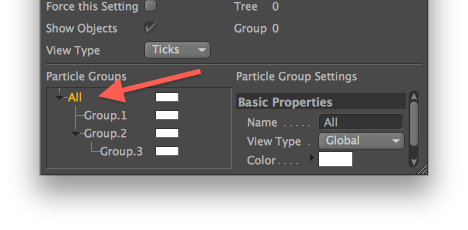

<!-- Source: https://developers.maxon.net/docs/py/2027_0_0/modules/c4d.modules/thinkingparticles/TP_MasterSystem/index.html -->

# c4d.modules.thinkingparticles.TP_MasterSystem <a id="c4d-modules-thinkingparticles-tp-mastersystem"></a>

## *class* `c4d.modules.thinkingparticles.TP_MasterSystem` <a id="c4d.modules.thinkingparticles.TP_MasterSystem"></a>

The master system is the main TP engine class.  
There can only be one master system per document.  
You can get it with `BaseDocument.GetParticleSystem()`.

Parent Class:

- [`c4d.BaseList2D`](../../../c4d/C4DAtom/GeListNode/BaseList2D/index.md#c4d.BaseList2D)

## Overview <a id="overview"></a>

**Allocation**

- [`TP_MasterSystem.AllocParticle()`](#c4d.modules.thinkingparticles.TP_MasterSystem.AllocParticle): Allocates a particle.
- [`TP_MasterSystem.AllocParticles()`](#c4d.modules.thinkingparticles.TP_MasterSystem.AllocParticles): Allocates *num* particles and stores their particles IDs.
- [`TP_MasterSystem.FreeAllParticles()`](#c4d.modules.thinkingparticles.TP_MasterSystem.FreeAllParticles): Frees all particles.
- [`TP_MasterSystem.FreeParticle()`](#c4d.modules.thinkingparticles.TP_MasterSystem.FreeParticle): Allocates *num* particles and stores their particles IDs.

**Collision Handling**

- [`TP_MasterSystem.CheckCollision()`](#c4d.modules.thinkingparticles.TP_MasterSystem.CheckCollision): Finds the node responsible for collision, the one that called SetCollision(),
- [`TP_MasterSystem.SetCollision()`](#c4d.modules.thinkingparticles.TP_MasterSystem.SetCollision): Sets the collision handling information for a particle.

**Data Channels**

- [`TP_MasterSystem.AddDataChannel()`](#c4d.modules.thinkingparticles.TP_MasterSystem.AddDataChannel): Adds a new data channel.
- [`TP_MasterSystem.DataChannelID()`](#c4d.modules.thinkingparticles.TP_MasterSystem.DataChannelID): Retrieves the index of a data channel from its unique ID.
- [`TP_MasterSystem.DataChannelName()`](#c4d.modules.thinkingparticles.TP_MasterSystem.DataChannelName): Retrieves the name of a data channel.
- [`TP_MasterSystem.DataChannelType()`](#c4d.modules.thinkingparticles.TP_MasterSystem.DataChannelType): Retrieves the data type of a data channel.
- [`TP_MasterSystem.DataChannelUniqueID()`](#c4d.modules.thinkingparticles.TP_MasterSystem.DataChannelUniqueID): Retrieves a unique ID for a data channel that’s independent of its index.
- [`TP_MasterSystem.GetPData()`](#c4d.modules.thinkingparticles.TP_MasterSystem.GetPData): Sets the data channel value for a particle:
- [`TP_MasterSystem.NumDataChannels()`](#c4d.modules.thinkingparticles.TP_MasterSystem.NumDataChannels): Retrieves the data channel count.
- [`TP_MasterSystem.RemoveDataChannel()`](#c4d.modules.thinkingparticles.TP_MasterSystem.RemoveDataChannel): Removes a data channel.
- [`TP_MasterSystem.SetPData()`](#c4d.modules.thinkingparticles.TP_MasterSystem.SetPData): Sets the data channel value for a particle:

**Group Access**

- [`TP_MasterSystem.GetGroupFromInfo()`](#c4d.modules.thinkingparticles.TP_MasterSystem.GetGroupFromInfo): Retrieves a group from the information in *info*.
- [`TP_MasterSystem.GetGroupInfo()`](#c4d.modules.thinkingparticles.TP_MasterSystem.GetGroupInfo): Retrieves the group information for a *group*.
- [`TP_MasterSystem.GetParticles()`](#c4d.modules.thinkingparticles.TP_MasterSystem.GetParticles): Retrieve a list of all particles Id.
- [`TP_MasterSystem.GetVirtualObjects()`](#c4d.modules.thinkingparticles.TP_MasterSystem.GetVirtualObjects): Creates the virtual object hierarchy for a particle group, i.e.
- [`TP_MasterSystem.UpdateGroup()`](#c4d.modules.thinkingparticles.TP_MasterSystem.UpdateGroup): Updates a *group* at a given time difference since the last update.

**Group Management**

- [`TP_MasterSystem.AllocParticleGroup()`](#c4d.modules.thinkingparticles.TP_MasterSystem.AllocParticleGroup): Allocates a new particle group.
- [`TP_MasterSystem.FreeParticleGroup()`](#c4d.modules.thinkingparticles.TP_MasterSystem.FreeParticleGroup): Frees a particle group, removing it from the list.
- [`TP_MasterSystem.GetGroupParticleCount()`](#c4d.modules.thinkingparticles.TP_MasterSystem.GetGroupParticleCount): Calculates the number of particles in the ingroup *group*.
- [`TP_MasterSystem.GetParticleGroups()`](#c4d.modules.thinkingparticles.TP_MasterSystem.GetParticleGroups): Returns the particle groups in *ingroup*, specified by *mode*.
- [`TP_MasterSystem.GetRootGroup()`](#c4d.modules.thinkingparticles.TP_MasterSystem.GetRootGroup): Returns the root group.
- [`TP_MasterSystem.SetPGroupHierarchy()`](#c4d.modules.thinkingparticles.TP_MasterSystem.SetPGroupHierarchy): Performs a hierarchy action on a particle group.

**Group Updates**

- [`TP_MasterSystem.SetGroup()`](#c4d.modules.thinkingparticles.TP_MasterSystem.SetGroup): Inserts a particle into another group.

**Kinematics**

- [`TP_MasterSystem.Alignment()`](#c4d.modules.thinkingparticles.TP_MasterSystem.Alignment): Retrieves the alignment matrix of a particle.
- [`TP_MasterSystem.Position()`](#c4d.modules.thinkingparticles.TP_MasterSystem.Position): Retrieves the position of a particle.
- [`TP_MasterSystem.Spin()`](#c4d.modules.thinkingparticles.TP_MasterSystem.Spin): Retrieves the spin of a particle.
- [`TP_MasterSystem.Transform()`](#c4d.modules.thinkingparticles.TP_MasterSystem.Transform): Retrieves the transformation matrix of a particle.
- [`TP_MasterSystem.Velocity()`](#c4d.modules.thinkingparticles.TP_MasterSystem.Velocity): Retrieves the velocity of a particle.

**Lifecycle**

- [`TP_MasterSystem.Alive()`](#c4d.modules.thinkingparticles.TP_MasterSystem.Alive): Retrieves the alive bit of a particle.
- [`TP_MasterSystem.EntersGroup()`](#c4d.modules.thinkingparticles.TP_MasterSystem.EntersGroup): Retrieves the enters-group bit of a particle.
- [`TP_MasterSystem.Group()`](#c4d.modules.thinkingparticles.TP_MasterSystem.Group): Retrieves the group of a particle.
- [`TP_MasterSystem.IsBorn()`](#c4d.modules.thinkingparticles.TP_MasterSystem.IsBorn): Retrieves the is-born bit of a particle.
- [`TP_MasterSystem.IsDie()`](#c4d.modules.thinkingparticles.TP_MasterSystem.IsDie): Retrieves the is-die bit of a particle.
- [`TP_MasterSystem.NumParticles()`](#c4d.modules.thinkingparticles.TP_MasterSystem.NumParticles): Retrieves the number of allocated particles.

**Motion Updates**

- [`TP_MasterSystem.SetSpin()`](#c4d.modules.thinkingparticles.TP_MasterSystem.SetSpin): Sets the spin for a particle.
- [`TP_MasterSystem.SetVelocity()`](#c4d.modules.thinkingparticles.TP_MasterSystem.SetVelocity): Sets the velocity for a particle.

**Physical Properties**

- [`TP_MasterSystem.Color()`](#c4d.modules.thinkingparticles.TP_MasterSystem.Color): Retrieves the color of a particle.
- [`TP_MasterSystem.Mass()`](#c4d.modules.thinkingparticles.TP_MasterSystem.Mass): Retrieves the mass of a particle.
- [`TP_MasterSystem.Scale()`](#c4d.modules.thinkingparticles.TP_MasterSystem.Scale): Retrieves the scale of a particle.
- [`TP_MasterSystem.Size()`](#c4d.modules.thinkingparticles.TP_MasterSystem.Size): Retrieves the size of a particle.

**Property Updates**

- [`TP_MasterSystem.SetColor()`](#c4d.modules.thinkingparticles.TP_MasterSystem.SetColor): Sets the color for a particle.
- [`TP_MasterSystem.SetMass()`](#c4d.modules.thinkingparticles.TP_MasterSystem.SetMass): Sets the mass for a particle.
- [`TP_MasterSystem.SetScale()`](#c4d.modules.thinkingparticles.TP_MasterSystem.SetScale): Sets the size for a particle.
- [`TP_MasterSystem.SetSize()`](#c4d.modules.thinkingparticles.TP_MasterSystem.SetSize): Sets the size for a particle.

**State Metadata**

- [`TP_MasterSystem.Flags()`](#c4d.modules.thinkingparticles.TP_MasterSystem.Flags): Retrieves the transformation matrix of a particle.
- [`TP_MasterSystem.Randomseed()`](#c4d.modules.thinkingparticles.TP_MasterSystem.Randomseed): Retrieves the random seed of a particle.

**State Updates**

- [`TP_MasterSystem.SetRandomseed()`](#c4d.modules.thinkingparticles.TP_MasterSystem.SetRandomseed): Sets the alignment matrix for a particle.

**System Tracking**

- [`TP_MasterSystem.GetDirty()`](#c4d.modules.thinkingparticles.TP_MasterSystem.GetDirty): A dirty counter for the master system.
- [`TP_MasterSystem.GetOperatorID()`](#c4d.modules.thinkingparticles.TP_MasterSystem.GetOperatorID): Retrieves an ID for *op*
- [`TP_MasterSystem.SetDirty()`](#c4d.modules.thinkingparticles.TP_MasterSystem.SetDirty): Increments the dirty counter, i.e.

**Timing**

- [`TP_MasterSystem.Age()`](#c4d.modules.thinkingparticles.TP_MasterSystem.Age): Retrieves the age of a particle.
- [`TP_MasterSystem.DTFactor()`](#c4d.modules.thinkingparticles.TP_MasterSystem.DTFactor): Retrieves the delta time factor of a particle.
- [`TP_MasterSystem.Life()`](#c4d.modules.thinkingparticles.TP_MasterSystem.Life): Retrieves the lifetime of a particle.

**Timing Updates**

- [`TP_MasterSystem.SetAge()`](#c4d.modules.thinkingparticles.TP_MasterSystem.SetAge): Sets the age for a particle.
- [`TP_MasterSystem.SetDTFactor()`](#c4d.modules.thinkingparticles.TP_MasterSystem.SetDTFactor): Sets the delta time factor for a particle.
- [`TP_MasterSystem.SetLife()`](#c4d.modules.thinkingparticles.TP_MasterSystem.SetLife): Sets the age for a particle.

**Transform Updates**

- [`TP_MasterSystem.SetAlignment()`](#c4d.modules.thinkingparticles.TP_MasterSystem.SetAlignment): Sets the alignment matrix for a particle.
- [`TP_MasterSystem.SetPosition()`](#c4d.modules.thinkingparticles.TP_MasterSystem.SetPosition): Retrieves the delta time factor of a particle.

## Members <a id="members"></a>

### Allocation <a id="c4d.modules.thinkingparticles.TP_MasterSystem-method-Allocation"></a>

#### `TP_MasterSystem.AllocParticle(self)` <a id="c4d.modules.thinkingparticles.TP_MasterSystem.AllocParticle"></a>

Allocates a particle.

**Return type:** int

**Returns:** The particle ID of the allocated particle, or *NOTOK* if the allocation failed.

#### `TP_MasterSystem.AllocParticles(self, num)` <a id="c4d.modules.thinkingparticles.TP_MasterSystem.AllocParticles"></a>

Allocates *num* particles and stores their particles IDs.

> > **Note:**
> >
> > The count of allocated particles might be unequal to *num* due to the limit in the settings *Max Particles*.  
> > Change it to increase the count of allocatable particles.
>
> 

**Parameters:** **num** (*int*) – The number of particles to allocate.

**Return type:** List[int]

**Returns:** The list with the allocated particle IDs.

#### `TP_MasterSystem.FreeAllParticles(self)` <a id="c4d.modules.thinkingparticles.TP_MasterSystem.FreeAllParticles"></a>

Frees all particles.

> > **Note:**
> >
> > Normally this should not be used.  
> > Instead you should use [`SetLife()`](#c4d.modules.thinkingparticles.TP_MasterSystem.SetLife) with a negative time, so that the particle in question dies immediately.

#### `TP_MasterSystem.FreeParticle(self, pid)` <a id="c4d.modules.thinkingparticles.TP_MasterSystem.FreeParticle"></a>

Allocates *num* particles and stores their particles IDs.

> > **Note:**
> >
> > Normally this should not be used.  
> > Instead you should use [`SetLife()`](#c4d.modules.thinkingparticles.TP_MasterSystem.SetLife) with a negative time, so that the particle in question dies immediately.

**Parameters:** **pid** (*int*) – Particle ID of the particle to free. Particle ID.

**Raises:** **IndexError** – If *pid* is out of range : *0<=pid<*[`NumParticles()`](#c4d.modules.thinkingparticles.TP_MasterSystem.NumParticles).

### Collision Handling <a id="c4d.modules.thinkingparticles.TP_MasterSystem-method-Collision-Handling"></a>

#### `TP_MasterSystem.CheckCollision(self, collision, pid, t, pos, vel, dt)` <a id="c4d.modules.thinkingparticles.TP_MasterSystem.CheckCollision"></a>

Finds the node responsible for collision, the one that called SetCollision(), and tells it to evaluate the passed collision parameters.

> **Note:** Normally Thinking Particles evaluates this function automatically for registered collisions.

**Parameters:**

- **collision** (*int*) – The collision ID. This is GetOperatorID() for the node responsible for the collision.

- **pid** (*int*) – The particle ID: 0 <= pid < NumParticles()

- **t** (*float*) –

  Time to evaluate the collision at.  
  Collisions are detected between t - dt and t.

- **pos** ([*c4d.Vector*](../../../c4d/Vector/index.md#c4d.Vector)) – Assigned the new position of the object if there is a collision.

- **vel** ([*c4d.Vector*](../../../c4d/Vector/index.md#c4d.Vector)) – Assigned the new velocity of the object if there is a collision.

- **dt** (*float*) – The time since the last evaluation, i.e. the time to look backwards for collisions.

**Return type:** Tuple[bool, Dict[“axis”: c4d.Vector, “speed”: float], float]

**Returns:**

A tuple filled in this order:

- **True** if there was a collision, otherwise **False**.

- dict with the next entries:

  > - ”axis”: Rotation axis.
  > - ”speed”: Rotation speed.

- The collision time, if there was a collision. This is generally less than t.

#### `TP_MasterSystem.SetCollision(self, pid, collision)` <a id="c4d.modules.thinkingparticles.TP_MasterSystem.SetCollision"></a>

Sets the collision handling information for a particle.

**Parameters:**

- **pid** (*int*) – Particle ID.
- **collision** (*int*) – Collision ID. This is [`GetOperatorID()`](#c4d.modules.thinkingparticles.TP_MasterSystem.GetOperatorID) for the node responsible for the collision handling.

**Raises:** **IndexError** – If *pid* is out of range : *0<=pid<*[`NumParticles()`](#c4d.modules.thinkingparticles.TP_MasterSystem.NumParticles).

### Data Channels <a id="c4d.modules.thinkingparticles.TP_MasterSystem-method-Data-Channels"></a>

#### `TP_MasterSystem.AddDataChannel(self, type, str)` <a id="c4d.modules.thinkingparticles.TP_MasterSystem.AddDataChannel"></a>

Adds a new data channel.

**Parameters:**

- **type** (*int*) – Channel data type.
- **str** (*str*) – Channel

**Return type:** bool

**Returns:** **True** if successful, otherwise **False**.

#### `TP_MasterSystem.DataChannelID(self, unique_id)` <a id="c4d.modules.thinkingparticles.TP_MasterSystem.DataChannelID"></a>

Retrieves the index of a data channel from its unique ID.

**Parameters:** **unique_id** (*int*) – Channel ID.

**Return type:** int

**Returns:** Data channel index.

#### `TP_MasterSystem.DataChannelName(self, chan)` <a id="c4d.modules.thinkingparticles.TP_MasterSystem.DataChannelName"></a>

Retrieves the name of a data channel.

**Parameters:** **chan** (*int*) – Channel index.

**Raises:** **IndexError** – If *chan* is out of range : *0<=chan<*[`NumDataChannels()`](#c4d.modules.thinkingparticles.TP_MasterSystem.NumDataChannels).

**Return type:** str

**Returns:** Number of data.

#### `TP_MasterSystem.DataChannelType(self, chan)` <a id="c4d.modules.thinkingparticles.TP_MasterSystem.DataChannelType"></a>

Retrieves the data type of a data channel.

**Parameters:** **chan** (*int*) – Channel index.

**Raises:** **IndexError** – If *chan* is out of range : *0<=chan<*[`NumDataChannels()`](#c4d.modules.thinkingparticles.TP_MasterSystem.NumDataChannels).

**Return type:** int

**Returns:** Data type of channel *chan*.

#### `TP_MasterSystem.DataChannelUniqueID(self, chan)` <a id="c4d.modules.thinkingparticles.TP_MasterSystem.DataChannelUniqueID"></a>

Retrieves a unique ID for a data channel that’s independent of its index.

**Parameters:** **chan** (*int*) – Channel index.

**Raises:** **IndexError** – If *chan* is out of range : *0<=chan<*[`NumDataChannels()`](#c4d.modules.thinkingparticles.TP_MasterSystem.NumDataChannels).

**Return type:** int

**Returns:** Unique ID of channel *chan*.

#### `TP_MasterSystem.GetPData(self, pid, chan)` <a id="c4d.modules.thinkingparticles.TP_MasterSystem.GetPData"></a>

Sets the data channel value for a particle:

```python
pid = 1
chan = 0
value = ms.GetPData(pid, chan, "Hello World!")
```

**Parameters:**

- **pid** (*int*) – Particle ID.
- **chan** (*int*) – Channel index.

**Raises:**

- **IndexError** – If *pid* is out of range : *0<=pid<*[`NumParticles()`](#c4d.modules.thinkingparticles.TP_MasterSystem.NumParticles).
- **IndexError** – If *chan* is out of range : *0<=chan<*[`NumDataChannels()`](#c4d.modules.thinkingparticles.TP_MasterSystem.NumDataChannels).

**Return type:** Any

**Returns:** Depends on the type of the channel.

#### `TP_MasterSystem.NumDataChannels(self)` <a id="c4d.modules.thinkingparticles.TP_MasterSystem.NumDataChannels"></a>

Retrieves the data channel count.

**Return type:** int

**Returns:** Number of data.

#### `TP_MasterSystem.RemoveDataChannel(self, chan)` <a id="c4d.modules.thinkingparticles.TP_MasterSystem.RemoveDataChannel"></a>

Removes a data channel.

**Parameters:** **chan** (*int*) – Channel index.

**Raises:** **IndexError** – If *chan* is out of range : *0<=chan<*[`NumDataChannels()`](#c4d.modules.thinkingparticles.TP_MasterSystem.NumDataChannels).

**Return type:** bool

**Returns:** **True** if successful, otherwise **False**.

#### `TP_MasterSystem.SetPData(self, pid, chan, value)` <a id="c4d.modules.thinkingparticles.TP_MasterSystem.SetPData"></a>

Sets the data channel value for a particle:

```python
pid = 1
chan = 0
ms.SetPData(pid, chan, "Hello World!")
```

**Parameters:**

- **pid** (*int*) – Particle ID.
- **chan** (*int*) – Channel index.
- **value** (*Union*[*int*, *float*, *str*, [*c4d.Vector*](../../../c4d/Vector/index.md#c4d.Vector), [*c4d.BaseTime*](../../../c4d/BaseTime/index.md#c4d.BaseTime), [*c4d.Matrix*](../../../c4d/Matrix/index.md#c4d.Matrix), [*c4d.BaseList2D*](../../../c4d/C4DAtom/GeListNode/BaseList2D/index.md#c4d.BaseList2D)]) – The new value to set.

**Raises:**

- **IndexError** – If *pid* is out of range : *0<=pid<*[`NumParticles()`](#c4d.modules.thinkingparticles.TP_MasterSystem.NumParticles).
- **IndexError** – If *chan* is out of range : *0<=chan<*[`NumDataChannels()`](#c4d.modules.thinkingparticles.TP_MasterSystem.NumDataChannels).

**Return type:** bool

**Returns:** **True** on success, otherwise **False**.

### Group Access <a id="c4d.modules.thinkingparticles.TP_MasterSystem-method-Group-Access"></a>

#### `TP_MasterSystem.GetGroupFromInfo(self, info)` <a id="c4d.modules.thinkingparticles.TP_MasterSystem.GetGroupFromInfo"></a>

Retrieves a group from the information in *info*.

**Parameters:** **info** ([*c4d.BaseContainer*](../../../c4d/BaseContainer/index.md#c4d.BaseContainer)) – The information to search for.

**Return type:** Optional[[c4d.modules.thinkingparticles.TP_PGroup](../TP_PGroup/index.md#c4d.modules.thinkingparticles.TP_PGroup)]

**Returns:** The retrieved group or **None** if no group matched.

#### `TP_MasterSystem.GetGroupInfo(self, group)` <a id="c4d.modules.thinkingparticles.TP_MasterSystem.GetGroupInfo"></a>

Retrieves the group information for a *group*.

**Parameters:** **group** ([*c4d.modules.thinkingparticles.TP_PGroup*](../TP_PGroup/index.md#c4d.modules.thinkingparticles.TP_PGroup)) – Group to get the information for.

**Return type:** [c4d.BaseContainer](../../../c4d/BaseContainer/index.md#c4d.BaseContainer)

**Returns:** The group information for the group.

#### `TP_MasterSystem.GetParticles(self, all=False)` <a id="c4d.modules.thinkingparticles.TP_MasterSystem.GetParticles"></a>

Retrieve a list of all particles Id.

**Parameters:** **all** (*bool*) – If **True** all particles added, otherwise only alive particle.

**Returns:** List[int]

**Return type:** A list with all particles ID.

#### `TP_MasterSystem.GetVirtualObjects(self, ingroup, inRender=True, subgroups=True, hh=None)` <a id="c4d.modules.thinkingparticles.TP_MasterSystem.GetVirtualObjects"></a>

Creates the virtual object hierarchy for a particle group, i.e. an object group containing all particles. Used by the ParticleGeometry object.

**Parameters:**

- **ingroup** ([*c4d.modules.thinkingparticles.TP_PGroup*](../TP_PGroup/index.md#c4d.modules.thinkingparticles.TP_PGroup)) – In-group parameter.

- **inRender** (*bool*) – **True** if this is for rendering, otherwise the objects are built for the editor view.

- **subgroups** (*bool*) – If this is **True** sub groups are included.

- **hh** (*Optional*[[*c4d.plugins.HierarchyHelp*](../../../c4d.plugins/HierarchyHelp/index.md#c4d.plugins.HierarchyHelp)]) –

  A hierarchy helper for the operation.  
  Usually passed through from a calling function, for example from `ObjectData.GetVirtualObjects()` or a Python generator *main()*.

**Return type:** Optional[[c4d.BaseObject](../../../c4d/C4DAtom/GeListNode/BaseList2D/BaseObject/index.md#c4d.BaseObject)]

**Returns:** Virtual object or **None** if there was an error.

#### `TP_MasterSystem.UpdateGroup(self, group, timeDelta)` <a id="c4d.modules.thinkingparticles.TP_MasterSystem.UpdateGroup"></a>

Updates a *group* at a given time difference since the last update.

> **Note:** Use a default *timeDelta* of *0* to update at the current time.

*New in version R16.050.*

**Parameters:**

- **group** ([*c4d.modules.thinkingparticles.TP_PGroup*](../TP_PGroup/index.md#c4d.modules.thinkingparticles.TP_PGroup)) – The group to update.
- **timeDelta** ([*c4d.BaseTime*](../../../c4d/BaseTime/index.md#c4d.BaseTime)) – The time difference since the last update.

**Return type:** bool

**Returns:** **True** if the update was done successfully, otherwise **False**.

### Group Management <a id="c4d.modules.thinkingparticles.TP_MasterSystem-method-Group-Management"></a>

#### `TP_MasterSystem.AllocParticleGroup(self)` <a id="c4d.modules.thinkingparticles.TP_MasterSystem.AllocParticleGroup"></a>

Allocates a new particle group.

> **Warning:** Must be freed with [`FreeParticleGroup()`](#c4d.modules.thinkingparticles.TP_MasterSystem.FreeParticleGroup), or inserted into the list with [`SetPGroupHierarchy()`](#c4d.modules.thinkingparticles.TP_MasterSystem.SetPGroupHierarchy).

**Return type:** [c4d.modules.thinkingparticles.TP_PGroup](../TP_PGroup/index.md#c4d.modules.thinkingparticles.TP_PGroup)

**Returns:** The new particle group.

#### `TP_MasterSystem.FreeParticleGroup(self, group)` <a id="c4d.modules.thinkingparticles.TP_MasterSystem.FreeParticleGroup"></a>

Frees a particle group, removing it from the list.

**Parameters:** **group** ([*c4d.modules.thinkingparticles.TP_PGroup*](../TP_PGroup/index.md#c4d.modules.thinkingparticles.TP_PGroup)) – The group to free.

#### `TP_MasterSystem.GetGroupParticleCount(self, ingroup, subgroups=True)` <a id="c4d.modules.thinkingparticles.TP_MasterSystem.GetGroupParticleCount"></a>

Calculates the number of particles in the ingroup *group*.

**Parameters:**

- **ingroup** ([*c4d.modules.thinkingparticles.TP_PGroup*](../TP_PGroup/index.md#c4d.modules.thinkingparticles.TP_PGroup)) – In-group parameter.
- **subgroups** (*bool*) – If this is **True** sub groups are included.

**Return type:** int

**Returns:** The number of particles.

#### `TP_MasterSystem.GetParticleGroups(self, ingroup, mode, subgroups=True)` <a id="c4d.modules.thinkingparticles.TP_MasterSystem.GetParticleGroups"></a>

Returns the particle groups in *ingroup*, specified by *mode*.

**Parameters:**

- **ingroup** ([*c4d.modules.thinkingparticles.TP_PGroup*](../TP_PGroup/index.md#c4d.modules.thinkingparticles.TP_PGroup)) – In-group parameter.

- **mode** (*int*) –

  Mode:

  |   |   |
  |---|---|
  | *TP_GETPGROUP_ALL* | All groups. |
  | *TP_GETPGROUP_WITHPARTICLES* | Groups with particles. |
  | *TP_GETPGROUP_SELECTED* | Selected groups. |

- **subgroups** (*bool*) – If this is **True** sub groups are included.

**Return type:** List[[c4d.modules.thinkingparticles.TP_PGroup](../TP_PGroup/index.md#c4d.modules.thinkingparticles.TP_PGroup)]

**Returns:** The root group.

#### `TP_MasterSystem.GetRootGroup(self)` <a id="c4d.modules.thinkingparticles.TP_MasterSystem.GetRootGroup"></a>

Returns the root group.



**Return type:** [c4d.modules.thinkingparticles.TP_PGroup](../TP_PGroup/index.md#c4d.modules.thinkingparticles.TP_PGroup)

**Returns:** The root group.

#### `TP_MasterSystem.SetPGroupHierarchy(self, parent, group, mode)` <a id="c4d.modules.thinkingparticles.TP_MasterSystem.SetPGroupHierarchy"></a>

Performs a hierarchy action on a particle group.

**Parameters:**

- **parent** ([*c4d.modules.thinkingparticles.TP_PGroup*](../TP_PGroup/index.md#c4d.modules.thinkingparticles.TP_PGroup)) – Parent parameter.

- **group** ([*c4d.modules.thinkingparticles.TP_PGroup*](../TP_PGroup/index.md#c4d.modules.thinkingparticles.TP_PGroup)) – Group to act on.

- **mode** (*int*) –

  Action:

  |   |   |
  |---|---|
  | *TP_INSERT_NONE* | Not used. |
  | *TP_INSERT_UNDERFIRST* | Insert group as first child of parent. |
  | *TP_INSERT_UNDERLAST* | Insert group as last child of parent. |
  | *TP_INSERT_BEFORE* | Insert group before parent. |
  | *TP_INSERT_AFTER* | Insert group after parent. |

### Group Updates <a id="c4d.modules.thinkingparticles.TP_MasterSystem-method-Group-Updates"></a>

#### `TP_MasterSystem.SetGroup(self, pid, group)` <a id="c4d.modules.thinkingparticles.TP_MasterSystem.SetGroup"></a>

Inserts a particle into another group.

**Parameters:**

- **pid** (*int*) – Particle ID.
- **group** ([*c4d.modules.thinkingparticles.TP_PGroup*](../TP_PGroup/index.md#c4d.modules.thinkingparticles.TP_PGroup)) – The group to place the particle in.

**Raises:** **IndexError** – If *pid* is out of range : *0<=pid<*[`NumParticles()`](#c4d.modules.thinkingparticles.TP_MasterSystem.NumParticles).

### Kinematics <a id="c4d.modules.thinkingparticles.TP_MasterSystem-method-Kinematics"></a>

#### `TP_MasterSystem.Alignment(self, pid)` <a id="c4d.modules.thinkingparticles.TP_MasterSystem.Alignment"></a>

Retrieves the alignment matrix of a particle.

**Parameters:** **pid** (*int*) – Particle ID.

**Raises:** **IndexError** – If *pid* is out of range : *0<=pid<*[`NumParticles()`](#c4d.modules.thinkingparticles.TP_MasterSystem.NumParticles).

**Return type:** [c4d.Matrix](../../../c4d/Matrix/index.md#c4d.Matrix)

**Returns:** Particle alignment matrix.

#### `TP_MasterSystem.Position(self, pid)` <a id="c4d.modules.thinkingparticles.TP_MasterSystem.Position"></a>

Retrieves the position of a particle.

**Parameters:** **pid** (*int*) – Particle ID.

**Raises:** **IndexError** – If *pid* is out of range : *0<=pid<*[`NumParticles()`](#c4d.modules.thinkingparticles.TP_MasterSystem.NumParticles).

**Return type:** [c4d.Vector](../../../c4d/Vector/index.md#c4d.Vector)

**Returns:** Particle position.

#### `TP_MasterSystem.Spin(self, pid)` <a id="c4d.modules.thinkingparticles.TP_MasterSystem.Spin"></a>

Retrieves the spin of a particle.

**Parameters:** **pid** (*int*) – Particle ID.

**Raises:** **IndexError** – If *pid* is out of range : *0<=pid<*[`NumParticles()`](#c4d.modules.thinkingparticles.TP_MasterSystem.NumParticles).

**Return type:** float

**Returns:** Particle spin.

#### `TP_MasterSystem.Transform(self, pid)` <a id="c4d.modules.thinkingparticles.TP_MasterSystem.Transform"></a>

Retrieves the transformation matrix of a particle.

**Parameters:** **pid** (*int*) – Particle ID.

**Raises:** **IndexError** – If *pid* is out of range : *0<=pid<*[`NumParticles()`](#c4d.modules.thinkingparticles.TP_MasterSystem.NumParticles).

**Return type:** [c4d.Matrix](../../../c4d/Matrix/index.md#c4d.Matrix)

**Returns:** Particle transformation matrix.

#### `TP_MasterSystem.Velocity(self, pid)` <a id="c4d.modules.thinkingparticles.TP_MasterSystem.Velocity"></a>

Retrieves the velocity of a particle.

**Parameters:** **pid** (*int*) – Particle ID.

**Raises:** **IndexError** – If *pid* is out of range : *0<=pid<*[`NumParticles()`](#c4d.modules.thinkingparticles.TP_MasterSystem.NumParticles).

**Return type:** [c4d.Vector](../../../c4d/Vector/index.md#c4d.Vector)

**Returns:** Particle velocity.

### Lifecycle <a id="c4d.modules.thinkingparticles.TP_MasterSystem-method-Lifecycle"></a>

#### `TP_MasterSystem.Alive(self, pid)` <a id="c4d.modules.thinkingparticles.TP_MasterSystem.Alive"></a>

Retrieves the alive bit of a particle.

**Parameters:** **pid** (*int*) – Particle ID.

**Raises:** **IndexError** – If *pid* is out of range : *0<=pid<*[`NumParticles()`](#c4d.modules.thinkingparticles.TP_MasterSystem.NumParticles).

**Return type:** bool

**Returns:** **True** if the particle is alive, otherwise **False**.

#### `TP_MasterSystem.EntersGroup(self, pid)` <a id="c4d.modules.thinkingparticles.TP_MasterSystem.EntersGroup"></a>

Retrieves the enters-group bit of a particle.

**Parameters:** **pid** (*int*) – Particle ID.

**Raises:** **IndexError** – If *pid* is out of range : *0<=pid<*[`NumParticles()`](#c4d.modules.thinkingparticles.TP_MasterSystem.NumParticles).

**Return type:** bool

**Returns:** **True** if the particle just entered a group, otherwise **False**.

#### `TP_MasterSystem.Group(self, pid)` <a id="c4d.modules.thinkingparticles.TP_MasterSystem.Group"></a>

Retrieves the group of a particle.

**Parameters:** **pid** (*int*) – Particle ID.

**Raises:** **IndexError** – If *pid* is out of range : *0<=pid<*[`NumParticles()`](#c4d.modules.thinkingparticles.TP_MasterSystem.NumParticles).

**Return type:** Optional[bool]

**Returns:** The group that the particle currently is in, otherwise **None**.

#### `TP_MasterSystem.IsBorn(self, pid)` <a id="c4d.modules.thinkingparticles.TP_MasterSystem.IsBorn"></a>

Retrieves the is-born bit of a particle.

**Parameters:** **pid** (*int*) – Particle ID.

**Raises:** **IndexError** – If *pid* is out of range : *0<=pid<*[`NumParticles()`](#c4d.modules.thinkingparticles.TP_MasterSystem.NumParticles).

**Return type:** bool

**Returns:** **True** if the particle was just born, otherwise **False**.

#### `TP_MasterSystem.IsDie(self, pid)` <a id="c4d.modules.thinkingparticles.TP_MasterSystem.IsDie"></a>

Retrieves the is-die bit of a particle.

**Parameters:** **pid** (*int*) – Particle ID.

**Raises:** **IndexError** – If *pid* is out of range : *0<=pid<*[`NumParticles()`](#c4d.modules.thinkingparticles.TP_MasterSystem.NumParticles).

**Return type:** bool

**Returns:** **True** if the particle just died, otherwise **False**.

#### `TP_MasterSystem.NumParticles(self)` <a id="c4d.modules.thinkingparticles.TP_MasterSystem.NumParticles"></a>

Retrieves the number of allocated particles.  
All particles IDs are less than this value.

**Return type:** int

**Returns:** Number of particles.

### Motion Updates <a id="c4d.modules.thinkingparticles.TP_MasterSystem-method-Motion-Updates"></a>

#### `TP_MasterSystem.SetSpin(self, pid, axis, speed)` <a id="c4d.modules.thinkingparticles.TP_MasterSystem.SetSpin"></a>

Sets the spin for a particle.

**Parameters:**

- **pid** (*int*) – Particle ID.
- **axis** ([*c4d.Vector*](../../../c4d/Vector/index.md#c4d.Vector)) – Rotation axis.
- **speed** (*float*) – Rotation speed

**Raises:** **IndexError** – If *pid* is out of range : *0<=pid<*[`NumParticles()`](#c4d.modules.thinkingparticles.TP_MasterSystem.NumParticles).

#### `TP_MasterSystem.SetVelocity(self, pid, p)` <a id="c4d.modules.thinkingparticles.TP_MasterSystem.SetVelocity"></a>

Sets the velocity for a particle.

**Parameters:**

- **pid** (*int*) – Particle ID.
- **p** ([*c4d.Vector*](../../../c4d/Vector/index.md#c4d.Vector)) – New particle velocity.

**Raises:** **IndexError** – If *pid* is out of range : *0<=pid<*[`NumParticles()`](#c4d.modules.thinkingparticles.TP_MasterSystem.NumParticles).

### Physical Properties <a id="c4d.modules.thinkingparticles.TP_MasterSystem-method-Physical-Properties"></a>

#### `TP_MasterSystem.Color(self, pid)` <a id="c4d.modules.thinkingparticles.TP_MasterSystem.Color"></a>

Retrieves the color of a particle.

*New in version R16.038.*

**Parameters:** **pid** (*int*) – Particle ID.

**Raises:** **IndexError** – If *pid* is out of range : *0<=pid<*[`NumParticles()`](#c4d.modules.thinkingparticles.TP_MasterSystem.NumParticles).

**Return type:** [c4d.Vector](../../../c4d/Vector/index.md#c4d.Vector)

**Returns:** Particle color.

#### `TP_MasterSystem.Mass(self, pid)` <a id="c4d.modules.thinkingparticles.TP_MasterSystem.Mass"></a>

Retrieves the mass of a particle.

**Parameters:** **pid** (*int*) – Particle ID.

**Raises:** **IndexError** – If *pid* is out of range : *0<=pid<*[`NumParticles()`](#c4d.modules.thinkingparticles.TP_MasterSystem.NumParticles).

**Return type:** float

**Returns:** Particle mass.

#### `TP_MasterSystem.Scale(self, pid)` <a id="c4d.modules.thinkingparticles.TP_MasterSystem.Scale"></a>

Retrieves the scale of a particle.

**Parameters:** **pid** (*int*) – Particle ID.

**Raises:** **IndexError** – If *pid* is out of range : *0<=pid<*[`NumParticles()`](#c4d.modules.thinkingparticles.TP_MasterSystem.NumParticles).

**Return type:** [c4d.Vector](../../../c4d/Vector/index.md#c4d.Vector)

**Returns:** Particle scale.

#### `TP_MasterSystem.Size(self, pid)` <a id="c4d.modules.thinkingparticles.TP_MasterSystem.Size"></a>

Retrieves the size of a particle.

**Parameters:** **pid** (*int*) – Particle ID.

**Raises:** **IndexError** – If *pid* is out of range : *0<=pid<*[`NumParticles()`](#c4d.modules.thinkingparticles.TP_MasterSystem.NumParticles).

**Return type:** float

**Returns:** Particle size.

### Property Updates <a id="c4d.modules.thinkingparticles.TP_MasterSystem-method-Property-Updates"></a>

#### `TP_MasterSystem.SetColor(self, pid, color)` <a id="c4d.modules.thinkingparticles.TP_MasterSystem.SetColor"></a>

Sets the color for a particle.

*New in version R16.038.*

**Parameters:**

- **pid** (*int*) – Particle ID.
- **color** ([*c4d.Vector*](../../../c4d/Vector/index.md#c4d.Vector)) – New particle color.

**Raises:** **IndexError** – If *pid* is out of range : *0<=pid<*[`NumParticles()`](#c4d.modules.thinkingparticles.TP_MasterSystem.NumParticles).

#### `TP_MasterSystem.SetMass(self, pid, mass)` <a id="c4d.modules.thinkingparticles.TP_MasterSystem.SetMass"></a>

Sets the mass for a particle.

**Parameters:**

- **pid** (*int*) – Particle ID.
- **mass** (*float*) – New particle velocity.

**Raises:** **IndexError** – If *pid* is out of range : *0<=pid<*[`NumParticles()`](#c4d.modules.thinkingparticles.TP_MasterSystem.NumParticles).

#### `TP_MasterSystem.SetScale(self, pid, scale)` <a id="c4d.modules.thinkingparticles.TP_MasterSystem.SetScale"></a>

Sets the size for a particle.

**Parameters:**

- **pid** (*int*) – Particle ID.
- **scale** ([*c4d.Vector*](../../../c4d/Vector/index.md#c4d.Vector)) – New particle scale.

**Raises:** **IndexError** – If *pid* is out of range : *0<=pid<*[`NumParticles()`](#c4d.modules.thinkingparticles.TP_MasterSystem.NumParticles).

#### `TP_MasterSystem.SetSize(self, pid, size)` <a id="c4d.modules.thinkingparticles.TP_MasterSystem.SetSize"></a>

Sets the size for a particle.

**Parameters:**

- **pid** (*int*) – Particle ID.
- **size** (*float*) – New particle size.

**Raises:** **IndexError** – If *pid* is out of range : *0<=pid<*[`NumParticles()`](#c4d.modules.thinkingparticles.TP_MasterSystem.NumParticles).

### State Metadata <a id="c4d.modules.thinkingparticles.TP_MasterSystem-method-State-Metadata"></a>

#### `TP_MasterSystem.Flags(self, pid)` <a id="c4d.modules.thinkingparticles.TP_MasterSystem.Flags"></a>

Retrieves the transformation matrix of a particle.

> **Note:** These are private. Use the functions like [`Alive()`](#c4d.modules.thinkingparticles.TP_MasterSystem.Alive) instead.

**Parameters:** **pid** (*int*) – Particle ID.

**Raises:** **IndexError** – If *pid* is out of range : *0<=pid<*[`NumParticles()`](#c4d.modules.thinkingparticles.TP_MasterSystem.NumParticles).

**Return type:** [c4d.Matrix](../../../c4d/Matrix/index.md#c4d.Matrix)

**Returns:** Particle flags.

#### `TP_MasterSystem.Randomseed(self, pid)` <a id="c4d.modules.thinkingparticles.TP_MasterSystem.Randomseed"></a>

Retrieves the random seed of a particle.

**Parameters:** **pid** (*int*) – Particle ID.

**Raises:** **IndexError** – If *pid* is out of range : *0<=pid<*[`NumParticles()`](#c4d.modules.thinkingparticles.TP_MasterSystem.NumParticles).

**Return type:** [c4d.Matrix](../../../c4d/Matrix/index.md#c4d.Matrix)

**Returns:** Particle random seed.

### State Updates <a id="c4d.modules.thinkingparticles.TP_MasterSystem-method-State-Updates"></a>

#### `TP_MasterSystem.SetRandomseed(self, pid, seed)` <a id="c4d.modules.thinkingparticles.TP_MasterSystem.SetRandomseed"></a>

Sets the alignment matrix for a particle.

**Parameters:**

- **pid** (*int*) – Particle ID.
- **seed** (*int*) – New particle random seed.

**Raises:** **IndexError** – If *pid* is out of range : *0<=pid<*[`NumParticles()`](#c4d.modules.thinkingparticles.TP_MasterSystem.NumParticles).

### System Tracking <a id="c4d.modules.thinkingparticles.TP_MasterSystem-method-System-Tracking"></a>

#### `TP_MasterSystem.GetDirty(self)` <a id="c4d.modules.thinkingparticles.TP_MasterSystem.GetDirty"></a>

A dirty counter for the master system.  
This can be used to see if anything has changed. Use [`SetDirty()`](#c4d.modules.thinkingparticles.TP_MasterSystem.SetDirty) to increment the counter.

**Return type:** int

**Returns:** Dirty counter. Is incremented when something changes in the system.

#### `TP_MasterSystem.GetOperatorID(self, op)` <a id="c4d.modules.thinkingparticles.TP_MasterSystem.GetOperatorID"></a>

Retrieves an ID for *op*

**Parameters:** **op** ([*c4d.modules.graphview.GvNode*](../../graphview/GvNode/index.md#c4d.modules.graphview.GvNode)) – A node.

**Return type:** int

**Returns:** ID for *op*.

#### `TP_MasterSystem.SetDirty(self)` <a id="c4d.modules.thinkingparticles.TP_MasterSystem.SetDirty"></a>

Increments the dirty counter, i.e. tells anyone using [`GetDirty()`](#c4d.modules.thinkingparticles.TP_MasterSystem.GetDirty) that something has changed.

> > **Note:** This has to be used whenever an operator affects particle shapes, like the ObjectShape operator does.

### Timing <a id="c4d.modules.thinkingparticles.TP_MasterSystem-method-Timing"></a>

#### `TP_MasterSystem.Age(self, pid)` <a id="c4d.modules.thinkingparticles.TP_MasterSystem.Age"></a>

Retrieves the age of a particle.

**Parameters:** **pid** (*int*) – Particle ID.

**Raises:** **IndexError** – If *pid* is out of range : *0<=pid<*[`NumParticles()`](#c4d.modules.thinkingparticles.TP_MasterSystem.NumParticles).

**Return type:** [c4d.BaseTime](../../../c4d/BaseTime/index.md#c4d.BaseTime)

**Returns:** Particle age.

#### `TP_MasterSystem.DTFactor(self, pid)` <a id="c4d.modules.thinkingparticles.TP_MasterSystem.DTFactor"></a>

Retrieves the delta time factor of a particle.

**Parameters:** **pid** (*int*) – Particle ID.

**Raises:** **IndexError** – If *pid* is out of range : *0<=pid<*[`NumParticles()`](#c4d.modules.thinkingparticles.TP_MasterSystem.NumParticles).

**Return type:** float

**Returns:** Particle flags.

#### `TP_MasterSystem.Life(self, pid)` <a id="c4d.modules.thinkingparticles.TP_MasterSystem.Life"></a>

Retrieves the lifetime of a particle.

**Parameters:** **pid** (*int*) – Particle ID.

**Raises:** **IndexError** – If *pid* is out of range : *0<=pid<*[`NumParticles()`](#c4d.modules.thinkingparticles.TP_MasterSystem.NumParticles).

**Return type:** [c4d.BaseTime](../../../c4d/BaseTime/index.md#c4d.BaseTime)

**Returns:** Particle lifetime.

### Timing Updates <a id="c4d.modules.thinkingparticles.TP_MasterSystem-method-Timing-Updates"></a>

#### `TP_MasterSystem.SetAge(self, pid, age)` <a id="c4d.modules.thinkingparticles.TP_MasterSystem.SetAge"></a>

Sets the age for a particle.

**Parameters:**

- **pid** (*int*) – Particle ID.
- **age** ([*c4d.BaseTime*](../../../c4d/BaseTime/index.md#c4d.BaseTime)) – New particle age.

**Raises:** **IndexError** – If *pid* is out of range : *0<=pid<*[`NumParticles()`](#c4d.modules.thinkingparticles.TP_MasterSystem.NumParticles).

#### `TP_MasterSystem.SetDTFactor(self, pid, dt)` <a id="c4d.modules.thinkingparticles.TP_MasterSystem.SetDTFactor"></a>

Sets the delta time factor for a particle.

**Parameters:**

- **pid** (*int*) – Particle ID.
- **dt** (*float*) – New particle delta time factor.

**Raises:** **IndexError** – If *pid* is out of range : *0<=pid<*[`NumParticles()`](#c4d.modules.thinkingparticles.TP_MasterSystem.NumParticles).

#### `TP_MasterSystem.SetLife(self, pid, life)` <a id="c4d.modules.thinkingparticles.TP_MasterSystem.SetLife"></a>

Sets the age for a particle.

**Parameters:**

- **pid** (*int*) – Particle ID.
- **life** ([*c4d.BaseTime*](../../../c4d/BaseTime/index.md#c4d.BaseTime)) – New particle lifetime.

**Raises:** **IndexError** – If *pid* is out of range : *0<=pid<*[`NumParticles()`](#c4d.modules.thinkingparticles.TP_MasterSystem.NumParticles).

### Transform Updates <a id="c4d.modules.thinkingparticles.TP_MasterSystem-method-Transform-Updates"></a>

#### `TP_MasterSystem.SetAlignment(self, pid, align)` <a id="c4d.modules.thinkingparticles.TP_MasterSystem.SetAlignment"></a>

Sets the alignment matrix for a particle.

**Parameters:**

- **pid** (*int*) – Particle ID.
- **align** ([*c4d.Matrix*](../../../c4d/Matrix/index.md#c4d.Matrix)) – New particle alignment matrix.

**Raises:** **IndexError** – If *pid* is out of range : *0<=pid<*[`NumParticles()`](#c4d.modules.thinkingparticles.TP_MasterSystem.NumParticles).

#### `TP_MasterSystem.SetPosition(self, pid, p)` <a id="c4d.modules.thinkingparticles.TP_MasterSystem.SetPosition"></a>

Retrieves the delta time factor of a particle.

**Parameters:**

- **pid** (*int*) – Particle ID.
- **p** ([*c4d.Vector*](../../../c4d/Vector/index.md#c4d.Vector)) – New particle position.

**Raises:** **IndexError** – If *pid* is out of range : *0<=pid<*[`NumParticles()`](#c4d.modules.thinkingparticles.TP_MasterSystem.NumParticles).
