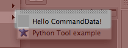

<!-- Source: https://developers.maxon.net/docs/py/2027_0_0/modules/c4d.plugins/BaseData/CommandData/index.html -->

# c4d.plugins.CommandData <a id="c4d-plugins-commanddata"></a>

## *class* `c4d.plugins.CommandData` <a id="c4d.plugins.CommandData"></a>

A data class for creating new commands.  
Use [`RegisterCommandPlugin()`](../../index.md#c4d.plugins.RegisterCommandPlugin) to register the plugin.



Parent Class:

- [`c4d.plugins.BaseData`](../index.md#c4d.plugins.BaseData)

## Overview <a id="overview"></a>

**Execution**

- [`CommandData.Execute()`](#c4d.plugins.CommandData.Execute): Override - Called when the plugin is selected by the user.
- [`CommandData.ExecuteOptionID()`](#c4d.plugins.CommandData.ExecuteOptionID): Override - Execute the command plugin when the user calls it through its options dialog.
- [`CommandData.ExecuteSubID()`](#c4d.plugins.CommandData.ExecuteSubID): Override - Execute the command plugin with the *subid* that was given by `GetSubContainer()`.

**Interface Persistence**

- [`CommandData.GetScriptName()`](#c4d.plugins.CommandData.GetScriptName): Override - Return the script name of the command data.
- [`CommandData.GetSubContainer()`](#c4d.plugins.CommandData.GetSubContainer): Override - Create dynamic subcontainer entries for a menu.
- [`CommandData.RestoreLayout()`](#c4d.plugins.CommandData.RestoreLayout): Override - Called by Cinema 4D when loading a layout and restoring async dialogs.

**Messaging And State**

- [`CommandData.GetState()`](#c4d.plugins.CommandData.GetState): Override - Called to get the state of the command.
- [`CommandData.Message()`](#c4d.plugins.CommandData.Message): Override - Called when the command receives messages.

## Members <a id="members"></a>

### Execution <a id="c4d.plugins.CommandData-method-Execution"></a>

#### `CommandData.Execute(self, doc)` <a id="c4d.plugins.CommandData.Execute"></a>

Override - Called when the plugin is selected by the user.

**Parameters:** **doc** ([*c4d.documents.BaseDocument*](../../../c4d.documents/BaseDocument/index.md#c4d.documents.BaseDocument)) – The currently active document when the command was selected.

**Return type:** bool

**Returns:** **True** if the command was executed successfully, otherwise **False**.

#### `CommandData.ExecuteOptionID(self, doc, plugid, subid)` <a id="c4d.plugins.CommandData.ExecuteOptionID"></a>

Override - Execute the command plugin when the user calls it through its options dialog.


> **Note:** Plugins must be [`registered`](../../index.md#c4d.plugins.RegisterCommandPlugin) with *PLUGINFLAG_COMMAND_OPTION_DIALOG* set.

**Parameters:**

- **doc** ([*c4d.documents.BaseDocument*](../../../c4d.documents/BaseDocument/index.md#c4d.documents.BaseDocument)) – The currently active document when the command was selected.
- **plugid** (*int*) – The command’s plugin ID.
- **subid** (*int*) – Only available for plugins that have sub-IDs (which normally are called using [`ExecuteSubID()`](#c4d.plugins.CommandData.ExecuteSubID)).

**Return type:** bool

**Returns:** **True** if the command was executed successfully, otherwise **False**.

#### `CommandData.ExecuteSubID(self, doc, subid)` <a id="c4d.plugins.CommandData.ExecuteSubID"></a>

Override - Execute the command plugin with the *subid* that was given by [`GetSubContainer()`](#c4d.plugins.CommandData.GetSubContainer).

**Parameters:**

- **doc** ([*c4d.documents.BaseDocument*](../../../c4d.documents/BaseDocument/index.md#c4d.documents.BaseDocument)) – The currently active document when the command was selected.
- **subid** (*int*) – Sub command ID.

**Return type:** bool

**Returns:** **True** if the message was processed.

### Interface Persistence <a id="c4d.plugins.CommandData-method-Interface-Persistence"></a>

#### `CommandData.GetScriptName(self)` <a id="c4d.plugins.CommandData.GetScriptName"></a>

Override - Return the script name of the command data. If this function is implemented, the command is stored by name rather than by ID in layouts, shortcuts and menus.

**Return type:** str

**Returns:** Script name.

#### `CommandData.GetSubContainer(self, doc, submenu)` <a id="c4d.plugins.CommandData.GetSubContainer"></a>

Override - Create dynamic subcontainer entries for a menu.  
The menu entries on the top level will all be placed at the point where the command plugin was placed.  
To create a submenu, place the entries as subcontainers in the returned container with ID 0. In the subcontainer, place a string with ID 1 to name it.

```python
bc = BaseContainer()
bc.SetString(1, "Submenu Test")
bc.SetString(1000, "First Entry")
submenu.InsData(0, bc)
```

**Parameters:**

- **doc** ([*c4d.documents.BaseDocument*](../../../c4d.documents/BaseDocument/index.md#c4d.documents.BaseDocument)) – The currently active document when the command was selected.
- **submenu** ([*c4d.BaseContainer*](../../../c4d/BaseContainer/index.md#c4d.BaseContainer)) – Fill this with the submenu structure.

**Return type:** bool

**Returns:** **True** if you put anything in the container, otherwise **False**.

#### `CommandData.RestoreLayout(self, secret)` <a id="c4d.plugins.CommandData.RestoreLayout"></a>

Override - Called by Cinema 4D when loading a layout and restoring async dialogs.  
If this function is not implemented Cinema 4D will create an empty “???” dialog.

**Parameters:** **secret** (*PyCObject*) – An internal hook. Pass it to `GeDialog.Restore()`

**Return type:** bool

**Returns:** **True** if the dialog was restored, otherwise **False**.

### Messaging And State <a id="c4d.plugins.CommandData-method-Messaging-And-State"></a>

#### `CommandData.GetState(self, doc)` <a id="c4d.plugins.CommandData.GetState"></a>

Override - Called to get the state of the command.  
This affects how it is displayed in menus or toolbars.

**Parameters:** **doc** ([*c4d.documents.BaseDocument*](../../../c4d.documents/BaseDocument/index.md#c4d.documents.BaseDocument)) – The document that is currently active in the editor.

**Return type:** int

**Returns:**

A combination of the state flags:

| Symbol ID | Description |
|---|---|
| CMD_ENABLED | Enabled. |
| CMD_VALUE | Checked. |
| CMD_HIDDEN | Hidden. |

#### `CommandData.Message(self, type, data)` <a id="c4d.plugins.CommandData.Message"></a>

Override - Called when the command receives messages.

> **See also:** [C4DAtom and Plugin Messages](../../../../consts/MSG_C4DATOM_PLUGINS.md) for information on the messages type, data and input/output.

**Parameters:**

- **type** (*int*) – The message type.
- **data** (*any*) – The message data.

**Return type:** bool

**Returns:** Depends on the message *type*.
