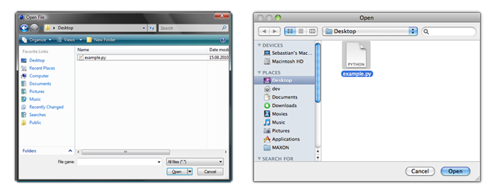
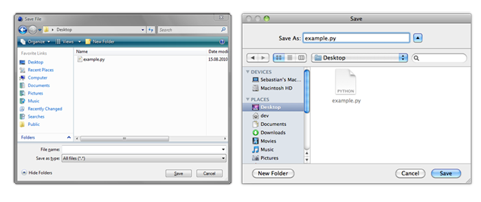

<!-- Source: https://developers.maxon.net/docs/py/2027_0_0/modules/c4d.storage/index.html -->

# c4d.storage 

## *class* `c4d.storage` 

- [`c4d.storage.HyperFile`](HyperFile/index.md#c4d.storage.HyperFile)
- [`c4d.storage.MemoryFileStruct`](MemoryFileStruct/index.md#c4d.storage.MemoryFileStruct)

## Overview 

**Application Execution**

- [`c4d.storage.GeExecuteFile()`](#c4d.storage.GeExecuteFile): Executes a file.
- [`c4d.storage.GeExecuteProgram()`](#c4d.storage.GeExecuteProgram): Executes an application.

**Application Paths**

- [`c4d.storage.GeGetC4DPath()`](#c4d.storage.GeGetC4DPath): Gets one of the Cinema 4D paths.
- [`c4d.storage.GeGetPluginPath()`](#c4d.storage.GeGetPluginPath): Retrieve the path of the current module.
- [`c4d.storage.GeGetStartupApplication()`](#c4d.storage.GeGetStartupApplication): Returns the complete path of the host application (Cinema 4D, BODYPAINT 3D, NET) of the plugin:
- [`c4d.storage.GeGetStartupPath()`](#c4d.storage.GeGetStartupPath): Get the path for the main folder Cinema 4D:
- [`c4d.storage.GeGetStartupWritePath()`](#c4d.storage.GeGetStartupWritePath): Returns the **writeable** startup directory.
- [`c4d.storage.GetUserSiteSpecificPath()`](#c4d.storage.GetUserSiteSpecificPath): Get the path to the site folder in the user folder.

**File Dialogs**

- [`c4d.storage.LoadDialog()`](#c4d.storage.LoadDialog): Open a load dialog.
- [`c4d.storage.SaveDialog()`](#c4d.storage.SaveDialog): Open a save dialog.

**File Discovery And Inspection**

- [`c4d.storage.GeGetMovieInfo()`](#c4d.storage.GeGetMovieInfo): Get information from a movie file.
- [`c4d.storage.GeIdentifyFile()`](#c4d.storage.GeIdentifyFile): Identify the file in name.
- [`c4d.storage.ShowInFinder()`](#c4d.storage.ShowInFinder): Show the file/path in the Finder (OSX) or Explorer (Windows).

**Hyperfile Persistence**

- [`c4d.storage.ReadHyperFile()`](#c4d.storage.ReadHyperFile): Reads a single list node from a hyper file on disk.
- [`c4d.storage.WriteHyperFile()`](#c4d.storage.WriteHyperFile): Writes a single list node to disk as a hyper file.

**System Resource Monitoring**

- [`c4d.storage.GeGetMemoryStat()`](#c4d.storage.GeGetMemoryStat): Gets Cinema 4D memory statistics.
- [`c4d.storage.GeMemGetFreePhysicalMemoryEstimate()`](#c4d.storage.GeMemGetFreePhysicalMemoryEstimate): Get the estimated free physical memory.
- [`c4d.storage.GetFreeVolumeSpace()`](#c4d.storage.GetFreeVolumeSpace): Calculate the free space on a volume.

## Members 

### Application Execution 

#### `c4d.storage.GeExecuteFile(path)` 

Executes a file.

> **Note:** Opens a file as if the user double-clicked it: the default application for this file will open.

**Parameters:** **path** (*str*) – The name of the application to execute.

**Return type:** bool

**Returns:** **True** if the application was executed, otherwise **False**.

#### `c4d.storage.GeExecuteProgram(app, path)` 

Executes an application.

> > **Note:** The application is started asynchronously.

**Parameters:**

- **app** (*str*) – The name of the application to execute.
- **path** (*str*) – The name of a file to open using the application.

**Return type:** bool

**Returns:** **True** if the application was executed, otherwise **False**.

### Application Paths 

#### `c4d.storage.GeGetC4DPath(whichpath)` 

Gets one of the Cinema 4D paths.

**Parameters:**

**whichpath** (*int*) –

The path to get:

|   |   |
|---|---|
| *C4D_PATH_PREFS* | Cinema 4D preferences directory. |
| *C4D_PATH_RESOURCE* | Cinema 4D resource directory. |
| *C4D_PATH_LIBRARY* | Cinema 4D library directory. (Built-in.) |
| *C4D_PATH_LIBRARY_USER* | Cinema 4D library path. (Different if multi-user mode is enabled.) |
| *C4D_PATH_ONLINE_HELP* | Cinema 4D online help directory. |
| *C4D_PATH_DESKTOP* | OS desktop directory. |
| *C4D_PATH_HOME* | OS home directory. |
| *C4D_PATH_STARTUPWRITE* | Writable startup directory. |
| *C4D_PATH_MYDOCUMENTS* | The user’s documents directory. |
| *C4D_PATH_APPLICATION* | OS application directory. |

**Return type:** str

**Returns:** The retrieved path.

#### `c4d.storage.GeGetPluginPath()` 

Retrieve the path of the current module.

> **Warning:** The Python implementation is different from the C++. In the Python SDK, this function returns the path of the Python SDK module. To get the path of your Python plugin use **__file__**.

> **See also:** [Plugin Files](../../manuals/manual_implementing_plugins.md#directory-structure)

**Return type:** str

**Returns:** The path of the Python SDK module.

#### `c4d.storage.GeGetStartupApplication()` 

Returns the complete path of the host application (Cinema 4D, BODYPAINT 3D, NET) of the plugin:

> (Mac) e.g: ‘/Applications/MAXON/Cinema 4D R21_022/Cinema 4D.app’ (Windows) e.g: ‘C:Program FilesMAXONCinema 4D R21_022Cinema 4D.exe’

**Return type:** str

**Returns:** The complete path to the host application.

#### `c4d.storage.GeGetStartupPath()` 

Get the path for the main folder Cinema 4D:

> (Mac) e.g: ‘/Applications/MAXON/Cinema 4D R12’ (Windows) e.g: ‘C:Program FilesMAXONCinema 4D R21_022’

**Return type:** str

**Returns:** The main path for the Cinema 4D application.

#### `c4d.storage.GeGetStartupWritePath()` 

Returns the **writeable** startup directory. This is the directory where all user data (preferences, libraries etc.) are stored:

> (Mac) e.g: ‘/Users/UserName/Library/Preferences/MAXON/Cinema 4D R12_C333CB6C’ (Windows) e.g: ‘C:UsersUserNameAppDataRoamingMaxonCinema 4D R21_022_95E9A228’

> **Note:** For example to store plugin preferences since modern OS do not allow to write files into the application folder.

**Return type:** str

**Returns:** The **writeable** startup directory.

#### `c4d.storage.GetUserSiteSpecificPath()` 

Get the path to the site folder in the user folder.

> (Windows 64-bits) e.g: ‘C:/Users/$UserName/AppData/Roaming/MAXON/R15/library/python/packages/win64’

*New in version R15.037.*

> **Note:** This folder exists so that 3rd party packages can be installed in it.

**Return type:** str

**Returns:** The path to the site folder in the user folder.

### File Dialogs 

#### `c4d.storage.LoadDialog(type=0, title='', flags=0, force_suffix='', def_path='', def_file='')` 

Open a load dialog. The look of this dialog depends on the operating system.

**Parameters:**

- **type** (*int*) –

  One of the following flags:

  |   |   |
  |---|---|
  | *FILESELECTTYPE_ANYTHING* | Any file. |
  | *FILESELECTTYPE_IMAGES* | Image files. |
  | *FILESELECTTYPE_SCENES* | 3D scene files. |
  | *FILESELECTTYPE_BODYPAINT* | *BodyPaint 3D* files. |

- **title** (*str*) – The title.

- **flags** (*int*) –

  The flags:

  |   |   |
  |---|---|
  | *FILESELECT_LOAD* | Load dialog. |
  | *FILESELECT_SAVE* | Save dialog. |
  | *FILESELECT_DIRECTORY* | Folder selection dialog. |

- **force_suffix** (*str*) – Currently not used.

- **def_path** (*str*) – The default path on popup.

- **def_file** (*str*) –

  *New in version R18.057:* The default file on popup.

**Return type:** str

**Returns:** The selected path.

#### `c4d.storage.SaveDialog(type=0, title='', force_suffix='', def_path='', def_file='')` 

Open a save dialog. The look of this dialog depends on the operating system.

**Parameters:**

- **type** (*int*) –

  One of the following flags:

  |   |   |
  |---|---|
  | *FILESELECTTYPE_ANYTHING* | Any file. |
  | *FILESELECTTYPE_IMAGES* | Image files. |
  | *FILESELECTTYPE_SCENES* | 3D scene files. |
  | *FILESELECTTYPE_BODYPAINT* | *BodyPaint 3D* files. |

- **title** (*str*) – The title.

- **force_suffix** (*str*) – The suffix.

- **def_path** (*str*) – The default path on popup.

- **def_file** (*str*) –

  *New in version R18.057:* The default file on popup.

**Return type:** str

**Returns:** The selected path.

### File Discovery And Inspection 

#### `c4d.storage.GeGetMovieInfo(path)` 

Get information from a movie file.

**Parameters:** **path** (*Union*[*str*, [*c4d.storage.MemoryFileStruct*](MemoryFileStruct/index.md#c4d.storage.MemoryFileStruct)]) – The path of the movie file.

**Return type:** dict{**frames**: int, **fps**: float}

**Returns:** The number of frames and frames per second.

#### `c4d.storage.GeIdentifyFile(name, probe, recognition)` 

Identify the file in name.

**Parameters:**

- **name** (*Union*[*str*, [*c4d.storage.MemoryFileStruct*](MemoryFileStruct/index.md#c4d.storage.MemoryFileStruct)]) – The file to check.

- **probe** (*buffer*) – The start of a small chunk of data from the start of the file for testing this file type. Usually the probe size is 1024 bytes.

- **recognition** (*int*) –

  Identification flags:

  |   |   |
  |---|---|
  | *IDENTIFYFILE_NONE* | None. |
  | *IDENTIFYFILE_SCENE* | Scene file. |
  | *IDENTIFYFILE_IMAGE* | Image file. |
  | *IDENTIFYFILE_MOVIE* | Movie file. |
  | *IDENTIFYFILE_SKIPQUICKTIME* | Skip files that require Quicktime. |
  | *IDENTIFYFILE_SCRIPT* | Script file. |
  | *IDENTIFYFILE_SOUND* | Sound file. |
  | *IDENTIFYFILE_LAYOUT* | Layout file. |
  | *IDENTIFYFILE_PYTHON* | Python file. |

**Return type:** Tuple[int, [c4d.plugins.BasePlugin](../c4d.plugins/BasePlugin/index.md#c4d.plugins.BasePlugin)]

**Returns:**

The result and, for image formats, the image loader that was identified.

|   |   |
|---|---|
| *IDENTIFYFILE_NONE* | None. |
| *IDENTIFYFILE_SCENE* | Scene file. |
| *IDENTIFYFILE_IMAGE* | Image file. |
| *IDENTIFYFILE_MOVIE* | Movie file. |
| *IDENTIFYFILE_SKIPQUICKTIME* | Skip files that require Quicktime. |
| *IDENTIFYFILE_SCRIPT* | Script file. |
| *IDENTIFYFILE_SOUND* | Sound file. |
| *IDENTIFYFILE_LAYOUT* | Layout file. |
| *IDENTIFYFILE_PYTHON* | Python file. |

#### `c4d.storage.ShowInFinder(path, open)` 

Show the file/path in the Finder (OSX) or Explorer (Windows).

**Parameters:**

- **path** (*str*) – The file/path to show.
- **open** (*bool*) – If True the file will be opened by the assigned application.

**Return type:** bool

**Returns:** **True** if the path/file exists, otherwise **False**.

### Hyperfile Persistence 

#### `c4d.storage.ReadHyperFile(doc, node, filename, ident)` 

Reads a single list node from a hyper file on disk. The read data replaces the data in *node*.

**Parameters:**

- **doc** ([*c4d.documents.BaseDocument*](../c4d.documents/BaseDocument/index.md#c4d.documents.BaseDocument)) – The document of the node.
- **node** ([*c4d.GeListNode*](../c4d/C4DAtom/GeListNode/index.md#c4d.GeListNode)) – The node to read to.
- **filename** (*Union*[*str*, [*c4d.storage.MemoryFileStruct*](MemoryFileStruct/index.md#c4d.storage.MemoryFileStruct)]) – A file to read from.
- **ident** (*int*) – A unique file identification, to make sure that you only read your own files.

**Return type:** int

**Returns:**

The result:

| Symbol ID | Description |
|---|---|
| FILEERROR_NONE | No error. |
| FILEERROR_OPEN | Problems opening the file. |
| FILEERROR_CLOSE | Problems closing the file. |
| FILEERROR_READ | Problems reading the file. |
| FILEERROR_WRITE | Problems writing the file. |
| FILEERROR_SEEK | Problems seeking the file. |
| FILEERROR_INVALID | Invalid parameter or operation (e.g. writing in read-mode). |
| FILEERROR_OUTOFMEMORY | Not enough memory. |
| FILEERROR_USERBREAK | User break. |
| FILEERROR_WRONG_VALUE | Other value detected than expected. |
| FILEERROR_CHUNK_NUMBER | Wrong number of chunks or sub-chunks detected. |
| FILEERROR_VALUE_NO_CHUNK | There was a value without any enclosing start/stop chunks. |
| FILEERROR_FILEEND | The file end was reached without finishing reading. |
| FILEERROR_UNKNOWN_VALUE | Unknown value detected. |

#### `c4d.storage.WriteHyperFile(doc, node, filename, ident)` 

Writes a single list node to disk as a hyper file.

**Parameters:**

- **doc** ([*c4d.documents.BaseDocument*](../c4d.documents/BaseDocument/index.md#c4d.documents.BaseDocument)) – The document of the node.
- **node** ([*c4d.GeListNode*](../c4d/C4DAtom/GeListNode/index.md#c4d.GeListNode)) – The node to write.
- **filename** (*Union*[*str*, [*c4d.storage.MemoryFileStruct*](MemoryFileStruct/index.md#c4d.storage.MemoryFileStruct)]) – A file to write to.
- **ident** (*int*) – A unique file identification, to make sure that you only read your own files.

**Return type:** int

**Returns:**

The result:

| Symbol ID | Description |
|---|---|
| FILEERROR_NONE | No error. |
| FILEERROR_OPEN | Problems opening the file. |
| FILEERROR_CLOSE | Problems closing the file. |
| FILEERROR_READ | Problems reading the file. |
| FILEERROR_WRITE | Problems writing the file. |
| FILEERROR_SEEK | Problems seeking the file. |
| FILEERROR_INVALID | Invalid parameter or operation (e.g. writing in read-mode). |
| FILEERROR_OUTOFMEMORY | Not enough memory. |
| FILEERROR_USERBREAK | User break. |
| FILEERROR_WRONG_VALUE | Other value detected than expected. |
| FILEERROR_CHUNK_NUMBER | Wrong number of chunks or sub-chunks detected. |
| FILEERROR_VALUE_NO_CHUNK | There was a value without any enclosing start/stop chunks. |
| FILEERROR_FILEEND | The file end was reached without finishing reading. |
| FILEERROR_UNKNOWN_VALUE | Unknown value detected. |

### System Resource Monitoring 

#### `c4d.storage.GeGetMemoryStat()` 

Gets Cinema 4D memory statistics.

**Return type:** Optional[[c4d.BaseContainer](../c4d/BaseContainer/index.md#c4d.BaseContainer)]

**Returns:**

Can be **None** if receiving memory container failed. Assigned statistics:

|   |   |   |
|---|---|---|
| *C4D_MEMORY_STAT_MEMORY_INUSE* | long | Bytes in use. |
| *C4D_MEMORY_STAT_MEMORY_PEAK* | long | Peak usage in bytes. |
| *C4D_MEMORY_STAT_NO_OF_ALLOCATIONS_TOTAL* | long | Total number of allocations. |
| *C4D_MEMORY_STAT_NO_OF_ALLOCATIONS_CURRENT* | long | Current number of allocations. |
| *C4D_MEMORY_STAT_EOGL_TEXBUFFER* | long | Texture buffer usage. |
| *C4D_MEMORY_STAT_EOGL_VERTEXBUFFER* | long | Vertex buffer usage. |
| *C4D_MEMORY_STAT_LOWMEMCNT* | int | Number of low memory conditions (out of memory). |
| *C4D_MEMORY_STAT_EOGL_VERTEXBUFFER_CNT* | int | Number of VBOs (Vertex Buffer Objects). |
| *C4D_MEMORY_STAT_EOGL_TEXTUREBUFFER_CNT* | int | Number of texture buffers. |
| *C4D_MEMORY_STAT_OPENGL_TOTAL* | int | Total OpenGL memory in KB. |
| *C4D_MEMORY_STAT_OPENGL_FREE* | int | Free OpenGL memory in KB. |

#### `c4d.storage.GeMemGetFreePhysicalMemoryEstimate()` 

Get the estimated free physical memory.

**Return type:** int

**Returns:** The estimated free physical memory.

#### `c4d.storage.GetFreeVolumeSpace(drive)` 

Calculate the free space on a volume.

*New in version R16.021.*

**Parameters:** **drive** (*str*) – Can point to a volume or directory.

**Return type:** Tuple[int, int]

**Returns:** The number of available bytes on the volume and the total size of the volume in bytes.
