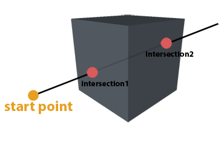

<!-- Source: https://developers.maxon.net/docs/py/2027_0_0/modules/c4d.utils/GeRayCollider/index.html -->

# c4d.utils.GeRayCollider <a id="c4d-utils-geraycollider"></a>

## *class* `c4d.utils.GeRayCollider` <a id="c4d.utils.GeRayCollider"></a>

Evaluates intersections between a ray and a polygon object. The ray is defined by a point, a ray and length.

In the following example a ray intersects a cube:



## Overview <a id="overview"></a>

**Magic Methods**

- [`GeRayCollider.__init__()`](#c4d.utils.GeRayCollider.__init__)

**Ray Collision**

- [`GeRayCollider.GetIntersection()`](#c4d.utils.GeRayCollider.GetIntersection): Retrieves the intersection information, found by `GeRayCollider.Intersect()`, by index:
- [`GeRayCollider.GetIntersectionCount()`](#c4d.utils.GeRayCollider.GetIntersectionCount): Returns the number of intersections found by `Intersect()`.
- [`GeRayCollider.GetNearestIntersection()`](#c4d.utils.GeRayCollider.GetNearestIntersection): Retrieves the intersection, found by `Intersect()`, closest to the start of the ray.
- [`GeRayCollider.Init()`](#c4d.utils.GeRayCollider.Init): Initializes the ray collider with the object specified by *goal*.
- [`GeRayCollider.Intersect()`](#c4d.utils.GeRayCollider.Intersect): Checks if the line segment specified by *ray_p* to *ray_p + ray_dir*ray_length* intersects the object.

## Members <a id="members"></a>

### Magic Methods <a id="c4d.utils.GeRayCollider-method-Magic-Methods"></a>

#### `GeRayCollider.__init__(self)` <a id="c4d.utils.GeRayCollider.__init__"></a>

### Ray Collision <a id="c4d.utils.GeRayCollider-method-Ray-Collision"></a>

#### `GeRayCollider.GetIntersection(self, number)` <a id="c4d.utils.GeRayCollider.GetIntersection"></a>

Retrieves the intersection information, found by `GeRayCollider.Intersect()`, by index:

```python
import c4d

rc = c4d.utils.GeRayCollider()

intersection = rc.GetIntersection(id)

intersection["face_id"]  # The polygon index, int
intersection["tri_face_id"]  # If first half of quad or triangle face_id + 1, else -(face_id + 1), int
intersection["hitpos"]  # Position of the intersection, c4d.Vector
intersection["distance"]  # Distance to the intersection, float
intersection["s_normal"]  # Same as f_normal (reserved for phong normal at the intersection (Not normalized)), c4d.Vector
intersection["f_normal"]  # Face normal (Not normalized), c4d.Vector
intersection["barrycoords"]  # Barycentric coordinates of the intersection (x = u, y = v, z = d), c4d.Vector
intersection["backface"]  # True if the intersected face's normal points away from the camera, otherwise False, bool
```

**Parameters:** **number** (*int*) – Intersection index.

**Raises:** **IndexError** – If intersection index is out of range : *0<=number<*[`GetIntersectionCount()`](#c4d.utils.GeRayCollider.GetIntersectionCount).

**Return type:** dict

**Returns:** The intersection information.

#### `GeRayCollider.GetIntersectionCount(self)` <a id="c4d.utils.GeRayCollider.GetIntersectionCount"></a>

Returns the number of intersections found by [`Intersect()`](#c4d.utils.GeRayCollider.Intersect).

**Return type:** int

**Returns:** Number of intersections.

#### `GeRayCollider.GetNearestIntersection(self)` <a id="c4d.utils.GeRayCollider.GetNearestIntersection"></a>

Retrieves the intersection, found by [`Intersect()`](#c4d.utils.GeRayCollider.Intersect), closest to the start of the ray.

**Return type:** Optional[Dict[int, int, [c4d.Vector](../../c4d/Vector/index.md#c4d.Vector), float, [c4d.Vector](../../c4d/Vector/index.md#c4d.Vector), [c4d.Vector](../../c4d/Vector/index.md#c4d.Vector), [c4d.Vector](../../c4d/Vector/index.md#c4d.Vector), bool]]

**Returns:** The nearest intersection or **None** if there was no intersection.

#### `GeRayCollider.Init(self, goal, force=False)` <a id="c4d.utils.GeRayCollider.Init"></a>

Initializes the ray collider with the object specified by *goal*.

**Parameters:**

- **goal** ([*c4d.PolygonObject*](../../c4d/C4DAtom/GeListNode/BaseList2D/BaseObject/PointObject/PolygonObject/index.md#c4d.PolygonObject)) – The object to check for intersections. The object is copied.

- **force** (*bool*) –

  If **False** then Cinema checks if the passed object’s `C4DAtom.GetDirty(c4d.DIRTYFLAGS_DATA)` is unchanged. If yes, it does nothing and returns **True**.  
  If **True** it always rebuilds the cache.

**Return type:** bool

**Returns:** **True** if successful, otherwise **False**.

#### `GeRayCollider.Intersect(self, ray_p, ray_dir, length, only_test=False)` <a id="c4d.utils.GeRayCollider.Intersect"></a>

Checks if the line segment specified by *ray_p* to *ray_p + ray_dir*ray_length* intersects the object.

**Parameters:**

- **ray_p** ([*c4d.Vector*](../../c4d/Vector/index.md#c4d.Vector)) – Start point of the ray in object coordinates
- **ray_dir** ([*c4d.Vector*](../../c4d/Vector/index.md#c4d.Vector)) – Ray direction in object coordinates.
- **ray_length** (*number*) – Ray length.
- **only_test** (*bool*) – If this is **True** no information about the intersections are stored, so only the return value can be used to tell if there were intersections or not.

**Return type:** bool

**Returns:** **True** if there was in intersection, otherwise **False**
