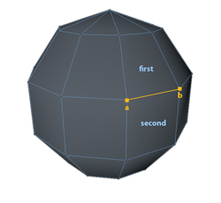
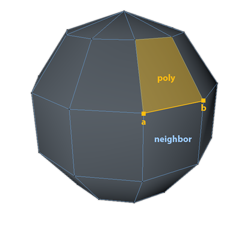
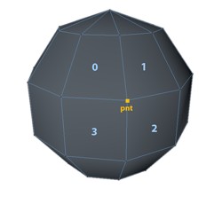

<!-- Source: https://developers.maxon.net/docs/py/2027_0_0/modules/c4d.utils/Neighbor/index.html -->

# c4d.utils.Neighbor <a id="c4d-utils-neighbor"></a>

## *class* `c4d.utils.Neighbor` <a id="c4d.utils.Neighbor"></a>

Class to get neighbouring polygons from edges and points.

- To get point->poly connections use `Neighbor.GetPointPolys()`.
- To get edge->poly connections use `Neighbor.GetEdgePolys()`.
- To get poly->edge connections use `Neighbor.GetPolyInfo()`, which additionally allows you to retrieve neighbor polygons directly.

> **Note:**
>
> This class assumes that the geometry is clean such that an edge is only shared by two polygons.  
> If this is not the case then the information may not be correct.

> **Warning:**
>
> The object passed to `Neighbor.Init()` must not be modified during the use of this class.  
> For example, if you resize a polygon object or modify the polygons this class may crash if you then try and use the classes functions.

## Overview <a id="overview"></a>

**Initialization And Cleanup**

- [`Neighbor.Flush()`](#c4d.utils.Neighbor.Flush): Flushes the neighbor information.
- [`Neighbor.Init()`](#c4d.utils.Neighbor.Init): Initialise the internal polygon information.

**Magic Methods**

- [`Neighbor.__init__()`](#c4d.utils.Neighbor.__init__)

**Topology Queries**

- [`Neighbor.GetEdgeCount()`](#c4d.utils.Neighbor.GetEdgeCount): Get the total number of edges found.
- [`Neighbor.GetEdgePolys()`](#c4d.utils.Neighbor.GetEdgePolys): Get the polygons that neighbor the given edge:
- [`Neighbor.GetNeighbor()`](#c4d.utils.Neighbor.GetNeighbor): Gets the polygon opposite to *poly* with respect to the edge from point *a* to *b*.
- [`Neighbor.GetPointOneRingPoints()`](#c4d.utils.Neighbor.GetPointOneRingPoints): Gets the points that are attached through one edge to the given point.
- [`Neighbor.GetPointPolys()`](#c4d.utils.Neighbor.GetPointPolys): Get the polygons that are attached to the given point index.
- [`Neighbor.GetPolyInfo()`](#c4d.utils.Neighbor.GetPolyInfo): Get a dict that contains neighbor information about the given polygon.

## Members <a id="members"></a>

### Initialization And Cleanup <a id="c4d.utils.Neighbor-method-Initialization-And-Cleanup"></a>

#### `Neighbor.Flush(self)` <a id="c4d.utils.Neighbor.Flush"></a>

Flushes the neighbor information.

#### `Neighbor.Init(self, op, bs=None)` <a id="c4d.utils.Neighbor.Init"></a>

Initialise the internal polygon information.

> **Note:** This function must be called before the class can be used to get the neighbouring polygons.

**Parameters:**

- **op** ([*c4d.PolygonObject*](../../c4d/C4DAtom/GeListNode/BaseList2D/BaseObject/PointObject/PolygonObject/index.md#c4d.PolygonObject)) – The class object.
- **bs** (*Optional*[[*c4d.BaseSelect*](../../c4d/BaseSelect/index.md#c4d.BaseSelect)]) – The polygon selection that will be used to build the neighbor information. By default **None** to use all polygons.

### Magic Methods <a id="c4d.utils.Neighbor-method-Magic-Methods"></a>

#### `Neighbor.__init__(self)` <a id="c4d.utils.Neighbor.__init__"></a>

### Topology Queries <a id="c4d.utils.Neighbor-method-Topology-Queries"></a>

#### `Neighbor.GetEdgeCount(self)` <a id="c4d.utils.Neighbor.GetEdgeCount"></a>

Get the total number of edges found.

**Return type:** int

**Returns:** The number of edges.

#### `Neighbor.GetEdgePolys(self, a, b)` <a id="c4d.utils.Neighbor.GetEdgePolys"></a>



Get the polygons that neighbor the given edge:

```python
# This example retrieve the polygons around the point ID 137
import c4d

nb = c4d.utils.Neighbor()
first, second = nb.GetEdgePolys(1, 2)

# do something with Polygon A and B
print first, second
```

**Parameters:**

- **a** (*int*) – The point index that defines the first edge point.
- **b** (*int*) – The point index that defines the second edge point.

**Raises:** **IndexError** – If *a* or *b* is out of range.

**Return type:** Tuple[int, int]

**Returns:** The first and second polygon associated with the edge.

#### `Neighbor.GetNeighbor(self, a, b, poly)` <a id="c4d.utils.Neighbor.GetNeighbor"></a>



Gets the polygon opposite to *poly* with respect to the edge from point *a* to *b*.

**Parameters:**

- **a** (*int*) – The point index that defines the first edge point.
- **b** (*int*) – The point index that defines the second edge point.
- **poly** (*int*) – The index of the polygon to get the polygon opposite to.
- **poly** – The index of the polygon to get the polygon opposite to.

**Raises:** **IndexError** – If *a*, *b* or *poly* is out of range.

**Returns:** The opposite polygon index, or *NOTOK* if none exists or if *poly* is not one of the edge polygons.

#### `Neighbor.GetPointOneRingPoints(self, pnt)` <a id="c4d.utils.Neighbor.GetPointOneRingPoints"></a>

Gets the points that are attached through one edge to the given point.

*New in version R19.*

**Parameters:** **pnt** (*int*) – The point index to use to find the associated one ring points.

**Return type:** List[int]

**Returns:** A list of points indices.

#### `Neighbor.GetPointPolys(self, pnt)` <a id="c4d.utils.Neighbor.GetPointPolys"></a>



Get the polygons that are attached to the given point index.

For example:

```python
import c4d

nb = c4d.utils.Neighbor()
polys = nb.GetPointPolys(137)
for poly in polys:
    # do something with poly
    pass
```

**Parameters:** **pnt** (*int*) – The point index to use to find the associated polygons.

**Raises:** **IndexError** – If *pnt* is out of range.

**Return type:** list

**Returns:** A list of returned polygons.

#### `Neighbor.GetPolyInfo(self, poly)` <a id="c4d.utils.Neighbor.GetPolyInfo"></a>

Get a dict that contains neighbor information about the given polygon. One can use this to browse through all available edges using the following code

```python
import c4d

nbr = c4d.utils.Neighbor()
nbr.Init(op)

vadr = op.GetAllPolygons()

for i in xrange(op.GetPolygonCount()):
    pli = nbr.GetPolyInfo(i)

    # Test all 4 sides of a polygon
    for side in xrange(4):

        # Only proceed if edge has not already been processed
        # and edge really exists (for triangles side 2 from c..d does not exist as c==d)
        if pli["mark"][side] or (side == 2 and vadr[i].c == vadr[i].d):
            continue

        # One can also skip the side == 2 && vadr[i].c==vadr[i].d test as pli["mark"][2] is always True for triangles

        if side == 0:
            a = vadr[i].a;
            b = vadr[i].b
        elif side == 1:
            a = vadr[i].b;
            b = vadr[i].c
        elif side == 2:
            a = vadr[i].c;
            b = vadr[i].d
        elif side == 3:
            a = vadr[i].d;
            b = vadr[i].a

        # Do something with the edge a..b
```

*0*-*1*-*2*-*3* are the indices for *a*-*b*/*b*-*c*/*c*-*d*/*d*-*a*.  
For triangles the face/edge index 2 is set to *NOTOK* (as *c* == *d*). e.g. a value of *5-8-2-1* for *face* means: *a*-*b* neighbor *face* is *5*, *b*-*c* neighbor *face* is *8* etc.

**Parameters:** **poly** (*int*) – The polygon index to get the neighbor information for.

**Return type:** dict{**mark**: bool*4, **face**: int*4, **edge**: int*4}

**Returns:** The neighbor information about the given polygon.

**Key mark:** **False** if that polygon “generated” an edge, for example think of two polygons that share an edge, one has set mark = **False** for this edge because it was the first and “built” this edge and the other(s) will set mark = **True** as no new edge had to be generated.

**Key face:** The neighbouring polygons. **Note**: If a value is *NOTOK* this means there is no neighbor.

**Key edge:** The edges of the polygon.
