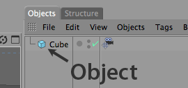
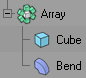
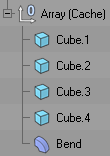
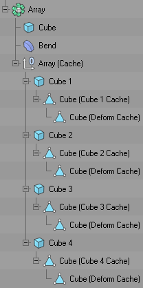

<!-- Source: https://developers.maxon.net/docs/py/2027_0_0/modules/c4d/C4DAtom/GeListNode/BaseList2D/BaseObject/index.html -->

# c4d.BaseObject <a id="c4d-baseobject"></a>

## *class* `c4d.BaseObject` <a id="c4d.BaseObject"></a>

The base class of objects.

Here is an example how to create and edit objects.

```python
import c4d

obj = c4d.BaseObject(c4d.Ocube) # Create new cube
obj.SetRelPos(c4d.Vector(20))   # Set position of cube
doc.InsertObject(obj)           # Insert object in document
c4d.EventAdd()                  # Send global event message
```



Parent Class:

- [`c4d.BaseList2D`](../index.md#c4d.BaseList2D)

Children Classes:

- [`c4d.CameraObject`](CameraObject/index.md#c4d.CameraObject)
- [`c4d.PointObject`](PointObject/index.md#c4d.PointObject)
- [`c4d.VoronoiFracture`](VoronoiFracture/index.md#c4d.VoronoiFracture)
- [`c4d.LodObject`](LodObject/index.md#c4d.LodObject)
- [`c4d.InstanceObject`](InstanceObject/index.md#c4d.InstanceObject)
- [`c4d.modules.character.CAJointObject`](../../../../../c4d.modules/character/CAJointObject/index.md#c4d.modules.character.CAJointObject)
- [`c4d.modules.mograph.FieldObject`](../../../../../c4d.modules/mograph/FieldObject/index.md#c4d.modules.mograph.FieldObject)
- [`c4d.modules.hair.HairObject`](../../../../../c4d.modules/hair/HairObject/index.md#c4d.modules.hair.HairObject)
- [`c4d.modules.sculpting.SculptObject`](../../../../../c4d.modules/sculpting/SculptObject/index.md#c4d.modules.sculpting.SculptObject)
- [`c4d.modules.sculpting.SculptLayerBase`](../../../../../c4d.modules/sculpting/SculptLayerBase/index.md#c4d.modules.sculpting.SculptLayerBase)
- [`c4d.modules.motiontracker.MotionTrackerObject`](../../../../../c4d.modules/motiontracker/MotionTrackerObject/index.md#c4d.modules.motiontracker.MotionTrackerObject)
- [`c4d.modules.volume.VolumeObject`](../../../../../c4d.modules/volume/VolumeObject/index.md#c4d.modules.volume.VolumeObject)
- [`c4d.modules.volume.VolumeBuilder`](../../../../../c4d.modules/volume/VolumeBuilder/index.md#c4d.modules.volume.VolumeBuilder)

## Overview <a id="overview"></a>

**Absolute Transform**

- [`BaseObject.GetAbsPos()`](#c4d.BaseObject.GetAbsPos): Returns the absolute position of the object.
- [`BaseObject.GetAbsRot()`](#c4d.BaseObject.GetAbsRot): Returns the absolute HPB rotation of the object relative to any parent object.
- [`BaseObject.GetAbsScale()`](#c4d.BaseObject.GetAbsScale): Returns the absolute scale of the object.
- [`BaseObject.SetAbsPos()`](#c4d.BaseObject.SetAbsPos): Sets the absolute local position of the object within its parent.
- [`BaseObject.SetAbsRot()`](#c4d.BaseObject.SetAbsRot): Sets the absolute HPB rotation of the object relative to any parent object.
- [`BaseObject.SetAbsScale()`](#c4d.BaseObject.SetAbsScale): Sets the absolute scale of the object relative to its parent object if it has one.

**Bounding Geometry**

- [`BaseObject.GetMp()`](#c4d.BaseObject.GetMp): Bounding box center (vector), in local space.
- [`BaseObject.GetRad()`](#c4d.BaseObject.GetRad): This is the bounding box radius (x/y/z) of the object, this works for all objects and is faster than manually finding the bounds of even polygon objects, the radius is internally cached.

**Cache Management**

- [`BaseObject.CheckCache()`](#c4d.BaseObject.CheckCache): Check if cache is built, if it matches the requirements (polygonized/isoparm, level of detail etc.).
- [`BaseObject.GetCache()`](#c4d.BaseObject.GetCache): Get the object from the previously built cache.
- [`BaseObject.GetCacheParent()`](#c4d.BaseObject.GetCacheParent): A cache/deform object has no `GetUp` link.
- [`BaseObject.GetDeformCache()`](#c4d.BaseObject.GetDeformCache): Gets the previously built cache that has been deformed by an active deformer.

**Change Tracking**

- [`BaseObject.IsDirty()`](#c4d.BaseObject.IsDirty): Check if the object has been changed since the last time the object was touched.
- [`BaseObject.SetDirty()`](#c4d.BaseObject.SetDirty): Check if the object has been changed since the last time the object was touched.
- [`BaseObject.Touch()`](#c4d.BaseObject.Touch): Mark object to be used by a generator; automatically resets ‘dirty’.

**Deformation State**

- [`BaseObject.GetDeformMode()`](#c4d.BaseObject.GetDeformMode): Returns the state of the deformation/generator tick.
- [`BaseObject.SetDeformMode()`](#c4d.BaseObject.SetDeformMode): Set the state of the deformation/generator tick.

**Dependency Tracking**

- [`BaseObject.AddDependence()`](#c4d.BaseObject.AddDependence): Add a child object to the dependence list.
- [`BaseObject.CompareDependenceList()`](#c4d.BaseObject.CompareDependenceList): Compares if anything in the dependence list has changed.
- [`BaseObject.NewDependenceList()`](#c4d.BaseObject.NewDependenceList): Start a new dependence list.
- [`BaseObject.TouchDependenceList()`](#c4d.BaseObject.TouchDependenceList): Mark all the objects in the dependence list that they will be replaced by the generator.

**Display And Visibility**

- [`BaseObject.GetEditorMode()`](#c4d.BaseObject.GetEditorMode): Returns the state of the editor dot for this object.
- [`BaseObject.GetHighlightHandle()`](#c4d.BaseObject.GetHighlightHandle): Checks if a highlight handle has been hit, by returning the ID previously returned by `ObjectData.DetectHandle()`.
- [`BaseObject.GetRenderMode()`](#c4d.BaseObject.GetRenderMode): Returns the state of the render dot for this object.
- [`BaseObject.GetVisibility()`](#c4d.BaseObject.GetVisibility): The object’s visibility depends upon its parent, if it has no visibility track this will return the parent’s visibility which is passed.
- [`BaseObject.SetEditorMode()`](#c4d.BaseObject.SetEditorMode): Set the state of the editor dot for this object.
- [`BaseObject.SetRenderMode()`](#c4d.BaseObject.SetRenderMode): Set the render state for this object.

**Frozen Transform**

- [`BaseObject.GetFrozenPos()`](#c4d.BaseObject.GetFrozenPos): Returns the frozen position of the object.
- [`BaseObject.GetFrozenRot()`](#c4d.BaseObject.GetFrozenRot): Returns the frozen HPB rotation of the object.
- [`BaseObject.GetFrozenScale()`](#c4d.BaseObject.GetFrozenScale): Returns the frozen scale of the object.
- [`BaseObject.SetFrozenPos()`](#c4d.BaseObject.SetFrozenPos): Sets the frozen position of the object.
- [`BaseObject.SetFrozenRot()`](#c4d.BaseObject.SetFrozenRot): Sets the frozen HPB rotation of the object.
- [`BaseObject.SetFrozenScale()`](#c4d.BaseObject.SetFrozenScale): Sets the frozen scale of the object.

**Geometry Representation**

- [`BaseObject.GetIsoparm()`](#c4d.BaseObject.GetIsoparm): Gets the previously built isoparm representation of the object.
- [`BaseObject.GetRealSpline()`](#c4d.BaseObject.GetRealSpline): Get a real spline representation of a primitive spline object.
- [`BaseObject.SetIsoparm()`](#c4d.BaseObject.SetIsoparm): Sets the isoparm representation of the object.
- [`BaseObject.SetPhong()`](#c4d.BaseObject.SetPhong): Set the phong smoothing for the object.

**Hierarchy Cloning**

- [`BaseObject.GetAndCheckHierarchyClone()`](#c4d.BaseObject.GetAndCheckHierarchyClone): Check and generate a clone of the child objects of a parent generator.
- [`BaseObject.GetHierarchyClone()`](#c4d.BaseObject.GetHierarchyClone): Generate a clone of the child objects of a parent generator.
- [`BaseObject.SearchHierarchy()`](#c4d.BaseObject.SearchHierarchy): Check if the object is a child of *op*.

**Magic Methods**

- [`BaseObject.__init__()`](#c4d.BaseObject.__init__): Initialize a new [`BaseObject`](#c4d.BaseObject) in memory.

**Matrix Operations**

- [`BaseObject.CopyMatrixTo()`](#c4d.BaseObject.CopyMatrixTo): Copy the matrix to another object.
- [`BaseObject.GetFrozenMln()`](#c4d.BaseObject.GetFrozenMln): Returns the frozen and normalized matrix of the object.
- [`BaseObject.GetMg()`](#c4d.BaseObject.GetMg): Get the world (global) matrix that represents the objects position, scale and rotation.
- [`BaseObject.GetMgn()`](#c4d.BaseObject.GetMgn): Get the global normalized matrix that represents the objects position, scale and rotation.
- [`BaseObject.GetMl()`](#c4d.BaseObject.GetMl): Get the local matrix that represents the objects position, scale and rotation.
- [`BaseObject.GetMln()`](#c4d.BaseObject.GetMln): Get the local normalized matrix that represents the objects position, scale and rotation.
- [`BaseObject.GetRelMl()`](#c4d.BaseObject.GetRelMl): Returns the relative matrix of the object.
- [`BaseObject.GetRelMln()`](#c4d.BaseObject.GetRelMln): Returns the relative and normalized matrix of the object.
- [`BaseObject.GetUpMg()`](#c4d.BaseObject.GetUpMg): Get the global matrix of the parent object that represents the objects position, scale and rotation.
- [`BaseObject.SetMg()`](#c4d.BaseObject.SetMg): Set the world (global) matrix that represents the objects position, scale and rotation.
- [`BaseObject.SetMl()`](#c4d.BaseObject.SetMl): Set the local matrix that represents the objects position, scale and rotation.
- [`BaseObject.SetRelMl()`](#c4d.BaseObject.SetRelMl): Sets the relative matrix of the object.

**Modeling Axis**

- [`BaseObject.GetModelingAxis()`](#c4d.BaseObject.GetModelingAxis): Gets the internal matrix for the modeling axis.
- [`BaseObject.SetModelingAxis()`](#c4d.BaseObject.SetModelingAxis): Sets the internal matrix for the modeling axis.

**Object Identity**

- [`BaseObject.GetGUID()`](#c4d.BaseObject.GetGUID): Returns a unique ID for any object in a document.
- [`BaseObject.GetUniqueIP()`](#c4d.BaseObject.GetUniqueIP): Get the ip of the object.
- [`BaseObject.SetUniqueIP()`](#c4d.BaseObject.SetUniqueIP): Set the ip of the object.

**Relative Transform**

- [`BaseObject.GetRelPos()`](#c4d.BaseObject.GetRelPos): Returns the relative position of the object.
- [`BaseObject.GetRelRot()`](#c4d.BaseObject.GetRelRot): Returns the relative HPB rotation of the object.
- [`BaseObject.GetRelScale()`](#c4d.BaseObject.GetRelScale): Returns the relative scale of the object.
- [`BaseObject.SetRelPos()`](#c4d.BaseObject.SetRelPos): Set the relative position of the object.
- [`BaseObject.SetRelRot()`](#c4d.BaseObject.SetRelRot): Sets the relative HPB rotation of the object.
- [`BaseObject.SetRelScale()`](#c4d.BaseObject.SetRelScale): Sets the relative scale of the object.

**Rotation Animation**

- [`BaseObject.EvaluateSynchronizedRotation()`](#c4d.BaseObject.EvaluateSynchronizedRotation): Forces an evaluation of all rotation tracks and considers quaternion interpolation.
- [`BaseObject.FindBestEulerAngle()`](#c4d.BaseObject.FindBestEulerAngle): Tries to find the best Euler angle according to the previous key.
- [`BaseObject.GetVectorCurves()`](#c4d.BaseObject.GetVectorCurves): Returns each component curve for the given curve.
- [`BaseObject.GetVectorTracks()`](#c4d.BaseObject.GetVectorTracks): Returns each component track for the given *id*.
- [`BaseObject.SynchronizeVectorTrackKeys()`](#c4d.BaseObject.SynchronizeVectorTrackKeys): Makes sure that the track Curves components are synchronized (keys on each component).

**Rotation Configuration**

- [`BaseObject.GetRotationOrder()`](#c4d.BaseObject.GetRotationOrder): Gets the rotation order of the object.
- [`BaseObject.IsQuaternionRotationMode()`](#c4d.BaseObject.IsQuaternionRotationMode): Checks if object rotation is interpolated in quaternion mode.
- [`BaseObject.SetQuaternionRotationMode()`](#c4d.BaseObject.SetQuaternionRotationMode): Sets the quaternion rotation mode of the object.
- [`BaseObject.SetRotationOrder()`](#c4d.BaseObject.SetRotationOrder): Sets the rotation order of the object.

**Tag Management**

- [`BaseObject.CopyTagsTo()`](#c4d.BaseObject.CopyTagsTo): Copy the tags of the object to another object.
- [`BaseObject.GetFirstTag()`](#c4d.BaseObject.GetFirstTag): Returns the first tag of the object.
- [`BaseObject.GetLastTag()`](#c4d.BaseObject.GetLastTag): Returns the last tag of the object.
- [`BaseObject.GetTag()`](#c4d.BaseObject.GetTag): Get a tag of a certain type associated with this object.
- [`BaseObject.GetTagDataCount()`](#c4d.BaseObject.GetTagDataCount): Get the variable tag data count.
- [`BaseObject.GetTags()`](#c4d.BaseObject.GetTags): Returns all tags in a list.
- [`BaseObject.InsertTag()`](#c4d.BaseObject.InsertTag): Attach a [`BaseTag`](../BaseTag/index.md#c4d.BaseTag) to [`BaseObject`](#c4d.BaseObject).
- [`BaseObject.KillTag()`](#c4d.BaseObject.KillTag): Removes a tag from the object and free its resources.
- [`BaseObject.MakeTag()`](#c4d.BaseObject.MakeTag): Create and insert a tag for this object.
- [`BaseObject.MakeVariableTag()`](#c4d.BaseObject.MakeVariableTag): Create a variable tag for this object.

## Members <a id="members"></a>

### Absolute Transform <a id="c4d.BaseObject-method-Absolute-Transform"></a>

#### `BaseObject.GetAbsPos(self)` <a id="c4d.BaseObject.GetAbsPos"></a>

Returns the absolute position of the object. These will be absolute local coordinates within its parent object.

> **See also:** See also [Freezing Transformations](../../../../../../manuals/manual_matrices.md#item-freezing-transformations).

**Return type:** [c4d.Vector](../../../../Vector/index.md#c4d.Vector)

**Returns:** The absolute object position.

#### `BaseObject.GetAbsRot(self)` <a id="c4d.BaseObject.GetAbsRot"></a>

Returns the absolute HPB rotation of the object relative to any parent object.

> **See also:** See also [Freezing Transformations](../../../../../../manuals/manual_matrices.md#item-freezing-transformations).

**Return type:** [c4d.Vector](../../../../Vector/index.md#c4d.Vector)

**Returns:** The absolute object rotation.

#### `BaseObject.GetAbsScale(self)` <a id="c4d.BaseObject.GetAbsScale"></a>

Returns the absolute scale of the object. These will be relative to the objects parent if it has one.

> **See also:** See also [Freezing Transformations](../../../../../../manuals/manual_matrices.md#item-freezing-transformations).

**Return type:** [c4d.Vector](../../../../Vector/index.md#c4d.Vector)

**Returns:** The absolute object scale.

#### `BaseObject.SetAbsPos(self, v)` <a id="c4d.BaseObject.SetAbsPos"></a>

Sets the absolute local position of the object within its parent. If the object has no parent then these will be world coordinates.

> **See also:** See also [Freezing Transformations](../../../../../../manuals/manual_matrices.md#item-freezing-transformations).

**Parameters:** **v** ([*c4d.Vector*](../../../../Vector/index.md#c4d.Vector)) – The absolute object position.

#### `BaseObject.SetAbsRot(self, v)` <a id="c4d.BaseObject.SetAbsRot"></a>

Sets the absolute HPB rotation of the object relative to any parent object.

> **See also:** See also [Freezing Transformations](../../../../../../manuals/manual_matrices.md#item-freezing-transformations).

**Parameters:** **v** ([*c4d.Vector*](../../../../Vector/index.md#c4d.Vector)) – The absolute object rotation.

#### `BaseObject.SetAbsScale(self, v)` <a id="c4d.BaseObject.SetAbsScale"></a>

Sets the absolute scale of the object relative to its parent object if it has one.

> **See also:** See also [Freezing Transformations](../../../../../../manuals/manual_matrices.md#item-freezing-transformations).

**Parameters:** **v** ([*c4d.Vector*](../../../../Vector/index.md#c4d.Vector)) – The absolute object scale.

### Bounding Geometry <a id="c4d.BaseObject-method-Bounding-Geometry"></a>

#### `BaseObject.GetMp(self)` <a id="c4d.BaseObject.GetMp"></a>

Bounding box center (vector), in local space.

**Return type:** [c4d.Vector](../../../../Vector/index.md#c4d.Vector)

**Returns:** The bounding box center.

#### `BaseObject.GetRad(self)` <a id="c4d.BaseObject.GetRad"></a>

This is the bounding box radius (x/y/z) of the object, this works for all objects and is faster than manually finding the bounds of even polygon objects, the radius is internally cached.

**Return type:** [c4d.Vector](../../../../Vector/index.md#c4d.Vector)

**Returns:** The bounding box width, height and depth.

### Cache Management <a id="c4d.BaseObject-method-Cache-Management"></a>

#### `BaseObject.CheckCache(self, hh)` <a id="c4d.BaseObject.CheckCache"></a>

Check if cache is built, if it matches the requirements (polygonized/isoparm, level of detail etc.).  
It returns the dirty status of the cache.

> > **Note:** This function must only be called from within `ObjectData.GetVirtualObjects()`/*main()* of a generator object.

**Parameters:**

**hh** ([*c4d.plugins.HierarchyHelp*](../../../../../c4d.plugins/HierarchyHelp/index.md#c4d.plugins.HierarchyHelp)) –

A hierarchy helper for the operation.  
Usually passed through from a calling function, for example from `ObjectData.GetVirtualObjects()` or a Python generator *main()*.

**Return type:** bool

**Returns:** **True** if the cache is dirty, **False** if it is valid.

#### `BaseObject.GetCache(self, hh=None)` <a id="c4d.BaseObject.GetCache"></a>

Get the object from the previously built cache.

> **Note:**
>
> Situations can be quite complex in Cinema 4D. For instance [`GetCache()`](#c4d.BaseObject.GetCache) could return a list of objects.  
> For example the default Sweep Generator internally has some built-in caches for the sweep surface and for the caps.  
> The following helper routine can be used to make things easier. It browses through this rather complex hierarchy of objects and caches recursively
>
> ```python
> def DoRecursion(op):
> tp = op.GetDeformCache()
> if tp is not None:
>     DoRecursion(tp)
> else:
>     tp = op.GetCache()
>     if tp is not None:
>         DoRecursion(tp)
>     else:
>         if not op.GetBit(c4d.BIT_CONTROLOBJECT):
>             if op.IsInstanceOf(c4d.Opolygon):
>                 ...
>
> tp = op.GetDown()
> while tp is not None:
>     DoRecursion(tp)
>     tp = tp.GetNext()
> ```

> **Warning:**
>
> Use the above routine only if the caches are already built.  
> It is for instance not safe to use it in a command plugin since the user can have stopped the scene redraw and the building of caches.

**Parameters:**

**hh** (*Optional*[[*c4d.plugins.HierarchyHelp*](../../../../../c4d.plugins/HierarchyHelp/index.md#c4d.plugins.HierarchyHelp)]) –

An optional hierarchy helper for the operation. Only for some special cases a hierarchy help must be passed.  
Usually passed through from a calling function, for example from `ObjectData.GetVirtualObjects()` or a Python generator *main()*.

**Return type:** Optional[[c4d.BaseObject](#c4d.BaseObject)]

**Returns:** The object’s previously built cache. May return **None** if the cache is not available or is not yet built.

#### `BaseObject.GetCacheParent(self)` <a id="c4d.BaseObject.GetCacheParent"></a>

A cache/deform object has no `GetUp` link.  
Instead this method can be called to detect the cache building parent.

**Return type:** Optional[[c4d.BaseObject](#c4d.BaseObject)]

**Returns:** The cache parent or **None**.

#### `BaseObject.GetDeformCache(self)` <a id="c4d.BaseObject.GetDeformCache"></a>

Gets the previously built cache that has been deformed by an active deformer.  
It is important to understand the concept how the deformer cache operates.  
For each object in the hierarchy that generates a polygonal cache a deformer cache could also have been created by an active deformer object.

A simple example will help to see how this works:



Take the simple hierarchy shown above, the array generator object creates a virtual hierarchy in the cache, this can be retrieved using [`GetCache()`](#c4d.BaseObject.GetCache).  
This hierarchy is:



From each of the Cube objects a further cache is generated, this time polygonal:


From these the deformer object generates a deformed polygon cache:


So the final hierarchy is:



When a deformer becomes active every object/cache object gets a deform cache (if it was a polygonal object).  
The deformer cache is always polygonal and is only ever a single object.

> > **Note:**
> >
> > The caches are always built after all plugins and expressions have been called.  
> > If the virtual objects have to be accessed to obtain a polygonal based object it is generally advised to call [`SendModelingCommand()`](../../../../../c4d.utils/index.md#c4d.utils.SendModelingCommand) with **MCOMMAND_CURRENTSTATETOOBJECT**.  
> > This will rebuild the cache for the passed object if needed, and then clone the polygonal objects.

**Return type:** Optional[[c4d.BaseObject](#c4d.BaseObject)]

**Returns:** The objects previously built deformed cache. May return **None** if the cache is not available or is not yet built.

### Change Tracking <a id="c4d.BaseObject-method-Change-Tracking"></a>

#### `BaseObject.IsDirty(self, flags)` <a id="c4d.BaseObject.IsDirty"></a>

Check if the object has been changed since the last time the object was touched.

**Parameters:**

**flags** (*int*) –

The object part to check:

Expresses dirty state categories for a single scene element. Unlike `HDIRTYFLAGS`, these flags only track changes on the element itself.

|   |   |
|---|---|
| *DIRTYFLAGS_NONE* | Signals no state. |
| *DIRTYFLAGS_MATRIX* | Signals that the matrix of a [`BaseObject`](#c4d.BaseObject) has changed. |
| *DIRTYFLAGS_DATA* | Signals that container or parameter data of a scene element has changed. |
| *DIRTYFLAGS_SELECT* | Signals that a point, edge, or polygon selection of a [`BaseObject`](#c4d.BaseObject) has changed. |
| *DIRTYFLAGS_CACHE* | Signals that the cache of a [`BaseObject`](#c4d.BaseObject) has changed or been rebuilt. |
| *DIRTYFLAGS_CHILDREN* | Signals that owned child data of a scene element, such as animation keys, has changed. |
| *DIRTYFLAGS_DESCRIPTION* | Signals that the description of a scene element has changed. |
| *DIRTYFLAGS_VISIBILITY* | Signals that the visibility state of a scene element has changed. |
| *DIRTYFLAGS_SELECTION_OBJECTS* | Signals that the object selection of a [`BaseDocument`](../../../../../c4d.documents/BaseDocument/index.md#c4d.documents.BaseDocument) has changed. |
| *DIRTYFLAGS_SELECTION_TAGS* | Signals that the tag selection of a [`BaseDocument`](../../../../../c4d.documents/BaseDocument/index.md#c4d.documents.BaseDocument) has changed. |
| *DIRTYFLAGS_SELECTION_MATERIALS* | Signals that the material selection of a [`BaseDocument`](../../../../../c4d.documents/BaseDocument/index.md#c4d.documents.BaseDocument) has changed. |
| *DIRTYFLAGS_ALL* | Signals all states. |

**Return type:** bool

**Returns:** **True** if the object is dirty, otherwise **False**.

#### `BaseObject.SetDirty(self, flags)` <a id="c4d.BaseObject.SetDirty"></a>

Check if the object has been changed since the last time the object was touched.

**Parameters:** **flags** (*int*) – See parameters at [`IsDirty()`](#c4d.BaseObject.IsDirty).

#### `BaseObject.Touch(self)` <a id="c4d.BaseObject.Touch"></a>

Mark object to be used by a generator; automatically resets ‘dirty’.

### Deformation State <a id="c4d.BaseObject-method-Deformation-State"></a>

#### `BaseObject.GetDeformMode(self)` <a id="c4d.BaseObject.GetDeformMode"></a>

Returns the state of the deformation/generator tick.

**Return type:** bool

**Returns:** **True** if the generator/deformer object is enabled.

#### `BaseObject.SetDeformMode(self, mode)` <a id="c4d.BaseObject.SetDeformMode"></a>

Set the state of the deformation/generator tick.

**Parameters:** **mode** (*bool*) – **True** to enable the generator/deformer object.

### Dependency Tracking <a id="c4d.BaseObject-method-Dependency-Tracking"></a>

#### `BaseObject.AddDependence(self, op, dirtyflags=6)` <a id="c4d.BaseObject.AddDependence"></a>

Add a child object to the dependence list.  
Usually this will be child objects that are used by a generator object.

**Parameters:**

- **op** ([*c4d.BaseObject*](#c4d.BaseObject)) – The child object to add to the dependence list.

- **dirtyflags** (*Optional*[*int*]) –

  *New in version R19.024.*

  The dirty flags stored within the dependence list:

  > Expresses dirty state categories for a single scene element. Unlike `HDIRTYFLAGS`, these flags only track changes on the element itself.
  >
  > |   |   |
  > |---|---|
  > | *DIRTYFLAGS_NONE* | Signals no state. |
  > | *DIRTYFLAGS_MATRIX* | Signals that the matrix of a [`BaseObject`](#c4d.BaseObject) has changed. |
  > | *DIRTYFLAGS_DATA* | Signals that container or parameter data of a scene element has changed. |
  > | *DIRTYFLAGS_SELECT* | Signals that a point, edge, or polygon selection of a [`BaseObject`](#c4d.BaseObject) has changed. |
  > | *DIRTYFLAGS_CACHE* | Signals that the cache of a [`BaseObject`](#c4d.BaseObject) has changed or been rebuilt. |
  > | *DIRTYFLAGS_CHILDREN* | Signals that owned child data of a scene element, such as animation keys, has changed. |
  > | *DIRTYFLAGS_DESCRIPTION* | Signals that the description of a scene element has changed. |
  > | *DIRTYFLAGS_VISIBILITY* | Signals that the visibility state of a scene element has changed. |
  > | *DIRTYFLAGS_SELECTION_OBJECTS* | Signals that the object selection of a [`BaseDocument`](../../../../../c4d.documents/BaseDocument/index.md#c4d.documents.BaseDocument) has changed. |
  > | *DIRTYFLAGS_SELECTION_TAGS* | Signals that the tag selection of a [`BaseDocument`](../../../../../c4d.documents/BaseDocument/index.md#c4d.documents.BaseDocument) has changed. |
  > | *DIRTYFLAGS_SELECTION_MATERIALS* | Signals that the material selection of a [`BaseDocument`](../../../../../c4d.documents/BaseDocument/index.md#c4d.documents.BaseDocument) has changed. |
  > | *DIRTYFLAGS_ALL* | Signals all states. |

#### `BaseObject.CompareDependenceList(self)` <a id="c4d.BaseObject.CompareDependenceList"></a>

Compares if anything in the dependence list has changed.

**Return type:** bool

**Returns:** **True** if the list has not changed (are the same).

#### `BaseObject.NewDependenceList(self)` <a id="c4d.BaseObject.NewDependenceList"></a>

Start a new dependence list. These enable you to keep track of changes made to any children.

> **Note:** The object must be children of your object.

#### `BaseObject.TouchDependenceList(self)` <a id="c4d.BaseObject.TouchDependenceList"></a>

Mark all the objects in the dependence list that they will be replaced by the generator.

### Display And Visibility <a id="c4d.BaseObject-method-Display-And-Visibility"></a>

#### `BaseObject.GetEditorMode(self)` <a id="c4d.BaseObject.GetEditorMode"></a>

Returns the state of the editor dot for this object.

**Return type:** int

**Returns:**

The editor mode:

|   |   |
|---|---|
| *MODE_ON* | The object is enabled regardless of the state of any parent object. |
| *MODE_OFF* | The object is disabled regardless of the state of any parent object. |
| *MODE_UNDEF* | The object is enabled by default, but the state of any parent object is used if it is enabled or disabled. |

#### `BaseObject.GetHighlightHandle(self, bd)` <a id="c4d.BaseObject.GetHighlightHandle"></a>

Checks if a highlight handle has been hit, by returning the ID previously returned by `ObjectData.DetectHandle()`.  
The handle can then be drawn in the highlight mode.

**Parameters:** **bd** ([*c4d.BaseDraw*](../BaseView/BaseDraw/index.md#c4d.BaseDraw)) – A base draw.

**Return type:** int

**Returns:** The handle ID.

#### `BaseObject.GetRenderMode(self)` <a id="c4d.BaseObject.GetRenderMode"></a>

Returns the state of the render dot for this object.

**Return type:** int

**Returns:**

The render mode:

|   |   |
|---|---|
| *MODE_ON* | The object is enabled regardless of the state of any parent object. |
| *MODE_OFF* | The object is disabled regardless of the state of any parent object. |
| *MODE_UNDEF* | The object is enabled by default, but the state of any parent object is used if it is enabled or disabled. |

#### `BaseObject.GetVisibility(self, parent)` <a id="c4d.BaseObject.GetVisibility"></a>

The object’s visibility depends upon its parent, if it has no visibility track this will return the parent’s visibility which is passed.

> **Note:** The range of values are *0.0<=visibility<=1.0*.

> **Note:** In the editor only a visibility of *0.0* can be noticed but all other intermediate values are visualized in the renderer only.

**Parameters:** **float** – The parent objects visibility.

**Return type:** float

**Returns:** The visibility.

#### `BaseObject.SetEditorMode(self, mode)` <a id="c4d.BaseObject.SetEditorMode"></a>

Set the state of the editor dot for this object.

**Parameters:**

**mode** (*int*) –

The editor mode:

|   |   |
|---|---|
| *MODE_ON* | The object is enabled regardless of the state of any parent object. |
| *MODE_OFF* | The object is disabled regardless of the state of any parent object. |
| *MODE_UNDEF* | The object is enabled by default, but the state of any parent object is used if it is enabled or disabled. |

#### `BaseObject.SetRenderMode(self, mode)` <a id="c4d.BaseObject.SetRenderMode"></a>

Set the render state for this object.

**Parameters:**

**mode** (*int*) –

The render mode:

|   |   |
|---|---|
| *MODE_ON* | The object is enabled regardless of the state of any parent object. |
| *MODE_OFF* | The object is disabled regardless of the state of any parent object. |
| *MODE_UNDEF* | The object is enabled by default, but the state of any parent object is used if it is enabled or disabled. |

### Frozen Transform <a id="c4d.BaseObject-method-Frozen-Transform"></a>

#### `BaseObject.GetFrozenPos(self)` <a id="c4d.BaseObject.GetFrozenPos"></a>

Returns the frozen position of the object.

> **See also:** See also [Freezing Transformations](../../../../../../manuals/manual_matrices.md#item-freezing-transformations).

**Return type:** [c4d.Vector](../../../../Vector/index.md#c4d.Vector)

**Returns:** The frozen object position.

#### `BaseObject.GetFrozenRot(self)` <a id="c4d.BaseObject.GetFrozenRot"></a>

Returns the frozen HPB rotation of the object.

> **See also:** See also [Freezing Transformations](../../../../../../manuals/manual_matrices.md#item-freezing-transformations).

**Return type:** [c4d.Vector](../../../../Vector/index.md#c4d.Vector)

**Returns:** The frozen object rotation.

#### `BaseObject.GetFrozenScale(self)` <a id="c4d.BaseObject.GetFrozenScale"></a>

Returns the frozen scale of the object.

> **See also:** See also [Freezing Transformations](../../../../../../manuals/manual_matrices.md#item-freezing-transformations).

**Return type:** [c4d.Vector](../../../../Vector/index.md#c4d.Vector)

**Returns:** The frozen object scale.

#### `BaseObject.SetFrozenPos(self, v)` <a id="c4d.BaseObject.SetFrozenPos"></a>

Sets the frozen position of the object.

> **See also:** See also [Freezing Transformations](../../../../../../manuals/manual_matrices.md#item-freezing-transformations).

**Parameters:** **v** ([*c4d.Vector*](../../../../Vector/index.md#c4d.Vector)) – The frozen object position.

#### `BaseObject.SetFrozenRot(self, v)` <a id="c4d.BaseObject.SetFrozenRot"></a>

Sets the frozen HPB rotation of the object.

> **See also:** See also [Freezing Transformations](../../../../../../manuals/manual_matrices.md#item-freezing-transformations).

**Parameters:** **v** ([*c4d.Vector*](../../../../Vector/index.md#c4d.Vector)) – The frozen object rotation.

#### `BaseObject.SetFrozenScale(self, v)` <a id="c4d.BaseObject.SetFrozenScale"></a>

Sets the frozen scale of the object.

> **See also:** See also [Freezing Transformations](../../../../../../manuals/manual_matrices.md#item-freezing-transformations).

**Parameters:** **v** ([*c4d.Vector*](../../../../Vector/index.md#c4d.Vector)) – The frozen object scale.

### Geometry Representation <a id="c4d.BaseObject-method-Geometry-Representation"></a>

#### `BaseObject.GetIsoparm(self)` <a id="c4d.BaseObject.GetIsoparm"></a>

Gets the previously built isoparm representation of the object.

> **Note:** May return None if the isoparm is not available or is not yet built.

**Return type:** Optional[[c4d.LineObject](PointObject/LineObject/index.md#c4d.LineObject)]

**Returns:** The LineObject representing isoparam.

#### `BaseObject.GetRealSpline(self)` <a id="c4d.BaseObject.GetRealSpline"></a>

Get a real spline representation of a primitive spline object.  
This can for example be used to calculate the length of the spline.  
If the object is a real spline it returns this. Otherwise **None**.

> > **Note:**
> >
> > The matrix of the returned object must not be used.  
> > Use the matrix of the original primitive spline object instead.

**Return type:** Optional[[c4d.SplineObject](PointObject/SplineObject/index.md#c4d.SplineObject)]

**Returns:**

The created spline object.

> **Warning:**
>
> The returned object is owned by the host object and therefore should be cloned when inserted somewhere else.  
> Ignoring this would lead to a crash if the original object is deleted.

To safely insert a real spline representation of a primitive spline object, it should be cloned beforehand.

```python
# The real spline representation.
realSpline = op.GetRealSpline()

if realSpline is not None:
    # The clone is inserted into the document.
    clone = realSpline.GetClone()
    doc.InsertObject(clone)

    # Update Cinema 4D.
    c4d.EventAdd()
```

#### `BaseObject.SetIsoparm(self, l)` <a id="c4d.BaseObject.SetIsoparm"></a>

Sets the isoparm representation of the object.

> **Warning:** Must only be called from within `ObjectData.GetVirtualObjects()` of a generator object.

**Parameters:** **l** ([*c4d.LineObject*](PointObject/LineObject/index.md#c4d.LineObject)) – The isoparm representation of the object to set.

#### `BaseObject.SetPhong(self, on, anglelimit, angle)` <a id="c4d.BaseObject.SetPhong"></a>

Set the phong smoothing for the object.

> **Note:**
>
> This function will delete any existing Phong tag.  
> If *on* is set to **True** it will create a new Phong tag.

**Parameters:**

- **on** (*bool*) – **False** removes the phong tag from the object.
- **anglelimit** (*bool*) – **True** if *angle* should be used.
- **angle** (*float*) – The phong angle.

**Return type:** bool

**Returns:** Success of changing the smoothing.

### Hierarchy Cloning <a id="c4d.BaseObject-method-Hierarchy-Cloning"></a>

#### `BaseObject.GetAndCheckHierarchyClone(self, hh, op, flags, allchildren, dirty=False, trans=None)` <a id="c4d.BaseObject.GetAndCheckHierarchyClone"></a>

Check and generate a clone of the child objects of a parent generator.  
This is similar to [`GetHierarchyClone()`](#c4d.BaseObject.GetHierarchyClone) except that it will check if the hierarchy is dirty and if not it will not need to generate a new clone.

**Parameters:**

- **hh** ([*c4d.plugins.HierarchyHelp*](../../../../../c4d.plugins/HierarchyHelp/index.md#c4d.plugins.HierarchyHelp)) –

  A hierarchy helper for the operation.  
  Usually passed through from a calling function, for example from `ObjectData.GetVirtualObjects()` or a Python generator *main()* function.

- **op** ([*c4d.BaseObject*](#c4d.BaseObject)) – The object to start the clone from, usually the first child of the parent object.

- **flags** (*int*) –

  The flags for the generation of the cloned chain, the values are:

  |   |   |
  |---|---|
  | *HIERARCHYCLONEFLAGS_NONE* | None. |
  | *HIERARCHYCLONEFLAGS_ASIS* | Objects unchanged. (Used by e.g. *Oarray*.) |
  | *HIERARCHYCLONEFLAGS_ASPOLY* | Objects cloned as polygons. (Used by e.g. HyperNURBS.) |
  | *HIERARCHYCLONEFLAGS_ASLINE* | Objects cloned as line objects. |
  | *HIERARCHYCLONEFLAGS_ASSPLINE* | Objects cloned as splines. |

- **allchildren** (*bool*) – **True** if all children should be used in the check.

- **dirty** (*bool*) –

  *New in version R18.057.*

  Has to be set to **None** (or left unset) for the cloning to take place. Set to **True** if some part of the child objects in the chain has changed, or **False** if nothing has changed.

- **trans** (*Optional*[[*c4d.AliasTrans*](../../../../AliasTrans/index.md#c4d.AliasTrans)]) –

  *New in version R18.057.*

  An optional alias translator for the operation.

**Return type:** Dict[**clone**: [`BaseObject`](#c4d.BaseObject), **dirty**: bool]

**Returns:** The cloned object and a dirty flag: **True** if some part of the child objects in the chain has changed, or **False** if nothing has changed.

#### `BaseObject.GetHierarchyClone(self, hh, op, flags, dirty=None, trans=None, dirtyflags=6)` <a id="c4d.BaseObject.GetHierarchyClone"></a>

Generate a clone of the child objects of a parent generator.

The result returned by [`GetAndCheckHierarchyClone()`](#c4d.BaseObject.GetAndCheckHierarchyClone) will be a chain of objects with various types. Passing *HIERARCHYCLONEFLAGS_ASLINE* e.g. will force all splines to be converted, but not every object in the chain will be of type *Oline*.  
Some objects like [`PolygonObject`](PointObject/PolygonObject/index.md#c4d.PolygonObject) cannot be converted, also there are *Onull*.

**Parameters:**

- **hh** ([*c4d.plugins.HierarchyHelp*](../../../../../c4d.plugins/HierarchyHelp/index.md#c4d.plugins.HierarchyHelp)) –

  A hierarchy helper for the operation.  
  Usually passed through from a calling function, for example from `ObjectData.GetVirtualObjects()` or a Python generator *main()* function.

- **op** ([*c4d.BaseObject*](#c4d.BaseObject)) – The object to start the clone from, usually the parent object itself.

- **flags** (*int*) –

  The flags for the generation of the cloned chain, the values are:

  |   |   |
  |---|---|
  | *HIERARCHYCLONEFLAGS_NONE* | None. |
  | *HIERARCHYCLONEFLAGS_ASIS* | Objects unchanged. (Used by e.g. *Oarray*.) |
  | *HIERARCHYCLONEFLAGS_ASPOLY* | Objects cloned as polygons. (Used by e.g. HyperNURBS.) |
  | *HIERARCHYCLONEFLAGS_ASLINE* | Objects cloned as line objects. |
  | *HIERARCHYCLONEFLAGS_ASSPLINE* | Objects cloned as splines. |

- **dirty** (*Optional*[*bool*]) –

  *New in version R18.057.*

  Has to be set to **None** (or left unset) for the cloning to take place. Set to **True** if some part of the child objects in the chain has changed, or **False** if nothing has changed.

- **trans** (*Optional*[[*c4d.AliasTrans*](../../../../AliasTrans/index.md#c4d.AliasTrans)]) –

  *New in version R18.057.*

  An optional alias translator for the operation.

- **dirtyflags** (*int*) –

  *New in version R19.024.*

  The dirty flags stored within the dependence list:

  > Expresses dirty state categories for a single scene element. Unlike `HDIRTYFLAGS`, these flags only track changes on the element itself.
  >
  > |   |   |
  > |---|---|
  > | *DIRTYFLAGS_NONE* | Signals no state. |
  > | *DIRTYFLAGS_MATRIX* | Signals that the matrix of a [`BaseObject`](#c4d.BaseObject) has changed. |
  > | *DIRTYFLAGS_DATA* | Signals that container or parameter data of a scene element has changed. |
  > | *DIRTYFLAGS_SELECT* | Signals that a point, edge, or polygon selection of a [`BaseObject`](#c4d.BaseObject) has changed. |
  > | *DIRTYFLAGS_CACHE* | Signals that the cache of a [`BaseObject`](#c4d.BaseObject) has changed or been rebuilt. |
  > | *DIRTYFLAGS_CHILDREN* | Signals that owned child data of a scene element, such as animation keys, has changed. |
  > | *DIRTYFLAGS_DESCRIPTION* | Signals that the description of a scene element has changed. |
  > | *DIRTYFLAGS_VISIBILITY* | Signals that the visibility state of a scene element has changed. |
  > | *DIRTYFLAGS_SELECTION_OBJECTS* | Signals that the object selection of a [`BaseDocument`](../../../../../c4d.documents/BaseDocument/index.md#c4d.documents.BaseDocument) has changed. |
  > | *DIRTYFLAGS_SELECTION_TAGS* | Signals that the tag selection of a [`BaseDocument`](../../../../../c4d.documents/BaseDocument/index.md#c4d.documents.BaseDocument) has changed. |
  > | *DIRTYFLAGS_SELECTION_MATERIALS* | Signals that the material selection of a [`BaseDocument`](../../../../../c4d.documents/BaseDocument/index.md#c4d.documents.BaseDocument) has changed. |
  > | *DIRTYFLAGS_ALL* | Signals all states. |

**Return type:** dict{**clone**: [`BaseObject`](#c4d.BaseObject), **dirty**: bool}

**Returns:** The cloned object and a dirty flag: **True** if some part of the child objects in the chain has changed, or **False** if nothing has changed.

#### `BaseObject.SearchHierarchy(self, op)` <a id="c4d.BaseObject.SearchHierarchy"></a>

Check if the object is a child of *op*.

**Parameters:** **op** ([*c4d.BaseObject*](#c4d.BaseObject)) – Check within this object’s hierarchy.

**Return type:** bool

**Returns:** **True** if the object is a child of op, otherwise **False**.

### Magic Methods <a id="c4d.BaseObject-method-Magic-Methods"></a>

#### `BaseObject.__init__(self, type)` <a id="c4d.BaseObject.__init__"></a>

Initialize a new [`BaseObject`](#c4d.BaseObject) in memory.

**Parameters:** **type** (*int*) – The object type : [Object Types](../../../../../../types/objects.md).

### Matrix Operations <a id="c4d.BaseObject-method-Matrix-Operations"></a>

#### `BaseObject.CopyMatrixTo(self, dst)` <a id="c4d.BaseObject.CopyMatrixTo"></a>

Copy the matrix to another object.

**Parameters:** **dst** ([*c4d.BaseObject*](#c4d.BaseObject)) – The destintation object.

#### `BaseObject.GetFrozenMln(self, m)` <a id="c4d.BaseObject.GetFrozenMln"></a>

Returns the frozen and normalized matrix of the object. See also [Freezing Transformations](../../../../../../manuals/manual_matrices.md#item-freezing-transformations).

**Parameters:** **m** ([*c4d.Matrix*](../../../../Matrix/index.md#c4d.Matrix)) – The object’s frozen and normalized matrix.

#### `BaseObject.GetMg(self)` <a id="c4d.BaseObject.GetMg"></a>

Get the world (global) matrix that represents the objects position, scale and rotation.

> **Note:**
>
> This will only work if the object is attached to a document.  
> Virtual objects in caches and deform caches are not attached to a document, so this function cannot be used for those objects.

**Return type:** [c4d.Matrix](../../../../Matrix/index.md#c4d.Matrix)

**Returns:** The object’s world matrix.

#### `BaseObject.GetMgn(self)` <a id="c4d.BaseObject.GetMgn"></a>

Get the global normalized matrix that represents the objects position, scale and rotation.

**Return type:** [c4d.Matrix](../../../../Matrix/index.md#c4d.Matrix)

**Returns:** The object’s normalized world matrix.

#### `BaseObject.GetMl(self)` <a id="c4d.BaseObject.GetMl"></a>

Get the local matrix that represents the objects position, scale and rotation.

**Return type:** [c4d.Matrix](../../../../Matrix/index.md#c4d.Matrix)

**Returns:** The object’s local matrix.

#### `BaseObject.GetMln(self)` <a id="c4d.BaseObject.GetMln"></a>

Get the local normalized matrix that represents the objects position, scale and rotation.

**Return type:** [c4d.Matrix](../../../../Matrix/index.md#c4d.Matrix)

**Returns:** The object’s normalized local matrix.

#### `BaseObject.GetRelMl(self)` <a id="c4d.BaseObject.GetRelMl"></a>

Returns the relative matrix of the object. See also [Freezing Transformations](../../../../../../manuals/manual_matrices.md#item-freezing-transformations).

**Return type:** [c4d.Matrix](../../../../Matrix/index.md#c4d.Matrix)

**Returns:** The object’s relative matrix.

#### `BaseObject.GetRelMln(self)` <a id="c4d.BaseObject.GetRelMln"></a>

Returns the relative and normalized matrix of the object. See also [Freezing Transformations](../../../../../../manuals/manual_matrices.md#item-freezing-transformations).

**Return type:** [c4d.Matrix](../../../../Matrix/index.md#c4d.Matrix)

**Returns:** The object’s relative and normalized matrix.

#### `BaseObject.GetUpMg(self)` <a id="c4d.BaseObject.GetUpMg"></a>

Get the global matrix of the parent object that represents the objects position, scale and rotation.  
If the object has no parent object then this matrix will be a unit matrix.

**Return type:** [c4d.Matrix](../../../../Matrix/index.md#c4d.Matrix)

**Returns:** The parent object’s world matrix.

#### `BaseObject.SetMg(self, m)` <a id="c4d.BaseObject.SetMg"></a>

Set the world (global) matrix that represents the objects position, scale and rotation.

**Parameters:** **m** ([*c4d.Matrix*](../../../../Matrix/index.md#c4d.Matrix)) – The object’s new world matrix.

#### `BaseObject.SetMl(self, m)` <a id="c4d.BaseObject.SetMl"></a>

Set the local matrix that represents the objects position, scale and rotation.

**Parameters:** **m** ([*c4d.Matrix*](../../../../Matrix/index.md#c4d.Matrix)) – The object’s new local matrix.

#### `BaseObject.SetRelMl(self, m)` <a id="c4d.BaseObject.SetRelMl"></a>

Sets the relative matrix of the object. See also [Freezing Transformations](../../../../../../manuals/manual_matrices.md#item-freezing-transformations).

**Parameters:** **m** ([*c4d.Matrix*](../../../../Matrix/index.md#c4d.Matrix)) – The object’s new relative matrix.

### Modeling Axis <a id="c4d.BaseObject-method-Modeling-Axis"></a>

#### `BaseObject.GetModelingAxis(self, doc)` <a id="c4d.BaseObject.GetModelingAxis"></a>

Gets the internal matrix for the modeling axis.

*New in version R19.*

> **Note:** To access the axis type, and other axis options, use the IDs defined in *toolmodelingaxis.h*.

> **See also:**
>
> `BaseObject.SetModelingAxis()`

**Parameters:** **doc** ([*c4d.documents.BaseDocument*](../../../../../c4d.documents/BaseDocument/index.md#c4d.documents.BaseDocument)) – The document for the operation.

**Return type:** [c4d.Matrix](../../../../Matrix/index.md#c4d.Matrix)

**Returns:** The modeling axis.

#### `BaseObject.SetModelingAxis(self, m)` <a id="c4d.BaseObject.SetModelingAxis"></a>

Sets the internal matrix for the modeling axis.

*New in version R19.*

> **Note:**
>
> To access the axis type, and other axis options, use the IDs in *toolmodelingaxis.h*.  
> Here is a code sample:
>
> ```python
> import c4d
>
>     def SetToolData(doc, toolID, paramID, data):
>     plug = c4d.plugins.FindPlugin(toolID, c4d.PLUGINTYPE_TOOL)
>     if plug is None:
>         return
>
>     plug[paramID] = data
>     SetToolData(doc, c4d.ID_MODELING_LIVESELECTION, c4d.MDATA_AXIS_MODE, c4d.MDATA_AXIS_MODE_FREE)
> ```

**Parameters:** **m** ([*c4d.Matrix*](../../../../Matrix/index.md#c4d.Matrix)) – The new modeling axis to set.

### Object Identity <a id="c4d.BaseObject-method-Object-Identity"></a>

#### `BaseObject.GetGUID(self)` <a id="c4d.BaseObject.GetGUID"></a>

Returns a unique ID for any object in a document.  
This works for generated objects in a cache (e.g. clones generated by a MoGraph cloner) and also for ‘real’ objects in the document (this is special, because [`GetUniqueIP()`](#c4d.BaseObject.GetUniqueIP) does not do this).

*New in version R14.014.*

> **Note:** The ID generation for cache objects is based on [`GetUniqueIP()`](#c4d.BaseObject.GetUniqueIP), so if two cache objects have the same IP, they will probably also get the same GUID (unless they are point objects or polygon objects with different point or poly count).

> **Note:** The ID generation for ‘real’ objects is based on the object’s marker, so if an object has no marker it will not return a GUID.

**Return type:** int

**Returns:** A checksum for the object.

#### `BaseObject.GetUniqueIP(self)` <a id="c4d.BaseObject.GetUniqueIP"></a>

Get the ip of the object.

**Return type:** int

**Returns:** The object IP number.

#### `BaseObject.SetUniqueIP(self, ip)` <a id="c4d.BaseObject.SetUniqueIP"></a>

Set the ip of the object.

**Parameters:** **ip** (*int*) – The object IP number.

### Relative Transform <a id="c4d.BaseObject-method-Relative-Transform"></a>

#### `BaseObject.GetRelPos(self)` <a id="c4d.BaseObject.GetRelPos"></a>

Returns the relative position of the object.

> **See also:** See also [Freezing Transformations](../../../../../../manuals/manual_matrices.md#item-freezing-transformations).

**Return type:** [c4d.Vector](../../../../Vector/index.md#c4d.Vector)

**Returns:** The relative object position.

#### `BaseObject.GetRelRot(self)` <a id="c4d.BaseObject.GetRelRot"></a>

Returns the relative HPB rotation of the object.

> **See also:** See also [Freezing Transformations](../../../../../../manuals/manual_matrices.md#item-freezing-transformations).

**Return type:** [c4d.Vector](../../../../Vector/index.md#c4d.Vector)

**Returns:** The relative object rotation.

#### `BaseObject.GetRelScale(self)` <a id="c4d.BaseObject.GetRelScale"></a>

Returns the relative scale of the object.

> **See also:** See also [Freezing Transformations](../../../../../../manuals/manual_matrices.md#item-freezing-transformations).

**Return type:** [c4d.Vector](../../../../Vector/index.md#c4d.Vector)

**Returns:** The relative object scale.

#### `BaseObject.SetRelPos(self, v)` <a id="c4d.BaseObject.SetRelPos"></a>

Set the relative position of the object.

> **See also:** See also [Freezing Transformations](../../../../../../manuals/manual_matrices.md#item-freezing-transformations).

**Parameters:** **v** ([*c4d.Vector*](../../../../Vector/index.md#c4d.Vector)) – The relative object position.

#### `BaseObject.SetRelRot(self, v)` <a id="c4d.BaseObject.SetRelRot"></a>

Sets the relative HPB rotation of the object.

> **See also:** See also [Freezing Transformations](../../../../../../manuals/manual_matrices.md#item-freezing-transformations).

**Parameters:** **v** ([*c4d.Vector*](../../../../Vector/index.md#c4d.Vector)) – The relative object rotation.

#### `BaseObject.SetRelScale(self, v)` <a id="c4d.BaseObject.SetRelScale"></a>

Sets the relative scale of the object.

> **See also:** See also [Freezing Transformations](../../../../../../manuals/manual_matrices.md#item-freezing-transformations).

**Parameters:** **v** ([*c4d.Vector*](../../../../Vector/index.md#c4d.Vector)) – The relative object scale.

### Rotation Animation <a id="c4d.BaseObject-method-Rotation-Animation"></a>

#### `BaseObject.EvaluateSynchronizedRotation(self, time, flags, applyRotation=True)` <a id="c4d.BaseObject.EvaluateSynchronizedRotation"></a>

Forces an evaluation of all rotation tracks and considers quaternion interpolation.

*New in version R18.020.*

**Parameters:**

- **time** ([*c4d.BaseTime*](../../../../BaseTime/index.md#c4d.BaseTime)) – The evaluation time.

- **flags** ([*c4d.BaseTime*](../../../../BaseTime/index.md#c4d.BaseTime)) –

  The animate flags:

  | Key | Description |
  |---|---|
  | ANIMATEFLAGS_NONE | None. |
  | ANIMATEFLAGS_NO_PARTICLES | Ignore particles. |
  | ANIMATEFLAGS_NO_CHILDREN | Do not animate children. |
  | ANIMATEFLAGS_INRENDER | Prepare to render scene. |
  | ANIMATEFLAGS_NO_MINMAX | Private. |
  | ANIMATEFLAGS_NO_NLA | Private. |
  | ANIMATEFLAGS_NLA_SUM | Private. |
  | ANIMATEFLAGS_PARAMETER_TRACKS | *New in version 2024.5:* Private |

- **applyRotation** (*bool*) –

  *New in version R18.039.*

  Pass **False** to return rotation result instead of updating attributes.

**Return type:** bool or Tuple[bool, [c4d.Vector](../../../../Vector/index.md#c4d.Vector)]

**Returns:**

If *applyRotation* is **True**, a bool giving the evaluation result.  
If *applyRotation* is **False**, a tuple with the following information:  
bool: **True** if evaluation was a success, otherwise **False**.  
[`c4d.Vector`](../../../../Vector/index.md#c4d.Vector): The rotation vector result.

#### `BaseObject.FindBestEulerAngle(self, rotationTrackID, adjustTangent, undo, startRange=<_custom_c4d.BaseTime object at 0x0000012D9D127860>, endRange=<_custom_c4d.BaseTime object at 0x0000012D9D12A020>)` <a id="c4d.BaseObject.FindBestEulerAngle"></a>

Tries to find the best Euler angle according to the previous key.

> **Note:** The object must have keys on each component.

*New in version R18.020.*

**Parameters:**

- **rotationTrackID** (*int*) – Rotation Track ID to manage (relative, global, absolute, frozen).
- **adjustTangent** (*bool*) – Try to adjust the tangent with new value, if **False** auto is used.
- **undo** (*int*) – Add undo to value changed (need to manage start and end externally).
- **startRange** ([*c4d.BaseTime*](../../../../BaseTime/index.md#c4d.BaseTime)) – Optionally start operation at given time.
- **endRange** ([*c4d.BaseTime*](../../../../BaseTime/index.md#c4d.BaseTime)) – Optionally end operation at given time.

**Return type:** bool

**Returns:** **True** if rotation synchronization was successful, otherwise **False**.

#### `BaseObject.GetVectorCurves(self, curveToSearch)` <a id="c4d.BaseObject.GetVectorCurves"></a>

Returns each component curve for the given curve.

*New in version R18.020.*

**Parameters:** **curveToSearch** ([*c4d.CCurve*](../CCurve/index.md#c4d.CCurve)) – The curve component of desired vector.

**Return type:** Tuple[bool, Optional[[c4d.CCurve](../CCurve/index.md#c4d.CCurve)], Optional[[c4d.CCurve](../CCurve/index.md#c4d.CCurve)], Optional[[c4d.CCurve](../CCurve/index.md#c4d.CCurve)]]

**Returns:**

A tuple with the following information:

bool: **True** if successful, otherwise **False**.  
[`c4d.CCurve`](../CCurve/index.md#c4d.CCurve): The X curve of vector, or **None** if not found.  
[`c4d.CCurve`](../CCurve/index.md#c4d.CCurve): The Y curve of vector, or **None** if not found.  
[`c4d.CCurve`](../CCurve/index.md#c4d.CCurve): The Z curve of vector, or **None** if not found.

#### `BaseObject.GetVectorTracks(self, id)` <a id="c4d.BaseObject.GetVectorTracks"></a>

Returns each component track for the given *id*.

*New in version R18.020.*

**Parameters:** **id** ([*c4d.DescID*](../../../../DescID/index.md#c4d.DescID)) – ID of desired vector.

**Return type:** Tuple[bool, Optional[[c4d.CTrack](../CTrack/index.md#c4d.CTrack)], Optional[[c4d.CTrack](../CTrack/index.md#c4d.CTrack)], Optional[[c4d.CTrack](../CTrack/index.md#c4d.CTrack)]]

**Returns:**

A tuple with the following information:

bool: **True** if successful, otherwise **False**.  
[`c4d.CTrack`](../CTrack/index.md#c4d.CTrack): The X track of vector, or **None** if not found.  
[`c4d.CTrack`](../CTrack/index.md#c4d.CTrack): The Y track of vector, or **None** if not found.  
[`c4d.CTrack`](../CTrack/index.md#c4d.CTrack): The Z track of vector, or **None** if not found.

#### `BaseObject.SynchronizeVectorTrackKeys(self, vectorTrackID, bUndo, startRange=<_custom_c4d.BaseTime object at 0x0000012D9D1334A0>, endRange=<_custom_c4d.BaseTime object at 0x0000012D9D132C60>)` <a id="c4d.BaseObject.SynchronizeVectorTrackKeys"></a>

Makes sure that the track Curves components are synchronized (keys on each component).

If a component track is found, the other track components will be synchronized.

*New in version R18.020.*

**Parameters:**

- **vectorTrackID** (*int*) – ID of the vector track to synchronize.
- **undo** (*int*) – Add undo to value changed (need to manage start and end externally).
- **startRange** ([*c4d.BaseTime*](../../../../BaseTime/index.md#c4d.BaseTime)) – Optionally start operation at given time.
- **endRange** ([*c4d.BaseTime*](../../../../BaseTime/index.md#c4d.BaseTime)) – Optionally end operation at given time.

**Return type:** bool

**Returns:** **True** if track synchronization was successful, otherwise **False**.

### Rotation Configuration <a id="c4d.BaseObject-method-Rotation-Configuration"></a>

#### `BaseObject.GetRotationOrder(self)` <a id="c4d.BaseObject.GetRotationOrder"></a>

Gets the rotation order of the object.

*New in version R14.014.*

**Return type:** int

**Returns:**

The rotation order:

|   |   |
|---|---|
| *ROTATIONORDER_YXZGLOBAL* | Global YXZ order. |
| *ROTATIONORDER_YZXGLOBAL* | Global YZX order. |
| *ROTATIONORDER_ZYXGLOBAL* | Global ZYX order. |
| *ROTATIONORDER_ZXYGLOBAL* | Global ZXY order. |
| *ROTATIONORDER_XZYGLOBAL* | Global XZY order. |
| *ROTATIONORDER_XYZGLOBAL* | Global XYZ order. |
| *ROTATIONORDER_YXZLOCAL* | Local YXZ order. |
| *ROTATIONORDER_YZXLOCAL* | Local YZX order. |
| *ROTATIONORDER_ZYXLOCAL* | Local ZYX order. |
| *ROTATIONORDER_ZXYLOCAL* | Local ZXY order. |
| *ROTATIONORDER_XZYLOCAL* | Local XZY order. |
| *ROTATIONORDER_XYZLOCAL* | Local XYZ order. |
| *ROTATIONORDER_HPB* | HPB order. |
| *ROTATIONORDER_DEFAULT* | Default order. *ROTATIONORDER_HPB*. |

#### `BaseObject.IsQuaternionRotationMode(self)` <a id="c4d.BaseObject.IsQuaternionRotationMode"></a>

Checks if object rotation is interpolated in quaternion mode.

*New in version R18.020.*

**Return type:** bool

**Returns:** **True** if rotation interpolation is quaternion, otherwise **False**.

#### `BaseObject.SetQuaternionRotationMode(self, active, undo)` <a id="c4d.BaseObject.SetQuaternionRotationMode"></a>

Sets the quaternion rotation mode of the object.

*New in version R18.020.*

**Parameters:**

- **active** (*bool*) – Enable/Disable the quaternion rotation mode for the object.

- **undo** (*bool*) –

  Add undo for the change of quaternion rotation mode.  
  The caller has to to manage start/end of undo actions with `BaseDocument.StartUndo()`/`EndUndo()`.

#### `BaseObject.SetRotationOrder(self, order)` <a id="c4d.BaseObject.SetRotationOrder"></a>

Sets the rotation order of the object.

*New in version R14.014.*

**Parameters:**

**order** (*int*) –

The new rotation order:

|   |   |
|---|---|
| *ROTATIONORDER_YXZGLOBAL* | Global YXZ order. |
| *ROTATIONORDER_YZXGLOBAL* | Global YZX order. |
| *ROTATIONORDER_ZYXGLOBAL* | Global ZYX order. |
| *ROTATIONORDER_ZXYGLOBAL* | Global ZXY order. |
| *ROTATIONORDER_XZYGLOBAL* | Global XZY order. |
| *ROTATIONORDER_XYZGLOBAL* | Global XYZ order. |
| *ROTATIONORDER_YXZLOCAL* | Local YXZ order. |
| *ROTATIONORDER_YZXLOCAL* | Local YZX order. |
| *ROTATIONORDER_ZYXLOCAL* | Local ZYX order. |
| *ROTATIONORDER_ZXYLOCAL* | Local ZXY order. |
| *ROTATIONORDER_XZYLOCAL* | Local XZY order. |
| *ROTATIONORDER_XYZLOCAL* | Local XYZ order. |
| *ROTATIONORDER_HPB* | HPB order. |
| *ROTATIONORDER_DEFAULT* | Default order. *ROTATIONORDER_HPB*. |

### Tag Management <a id="c4d.BaseObject-method-Tag-Management"></a>

#### `BaseObject.CopyTagsTo(self, dest, visible, variable, hierarchical)` <a id="c4d.BaseObject.CopyTagsTo"></a>

Copy the tags of the object to another object.

**Parameters:**

- **dest** ([*c4d.BaseObject*](#c4d.BaseObject)) – The destination object.
- **visible** (*bool*) – **True** if the tags must be visible, **False** if it must not be visible or **NOTOK** if it can be either (if this property does not need to be checked).
- **variable** (*bool*) – **True** if the tags must be variable, **False** if it must not be variable or **NOTOK** if it can be either (if this property does not need to be checked).
- **hierarchical** (*bool*) – **True** if the tags must be hierarchical, **False** if it must not be hierarchical or **NOTOK** if it can be either (if this property does not need to be checked).

**Returns:** **True** if the object’s tags were copied successfully, otherwise **False**.

#### `BaseObject.GetFirstTag(self)` <a id="c4d.BaseObject.GetFirstTag"></a>

Returns the first tag of the object.

**Return type:** Optional[[c4d.BaseTag](../BaseTag/index.md#c4d.BaseTag)]

**Returns:** The first tag of the object, or **None** if the object has no tags.

#### `BaseObject.GetLastTag(self)` <a id="c4d.BaseObject.GetLastTag"></a>

Returns the last tag of the object.

*New in version R19.024.*

**Return type:** Optional[[c4d.BaseTag](../BaseTag/index.md#c4d.BaseTag)]

**Returns:** The last tag of the object, or **None** if the object has no tags.

#### `BaseObject.GetTag(self, type, nr=0)` <a id="c4d.BaseObject.GetTag"></a>

Get a tag of a certain type associated with this object.

**Parameters:**

- **type** (*int*) – The type of tag to fetch from the object. See [Tag Types](../../../../../../types/tags.md).
- **nr** (*int*) – The starting tag index to find of this type.

**Return type:** Optional[[c4d.BaseTag](../BaseTag/index.md#c4d.BaseTag)]

**Returns:**

The requested tag, or **None** if no tags of the requested type are available.

> **Note:** If you request a specific number that is not available then **None** will be returned even if there is a tag of that type with a different index.

#### `BaseObject.GetTagDataCount(self, type)` <a id="c4d.BaseObject.GetTagDataCount"></a>

Get the variable tag data count.

**Parameters:**

**type** (*int*) –

The type of tag:

The table lists the supported variable tags by `VariableTag.GetAllHighlevelData()`/`SetAllHighlevelData()` and their corresponding data.

| Tag | Data | Description |
|---|---|---|
| *Tpoint* | list of [`c4d.Vector`](../../../../Vector/index.md#c4d.Vector) | The points. |
| *Tpolygon* | list of [`c4d.CPolygon`](../../../../CPolygon/index.md#c4d.CPolygon) | The polygons. |
| *Ttangent* | list of ([`c4d.Vector`](../../../../Vector/index.md#c4d.Vector), [`c4d.Vector`](../../../../Vector/index.md#c4d.Vector)) | The tangents left and right interpolation. |
| *Tsegment* | list of dict{*cnt*: int, *closed*: bool} | The segments number of points and closed state. |
| *Tline* | list of dict{*pos*: float, *t*: float} | The line points percentage position and original spline point. |
| *Tvertexmap* | list of float | The vertex map values. |
| *Tnormal* | List[int]eger | The normals. Note: Contains *12* times more elements than `VariableTag.GetDataCount()` returns. |
| *Tvertexcolor* | list of dict{*a*, *b*, *c*, *d*: [`c4d.Vector4d`](../../../../Vector4d/index.md#c4d.Vector4d)} | The vertex colors for a polygon. |
| *Tsoftselection* | list of float | The soft selection values. |

**Return type:** int

**Returns:** The number of elements in the variable tag.

#### `BaseObject.GetTags(self)` <a id="c4d.BaseObject.GetTags"></a>

Returns all tags in a list.

**Return type:** List[[c4d.BaseTag](../BaseTag/index.md#c4d.BaseTag)]

**Returns:** The list of all tags.

#### `BaseObject.InsertTag(self, tp, pred=None)` <a id="c4d.BaseObject.InsertTag"></a>

Attach a [`BaseTag`](../BaseTag/index.md#c4d.BaseTag) to [`BaseObject`](#c4d.BaseObject).

> **Warning:**
>
> If the tag type was not registered with **TAG_MULTIPLE**, any existing old tag of same type will be implicitly removed.  
> Any previous reference to the old tag will be invalid afterwards.

**Parameters:**

- **tp** ([*c4d.BaseTag*](../BaseTag/index.md#c4d.BaseTag)) – The tag which will be attached.
- **pred** (*Optional*[[*c4d.BaseTag*](../BaseTag/index.md#c4d.BaseTag)]) – *tp* will insert after *pred*.

#### `BaseObject.KillTag(self, type, nr=0)` <a id="c4d.BaseObject.KillTag"></a>

Removes a tag from the object and free its resources.

**Parameters:**

- **type** (*int*) – The type of tag to fetch from the object. See [Tag Types](../../../../../../types/tags.md).
- **nr** (*int*) – The starting tag index to find of this type.

#### `BaseObject.MakeTag(self, x, pred=None)` <a id="c4d.BaseObject.MakeTag"></a>

Create and insert a tag for this object.

**Parameters:**

- **x** (*int*) – The type of tag to create. See [Tag Types](../../../../../../types/tags.md).
- **pred** (*Optional*[[*c4d.BaseTag*](../BaseTag/index.md#c4d.BaseTag)]) – The tag will insert after *pred*.

**Return type:** [c4d.BaseTag](../BaseTag/index.md#c4d.BaseTag)

**Returns:** The new tag.

#### `BaseObject.MakeVariableTag(self, x, count, pred=None)` <a id="c4d.BaseObject.MakeVariableTag"></a>

Create a variable tag for this object.

**Parameters:**

- **x** (*int*) –

  The type of tag to create:

  The table lists the supported variable tags by `VariableTag.GetAllHighlevelData()`/`SetAllHighlevelData()` and their corresponding data.

  | Tag | Data | Description |
  |---|---|---|
  | *Tpoint* | list of [`c4d.Vector`](../../../../Vector/index.md#c4d.Vector) | The points. |
  | *Tpolygon* | list of [`c4d.CPolygon`](../../../../CPolygon/index.md#c4d.CPolygon) | The polygons. |
  | *Ttangent* | list of ([`c4d.Vector`](../../../../Vector/index.md#c4d.Vector), [`c4d.Vector`](../../../../Vector/index.md#c4d.Vector)) | The tangents left and right interpolation. |
  | *Tsegment* | list of dict{*cnt*: int, *closed*: bool} | The segments number of points and closed state. |
  | *Tline* | list of dict{*pos*: float, *t*: float} | The line points percentage position and original spline point. |
  | *Tvertexmap* | list of float | The vertex map values. |
  | *Tnormal* | List[int]eger | The normals. Note: Contains *12* times more elements than `VariableTag.GetDataCount()` returns. |
  | *Tvertexcolor* | list of dict{*a*, *b*, *c*, *d*: [`c4d.Vector4d`](../../../../Vector4d/index.md#c4d.Vector4d)} | The vertex colors for a polygon. |
  | *Tsoftselection* | list of float | The soft selection values. |

- **count** (*int*) – The size of the variable tags data.

- **pred** (*Optional*[[*c4d.BaseTag*](../BaseTag/index.md#c4d.BaseTag)]) – The tag will insert after *pred*.

**Return type:** [c4d.BaseTag](../BaseTag/index.md#c4d.BaseTag)

**Returns:** The new tag.
