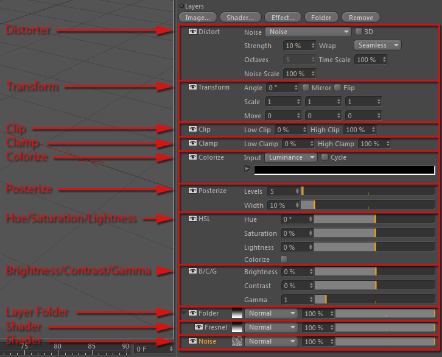

<!-- Source: https://developers.maxon.net/docs/py/2027_0_0/modules/c4d/C4DAtom/GeListNode/BaseList2D/BaseShader/LayerShader/index.html -->

# c4d.LayerShader 

## *class* `c4d.LayerShader` 

Represents a layer shader that can contain several layers of different types (shaders, folders, effects).

It looks like this:

Parent Class:

- [`c4d.BaseShader`](../index.md#c4d.BaseShader)

## Overview 

**Layer Management**

- [`LayerShader.AddLayer()`](#c4d.LayerShader.AddLayer): Creates and adds a new layer of a specific type.
- [`LayerShader.GetFirstLayer()`](#c4d.LayerShader.GetFirstLayer): Returns the first layer of the shader.

**Magic Methods**

- [`LayerShader.__init__()`](#c4d.LayerShader.__init__): Initializes a new [`LayerShader`](#c4d.LayerShader) in memory.

## Members 

### Layer Management 

#### `LayerShader.AddLayer(self, type, parent=None)` 

Creates and adds a new layer of a specific type.

*New in version 24.*

**Parameters:**

- **type** – int
- **parent** (*Optional*[[*c4d.LayerShaderLayer*](../../../../../LayerShaderLayer/index.md#c4d.LayerShaderLayer)]) – The parent folder.

#### `LayerShader.GetFirstLayer(self)` 

Returns the first layer of the shader.

> **Note:** To navigate through all the layers of a layer shader, get its first layer then use `LayerShaderLayer.GetNext()`.

**Return type:** [c4d.LayerShaderLayer](../../../../../LayerShaderLayer/index.md#c4d.LayerShaderLayer)

**Returns:** The first layer in the layer shader.

### Magic Methods 

#### `LayerShader.__init__(self)` 

Initializes a new [`LayerShader`](#c4d.LayerShader) in memory.
