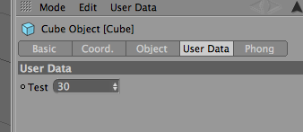

<!-- Source: https://developers.maxon.net/docs/py/2027_0_0/modules/c4d/C4DAtom/GeListNode/BaseList2D/index.html -->

# c4d.BaseList2D <a id="c4d-baselist2d"></a>

## *class* `c4d.BaseList2D` <a id="c4d.BaseList2D"></a>

The base class of many other classes.  
This class is also a linked list which enables you to link several objects with each other.

Parent Class:

- [`c4d.GeListNode`](../index.md#c4d.GeListNode)

Children Classes:

- [`c4d.BaseMaterial`](BaseMaterial/index.md#c4d.BaseMaterial)
- [`c4d.BaseShader`](BaseShader/index.md#c4d.BaseShader)
- [`c4d.CCurve`](CCurve/index.md#c4d.CCurve)
- [`c4d.CTrack`](CTrack/index.md#c4d.CTrack)
- [`c4d.BaseTag`](BaseTag/index.md#c4d.BaseTag)
- [`c4d.BaseObject`](BaseObject/index.md#c4d.BaseObject)
- [`c4d.BaseView`](BaseView/index.md#c4d.BaseView)
- [`c4d.documents.BaseDocument`](../../../../c4d.documents/BaseDocument/index.md#c4d.documents.BaseDocument)
- [`c4d.documents.RenderData`](../../../../c4d.documents/RenderData/index.md#c4d.documents.RenderData)
- [`c4d.documents.LayerObject`](../../../../c4d.documents/LayerObject/index.md#c4d.documents.LayerObject)
- [`c4d.documents.BaseVideoPost`](../../../../c4d.documents/BaseVideoPost/index.md#c4d.documents.BaseVideoPost)
- [`c4d.modules.mograph.FieldLayer`](../../../../c4d.modules/mograph/FieldLayer/index.md#c4d.modules.mograph.FieldLayer)
- [`c4d.modules.net.RenderJob`](../../../../c4d.modules/net/RenderJob/index.md#c4d.modules.net.RenderJob)
- [`c4d.modules.bodypaint.PaintBitmap`](../../../../c4d.modules/bodypaint/PaintBitmap/index.md#c4d.modules.bodypaint.PaintBitmap)
- [`c4d.modules.thinkingparticles.TP_PGroup`](../../../../c4d.modules/thinkingparticles/TP_PGroup/index.md#c4d.modules.thinkingparticles.TP_PGroup)
- [`c4d.modules.thinkingparticles.TP_MasterSystem`](../../../../c4d.modules/thinkingparticles/TP_MasterSystem/index.md#c4d.modules.thinkingparticles.TP_MasterSystem)
- [`c4d.modules.sculpting.SculptLayerData`](../../../../c4d.modules/sculpting/SculptLayerData/index.md#c4d.modules.sculpting.SculptLayerData)
- [`c4d.modules.graphview.GvNodeMaster`](../../../../c4d.modules/graphview/GvNodeMaster/index.md#c4d.modules.graphview.GvNodeMaster)
- [`c4d.modules.graphview.GvNode`](../../../../c4d.modules/graphview/GvNode/index.md#c4d.modules.graphview.GvNode)
- [`c4d.modules.takesystem.BaseTake`](../../../../c4d.modules/takesystem/BaseTake/index.md#c4d.modules.takesystem.BaseTake)
- [`c4d.modules.takesystem.BaseOverride`](../../../../c4d.modules/takesystem/BaseOverride/index.md#c4d.modules.takesystem.BaseOverride)
- [`c4d.modules.takesystem.BaseOverrideGroup`](../../../../c4d.modules/takesystem/BaseOverrideGroup/index.md#c4d.modules.takesystem.BaseOverrideGroup)
- [`c4d.plugins.BasePlugin`](../../../../c4d.plugins/BasePlugin/index.md#c4d.plugins.BasePlugin)

## Overview <a id="overview"></a>

**Animation Parameters**

- [`BaseList2D.GetAnimatedParameter()`](#c4d.BaseList2D.GetAnimatedParameter): Normally not used.
- [`BaseList2D.SetAnimatedParameter()`](#c4d.BaseList2D.SetAnimatedParameter): Normally not used.

**Bit Handler**

- [`BaseList2D.DelBit()`](#c4d.BaseList2D.DelBit): Deletes the object bits denoted by *mask*, i.e.
- [`BaseList2D.GetAllBits()`](#c4d.BaseList2D.GetAllBits): Returns all of the object’s bits.
- [`BaseList2D.GetBit()`](#c4d.BaseList2D.GetBit): Gets the state of the object bits denoted by *mask*.
- [`BaseList2D.SetAllBits()`](#c4d.BaseList2D.SetAllBits): Sets all the object’s bits at once.
- [`BaseList2D.SetBit()`](#c4d.BaseList2D.SetBit): Sets the object bits denoted by *mask*.
- [`BaseList2D.ToggleBit()`](#c4d.BaseList2D.ToggleBit): Toggles the state of the object bits denoted by *mask*.

**Data**

- [`BaseList2D.GetData()`](#c4d.BaseList2D.GetData): Returns a copy of the object’s container.
- [`BaseList2D.GetDataInstance()`](#c4d.BaseList2D.GetDataInstance): Returns a reference to the object’s data container.
- [`BaseList2D.SetData()`](#c4d.BaseList2D.SetData): Sets the object container.

**Hierarchy And Relationships**

- [`BaseList2D.GetMain()`](#c4d.BaseList2D.GetMain): Goes up the next level, e.g.
- [`BaseList2D.GetNLARoot()`](#c4d.BaseList2D.GetNLARoot): Private.
- [`BaseList2D.TransferGoal()`](#c4d.BaseList2D.TransferGoal): Transfer goals from this object to *dst*.

**Keyframes**

- [`BaseList2D.ClearKeyframeSelection()`](#c4d.BaseList2D.ClearKeyframeSelection): Clears the current keyframe selection.
- [`BaseList2D.FindKeyframeSelection()`](#c4d.BaseList2D.FindKeyframeSelection): Checks if *id* is included in the keyframe selection.
- [`BaseList2D.KeyframeSelectionContent()`](#c4d.BaseList2D.KeyframeSelectionContent): Checks if there are any active keyframe selections.
- [`BaseList2D.SetKeyframeSelection()`](#c4d.BaseList2D.SetKeyframeSelection): Sets the keyframe selection status of *id* to *selection*.

**Layer**

- [`BaseList2D.GetLayerData()`](#c4d.BaseList2D.GetLayerData): Get the layer data for this object.
- [`BaseList2D.GetLayerObject()`](#c4d.BaseList2D.GetLayerObject): Get the layer of this object.
- [`BaseList2D.SetLayerData()`](#c4d.BaseList2D.SetLayerData): Set the layer data for this object.
- [`BaseList2D.SetLayerObject()`](#c4d.BaseList2D.SetLayerObject): Set the layer of this object.

**Magic Methods**

- [`BaseList2D.__init__()`](#c4d.BaseList2D.__init__)
- [`BaseList2D.__str__()`](#c4d.BaseList2D.__str__): Returns the BaseList2D as string.

**Name and Description**

- [`BaseList2D.GetBubbleHelp()`](#c4d.BaseList2D.GetBubbleHelp): Returns the bubble help of the object.
- [`BaseList2D.GetName()`](#c4d.BaseList2D.GetName): Returns the name of the object.
- [`BaseList2D.GetTypeName()`](#c4d.BaseList2D.GetTypeName): The name of the object category, for example *Phong*, *Spline*, *Bone*, etc.
- [`BaseList2D.SetName()`](#c4d.BaseList2D.SetName): Set the name of the object.

**Nodes**

- [`BaseList2D.GetAllNimbusRefs()`](#c4d.BaseList2D.GetAllNimbusRefs): Retrieve a list of tuple of all NodeSpace ID and NimbusRef of the current BaseList is holding.
- [`BaseList2D.GetNimbusRef()`](#c4d.BaseList2D.GetNimbusRef): Return the owning NimbusBaseRef corresponding to the provided NodeSpace Id.
- [`BaseList2D.IsNodeBased()`](#c4d.BaseList2D.IsNodeBased): Checks whether the object contains nodes.
- [`BaseList2D.RemoveNimbusRef()`](#c4d.BaseList2D.RemoveNimbusRef): Remove the NimbusRef and therefore the owned graph, corresponding to the provided NodeSpace Id.

**Object Data And Actions**

- [`BaseList2D.Edit()`](#c4d.BaseList2D.Edit): Triggers the edit action for this object.
- [`BaseList2D.GetInfo()`](#c4d.BaseList2D.GetInfo): Returns the information flags for the object.
- [`BaseList2D.GetNodeData()`](#c4d.BaseList2D.GetNodeData): Returns the NodeData part of the BaseList2D.
- [`BaseList2D.Scale()`](#c4d.BaseList2D.Scale): Scale the object.

**Private**

- [`BaseList2D.AddEventNotification()`](#c4d.BaseList2D.AddEventNotification): Private.
- [`BaseList2D.FindEventNotification()`](#c4d.BaseList2D.FindEventNotification): Private.
- [`BaseList2D.RemoveEventNotification()`](#c4d.BaseList2D.RemoveEventNotification): Private.

**Shader**

- [`BaseList2D.GetFirstShader()`](#c4d.BaseList2D.GetFirstShader): Returns the first shader of the object.
- [`BaseList2D.InsertShader()`](#c4d.BaseList2D.InsertShader): Inserts a shader in the object’s shader list.

**Tracks**

- [`BaseList2D.FindCTrack()`](#c4d.BaseList2D.FindCTrack): Find the track for the specified description *id*.
- [`BaseList2D.GetCTrackRoot()`](#c4d.BaseList2D.GetCTrackRoot): Returns the track root of the object.
- [`BaseList2D.GetCTracks()`](#c4d.BaseList2D.GetCTracks): Returns all CTracks of an object.
- [`BaseList2D.GetFirstCTrack()`](#c4d.BaseList2D.GetFirstCTrack): Returns the first CTrack of the object.
- [`BaseList2D.InsertTrackSorted()`](#c4d.BaseList2D.InsertTrackSorted): Inserts a track and automatically places it at the right place (so that Y comes after Y etc.)

**User Data**

- [`BaseList2D.AddUserData()`](#c4d.BaseList2D.AddUserData): Allocates a new user data and return its ID.
- [`BaseList2D.GetUserDataContainer()`](#c4d.BaseList2D.GetUserDataContainer): Browse through the user data container sequence.
- [`BaseList2D.RemoveUserData()`](#c4d.BaseList2D.RemoveUserData): Removes a userdata element.
- [`BaseList2D.SetUserDataContainer()`](#c4d.BaseList2D.SetUserDataContainer): Insert a new user data with the specified ID.

**Visual Representation**

- [`BaseList2D.GetIcon()`](#c4d.BaseList2D.GetIcon): Returns the original bitmap pattern.
- [`BaseList2D.GetIconEx()`](#c4d.BaseList2D.GetIconEx): Returns the original bitmap pattern.

## Members <a id="members"></a>

### Animation Parameters <a id="c4d.BaseList2D-method-Animation-Parameters"></a>

#### `BaseList2D.GetAnimatedParameter(self, id, flags)` <a id="c4d.BaseList2D.GetAnimatedParameter"></a>

Normally not used. Used by the animator to set the interpolated value along with the right and left values.

*New in version R23.105.*

**Parameters:**

- **id** ([*c4d.DescID*](../../../DescID/index.md#c4d.DescID)) – The ID of the animated parameter.

- **flags** (*int*) –

  Flags:

  |   |   |
  |---|---|
  | *DESCFLAGS_GET_NONE* | None. |
  | *DESCFLAGS_GET_PARAM_GET* | Parameter retrieved. |
  | *DESCFLAGS_GET_NO_GEDATADEFAULTVALUE* | If set, the C++ *GeData* default type will not be initialized for `C4DAtom.GetParameter()`. |
  | *DESCFLAGS_GET_NO_GLOBALDATA* | Private. |

**Returns:** A tuple of the first data, the second data and the mix value between both data.

**Return type:** Tuple[Any, Any, float]

#### `BaseList2D.SetAnimatedParameter(self, track, id, t_data1, t_data2, mix, flags)` <a id="c4d.BaseList2D.SetAnimatedParameter"></a>

Normally not used. Used by the animator to set the interpolated value along with the right and left values.

*New in version R23.105.*

**Parameters:**

- **track** ([*c4d.CTrack*](CTrack/index.md#c4d.CTrack)) – The animation track. The caller owns the pointed track.

- **id** ([*c4d.DescID*](../../../DescID/index.md#c4d.DescID)) – The ID of the animated parameter.

- **t_data1** (*Any*) – The first data.

- **t_data2** (*Any*) – The second data.

- **mix** (*float*) – The mix value between t_data1 and t_data2

- **flags** (*int*) –

  Flags:

  |   |   |
  |---|---|
  | *DESCFLAGS_SET_NONE* | None. |
  | *DESCFLAGS_SET_PARAM_SET* | Parameter set. |
  | *DESCFLAGS_SET_USERINTERACTION* | Set when the GUI is calling `SetParameter()`. This is the only time when `SetParameter()` is allowed to use user interaction elements (e.g. open dialogs, display messages etc.). |
  | *DESCFLAGS_SET_DONTCHECKMINMAX* | No check is internally done if the parameter passed is within the [min/max] range of the description, to save some time. |
  | *DESCFLAGS_SET_DONTAFFECTINHERITANCE* | No parameter inheritance, for render settings and post effects only. |
  | *DESCFLAGS_SET_FORCESET* | Forces the set value without `GetParameter()`/Compare. Use only for calls where for sure the value was changed! |
  | *DESCFLAGS_SET_DONTFREESPLINECACHE* | **Private.** *New in version R16.038.* |
  | *DESCFLAGS_SET_INDRAG* | **Gadget (e.g. Slider) in dragging mode (not finished). Only used when *DESCFLAGS_SET_USERINTERACTION* is set.** *New in version R17.053.* |

**Returns:** *True* if the animated parameter was set, otherwise *False*.

**Return type:** bool

### Bit Handler <a id="c4d.BaseList2D-method-Bit-Handler"></a>

#### `BaseList2D.DelBit(self, mask)` <a id="c4d.BaseList2D.DelBit"></a>

Deletes the object bits denoted by *mask*, i.e. sets the corresponding bit to *0*.

**Parameters:**

**mask** (*int*) –

The bit mask of the bits:

|   |   |
|---|---|
| *BIT_ACTIVE* | Active element. |
| *BIT_ACTIVE2* | Private. |
| *BIT_ACTIVE3* | *New in version R17.032:* Private. |
| *BIT_ACTIVERENDERDATA* | Active render data. |
| *BIT_ACTIVESELECTIONDRAW* | Draws active selection. |
| *BIT_ANIM_CONSTANTVELOCITY* | Constant velocity of the track. |
| *BIT_ANIM_OFF* | Inactive sequence. |
| *BIT_ANIM_SOLO* | Solo track. |
| *BIT_BP_FOLDLAYERS* | Fold layers in material manager. |
| *BIT_CONTROLOBJECT* | Internal bit set by generators. |
| *BIT_DOCUMENT_CHECKREWIND* | Check rewind. |
| *BIT_EDITOBJECT* | Private. |
| *BIT_ENABLEPAINT* | Enable painting. |
| *BIT_FORCE_UNOPTIMIZED* | Private. |
| *BIT_HIGHLIGHT* | Private. |
| *BIT_IGNOREDRAW* | Ignore object during draw. |
| *BIT_IGNOREDRAWBOX* | Ignore object drawing box. |
| *BIT_MATMARK* | Marked material. |
| *BIT_MFOLD* | Folded in material manager. |
| *BIT_OFOLD* | Folded in object manager. |
| *BIT_RECALCPREVIEW* | Recalculate preview. |
| *BIT_RECMARK* | Private. |
| *BIT_TEMPDRAW_VISIBLE_CACHECHILD* | Private. |
| *BIT_TEMPDRAW_VISIBLE_CHILD* | Private. |
| *BIT_TEMPDRAW_VISIBLE_DEFCACHECHILD* | Private. |
| *BIT_TRACKPROCESSED* | Track has been processed, avoid recursions. |
| *BIT_VPDISABLED* | Videopost is disabled. |

#### `BaseList2D.GetAllBits(self)` <a id="c4d.BaseList2D.GetAllBits"></a>

Returns all of the object’s bits.

**Return type:** int

**Returns:**

The object’s bits:

|   |   |
|---|---|
| *BIT_ACTIVE* | Active element. |
| *BIT_ACTIVE2* | Private. |
| *BIT_ACTIVE3* | *New in version R17.032:* Private. |
| *BIT_ACTIVERENDERDATA* | Active render data. |
| *BIT_ACTIVESELECTIONDRAW* | Draws active selection. |
| *BIT_ANIM_CONSTANTVELOCITY* | Constant velocity of the track. |
| *BIT_ANIM_OFF* | Inactive sequence. |
| *BIT_ANIM_SOLO* | Solo track. |
| *BIT_BP_FOLDLAYERS* | Fold layers in material manager. |
| *BIT_CONTROLOBJECT* | Internal bit set by generators. |
| *BIT_DOCUMENT_CHECKREWIND* | Check rewind. |
| *BIT_EDITOBJECT* | Private. |
| *BIT_ENABLEPAINT* | Enable painting. |
| *BIT_FORCE_UNOPTIMIZED* | Private. |
| *BIT_HIGHLIGHT* | Private. |
| *BIT_IGNOREDRAW* | Ignore object during draw. |
| *BIT_IGNOREDRAWBOX* | Ignore object drawing box. |
| *BIT_MATMARK* | Marked material. |
| *BIT_MFOLD* | Folded in material manager. |
| *BIT_OFOLD* | Folded in object manager. |
| *BIT_RECALCPREVIEW* | Recalculate preview. |
| *BIT_RECMARK* | Private. |
| *BIT_TEMPDRAW_VISIBLE_CACHECHILD* | Private. |
| *BIT_TEMPDRAW_VISIBLE_CHILD* | Private. |
| *BIT_TEMPDRAW_VISIBLE_DEFCACHECHILD* | Private. |
| *BIT_TRACKPROCESSED* | Track has been processed, avoid recursions. |
| *BIT_VPDISABLED* | Videopost is disabled. |

#### `BaseList2D.GetBit(self, mask)` <a id="c4d.BaseList2D.GetBit"></a>

Gets the state of the object bits denoted by *mask*.

**Parameters:**

**mask** (*int*) –

The bit mask of the bits:

|   |   |
|---|---|
| *BIT_ACTIVE* | Active element. |
| *BIT_ACTIVE2* | Private. |
| *BIT_ACTIVE3* | *New in version R17.032:* Private. |
| *BIT_ACTIVERENDERDATA* | Active render data. |
| *BIT_ACTIVESELECTIONDRAW* | Draws active selection. |
| *BIT_ANIM_CONSTANTVELOCITY* | Constant velocity of the track. |
| *BIT_ANIM_OFF* | Inactive sequence. |
| *BIT_ANIM_SOLO* | Solo track. |
| *BIT_BP_FOLDLAYERS* | Fold layers in material manager. |
| *BIT_CONTROLOBJECT* | Internal bit set by generators. |
| *BIT_DOCUMENT_CHECKREWIND* | Check rewind. |
| *BIT_EDITOBJECT* | Private. |
| *BIT_ENABLEPAINT* | Enable painting. |
| *BIT_FORCE_UNOPTIMIZED* | Private. |
| *BIT_HIGHLIGHT* | Private. |
| *BIT_IGNOREDRAW* | Ignore object during draw. |
| *BIT_IGNOREDRAWBOX* | Ignore object drawing box. |
| *BIT_MATMARK* | Marked material. |
| *BIT_MFOLD* | Folded in material manager. |
| *BIT_OFOLD* | Folded in object manager. |
| *BIT_RECALCPREVIEW* | Recalculate preview. |
| *BIT_RECMARK* | Private. |
| *BIT_TEMPDRAW_VISIBLE_CACHECHILD* | Private. |
| *BIT_TEMPDRAW_VISIBLE_CHILD* | Private. |
| *BIT_TEMPDRAW_VISIBLE_DEFCACHECHILD* | Private. |
| *BIT_TRACKPROCESSED* | Track has been processed, avoid recursions. |
| *BIT_VPDISABLED* | Videopost is disabled. |

**Return type:** int

**Returns:** The state of the object bits.

#### `BaseList2D.SetAllBits(self, mask)` <a id="c4d.BaseList2D.SetAllBits"></a>

Sets all the object’s bits at once.

**Parameters:**

**mask** (*int*) –

The object’s bits to set:

|   |   |
|---|---|
| *BIT_ACTIVE* | Active element. |
| *BIT_ACTIVE2* | Private. |
| *BIT_ACTIVE3* | *New in version R17.032:* Private. |
| *BIT_ACTIVERENDERDATA* | Active render data. |
| *BIT_ACTIVESELECTIONDRAW* | Draws active selection. |
| *BIT_ANIM_CONSTANTVELOCITY* | Constant velocity of the track. |
| *BIT_ANIM_OFF* | Inactive sequence. |
| *BIT_ANIM_SOLO* | Solo track. |
| *BIT_BP_FOLDLAYERS* | Fold layers in material manager. |
| *BIT_CONTROLOBJECT* | Internal bit set by generators. |
| *BIT_DOCUMENT_CHECKREWIND* | Check rewind. |
| *BIT_EDITOBJECT* | Private. |
| *BIT_ENABLEPAINT* | Enable painting. |
| *BIT_FORCE_UNOPTIMIZED* | Private. |
| *BIT_HIGHLIGHT* | Private. |
| *BIT_IGNOREDRAW* | Ignore object during draw. |
| *BIT_IGNOREDRAWBOX* | Ignore object drawing box. |
| *BIT_MATMARK* | Marked material. |
| *BIT_MFOLD* | Folded in material manager. |
| *BIT_OFOLD* | Folded in object manager. |
| *BIT_RECALCPREVIEW* | Recalculate preview. |
| *BIT_RECMARK* | Private. |
| *BIT_TEMPDRAW_VISIBLE_CACHECHILD* | Private. |
| *BIT_TEMPDRAW_VISIBLE_CHILD* | Private. |
| *BIT_TEMPDRAW_VISIBLE_DEFCACHECHILD* | Private. |
| *BIT_TRACKPROCESSED* | Track has been processed, avoid recursions. |
| *BIT_VPDISABLED* | Videopost is disabled. |

#### `BaseList2D.SetBit(self, mask)` <a id="c4d.BaseList2D.SetBit"></a>

Sets the object bits denoted by *mask*.

**Parameters:**

**mask** (*int*) –

The bit mask of the bits:

|   |   |
|---|---|
| *BIT_ACTIVE* | Active element. |
| *BIT_ACTIVE2* | Private. |
| *BIT_ACTIVE3* | *New in version R17.032:* Private. |
| *BIT_ACTIVERENDERDATA* | Active render data. |
| *BIT_ACTIVESELECTIONDRAW* | Draws active selection. |
| *BIT_ANIM_CONSTANTVELOCITY* | Constant velocity of the track. |
| *BIT_ANIM_OFF* | Inactive sequence. |
| *BIT_ANIM_SOLO* | Solo track. |
| *BIT_BP_FOLDLAYERS* | Fold layers in material manager. |
| *BIT_CONTROLOBJECT* | Internal bit set by generators. |
| *BIT_DOCUMENT_CHECKREWIND* | Check rewind. |
| *BIT_EDITOBJECT* | Private. |
| *BIT_ENABLEPAINT* | Enable painting. |
| *BIT_FORCE_UNOPTIMIZED* | Private. |
| *BIT_HIGHLIGHT* | Private. |
| *BIT_IGNOREDRAW* | Ignore object during draw. |
| *BIT_IGNOREDRAWBOX* | Ignore object drawing box. |
| *BIT_MATMARK* | Marked material. |
| *BIT_MFOLD* | Folded in material manager. |
| *BIT_OFOLD* | Folded in object manager. |
| *BIT_RECALCPREVIEW* | Recalculate preview. |
| *BIT_RECMARK* | Private. |
| *BIT_TEMPDRAW_VISIBLE_CACHECHILD* | Private. |
| *BIT_TEMPDRAW_VISIBLE_CHILD* | Private. |
| *BIT_TEMPDRAW_VISIBLE_DEFCACHECHILD* | Private. |
| *BIT_TRACKPROCESSED* | Track has been processed, avoid recursions. |
| *BIT_VPDISABLED* | Videopost is disabled. |

#### `BaseList2D.ToggleBit(self, mask)` <a id="c4d.BaseList2D.ToggleBit"></a>

Toggles the state of the object bits denoted by *mask*.

**Parameters:**

**mask** (*int*) –

The bit mask of the bits:

|   |   |
|---|---|
| *BIT_ACTIVE* | Active element. |
| *BIT_ACTIVE2* | Private. |
| *BIT_ACTIVE3* | *New in version R17.032:* Private. |
| *BIT_ACTIVERENDERDATA* | Active render data. |
| *BIT_ACTIVESELECTIONDRAW* | Draws active selection. |
| *BIT_ANIM_CONSTANTVELOCITY* | Constant velocity of the track. |
| *BIT_ANIM_OFF* | Inactive sequence. |
| *BIT_ANIM_SOLO* | Solo track. |
| *BIT_BP_FOLDLAYERS* | Fold layers in material manager. |
| *BIT_CONTROLOBJECT* | Internal bit set by generators. |
| *BIT_DOCUMENT_CHECKREWIND* | Check rewind. |
| *BIT_EDITOBJECT* | Private. |
| *BIT_ENABLEPAINT* | Enable painting. |
| *BIT_FORCE_UNOPTIMIZED* | Private. |
| *BIT_HIGHLIGHT* | Private. |
| *BIT_IGNOREDRAW* | Ignore object during draw. |
| *BIT_IGNOREDRAWBOX* | Ignore object drawing box. |
| *BIT_MATMARK* | Marked material. |
| *BIT_MFOLD* | Folded in material manager. |
| *BIT_OFOLD* | Folded in object manager. |
| *BIT_RECALCPREVIEW* | Recalculate preview. |
| *BIT_RECMARK* | Private. |
| *BIT_TEMPDRAW_VISIBLE_CACHECHILD* | Private. |
| *BIT_TEMPDRAW_VISIBLE_CHILD* | Private. |
| *BIT_TEMPDRAW_VISIBLE_DEFCACHECHILD* | Private. |
| *BIT_TRACKPROCESSED* | Track has been processed, avoid recursions. |
| *BIT_VPDISABLED* | Videopost is disabled. |

### Data <a id="c4d.BaseList2D-method-Data"></a>

#### `BaseList2D.GetData(self)` <a id="c4d.BaseList2D.GetData"></a>

Returns a copy of the object’s container.

*Deprecated since version 2024.0.0:* Use `BaseList2D.GetDataInstance()` instead.

**Return type:** [c4d.BaseContainer](../../../BaseContainer/index.md#c4d.BaseContainer)

**Returns:** The container reference.

#### `BaseList2D.GetDataInstance(self)` <a id="c4d.BaseList2D.GetDataInstance"></a>

Returns a reference to the object’s data container.  
All modifications to the container are directly applied to the node which owns the container. The container is only alive as long as the hosting node is alive. The elements of the container are type protected when you set touch them via `GeListNode.__setitem__()`. This means that you can just overwrite an element with a new object when its of the same type. When you want to overwrite the element with another type, you need to delete the previous element with **del(bc[ELEMENT_ID])**, or use the manual **BaseContainer.Set*** methods.

**Raises:** **ReferenceError** – If the container is dead. The container is just alive as long as the host object is alive. Access to a dead container leads to this error.

**Return type:** Optional[[c4d.BaseContainer](../../../BaseContainer/index.md#c4d.BaseContainer)]

**Returns:** The original container reference.

#### `BaseList2D.SetData(self, bc, add=True)` <a id="c4d.BaseList2D.SetData"></a>

Sets the object container.  
By default the contents of *bc* are merged with the existing container.  
You can control this behavior with *add*.

> **Note:** Do not forget to send a `C4DAtom.Message()` if you change any settings.

**Parameters:**

- **bc** ([*c4d.BaseContainer*](../../../BaseContainer/index.md#c4d.BaseContainer)) – The container.
- **add** (*bool*) – If this is **True** the values are merged, otherwise the old values are discarded.

**Return type:** [c4d.BaseContainer](../../../BaseContainer/index.md#c4d.BaseContainer)

**Returns:** The container reference.

### Hierarchy And Relationships <a id="c4d.BaseList2D-method-Hierarchy-And-Relationships"></a>

#### `BaseList2D.GetMain(self)` <a id="c4d.BaseList2D.GetMain"></a>

Goes up the next level, e.g. from tag to object or Xpresso node to tag, or object to document, etc.

**Return type:** Optional[[c4d.BaseList2D](#c4d.BaseList2D)]

**Returns:** The main object of this object or **None**.

#### `BaseList2D.GetNLARoot(self, create=True)` <a id="c4d.BaseList2D.GetNLARoot"></a>

Private.

#### `BaseList2D.TransferGoal(self, dst, undolink)` <a id="c4d.BaseList2D.TransferGoal"></a>

Transfer goals from this object to *dst*.  
This changes all internal links that point to this object to point to *dst* instead.

**Parameters:**

- **dst** ([*c4d.BaseList2D*](#c4d.BaseList2D)) – The destination
- **undolink** (*bool*) – This has to be set to *False*. Private.

### Keyframes <a id="c4d.BaseList2D-method-Keyframes"></a>

#### `BaseList2D.ClearKeyframeSelection(self)` <a id="c4d.BaseList2D.ClearKeyframeSelection"></a>

Clears the current keyframe selection.

#### `BaseList2D.FindKeyframeSelection(self, id)` <a id="c4d.BaseList2D.FindKeyframeSelection"></a>

Checks if *id* is included in the keyframe selection.

**Parameters:** **id** ([*c4d.DescID*](../../../DescID/index.md#c4d.DescID)) – The description ID to check.

**Return type:** bool

**Returns:** **True** if the given *id* is selected, otherwise **False**.

#### `BaseList2D.KeyframeSelectionContent(self)` <a id="c4d.BaseList2D.KeyframeSelectionContent"></a>

Checks if there are any active keyframe selections.

> **Note:**
>
> This is not the same as **BIT_ACTIVE**, it is the possibility to restrict autokeyframing to certain description parameters.  
> See “Animation->Add Keyframe Selection” in the Attributes Manager.

**Return type:** bool

**Returns:** **True** if there is a keyframe selection, otherwise *False*.

#### `BaseList2D.SetKeyframeSelection(self, id, selection)` <a id="c4d.BaseList2D.SetKeyframeSelection"></a>

Sets the keyframe selection status of *id* to *selection*.

**Parameters:** **id** ([*c4d.DescID*](../../../DescID/index.md#c4d.DescID)) – The description ID to set.

**Returns:** **True** to select the key, otherwise id is selected, otherwise **False**.

### Layer <a id="c4d.BaseList2D-method-Layer"></a>

#### `BaseList2D.GetLayerData(self, doc, rawdata=False)` <a id="c4d.BaseList2D.GetLayerData"></a>

Get the layer data for this object.

*Changed in version R21:* *xref* added to the dictionary.

**Parameters:**

- **doc** ([*c4d.documents.BaseDocument*](../../../../c4d.documents/BaseDocument/index.md#c4d.documents.BaseDocument)) – The document.
- **rawdata** (*bool*) – Usually [`GetLayerData()`](#c4d.BaseList2D.GetLayerData) takes special global modes like SOLO Layer automatically into account. But if you want to see the original layer values without any additional global changes you can set *rawdata* to **True** to get them.

**Return type:** dict{**solo**: bool, **view**: bool, **render**: bool, **manager**: bool, **locked**: bool, **generators**: bool, **expressions**: bool, **animation**: bool, **color**: [`Vector`](../../../Vector/index.md#c4d.Vector), **xref**: bool}

#### `BaseList2D.GetLayerObject(self, doc)` <a id="c4d.BaseList2D.GetLayerObject"></a>

Get the layer of this object.

**Parameters:** **doc** ([*c4d.documents.BaseDocument*](../../../../c4d.documents/BaseDocument/index.md#c4d.documents.BaseDocument)) – The document.

**Return type:** [c4d.documents.LayerObject](../../../../c4d.documents/LayerObject/index.md#c4d.documents.LayerObject)

**Returns:** The layer.

#### `BaseList2D.SetLayerData(self, doc, data)` <a id="c4d.BaseList2D.SetLayerData"></a>

Set the layer data for this object.

*Changed in version R21:* *xref* added to the dictionary.

**Parameters:**

- **doc** ([*c4d.documents.BaseDocument*](../../../../c4d.documents/BaseDocument/index.md#c4d.documents.BaseDocument)) – The document.
- **data** (dict{**solo**: bool, **view**: bool, **render**: bool, **manager**: bool, **locked**: bool, **generators**: bool, **expressions**: bool, **animation**: bool, **color**: c4d.Vector, **xref**: bool}) – The new layer data. it is possible to leave values in the dictionary out.

**Return type:** bool

**Returns:** **True** if successful, otherwise **False**.

#### `BaseList2D.SetLayerObject(self, layer)` <a id="c4d.BaseList2D.SetLayerObject"></a>

Set the layer of this object.

**Parameters:**

**layer** (*Optional*[[*c4d.documents.LayerObject*](../../../../c4d.documents/LayerObject/index.md#c4d.documents.LayerObject)]) –

The new layer.

*Changed in version R18.020:* Can be **None**.

**Return type:** bool

**Returns:** **True** if successful, otherwise **False**.

### Magic Methods <a id="c4d.BaseList2D-method-Magic-Methods"></a>

#### `BaseList2D.__init__(self, type)` <a id="c4d.BaseList2D.__init__"></a>

**Parameters:** **type** (*int*) – The id of the object, e.g: (*Ocube*).

#### `BaseList2D.__str__(self)` <a id="c4d.BaseList2D.__str__"></a>

Returns the BaseList2D as string. Called if [str()](https://docs.python.org/3.9/library/functions.html#func-str) is wrapped around an instance of [`BaseList2D`](#c4d.BaseList2D). (See [__str__](https://docs.python.org/3.9/reference/datamodel.html?highlight=__str__#object.__str__).)

**Return type:** str

**Returns:** The string representation of [`BaseList2D`](#c4d.BaseList2D).

### Name and Description <a id="c4d.BaseList2D-method-Name-and-Description"></a>

#### `BaseList2D.GetBubbleHelp(self)` <a id="c4d.BaseList2D.GetBubbleHelp"></a>

Returns the bubble help of the object.

**Return type:** str

**Returns:** The bubble help.

#### `BaseList2D.GetName(self)` <a id="c4d.BaseList2D.GetName"></a>

Returns the name of the object.

**Return type:** str

**Returns:** The name.

#### `BaseList2D.GetTypeName(self)` <a id="c4d.BaseList2D.GetTypeName"></a>

The name of the object category, for example *Phong*, *Spline*, *Bone*, etc.

**Return type:** str

**Returns:** The type name.

#### `BaseList2D.SetName(self, name, setDirty=True)` <a id="c4d.BaseList2D.SetName"></a>

Set the name of the object.

**Parameters:**

- **name** (*str*) – Set the name.

- **setDirty** –

  *New in version 2024.0.0.*

  True if the object should be dirty when the name changes. False to prevent doing it.

### Nodes <a id="c4d.BaseList2D-method-Nodes"></a>

#### `BaseList2D.GetAllNimbusRefs(self)` <a id="c4d.BaseList2D.GetAllNimbusRefs"></a>

Retrieve a list of tuple of all NodeSpace ID and NimbusRef of the current BaseList is holding.

*New in version R24.*

**Returns:** A list of tuple. | The first item of this tuple is a [`maxon.Id`](../../../../maxon_generated/datatypes/id/maxon.Id.md#module-maxon.Id) of the nodespace. | The second item of this tuple is the corresponding [`maxon.NimbusBaseRef`](../../../../maxon_generated/frameworks/nodespace/reference/maxon.NimbusBaseRef.md#module-maxon.NimbusBaseRef).

**Return type:** List[Tuple[[`maxon.Id`](../../../../maxon_generated/datatypes/id/maxon.Id.md#module-maxon.Id), [`maxon.NimbusBaseRef`](../../../../maxon_generated/frameworks/nodespace/reference/maxon.NimbusBaseRef.md#module-maxon.NimbusBaseRef)]]

#### `BaseList2D.GetNimbusRef(self, spaceId)` <a id="c4d.BaseList2D.GetNimbusRef"></a>

Return the owning NimbusBaseRef corresponding to the provided NodeSpace Id.

*New in version R24.*

**Parameters:** **spaceId** ([`maxon.Id`](../../../../maxon_generated/datatypes/id/maxon.Id.md#module-maxon.Id)) – The NodeSpace ID.

**Returns:** Returns the owner of the node graph. None if the nimbusRef is not found

**Return type:** Optional[[`maxon.NimbusBaseRef`](../../../../maxon_generated/frameworks/nodespace/reference/maxon.NimbusBaseRef.md#module-maxon.NimbusBaseRef)]

#### `BaseList2D.IsNodeBased(self)` <a id="c4d.BaseList2D.IsNodeBased"></a>

Checks whether the object contains nodes.

*New in version R24.*

**Returns:** Return **True** if a [`maxon.NimbusBaseRef`](../../../../maxon_generated/frameworks/nodespace/reference/maxon.NimbusBaseRef.md#module-maxon.NimbusBaseRef) is attached to the current [`c4d.BaseList2D`](#c4d.BaseList2D).

**Return type:** bool

#### `BaseList2D.RemoveNimbusRef(self, spaceId)` <a id="c4d.BaseList2D.RemoveNimbusRef"></a>

Remove the NimbusRef and therefore the owned graph, corresponding to the provided NodeSpace Id.

*New in version R24.*

**Parameters:** **spaceId** ([`maxon.Id`](../../../../maxon_generated/datatypes/id/maxon.Id.md#module-maxon.Id)) – The NodeSpace ID.

### Object Data And Actions <a id="c4d.BaseList2D-method-Object-Data-And-Actions"></a>

#### `BaseList2D.Edit(self)` <a id="c4d.BaseList2D.Edit"></a>

Triggers the edit action for this object.

> **Note:**
>
> For most types this brings up the node in the attributes manager.  
> Some still show a separate dialog.

**Return type:** bool

**Returns:** **False** if an error occurred, otherwise **True**.

#### `BaseList2D.GetInfo(self)` <a id="c4d.BaseList2D.GetInfo"></a>

Returns the information flags for the object. The interpretation depends on the object type.

When a BaseList2D is registered, some behaviors have to be defined (e.g. for an object, it might be a generator, a modifier, etc…)

This is done through Flags, and GetInfo returns these flags.

```python
>>> op
<c4d.BaseObject object called Cube/Cube with ID 5159 at 1694956664448>
>>> op.GetInfo()
268435460
>>> # To make this output useful, we have to use a bitmask.
>>> op.GetInfo() & c4d.OBJECT_MODIFIER
0
>>> op.GetInfo() & c4d.OBJECT_GENERATOR
4
```

**Return type:** int

**Returns:** The flags. This is the same as the info parameter of the registration function of the registration function of the [`NodeData`](../../../../c4d.plugins/BaseData/NodeData/index.md#c4d.plugins.NodeData).

#### `BaseList2D.GetNodeData(self)` <a id="c4d.BaseList2D.GetNodeData"></a>

Returns the NodeData part of the BaseList2D.

> **Note:** Only Python defined node.

**Return type:** any

**Returns:** The established NodeData.

#### `BaseList2D.Scale(self, scale)` <a id="c4d.BaseList2D.Scale"></a>

Scale the object.

**Parameters:** **scale** (*float*) – The size.

### Private <a id="c4d.BaseList2D-method-Private"></a>

#### `BaseList2D.AddEventNotification(self, bl, eventid, flags, data)` <a id="c4d.BaseList2D.AddEventNotification"></a>

Private.

#### `BaseList2D.FindEventNotification(self, doc, bl, eventid)` <a id="c4d.BaseList2D.FindEventNotification"></a>

Private.

#### `BaseList2D.RemoveEventNotification(self, doc, bl, eventid)` <a id="c4d.BaseList2D.RemoveEventNotification"></a>

Private.

### Shader <a id="c4d.BaseList2D-method-Shader"></a>

#### `BaseList2D.GetFirstShader(self)` <a id="c4d.BaseList2D.GetFirstShader"></a>

Returns the first shader of the object.

> **Note:** Normally you don’t have to deal with this list. But if you want to create or modify shader trees via the API you need to read the following lines:
>
> - If you are programming shader links you need to make sure that every shader is referenced only once; it is not allowed that a shader is referenced multiple times.
> - If the referencing object is a shader the referenced shader must be a child of it, otherwise it must be inserted via [`InsertShader()`](#c4d.BaseList2D.InsertShader).
> - Example 1: A tag references a shader. The shader must be inserted into the tag using [`tag.InsertShader()`](#c4d.BaseList2D.InsertShader).
> - Example 2: A shader (A) references another shader (B): shader B must be a child of shader A.

**Return type:** Optional[[c4d.BaseList2D](#c4d.BaseList2D)]

**Returns:** The first shader of the object, or **None** if there is no shader.

#### `BaseList2D.InsertShader(self, shader, pred=None)` <a id="c4d.BaseList2D.InsertShader"></a>

Inserts a shader in the object’s shader list.

```python
# Get the first material in the document.
material = doc.GetFirstMaterial()
if material is None:
    raise MemoryError("Could not allocate material node.")

# Instantiate a bitmap shader and insert it into the material.
shader = c4d.BaseList2D(c4d.Xbitmap)
material.InsertShader(shader)

# Link the shader in the color channel.
material[c4d.MATERIAL_COLOR_SHADER] = shader
material.Message(c4d.MSG_UPDATE)
material.Update(True, True)

# Push an update event to Cinema 4D
c4d.EventAdd()
```

**Parameters:**

- **shader** ([*c4d.BaseList2D*](#c4d.BaseList2D)) – The shader to insert.
- **pred** (*Optional*[[*c4d.BaseList2D*](#c4d.BaseList2D)]) – The shader to insert the new shader after, or **None** to insert the new shader first. This shader must already be inserted into the list.

### Tracks <a id="c4d.BaseList2D-method-Tracks"></a>

#### `BaseList2D.FindCTrack(self, id)` <a id="c4d.BaseList2D.FindCTrack"></a>

Find the track for the specified description *id*.

**Parameters:** **id** ([*c4d.DescID*](../../../DescID/index.md#c4d.DescID)) – The description ID to check.

**Return type:** Optional[[c4d.CTrack](CTrack/index.md#c4d.CTrack)]

**Returns:** The track found, or **None** if there was no match.

#### `BaseList2D.GetCTrackRoot(self, create=True)` <a id="c4d.BaseList2D.GetCTrackRoot"></a>

Returns the track root of the object. To get the tracks of an object use [`GetCTracks()`](#c4d.BaseList2D.GetCTracks) instead. :type create: bool :param create:

> *New in version 2024.0.0.*
>
> True create it if none exist.

**Return type:** Optional[[c4d.GeListHead](../GeListHead/index.md#c4d.GeListHead)]

**Returns:**

The track root if there is one, otherwise **None**.

*Changed in version R19.*

The function now returns a [`c4d.GeListHead`](../GeListHead/index.md#c4d.GeListHead) object.

#### `BaseList2D.GetCTracks(self)` <a id="c4d.BaseList2D.GetCTracks"></a>

Returns all CTracks of an object.

**Return type:** List[[c4d.CTrack](CTrack/index.md#c4d.CTrack)]

**Returns:** The CTrack.

#### `BaseList2D.GetFirstCTrack(self)` <a id="c4d.BaseList2D.GetFirstCTrack"></a>

Returns the first CTrack of the object.

**Return type:** Optional[[c4d.CTrack](CTrack/index.md#c4d.CTrack)]

**Returns:** The first track, or **None** if there are no tracks.

#### `BaseList2D.InsertTrackSorted(self, track)` <a id="c4d.BaseList2D.InsertTrackSorted"></a>

Inserts a track and automatically places it at the right place (so that Y comes after Y etc.)

**Parameters:** **track** ([*c4d.CTrack*](CTrack/index.md#c4d.CTrack)) – The track to insert.

### User Data <a id="c4d.BaseList2D-method-User-Data"></a>

#### `BaseList2D.AddUserData(self, datadescription)` <a id="c4d.BaseList2D.AddUserData"></a>

Allocates a new user data and return its ID.

Use [`c4d.GetCustomDataTypeDefault()`](../../../index.md#c4d.GetCustomDataTypeDefault) to create a default container for user data.

> **See also:** The [DESC](../../../../../consts/DESC.md#symbols-desc) documentation can be helpful to create an user data element form scratch.

```python
# Create default container for the data type Int32.
bc = c4d.GetCustomDataTypeDefault(c4d.DTYPE_LONG)
# The display name of the element.
bc[c4d.DESC_NAME] = "Test"
# The minimum and maximum value of the element.
bc[c4d.DESC_MIN] = 0
bc[c4d.DESC_MAX] = 100

# Add the user data element, retrieving its DescId.
descId = op.AddUserData(bc)

# Write a new value with that DescId
op[descId] = 30
# Push an update event to Cinema 4D
c4d.EventAdd()
```



**Parameters:** **datadescription** ([*c4d.BaseContainer*](../../../BaseContainer/index.md#c4d.BaseContainer)) – Settings of the new user data. See [`Description`](../../../Description/index.md#c4d.Description) for more information on the description IDs.

**Return type:** [c4d.DescID](../../../DescID/index.md#c4d.DescID)

**Returns:** The description ID. The first level is [`c4d.DESCID_DYNAMICSUB`](../../../DescID/index.md#c4d.DESCID_DYNAMICSUB).

#### `BaseList2D.GetUserDataContainer(self)` <a id="c4d.BaseList2D.GetUserDataContainer"></a>

Browse through the user data container sequence.

```python
>>> for cid, bc in op.GetUserDataContainer():
...     print(cid, bc)
...
((700, 5, 0), (1, 19, 0)) <c4d.BaseContainer object at 0x0000018AA3496840>
((700, 5, 0), (2, 23, 0)) <c4d.BaseContainer object at 0x0000018AA349EE80>
((700, 5, 0), (3, 400007013, 0)) <c4d.BaseContainer object at 0x0000018AA349B780>
```

**Return type:** List[[c4d.DescID](../../../DescID/index.md#c4d.DescID), [c4d.BaseContainer](../../../BaseContainer/index.md#c4d.BaseContainer)]

**Returns:** A list of tuples with the [`Description`](../../../Description/index.md#c4d.Description) ID and container for each user data.

#### `BaseList2D.RemoveUserData(self, id)` <a id="c4d.BaseList2D.RemoveUserData"></a>

Removes a userdata element. There are several ways how to delete a user data.

This function supports several types to identify a user data entry.

```python
>>> # Removes user data element with the ID 1.
>>> op.RemoveUserData(1)
True
>>> # Removes user data element with the ID 2.
>>> op.RemoveUserData([c4d.ID_USERDATA, 2])
True
>>> # Removes user data element with the ID 3.
>>> descId = c4d.DescID(c4d.DescLevel(c4d.ID_USERDATA), c4d.DescLevel(3))
>>> op.RemoveUserData(descId)
True
```

**Parameters:** **id** (*Union*[*int*, *List*[*int*], [*c4d.DescID*](../../../DescID/index.md#c4d.DescID)]) – The id of the userdata.

**Return type:** bool

**Returns:** **True** if the userdata is removed, otherwise **False**.

#### `BaseList2D.SetUserDataContainer(self, descid, datadescription)` <a id="c4d.BaseList2D.SetUserDataContainer"></a>

Insert a new user data with the specified ID.

**Parameters:**

- **descid** ([*c4d.DescID*](../../../DescID/index.md#c4d.DescID)) – ID of the new user data.
- **datadescription** ([*c4d.BaseContainer*](../../../BaseContainer/index.md#c4d.BaseContainer)) – Settings to the new user data. See [`Description`](../../../Description/index.md#c4d.Description) for more information on the description IDs.

**Return type:** **True** if the user data was inserted, otherwise *False*.

### Visual Representation <a id="c4d.BaseList2D-method-Visual-Representation"></a>

#### `BaseList2D.GetIcon(self)` <a id="c4d.BaseList2D.GetIcon"></a>

Returns the original bitmap pattern.

> **Warning:** Please, never edit the returned bitmap - read only.

An example

```python
>>> op.GetIcon()
{'bmp': <c4d.bitmaps.BaseBitmap object at 0x0000018AA34B45C0>, 'x': 832, 'y': 64, 'w': 64, 'h': 64}
```

**Return type:** dict{**bmp**: [`BaseBitmap`](../../../../c4d.bitmaps/BaseBitmap/index.md#c4d.bitmaps.BaseBitmap), **x**: int, **y**: int, **w**: int, **h**: int}

**Returns:** The image and size information like height, width and X/Y position in the icon table.

#### `BaseList2D.GetIconEx(self)` <a id="c4d.BaseList2D.GetIconEx"></a>

Returns the original bitmap pattern.

> **Note:** Similar to `BaseList2D.GetIcon()` but instead returns a [`c4d.IconData`](../../../IconData/index.md#c4d.IconData).

> **Warning:** Please, never edit the returned bitmap - read only.

**Return type:** [`c4d.IconData`](../../../IconData/index.md#c4d.IconData)

**Returns:** The image and size information like height, width and X/Y position in the icon table.
