<!-- Source: https://developers.maxon.net/docs/py/2027_0_0/types/noise.html -->

The next code was used to generate the next picture of noises.

```python
import c4d

width = 300
height = 300
noisetype = c4d.NOISE_DISPL_TURB
bmp =  c4d.bitmaps.BaseBitmap()
bmp.Init(width, height, 24)

# Create and initialize the noise instance
noise = c4d.utils.noise.C4DNoise(1234)
noise.InitFbm(21, 2.1, 0.5)

rw = float(width-1)
rh = float(height-1)

# Iterate through the bitmap and set the noise value per pixel
for x in range(width):
    for y in range(height):
        r = noise.Noise(noisetype, False, c4d.Vector(x/rw, y/rh, 0) * 7.0, octaves=5)
        o = int(c4d.utils.Clamp(0, 255, 255.0*r))
        bmp[x, y] = (o, o, o)

c4d.bitmaps.ShowBitmap(bmp)
```

# Noise Types <a id="noise-types"></a>

## BoxNoise <a id="boxnoise"></a>

> **Type:** NOISE_BOX_NOISE
>
> 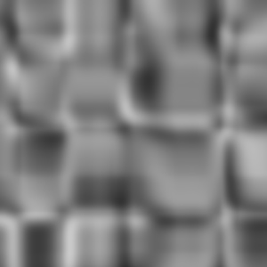

## Blistered Turbulence <a id="blistered-turbulence"></a>

> **Type:** NOISE_BLIST_TURB
>
> 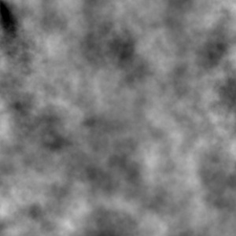

## Buya <a id="buya"></a>

> **Type:** NOISE_BUYA
>
> 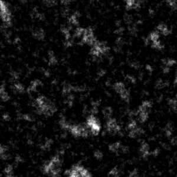

## Cell Noise <a id="cell-noise"></a>

> **Type:** NOISE_CELL_NOISE
>
> 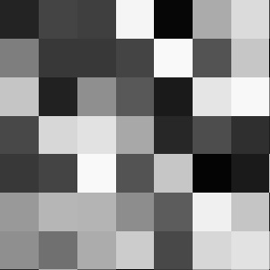

## Cell Voronoi <a id="cell-voronoi"></a>

> **Type:** NOISE_CELL_VORONOI
>
> 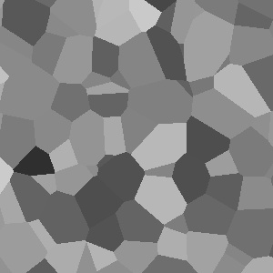

## Cranal <a id="cranal"></a>

> **Type:** NOISE_CRANAL
>
> 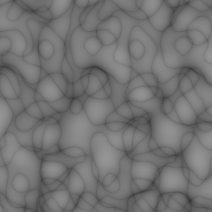

## Dents <a id="dents"></a>

> **Type:** NOISE_DENTS
>
> 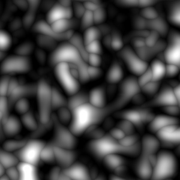

## Displaced Turbulence <a id="displaced-turbulence"></a>

> **Type:** NOISE_DISPL_TURB
>
> 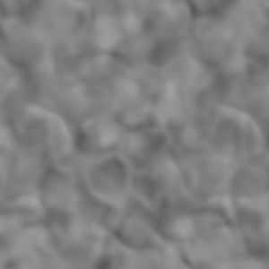

## Electric <a id="electric"></a>

> **Type:** NOISE_ELECTRIC
>
> 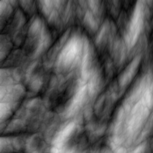

## FBM <a id="fbm"></a>

> **Type:** NOISE_FBM
>
> 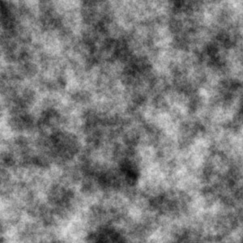

## Fire <a id="fire"></a>

> **Type:** NOISE_FIRE
>
> 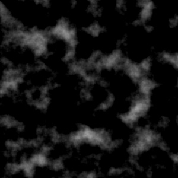

## Gas <a id="gas"></a>

> **Type:** NOISE_GASEOUS
>
> 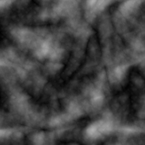

## Hama <a id="hama"></a>

> **Type:** NOISE_HAMA
>
> 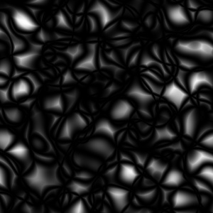

## Luka <a id="luka"></a>

> **Type:** NOISE_LUKA
>
> 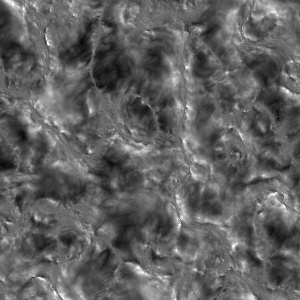

## Mod Noise <a id="mod-noise"></a>

> **Type:** NOISE_MOD_NOISE
>
> 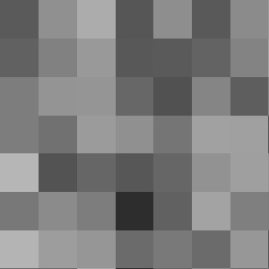

## Naki <a id="naki"></a>

> **Type:** NOISE_NAKI
>
> 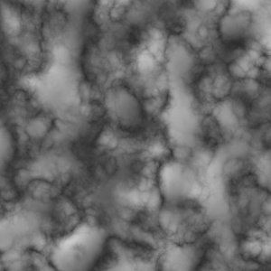

## Noise <a id="noise"></a>

> **Type:** NOISE_NOISE
>
> 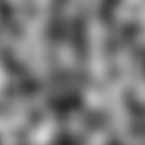

## None <a id="none"></a>

> **Type:** NOISE_NONE
>
> 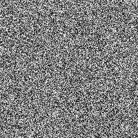

## Nutous <a id="nutous"></a>

> **Type:** NOISE_NUTOUS
>
> 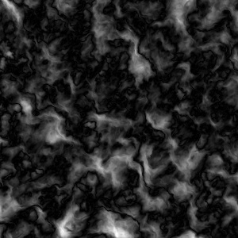

## Ober <a id="ober"></a>

> **Type:** NOISE_OBER
>
> 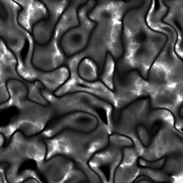

## Pezo <a id="pezo"></a>

> **Type:** NOISE_PEZO
>
> 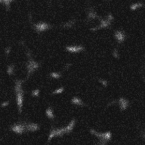

## Poxo <a id="poxo"></a>

> **Type:** NOISE_POXO
>
> 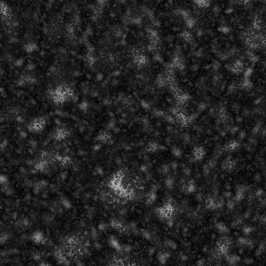

## Sema <a id="sema"></a>

> **Type:** NOISE_SEMA
>
> 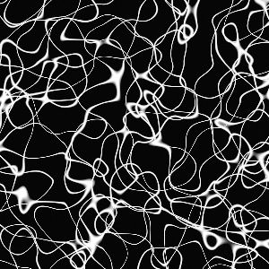

## Sparse Convolution <a id="sparse-convolution"></a>

> **Type:** NOISE_SPARSE_CONV
>
> 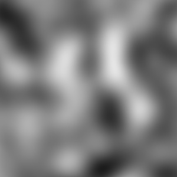

## Stupl <a id="stupl"></a>

> **Type:** NOISE_STUPL
>
> 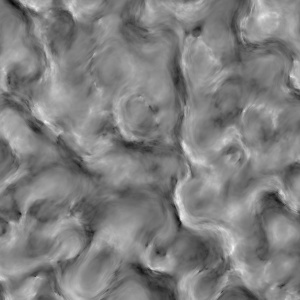

## Turbulence <a id="turbulence"></a>

> **Type:** NOISE_TURBULENCE
>
> 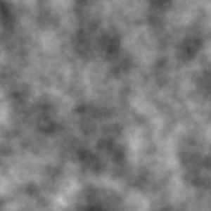

## VLNoise <a id="vlnoise"></a>

> **Type:** NOISE_VL_NOISE
>
> 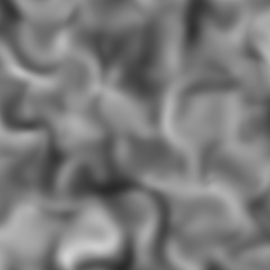

## Voronoi 1 <a id="voronoi-1"></a>

> **Type:** NOISE_VORONOI_1
>
> 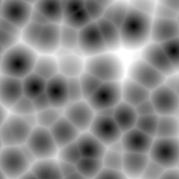

## Voronoi 2 <a id="voronoi-2"></a>

> **Type:** NOISE_VORONOI_2
>
> 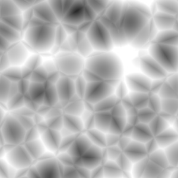

## Voronoi 3 <a id="voronoi-3"></a>

> **Type:** NOISE_VORONOI_3
>
> 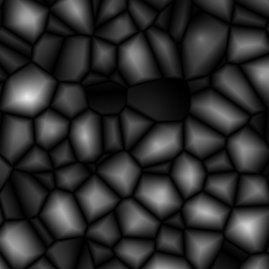

## Wavy Turbulence <a id="wavy-turbulence"></a>

> **Type:** NOISE_WAVY_TURB
>
> 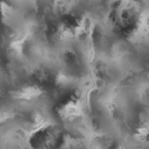

## Zada <a id="zada"></a>

> **Type:** NOISE_ZADA
>
> 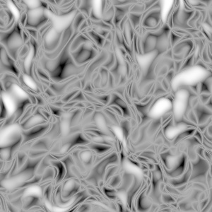
