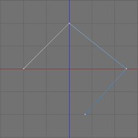
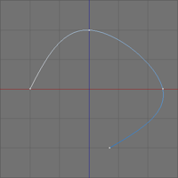
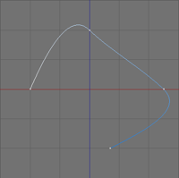
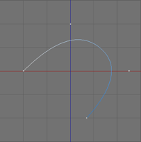

<!-- Source: https://developers.maxon.net/docs/py/2027_0_0/types/spline.html -->

# Spline Types 

## Linear 

> **Type:** SPLINETYPE_LINEAR
>
> 

## Cubic 

> **Type:** SPLINETYPE_CUBIC
>
> 

## Akima 

> **Type:** SPLINETYPE_AKIMA
>
> 

## B-Spline 

> **Type:** SPLINETYPE_BSPLINE
>
> 
